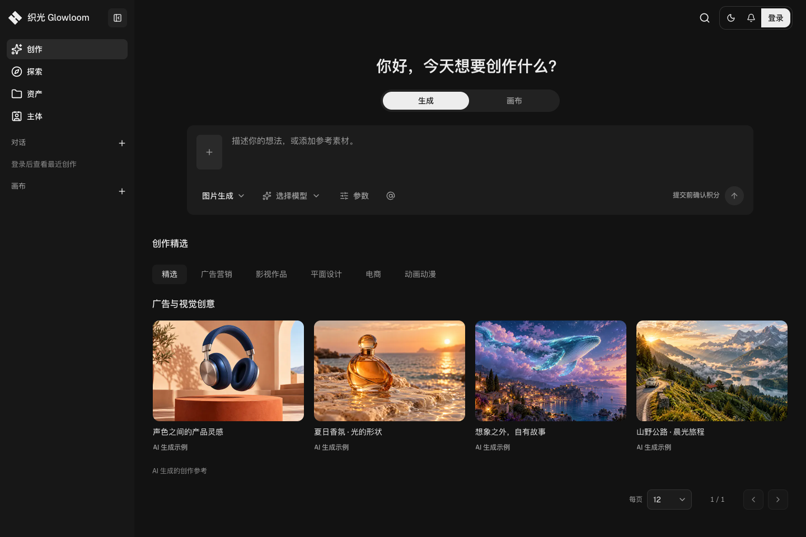

<p align="center">
  
</p>

<h1 align="center">Glowloom · 织光</h1>

<p align="center">把图片、视频、声音与参考素材，组织在同一张创作画布上。</p>

<p align="center">
  <a href="https://github.com/StephenQiu30/glowloom/actions/workflows/ci.yml"></a>
  <a href="LICENSE"></a>
</p>

<p align="center">
  <a href="#开始开发">开始开发</a> ·
  <a href="workspace/content/00-文档索引.md">阅读文档</a> ·
  <a href="BACKLOG.md">当前进展</a>
</p>



<p align="center"><sub>创作页本地实拍 · 2026-10-29。展示创作入口与参考内容；精选封面为 AI 生成的静态示例。</sub></p>

> 同仓库独立 `agent` 服务使用 TypeScript、官方 Pi Durable 与 PostgreSQL；Go 提供业务授权、模型和工具。Docker Compose 统一启动四个服务，当前源码不依赖 Temporal 或旧 Agent 实现。完整合同见[设计32](workspace/content/design/32-完整创作AgentHarness与Skill多Agent架构设计.md)，工程验证与真实创作接受见 [BACKLOG](BACKLOG.md#pi-durable-migration)。

## 在织光中创作

Glowloom 是一个围绕视觉创作组织的 Web 工作台。这个仓库同时包含 Next.js 前端、Go 后端、TypeScript Agent、私有 Yjs 协作运行时及产品文档。

- **从参考开始**：通过创作入口和多参考提示词编辑器，组织文字、图片及其他参考内容。
- **在画布中连接**：用节点组织创作内容、主体与引用关系，配合画布持久化和协作运行时。
- **管理创作资源**：通过资产、参考素材和主体入口，管理上传内容与可复用的创作资料。
- **接入 AI 模型**：配置供应商及模型；模型是否可用，以实际适配、配置和验证结果为准。

项目仍在持续开发。功能设计不代表全部已实现或通过验收；完整范围见[产品总览](workspace/content/design/24-产品总览与交付边界设计.md)，实际进展与阻塞见 [BACKLOG](BACKLOG.md)。真实供应商生成、邮件、支付及生产环境须分别验证。

## 开始开发

> 当前提供复用现有基础设施的开发环境。新克隆仓库仍需先准备依赖、配置和密钥；Compose 不会自动部署基础依赖或迁移数据库。

```sh
git clone https://github.com/StephenQiu30/glowloom.git
cd glowloom
```

启动前，按 [.env.example](.env.example) 与 [PROJECT](PROJECT.md) 准备本地配置：

1. 可用的 PostgreSQL、Redis、Kafka 与对象存储。
2. `.env` 中的依赖连接、身份与会话密钥、协作令牌、两个方向独立的 Agent 服务令牌与受限 PostgreSQL DSN；模型接入另需凭据加密与请求 MAC 密钥。
3. 与运行版本匹配的 PostgreSQL 结构。空库使用 [schema.sql](backend/db/schema.sql) 初始化。已有库在部署前核对实际结构。

确认端口可用后，在仓库根目录启动：

```sh
lsof -nP -iTCP:1122 -iTCP:1123 -sTCP:LISTEN
docker compose up -d --build --wait
docker compose ps
```

| 服务       | 本地地址                                |
| ---------- | --------------------------------------- |
| 前端工作台 | [localhost:1122](http://localhost:1122) |
| 后端       | [127.0.0.1:1123](http://127.0.0.1:1123) |
| Agent      | Compose 内部 `agent:4401`，无宿主端口   |

首次启动成功后，打开工作台；需要私人素材、主体、画布或生成时，使用有效账号登录，并按对象权限访问。容器健康不等于真实生成能力已验收。

`docker-compose.yml` 是应用的基础部署配置，包含 `frontend`、`backend`、`agent` 和 `canvas`。前端运行镜像内的 Next.js standalone 构建，完整启动时等待后端健康。后端在同一容器运行 API、worker、relay，并等待协作运行时健康后启动。仅更新后端时执行：

```sh
docker compose up -d --build --wait backend
docker compose logs --tail=100 backend
```

后端已健康时，可单独更新前端：

```sh
docker compose up -d --build --no-deps --wait frontend
```

已有可用镜像时，单独启动前端可用 `docker compose up -d --no-build --no-deps --wait frontend`。在当前服务上执行 `docker compose ps` 并访问两个端口的 `/healthz` 即可确认启动状态。

### 本地开发与热更新

在仓库根目录使用 Docker Compose 2.32.0 或更高版本启动开发模式：

```sh
docker compose -f docker-compose.yml -f docker-compose.dev.yml up --build --watch
```

保存 `frontend/src` 或 `frontend/public` 下的文件后，Compose 将改动同步到 Next.js 开发容器。页面组件由 Fast Refresh 更新。前端依赖、配置或共享画布包变更时重建前端镜像。Go、Agent 和画布协作的源码变更会重建对应镜像并替换容器，期间该服务会短暂中断。

开发模式沿用同一个 Compose 项目和本地端口。结束开发模式后，执行 `docker compose up -d --build --wait` 可切回普通镜像。

<details>
<summary>配置、数据库初始化与运行注意事项</summary>

两端的浏览器 Origin 同步固定为 `http://localhost:1122`，忽略 `.env` 中旧的 Origin，避免端口切换后登录或写入被 Origin 校验拒绝。worker/relay 健康检查在容器内执行，不额外开放宿主端口。

现有 PostgreSQL、Redis、Kafka、COS、身份密钥及 `.env` 须提前准备。Compose 复用这些资源，数据库结构在部署前独立核对。

部署管理员预建 `glowloom_app NOLOGIN NOSUPERUSER` 和独立的受限 `glowloom_agent LOGIN NOSUPERUSER`，通过受保护的渠道配置登录凭据。由结构所有者执行一次空库初始化：

```sh
psql "$GLOWLOOM_SCHEMA_DB_DSN" -X --single-transaction -v ON_ERROR_STOP=1 -f backend/db/schema.sql
```

应用启动依赖已初始化的业务结构。配置 `GLOWLOOM_AGENT_DB_DSN` 使用该受限角色，`GLOWLOOM_AGENT_SERVICE_TOKEN` 和 `GLOWLOOM_AGENT_BUSINESS_TOKEN` 为两个不同的至少32字节凭据；Go 不能把自己的业务库账号复用于 Agent。

已有业务库以 PostgreSQL 中的实际结构为准。部署前从相同版本的 `schema.sql` 建立隔离参考库，再用同版本的 PostgreSQL 18 客户端对两库分别执行 `pg_dump --schema-only --restrict-key=GlowloomSchemaCompare`，核对表、约束、索引、触发器和授权。按实际时间核对月分区，按环境核对所有者。发现结构差异时暂停部署并由数据库管理员处理。完整 schema 仅允许用于空库。详见 [PostgreSQL pg_dump 文档](https://www.postgresql.org/docs/18/app-pgdump.html)。

启动前确认1122和1123未被占用：`lsof -nP -iTCP:1122 -iTCP:1123 -sTCP:LISTEN`。若被其他进程占用，应先协调端口冲突，再启动应用。启动后使用 `docker compose ps` 查看状态，使用 `docker compose logs --tail=100 backend` 排查启动错误；可分别请求前端、后端的 `/healthz` 检查访问链路。

身份与会话密钥由 `.env` 直接注入，配置名及格式见 `.env.example`：`GLOWLOOM_IDENTITY_KEY`、`GLOWLOOM_IDENTITY_JWT_PRIVATE_KEY`、`GLOWLOOM_IDENTITY_JWT_VERIFY_KEYS`、`GLOWLOOM_IDENTITY_JWT_ACTIVE_KID`、`GLOWLOOM_IDENTITY_REFRESH_RECEIPT_KEY`。JWT 私钥使用 Base64 PEM，验证映射为 KID 到 Base64 公钥 PEM 的 JSON，回执密钥为独立32字节 Base64值；运行时不加载独立密钥文件或 Compose secret 挂载。已有密钥不得随启动重新生成，缺失密钥按恢复授权处理，身份主密钥必须保留。

模型预设接入还需要独立的凭据加密 RSA 密钥对与请求 MAC 密钥，配置四个 `GLOWLOOM_CREDENTIAL_*` 项（见 `.env.example`）。采用 PEM 环境值，或由部署环境明确提供容器内只读密钥文件并配置对应 FILE 项；当前 Compose 不自动挂载宿主凭据目录。首次配置使用至少 2048 位 RSA 的 PKCS8 私钥及 PKIX 公钥；请求 MAC 密钥为随机 32 字节的十六进制编码。密钥文件和 `.env` 不进入 Git，已有加密凭据对应的密钥必须保留，不在启动时自动重新生成。配置私钥后 `--role=all` 会同时消费 `provider` 队列；独立部署仍通过 `--role=worker --queues=provider` 运行。

Go 二进制和 Next.js 构建产物均在镜像构建阶段生成，容器启动时直接运行镜像内产物。变更代码、依赖、Dockerfile 或 Compose 配置后，使用上述带 `--build` 的命令更新对应服务。构建会纳入工作区当前源码，包括未提交修改。

</details>

## 仓库结构

```text
frontend/      Next.js 工作台与交互界面
backend/       Go API、worker、relay 与数据库定义
agent/         独立 TypeScript/Pi Durable 服务与 PostgreSQL Storage
canvas/ 私有 Yjs 协作运行时
workspace/     知识库、静态阅读与在线研发协作服务（正文在 content/）
```

GitHub 仓库现名为 `StephenQiu30/glowloom`。后端 Go 模块路径暂保留 `github.com/StephenQiu30/glowloom-server/backend`，以保持现有导入与生成合同一致；应用命令为 `glowloom`，入口为 `backend/cmd/glowloom`。配置只使用当前 `GLOWLOOM_*`，旧环境变量别名已移除；运行资源名称以实际部署为准。

## 文档与协作

| 入口                                                                                                                          | 内容                           |
| ----------------------------------------------------------------------------------------------------------------------------- | ------------------------------ |
| [文档索引](workspace/content/00-文档索引.md)                                                                                               | 从产品范围进入各主题文档       |
| [产品总览](workspace/content/design/24-产品总览与交付边界设计.md) · [设计导航](workspace/content/design/00-设计导航.md)                                 | 能力范围、技术方案与交付边界   |
| [工作台与创作入口](workspace/content/design/09-统一顶栏与阶段入口设计.md) · [多参考编辑器](workspace/content/design/06-多参考提示词编辑器调研与设计.md) | 创作流程与交互合同             |
| [AI 接入](workspace/content/design/07-AI平台接入市场调研与架构设计.md)                                                                     | 供应商与模型接入方案           |
| [用户系统](workspace/content/prd/01-用户系统.md) · [需求与验收](workspace/content/requirement/02-用户系统需求.md)                                       | 账号、权限及验收规则           |
| [PROJECT](PROJECT.md) · [AGENTS](AGENTS.md) · [DESIGN](DESIGN.md)                                                             | 工程工具链、协作规则与视觉规范 |
| [BACKLOG](BACKLOG.md)                                                                                                         | 当前实施进展、剩余工作和阻塞   |

文档直接维护 Markdown，按原始需求 → design → PRD → Plan 分层，使用[统一模板](workspace/content/templates/00-模板导航.md)。实施状态统一维护在 BACKLOG；设计、工程验证与产品接受分别记录。

研发知识正文统一在`workspace/content/`，同仓独立Workspace提供静态阅读、Skill、工作流和本机在线协作。入口、构建与配置见[服务说明](workspace/README.md)；实际验证及未覆盖项见[BACKLOG](BACKLOG.md#workspace-20261114)。真实TTS暂不启用。

默认 CI 包含后端全量 Race、隔离 PostgreSQL 集成与协作运行时测试，以及前端全量 Vitest 和含 TypeScript 检查的生产构建。完整质量门禁见 [PROJECT](PROJECT.md#4-质量门禁)。CI 通过不代表真实邮件、供应商或生产环境已通过验收。

## 许可

项目采用 [MIT License](LICENSE)。第三方素材与依赖的版权说明见 [THIRD_PARTY_NOTICES](frontend/public/THIRD_PARTY_NOTICES.md) 及对应目录中的许可文件。
