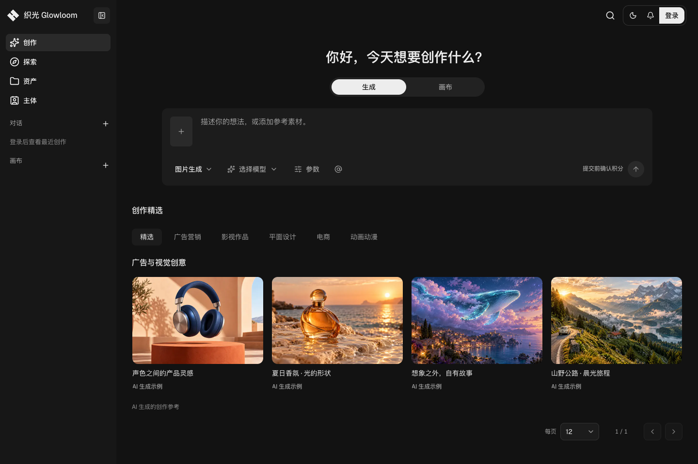

<p align="center">
  
</p>

<h1 align="center">Glowloom · 织光</h1>

<p align="center">把图片、视频、声音与参考素材，组织在同一张创作画布上。</p>

<p align="center">
  <a href="https://github.com/StephenQiu30/glowloom/actions/workflows/ci.yml"></a>
  <a href="LICENSE"></a>
</p>

<p align="center">
  <a href="#开始开发">开始开发</a> ·
  <a href="docs/00-文档索引.md">阅读文档</a> ·
  <a href="BACKLOG.md">当前进展</a>
</p>



<p align="center"><sub>创作页本地实拍 · 2026-10-29。展示创作入口与参考内容；精选封面为 AI 生成的静态示例。</sub></p>

## 在织光中创作

Glowloom 是一个围绕视觉创作组织的 Web 工作台。这个仓库同时包含 Next.js 前端、Go 后端、私有 Yjs 协作运行时及产品文档。

- **从参考开始**：通过创作入口和多参考提示词编辑器，组织文字、图片及其他参考内容。
- **在画布中连接**：用节点组织创作内容、主体与引用关系，配合画布持久化和协作运行时。
- **管理创作资源**：通过资产、参考素材和主体入口，管理上传内容与可复用的创作资料。
- **接入 AI 模型**：配置供应商及模型；模型是否可用，以实际适配、配置和验证结果为准。

项目仍在持续开发。功能设计不代表全部已实现或通过验收；完整范围见[产品总览](docs/design/24-产品总览与交付边界设计.md)，实际进展与阻塞见 [BACKLOG](BACKLOG.md)。真实供应商生成、邮件、支付及生产环境须分别验证。

## 开始开发

> 当前提供复用现有基础设施的开发环境。新克隆仓库仍需先准备依赖、配置和密钥；Compose 不会自动部署基础依赖或迁移数据库。

```sh
git clone https://github.com/StephenQiu30/glowloom.git
cd glowloom
```

启动前，按 [.env.example](.env.example) 与 [PROJECT](PROJECT.md) 准备本地配置：

1. 可用的 PostgreSQL、Redis、Kafka、Temporal、对象存储及对应 namespace。
2. `.env` 中的依赖连接、身份与会话密钥、协作令牌；模型接入另需凭据加密与请求 MAC 密钥。
3. 现有开发卷与匹配的业务库结构。空库和存量库采用不同初始化／增量升级流程，不对存量库重放 `schema.sql`。

确认端口可用后，在仓库根目录启动：

```sh
lsof -nP -iTCP:1122 -iTCP:1123 -sTCP:LISTEN
docker compose up -d --build
docker compose ps
```

| 服务       | 本地地址                                |
| ---------- | --------------------------------------- |
| 前端工作台 | [localhost:1122](http://localhost:1122) |
| 后端       | [127.0.0.1:1123](http://127.0.0.1:1123) |

首次启动成功后，打开工作台；需要私人素材、主体、画布或生成时，使用有效账号登录，并按对象权限访问。容器健康不等于真实生成能力已验收。

`docker-compose.yml` 是应用唯一启动入口，包含 `frontend`、`backend` 和 `canvas-collaboration`。后端在同一容器运行 API、worker、relay，并等待协作运行时健康后启动。仅更新后端时执行：

```sh
docker compose up -d --build backend
docker compose logs --tail=100 backend
```

<details>
<summary>配置、存量数据库升级与运行注意事项</summary>

两端的浏览器 Origin 同步固定为 `http://localhost:1122`，忽略 `.env` 中旧的 Origin，避免端口切换后登录或写入被 Origin 校验拒绝。worker/relay 健康检查在容器内执行，不额外开放宿主端口。

现有依赖服务、Temporal namespace、身份密钥、前端开发缓存卷及 `.env` 须提前准备；Compose 复用这些资源，不执行数据库迁移。仓库不再提供额外的依赖栈、生产拆分或协作 overlay Compose 文件。

旧画布库须先按[画布增量升级记录](docs/plan/17-画布数据库持久化与DAG实施计划.md#75-本地存量画布增量升级2026-10-23)核对、备份并演练，再由结构所有者执行 `backend/db/canvas_protocol_incremental.sql`。不得对存量库重放 `schema.sql`。容器健康不代表业务表已升级，仍需验证真实画布读取。

启动前确认1122和1123未被占用：`lsof -nP -iTCP:1122 -iTCP:1123 -sTCP:LISTEN`。若被其他进程占用，应先协调端口冲突，再启动应用。启动后使用 `docker compose ps` 查看状态，使用 `docker compose logs --tail=100 backend` 排查编译或启动错误；可分别请求前端、后端的 `/healthz` 检查访问链路。

身份与会话密钥由 `.env` 直接注入，配置名及格式见 `.env.example`：`GLOWLOOM_IDENTITY_KEY`、`GLOWLOOM_IDENTITY_JWT_PRIVATE_KEY`、`GLOWLOOM_IDENTITY_JWT_VERIFY_KEYS`、`GLOWLOOM_IDENTITY_JWT_ACTIVE_KID`、`GLOWLOOM_IDENTITY_REFRESH_RECEIPT_KEY`。JWT 私钥使用 Base64 PEM，验证映射为 KID 到 Base64 公钥 PEM 的 JSON，回执密钥为独立32字节 Base64值；运行时不加载独立密钥文件或 Compose secret 挂载。已有密钥不得随启动重新生成，缺失密钥按恢复授权处理，身份主密钥必须保留。

模型预设接入还需要独立的凭据加密 RSA 密钥对与请求 MAC 密钥，配置四个 `GLOWLOOM_CREDENTIAL_*` 项（见 `.env.example`）。Compose 将本机 `.local/credentials/` 只读挂载到 `/run/glowloom-credentials/`，文件路径填写容器路径。首次配置使用至少 2048 位 RSA 的 PKCS8 私钥及 PKIX 公钥；请求 MAC 密钥为随机 32 字节的十六进制编码。密钥文件和 `.env` 不进入 Git，已有加密凭据对应的密钥必须保留，不在启动时自动重新生成。配置私钥后 `--role=all` 会同时消费 `provider` 队列；独立部署仍通过 `--role=worker --queues=provider` 运行。旧库使用结构所有者执行 `backend/db/provider_onboarding_incremental.sql` 增量升级，不重放全库 schema。

Temporal返回命名空间不存在时，先用`temporal operator namespace list --address 127.0.0.1:7233`核对现有服务，再按`.env`中的实际命名空间显式注册；不改用其他项目的命名空间。本地默认值可使用`temporal operator namespace create --namespace glowloom-local --address 127.0.0.1:7233 --retention 7d`，随后重启后端。

后端每次启动都编译只读挂载的当前源码，成功后才启动服务；编译失败直接停止，不运行旧程序。独立 Go 构建缓存卷减少重复编译耗时。首次更新开发镜像后，纯 Go 源码更新也可执行 `docker compose restart backend`；修改依赖、Dockerfile、启动入口或 Compose 配置时重新执行上述带 `--build` 的命令。裸 `docker compose up -d` 不会强制更新已运行容器，开发后端运行中也不会自动热重载。

启动会使用工作区当前源码，包括未提交修改；存在并行任务时，先确认这些修改可以一起运行，或在隔离的源码快照中验证。前端继续使用现有 Next.js 开发服务热更新，依赖卷的升级仍按现有依赖管理流程处理；生产镜像仍在构建阶段编译。

</details>

## 仓库结构

```text
frontend/      Next.js 工作台与交互界面
backend/       Go API、worker、relay 与数据库定义
canvas-collab/ 私有 Yjs 协作运行时
docs/          原始需求、设计、PRD、实施计划与验证证据
```

GitHub 仓库现名为 `StephenQiu30/glowloom`。后端 Go 模块路径暂保留 `github.com/StephenQiu30/glowloom-server/backend`，以保持现有导入与生成合同一致；应用命令为 `glowloom`，入口为 `backend/cmd/glowloom`。配置使用 `GLOWLOOM_*`，过渡期兼容旧 `LV_*`，新键优先；运行资源名称以实际部署为准。

## 文档与协作

| 入口                                                                                                                          | 内容                           |
| ----------------------------------------------------------------------------------------------------------------------------- | ------------------------------ |
| [文档索引](docs/00-文档索引.md)                                                                                               | 从产品范围进入各主题文档       |
| [产品总览](docs/design/24-产品总览与交付边界设计.md) · [设计导航](docs/design/00-设计导航.md)                                 | 能力范围、技术方案与交付边界   |
| [工作台与创作入口](docs/design/09-统一顶栏与阶段入口设计.md) · [多参考编辑器](docs/design/06-多参考提示词编辑器调研与设计.md) | 创作流程与交互合同             |
| [AI 接入](docs/design/07-AI平台接入市场调研与架构设计.md)                                                                     | 供应商与模型接入方案           |
| [用户系统](docs/prd/01-用户系统.md) · [需求与验收](docs/requirement/02-用户系统需求.md)                                       | 账号、权限及验收规则           |
| [PROJECT](PROJECT.md) · [AGENTS](AGENTS.md) · [DESIGN](DESIGN.md)                                                             | 工程工具链、协作规则与视觉规范 |
| [BACKLOG](BACKLOG.md)                                                                                                         | 当前实施进展、剩余工作和阻塞   |

文档直接维护 Markdown，按原始需求 → design → PRD → Plan 分层，使用[统一模板](docs/templates/00-模板导航.md)。实施状态统一维护在 BACKLOG；设计、工程验证与产品接受分别记录。

默认 CI 包含后端全量 Race、隔离 PostgreSQL 集成与协作运行时测试，以及前端全量 Vitest 和含 TypeScript 检查的生产构建。完整质量门禁见 [PROJECT](PROJECT.md#4-质量门禁)。CI 通过不代表真实邮件、供应商或生产环境已通过验收。

## 许可

项目采用 [MIT License](LICENSE)。第三方素材与依赖的版权说明见 [THIRD_PARTY_NOTICES](frontend/public/THIRD_PARTY_NOTICES.md) 及对应目录中的许可文件。
