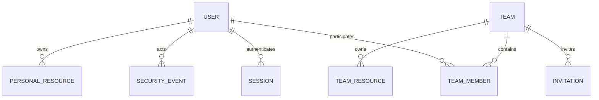
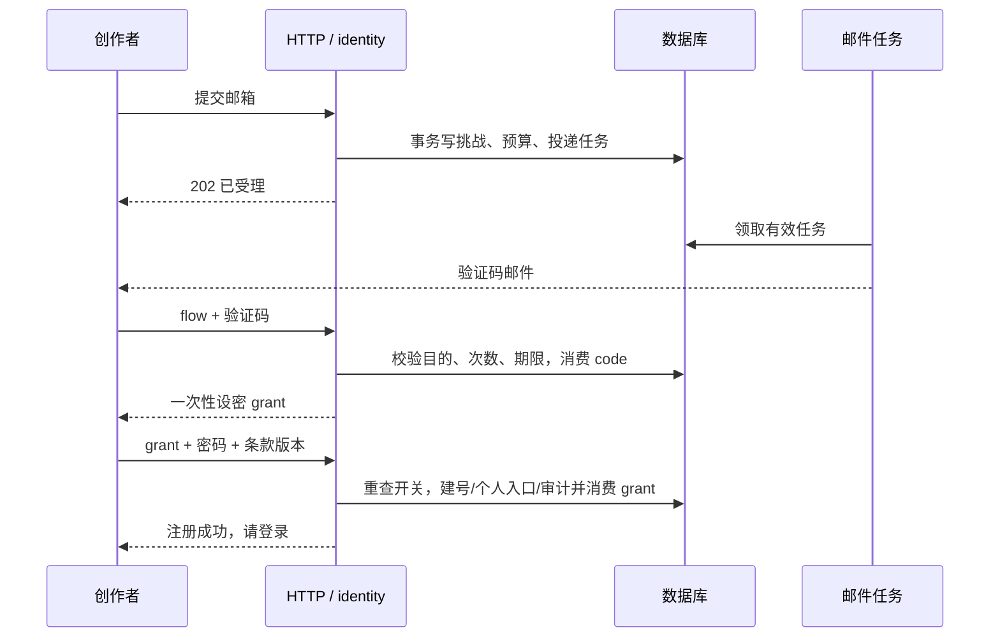

# 用户系统总体设计

更新：2026-10-21（结构整理）；文档确认状态沿原来源，未重新认定方案接受。

## 1. 摘要

同一邮箱身份下完成认证、个人管理、团队创作和账号生命周期操作。

本文按设计、用户故事与测试场景结构整理。原需求、确认结论和历史验证沿来源记录保留；当前实施进度、剩余工作及阻塞项统一见 [BACKLOG](../../BACKLOG.md)。

### 1.1 产品定义：摘要

来源：原PRD《01-用户系统》第1节。

为织光建立统一用户身份，让创作者在个人空间创作，也能以同一账号加入团队创作。用户能恢复和管理账号，团队管理员能管理成员，平台管理员能治理全站账号与团队。

## 2. 参与者

使用者与参与职责：创作者、平台管理员与团队管理员。维护职责及确认人沿下方原来源记录；未给出姓名的，不补造人员或排期。

### 2.1 产品定义：目标用户

来源：原PRD《01-用户系统》第4节。

| 人群                       | 任务                                     | 关键约束                             |
| -------------------------- | ---------------------------------------- | ------------------------------------ |
| 个人创作者                 | 浏览灵感、建立可恢复账号、保存个人作品   | 不必加入团队；不丢创作输入与私人归属 |
| 团队创作者（含团队管理员） | 复用同一身份参与团队创作、邀请和管理成员 | 团队角色是成员职责；不同团队不串数据 |
| 平台管理者                 | 查找/治理账号、处理团队异常、追查操作    | 管理与内容访问权限分离，不冒充用户   |

首轮聚焦以上三类已定义角色，因为账号连续性、团队边界和平台治理共同决定同一身份能否可靠使用。暂无人群规模或频率研究，相关假设见第7.22节；角色不与会员套餐绑定。

### 2.2 需求原文与规则：用户与管理职责

来源：原需求《02-用户系统需求》第1.2节。

| 概念                    | 含义与边界                                                                 |
| ----------------------- | -------------------------------------------------------------------------- |
| 个人创作者              | 在个人空间创作的注册用户；不加入团队也能使用个人能力                       |
| 团队创作者              | 同一用户在某团队中的有效成员；不是另一套账号或收费等级                     |
| 团队管理员              | 某团队成员承担的管理职责，只能管理该团队与成员；可以在另一团队仅为普通成员 |
| 平台管理员              | 获得平台后台权限的用户，可管理全站账号与团队；不是对外展示的创作者类型     |
| 用户 ID / 邮箱 / 显示名 | 稳定身份主键 / 已验证登录与恢复地址 / 可重名展示名称，三者不能混用         |
| 团队与成员关系          | 团队有独立 ID；一人可加入多个团队，每个关系单独记录角色、状态与加入时间    |
| 创作空间                | 个人空间或明确选定的团队空间；当前空间决定资源归属和可执行动作             |
| 邮箱挑战 / 会话         | 有目的和有效期的一次验证 / 可撤销的登录身份记录；验证授权不等于业务会话    |

不引入部门、组织树、企业 SSO、自定义角色平台或团队计费。团队创作者不会自动失去个人空间；加入、退出或切换团队不自动转移作品。平台管理与团队管理都不自动授予私人创作内容读取权。

## 3. 背景

需求来源：[02-用户系统需求](01-用户系统总体设计.md#36-需求原文与规则文首来源与范围)。产品范围来源：[01-用户系统](01-用户系统总体设计.md#34-产品定义文首来源与范围)。

下方保留来源的日期、适用范围与确认状态。早期盘点和历史结果只支持其原时点；整理文档不重新执行实现、测试、迁移或发布。

### 3.1 文首来源与范围

来源：原设计《01-用户系统总体设计》文首。

适用范围：全局身份、个人/团队授权、治理及生命周期总体方案；数据库、HTTP、运行与续期由专项设计承接。文档版本：2026-10-20整理版，业务接受范围沿第8.3节及原日期记录；本次结构与缺口补充待评审。维护职责：身份/团队模块；评审人未指定。

下游[用户系统 PRD](01-用户系统总体设计.md#34-产品定义文首来源与范围)基于本设计及需求汇总产品交付定义，再由[执行总览](#1-摘要)拆解实施任务。

实施进度及调度字段见 [BACKLOG 第4.1节](../../BACKLOG.md#41-01-用户系统总体设计文首来源与范围)。

### 3.2 实现盘点

来源：原设计《01-用户系统总体设计》第1节。

以下为2026-10-15盘点及后续注明日期的增补快照；本次文档整理未重核源码或运行环境。代码、回滚测试与运行环境接受分别记录，完整证据见[执行总览](#1-摘要)。

| 能力       | 当前源码                                                                                                                                                                                                                                                                                                                                                  |
| ---------- | --------------------------------------------------------------------------------------------------------------------------------------------------------------------------------------------------------------------------------------------------------------------------------------------------------------------------------------------------------- |
| 邮箱认证   | [auth-view.tsx](../../frontend/src/components/auth/auth-view.tsx) 已实现邮箱登录、验证注册和找回；[email_auth.go](../../backend/internal/identity/adapter/http/email_auth.go) 提供普通会话接口，旧短密码与历史改密标记不限制登录                                                                                                                          |
| 会话与身份 | [identityruntime](../../backend/internal/app/identityruntime/runtime.go) 组合身份入口与通知；[scope](../../backend/internal/app/scope/scope_access.go)、[operation](../../backend/internal/app/operation/operation_scope_access.go) 及媒体/复制接线已覆盖当前请求和异步消费者的会话、成员关系与空间边界，并经切片审查和数据库回滚验证                     |
| 个人中心   | [account-page.tsx](../../frontend/src/app/account/_components/account-page.tsx) 已接入资料、偏好、设备、安全活动和软注销；[avatar-editor.tsx](../../frontend/src/components/account/avatar-editor.tsx) 与[双邮箱换绑](../../frontend/src/app/account/_components/email-change.tsx) 的界面、生成合同和后端均已实现并完成切片审查                           |
| 平台管理   | [users-page.tsx](../../frontend/src/app/users/_components/users-page.tsx) 与[user-actions.tsx](../../frontend/src/app/users/_components/user-actions.tsx) 已实现邮箱目录及独立治理动作；[directory-tools.tsx](../../frontend/src/components/directory/directory-tools.tsx) 接入统计和受控导出；平台团队治理、设置及对应后端已完成切片审查                 |
| 团队协作   | [team-page.tsx](../../frontend/src/app/teams/[teamId]/_components/team-page.tsx) 已实现团队资料、成员、邀请与管理；[space-context.tsx](../../frontend/src/components/spaces/space-context.tsx) 已实现空间切换和旧请求清理；[team_governance.go](../../backend/internal/workspace/adapter/postgres/team_governance.go) 与请求/worker范围授权已完成切片审查 |
| 密码与注销 | [password_hash.go](../../backend/internal/identity/domain/password_hash.go) 集中维护密码策略和旧哈希验证；[account_deletion.go](../../backend/internal/identity/application/account_deletion.go) 执行本人软删除和即时撤权；无强制改密、管理员仅发恢复邮件                                                                                                 |

显示名统一为 32 字符；已登录改密与邮件找回采用不同的验证流程。产品界面统一称“团队”。底层 organization/org_id 表示物理分区，资源访问仍必须验证当前个人/团队范围、会话和成员关系，不能将分区相同视为授权。

实施进度及调度字段见 [BACKLOG 第4.2节](../../BACKLOG.md#42-01-用户系统总体设计实现盘点)。

### 3.3 文首来源与范围

来源：原任务文档《01-用户系统执行总览》文首。

> 执行说明：保留原技术任务与验证步骤；本次按模板补齐规划内容，不要求调用特定技能或改变已约定的执行方式。

**Goal:** 将用户系统PRD落实为可独立验证的18个任务，覆盖认证、本人设置、平台用户管理、团队创作和完整生命周期。

**Architecture:** 沿用模块化单体与现有Go/Next.js工具链，身份、团队职责与资源归属分开。数据/接口设计先接受，再按依赖执行TDD切片；最后做真实链路和迁移接受。

**Tech Stack:** Go 1.26、Gin、GORM、PostgreSQL、Next.js 16.3.6、React19.2.8、TypeScript、Vitest；以实际锁文件核对，不自动升级。

**Spec:** [SRS](01-用户系统总体设计.md#36-需求原文与规则文首来源与范围)、[总体设计](#1-摘要)、[数据库](02-用户系统数据库设计.md)、[接口](03-用户系统接口设计.md)、[测试与运行](04-用户系统测试与运行设计.md)、[PRD](01-用户系统总体设计.md#34-产品定义文首来源与范围)。

实施进度及调度字段见 [BACKLOG 第4.19节](../../BACKLOG.md#419-01-用户系统执行总览文首来源与范围)。

### 3.4 产品定义：文首来源与范围

来源：原PRD《01-用户系统》文首。

2026-10-20 配置验收补充：身份密钥统一由 `.env` 直接注入，运行时不依赖独立密钥目录或文件挂载；JWT 继续复用 `github.com/golang-jwt/jwt/v5`。验收应覆盖值解析、错误不泄密、只验签回退、后端健康及已有账号重新登录。密钥入口调整不改变续期、撤销和权限合同。

| 项目       | 内容                                                                                                                            |
| ---------- | ------------------------------------------------------------------------------------------------------------------------------- |
| 版本与更新 | 2026-10-20 整理版；沿用原业务版本与下述盘点日期                                                                                 |
| 文档状态   | 本次为结构整理；既有确认、实施与接受状态如下，不新增产品接受结论                                                                |
| 维护与决策 | 维护人未指定；范围与接受以已记录的用户确认及上游依据为准                                                                        |
| 交付范围   | 账号、个人/团队管理、会话续期及公开邮箱注册体验                                                                                 |
| 上游依据   | [需求02](01-用户系统总体设计.md#36-需求原文与规则文首来源与范围)、[设计01](#1-摘要)、[设计05](05-无感登录与会话续期调研设计.md) |
| 迭代与证据 | [执行总览](#1-摘要)、[设计05](05-无感登录与会话续期调研设计.md)；各证据层次及未执行项分别记录                                   |

状态：用户系统分批实现/接受；续期设计05的T-AUTH-01～T-AUTH-09已完成模块实现/审查，T-AUTH-10已在既有应用开启v2，整体产品接受仍待剩余证据。实际接受以设计05分层记录为准。更新：2026-10-18。

文档链路：[requirement · 需求](01-用户系统总体设计.md#36-需求原文与规则文首来源与范围) → [design · 总体及专项设计](#1-摘要) → **prd · 本文** → [plan · 执行总览](#1-摘要)。本文基于需求与设计汇总产品目标、范围和接受条件，详细规则仍以需求为准。

### 3.5 产品定义：背景

来源：原PRD《01-用户系统》第2节。

用户系统改造针对旧登录名、单一组织角色和账号管理缺口展开；截至2026-10-18盘点，邮箱认证及个人/团队权限已有实现，接受状态见[实现盘点](01-用户系统总体设计.md#32-实现盘点)。2026-10-18 盘点显示已有有效 Cookie 的页面恢复及服务端活跃滑动，当时尚无短期凭据透明续期，多标签和故障恢复需专项设计；此为专项实施前的历史缺口，后续实现与接受以设计05为准，不能继续把旧登录名描述为当前产品入口。

用户要求先确定需求，并补齐功能性需求、非功能性需求与用户管理。详细规则统一维护于[软件需求规格](01-用户系统总体设计.md#36-需求原文与规则文首来源与范围)，不把已有接口当作新产品范围。

### 3.6 需求原文与规则：文首来源与范围

来源：原需求《02-用户系统需求》文首。

2026-10-20 用户修正：身份密钥及环境配置统一从 `.env` 注入，不设置 `.local/identity/` 等独立运行入口。JWT 复用现有第三方库。缺失密钥不得静默重新生成；本次丢失本地会话密钥的恢复已得到用户授权，允许重新登录，不改变账号或业务数据。

| 文档管理项     | 本次整理基线                                                                                                                                                                               |
| -------------- | ------------------------------------------------------------------------------------------------------------------------------------------------------------------------------------------ |
| 版本与更新     | 结构整理 v0.2；2026-10-20；不重置原需求编号。第3.8节为角色用词整理，待评审                                                                                                                 |
| 状态与接受     | 现行需求与增补并存；原有用户确认按第1/5/9/10/11节保留。第3.8节只整理原始诉求，未接受为新角色模型，也未授权改设计或代码                                                                     |
| 维护与评审     | 用户系统产品、设计与工程职责；具体人员未指定                                                                                                                                               |
| 原始来源       | 第4.2节确认表、第7.53节2026-10-15密码决策、第7.57节2026-10-18续期要求、第5.7节2026-10-20公开注册要求、第3.8节2026-10-20角色用词诉求；均为原文记录，本轮未重新核验会话或运行结果            |
| 适用范围与承接 | 个人/团队统一身份、治理、会话与邮箱注册；[设计01](#1-摘要)、[PRD01](01-用户系统总体设计.md#34-产品定义文首来源与范围)、[执行总览](#1-摘要)、[续期设计05](05-无感登录与会话续期调研设计.md) |

更新：2026-10-14。本文是用户系统的现行需求事实来源，覆盖功能性需求（FR）、业务规则（BR）、数据要求（DR）、外部接口要求（IR）、非功能性需求（NFR）及验收追踪。未声明符合某项认证标准；文档完成不代表实现或运行指标已通过。

服务条款和隐私政策已由用户授权编写，运营者使用 StephenQiu，公开客服/隐私邮箱使用 stephenqiu03@gmail.com，原正文及实现对照引用为 `docs/legal/00-协议发布与实现对照.md`；该文件在当前工作区缺失，不能作为可用协议材料或发布依据。当前为未生效草案；`terms_version` 表示两份文本共同的不可变协议包版本。注册必须主动确认当前已发布版本，旧版本或未同意不得建号，迁移验证不代替协议接受。保留期限和服务商披露以协议对照列出的待落实项为准，不能据草案假定已经实现。

### 3.7 需求原文与规则：需求来源、用户旅程与本次交接补充

来源：原需求《02-用户系统需求》第12节。

第4.2节的确认表负责区分用户决策与推荐方案，第7.24节负责行为，第3～5节负责共享规则及参数，第6～8节负责质量、验收与追踪，第7.56节负责待决。以下只补足跨增补的阅读与交接边界，不另定账号政策。

| 用户与场景             | 起点及已有障碍                                             | 期望终点与可执行入口                                                                                           |
| ---------------------- | ---------------------------------------------------------- | -------------------------------------------------------------------------------------------------------------- |
| 游客开始保存创作       | 公共页面可浏览；私有动作需要身份，认证中断不能变成付费提交 | FR-USER-01/02/03；AC-USER-01～AC-USER-05与AC-EMAIL-01～AC-EMAIL-06：认证回原页面、注册后主动登录、输入不串账号 |
| 本人管理身份与继续创作 | 密码、邮箱、会话与空间是不同状态；网络异常不能误判登出     | FR-USER-04～FR-USER-09、FR-AUTH-01～FR-AUTH-08；AC-USER-06～AC-USER-11及AC-AUTH-01～AC-AUTH-10                 |
| 团队内管理与平台治理   | 同账号有多团队角色，治理资格不包含作品读取权               | FR-USER-10～FR-USER-25、BR-USER-02～BR-USER-12及权限表；AC-USER-12～AC-USER-34，包含最后管理员及撤权交错       |

范围与优先级仍以第4.2节非目标、第8.19节逐FR批次和第10/11节增补为准；公开注册是第5.7节已确认产品目标，生效协议与真实邮件链路仍是开放条件。新增注册体验和续期的交付安排由PRD01及设计05承接，不由本文新定工期。

### 3.8 需求原文与规则：角色体系与可靠校验的原始需求整理（2026-10-20）

来源：原需求《02-用户系统需求》第13节。

本节把本轮原始诉求接到已有用户规则上。它不新增角色，不改第1～12节已确认规则，也不把 Redis 或 JWT 写成另一套用户目录。设计、PRD 和计划在本节获得确认前保持原链。

### 3.9 需求原文与规则：原始表述

来源：原需求《02-用户系统需求》第13.1节。

2026-10-20，用户要求先检查当前用户服务设计，并明确用户服务需要角色体系，举例为 user、admin、ban；随后提出使用 Redis 与 JWT 做用户管理和角色校验，以保证服务稳定、可靠。原文写的是“角色教研”，按上下文理解为角色校验。若实际是指教研、审核或其他职责，需要另行说明，不能按本节映射执行。

本轮明确要求先做产品需求整理。该要求只确认整理动作，不确认改变角色模型，也不授权修改设计或代码。

| 来源        | 内容摘要                                                     | 性质                 | 确认范围                                   |
| ----------- | ------------------------------------------------------------ | -------------------- | ------------------------------------------ |
| SRC-ROLE-01 | 需要可区分的用户职责与禁用结果，并用 Redis、JWT 支撑可靠校验 | 已提出；映射待确认   | 只确认先整理需求；未接受新角色，未授权实施 |
| 第2.2节     | 个人创作者、团队创作者、团队管理员、平台管理员已经分开       | 此前用户已确认的职责 | 不因本节用词被替换                         |
| 第7.57节    | 短期 JWT、轮换刷新凭据和 Redis 协调已是续期方案              | 此前已确认的会话机制 | 权限事实仍是当前账号、会话和成员关系       |

## 4. 目标

同一邮箱身份下完成认证、个人管理、团队创作和账号生命周期操作。目标的规则、量化条件与非目标沿需求原文及下方已确认设计，不增加未经确认的指标。

### 4.1 产品定义：目标

来源：原PRD《01-用户系统》第3节。

- 个人创作者能完成真实邮箱注册、登录恢复和本人设置；团队创作者能接受邀请、切换空间并维护成员关系。
- 平台管理与团队管理按各自范围生效；团队移除不误删账号或个人作品，平台治理不自动授予私有内容读取权。
- 每个交付范围均有 FR/AC 与 NFR/QA 证据；账号/资源归属迁移前后一致；性能、容量、恢复按已接受条件实测，不虚构上线日期或商业增长指标。
- 本轮新增退出指标：AC-AUTH-01～AC-AUTH-10都有分层证据；有效会话到期可恢复，撤权后旧权限下一次请求拒绝，已发业务写入次数不因续期增加。续期p95≤500ms、页面恢复p95≤1s为待实测目标，不虚构当前已达标。

以下三项为发布前可判断结果，按对应批次接受前观察；现有证据和未完成项以 Plan 为准。尚无发布后用户结果基线、观察周期或增长承诺，待决见第7.22节。

| 关键结果                      | 指标口径与人群                        | 基线与目标                                                                                                                             | 测量方式                             |
| ----------------------------- | ------------------------------------- | -------------------------------------------------------------------------------------------------------------------------------------- | ------------------------------------ |
| KR-USER-01 身份与创作连续     | 个人/团队账号恢复、注册与续期接受场景 | 以计划现有分层记录为基线；选入批次的 FR/AC、AC-AUTH-01～AC-AUTH-10、AC-EMAIL-01～AC-EMAIL-06均有对应状态与证据，未通过不宣布该范围接受 | 真实邮箱、会话、草稿恢复及浏览器接受 |
| KR-USER-02 权限和归属有效     | 平台、团队与本人操作矩阵              | 团队移除不删个人资源，撤权后下一请求拒绝，续期不增加已发业务写入次数                                                                   | 授权矩阵、资源归属与写入记录         |
| KR-USER-03 质量达到已接受条件 | 所选范围性能、容量与恢复              | 续期p95≤500ms、页面恢复p95≤1s为待实测目标；其他阈值沿需求，不推定当前达标                                                              | 设计05实测与NFR/QA证据               |

### 4.2 需求原文与规则：目标与需求基线

来源：原需求《02-用户系统需求》第1节。

建立同一账号下的个人创作与团队创作能力，并提供明确区分的平台用户管理和团队成员管理。账号通过邮箱注册、验证与密码登录；内容归属、成员身份和管理权限分别控制。

### 4.3 需求原文与规则：要保住的结果

来源：原需求《02-用户系统需求》第13.2节。

受保护动作必须同时回答三件事：当前是谁，此人现在承担什么职责，这次访问允许还是拒绝。禁用、降权、退出或成员资格变化提交之后，下一次受保护请求按新状态拒绝。依赖暂时不可用时，服务可以拒绝并允许稍后重试，但不能凭旧签名或旧缓存放行，也不能把暂时故障显示成全员退出。

这些结果已经由 FR-USER-12、FR-USER-15、BR-USER-07、FR-AUTH-06 和 NFR-AUTH-03、NFR-AUTH-04 定义。本节的工作是防止用一组扁平的 user、admin、ban 覆盖它们。

## 5. 使用场景

参与者为创作者、平台管理员与团队管理员；在下方定义的输入、对象状态、权限和环境条件具备时执行相应操作。各故事按其独立前置条件核对，不能把测试夹具当成真实业务条件。

### 5.1 公开邮箱注册的交互补齐（2026-10-20）

来源：原设计《01-用户系统总体设计》第12节。

范围依据[设计01第5.7节](01-用户系统总体设计.md#57-需求原文与规则邮箱注册登录体验补齐2026-10-20)。目标是首次创作者自助取得账号、已有创作者继续登录；公开开放方向已由用户确认，本节为实施方案，保存文档不代表正式发布。

### 5.2 用户旅程与页面状态

来源：原设计《01-用户系统总体设计》第12.1节。

| 阶段      | 用户动作/关切                          | 页面与恢复路径                                                                                             |
| --------- | -------------------------------------- | ---------------------------------------------------------------------------------------------------------- |
| 进入      | 希望保存当前创作，已有账号也能直接登录 | 保留现有首页背景与共用登录/注册 Tabs；仅邮箱在两面板间保留                                                 |
| 填写邮箱  | 确认地址，获取验证码                   | 步骤1，发信请求锁定；受理不承诺邮件到达，不透露账号是否存在                                                |
| 验证邮箱  | 收信、粘贴六位码，纠正输错邮箱         | 步骤2，只读邮箱＋更换邮箱；重发按真实回执倒计时。更换后丢弃当前本地证明，重新验证新地址                    |
| 设置账号  | 设置显示名和密码，阅读协议             | 步骤3，复用现有规则及默认不勾选的协议框；错误定位对应字段，不消费有效授权                                  |
| 完成      | 确认账号确已创建，继续原任务           | 校验完整回执后展示成功提示＋前往登录。清除敏感输入；邮箱保留在同一弹窗登录，仍需密码，不自动生成或创建画布 |
| 失败/返回 | 不希望反复输入或误以为已成功           | 网络失败保留当前可重试状态；策略异常可重读；关闭/重载放弃内存证明，重新验证。服务端仍防重放与重复建号      |

步骤来源直接由现有 operation/grant/完成状态派生，不建立第二套认证状态机。AuthDialog 持有本次打开期间的邮箱与模式，AuthView 通过可选初值/事件与父层协作，独立使用仍可运行。注册成功后只显示成功态，用户明确进入登录；不把邮箱、密码或grant写入URL/本地存储。弹窗关闭时卸载表单，重开重新开始；切换面板重建表单，仅邮箱保留。业务会话继续由现有 SessionProvider 激活。

### 5.3 组件、接口与失败边界

来源：原设计《01-用户系统总体设计》第12.2节。

复用 shadcn Tabs、Field/FieldGroup、Input/InputGroup、Checkbox、Button、Alert；不新增依赖、页面路由、数据库表或手写API。发起、重发、验证、完成与登录分别沿用现有生成合同。更换邮箱只放弃客户端流程，不声称服务端撤销旧挑战；服务端限流与单次消费保持有效。

注册完成回执需有效UUID及 next=login；异常回执保持未确认并且不建立会话。验证码格式或显示名不符合规则时不发请求。策略失效或最终建号拒绝时留在当前界面并说明下一步；已验证邮箱持有人遇到 email_unavailable 可改邮箱/登录/找回，不能公开探测其他邮箱。

交互规则参考 [shadcn Field](https://ui.shadcn.com/docs/components/radix/field) 和 [Vercel Web Interface Guidelines](https://github.com/vercel-labs/web-interface-guidelines) 的表单语义、错误与焦点；登录和注册受理的防枚举沿用 [OWASP Authentication](https://cheatsheetseries.owasp.org/cheatsheets/Authentication_Cheat_Sheet.html)。核验：2026-10-20。不因参考资料擅自变更已接受的密码长度规则。

### 5.4 发布与验收

来源：原设计《01-用户系统总体设计》第12.3节。

组件测试覆盖 AC-EMAIL-01～AC-EMAIL-05 和迟到请求不更新已卸载界面，浏览器覆盖 AC-EMAIL-06 与当前真实策略的关闭提示。受控模拟只用于未开放流程交互，必须单独标明；真实邮件投递、邮箱持有、注册、恢复和对外开关由发布验证补齐。协议正文/生效版本、SMTP可用性及管理开关继续由后端组合判定，不以测试需要绕过。对应任务见[设计18增补](18-邮箱认证与授权基础设计.md#51-t-user-19公开邮箱注册体验补齐2026-10-20)。

### 5.5 产品定义：体验与设计入口

来源：原PRD《01-用户系统》第6.1节。

个人、团队及平台旅程如下；具体界面与失败状态引用总体设计及续期专项设计，不以流程描述代替产品接受。

个人旅程：游客 → 验证邮箱 → 设置账号 → 邮箱密码登录 → 个人创作与设置。团队旅程：创建或受邀加入团队 → 明确角色 → 选择团队空间 → 团队创作 → 管理/退出或交接。平台旅程：用户/团队目录 → 查看安全摘要 → 有理由地治理 → 读回结果与审计。

本次完整范围包含认证恢复、个人中心、全站用户管理、平台权限授予、团队资料、成员邀请/查询/暂停/移除/退出/交接、空间隔离、安全活动、统计/受控导出、注册开关、注销与迁移。功能规则、数据/接口约束和非功能指标见软件需求规格；角色不与会员套餐绑定。

注销采用已确认的软删除方案：本人确认后即时撤销登录和成员访问，保留资料、个人与团队作品及邮箱占位。最后管理员先交接；不设置冷静期、取消注销或自动物理清理流程。

复用现有 Go/Next.js 工具链。全局账号、平台角色、团队、成员角色分开，个人/团队资源归属明确；不引入企业组织树、部门、自定义 RBAC 平台或认证微服务。[系统设计](#1-摘要)给出可审阅方案。

自助创建团队、多团队和具体权限是当前推荐细则；业务限额、质量指标、邮件渠道、支持恢复及保留策略见规格待决表，未确认项不伪装成生产政策。

### 5.6 产品定义：公开邮箱注册体验补齐

来源：原PRD《01-用户系统》第6.3.1节。

用户确认面向所有用户开放注册，发布条件另行核对。首次个人创作者需要自助验证邮箱并取得账号；已有用户需要继续用邮箱密码登录。现有接口已覆盖主流程，本轮价值是让步骤可见、邮箱可纠错、完成结果可确认，并在原创作页面继续登录。

本轮交付范围为三步注册提示、更换邮箱、局部校验、真实回执成功态和登录/注册邮箱连续性；沿用既有会话、找回密码与邀请规则。具体验收以[AC-EMAIL-01～AC-EMAIL-06](01-用户系统总体设计.md#57-需求原文与规则邮箱注册登录体验补齐2026-10-20)为准，不用页面存在或模拟测试替代真实收信。技术实现、公开开放分开记录；首批不新增免密登录、自动登录或套餐赠送积分。正式协议发布、实际收信及完整公开注册/恢复接受仍需核对。

### 5.7 需求原文与规则：邮箱注册登录体验补齐（2026-10-20）

来源：原需求《02-用户系统需求》第11节。

用户已确认目标为面向所有用户开放注册，发布条件另行核对；沿用已确认的邮箱＋密码登录及注册邮箱验证，不新增验证码免密登录、第三方登录或另一套身份服务。本节补齐 FR-USER-01～FR-USER-04 的交互，不改会话、密码策略或授权边界。

- AC-EMAIL-01：注册显示“填写邮箱 → 验证邮箱 → 设置账号”当前步骤。发码后邮箱只读，可主动“更换邮箱”，清除本流程验证码、operation、grant、密码、同意状态；改邮箱不自动发信、不取消或绕过服务端邮件预算。当前请求未完成时禁止更换。
- AC-EMAIL-02：验证码为六位数字；空或错误格式在本地提示并聚焦。显示名去首尾空白后为1～32个Unicode字符且无控制字符；字段错误应可定位。服务端仍作最终校验。
- AC-EMAIL-03：只有完整注册成功回执（有效账号ID与 next=login）才能显示“账号已创建”。清除密码及证明，提供“前往登录”，沿用当前邮箱但不自动建立会话，不重新发送建号请求。受邀注册保留邀请连续性。
- AC-EMAIL-04：同一弹窗内切换登录/注册，仅保留邮箱；密码、验证码和证明不跨流程保留。成功后切至同一弹窗登录，不通过页面跳转重置创作背景；取消不会提交生成。
- AC-EMAIL-05：策略读取中、读取失败可重试、注册未开放、邮件暂不可用、验证码错误/过期、注册成功分别可辨识；关闭注册不阻断已有用户登录及找回。未知账号/密码错误保持统一反馈，公开注册不增加邮箱可用性查询。
- AC-EMAIL-06：桌面与390px窄屏可键盘完成表单；字段具备标签、自动填充语义，错误与步骤可被辅助技术读取；使用现有黑白/Geist/shadcn体系。

本次完成标准是上述可观察行为与既有认证合同回归通过，不编造转化率。对外开放还需正式协议包生效、运行接受版本一致、SMTP/队列与真实收信验证、实际注册和恢复闭环及注册开关读回；测试夹具或模拟邮件不替代这些证据。发布前继续执行现有服务端策略，不静默修改协议状态或数据库开关。

## 6. 价值

账号与资源归属清楚，平台治理和团队职责分别校验。

### 6.1 产品定义：价值主张

来源：原PRD《01-用户系统》第5节。

| 六项价值要素       | 个人创作者                               | 团队创作者                                     | 平台管理者                                |
| ------------------ | ---------------------------------------- | ---------------------------------------------- | ----------------------------------------- |
| 谁                 | 自己开展创作的用户                       | 同一团队的创作者与管理成员                     | 负责账号与平台运行的人                    |
| 为什么             | 需要稳定且可恢复的身份                   | 需要可靠的成员关系与协作范围                   | 需要可追查的账号治理                      |
| 改造前如何做       | 已有邮箱/Cookie恢复，期限与续期协调不足  | 已有成员与空间隔离，会话中断影响连续协作       | 已有账号治理，续期与故障观察尚未闭环      |
| 怎样改善           | 有效设备自动恢复与续期，仍使用原密码     | 同一身份续期，每次继续校验当前团队资格         | 可撤销设备会话、脱敏事件和故障分级        |
| 之后的结果         | 正常过期不丢输入，不反复输密             | 连续协作，旧团队权限不会被缓存恢复             | 治理提交真实生效，故障不复活旧身份        |
| 替代方式与选择理由 | 手动重登或无限加长Cookie；有界恢复更可控 | 共用账号或反复重登；同身份与实时成员检查更清楚 | 人工清缓存或等待JWT到期；持久撤销更可追查 |

价值主张：一个账号支持个人与团队创作，身份、资源归属和管理职责清晰，用户和管理者都能完成自己的工作。

原实施进度及调度字段见 [BACKLOG第5.1节](../../BACKLOG.md#51-prd01价值主张)。

## 7. 方案

### 7.1 D1 身份与数据模型

来源：原设计《01-用户系统总体设计》第2节。

对应 FR-USER-02/06/07/09/11/14/16/17；DR-USER-01～DR-USER-08。同一个 user_id 拥有个人身份和零到多个团队成员身份。个人/团队创作者由当前空间和有效成员关系表达，平台权限为独立授权，不保存“团队创作者账号类型”字段。

| 对象              | 候选字段                                                                                                                                                                                   | 核心约束与查询                                                                                                        |
| ----------------- | ------------------------------------------------------------------------------------------------------------------------------------------------------------------------------------------ | --------------------------------------------------------------------------------------------------------------------- |
| 全局账号          | id、email/email_key、email_verified_at、display_name、avatar_asset_id、platform_role、status、password_hash/scheme、credential_epoch、platform_epoch、revision、theme、prompt_suffix、时间 | email_key 全局唯一；platform_role 为 creator/platform_admin；不以单一 team_id 决定归属；平台目录按状态/验证/时间索引  |
| 团队              | id、name、avatar_asset_id、status、resume_status、governance_blocked、created_by、auth_epoch、revision、时间                                                                               | active/archived/suspended 独立于账号；停用恢复原状态；治理冻结单独控制写入；名称不唯一                                |
| 团队成员          | team_id、user_id、role、status、auth_epoch、revision、joined_at、joined_by/source、last_team_activity_at                                                                                   | 主键/唯一键(team_id,user_id)，角色 team_admin/member；状态 active/suspended/removed；目录按 team_id/状态/加入时间索引 |
| 创作空间映射      | scope_id、kind、owner_user_id 或 team_id、physical_scope_id                                                                                                                                | 个人空间与团队空间二选一；每用户一个个人入口；保留已有物理隔离键及资源 ID，不把物理范围相同视为成员授权               |
| 邮箱挑战/注册授权 | id、purpose、email_key、user_id（可空）、operation_id、proof_digest、credential_revision、attempts、expires_at、consumed/revoked_at                                                        | 目的闭集，单次消费；注册授权只建指定邮箱普通账号，不能调用业务接口                                                    |
| 会话              | id、user_id、token_hash、credential_epoch、created/last_active/expires_at、revoked_at、persistent、device_summary、reauth_at                                                               | token_hash 唯一；会话证明全局登录，不缓存永久有效的团队权限；当前空间只是 UI 选择                                     |
| 邀请              | id、kind、team_id（按 kind 可空）、email_key、team_role、inviter_id、status、revision、expires_at、accepted_user_id                                                                        | kind 为普通平台账号/团队加入；不接受 platform_admin 角色；同邮箱/团队仅一有效邀请                                     |
| 授权与职责交接    | id、kind、team_id（条件字段）、source_user_id、target_user_id、proposed_role、status、revision、expires_at                                                                                 | 平台授权和团队交接使用不同目的/处理函数；绑定现有已验证目标，目标接受后才生效，不能把提出方权限转成令牌万能权限       |
| 安全事件          | id、actor_id、target_user_id、team_id、scope_kind、action、result、reason、request_id、safe_diff、created_at                                                                               | 只追加，按平台/团队/本人投影；全局风控原因不出现在团队投影                                                            |
| 邮件任务          | event_id、template、recipient、encrypted_payload、status、attempt_count、next_attempt_at、provider_message_id、error_category                                                              | event_id 幂等、有限重试，凭据载荷短期加密；完成/到期清除，密钥与数据分开                                              |
| 管理导出任务      | id、actor_id、scope、filter_snapshot、as_of、status、row_count、expires_at、private_object_id                                                                                              | 同一过滤快照导出；生成和下载重查授权，过期撤销对象访问；无公开下载 URL                                                |
| 设置              | key、scope、value、revision、updated_by                                                                                                                                                    | 全局公开注册/团队创建开关及团队邀请开关，写入审计；不创建通用权限配置平台                                             |

头像复用受控媒体引用，校验拥有者与实际格式。账号个人偏好保存在用户层，不因团队切换覆盖。账号注销按已接受的软删除规则撤权并保留数据；事件与导出保留规则单独记录，不承诺物理擦除。

### 7.2 D2 授权与状态

来源：原设计《01-用户系统总体设计》第3节。

对应 FR-USER-01/03/08/12/14/15/19/20/21/23；BR-USER-01～BR-USER-12。

授权按“全局身份 → 操作范围 → 当前平台权限或成员资格 → 对象权限”逐级判断。全局账号必须已验证、active、凭据版本与会话有效；正确的既有密码建立普通会话；历史改密标记不参与认证、能力列表或业务授权。个人操作检查 owner_user_id；团队业务检查有效成员、团队状态和具体资源授权；平台治理检查 platform_admin，**不把治理许可转换成团队内容权限**。

| 场景               | 授权来源                                      | 失效方式                                                            |
| ------------------ | --------------------------------------------- | ------------------------------------------------------------------- |
| 本人资料与个人创作 | 会话 + 本人/对象归属                          | 全局账号/credential_epoch/对象权限                                  |
| 团队内容与成员目录 | 会话 + 请求 team_id 的当前成员关系 + 资源权限 | team.auth_epoch、membership.auth_epoch 或状态改变；不需踢出其他团队 |
| 团队管理           | 上述身份 + 当前 team_admin                    | 角色变更或成员暂停/移除即失效                                       |
| 平台用户/团队治理  | 当前 platform_admin + 必要近期复验            | platform_epoch 变化；角色由服务端实时来源判断                       |
| 受邀加入/交接接受  | 指定邮箱或 user_id 的认证 + 有效目的授权      | 邀请/交接撤回、期限、目标/发起者失权、团队停用                      |

team_id 是请求上下文，不是可信身份；所有持久关系从服务端读取。普通成员目录与团队管理员目录使用不同字段投影，平台/团队/本人事件查询也分离。缓存键至少包含 user_id、scope_kind、team_id 和权限版本；切换范围取消旧请求并校验响应范围再渲染。

团队停用使所有团队业务访问失败，管理员可在治理入口读必要状态摘要；归档允许有效成员按权限只读。governance_blocked 阻止新写入/邀请，只开放经授权的交接修复。全局禁用优先于团队启用，平台恢复团队也不激活 suspended/removed 成员。

最后平台管理员以平台级锁保护；最后团队管理员以对应团队级锁保护。紧急全局禁用可用“先锁用户/涉及团队、复算管理员、原子冻结无管理员团队并撤销账号”的事务处理；锁顺序稳定，交接不得在已过期读取上执行。恢复团队治理须经 FR-USER-21 的目标成员确认。候选具体锁实现应在集成测试中验证死锁处理与重试上限。

长连接在发送受保护数据前、队列在后续敏感步骤、下载在发放内容前复核权限。撤权不能撤回已发出的数据或供应商调用；完成结果仅对仍有权的主体可见，费用按实际执行记录。

### 7.3 D3 平台用户与团队管理

来源：原设计《01-用户系统总体设计》第4节。

对应 FR-USER-10～FR-USER-13/17～19/21～25。

| 管理面            | 能力                                                                 | 字段/权限控制                                     |
| ----------------- | -------------------------------------------------------------------- | ------------------------------------------------- |
| 平台用户目录/详情 | 全局查找、统计、状态、安全处理、公共资料治理、平台角色授权、受控导出 | 可看成员摘要，不能读私人内容、秘密或假冒用户      |
| 平台团队目录/详情 | 按团队/管理员查找、团队停用恢复、恶意邀请撤回、待接管处理            | 不必加入团队，但所有治理写入需要原因和审计        |
| 团队设置          | 创建、名称/头像维护、归档恢复、邀请开关                              | team_admin 仅当前团队；平台停用不可自行解除       |
| 团队成员/邀请     | 查找、最小目录、邀请、暂停恢复、角色、移除、退出、职责交接           | 不改全局密码/邮箱/账号状态，不查询其他团队        |
| 全局设置          | 公开注册和团队创建开关                                               | platform_admin + 版本/复验/审计；安全控制不能关闭 |

所有写入接收 expected_revision；创建/邀请/导出等使用 actor + action + scope + request_key 的幂等标识，并对规范化请求内容判等。同键不同输入返回冲突，重试返回同一操作结果。禁用/暂停/移除动作分别命名，不提供含义不清的通用“删除”。

平台注册邀请仅取得普通账号；团队邀请追加成员关系。已注册目标必须验证登录邮箱并主动接受，不能通过被邀请覆盖密码；新注册与邀请争用同邮箱时复用唯一账号，并再次确认加入团队。removed 重新加入可更新同一当前关系并记录新加入事件；suspended 成员需管理员明确恢复，新邀请不能绕过。

团队管理员提升成员为团队管理员要复验，最后管理员职责交接另需接收者接受；平台管理员授予走独立授权提案并要求目标接受。所有接受都重查发起者/目标/团队和版本；撤回/接受竞争只有一个成功。

全局状态与团队状态分别通知。平台公开资料治理只重置显示名/头像；支持恢复不是任意修改邮箱入口。统计独立计算互斥账号状态、可重叠验证标签及有效成员去重人数，带 as_of；成员关系数不能冒充用户数。

导出 P1 使用有上限的私有任务，过滤快照和 as_of 固定，生成与下载都检查当前授权；超 10,000 行拒绝并要求缩小范围；下载限时且鉴权，对 CSV 公式前缀做安全编码。文件完成不代表发起者永久获访问权，撤权后禁止下载并清理临时结果。

### 7.4 D4 事务、凭据与可靠执行

来源：原设计《01-用户系统总体设计》第5节。

对应 FR-USER-02～FR-USER-05/07/11～14/23/25；NFR-USER-02/05/07/08/12。

### 7.5 注册与邮件

来源：原设计《01-用户系统总体设计》第5.1节。

先按规范化邮箱、来源和全局预算限流，统一受理公开注册与恢复，响应与可查询状态不暴露邮箱存在性。挑战与邮件任务同事务创建，worker 只投递未过期的当前版本；重发撤销旧凭据，不清空地址级尝试计数。验证锁定挑战，检查目的/到期/次数，签发一次性设密授权；最终建号再次校验公开注册开关或独立有效邀请、邮箱唯一性，原子建普通账号/个人空间入口、消费授权并写审计。

先验证后设密，防止未验证请求预置他人密码；注册授权不能建立创作会话。丢回执后可查询操作或重新验证后登录，不重新建号。有效邀请模式不依赖公开注册开关，但其团队、目标和权限条件始终执行。

### 7.6 密码、会话和换邮箱

来源：原设计《01-用户系统总体设计》第5.2节。

新密码采用带版本参数的 Argon2id 与独立盐，参数参考 [OWASP 密码存储](https://cheatsheetseries.owasp.org/cheatsheets/Password_Storage_Cheat_Sheet.html) 后在基准环境定值；现有 bcrypt 保留既有密码验证；通过验证且符合新密码结构规则时透明升级。既有密码不符合新设密码规则时保留原哈希并建立普通会话，不要求重置、不限制权限；用户主动改密或完成邮件恢复时才应用新设密码规则。不得静默 trim/截断密码或外发原始密码做弱密码检查。

服务端不透明会话令牌只存摘要，生产 Cookie 使用 HttpOnly/Secure/同站策略，所有状态写入校验可信来源及 CSRF；私有接口 no-store。会话不永久携带团队权限。主动改密原子更新哈希、credential_epoch、撤销旧会话并轮换当前会话；恢复邮件设密撤销全部会话但不自动登录。参考 [OWASP 会话管理](https://cheatsheetseries.owasp.org/cheatsheets/Session_Management_Cheat_Sheet.html) 与 [找回密码](https://cheatsheetseries.owasp.org/cheatsheets/Forgot_Password_Cheat_Sheet.html)。

换绑绑定 user_id、原邮箱版本、新邮箱及双邮箱证明；消费时重查唯一性，原子更新邮箱、撤销全局会话/未完成身份挑战，通知两个地址。成员关系以 ID 关联不受影响；未消费的邮箱定向邀请不自动改投新邮箱，需重新邀请。

### 7.7 管理写入、职责保护与账号生命周期

来源：原设计《01-用户系统总体设计》第5.3节。

账号/团队/成员/设置变更与安全审计、必要通知任务同事务；邮件故障不回滚已提交的安全变化，审计持久失败则回滚关键写入。成员撤权增加该成员 auth_epoch，团队停用增加该团队 auth_epoch，全局禁用提高 credential_epoch，作用范围不能混用。

团队创建与首位 team_admin 原子完成；容量/开关在提交时检查。列表与统计采用同一过滤语义，分页游标绑定范围、排序及查询条件；注册、最近登录和团队活动时间由服务端写入，变动列表按查询快照/稳定游标控制重复，统计明确 as_of。成员移除/退出保留团队资源归属与作者引用；账号注销必须完成最后管理职责交接；一个事务内软删除、撤销会话/证明/成员权限并保留个人资料和资源，团队资源继续归团队。不设冷静期、取消或物理清理任务。

备份恢复除账号数据外还必须恢复安全事件与治理冻结状态，或从独立持久源重放安全撤权；完成前阻止外部访问，并使恢复前会话全部失效。无法证明安全状态完整时停止开放，不能仅恢复旧库后让禁用账号复活。

### 7.8 D5 接口与界面边界

来源：原设计《01-用户系统总体设计》第6节。

HTTP 路由、请求/响应、错误、版本、幂等、分页、Cookie/CSRF 与前端状态统一见[接口设计](03-用户系统接口设计.md)。表字段、索引、外键、锁序和清理合同统一见[数据库设计](02-用户系统数据库设计.md)，不在总体设计重复定义另一份详细合同。

页面分为公共认证、账号设置、个人/团队空间切换、团队设置和平台后台。平台入口按平台权限展示，团队管理入口按当前成员职责展示；直接 URL、刷新和异步任务仍由服务端授权。测试矩阵、部署、恢复和证据要求见[测试与运行设计](04-用户系统测试与运行设计.md)。

### 7.9 邮件与外部依赖

来源：原设计《01-用户系统总体设计》第7节。

注册验证、密码恢复、邮箱换绑、账号/团队邀请、权限授予与职责交接、安全通知使用目的不同的模板。邮件任务受理、供应商投递和实际收信分别记录；失败有限重试并告警。

验证码使用服务端密钥保护的摘要，随机长令牌只存摘要；必要待投递载荷短期加密，密钥隔离且日志不输出。链接 origin 由可信配置产生，不接受任意 Host/redirect；邮件落地无第三方跟踪、no-referrer，GET 不消费凭据，明确 POST 才执行。worker 回调验签与去重，过期任务不再发信。

IR-USER-01～IR-USER-06 均需契约测试：邮件故障、媒体引用失败、项目/生成撤权、审计故障和配置缺失都必须有真实失败路径。供应商选择、测试邮箱、恢复支持政策与保留期限未定时，只能报告已完成的工程层证据。

### 7.10 模块边界与方案取舍

来源：原设计《01-用户系统总体设计》第10节。

沿用模块化单体，进程入口只有 `backend/cmd/glowloom`。identity 负责全局身份、邮箱证明、会话、平台治理及安全事件；workspace 负责团队、成员、空间与资源归属；media 负责受控头像；已有任务基础设施负责投递与清理。`package app` 只做角色进程和 Wire 注入；各服务的跨模块适配放在 `backend/internal/app/<服务>/` 独立包。HTTP 仅解码、校验及转换，事务由应用用例协调，领域规则不依赖 Gin/GORM。业务规则留在各模块的 domain 与 application，不因接线再拆出第二个命令。

| 选择                               | 结论与理由                                                           |
| ---------------------------------- | -------------------------------------------------------------------- |
| 扩展既有 identity/workspace        | 采用；单库事务可以覆盖禁用与团队冻结，当前不需要分布式一致性         |
| 外部 IdP 替换登录                  | 本轮不采用；尚无既定供应商，不能解决团队资源归属和存量角色映射       |
| 单一 User.Role 同时决定平台/团队权 | 不采用；不能表达 A 团队管理员、B 团队成员及独立平台管理职责          |
| 为所有用户建立一个“个人团队”       | 不采用；个人所有权是明确实体，不制造虚假团队或席位                   |
| 长期把授权角色放入 JWT             | 不采用；需求要求撤权提交后下一请求生效，使用服务器会话与当前权限查询 |

跨模块不互相调用应用服务形成循环：workspace 消费方定义 `ActorAccess` 小接口获取有效账号事实；业务资源消费者定义 `ScopeAccess` 获取范围事实；对应服务的装配包适配 identity/workspace 实现。跨账号禁用和团队冻结的同库事务适配器放在该装配包，持有明确数据库依赖，以同一事务执行两模块已定义的存储操作；不能先提交禁用再依赖最终一致事件补冻结。平台治理的团队读模型不投影作品。

### 7.11 注册时序

来源：原设计《01-用户系统总体设计》第10.1节。

### 7.12 状态变化与失败边界

来源：原设计《01-用户系统总体设计》第10.2节。

凭据消费/成员撤回竞争以数据库提交顺序为准。邮箱唯一冲突不得合并 ID；用户可重新登录已有身份。业务提交成功、发信失败时页面如实显示已完成操作及通知状态；数据库审计失败则整笔回滚。私有权限数据源不可用时拒绝访问，不能回退固定工作区。已派发第三方任务不能伪装为撤销成功，后续执行、资源写回和下载按当前权限处理。

新密码 Argon2id 候选初值 m=19456 KiB、t=2、p=1、salt=16 bytes、hash=32 bytes；这是依据 [OWASP 密码存储建议](https://cheatsheetseries.owasp.org/cheatsheets/Password_Storage_Cheat_Sheet.html)选择的测试起点，需按 NFR-USER-03 的实际并发验证，并限制并行哈希数量避免内存耗尽。既有 bcrypt 仅验证及升级，不用旧 72 字节限制截断新密码。

### 7.13 迭代规划与交付基线（2026-10-20）

来源：原任务文档《01-用户系统执行总览》第1节。

| 规划项   | 本文结论                                                                                                          |
| -------- | ----------------------------------------------------------------------------------------------------------------- |
| 目标     | 创作者用同一邮箱身份安全完成认证、个人管理、团队创作和生命周期操作，平台治理与内容访问各有边界。                  |
| 适用范围 | 用户系统跨批次总览；原18项任务及公开邮箱注册体验增补T-USER-19采用统一任务标识，本表不把多个交付批次压成一次迭代。 |

实施进度及调度字段见 [BACKLOG 第4.20节](../../BACKLOG.md#420-01-用户系统执行总览迭代规划与交付基线2026-10-20)。

### 7.14 故事、范围与任务承接

来源：原任务文档《01-用户系统执行总览》第1.1节。

用户故事按本节下方的统一字段展开；原优先级、估算、候选/承诺及就绪记录已迁入 BACKLOG。

故事优先级沿来源需求和原任务依赖，不因本次排列重新定级。接受条件沿原任务引用的 AC／QA；现有工程实现不因容量数据缺失被回退为未实现，但缺估算、责任或外部条件的剩余范围不自动列入新承诺。实际选入时先核对就绪条件，再从高优先级故事选择，达到容量停止；未选范围留待办，不重复计入跨计划的同一工作。

实施进度及调度字段见 [BACKLOG 第4.21节](../../BACKLOG.md#421-01-用户系统执行总览故事范围与任务承接)。

### 7.15 Global Constraints

来源：原任务文档《01-用户系统执行总览》第2节。

- 环境硬约束：只复用已经启动的服务及已经连接的数据库，不创建数据库、集群、容器或新环境；不重放空库 schema，不清库，不以测试名义重建服务。此约束优先于各任务原先的隔离环境步骤。
- 已确认：邮箱+密码、注册验证邮箱、个人/团队创作者同一身份、平台管理员与团队管理员职责独立；不再重复决策。
- SRS第5/6节为候选参数唯一来源；新增运行参数在设计明确为建议。SMTP、存量账号邮箱及首位管理员已确认；协议草案及运营者/联系邮箱见原协议发布对照 `docs/legal/00-协议发布与实现对照.md`（当前工作区缺失，版本与生效状态待核对）。未冻结的保留策略、正式协议发布和指标只阻塞相应执行/上线。
- 保留共享工作区已有修改；每个任务开始核对git status与实际文件。计划中Create是未来路径，不表示当前已存在。
- Go按adapter→application→domain及Google风格；前端按仓库AGENTS/Vercel/当前安装Next.js文档；生成客户端不手改，不增加脚本/Makefile或在线Swagger。
- 文档编号为目录内两位顺序；00是索引/范围/总览。根README/AGENTS/PROJECT/DESIGN/BACKLOG保持仓库约定文件名，正式正文统一在docs编号目录。
- 以最终状态直接修订现行文档，不留旧路径副本、历史轮次或多份同义PRD。

### 7.16 ST-USER-01：通过邮箱证明取得账号并正常登录、找回及主动改密

**故事 ID 与标题：** ST-USER-01；通过邮箱证明取得账号并正常登录、找回及主动改密

**描述：** 作为创作者、平台管理员与团队管理员，希望通过邮箱证明取得账号并正常登录、找回及主动改密，以便账号与资源归属清楚，平台治理和团队职责分别校验。

**来源与设计：** [01-用户系统执行总览的原故事及承接关系](01-用户系统总体设计.md#714-故事范围与任务承接)；需求来源见第3节。

**讨论：** 原任务或证据落点：T-USER-01、T-USER-02、T-USER-03、T-USER-04、T-USER-19。候选、估算和就绪情况只在 BACKLOG 维护。

**确认条件：** 沿用原故事对应任务的退出条件及来源 AC／QA；正常结果、边界、失败和权限场景逐项核对，不将本次描述整理升级为新确认。

**追踪：** [CASE-USER-01](#813-case-user-01通过邮箱证明取得账号并正常登录找回及主动改密)；实施状态见 [BACKLOG](../../BACKLOG.md)。

### 7.17 ST-USER-02：本人维护资料、偏好、邮箱与设备，并读回自己的变更

**故事 ID 与标题：** ST-USER-02；本人维护资料、偏好、邮箱与设备，并读回自己的变更

**描述：** 作为创作者、平台管理员与团队管理员，希望本人维护资料、偏好、邮箱与设备，并读回自己的变更，以便账号与资源归属清楚，平台治理和团队职责分别校验。

**来源与设计：** [01-用户系统执行总览的原故事及承接关系](01-用户系统总体设计.md#714-故事范围与任务承接)；需求来源见第3节。

**讨论：** 原任务或证据落点：T-USER-05、T-USER-06、T-USER-07。候选、估算和就绪情况只在 BACKLOG 维护。

**确认条件：** 沿用原故事对应任务的退出条件及来源 AC／QA；正常结果、边界、失败和权限场景逐项核对，不将本次描述整理升级为新确认。

**追踪：** [CASE-USER-02](#814-case-user-02本人维护资料偏好邮箱与设备并读回自己的变更)；实施状态见 [BACKLOG](../../BACKLOG.md)。

### 7.18 ST-USER-03：平台按独立职责治理账号，团队按成员资格安全创作

**故事 ID 与标题：** ST-USER-03；平台按独立职责治理账号，团队按成员资格安全创作

**描述：** 作为创作者、平台管理员与团队管理员，希望平台按独立职责治理账号，团队按成员资格安全创作，以便账号与资源归属清楚，平台治理和团队职责分别校验。

**来源与设计：** [01-用户系统执行总览的原故事及承接关系](01-用户系统总体设计.md#714-故事范围与任务承接)；需求来源见第3节。

**讨论：** 原任务或证据落点：T-USER-08、T-USER-09、T-USER-10、T-USER-11、T-USER-12、T-USER-13。候选、估算和就绪情况只在 BACKLOG 维护。

**确认条件：** 沿用原故事对应任务的退出条件及来源 AC／QA；正常结果、边界、失败和权限场景逐项核对，不将本次描述整理升级为新确认。

**追踪：** [CASE-USER-03](#815-case-user-03平台按独立职责治理账号团队按成员资格安全创作)；实施状态见 [BACKLOG](../../BACKLOG.md)。

### 7.19 ST-USER-04：本人注销后访问立即撤销，保留资源；存量切换可验证

**故事 ID 与标题：** ST-USER-04；本人注销后访问立即撤销，保留资源；存量切换可验证

**描述：** 作为创作者、平台管理员与团队管理员，希望本人注销后访问立即撤销，保留资源；存量切换可验证，以便账号与资源归属清楚，平台治理和团队职责分别校验。

**来源与设计：** [01-用户系统执行总览的原故事及承接关系](01-用户系统总体设计.md#714-故事范围与任务承接)；需求来源见第3节。

**讨论：** 原任务或证据落点：T-USER-14、T-USER-15、T-USER-17、T-USER-18。候选、估算和就绪情况只在 BACKLOG 维护。

**确认条件：** 沿用原故事对应任务的退出条件及来源 AC／QA；正常结果、边界、失败和权限场景逐项核对，不将本次描述整理升级为新确认。

**追踪：** [CASE-USER-04](#816-case-user-04本人注销后访问立即撤销保留资源存量切换可验证)；实施状态见 [BACKLOG](../../BACKLOG.md)。

### 7.20 产品定义：首轮关键能力与接受

来源：原PRD《01-用户系统》第6.2节。

| 能力                         | 用户结果                           | 需求及接受来源                                       |
| ---------------------------- | ---------------------------------- | ---------------------------------------------------- |
| 认证、个人中心与账号生命周期 | 本人可恢复、管理并安全注销账号     | 需求02 FR/AC与NFR/QA；设计18～07                     |
| 平台与团队管理               | 管理作用于正确范围，归属可保留     | 需求02角色、成员及治理规则；执行总览                 |
| 无感续期与最小文字恢复       | 正常过期继续工作，终态不恢复旧权限 | 设计01第7.57节 AC-AUTH-01～AC-AUTH-10；设计05        |
| 公开邮箱注册体验             | 自助验证、纠错和确认结果           | 设计01第5.7节 AC-EMAIL-01～AC-EMAIL-06；真实收信接受 |

### 7.21 产品定义：会话专项及技术边界

来源：原PRD《01-用户系统》第6.3节。

2026-10-18：个人与团队创作者在同一可信设备恢复页面或短期请求凭据到期时，应继续创作，不反复输密、不丢输入。用户已确认保持登录最长30天、连续7天未使用失效；普通登录沿用7天/12小时初始策略。原密码登录不得强制重置密码，软注销与实时团队撤权保持原规则。

现状盘点和市场调研已形成[设计05](05-无感登录与会话续期调研设计.md)，用户已确认短期JWT＋轮换刷新凭据＋现有Redis协调，同时保留PostgreSQL的会话/权限权威。实现与接受由[设计05](05-无感登录与会话续期调研设计.md)追踪。具体 FR/BR/DR/IR/NFR 与 AC-AUTH-01～AC-AUTH-10 统一维护于[需求第7.57节](01-用户系统总体设计.md#757-需求原文与规则无感登录与自动续期增补)，不在本 PRD 重复维护参数。

终态过期时，已有提示词草稿及首页生成/画布想法输入的文字和换行可暂存，私有内容立即隐藏。同一账号重新登录并通过原项目/草稿权限检查，或确认首页原空间仍可写后，可手动恢复文字；这是有损保留，参考素材和生成设置需要重新选择，创建画布、生成、发布、删除不会自动执行。主动退出、切换账号或失去范围权限不恢复旧输入；本地存储不可用不阻止正常登录。退出当前设备也不依赖续期服务成功，设备目录撤销其他设备仍遵循正常鉴权。

新增接受条件包含同设备恢复、多标签与断网、终态失效和503区分、已发写入不重放、撤权不等待JWT到期、可信地址归一及旧会话迁移回退。当前已有模块、真实PG/Redis及既有设备升级证据，现有18项计划不自动覆盖此增补。整体接受以[设计05实际矩阵](05-无感登录与会话续期调研设计.md#826-t-auth-10实际接受记录)为准；已观察1次自然15分钟access周期及签发开关回退；未实测的连续7天/30天、浏览器进程关闭重开、共享实例故障、约定负载容量和数据库恢复不得承诺已交付。

若浏览器无法完成安全清理，或重载后无法确认本次安全保留经过，旧本地输入可能丢失；正常登录与服务端草稿不受此本地故障否认。新会话只能恢复已成功保留的最小文字，不能重新开放未经清理的完整旧快照。过期文字须在点击恢复时再次确认原范围权限，不能借“保留为副本”绕过该检查。已收到其他标签登录或退出的通知时，本标签立即撤销旧文字恢复资格，不等待浏览器存储或后续身份读取成功。

### 7.22 产品定义：假设与未决问题

来源：原PRD《01-用户系统》第6.4节。

| 假设、依赖或问题                                                         | 决策影响                         | 验证或关闭条件                   | 责任职责与阻断阶段                             |
| ------------------------------------------------------------------------ | -------------------------------- | -------------------------------- | ---------------------------------------------- |
| 自助团队、多团队、限额、邮件渠道、支持恢复及保留细则仍含推荐/待决项      | 不能将建议发布为生产政策         | 按需求待决表形成可定位确认       | 产品与运维职责；阻断受影响政策开放             |
| 正式协议发布、实际收信、完整公开注册/恢复接受需核对                      | 面向所有用户开放注册仍有发布门槛 | 真实协议及邮箱全链路证据齐备     | 产品、法务及验收职责；阻断公开注册发布         |
| 连续7天/30天、进程关闭重开、共享实例故障、负载容量与数据库恢复未完整实测 | 会话整体产品接受不能关闭         | 设计05补齐缺失真实证据           | 研发与验收职责；阻断续期完整接受               |
| 人群频率、发布后用户指标基线与观察周期未建立                             | 不能声明留存或增长改善           | 在真实使用中采样并确认口径和周期 | 产品职责；阻断结果量化承诺，不阻断既有行为验证 |

### 7.23 需求原文与规则：已确认与待评审

来源：原需求《02-用户系统需求》第1.1节。

| 决策                                     | 状态                 | 约束                                                        |
| ---------------------------------------- | -------------------- | ----------------------------------------------------------- |
| 邮箱 + 密码登录，注册验证邮箱            | 用户已确认           | 不保留登录名作为产品登录入口                                |
| 同时支持平台管理员与团队管理员           | 用户已确认           | 平台权限和团队内权限分开                                    |
| 产品称“团队”；个人创作者与团队创作者     | 用户已确认           | 不使用组织/企业层级包装创作体验；同一账号可承载两种创作场景 |
| 完整用户管理及工程化需求规格             | 用户已要求           | 不能只完成认证或只有页面清单                                |
| 自助创建团队、多团队、权限细则、量化指标 | 本文推荐方案，待评审 | 有确定建议和验收定义，不等于用户已确认数值与所有细则        |
| 邮件供应商、保留政策、部署规模           | 外部条件待确定       | 仅阻塞受影响的上线和验收，不阻塞需求整理                    |

优先级：P0 为可对外开放对应能力前必需；P1 为完整用户系统需要、可后续交付。优先级不等于已实现或工期承诺。原始规格阶段各项默认“规格已定义、实现/验收待执行”；后续实现与局部接受分别见第10/11节及相关计划，不以此默认值覆盖执行记录；正式基线接受时记录范围、决定者和时间，直接更新正文，不保留并行版本。

### 7.24 需求原文与规则：功能性需求

来源：原需求《02-用户系统需求》第2节。

每项 FR 定义参与者、触发条件、规则及可观察结果；输入边界见第 5 节，通用状态与异常见第 3 节，优先级、设计和 AC 对应见第 8 节。认证/个人设置的参与者为游客或账号本人，管理功能在各条单独限定。

### 7.25 需求原文与规则：FR-USER-01 游客与认证入口

来源：原需求《02-用户系统需求》第2.1.1节。

- 首页、探索和公开灵感可浏览；保存、私有内容、上传、生成及管理需要有效账号权限。
- 站内登录/注册使用共用弹窗；直接访问 `/login`、`/register` 能独立完成同一流程。登录和注册可切换，邮箱可保留，密码不跨流程或落盘保存。
- 认证中、取消弹窗或会话失效时保留当前页面可恢复的创作输入。退出账号清理私有数据缓存；跨账号不恢复上个账号的私有草稿。
- 成功后仅恢复同站已授权的原目标；付费生成、发布和删除仍需用户再次提交，认证不能代替业务确认。

### 7.26 需求原文与规则：FR-USER-02 邮箱注册与验证

来源：原需求《02-用户系统需求》第2.1.2节。

1. 输入邮箱并提交发送验证邮件，明确提示“请求已受理，请检查邮箱”及重发等待时间。
2. 输入邮件中的验证码。过期、已消费、次数用尽或无效均不能继续；允许改邮箱和重新发送。
3. 验证成功后进入短时有效的“设置账号”步骤，填写显示名、新密码、确认密码；完成必要的条款确认。
4. 创建普通创作者账号，显示成功并引导邮箱登录。验证本身不产生创作权限；关闭/刷新可通过重新验证继续，不能假装注册成功。

注册前不提供邮箱“可用/已占用”查询。已有邮箱请求注册时，页面使用同样的受理反馈；邮件可引导其登录或找回。验证通过后可以向邮箱持有人提示已有账号，但不覆盖密码、角色或资料。并发注册同一邮箱只创建一个账号；客户端传入平台角色、团队角色或成员关系必须拒绝。

### 7.27 需求原文与规则：FR-USER-03 邮箱密码登录

来源：原需求《02-用户系统需求》第2.1.3节。

- 表单为邮箱、密码、保持登录；支持自动填充、粘贴与密码显隐。移除登录名及字符集说明。
- 仅已验证且可用账号建立正常会话。未知邮箱、错密、停用及锁定使用统一失败反馈；不从公开接口泄露账号存在性。
- 失败次数由服务端统计和限流；等待时间有真实回执时才展示。账号级锁定与来源级限制分开，邮件服务不可用不影响已验证用户的正常密码登录。
- 正确的既有密码通过验证后建立普通会话；历史改密标记和新设密码规则不得限制登录或业务权限。改密与邮件恢复由用户主动完成。

登录来源只取后端实际连接 peer，不信任浏览器提交的 X-Forwarded-For、X-Real-IP、Forwarded 或任意身份头。每个成功解码的登录请求（含成功、密码错误、未知邮箱、格式错误邮箱）都消耗来源额度；耗尽时在密码哈希验证前返回 429 和实际 Retry-After。来源桶独立于邮箱失败锁、邮件 5 次/小时和 10 次/日预算，窗口到期独立恢复。当前 BFF 后的浏览器可能共享同一个 peer 桶；100 次/15 分钟仅为保守本地候选值，开放更多用户前需按实际 BFF 聚合量与哈希容量校准；细分浏览器来源须先建立可信代理边界。内部无 peer 的登录也共用有上限的 unknown 桶。

### 7.28 需求原文与规则：FR-USER-04 忘记密码与恢复

来源：原需求《02-用户系统需求》第2.1.4节。

- 提供“忘记密码”入口，输入邮箱后统一受理，不再只提示联系管理员。
- 使用独立的邮件重置链接。打开链接只显示页面，不自动改变账号；确认新密码才消费凭据。
- 成功后撤销全部会话与未完成恢复凭据，发送安全通知，返回登录，不自动登录。
- 重放、过期、并发使用、账号被禁用或进入注销状态时不能恢复访问；发起找回请求本身不锁号、不改密码、不撤销现有会话。

### 7.29 需求原文与规则：FR-USER-05 主动修改密码

来源：原需求《02-用户系统需求》第2.1.5节。

- 已登录本人输入当前密码、新密码与确认密码；新密码不能与当前密码相同。
- 注册、恢复、主动改密和邀请设密遵循同一新密码规则。成功后撤销其他设备并轮换当前会话；轮换失败时回到登录，不复活旧会话。
- 并发改密/管理员撤权必须按服务端版本判断，失败不得显示成功。修改完成发送安全通知，不发送明文密码。

主动改密与密码复验使用同一账号失败 guard；失败预算和审计先提交，再返回业务拒绝。锁内请求不得验证密码或延长锁。近期复验不能替代主动改密的当前密码输入。主动改密的密码、credential epoch、会话轮换、安全事件和一封加密 password_changed 通知在同一事务内提交；通知入队失败时全部回滚，实际 SMTP 由异步 runner 处理。

### 7.30 需求原文与规则：FR-USER-06 个人资料与头像

来源：原需求《02-用户系统需求》第2.1.6节。

- 本人可以修改显示名、上传/裁切/移除头像；邮箱在资料中展示，并由专门换绑流程修改；角色只读。
- 显示名建议 1～32 个 Unicode 字符，去除首尾空白，不允许控制字符；所有创建和编辑入口统一，不沿用不同长度限制。
- 头像建议 JPEG/PNG/WebP，最大 5 MiB、解码后不超过 4096×4096；服务端验证真实格式、重编码去除元数据，暂不接收 SVG/动图。建议提供方形裁切和默认头像。
- 保存后刷新、重新登录仍能读回；上传失败保留旧头像，不以替换本地图片冒充保存。头像引用不得接受他人私有资源或任意外部 URL。

### 7.31 需求原文与规则：FR-USER-07 更换邮箱

来源：原需求《02-用户系统需求》第2.1.7节。

- 通过近期密码复验、原邮箱确认和新邮箱验证后，才原子切换登录邮箱。任一失败时旧邮箱仍有效。
- 新地址全局唯一；换绑不改变用户 ID、内容归属、角色和权益。完成后向新旧地址通知，撤销全部会话和未完成身份挑战，使用新邮箱重新登录。
- 无法访问原邮箱时进入支持恢复渠道；在身份核验政策未建立前不提供自助绕过，也不允许管理员直接填写邮箱即视为验证完成。

### 7.32 需求原文与规则：FR-USER-08 设备与会话

来源：原需求《02-用户系统需求》第2.1.8节。

- 展示当前及其他有效会话的设备/浏览器摘要、创建时间、最近活动、到期时间，标明当前设备；摘要可能不精确，不显示完整令牌或精确定位。
- 支持退出当前设备、撤销指定设备、退出其他所有设备。重复撤销结果一致；过期会话不计为在线。
- 服务端撤销提交后，旧会话的下一次请求被拒绝；“撤销”不承诺撤回已经发送给浏览器的内容。
- 设备会话确定过期后显示重新登录，清除受保护缓存；普通离线或 5xx 显示重试，不误判为账号不存在。短期请求凭据到期与设备会话失效分开，待实现的无感恢复规则见第 10 节。

### 7.33 需求原文与规则：FR-USER-09 个人偏好

来源：原需求《02-用户系统需求》第2.1.9节。

- 账号保存浅色/深色/跟随系统主题和默认提示词后缀；跨设备、刷新和重新登录可读回。默认主题为深色；首次访问与新注册账号使用 dark，已有主题选择保持不变。
- 登录后以服务器偏好为准；匿名浏览使用本机偏好，不静默覆盖账号设置。切换账号时清除前一个用户的偏好缓存。
- 默认后缀只用于后续新建草稿，已经编辑或提交的输入快照不变。保存失败保留待提交内容并明确提示未保存。

### 7.34 需求原文与规则：FR-USER-10 平台用户目录与详情

来源：原需求《02-用户系统需求》第2.2.1节。

参与者：平台管理员；前置：正常登录且具备当前平台权限。入口“平台管理 → 用户”。

- 支持按用户 ID、邮箱、显示名搜索；ID/邮箱精确查找，显示名支持包含搜索。按全局账号状态、邮箱验证、平台角色、是否加入团队、注册时间筛选；时间区间为起始包含、结束不含。
- 服务端筛选、分页与排序，默认创建时间降序并以 ID 稳定排序；切换筛选回到首页。列表含显示名、邮箱、用户 ID、全局状态、验证状态、平台角色、有效团队数、注册和最近登录时间；团队创作者是由有效成员关系计算的标签，不是可手改账号类型。
- 详情含账号概况、团队成员关系摘要、安全事件及允许的动作；不返回作品内容、原始会话、密码/验证码、完整邮件或第三方凭据。空、加载、失败、无权和已注销分别展示。
- 统计与总数使用同一筛选范围，标明统计时间；列表并发变化允许刷新后反映，但同一分页游标内不能重复记录或跳到其他权限范围。平台管理员降权后下一次查询被拒绝。

### 7.35 需求原文与规则：FR-USER-11 邮件邀请与账号取得

来源：原需求《02-用户系统需求》第2.2.2节。

参与者：平台管理员发起普通账号邀请；团队管理员/平台管理员发起指定团队成员邀请。公开注册与邀请使用同一用户身份。

- 输入邮箱、可选显示名；团队邀请另含 team_id、目标团队角色。平台账号邀请只创建普通创作者，不通过邀请直接授予平台管理员。
- 接受邀请须证明目标邮箱归属。已注册者登录同一邮箱账号并明确接受后增加成员关系，不重建账号、不覆盖密码；未注册者完成邮箱验证、设密与条款确认后加入指定团队。
- 面向发起者不泄露目标邮箱在平台是否已注册、其他团队或全局账号细节。邀请页面向收件人展示团队名、邀请者、安全摘要、角色与到期时间；邮箱不匹配时提示切换账号。
- 支持待接受、接受、过期、撤回、重发、失败；拒绝邀请后不加入，状态可见且不暴露其他账号信息。一个邮箱在同团队最多一份有效邀请，重发不累计多条成员关系。
- 消费邀请时复查团队状态、邀请者权限、目标身份及角色。并发接受/撤回只允许一个终态；被暂停或移除的成员不能用早先邀请自行恢复。平台账号被禁用或注销不能借邀请激活。
- 团队管理员可以邀请团队管理员，须近期复验；接收者明确接受角色。注册表单不可选择管理员，首位平台管理员采用受控运维引导并验证邮箱。

### 7.36 需求原文与规则：FR-USER-12 平台账号状态与安全操作

来源：原需求《02-用户系统需求》第2.2.3节。

参与者：平台管理员；输入为目标 user_id、动作、原因、预期版本与必要复验证据。确认框显示用户和影响范围，成功后从服务端读回。

| 独立动作     | 结果                                                          | 边界与反例                                               |
| ------------ | ------------------------------------------------------------- | -------------------------------------------------------- |
| 全局禁用     | 所有个人/团队访问停止，全部会话与身份挑战撤销，安全通知与审计 | 不删除作品，不等于取消在途外部调用；团队管理员没有此权限 |
| 全局启用     | 恢复登录资格，仍需邮箱已验证及新登录                          | 不恢复旧会话，不恢复先前已暂停/移除的团队关系            |
| 登录解锁     | 清除登录失败计数和临时锁                                      | 不启用禁用账号、不改密码、不解除邮件限流                 |
| 发送恢复邮件 | 发起独立密码恢复                                              | 申请本身不改密码或撤会话，不能查看临时密码               |
| 强制下线     | 撤销全部会话；再次登录仍使用既有密码                          | 不能冒充用户登录，不能读取其设备令牌                     |

拒绝未授权/过期版本/已注销目标；重复启停或撤销按已达到状态反馈，不重复通知。保护最后一个可用平台管理员。若紧急禁用导致团队失去唯一可用管理员，仍可执行全局风控禁用，但必须同时将受影响团队置为“待接管、禁止新写入”，通知其有效成员；恢复流程见 FR-USER-21，不能让团队悄然无管理员。

### 7.37 需求原文与规则：FR-USER-13 安全活动、管理审计与通知

来源：原需求《02-用户系统需求》第2.2.4节。

- 本人查看自己的登录、设备撤销、改密、换邮箱与全局状态事件；团队管理员查看本团队成员/邀请/角色/团队配置操作；平台管理员查看平台治理事件及团队管理事件。团队管理员不得查看成员其他团队、全局设备或全局登录历史。
- 每条事件含服务端时间、操作人、目标用户/团队、作用范围、动作、结果、原因、请求 ID 和脱敏前后值。可按时间/动作/操作人/目标分页筛选，审计不可由管理界面修改或删除。
- 登录失败可记录安全事件但不向公开用户泄露是否存在账号。安全邮件不包含密码、验证码以外的无关机密或作品，不受营销订阅开关影响。
- 全局禁用、凭据修改、角色及成员状态变化通知受影响用户；必要团队变更通知仍有权的管理员。投递失败独立追踪，不回滚已完成权限变更。

### 7.38 需求原文与规则：FR-USER-14 本人注销与数据处理

来源：原需求《02-用户系统需求》第2.2.5节。

- 本人通过近期密码和邮箱确认提交注销，预览个人内容、所有团队成员关系、分享、未完成任务和可能账务的影响；必须先移交其承担的最后平台/团队管理职责。
- 采用软删除：确认事务立即标记账号已删除并禁用，撤销全部会话、身份挑战和成员权限，个人公开分享不再可用；已外发任务如实记录结果，不能假报取消或费用归零。
- 不设置冷静期、取消注销、自助恢复或自动物理清理任务。账号资料、个人资源和必要作者引用保留；**团队拥有的作品和资源不因作者账号注销而删除**，不转移所有权。
- 已注销账号不能登录、找回密码或通过旧凭据恢复访问；邮箱继续占位，不能以重新注册恢复旧权限。界面必须明确“停止访问并保留数据”，不得承诺物理删除或备份擦除。

### 7.39 需求原文与规则：FR-USER-15 权限与空间隔离

来源：原需求《02-用户系统需求》第2.2.6节。

| 能力                              | 个人创作者       | 团队创作者（普通成员）   | 团队管理员     | 平台管理员                 |
| --------------------------------- | ---------------- | ------------------------ | -------------- | -------------------------- |
| 本人资料、密码、设备              | 仅本人           | 仅本人                   | 仅本人         | 仅本人；治理动作走独立后台 |
| 个人内容                          | 本人对象权限     | 本人对象权限             | 无额外权限     | 无额外内容权限             |
| 团队作品/资产                     | 无成员资格则拒绝 | 有效成员 + 对象权限      | 仍检查对象权限 | 无自动内容权限             |
| 全站用户搜索/全局状态/平台角色    | 拒绝             | 拒绝                     | 拒绝           | 允许，受复验与审计约束     |
| 本团队成员列表/邀请/角色/暂停移除 | 拒绝             | 仅最小成员目录与本人退出 | 允许           | 治理入口可操作，须原因     |
| 团队名称/头像/归档                | 拒绝             | 拒绝                     | 本团队         | 治理入口可操作             |
| 全局停用/恢复团队                 | 拒绝             | 拒绝                     | 拒绝           | 允许                       |
| 团队管理审计                      | 拒绝             | 仅本人相关通知           | 本团队         | 平台治理范围               |

同一人可以在不同团队有不同角色；权限必须由服务端当前身份、平台角色、team_id、成员状态和对象归属共同计算。界面按钮不构成授权。团队暂停成员只影响该团队；平台禁用账号影响全部空间。异步任务和下载/预览同样受撤权检查，已派发外部任务交由真实状态机处理。

### 7.40 需求原文与规则：FR-USER-16 邮箱与成员模型迁移

来源：原需求《02-用户系统需求》第2.2.7节。

保留稳定用户 ID、作品/资产/任务与审计引用；验证邮箱，不猜测地址或按显示名合并。将现有单范围关系映射为显式团队成员，映射须核实；旧组织管理员不得自动升级平台管理员。现有个人资源和共享资源先分类盘点，不能因改称团队把个人作品全量共享。只有隔离演练与管理员恢复准备完成后才能切换。

### 7.41 需求原文与规则：FR-USER-17 创建与维护团队

来源：原需求《02-用户系统需求》第2.3.1节。

推荐允许已验证创作者创建团队，输入团队名和可选头像；成功后创建者成为该团队第一位管理员，仍保留个人身份。创建与首位成员原子完成，超限或重复请求不能产生空团队；团队名可重名，ID 唯一。

团队管理员可修改名称/头像并查看团队创建时间、状态、有效成员数；遵循字段和版本校验。可归档无未处理执行/交接问题的团队，归档前说明影响；归档后有效成员仅只读，邀请及新写入停止，原管理员可在团队未被平台停用时恢复。平台停用团队的恢复只能由平台管理员执行。团队永久删除及计费不在本次执行范围。

### 7.42 需求原文与规则：FR-USER-18 团队成员目录与详情

来源：原需求《02-用户系统需求》第2.3.2节。

入口“团队设置 → 成员”，页面始终显示当前团队。团队管理员按显示名/本团队成员邮箱查找，按角色、成员状态、加入时间筛选和分页；成员详情仅含本人团队的角色、加入来源/时间、状态、最近团队活动和管理事件。

普通有效成员仅看本团队有效成员的显示名、头像和团队角色，不获取邮箱、全局状态或成员治理记录。团队管理员可以查看处理邀请所需邮箱，不得全站搜索非成员；邀请列表与已加入成员列表分开。用户在平台被禁用时只显示“当前不可访问”等最小状态，不暴露风控原因。查询失败不显示“暂无成员”误导操作者。

### 7.43 需求原文与规则：FR-USER-19 成员角色、暂停、移除与退出

来源：原需求《02-用户系统需求》第2.3.3节。

参与者：团队管理员管理本团队成员；成员可主动退出。角色仅团队管理员/普通成员。

- 提升/降级角色、暂停/恢复、移除分别操作，附目标、原因和 expected_revision；角色调整要求近期复验。暂停立即取消团队权限但保留关系；移除终止成员资格并撤销相关未完成邀请/权限票据，再加入须新邀请。
- 移除或退出不删除全局账号、不撤销个人或其他团队会话、不修改密码、不搬走团队资产。本人在团队拥有的作品仍归团队，私人作品仍归本人。
- 本人主动退出需确认团队与影响；最后一个可用团队管理员必须先将职责交给已验证且可用的成员。职责交接需接收者明确接受，成功后才允许原管理员降级/退出；未接受时原管理员继续负责。
- 并发降级、移除、退出不能清空最后管理员；被移除者不能用缓存页面、旧邀请或队列任务继续访问团队。

### 7.44 需求原文与规则：FR-USER-20 个人与团队空间切换

来源：原需求《02-用户系统需求》第2.3.4节。

登录后默认进入个人空间，可选择有权限的团队。团队创作者在每个团队按各自角色工作；持久化最近选择只是偏好，服务端仍重查权限。

创建项目、上传或提交生成前明确归属“个人”或具体团队；切换前提示未保存内容，只在当前对象范围保存，不静默跨空间复制草稿。切换后列表、缓存、预览和下载权限随范围变化；在途请求迟到结果不能写入新团队页面。团队不可用时回个人空间并解释原因，不自动换成另一个团队。

### 7.45 需求原文与规则：FR-USER-21 平台团队治理

来源：原需求《02-用户系统需求》第2.3.5节。

平台管理员可按团队 ID/名称、状态、管理员及创建时间查询团队，查看成员/邀请/状态摘要；无需成为团队成员即可处理治理操作，但不能借此打开团队作品。

支持停用/恢复团队、撤回恶意邀请、处理团队待接管状态；操作必须复验、填原因并通知受影响管理员。停用阻止团队读写、邀请和新执行，个人及其他团队保持可用；恢复不自动激活暂停/移除的成员。待接管团队由平台发起向已验证有效成员的交接，接收者确认后解除治理冻结，所有动作留审计，不隐式赋予平台角色。

### 7.46 需求原文与规则：FR-USER-22 账号资料治理与恢复边界

来源：原需求《02-用户系统需求》第2.3.6节。

平台管理员可处理不当显示名/头像：查看当前公共资料，输入原因，执行重置为安全占位或移除头像，通知本人并允许其重新设置；不得直接修改其登录邮箱、密码、个人偏好或私有作品。

团队管理员不能修改成员全局资料；只能发起团队成员管理动作。无法使用原邮箱的恢复转受控支持流程，必须独立验证既有身份并记录证据摘要；政策未确定前不提供“管理员直接换绑”捷径。邀请不是恢复身份的替代手段。

### 7.47 需求原文与规则：FR-USER-23 平台管理员授权与保护

来源：原需求《02-用户系统需求》第2.3.7节。

仅当前平台管理员可向已有、已验证、可用账号发起平台权限授予，需近期复验、原因及目标明确接受；撤销权限由授权平台管理员执行并立即失效。团队管理员不能授予平台权限，自助注册/团队邀请/资料写入均不可携带平台角色。

至少保留一个可用平台管理员；禁用、降权、注销及并发更新遵守同一保护。平台角色变化使旧平台管理授权失效，必要时撤销目标全局会话；不自动改变其团队角色。首位管理员只通过受控引导建立，不依注册顺序产生。

### 7.48 需求原文与规则：FR-USER-24 管理统计与受控导出

来源：原需求《02-用户系统需求》第2.3.8节。

平台后台可查看全局账号总数、有效/禁用/已注销数、已验证数、具有有效团队成员资格的去重人数及团队数；团队后台只查看本团队有效/暂停成员与待接受邀请数。已注销以软删除标记为准，与未注销账号的有效/禁用状态互斥；管理目录和统计沿用同一筛选，已注销条目只读且无恢复、启用或改密动作。全局状态计数互斥，验证/团队创作者是可重叠维度，不相加充当总用户数。当前可用团队创作者定义为账号 active 且已验证，并至少有一条 active 成员关系指向非 suspended 团队；多团队按 user_id 去重，待邀请不计入。团队的有效/暂停成员数按成员关系自身状态统计，与当前可登录人数分开标注。展示 as_of 和筛选范围，不预填样例数据。

作为 P1 提供受控 CSV 导出：平台可导出当前过滤后的用户安全摘要，团队管理员只导出本团队成员摘要；普通成员拒绝。需复验并记录筛选/发起人/范围/数量/结果，最多 10,000 行，超限要求缩小范围。任务与下载时均重查权限，下载入口鉴权、建议 15 分钟失效；处理公式注入，禁止密码/令牌/私有内容。统计核心为 P0，导出未实现不得伪造下载。

### 7.49 需求原文与规则：FR-USER-25 注册与邀请开关

来源：原需求《02-用户系统需求》第2.3.9节。

平台管理员可设置公开注册开放/关闭及是否允许新建团队；团队管理员可暂停本团队邀请。修改有原因、版本校验及审计。公开注册关闭不影响已有用户登录、找回与本人设置；已授权有效邀请仍可完成账号取得，但新账号只能加入邀请指定团队，不获得管理权限。

关闭团队邀请时停止新邀请并撤销尚未接受的团队邀请；创建者不能凭旧表单绕过开关。公开注册流程在最终建号时再次检查开关，关闭期间未完成的公开注册不能继续创建。开关不可关闭安全通知、审计或权限检查。

### 7.50 需求原文与规则：业务规则与状态约束

来源：原需求《02-用户系统需求》第3节。

本节是跨功能统一规则；各 FR 不得自行定义不同的账号、团队或权限语义。可用管理员指账号 active 且邮箱已验证、具备相应平台角色或 active 团队管理员成员关系；临时登录锁不等于失去管理资格，登录仍按锁定规则校验；历史改密标记不产生登录、业务访问或管理资格限制。

| 标识       | 规则                                                         | 验证边界                                                            |
| ---------- | ------------------------------------------------------------ | ------------------------------------------------------------------- |
| BR-USER-01 | 一个已验证邮箱对应一个全局 user_id；个人/团队创作者共用身份  | 并发注册/邀请仅建一个账号；换邮箱不换 ID                            |
| BR-USER-02 | 平台角色只决定平台治理权限；团队角色记录在成员关系上         | 同一人可管理 A 团队、普通参与 B 团队；不能用全局 role 覆盖两者      |
| BR-USER-03 | 账号、团队、成员资格三个状态维度独立                         | 账号禁用影响全部；团队停用仅该团队；成员暂停仅该关系                |
| BR-USER-04 | 团队资源要求账号有效、团队可用、成员有效及对象权限全部成立   | 平台管理员的治理资格不自动满足内容权限；归档按只读规则              |
| BR-USER-05 | 每个可用用户始终有个人使用入口；成员变化不移动资源所有权     | 退出团队、团队停用不影响个人作品；用户注销不删团队作品              |
| BR-USER-06 | 至少一位可用平台管理员；每个可写团队至少一位可用团队管理员   | 事务内防并发清空；紧急全局禁用按 FR-USER-12 冻结待接管团队          |
| BR-USER-07 | 成功的撤权在下一次受保护请求及后续执行授权检查生效           | 迟到请求、WebSocket、下载、任务不能只信旧角色；不承诺收回已交付内容 |
| BR-USER-08 | 受邀邮箱、目标团队、拟授角色及邀请版本绑定                   | 本人接受，不跨邮箱消费，不改变既有密码，不用旧邀请恢复暂停关系      |
| BR-USER-09 | 高风险操作有目标、影响、复验、原因、版本、审计和结果读回     | 前端弹窗不能代替服务端校验；失败不显示成功                          |
| BR-USER-10 | 确认执行的账号/成员写入与必需审计同成败；邮件异步可靠投递    | 邮件失败不撤销安全操作；丢回执不重复建号/建团队/加成员              |
| BR-USER-11 | 生命周期和认证状态分别呈现                                   | “已验证”不等于可登录，“最近活动”不等于在线，“待邀请”不计有效成员    |
| BR-USER-12 | 资料编辑不赋权；注销、成员移除、禁用、团队归档不是同一种删除 | 不提供通用“删除用户”按钮混用四种操作                                |

| 对象          | 状态与允许的变化                                                              | 禁止的变化                                           |
| ------------- | ----------------------------------------------------------------------------- | ---------------------------------------------------- |
| 全局账号      | active ↔ disabled；注销原子设 disabled + is_delete + deleted_at               | 通过邀请/恢复邮件解除 disabled；deleted 恢复原身份   |
| 邮箱/登录限制 | verified_at 与临时登录锁分别校验；没有强制改密状态                            | 修改显示名即改变验证状态，解锁即改密码               |
| 团队          | active ↔ archived；平台可 suspend 并恢复原非 suspended 状态；治理冻结独立标记 | 团队管理员自行解除平台停用；恢复团队直接恢复移除成员 |
| 成员关系      | active ↔ suspended；active/suspended → removed；removed 通过新邀请再入        | 团队管理员改动全局账号；普通成员自行恢复 suspended   |
| 邀请/授权提案 | pending → accepted/declined/revoked/expired；各终态不可复用                   | 重发复活已消费凭据，客户端倒计时作为唯一到期依据     |
| 团队管理交接  | pending → accepted/cancelled/expired；接受前原职责不消失                      | 单方面发起即使原管理员退出                           |

### 7.51 需求原文与规则：数据需求

来源：原需求《02-用户系统需求》第4.1节。

| 标识       | 数据与业务约束                                                                                        | 读写/保留要求                                                                                    |
| ---------- | ----------------------------------------------------------------------------------------------------- | ------------------------------------------------------------------------------------------------ |
| DR-USER-01 | 全局账号存稳定 ID、规范化邮箱、验证时间、全局状态、平台角色、版本与时间；昵称和头像是资料             | 邮箱唯一；列表只投影允许字段；注销以不可登录主体保留必要引用                                     |
| DR-USER-02 | 团队存稳定 ID、名称、头像、状态、创建者、版本；成员存 user_id + team_id、角色/状态/加入来源/时间/版本 | 同一对 user/team 只有一个当前成员关系；成员历史通过事件保留；不把单一 team_id 放账号上限制多团队 |
| DR-USER-03 | 资源区分个人拥有者或团队拥有者，创作者另记 user_id                                                    | 加入/退出团队不改所有权；跨范围转移需另设计，不在本次暗中执行                                    |
| DR-USER-04 | 会话、挑战、邀请、授权提案、交接具有目的/范围、版本、到期和消费标记                                   | 凭据只存安全摘要；短期投递载荷例外加密处理；不提供列表明文                                       |
| DR-USER-05 | 审计记录 actor、target、scope、动作、结果、原因、服务端时间、请求 ID 与允许的差异                     | 必须可按用户/团队追踪；只追加，不复制密码、令牌或敏感邮件正文                                    |
| DR-USER-06 | 日期存统一绝对时间，界面按用户时区展示并显示时区；统计有 as_of、筛选及口径                            | 创建/活动无值显示未知/未发生；不靠浏览器时钟判断安全期限                                         |
| DR-USER-07 | 名称、头像、分页、导出、团队/成员数量有边界校验，具体限额见第 5 节                                    | 前后端一致；超限无部分成功；统计分页不使用全量拉取                                               |
| DR-USER-08 | 迁移前后用户/团队/资源主键、拥有者、成员权限、哈希验证能力与引用完整                                  | 不猜邮箱、不把现有管理员全部升为平台管理员；保留/匿名化期限在上线前明确                          |

### 7.52 需求原文与规则：外部接口与依赖

来源：原需求《02-用户系统需求》第4.2节。

| 标识       | 接口边界                                | 必需行为及不可用处理                                                                                               |
| ---------- | --------------------------------------- | ------------------------------------------------------------------------------------------------------------------ |
| IR-USER-01 | 浏览器与身份/个人中心/平台后台/团队后台 | 同站认证，结构化错误与字段错误；上下文和动作明确；未登录、无权、冲突、限流、服务故障分别响应                       |
| IR-USER-02 | 事务邮件                                | 区分受理/投递/验证；超时、退信、重复回调可追踪；不可用时不跳过验证，已验证账号正常登录不依赖邮件实时可用           |
| IR-USER-03 | 头像与文件存储                          | 验证真实格式、大小及引用权；受控上传/预览，失败不覆盖旧头像；无效头像不能成为任意外链                              |
| IR-USER-04 | 项目、资产、生成及导出服务              | 接收真实 actor 与个人/团队范围并重新校验；撤权事件有可恢复处理，不假报外部任务取消                                 |
| IR-USER-05 | 审计、监控及后台任务                    | 带安全 request_id 与事件标识，重复投递幂等，持久任务重启续办，日志脱敏                                             |
| IR-USER-06 | 部署配置与支持恢复                      | 发信域、回调 origin、密钥与首个管理员由受控配置提供；注册/邀请开关有审计，配置不进前端；失效时可诊断并阻止错误写入 |

### 7.53 需求原文与规则：业务参数

来源：原需求《02-用户系统需求》第5节。

下列数值用于形成可实现、可测试的候选方案，仍需产品/设计评审和运行容量校准；它们不是行业标准或已确认服务指标。

密码长度决策（2026-10-15 用户确认）：最低 8、最高 128 个 Unicode 字符。市场参考：[Apple](https://support.apple.com/en-us/102614) 最低 8 字符并要求大小写字母和数字；[GitHub](https://docs.github.com/en/authentication/keeping-your-account-and-data-secure/creating-a-strong-password) 允许含数字、小写字母的 8 字符密码，或任意组合的 15 字符密码。织光采用用户确认的 8 字符门槛，不额外强制字符类别；这不等同于上述产品的完整策略，也不声明符合 [NIST SP 800-63B-4](https://pages.nist.gov/800-63-4/sp800-63b.html) 的密码单因素 15 字符要求。保留现有弱密码阻断表校验接口、密码哈希和登录限流；运行时阻断表的配置和覆盖范围单独验证，不能将长度合规视作已经完成泄露密码筛查。注册、激活、修改与恢复共用同一领域校验，登录核验既有密码不套用新设密长度。登录不得要求强制重置密码。正确的既有密码通过正常验证后建立普通会话；历史 must_change_password 标记不触发跳转、不限制资料、作品、设备或团队权限。初始化、管理员治理、会话撤销与哈希升级均不得建立强制改密状态。修改密码和找回密码由用户主动发起，管理员仅能发送恢复邮件。现有密码即使不符合新设密码长度，也不因此禁止登录或强制改密；哈希兼容与升级由后端处理。

| 项目         | 建议值/行为                                                                                                                                                                                                                                    |
| ------------ | ---------------------------------------------------------------------------------------------------------------------------------------------------------------------------------------------------------------------------------------------- |
| 邮箱范围     | 首批支持 ASCII 邮箱，最长 254 字节；trim 后全地址按大小写不敏感作为产品唯一键；不折叠点号或 `+tag`；非 ASCII 明确提示暂不支持                                                                                                                  |
| 新密码       | 8～128 个 Unicode 字符，允许空格与粘贴，不要求字符类别，不截断；阻止常见/泄露密码，注册/设密前展示规则                                                                                                                                         |
| 登录失败     | 同一规范化邮箱滚动 15 分钟内 5 次失败，锁 15 分钟；锁内尝试不续期；独立可信 peer 来源桶滚动 15 分钟最多接纳 100 次登录尝试（本地候选值），防止轮换邮箱批量猜测                                                                                 |
| 验证码       | 6 位随机数字，10 分钟有效，同一挑战最多 5 次验证；失败额度同时按地址/目的聚合，重发不清零                                                                                                                                                      |
| 邮件发送     | 同地址/目的间隔 60 秒，最多 5 次/小时、10 次/日；再叠加来源与全局投递预算；具体来源阈值发布前压测确定                                                                                                                                          |
| 重置链接     | 30 分钟有效，单次使用；邀请建议 48 小时有效；成功消费后同目的其他凭据失效                                                                                                                                                                      |
| 注册完成凭据 | 验证成功后 10 分钟，只允许设置该邮箱的账号；单次消费，不是登录会话                                                                                                                                                                             |
| 换绑         | 原、新邮箱确认在同一 10 分钟操作窗口内；新请求撤销旧请求                                                                                                                                                                                       |
| 会话         | 第7.57节增补前实现空闲 12 小时、绝对 7 天，保持登录仅控制 Cookie 持久性。2026-10-18 用户确认的目标：勾选保持登录改为最长 30 天、连续 7 天未使用失效；普通登录建议沿用原期限，具体机制及后续已实现/原环境记录见第 10 节；“尚未实现”为增补前状态 |
| 敏感操作复验 | 最近 5 分钟通过密码复验；主动改密与复验共享账号级滚动 15 分钟 5 次失败/锁 15 分钟预算，锁内不续期；改邮箱、管理员提权、注销仍需各自额外验证                                                                                                    |

邮箱规范化为产品政策，不能推广为所有邮件提供商的规则；有效性检查和实际收信验证分开。相关注意事项参考 [OWASP 邮箱验证](https://cheatsheetseries.owasp.org/cheatsheets/Email_Validation_and_Verification_Cheat_Sheet.html)。密码长度和常见密码阻断方向参考 [OWASP 认证](https://cheatsheetseries.owasp.org/cheatsheets/Authentication_Cheat_Sheet.html)，以上具体上限是本产品提案。

个人偏好补充建议：默认提示词后缀最多 2,000 个 Unicode 字符，空串表示清除；这是待评审参数，不是已确认生产限额。

团队参数推荐值：团队名称 2～50 字符，头像与本人头像同规则；每人最多创建 5 个未归档团队、加入 20 个团队，每团队最多 100 个有效/暂停成员、100 份有效邀请。暂停成员仍计席位，removed 不计；邀请接受时再次检查额度。列表默认 20、最大 100 条，搜索词最长 100 字符，管理原因 5～500 字符。上述为首批容量边界建议，不是已确认商业套餐；平台上线前可通过受控配置定值并记录评审结果，不能静默删成员以满足限额。

### 7.54 需求原文与规则：非功能性需求

来源：原需求《02-用户系统需求》第6节。

所有 NFR 有独立编号、质量目标、测量方法与通过条件。安全/一致性等不可妥协条件是本次推荐基线；容量、延迟、可用性和恢复数字是**待评审目标，尚未测量**。P0 能力上线必须满足对应已接受的 NFR；未接受指标不能改写成“已达标”。

### 7.55 需求原文与规则：测量基准与证据规则

来源：原需求《02-用户系统需求》第6.1节。

建议压测数据集：10 万账号、1,000 个团队、10 万条当前成员关系、100 万条安全/管理事件；遵守第 5 节每团队成员上限。建议环境：应用与 PostgreSQL 各 4 vCPU/8 GiB、SSD、同区域网络，配置与密码哈希参数记入结果。50 个并发客户端，以固定到达率 20 请求/秒持续 15 分钟，预热 2 分钟；请求占比登录 30%、用户列表 20%、成员列表 20%、管理写入 20%、会话读取 10%。同时记录到达量、完成量、错误和超时，不通过客户端排队降低报告延迟。

API 从服务端收到完整请求至发完响应计时，登录包括实际密码核验，不含邮件网络投递；浏览器另测 100ms RTT、10Mbps 网络下的加载交互。合理业务拒绝与故障分别计数，错误请求不能充当快请求稀释正常路径分位数。指标按各类正常操作分别统计，并报告 P50/P95/P99 与样本数。

| 标识/质量属性                | 要求与目标                                                                                                                           | 验证方法及通过条件                                                                                                                                                              |
| ---------------------------- | ------------------------------------------------------------------------------------------------------------------------------------ | ------------------------------------------------------------------------------------------------------------------------------------------------------------------------------- |
| NFR-USER-01 安全与权限隔离   | 所有受保护入口默认拒绝；平台角色、团队角色、对象范围独立校验；撤权提交后的下一次授权读取拒绝失效权限                                 | QA-USER-01：两团队至少三用户与平台管理员交叉访问 HTTP/下载/任务/缓存/事件流；授权反例全部拒绝且无数据或副作用；持续连接下次发送前重新校验                                       |
| NFR-USER-02 凭据与隐私安全   | 密码安全哈希、会话/验证秘密不可回显；传输保护、CSRF、公开流程防枚举与服务端限流                                                      | QA-USER-02：合成凭据标记检查响应/日志/构建产物/导出为零泄露；伪造来源、重放、批量尝试被拒绝，存在/不存在账号公共回执一致                                                        |
| NFR-USER-03 性能             | 基准下列表 P95 ≤500ms、详情/会话 ≤300ms、登录与管理写入 ≤1s；浏览器管理页首个可操作列表 ≤2s                                          | QA-USER-03：按上述数据/环境/负载分别测量，包含权限过滤与哈希开销；超时计失败；不得用 mock 或空库达标                                                                            |
| NFR-USER-04 容量与资源边界   | 基准容量下正确分页；所有接口有读取/提交上限，不允许每次查询全量用户；超限在产生副作用前拒绝                                          | QA-USER-04：基准量和各字段/人数/邀请/分页边界±1，检查稳定排序、重复/遗漏、内存及查询计划；100 行上限不可由客户端绕过                                                            |
| NFR-USER-05 一致性与幂等     | 同邮箱只一账号，同用户/团队只一当前关系；成功回执代表持久提交；版本冲突不静默覆盖，重复命令不重复副作用                              | QA-USER-05：每类冲突 20 路并发、超时丢回执、进程重启；核账号/成员/邀请/事件数量与状态，最后平台/团队管理员保护无竞态                                                            |
| NFR-USER-06 可用性与降级     | 候选月度可用性目标 99.9%；邮件故障不影响已有账号密码登录；存储/权限源不可用时拒绝受保护写入                                          | QA-USER-06：故障演练和监控验证；按固定 1 分钟窗口多点合成探测登录/会话/管理查询，任一必需路径失败或超时该窗口不可用，计划维护也计入；不足整月只能报告观测窗口，不能宣称月度达标 |
| NFR-USER-07 持久性与恢复     | 候选 RPO ≤15 分钟、RTO ≤4 小时；正常进程重启不丢已确认写入；恢复不得复活撤权/注销身份                                                | QA-USER-07：隔离备份恢复测最后持久恢复点与开始恢复到可用的时长，核 ID/归属/成员/审计/邮件任务；演练后全局失效旧会话，按可独立恢复的安全事件记录重放撤权，完成前不开放访问       |
| NFR-USER-08 邮件可靠性       | 正常通道下 95% 邮件任务在 60s 内提交到供应商；真实送达单列观测，不把受理算收信；失败有限重试并告警                                   | QA-USER-08：真实授权邮箱检查收信/验证；注入超时、退信和重复回调，未消费授权不被提前激活，过期任务不发，重复不重复变更；记录供应商回执与收信实测的区别                           |
| NFR-USER-09 易用性与可访问性 | 必需动作可键盘完成；标签、错误关联、焦点进入/返回、状态播报完整；不只用颜色表示状态                                                  | QA-USER-09：自动检查配合人工键盘/读屏；390/768/1280/1440 宽、390×600/1280×600 短屏，浅/深/跟随系统；无整页横向溢出且确认/取消可达                                               |
| NFR-USER-10 兼容性           | 候选支持矩阵为验收时 Chrome/Edge/Firefox/Safari 最新及前一稳定大版本，iOS Safari/Android Chrome 当前稳定版；不依赖特定邮箱客户端脚本 | QA-USER-10：记录实际 OS/浏览器版本跑核心登录/验证/团队切换/管理流程；自动填充与粘贴可用，邮件安全扫描 GET 不消费凭据；未测浏览器明确列出                                        |
| NFR-USER-11 隐私与保留       | 团队管理员只见本团队必要字段，公开成员目录无邮箱；导出最小化、限时鉴权；字段/事件/备份的保留政策应可执行                             | QA-USER-11：逐角色字段白名单、导出权限撤销、到期、CSV 公式注入、注销及团队资产保留测试；保留期未定则相关执行/上线门禁不通过                                                     |
| NFR-USER-12 可观测性         | 关键写入有 100% 可关联审计；指标含登录/注册/邀请结果、权限拒绝、队列延迟、退信、冲突和恢复；无个人明文作为指标标签                   | QA-USER-12：从 UI request_id 定位安全事件与投递状态；审计写入故障时关键写入失败；积压超过 5 分钟或持续故障 5 分钟生成可验证告警，告警目标上线前确定                             |
| NFR-USER-13 可维护与可测试性 | 身份策略一处定义；平台/团队权限有明确消费边界；DTO 与生成客户端一致，时钟和投递可替换测试；核心状态可隔离验证                        | QA-USER-13：工程门禁通过，契约/权限矩阵覆盖所有新增入口；代码依赖满足 PROJECT，失败时可定位；不以覆盖率数字代替业务反例                                                         |
| NFR-USER-14 迁移与时间正确性 | 迁移无身份/归属意外变化；旧角色不意外提权；安全期限以服务端为准，所有边界在 expires_at 精确时刻失效                                  | QA-USER-14：迁移前后对照 ID/引用/权限，缺邮箱和冲突被隔离；测试时区、夏令时、客户端时钟漂移、重启和到期±1ms；异常服务端时钟不能延长授权                                         |

### 7.56 需求原文与规则：待决事项与基线接受

来源：原需求《02-用户系统需求》第9节。

| 决策项               | 推荐方案/待获取信息                                                   | 决定责任与阻塞范围                                               |
| -------------------- | --------------------------------------------------------------------- | ---------------------------------------------------------------- |
| 自助团队与多团队     | 按 FR-USER-17/20；没有企业层级和计费                                  | 产品负责人接受范围后冻结；阻塞团队交付范围                       |
| 邮件供应商与域名     | 已确认 SMTP，复用现有配置；授权测试邮箱及真实送达仍待验证             | 运行负责人配置，阻塞真实发信上线                                 |
| 业务限额和质量目标   | 第 5/6 节建议值；部署容量与真实负载未测                               | 产品/工程/运行共同冻结，阻塞相应性能容量承诺                     |
| 邮箱丢失支持恢复     | 以既有独立证据核验，不由团队管理员改邮箱                              | 产品/安全负责人定义；未定义则不开放此例外                        |
| 现有账号与团队映射   | 逐账号/资源核实，指定平台管理员，不从旧角色推导                       | 数据负责人核验并批准目标清单，阻塞迁移                           |
| 条款与隐私           | 实际文本/版本及必要确认，不预勾营销                                   | 产品负责人提供，阻塞公开注册                                     |
| 注销、保留与团队引用 | 已接受软删除、即时撤权、资料/资源保留、邮箱占位；不设冷静期或清理任务 | 软删除规则已由用户接受；其他记录的具体保留期限不作未经核实的承诺 |
| 告警与恢复           | 确定接收目标、值守和安全撤权记录的独立备份                            | 运行负责人落实，阻塞可用性/恢复上线接受                          |

责任为所需职责，不虚构人员或已获批准。用户已确认的账号方式、双层管理职责和团队称谓不再作为待决项；其余有明确推荐值的项可逐项接受，不能因文档保存自动变成生产政策。

### 7.57 需求原文与规则：无感登录与自动续期增补

来源：原需求《02-用户系统需求》第10节。

更新：2026-10-18。保持登录最长30天/空闲7天、普通登录7天/12小时已实现，既有会话原期限不延长。T-AUTH-01～T-AUTH-09已完成模块审查及指定PG回滚验证；T-AUTH-10已在原环境开启v2，真实旧设备自动升级保留原账号密码和期限。真实双连接、Lua、浏览器与整体接受边界见[设计05实际记录](05-无感登录与会话续期调研设计.md#826-t-auth-10实际接受记录)；已观察1次自然15分钟access周期与纯timer续期，其他未完成的长期/负载/产品场景仍保留缺口。本节扩展 FR-USER-01/03/08/12/14/15，不改变原密码登录、软注销或即时撤权规则。

### 7.58 需求原文与规则：功能性需求

来源：原需求《02-用户系统需求》第10.1节。

| 标识                  | 参与者与触发                                          | 必需行为                                                                                     |
| --------------------- | ----------------------------------------------------- | -------------------------------------------------------------------------------------------- |
| FR-AUTH-01 会话恢复   | 本人重新打开同一可信站点                              | 有效设备会话自动恢复本人及当前可用空间，不先弹登录，不跨账号恢复私有草稿                     |
| FR-AUTH-02 正常续期   | 短期请求凭据临近到期或已到期                          | 设备仍有效时透明续期，账号/空间不变；普通登录绝不强制重置密码                                |
| FR-AUTH-03 保持登录   | 本人主动勾选保持登录                                  | 最长 30 天、连续 7 天未使用失效；普通登录建议沿用 7 天/12 小时；自动续期不能滚动延长绝对期限 |
| FR-AUTH-04 并发与恢复 | 多请求、多标签、断网或刷新响应丢失                    | 正常并发不误判盗用、不双消费；服务故障保留可恢复输入，恢复失败原因可区分                     |
| FR-AUTH-05 写入保护   | 续期前后用户操作生成、删除、上传等                    | 不因认证重试自动重放已发业务写入；安全读取仅在同身份/空间下有限重试                          |
| FR-AUTH-06 安全撤销   | 退出、设备撤销、账号禁用/软注销、换邮、改密、团队撤权 | 撤销提交后下一次受保护请求按当前权限拒绝；JWT 尚未到期不构成例外；团队撤权不误退出个人账号   |
| FR-AUTH-07 可信入口   | 用户从本地别名或非配置地址访问                        | 先进入唯一可信站点；不跨源重放登录，不伪造 Origin，不用通配来源放宽校验                      |
| FR-AUTH-08 可解释状态 | 恢复中、确定失效、网络异常、依赖故障、来源拒绝        | 分别呈现加载/重新登录/重试/可信站点提示，503 不当作登出，近期密码证明不被后台续期延长        |

### 7.59 需求原文与规则：业务、数据与接口约束

来源：原需求《02-用户系统需求》第10.2节。

- BR-AUTH-01：创建时间和绝对期限保持不变；仅服务端认可的业务活动/前台恢复推动空闲时间，纯续期、心跳和后台轮询不独立续命。
- BR-AUTH-02：保持登录时长已确认；JWT/refresh 是技术方案而不是用户身份或团队角色来源。签名、缓存及旧权限快照不能覆盖当前账号、会话和成员关系。
- BR-AUTH-03：密码登录核验既有密码，禁止以迁移、JWT 换发或设备撤销为由强制重置密码；主动改密和找回仍由本人发起。注销保持即时软删除，不追加冷静期或物理清理设计。
- DR-AUTH-01：复用现有 PostgreSQL 和 Redis；保存设备、代次、撤销与审计的持久事实。凭据常态只存安全摘要，设计05限定的轮换响应恢复材料可作短时加密例外，严格限制恢复窗和清理时间，不进日志或公开接口。
- DR-AUTH-02：身份 generation、refresh generation 与团队权限版本分开；纯续期不得清除当前账号的空间和创作输入；退出/换号后的迟到响应不得恢复旧身份。
- IR-AUTH-01：同站代理、生成客户端、Cookie、CSRF、Origin 与错误码共同设计；不用脚本可读的长效认证 token，也不在 URL、本地持久存储或聊天中传递凭据。
- IR-AUTH-02：新增刷新/兼容升级接口已同步 OpenAPI、生成客户端与 BFF 白名单；运行验证状态见设计05。已到期会话不能通过升级复活。

### 7.60 需求原文与规则：用词对照

来源：原需求《02-用户系统需求》第13.3节。

下表是待确认的产品解释。确认前，实现与验收继续使用「已有产品语义」一列，不引入 user、admin、ban 作为新的存储值或接口角色名。

| 本轮用词 | 已有产品语义                                           | 不能理解成                                       |
| -------- | ------------------------------------------------------ | ------------------------------------------------ |
| user     | 已验证的普通创作者；平台职责为创作者，可同时是团队成员 | 登录名、会员等级，或一个会覆盖团队职责的全局角色 |
| admin    | 两种独立职责：平台管理员，以及某个团队中的团队管理员   | 一个全局管理员同时获得全部团队内容和全部治理权   |
| ban      | 全局账号禁用：账号状态变为不可登录、全部空间停止访问   | 一种角色；也不是成员暂停、团队停用或账号注销     |

因此：

- 新注册账号只成为普通创作者。客户端不能在注册、邀请或令牌里自行选择平台管理员、团队管理员或禁用。
- 同一个人可以在 A 团队是团队管理员，在 B 团队只是普通成员，同时不是平台管理员。这仍由 BR-USER-02 约束。
- 全局禁用、成员暂停、团队停用和注销是四种不同状态。资料修改不授予其中任何一种，仍由 BR-USER-03、BR-USER-12 约束。
- 平台管理员可以治理账号，但不因此获得他人作品的读取权，仍由 FR-USER-15 约束。

### 7.61 需求原文与规则：原诉求与现有规则的对应

来源：原需求《02-用户系统需求》第13.4节。

| 原诉求                   | 已有规则如何覆盖                                                                                           | 本轮是否新增规则 |
| ------------------------ | ---------------------------------------------------------------------------------------------------------- | ---------------- |
| 普通用户能使用自己的能力 | FR-USER-01～FR-USER-09、FR-USER-15：已验证且可用的创作者使用本人资料和个人空间，并按成员资格使用团队空间   | 否               |
| 管理员能管理             | FR-USER-10～FR-USER-13、FR-USER-17～FR-USER-25：平台治理与团队管理分开，高风险动作要复验、原因、版本和审计 | 否               |
| 被禁止的人不能继续访问   | FR-USER-12：全局禁用停止全部个人和团队访问，撤销会话与身份挑战；作品不删除                                 | 否               |
| 角色变化后立刻生效       | BR-USER-07、FR-AUTH-06：撤权提交后的下一次受保护请求拒绝；短期凭据尚未到期不构成例外                       | 否               |
| 校验失败不影响稳定性     | NFR-AUTH-04：依赖故障与确定的未登录、无权要分开；撤销依据不依赖缓存                                        | 否               |

没有新的功能编号。若确认后发现某条行为与上表不同，先改对应的 FR、BR 或 NFR，再进入设计。

### 7.62 需求原文与规则：Redis 与 JWT 在本需求中的位置

来源：原需求《02-用户系统需求》第13.5节。

“使用 Redis 与 JWT 做用户管理和角色校验”是实现假设，不是新的用户需求。续期已经确认采用短期请求凭据、轮换刷新凭据、Redis 协调，并保留持久化的会话与权限事实，见第7.57节和 [设计05方案B](05-无感登录与会话续期调研设计.md)。2026-10-20对这条路径的源码检查见[设计05第8.5节](05-无感登录与会话续期调研设计.md#85-角色校验与续期路径检查2026-10-20)；该检查不接受本节映射，也不关闭续期的整体产品接受。

在该假设下，本需求只保留这些可观察边界：

- 请求凭据用来指出哪一个账号和哪一次设备会话，不用来宣布此人永久是管理员或未被禁用。
- 每次受保护动作仍按当前账号是否可用、会话是否有效、平台职责、目标团队成员关系和对象归属共同判断。
- Redis 可以协助限流、多实例之间的刷新协调和撤销提示。缓存命中不能单独放行；缓存丢失不能抹掉已经提交的禁用、退出或降权。
- 不另建只存在于 Redis 的用户库，不把长效职责写入请求凭据，也不为此新增身份服务。

若以后确认要让签名本身决定角色或禁用结果，那会改变 BR-AUTH-02、BR-USER-07，以及 [设计01](#1-摘要) 中不把长期授权职责放入请求凭据的决定。该变更必须先改这些规则。本节不提出该变更。

### 7.63 需求原文与规则：本轮范围

来源：原需求《02-用户系统需求》第13.7节。

| 范围项                                   | 决定     | 理由                             |
| ---------------------------------------- | -------- | -------------------------------- |
| 把 user、admin、ban 对照到现有职责和状态 | 纳入整理 | 避免后续设计成一套并行角色       |
| 角色校验的当前性与故障时的拒绝           | 沿用现有 | 已有验收，不重复编号             |
| 新的全局角色、自定义职责或把禁用建成角色 | 明确排除 | 与已确认的双层职责和独立状态冲突 |
| 修改注册、密码、会话期限或公开注册       | 明确排除 | 不属于本轮诉求                   |
| 设计、接口、数据结构和代码               | 本轮不做 | 用词确认前不能进入设计           |

### 7.64 需求原文与规则：确认前不能进入设计的问题

来源：原需求《02-用户系统需求》第13.8节。

| 问题                                   | 未确认时怎么处理                                     | 是否阻断设计 |
| -------------------------------------- | ---------------------------------------------------- | ------------ |
| user、admin、ban 是否按第7.60节解释    | 继续使用第2.2节和 BR-USER-02、BR-USER-03、BR-USER-12 | 是           |
| 是否让请求凭据本身携带并决定职责       | 保持否；沿用第7.57节和 BR-AUTH-02                    | 是           |
| “教研”是否其实指内容审核或其他管理职责 | 不增加审核角色或审核流程                             | 是           |
| 是否存在当前校验失效的具体场景         | 没有可复现记录前，不新增可靠性需求                   | 否           |

| 评审日期   | 评审范围与版本               | 结论及确认来源                   | 仍未接受的内容                   |
| ---------- | ---------------------------- | -------------------------------- | -------------------------------- |
| 2026-10-20 | 第3.8节 v0.2；仅原始诉求整理 | 已写入需求，等待产品确认用词映射 | 全部映射、机制边界和是否进入设计 |

## 8. 实施与验收

### 8.1 D6 迁移与切换

来源：原设计《01-用户系统总体设计》第8节。

对应 FR-USER-16；NFR-USER-07/14。先授权目标环境与只读盘点，再执行单独审阅的增量，不重放最终态 schema。

1. 盘点账号、旧 org_id、role、个人/共享资源引用、无邮箱/冲突、现有管理员。对每个旧范围形成明确团队/物理范围映射；不因名为工作区就认为全部资源应共享。
2. 扩展全局邮箱与平台角色、团队/成员、空间映射、邀请/交接与权限版本；可以保留现有物理 organization/org_id 以避免破坏外键，但产品与授权使用显式团队语义。
3. 现有用户 ID 不变；核实的旧范围内 admin 可映射该团队 team_admin，不能升级 platform_admin。平台管理员单独指定并验证；团队多角色信息进入成员关系，不继续由单一 User.OrgID/Role 供所有请求使用。
4. 逐账号完成安全邮箱绑定；受控迁移授权只绑定当前 ID，不能作为业务会话。无邮箱、冲突、未明确归属的资源隔离处理，不猜测、不自动合并、不清库。
5. 改造所有身份消费者：HTTP principal、管理目录、媒体/下载、项目/画布、生成队列、审计/缓存/导出；检查全局身份与请求范围各自来源，不能只更新登录模块。
6. 在隔离副本对照 ID/资源归属/当前成员/旧授权映射，运行双团队多角色矩阵、并发保护与恢复演练。确认至少一可用平台管理员、每个可写团队有可用管理员。
7. 前后端同步切换邮箱及平台/团队接口，失效旧会话；关闭公开登录名入口与旧单范围管理权限绕过。临时绑定入口有截止时间，完结后删除。
8. 收尾删除无消费者的旧身份字段/契约前先证明引用已迁移。故障时关闭受影响写入并采用兼容新身份数据的修复或已演练恢复，不能把新多团队身份回退到只认识单组织的版本。

该计划不授权本轮写数据库；术语调整不等于已执行物理表/列重命名。

### 8.2 D7 质量验证与追踪

来源：原设计《01-用户系统总体设计》第9节。

[需求规格第 6 节](01-用户系统总体设计.md#754-需求原文与规则非功能性需求)是指标唯一来源，设计不复制另一套数字。

| 非功能需求  | 设计落实点                                                | 验收       |
| ----------- | --------------------------------------------------------- | ---------- |
| NFR-USER-01 | D2 范围和对象授权、撤权版本、缓存/任务复核                | QA-USER-01 |
| NFR-USER-02 | D4 凭据/会话/CSRF、防枚举，邮件密钥与日志边界             | QA-USER-02 |
| NFR-USER-03 | D1 目录索引与 D5 有界接口；密码核验成本纳入压测           | QA-USER-03 |
| NFR-USER-04 | D3 限额/分页/导出和成员唯一约束                           | QA-USER-04 |
| NFR-USER-05 | D4 事务、幂等与版本，D2 最后管理员锁                      | QA-USER-05 |
| NFR-USER-06 | D4 异步邮件/权限源失败拒绝，运行探测                      | QA-USER-06 |
| NFR-USER-07 | D6 备份恢复，安全事件与治理冻结恢复检查                   | QA-USER-07 |
| NFR-USER-08 | D4/第 7 节邮件队列、过期、重试、退信与实测收信            | QA-USER-08 |
| NFR-USER-09 | D5 表单/管理界面焦点、反馈、响应式                        | QA-USER-09 |
| NFR-USER-10 | D5 浏览器合同与邮件 GET/POST 语义                         | QA-USER-10 |
| NFR-USER-11 | D1 字段投影/保留、D3 受控导出、D4 注销                    | QA-USER-11 |
| NFR-USER-12 | D1 安全事件与 D4 事务/outbox、告警                        | QA-USER-12 |
| NFR-USER-13 | identity 领域规则、workspace 团队边界、生成契约和注入时钟 | QA-USER-13 |
| NFR-USER-14 | D6 映射/回退检查，D4 服务端时钟与期限                     | QA-USER-14 |

工程边界继续使用 `adapter → application → domain`，全局身份由 identity 负责，团队资料/成员生命周期按现有 workspace 业务边界实现；身份模块通过消费方小接口获取团队授权事实，避免循环依赖或创建通用权限微服务。客户端 DTO 由现有工具链生成。

完整 FR → D → 批次 → AC 对照在需求第 8 节；计划必须覆盖各批次适用 NFR/QA。自动化门禁、隔离存储、真实邮箱、浏览器与用户接受分别记录；本轮只校验文档结构与一致性。

### 8.3 文档接受与实现边界

来源：原设计《01-用户系统总体设计》第11节。

用户已确认邮箱加密码、注册验证邮箱、现有 SMTP、个人与团队创作者、独立平台管理权限，以及即时软删除并保留数据。指定存量账号的邮箱绑定和平台管理员迁移已执行。其余实现继续按任务推进；实际运行配置、正式协议版本、其他记录的保留规则及综合验收分别记录，不将这些未决项扩大为已接受功能的阻塞。设计评审关注接口/状态/事务/归属，实施评审关注 diff 与测试，产品验收关注实际使用结果，三者分开记录。

### 8.4 总体设计评审与交接（2026-10-20整理）

来源：原设计《01-用户系统总体设计》第13节。

设计目标是让同一账号在个人、多个团队及平台治理之间使用正确身份，保证凭据变更、撤权和注销后不继续获得私有权限；第5.1节另承接公开注册的渐进交互。现状证据为文首注明日期的盘点与计划记录，本轮没有新的源码、环境或接受结论。

| 评审问题                   | 精确阅读位置与专项所有者                                                                                      |
| -------------------------- | ------------------------------------------------------------------------------------------------------------- |
| 目标、约束与方案取舍       | 本文第1、10、11节；需求02定义规则与AC，不从实现反推需求                                                       |
| 正常、拒绝和失败的用户流程 | 第3～5、12节；[接口设计第5.1节](03-用户系统接口设计.md#51-界面生成合同与演进)承接页面状态                     |
| 模块、接口与数据事实       | 第2、6、10节；[数据库设计第2～6节](02-用户系统数据库设计.md#72-全局身份与会话)及接口设计第1～5节维护详细合同  |
| 安全、事务、未知结果和恢复 | 第3、5、7、8节；续期的协议/代次/故障由[设计05第7～12节](05-无感登录与会话续期调研设计.md#76-接口合同草案)细化 |
| 质量、兼容与交付证据       | 第8～9节及[运行设计第5～7节](04-用户系统测试与运行设计.md#84-发布迁移与恢复)；实际接受写入对应计划            |

总体层保留“不透明会话令牌”与“不长期在JWT内保存权限”的原决策语境：设计05方案B后来增加短期JWT身份引用，并继续查持久会话及实时权限，不将本总体的早期凭据描述视为否决已确认续期方案。具体新旧协议合同以设计05的显式v1/v2边界评审。

| 未决或需核对项                                                        | 影响与关闭条件                                                                                 | 责任职责及阻断阶段                            |
| --------------------------------------------------------------------- | ---------------------------------------------------------------------------------------------- | --------------------------------------------- |
| 总体第3.2节已应用005/007等记录，与数据库设计第8.1节“尚未持久应用”并存 | 对照各自日期、实际迁移清单与执行记录，确认每份记录所指环境；本轮保留双方陈述                   | 数据库/运行职责；阻断依赖该环境的迁移完成声明 |
| 正式协议、开放策略与实际邮件闭环                                      | 第5.1节交互可实现不等于注册可开放；按需求待决及设计18提供生效协议、策略读回和真实邮件/注册证据 | 产品/身份/运行职责；阻断相应公开发布          |
| 完整质量与跨角色接受                                                  | 逐项补QA及真实多账号/异步撤权、恢复、最小权限证据，不能由局部回滚或页面读取代替                | 测试/模块所有者；阻断整体产品接受             |

评审结论保留第8.3节已确认范围；本次增加的是阅读与交接约束，尚无新增整体评审日期或评审人。未指定职责的实际承担人应在相应计划开始前明确。

### 8.5 顺序、关键依赖与风险

来源：原任务文档《01-用户系统执行总览》第1.2节。

T-USER-16预检 → 01认证及范围授权 → 02/03适用交付 → 04团队职责 → 05生命周期 → T-USER-17、T-USER-18综合接受；只将T-USER-16放在前置，不能形成整份06与01互相等待的环。

上述为依赖链与候选关键路径；缺少工时和资源日历，不能据此计算最长工期。外部依赖负责人和关键知识备份未在原记录明确的，纳入迭代前落实，不臆造人员。

| 风险与触发条件               | 对用户或交付的影响               | 应对及承接位置                                                |
| ---------------------------- | -------------------------------- | ------------------------------------------------------------- |
| 正式协议、发信和开关未具备   | 公开注册不能因界面或模拟成功开放 | T-USER-19与T-USER-18按设计01第5.7节逐项核对真实政策和收信闭环 |
| 治理写入、撤权或恢复证据不足 | 账号与资源隔离不能整体接受       | 03～06分角色、分副作用补证，不重复存量迁移或清理              |

### 8.6 完成标准、证据与待决

来源：原任务文档《01-用户系统执行总览》第1.3节。

完成标准仍是对应故事的 AC／QA 和原任务退出条件。工程、模拟、真实数据库、浏览器、真实第三方、产品接受及发布逐层记录；本次只整理文档，没有重新执行历史验证、迁移或真实调用。

证据入口：本文件第7、8节及各分计划实际记录；无感续期以设计05、注册体验以设计18的T-USER-19为专项证据。

实施进度及调度字段见 [BACKLOG 第4.22节](../../BACKLOG.md#422-01-用户系统执行总览完成标准证据与待决)。

### 8.7 Review Focus

来源：原任务文档《01-用户系统执行总览》第3节。

- 公开认证枚举/重放/验证码预算 → T-USER-02。
- 个人/团队/平台权限混用和异步任务撤权 → T-USER-03、T-USER-13。
- 最后管理员并发消失及紧急团队冻结 → T-USER-09、T-USER-12。
- 数据清理、导出和备份恢复导致私人数据泄漏/复活 → T-USER-10、T-USER-15、T-USER-17。
- 缺外部条件或Skip被算作通过 → T-USER-18和本总览验收表。

---

2026-10-18 增补：[设计05](05-无感登录与会话续期调研设计.md)的JWT＋Redis会话续期方案已由用户确认，[设计05](05-无感登录与会话续期调研设计.md)以01～10顺序任务拆解，并按pm-execution统一产品交付与AC-AUTH-01～AC-AUTH-10验收。该专项独立于原18个任务。T-AUTH-01～T-AUTH-09已完成模块审查与指定PG回滚；T-AUTH-10已接通原环境v2，真实PG竞争、Lua与原设备自动升级有证据，整体接受仍待设计05列明的剩余场景，原有完成记录不替代本专项验收。

### 8.8 文档与任务依赖

来源：原任务文档《01-用户系统执行总览》第4节。

| 顺序 / 文件                                                  | 任务                                       | 依赖及独立结果                                                             | 原批次       |
| ------------------------------------------------------------ | ------------------------------------------ | -------------------------------------------------------------------------- | ------------ |
| [06 迁移与综合验收](04-用户系统测试与运行设计.md)的预检      | T-USER-16                                  | 先完成合成数据映射、实际消费者盘点、现有库只读预检                         | A            |
| [01 邮箱认证与授权基础](18-邮箱认证与授权基础设计.md)        | T-USER-01、T-USER-02、T-USER-03、T-USER-04 | 依赖T-USER-16；邮箱认证、目的凭据、范围授权、邮件边界与UI                  | B            |
| [02 个人中心](19-个人中心设计.md)                            | T-USER-05、T-USER-06、T-USER-07            | 依赖01；资料/头像/偏好、换绑、设备和本人活动                               | C            |
| [03 平台用户管理](20-平台用户管理设计.md)                    | T-USER-08、T-USER-09、T-USER-10            | 依赖01；目录、平台权限、治理、邀请、统计/导出/开关                         | D            |
| [04 团队创作与成员管理](21-团队创作与成员管理设计.md)        | T-USER-11、T-USER-12、T-USER-13            | 依赖01、03治理/邀请；02头像接口可独立复用；团队资料/成员/交接/空间与治理UI | E            |
| [05 账号生命周期](22-账号生命周期设计.md)                    | T-USER-14、T-USER-15                       | 依赖01～04；本人确认、软删除与撤权/资源保留                                | F            |
| [06 迁移与综合验收](04-用户系统测试与运行设计.md)的切换/接受 | T-USER-17、T-USER-18                       | 依赖所切换的完整切片；迁移/恢复/合同/负载/浏览器/真实邮件                  | A～F共同退出 |

02与03可按接口依赖选择顺序；当前按已选 Superpowers 工作流分别分配资源授权、认证界面和团队治理任务，文件所有权及接口交接明确后才并行修改。T-USER-07的共享EventQuery由先实施者创建、另一方复用；T-USER-09先落实同事务失管冻结，T-USER-13完成接管及完整团队治理后才能开放会导致失管的全局禁用。不得出现先开放全局禁用、后补失管团队冻结的窗口。阶段A～F保留为SRS追踪标识，不再作为只有标题的旧计划。

### 8.9 每个任务的共同检查点

来源：原任务文档《01-用户系统执行总览》第5节。

- 读Spec、任务Files/Interfaces，确认实际接口/文件尚未被其他任务改动；若有漂移先修订本计划，不能强行覆盖。
- 在所列Test文件创建明确fixture与测试函数；计划代码块是关键断言片段，局部变量由该测试实测得到，不是既有helper或已执行测试。新接口缺失的编译失败只能作为最初红阶段，后续须观察对应业务断言失败。
- 按命令记录真实FAIL原因；实现最小闭环后同命令PASS。数据库只复用已连接、已启动的 PostgreSQL；仅运行经过审查、保证事务回滚且不影响存量数据的用例。需要提交、多连接并发、大批量负载或恢复副本的用例若不能满足此约束，明确标记未验证；缺 DSN 导致 Skip 也是未验证。
- 同步Handler/DTO/注解与生成客户端，检查跨层依赖、隐私字段、审计/通知和相关QA；代码门禁以PROJECT为准，只重跑受影响检查。
- `git diff --check`及逐文件审阅，记录结果/未执行项。本任务未获commit/push授权，技能中的commit步骤替换为可审阅检查点；未来用户明确授权提交后才按AGENTS命名精确暂存任务文件。

实施进度及调度字段见 [BACKLOG 第4.23节](../../BACKLOG.md#423-01-用户系统执行总览每个任务的共同检查点)。

### 8.10 FR与任务追踪

来源：原任务文档《01-用户系统执行总览》第6节。

| 需求       | 实施任务                                                         | 功能验收            |
| ---------- | ---------------------------------------------------------------- | ------------------- |
| FR-USER-01 | T-USER-04                                                        | AC-USER-01/19       |
| FR-USER-02 | T-USER-01、T-USER-02、T-USER-04                                  | AC-USER-02/03/20/21 |
| FR-USER-03 | T-USER-01、T-USER-02、T-USER-04                                  | AC-USER-04/05       |
| FR-USER-04 | T-USER-02、T-USER-04                                             | AC-USER-06/20       |
| FR-USER-05 | T-USER-02、T-USER-04                                             | AC-USER-07/21       |
| FR-USER-06 | T-USER-05                                                        | AC-USER-08/21/34    |
| FR-USER-07 | T-USER-06                                                        | AC-USER-09/20       |
| FR-USER-08 | T-USER-07                                                        | AC-USER-05/10       |
| FR-USER-09 | T-USER-05、T-USER-07                                             | AC-USER-11/34       |
| FR-USER-10 | T-USER-08                                                        | AC-USER-12/34       |
| FR-USER-11 | T-USER-10、T-USER-12、T-USER-02受邀注册                          | AC-USER-13/20/21/34 |
| FR-USER-12 | T-USER-09                                                        | AC-USER-14/22/28/34 |
| FR-USER-13 | T-USER-02、T-USER-04、T-USER-07、T-USER-08、T-USER-09、T-USER-12 | AC-USER-15/20       |
| FR-USER-14 | T-USER-14、T-USER-15                                             | AC-USER-16/22       |
| FR-USER-15 | T-USER-03、T-USER-08、T-USER-09、T-USER-13                       | AC-USER-17/22/27    |
| FR-USER-16 | T-USER-16、T-USER-17、T-USER-01、T-USER-03                       | AC-USER-18          |
| FR-USER-17 | T-USER-11                                                        | AC-USER-23/34       |
| FR-USER-18 | T-USER-11                                                        | AC-USER-24/34       |
| FR-USER-19 | T-USER-12                                                        | AC-USER-22/25/26/34 |
| FR-USER-20 | T-USER-13                                                        | AC-USER-27/17       |
| FR-USER-21 | T-USER-09、T-USER-13                                             | AC-USER-28/22/34    |
| FR-USER-22 | T-USER-10                                                        | AC-USER-29          |
| FR-USER-23 | T-USER-09                                                        | AC-USER-30/14/34    |
| FR-USER-24 | T-USER-10、T-USER-11、T-USER-13                                  | AC-USER-31/32       |
| FR-USER-25 | T-USER-02、T-USER-10、T-USER-11、T-USER-12                       | AC-USER-33          |

14个NFR分别由[测试与运行设计第8.2节](04-用户系统测试与运行设计.md#82-需求追踪与质量门禁)映射到任务与QA。12个BR、8个DR和6个IR是各切片共同约束；完整接受还要逐项核对，不能因没有独立页面而省略。P1仍属完整范围，部分发布须明确尚未交付项。

### 8.11 验收与交付记录

来源：原任务文档《01-用户系统执行总览》第7节。

| 证据类别                   | 完成时必须补充                                           |
| -------------------------- | -------------------------------------------------------- |
| 文档编号/链接/需求任务覆盖 | 文档检查不代表实现或产品接受                             |
| 18个任务红绿与工程门禁     | 当前证据与实际命令见本节及执行记录                       |
| 34个功能AC                 | 完整真实写入、多用户隔离、通知和异步副作用仍待接受       |
| 14个质量QA                 | 负载、月度SLO、恢复及完整浏览器矩阵未接受                |
| 浏览器与可访问性           | 读取和受保护入口验证不等于真实治理写入或全面可访问性接受 |
| 真实邮件和外部存储         | 注册/恢复/换邮箱/邀请/通知、头像和导出对象仍待真实接受   |
| 迁移/恢复                  | 恢复演练未接受；不重复迁移或历史清理                     |
| 用户接受/生产开放          | 正式协议发布、完整多用户/外部副作用及质量条件仍待接受    |

实施进度及调度字段见 [BACKLOG 第4.24节](../../BACKLOG.md#424-01-用户系统执行总览验收与交付记录)。

### 8.12 执行交接

来源：原任务文档《01-用户系统执行总览》第8节。

已选择当前会话直接在 main 执行，不重复请求工作区选择。按依赖持续实现，保留其他任务修改；实际发信、切换及清理仍受明确配置、数据映射和环境约束控制。

当前工程证据：前端59个测试文件、242项通过，lint、格式、类型生成、TypeScript及构建通过，API重生成一致性检查通过。最终现有数据库身份回归131个顶层/213项通过，导出快照双连接重叠用例1项通过，均无失败或跳过；全后端无外部配置运行1967项通过、898项可选集成跳过，不能作为外部验收。受影响包race、vet、lint和格式检查通过；漏洞检查无可达/已导入漏洞，保留1项未导入模块通告，不能称依赖零漏洞。

运行证据：最终二进制SHA-256为 `33aadebaa8a7420fe98712d0365eca78c9856c893d476d5d1c6ca39bf54a61bf`，绑定802项实际生产构建输入。仅在原后端容器应用增量011/012并更新二进制，复用现有数据库、SMTP和密钥；未创建数据库、容器或环境。API、worker和relay健康检查及42项路由契约检查通过。用户自行以原密码登录后，同一会话连续三次刷新均保持登录，session/preferences/spaces共9次响应均200；后续本人/平台页面共40项API响应均200。

浏览器验证覆盖读取和受保护动作入口：导出仅打开复验弹窗后取消，注销仅预览唯一平台管理员保护；未实际改密、创建导出或注销当前账号。真实头像/换邮箱/团队多用户写入、完整外部邮件与对象链路、负载和恢复演练仍未接受；公开注册和团队创建保持关闭。

### 8.13 CASE-USER-01：通过邮箱证明取得账号并正常登录、找回及主动改密

**场景 ID 与名称：** CASE-USER-01；核对原故事 ST-USER-01 的结果。本场景按下列来源 AC／QA 组织，具体测试与故障注入定义仍保留在本节。

**目标：** 通过邮箱证明取得账号并正常登录、找回及主动改密

**前置条件：** 原任务或证据落点：T-USER-01、T-USER-02、T-USER-03、T-USER-04、T-USER-19

**角色：** 创作者、平台管理员与团队管理员，仅使用来源规则允许的操作。

**步骤与结果：** 逐项执行以下关联的原验收定义；每项沿用其角色、前置、动作、结果与边界。原文标为建议、草案或待确认的，继续保持原状态。

| 原验收 ID                                                           | 原定义中的前置、操作、结果及证据要求                                                                                                    |
| ------------------------------------------------------------------- | --------------------------------------------------------------------------------------------------------------------------------------- |
| [AC-USER-01](01-用户系统总体设计.md#818-需求原文与规则功能验收场景) | 前提与动作：游客触发、关闭和完成认证；预期结果：保留当前公共草稿，回同站目标，不自动执行付费操作                                        |
| [AC-USER-02](01-用户系统总体设计.md#818-需求原文与规则功能验收场景) | 前提与动作：未注册邮箱实际收信、验证、设密、登录并刷新；预期结果：产生一个普通账号和本人空间访问，无自行赋权                            |
| [AC-USER-03](01-用户系统总体设计.md#818-需求原文与规则功能验收场景) | 前提与动作：注册重复邮箱、重发、过期、错误及并发消费；预期结果：无重复账号或覆盖密码；公开结果不枚举邮箱                                |
| [AC-USER-04](01-用户系统总体设计.md#818-需求原文与规则功能验收场景) | 前提与动作：已验证/未知/错密/锁定/禁用账号登录；预期结果：成功或统一拒绝，次数、锁定及精确到期正确                                      |
| [AC-USER-05](01-用户系统总体设计.md#818-需求原文与规则功能验收场景) | 前提与动作：会话刷新、关闭重开、空闲/绝对到期、离线与 5xx；预期结果：持久 Cookie 与服务器到期一致；离线不误判身份失效                   |
| [AC-USER-06](01-用户系统总体设计.md#818-需求原文与规则功能验收场景) | 前提与动作：发起找回、实际收信、设置密码，重放/过期/并发；预期结果：发起不改账号，成功后全局旧会话及旧密码失效                          |
| [AC-USER-07](01-用户系统总体设计.md#818-需求原文与规则功能验收场景) | 前提与动作：本人改密含错旧密码、同密码、并发平台撤权；预期结果：合法改密轮换当前并撤销其他会话；冲突不复活权限                          |
| [AC-USER-15](01-用户系统总体设计.md#818-需求原文与规则功能验收场景) | 前提与动作：本人/团队/平台查询事件，邮件失败；预期结果：范围与字段正确，通知失败不回滚安全变更                                          |
| [AC-USER-17](01-用户系统总体设计.md#818-需求原文与规则功能验收场景) | 前提与动作：个人、A/B 团队、平台角色交叉访问与篡改范围；预期结果：默认拒绝越权；平台治理不等于作品内容访问                              |
| [AC-USER-18](01-用户系统总体设计.md#818-需求原文与规则功能验收场景) | 前提与动作：隔离迁移含旧管理员、缺邮箱/冲突、个人/共享资源；预期结果：ID/归属/引用一致，旧管理员不自动成为平台管理员                    |
| [AC-USER-19](01-用户系统总体设计.md#818-需求原文与规则功能验收场景) | 前提与动作：所有页面的断点、主题、短屏与键盘/读屏；预期结果：控件可达、错误关联、焦点正确且无假成功                                     |
| [AC-USER-20](01-用户系统总体设计.md#818-需求原文与规则功能验收场景) | 前提与动作：邮件失败、退信、超时、重复回调与重试；预期结果：不假报送达、不提前消费、不绕过限流                                          |
| [AC-USER-21](01-用户系统总体设计.md#818-需求原文与规则功能验收场景) | 前提与动作：各注册/邀请/改密/编辑入口提交规则边界；预期结果：密码、显示名、邮箱策略一致，超限不部分成功                                 |
| [AC-USER-22](01-用户系统总体设计.md#818-需求原文与规则功能验收场景) | 前提与动作：全局禁用、团队停用、成员移除发生于任务排队/执行；预期结果：按范围阻止后续执行，个人及其他团队不受误伤，外部在途结果如实记录 |
| [AC-USER-27](01-用户系统总体设计.md#818-需求原文与规则功能验收场景) | 前提与动作：同一账号在个人、A 管理员、B 成员空间切换；预期结果：每空间权限独立，迟到请求不串数据，失权回个人空间                        |
| [AC-USER-33](01-用户系统总体设计.md#818-需求原文与规则功能验收场景) | 前提与动作：关闭公开注册、新建团队或团队邀请，再消费旧流程；预期结果：开关最终提交时生效；已授权邀请例外符合政策，不影响正常登录恢复    |

**例外：** 沿原任务和 AC 的非法输入、边界、权限、并发及恢复路径；只选原规则适用项，不新增未经确认的条件。

**证据：** 历史命令、样例、结果及未覆盖边界见本节原验证记录；仅有计划而无执行记录的场景仍是“未执行”。本次整理未重跑验证，不改写原通过、失败、跳过或未执行结论。

### 8.14 CASE-USER-02：本人维护资料、偏好、邮箱与设备，并读回自己的变更

**场景 ID 与名称：** CASE-USER-02；核对原故事 ST-USER-02 的结果。本场景按下列来源 AC／QA 组织，具体测试与故障注入定义仍保留在本节。

**目标：** 本人维护资料、偏好、邮箱与设备，并读回自己的变更

**前置条件：** 原任务或证据落点：T-USER-05、T-USER-06、T-USER-07

**角色：** 创作者、平台管理员与团队管理员，仅使用来源规则允许的操作。

**步骤与结果：** 逐项执行以下关联的原验收定义；每项沿用其角色、前置、动作、结果与边界。原文标为建议、草案或待确认的，继续保持原状态。

| 原验收 ID                                                           | 原定义中的前置、操作、结果及证据要求                                                                                  |
| ------------------------------------------------------------------- | --------------------------------------------------------------------------------------------------------------------- |
| [AC-USER-05](01-用户系统总体设计.md#818-需求原文与规则功能验收场景) | 前提与动作：会话刷新、关闭重开、空闲/绝对到期、离线与 5xx；预期结果：持久 Cookie 与服务器到期一致；离线不误判身份失效 |
| [AC-USER-08](01-用户系统总体设计.md#818-需求原文与规则功能验收场景) | 前提与动作：本人资料/头像保存、刷新、超限/错误/他人媒体；预期结果：正确持久读回；失败保留旧资料，无越权引用           |
| [AC-USER-09](01-用户系统总体设计.md#818-需求原文与规则功能验收场景) | 前提与动作：双邮箱换绑，冲突/过期/取消与成功；预期结果：成功后 ID/成员/作品不变，需新邮箱登录；失败原邮箱有效         |
| [AC-USER-10](01-用户系统总体设计.md#818-需求原文与规则功能验收场景) | 前提与动作：两设备登录后撤销单台/其他/当前并重复请求；预期结果：被撤设备下次请求失败，无其他用户副作用                |
| [AC-USER-11](01-用户系统总体设计.md#818-需求原文与规则功能验收场景) | 前提与动作：匿名偏好、跨设备保存、换账号、新旧草稿；预期结果：服务器偏好正确读回，不串账号，不改已提交输入            |
| [AC-USER-15](01-用户系统总体设计.md#818-需求原文与规则功能验收场景) | 前提与动作：本人/团队/平台查询事件，邮件失败；预期结果：范围与字段正确，通知失败不回滚安全变更                        |
| [AC-USER-20](01-用户系统总体设计.md#818-需求原文与规则功能验收场景) | 前提与动作：邮件失败、退信、超时、重复回调与重试；预期结果：不假报送达、不提前消费、不绕过限流                        |
| [AC-USER-21](01-用户系统总体设计.md#818-需求原文与规则功能验收场景) | 前提与动作：各注册/邀请/改密/编辑入口提交规则边界；预期结果：密码、显示名、邮箱策略一致，超限不部分成功               |
| [AC-USER-34](01-用户系统总体设计.md#818-需求原文与规则功能验收场景) | 前提与动作：多管理员同时修改资料/角色/成员，超时后重试；预期结果：版本冲突明确、状态可重查，无重复权限/通知与静默覆盖 |

**例外：** 沿原任务和 AC 的非法输入、边界、权限、并发及恢复路径；只选原规则适用项，不新增未经确认的条件。

**证据：** 历史命令、样例、结果及未覆盖边界见本节原验证记录；仅有计划而无执行记录的场景仍是“未执行”。本次整理未重跑验证，不改写原通过、失败、跳过或未执行结论。

### 8.15 CASE-USER-03：平台按独立职责治理账号，团队按成员资格安全创作

**场景 ID 与名称：** CASE-USER-03；核对原故事 ST-USER-03 的结果。本场景按下列来源 AC／QA 组织，具体测试与故障注入定义仍保留在本节。

**目标：** 平台按独立职责治理账号，团队按成员资格安全创作

**前置条件：** 原任务或证据落点：T-USER-08、T-USER-09、T-USER-10、T-USER-11、T-USER-12、T-USER-13

**角色：** 创作者、平台管理员与团队管理员，仅使用来源规则允许的操作。

**步骤与结果：** 逐项执行以下关联的原验收定义；每项沿用其角色、前置、动作、结果与边界。原文标为建议、草案或待确认的，继续保持原状态。

| 原验收 ID                                                           | 原定义中的前置、操作、结果及证据要求                                                                                                    |
| ------------------------------------------------------------------- | --------------------------------------------------------------------------------------------------------------------------------------- |
| [AC-USER-12](01-用户系统总体设计.md#818-需求原文与规则功能验收场景) | 前提与动作：平台管理员查询筛选排序详情，普通/团队管理员越权；预期结果：返回正确用户摘要；其他角色无全站数据                             |
| [AC-USER-13](01-用户系统总体设计.md#818-需求原文与规则功能验收场景) | 前提与动作：平台/团队邀请新/既有邮箱，拒绝/过期/撤回/重发；预期结果：同邮箱一个身份，正确目标/角色，个人密码不被覆盖                    |
| [AC-USER-14](01-用户系统总体设计.md#818-需求原文与规则功能验收场景) | 前提与动作：平台启停/解锁/重置邮件/强制下线与并发；预期结果：各动作效果独立，最后平台管理员保护生效                                     |
| [AC-USER-15](01-用户系统总体设计.md#818-需求原文与规则功能验收场景) | 前提与动作：本人/团队/平台查询事件，邮件失败；预期结果：范围与字段正确，通知失败不回滚安全变更                                          |
| [AC-USER-17](01-用户系统总体设计.md#818-需求原文与规则功能验收场景) | 前提与动作：个人、A/B 团队、平台角色交叉访问与篡改范围；预期结果：默认拒绝越权；平台治理不等于作品内容访问                              |
| [AC-USER-20](01-用户系统总体设计.md#818-需求原文与规则功能验收场景) | 前提与动作：邮件失败、退信、超时、重复回调与重试；预期结果：不假报送达、不提前消费、不绕过限流                                          |
| [AC-USER-21](01-用户系统总体设计.md#818-需求原文与规则功能验收场景) | 前提与动作：各注册/邀请/改密/编辑入口提交规则边界；预期结果：密码、显示名、邮箱策略一致，超限不部分成功                                 |
| [AC-USER-22](01-用户系统总体设计.md#818-需求原文与规则功能验收场景) | 前提与动作：全局禁用、团队停用、成员移除发生于任务排队/执行；预期结果：按范围阻止后续执行，个人及其他团队不受误伤，外部在途结果如实记录 |
| [AC-USER-23](01-用户系统总体设计.md#818-需求原文与规则功能验收场景) | 前提与动作：本人创建团队、重试、超限、编辑/归档/恢复；预期结果：团队和首位管理员原子创建，归档只读，停用不可自行恢复                    |
| [AC-USER-24](01-用户系统总体设计.md#818-需求原文与规则功能验收场景) | 前提与动作：团队管理员/普通成员查本团队和他队成员；预期结果：字段最小化；普通目录无邮箱，他队拒绝，失败不是空列表                       |
| [AC-USER-25](01-用户系统总体设计.md#818-需求原文与规则功能验收场景) | 前提与动作：团队成员升降级/暂停恢复/移除/退出；预期结果：只影响该团队，个人账号与其他团队仍可用；作品不转移                             |
| [AC-USER-26](01-用户系统总体设计.md#818-需求原文与规则功能验收场景) | 前提与动作：最后团队管理员发起交接，接收/拒绝/过期和并发退出；预期结果：接受前原职责保留，接受后可退出；不能清空最后管理员              |
| [AC-USER-27](01-用户系统总体设计.md#818-需求原文与规则功能验收场景) | 前提与动作：同一账号在个人、A 管理员、B 成员空间切换；预期结果：每空间权限独立，迟到请求不串数据，失权回个人空间                        |
| [AC-USER-28](01-用户系统总体设计.md#818-需求原文与规则功能验收场景) | 前提与动作：平台停用/恢复团队或紧急禁用唯一团队管理员；预期结果：团队按范围失效；待接管冻结可治理恢复，不隐式升平台权限                 |
| [AC-USER-29](01-用户系统总体设计.md#818-需求原文与规则功能验收场景) | 前提与动作：平台处理头像/名称，团队管理员尝试改全局资料；预期结果：处理有理由/通知/审计，团队越权拒绝，邮箱密码未被代改                 |
| [AC-USER-30](01-用户系统总体设计.md#818-需求原文与规则功能验收场景) | 前提与动作：平台管理员授权、对方接受/拒绝、撤销与并发；预期结果：只有独立平台授权生效；最后平台管理员受保护，团队邀请不能提权           |
| [AC-USER-31](01-用户系统总体设计.md#818-需求原文与规则功能验收场景) | 前提与动作：构造个人用户、多团队用户、禁用成员及待邀请数据；预期结果：去重人数与状态统计符合口径，筛选与 as_of 明确，无样例补值         |
| [AC-USER-32](01-用户系统总体设计.md#818-需求原文与规则功能验收场景) | 前提与动作：合法/超限导出、范围篡改、生成中撤权、链接到期及公式文本；预期结果：数量与筛选一致，越权/过期不下载，内容无秘密和公式执行    |
| [AC-USER-33](01-用户系统总体设计.md#818-需求原文与规则功能验收场景) | 前提与动作：关闭公开注册、新建团队或团队邀请，再消费旧流程；预期结果：开关最终提交时生效；已授权邀请例外符合政策，不影响正常登录恢复    |
| [AC-USER-34](01-用户系统总体设计.md#818-需求原文与规则功能验收场景) | 前提与动作：多管理员同时修改资料/角色/成员，超时后重试；预期结果：版本冲突明确、状态可重查，无重复权限/通知与静默覆盖                   |

**例外：** 沿原任务和 AC 的非法输入、边界、权限、并发及恢复路径；只选原规则适用项，不新增未经确认的条件。

**证据：** 历史命令、样例、结果及未覆盖边界见本节原验证记录；仅有计划而无执行记录的场景仍是“未执行”。本次整理未重跑验证，不改写原通过、失败、跳过或未执行结论。

### 8.16 CASE-USER-04：本人注销后访问立即撤销，保留资源；存量切换可验证

**场景 ID 与名称：** CASE-USER-04；核对原故事 ST-USER-04 的结果。本场景按下列来源 AC／QA 组织，具体测试与故障注入定义仍保留在本节。

**目标：** 本人注销后访问立即撤销，保留资源；存量切换可验证

**前置条件：** 原任务或证据落点：T-USER-14、T-USER-15、T-USER-17、T-USER-18

**角色：** 创作者、平台管理员与团队管理员，仅使用来源规则允许的操作。

**步骤与结果：** 逐项执行以下关联的原验收定义；每项沿用其角色、前置、动作、结果与边界。原文标为建议、草案或待确认的，继续保持原状态。

| 原验收 ID                                                           | 原定义中的前置、操作、结果及证据要求                                                                                                    |
| ------------------------------------------------------------------- | --------------------------------------------------------------------------------------------------------------------------------------- |
| [AC-USER-16](01-用户系统总体设计.md#818-需求原文与规则功能验收场景) | 前提与动作：本人注销，含最后管理员/团队作品/备份恢复；预期结果：需交接，注销不删除团队资源，已撤销身份不复活                            |
| [AC-USER-18](01-用户系统总体设计.md#818-需求原文与规则功能验收场景) | 前提与动作：隔离迁移含旧管理员、缺邮箱/冲突、个人/共享资源；预期结果：ID/归属/引用一致，旧管理员不自动成为平台管理员                    |
| [AC-USER-22](01-用户系统总体设计.md#818-需求原文与规则功能验收场景) | 前提与动作：全局禁用、团队停用、成员移除发生于任务排队/执行；预期结果：按范围阻止后续执行，个人及其他团队不受误伤，外部在途结果如实记录 |

**例外：** 沿原任务和 AC 的非法输入、边界、权限、并发及恢复路径；只选原规则适用项，不新增未经确认的条件。

**证据：** 历史命令、样例、结果及未覆盖边界见本节原验证记录；仅有计划而无执行记录的场景仍是“未执行”。本次整理未重跑验证，不改写原通过、失败、跳过或未执行结论。

### 8.17 产品定义：交付与发布

来源：原PRD《01-用户系统》第7节。

依次完成基线与迁移准备、认证与权限基础、个人中心、平台用户管理、团队创作与成员管理、注销生命周期。每批自带权限、审计和非功能验收，完整性以全部接受范围判断。[执行总览](#1-摘要)将需求拆为6份计划、18个任务，定义文件、接口、失败测试、依赖与退出条件。总体、数据库、接口、测试与运行设计按01～04分别维护；续期专项由设计05及设计05单独追踪。

首批不引入短信/第三方登录、企业 SSO、部门层级、团队计费、动态角色或完整消息中心。管理员 MFA 为独立后续安全增强；受控导出、资料治理和注销可分批交付但仍属完整需求，不能只完成登录就称用户系统完成。

| 范围或批次         | 用户结果与交付决定                                                                                     | 相对顺序                                          | 接受条件与证据                          |
| ------------------ | ------------------------------------------------------------------------------------------------------ | ------------------------------------------------- | --------------------------------------- |
| 首轮及既有分批范围 | 沿6份计划/18任务完成完整用户系统，各批独立记录接受                                                     | 基线迁移→认证权限→个人中心→平台管理→团队管理→注销 | FR/AC、NFR/QA及执行总览                 |
| 会话与注册补充批次 | 续期及公开邮箱体验按已确认范围独立接受                                                                 | 依赖既有身份基础；具体周期未估算                  | 设计05；AUTH-AC、EMAIL-AC及公开发布条件 |
| 后续候选           | 管理员MFA独立安全增强                                                                                  | 另行深化与排期                                    | 独立需求与接受                          |
| 首批非目标         | 短信/第三方登录、企业SSO、组织部门、团队计费、动态角色、完整消息中心；注册不增免密、自动登录或赠送积分 | 不纳入本批                                        | 不以模板整理扩大范围                    |

| 决策日期与范围       | 已确认事项                                         | 确认来源                       | 尚未接受事项                     |
| -------------------- | -------------------------------------------------- | ------------------------------ | -------------------------------- |
| 既有用户系统分批记录 | 软注销及既有用户系统范围沿原确认                   | 需求02、总体设计与执行总览     | 整体完成仍按每批实际接受         |
| 2026-10-18续期专项   | 用户确认最长30天/连续7天及JWT＋轮换刷新＋Redis方案 | 设计01第7.57节、设计05、设计05 | 长期/故障/容量等剩余证据         |
| 2026-10-20邮箱体验   | 用户确认面向所有用户开放注册，发布条件另核         | 设计01第5.7节及本节原确认记录  | 正式协议、真实收信及完整公开接受 |

### 8.18 需求原文与规则：功能验收场景

来源：原需求《02-用户系统需求》第7节。

以下是原始“待执行”场景定义，后续分层结果在各实施计划维护，新增续期/注册体验另见第10/11节；本文不将已有局部结果重置。每条应保存 Given（初始状态与角色）/When（动作或并发故障）/Then（响应、持久状态、权限与副作用）的实际证据；下表即用例定义，不能把描述当作测试通过。

| 编号       | 前提与动作                                              | 预期结果                                                         |
| ---------- | ------------------------------------------------------- | ---------------------------------------------------------------- |
| AC-USER-01 | 游客触发、关闭和完成认证                                | 保留当前公共草稿，回同站目标，不自动执行付费操作                 |
| AC-USER-02 | 未注册邮箱实际收信、验证、设密、登录并刷新              | 产生一个普通账号和本人空间访问，无自行赋权                       |
| AC-USER-03 | 注册重复邮箱、重发、过期、错误及并发消费                | 无重复账号或覆盖密码；公开结果不枚举邮箱                         |
| AC-USER-04 | 已验证/未知/错密/锁定/禁用账号登录                      | 成功或统一拒绝，次数、锁定及精确到期正确                         |
| AC-USER-05 | 会话刷新、关闭重开、空闲/绝对到期、离线与 5xx           | 持久 Cookie 与服务器到期一致；离线不误判身份失效                 |
| AC-USER-06 | 发起找回、实际收信、设置密码，重放/过期/并发            | 发起不改账号，成功后全局旧会话及旧密码失效                       |
| AC-USER-07 | 本人改密含错旧密码、同密码、并发平台撤权                | 合法改密轮换当前并撤销其他会话；冲突不复活权限                   |
| AC-USER-08 | 本人资料/头像保存、刷新、超限/错误/他人媒体             | 正确持久读回；失败保留旧资料，无越权引用                         |
| AC-USER-09 | 双邮箱换绑，冲突/过期/取消与成功                        | 成功后 ID/成员/作品不变，需新邮箱登录；失败原邮箱有效            |
| AC-USER-10 | 两设备登录后撤销单台/其他/当前并重复请求                | 被撤设备下次请求失败，无其他用户副作用                           |
| AC-USER-11 | 匿名偏好、跨设备保存、换账号、新旧草稿                  | 服务器偏好正确读回，不串账号，不改已提交输入                     |
| AC-USER-12 | 平台管理员查询筛选排序详情，普通/团队管理员越权         | 返回正确用户摘要；其他角色无全站数据                             |
| AC-USER-13 | 平台/团队邀请新/既有邮箱，拒绝/过期/撤回/重发           | 同邮箱一个身份，正确目标/角色，个人密码不被覆盖                  |
| AC-USER-14 | 平台启停/解锁/重置邮件/强制下线与并发                   | 各动作效果独立，最后平台管理员保护生效                           |
| AC-USER-15 | 本人/团队/平台查询事件，邮件失败                        | 范围与字段正确，通知失败不回滚安全变更                           |
| AC-USER-16 | 本人注销，含最后管理员/团队作品/备份恢复                | 需交接，注销不删除团队资源，已撤销身份不复活                     |
| AC-USER-17 | 个人、A/B 团队、平台角色交叉访问与篡改范围              | 默认拒绝越权；平台治理不等于作品内容访问                         |
| AC-USER-18 | 隔离迁移含旧管理员、缺邮箱/冲突、个人/共享资源          | ID/归属/引用一致，旧管理员不自动成为平台管理员                   |
| AC-USER-19 | 所有页面的断点、主题、短屏与键盘/读屏                   | 控件可达、错误关联、焦点正确且无假成功                           |
| AC-USER-20 | 邮件失败、退信、超时、重复回调与重试                    | 不假报送达、不提前消费、不绕过限流                               |
| AC-USER-21 | 各注册/邀请/改密/编辑入口提交规则边界                   | 密码、显示名、邮箱策略一致，超限不部分成功                       |
| AC-USER-22 | 全局禁用、团队停用、成员移除发生于任务排队/执行         | 按范围阻止后续执行，个人及其他团队不受误伤，外部在途结果如实记录 |
| AC-USER-23 | 本人创建团队、重试、超限、编辑/归档/恢复                | 团队和首位管理员原子创建，归档只读，停用不可自行恢复             |
| AC-USER-24 | 团队管理员/普通成员查本团队和他队成员                   | 字段最小化；普通目录无邮箱，他队拒绝，失败不是空列表             |
| AC-USER-25 | 团队成员升降级/暂停恢复/移除/退出                       | 只影响该团队，个人账号与其他团队仍可用；作品不转移               |
| AC-USER-26 | 最后团队管理员发起交接，接收/拒绝/过期和并发退出        | 接受前原职责保留，接受后可退出；不能清空最后管理员               |
| AC-USER-27 | 同一账号在个人、A 管理员、B 成员空间切换                | 每空间权限独立，迟到请求不串数据，失权回个人空间                 |
| AC-USER-28 | 平台停用/恢复团队或紧急禁用唯一团队管理员               | 团队按范围失效；待接管冻结可治理恢复，不隐式升平台权限           |
| AC-USER-29 | 平台处理头像/名称，团队管理员尝试改全局资料             | 处理有理由/通知/审计，团队越权拒绝，邮箱密码未被代改             |
| AC-USER-30 | 平台管理员授权、对方接受/拒绝、撤销与并发               | 只有独立平台授权生效；最后平台管理员受保护，团队邀请不能提权     |
| AC-USER-31 | 构造个人用户、多团队用户、禁用成员及待邀请数据          | 去重人数与状态统计符合口径，筛选与 as_of 明确，无样例补值        |
| AC-USER-32 | 合法/超限导出、范围篡改、生成中撤权、链接到期及公式文本 | 数量与筛选一致，越权/过期不下载，内容无秘密和公式执行            |
| AC-USER-33 | 关闭公开注册、新建团队或团队邀请，再消费旧流程          | 开关最终提交时生效；已授权邀请例外符合政策，不影响正常登录恢复   |
| AC-USER-34 | 多管理员同时修改资料/角色/成员，超时后重试              | 版本冲突明确、状态可重查，无重复权限/通知与静默覆盖              |

非功能验收使用 NFR 表的 QA-USER-01～QA-USER-14；两类用例共同构成接受条件。

### 8.19 需求原文与规则：需求追踪与完整性

来源：原需求《02-用户系统需求》第8节。

设计按稳定模块标识 D1 身份/数据、D2 授权/状态、D3 用户/团队管理、D4 事务/凭据/邮件、D5 接口/交互、D6 迁移、D7 质量验证组织；具体说明见[系统设计](#1-摘要)。批次定义见[落地任务与验证](#1-摘要)。

| 功能需求   | 优先级           | 对应设计 | 交付批次   | 功能验收            |
| ---------- | ---------------- | -------- | ---------- | ------------------- |
| FR-USER-01 | P0               | D2/D5    | B          | AC-USER-01/19       |
| FR-USER-02 | P0               | D1/D4/D5 | B          | AC-USER-02/03/20/21 |
| FR-USER-03 | P0               | D2/D4    | B          | AC-USER-04/05       |
| FR-USER-04 | P0               | D4/D5    | B          | AC-USER-06/20       |
| FR-USER-05 | P0               | D4       | B          | AC-USER-07/21       |
| FR-USER-06 | P1               | D1/D5    | C          | AC-USER-08/21/34    |
| FR-USER-07 | P0               | D1/D4    | C          | AC-USER-09/20       |
| FR-USER-08 | P0               | D2/D4/D5 | C          | AC-USER-05/10       |
| FR-USER-09 | P1               | D1/D5    | C          | AC-USER-11/34       |
| FR-USER-10 | P0               | D3/D5    | D          | AC-USER-12/34       |
| FR-USER-11 | P0               | D1/D3/D4 | D/E        | AC-USER-13/20/21/34 |
| FR-USER-12 | P0               | D2/D3/D4 | D          | AC-USER-14/22/28/34 |
| FR-USER-13 | P0               | D3/D4    | 各写入批次 | AC-USER-15/20       |
| FR-USER-14 | P1               | D1/D2/D4 | F          | AC-USER-16/22       |
| FR-USER-15 | P0               | D2       | B/D/E      | AC-USER-17/22/27    |
| FR-USER-16 | P0               | D6       | A/B/E      | AC-USER-18          |
| FR-USER-17 | P0               | D1/D3    | E          | AC-USER-23/34       |
| FR-USER-18 | P0               | D3/D5    | E          | AC-USER-24/34       |
| FR-USER-19 | P0               | D2/D3    | E          | AC-USER-22/25/26/34 |
| FR-USER-20 | P0               | D2/D5    | E          | AC-USER-27/17       |
| FR-USER-21 | P0               | D2/D3    | D/E        | AC-USER-28/22/34    |
| FR-USER-22 | P1               | D3       | D          | AC-USER-29          |
| FR-USER-23 | P0               | D2/D3/D4 | D          | AC-USER-30/14/34    |
| FR-USER-24 | 统计 P0；导出 P1 | D3/D5    | D/E        | AC-USER-31/32       |
| FR-USER-25 | P0               | D3/D4    | B/D/E      | AC-USER-33          |

NFR-USER-01～NFR-USER-14 由 D7 逐条映射到 QA-USER-01～QA-USER-14，按批次适用面验证。BR-USER-01～BR-USER-12、DR-USER-01～DR-USER-08、IR-USER-01～IR-USER-06 是各 FR 的共同约束，不可因未单独排期省略。所有 P1 仍属于完整范围，延后必须在计划与接受结论列明。

需求变更先明确受影响 FR/BR/DR/IR/NFR，再同时更新设计、接口、AC/QA 和计划。完成标准：每条接受范围内的功能有正常与拒绝/失败证据，每条 NFR 有条件和实测结果，所有阻断缺口关闭；局部通过只能接受该切片。

### 8.20 需求原文与规则：非功能性需求与验收

来源：原需求《02-用户系统需求》第10.3节。

| 标识                   | 要求                                                       | 对应验收                                                                                               |
| ---------------------- | ---------------------------------------------------------- | ------------------------------------------------------------------------------------------------------ |
| NFR-AUTH-01 正确性     | 服务端时间控制 idle/absolute 边界；轮换最多一次生效        | AC-AUTH-01：有效会话正常续期，7 天空闲及30天绝对边界精确拒绝；普通期限与反时钟回退同测                 |
| NFR-AUTH-02 并发安全   | 不反转既有身份锁序，正常并发与真重放分别处理               | AC-AUTH-02：20请求/多标签/关闭标签/丢响应；AC-AUTH-03：真重放只撤销对应链，随机猜测不能踢他人          |
| NFR-AUTH-03 撤权一致性 | JWT 与 Redis 不能造成可访问旧权限窗口                      | AC-AUTH-04：刷新与退出、禁用、软注销、改密及团队撤权交错，下一次请求拒绝且无死锁                       |
| NFR-AUTH-04 依赖故障   | Redis/PG不可用、缓存丢失或恢复旧数据不复活权限，不误登出   | AC-AUTH-05：各故障503与终态401分开，重试保留输入，撤销依据不依赖缓存                                   |
| NFR-AUTH-05 易用性     | 重开/睡眠/恢复可见/恢复网络时有效会话可恢复，不闪登录      | AC-AUTH-06：桌面及移动窄屏验证，包含浏览器session恢复差异；不承诺关闭浏览器必退出                      |
| NFR-AUTH-06 业务副作用 | 不重复生成、发布、删除、上传完成或收费请求                 | AC-AUTH-07：业务已提交而响应丢失时先查真实回执，不因续期自动重提                                       |
| NFR-AUTH-07 性能与观测 | 健康依赖下建议续期p95≤500ms、页面恢复p95≤1s；指标/日志脱敏 | AC-AUTH-08：约定负载后实测；当前不宣称达标，不以邮箱、sid或token作指标标签                             |
| NFR-AUTH-08 迁移与入口 | 保留账号、密码、资源及原有效期限；来源校验不放宽           | AC-AUTH-09：有效旧会话升级/到期拒绝/安全回退；AC-AUTH-10：localhost与127.0.0.1入口归一及恶意Origin拒绝 |

AC-AUTH-01～AC-AUTH-10已有分层证据，完整状态以[设计05实际接受表](05-无感登录与会话续期调研设计.md#826-t-auth-10实际接受记录)为准；不得把单元、回滚、无DSN Skip或既有系统接受替代本轮真实浏览器、负载与回退验收。当前不宣称整体接受。

### 8.21 需求原文与规则：增补追踪与证据判读

来源：原需求《02-用户系统需求》第12.1节。

| 需求集合                                                        | 功能/质量验收                                                  | 设计与交付承接                                   | 执行记录边界                                                                                           |
| --------------------------------------------------------------- | -------------------------------------------------------------- | ------------------------------------------------ | ------------------------------------------------------------------------------------------------------ |
| FR-USER-01～FR-USER-25、BR/DR/IR及NFR-USER-01～NFR-USER-14      | 第8.18节AC-USER-01～AC-USER-34、第7.54节QA-USER-01～QA-USER-14 | 设计01第8.1节D1～D7及批次；PRD01、执行总览       | 第8.18节为原用例定义；实际结果应按对应计划逐项读，不以“全部待执行”否定后续证据，也不将局部证据外推全部 |
| FR-AUTH-01～FR-AUTH-08、BR/DR/IR-AUTH、NFR-AUTH-01～NFR-AUTH-08 | AC-AUTH-01～AC-AUTH-10                                         | 设计01第7.10节、设计05、PRD01及设计05            | 原记录含本地/原环境接受与一次自然周期；长期、负载及完整产品场景仍未完整接受                            |
| FR-USER-01～FR-USER-04的注册交互增补                            | AC-EMAIL-01～AC-EMAIL-06及原AC-USER-01～AC-USER-06/19～21      | 设计01第5.1节、PRD01；执行任务由用户系统计划承接 | 定义不等于通过；实际注册、找回、SMTP/队列、真实收信与发布开关仍须独立证据                              |
| SRC-ROLE-01；第3.8节用词整理                                    | 沿用 AC-USER-14/17/22 与 AC-AUTH-04/05；本轮不新增 AC          | 设计仍用设计01与设计05；确认前不新建设计         | 只记录诉求与映射；未接受、未改规则、未重新验证运行结果                                                 |

### 8.22 需求原文与规则：状态差异与需关闭的缺口

来源：原需求《02-用户系统需求》第12.2节。

| 事项                               | 当前基线与保留的原记录                                                                                              | 责任职责及关闭条件                                                                  | 阻断阶段                       |
| ---------------------------------- | ------------------------------------------------------------------------------------------------------------------- | ----------------------------------------------------------------------------------- | ------------------------------ |
| 第3.8节角色用词                    | user/admin/ban 已按第7.60节对照到现有创作者、两类管理员和全局禁用；确认前不改第1～12节规则，也不另开设计链          | 产品职责确认映射；未确认则继续沿用第2.2节与 BR-USER-02/03/12                        | 是；阻断任何新的角色或鉴权设计 |
| 第7.53节会话参数与第7.57节实现记录 | 第7.53节“尚未实现”属于续期增补前阶段；现有已实现/原环境记录见第7.57节和设计05。本轮不重新验证运行状态               | 会话工程/运行职责按设计05核对部署版本与各AC状态；不能延长旧会话或宣称整体接受       | 未完成的长期、负载、产品接受   |
| 协议发布来源缺失                   | 开头保留原授权、运营者及未生效草案事实；原legal引用文件在本次工作区缺失。第7.56节“提供文本”的历史待决尚不能据此关闭 | 产品/运行职责提供可定位的正式协议包、生效版本和部署一致性证据；不根据旧草案放开注册 | 公开注册发布                   |
| 自助团队/多团队及参数              | 第1/5/9节仍有推荐或待评审内容；已有实现不能替代范围确认，密码8～128的用户确认保留                                   | 产品/工程/运行职责逐项确认团队范围、容量、质量、保留与告警；结果补回第7.56节        | 相应能力或指标接受             |

本次只整理来源、旅程、追踪和冲突适用范围；未获得新的业务接受、测试通过或发布结论。

### 8.23 需求原文与规则：稳定性怎么判断

来源：原需求《02-用户系统需求》第13.6节。

本轮不新增延迟、容量或可用性数字。可以判断“稳定、可靠”的现有标准是：

- 全局禁用、降权、退出或成员撤权提交后，尚未到期的请求凭据在下一次受保护请求被拒绝。对应 AC-AUTH-04。
- 协调缓存不可用时，返回可重试的服务故障；已禁用账号不被放行，仍有效的账号也不被全部显示为已退出。对应 AC-AUTH-05。
- 持久身份恢复后，禁用和撤销仍然有效，恢复前的会话不能重新生效。对应 NFR-USER-01 与既有恢复规则。

第7.57节已经说明长期在线、负载和依赖故障的完整产品接受尚未关闭。本节不把这些缺口写成已经满足。

[返回设计导航](00-设计导航.md)
