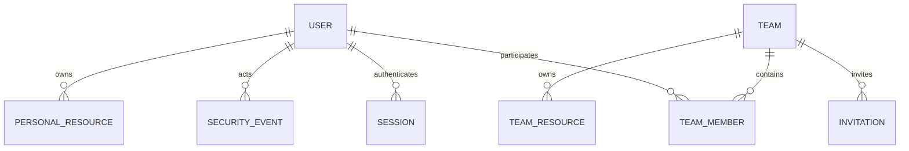
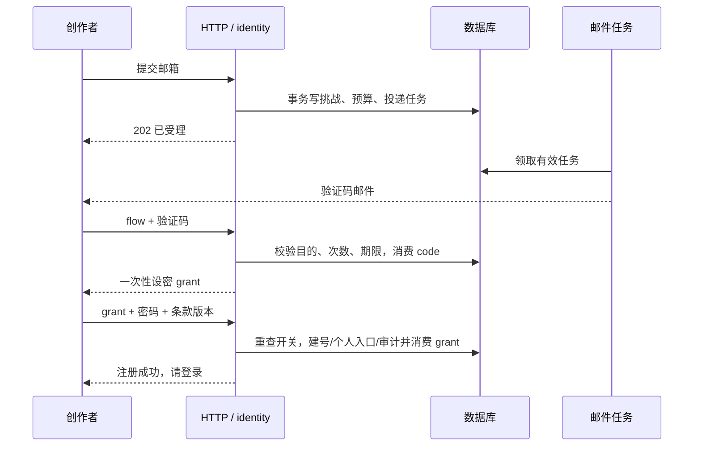

# 用户系统总体设计

## 1. 摘要

同一邮箱身份下完成认证、个人管理、团队创作和账号生命周期操作。

## 2. 参与者

使用者与参与职责：创作者、平台管理员与团队管理员。维护职责及确认人沿下方原来源记录；未给出姓名的，不补造人员或排期。

## 3. 背景

原始需求：[02-用户系统需求](../requirement/02-用户系统需求.md)。关联需求与验收：[01-用户系统](../prd/01-用户系统.md)。本文维护技术合同；相关实施步骤与证据见 Plan，状态与调度见 [BACKLOG](../../BACKLOG.md)。

### 3.1 文首来源与范围

适用范围：全局身份、个人/团队授权、治理及生命周期总体方案；数据库、HTTP、运行与续期由专项设计承接。维护职责：身份/团队模块；评审人未指定。

下游[用户系统 PRD](../prd/01-用户系统.md)基于本设计及需求汇总产品交付定义，再由[执行总览](#1-摘要)拆解实施任务。

实施进度及调度字段见 [BACKLOG 第4.1节](../../BACKLOG.md#41-01-用户系统总体设计文首来源与范围)。

### 3.2 身份与归属约束

显示名统一为 32 字符；已登录改密与邮件找回采用不同的验证流程。产品界面统一称“团队”。底层 organization/org_id 表示物理分区，资源访问必须验证当前个人/团队范围、会话和成员关系，不能将分区相同视为授权。

## 4. 目标

同一邮箱身份下完成认证、个人管理、团队创作和账号生命周期操作。目标的规则、量化条件与非目标沿需求原文及下方已确认设计，不增加未经确认的指标。

## 5. 使用场景

参与者为创作者、平台管理员与团队管理员；在下方定义的输入、对象状态、权限和环境条件具备时执行相应操作。各故事按其独立前置条件核对，不能把测试夹具当成真实业务条件。

### 5.1 公开邮箱注册的交互补齐（2026-10-20）

范围依据[需求02第11节](../requirement/02-用户系统需求.md#11-邮箱注册登录体验补齐2026-10-20)。目标是首次创作者自助取得账号、已有创作者继续登录；公开开放方向已由用户确认，本节为实施方案，保存文档不代表正式发布。

### 5.2 用户旅程与页面状态

| 阶段      | 用户动作/关切                          | 页面与恢复路径                                                                                             |
| --------- | -------------------------------------- | ---------------------------------------------------------------------------------------------------------- |
| 进入      | 希望保存当前创作，已有账号也能直接登录 | 保留现有首页背景与共用登录/注册 Tabs；仅邮箱在两面板间保留                                                 |
| 填写邮箱  | 确认地址，获取验证码                   | 步骤1，发信请求锁定；受理不承诺邮件到达，不透露账号是否存在                                                |
| 验证邮箱  | 收信、粘贴六位码，纠正输错邮箱         | 步骤2，只读邮箱＋更换邮箱；重发按真实回执倒计时。更换后丢弃当前本地证明，重新验证新地址                    |
| 设置账号  | 设置显示名和密码，阅读协议             | 步骤3，复用现有规则及默认不勾选的协议框；错误定位对应字段，不消费有效授权                                  |
| 完成      | 确认账号确已创建，继续原任务           | 校验完整回执后展示成功提示＋前往登录。清除敏感输入；邮箱保留在同一弹窗登录，仍需密码，不自动生成或创建画布 |
| 失败/返回 | 不希望反复输入或误以为已成功           | 网络失败保留当前可重试状态；策略异常可重读；关闭/重载放弃内存证明，重新验证。服务端仍防重放与重复建号      |

步骤来源直接由现有 operation/grant/完成状态派生，不建立第二套认证状态机。AuthDialog 持有本次打开期间的邮箱与模式，AuthView 通过可选初值/事件与父层协作，独立使用仍可运行。注册成功后只显示成功态，用户明确进入登录；不把邮箱、密码或grant写入URL/本地存储。弹窗关闭时卸载表单，重开重新开始；切换面板重建表单，仅邮箱保留。业务会话继续由现有 SessionProvider 激活。

### 5.3 组件、接口与失败边界

复用 shadcn Tabs、Field/FieldGroup、Input/InputGroup、Checkbox、Button、Alert；不新增依赖、页面路由、数据库表或手写API。发起、重发、验证、完成与登录分别沿用现有生成合同。更换邮箱只放弃客户端流程，不声称服务端撤销旧挑战；服务端限流与单次消费保持有效。

注册完成回执需有效UUID及 next=login；异常回执保持未确认并且不建立会话。验证码格式或显示名不符合规则时不发请求。策略失效或最终建号拒绝时留在当前界面并说明下一步；已验证邮箱持有人遇到 email_unavailable 可改邮箱/登录/找回，不能公开探测其他邮箱。

交互规则参考 [shadcn Field](https://ui.shadcn.com/docs/components/radix/field) 和 [Vercel Web Interface Guidelines](https://github.com/vercel-labs/web-interface-guidelines) 的表单语义、错误与焦点；登录和注册受理的防枚举沿用 [OWASP Authentication](https://cheatsheetseries.owasp.org/cheatsheets/Authentication_Cheat_Sheet.html)。核验：2026-10-20。不因参考资料擅自变更已接受的密码长度规则。

### 5.4 发布与验收

组件测试覆盖 AC-EMAIL-01～AC-EMAIL-05 和迟到请求不更新已卸载界面，浏览器覆盖 AC-EMAIL-06 与当前真实策略的关闭提示。受控模拟只用于未开放流程交互，必须单独标明；真实邮件投递、邮箱持有、注册、恢复和对外开关由发布验证补齐。协议正文/生效版本、SMTP可用性及管理开关继续由后端组合判定，不以测试需要绕过。对应任务见[设计18增补](../plan/02-邮箱认证与授权基础.md#6-t-user-19公开邮箱注册体验补齐2026-10-20)。

## 6. 价值

账号与资源归属清楚，平台治理和团队职责分别校验。

## 7. 方案

### 7.1 D1 身份与数据模型

对应 FR-USER-02/06/07/09/11/14/16/17；DR-USER-01～DR-USER-08。同一个 user_id 拥有个人身份和零到多个团队成员身份。个人/团队创作者由当前空间和有效成员关系表达，平台权限为独立授权，不保存“团队创作者账号类型”字段。

| 对象              | 候选字段                                                                                                                                                                                   | 核心约束与查询                                                                                                        |
| ----------------- | ------------------------------------------------------------------------------------------------------------------------------------------------------------------------------------------ | --------------------------------------------------------------------------------------------------------------------- |
| 全局账号          | id、email/email_key、email_verified_at、display_name、avatar_asset_id、platform_role、status、password_hash/scheme、credential_epoch、platform_epoch、revision、theme、prompt_suffix、时间 | email_key 全局唯一；platform_role 为 creator/platform_admin；不以单一 team_id 决定归属；平台目录按状态/验证/时间索引  |
| 团队              | id、name、avatar_asset_id、status、resume_status、governance_blocked、created_by、auth_epoch、revision、时间                                                                               | active/archived/suspended 独立于账号；停用恢复原状态；治理冻结单独控制写入；名称不唯一                                |
| 团队成员          | team_id、user_id、role、status、auth_epoch、revision、joined_at、joined_by/source、last_team_activity_at                                                                                   | 主键/唯一键(team_id,user_id)，角色 team_admin/member；状态 active/suspended/removed；目录按 team_id/状态/加入时间索引 |
| 创作空间映射      | scope_id、kind、owner_user_id 或 team_id、physical_scope_id                                                                                                                                | 个人空间与团队空间二选一；每用户一个个人入口；保留已有物理隔离键及资源 ID，不把物理范围相同视为成员授权               |
| 邮箱挑战/注册授权 | id、purpose、email_key、user_id（可空）、operation_id、proof_digest、credential_revision、attempts、expires_at、consumed/revoked_at                                                        | 目的闭集，单次消费；注册授权只建指定邮箱普通账号，不能调用业务接口                                                    |
| 会话              | id、user_id、token_hash、credential_epoch、created/last_active/expires_at、revoked_at、persistent、device_summary、reauth_at                                                               | token_hash 唯一；会话证明全局登录，不缓存永久有效的团队权限；当前空间只是 UI 选择                                     |
| 邀请              | id、kind、team_id（按 kind 可空）、email_key、team_role、inviter_id、status、revision、expires_at、accepted_user_id                                                                        | kind 为普通平台账号/团队加入；不接受 platform_admin 角色；同邮箱/团队仅一有效邀请                                     |
| 授权与职责交接    | id、kind、team_id（条件字段）、source_user_id、target_user_id、proposed_role、status、revision、expires_at                                                                                 | 平台授权和团队交接使用不同目的/处理函数；绑定现有已验证目标，目标接受后才生效，不能把提出方权限转成令牌万能权限       |
| 安全事件          | id、actor_id、target_user_id、team_id、scope_kind、action、result、reason、request_id、safe_diff、created_at                                                                               | 只追加，按平台/团队/本人投影；全局风控原因不出现在团队投影                                                            |
| 邮件任务          | event_id、template、recipient、encrypted_payload、status、attempt_count、next_attempt_at、provider_message_id、error_category                                                              | event_id 幂等、有限重试，凭据载荷短期加密；完成/到期清除，密钥与数据分开                                              |
| 管理导出任务      | id、actor_id、scope、filter_snapshot、as_of、status、row_count、expires_at、private_object_id                                                                                              | 同一过滤快照导出；生成和下载重查授权，过期撤销对象访问；无公开下载 URL                                                |
| 设置              | key、scope、value、revision、updated_by                                                                                                                                                    | 全局公开注册/团队创建开关及团队邀请开关，写入审计；不创建通用权限配置平台                                             |

头像复用受控媒体引用，校验拥有者与实际格式。账号个人偏好保存在用户层，不因团队切换覆盖。账号注销按已接受的软删除规则撤权并保留数据；事件与导出保留规则单独记录，不承诺物理擦除。

### 7.2 D2 授权与状态

对应 FR-USER-01/03/08/12/14/15/19/20/21/23；BR-USER-01～BR-USER-12。

授权按“全局身份 → 操作范围 → 当前平台权限或成员资格 → 对象权限”逐级判断。全局账号必须已验证、active、凭据版本与会话有效；正确的既有密码建立普通会话；历史改密标记不参与认证、能力列表或业务授权。个人操作检查 owner_user_id；团队业务检查有效成员、团队状态和具体资源授权；平台治理检查 platform_admin，**不把治理许可转换成团队内容权限**。

| 场景               | 授权来源                                      | 失效方式                                                            |
| ------------------ | --------------------------------------------- | ------------------------------------------------------------------- |
| 本人资料与个人创作 | 会话 + 本人/对象归属                          | 全局账号/credential_epoch/对象权限                                  |
| 团队内容与成员目录 | 会话 + 请求 team_id 的当前成员关系 + 资源权限 | team.auth_epoch、membership.auth_epoch 或状态改变；不需踢出其他团队 |
| 团队管理           | 上述身份 + 当前 team_admin                    | 角色变更或成员暂停/移除即失效                                       |
| 平台用户/团队治理  | 当前 platform_admin + 必要近期复验            | platform_epoch 变化；角色由服务端实时来源判断                       |
| 受邀加入/交接接受  | 指定邮箱或 user_id 的认证 + 有效目的授权      | 邀请/交接撤回、期限、目标/发起者失权、团队停用                      |

team_id 是请求上下文，不是可信身份；所有持久关系从服务端读取。普通成员目录与团队管理员目录使用不同字段投影，平台/团队/本人事件查询也分离。缓存键至少包含 user_id、scope_kind、team_id 和权限版本；切换范围取消旧请求并校验响应范围再渲染。

团队停用使所有团队业务访问失败，管理员可在治理入口读必要状态摘要；归档允许有效成员按权限只读。governance_blocked 阻止新写入/邀请，只开放经授权的交接修复。全局禁用优先于团队启用，平台恢复团队也不激活 suspended/removed 成员。

最后平台管理员以平台级锁保护；最后团队管理员以对应团队级锁保护。紧急全局禁用可用“先锁用户/涉及团队、复算管理员、原子冻结无管理员团队并撤销账号”的事务处理；锁顺序稳定，交接不得在已过期读取上执行。恢复团队治理须经 FR-USER-21 的目标成员确认。候选具体锁实现应在集成测试中验证死锁处理与重试上限。

长连接在发送受保护数据前、队列在后续敏感步骤、下载在发放内容前复核权限。撤权不能撤回已发出的数据或供应商调用；完成结果仅对仍有权的主体可见，费用按实际执行记录。

### 7.3 D3 平台用户与团队管理

对应 FR-USER-10～FR-USER-13/17～19/21～25。

| 管理面            | 能力                                                                 | 字段/权限控制                                     |
| ----------------- | -------------------------------------------------------------------- | ------------------------------------------------- |
| 平台用户目录/详情 | 全局查找、统计、状态、安全处理、公共资料治理、平台角色授权、受控导出 | 可看成员摘要，不能读私人内容、秘密或假冒用户      |
| 平台团队目录/详情 | 按团队/管理员查找、团队停用恢复、恶意邀请撤回、待接管处理            | 不必加入团队，但所有治理写入需要原因和审计        |
| 团队设置          | 创建、名称/头像维护、归档恢复、邀请开关                              | team_admin 仅当前团队；平台停用不可自行解除       |
| 团队成员/邀请     | 查找、最小目录、邀请、暂停恢复、角色、移除、退出、职责交接           | 不改全局密码/邮箱/账号状态，不查询其他团队        |
| 全局设置          | 公开注册和团队创建开关                                               | platform_admin + 版本/复验/审计；安全控制不能关闭 |

所有写入接收 expected_revision；创建/邀请/导出等使用 actor + action + scope + request_key 的幂等标识，并对规范化请求内容判等。同键不同输入返回冲突，重试返回同一操作结果。禁用/暂停/移除动作分别命名，不提供含义不清的通用“删除”。

平台注册邀请仅取得普通账号；团队邀请追加成员关系。已注册目标必须验证登录邮箱并主动接受，不能通过被邀请覆盖密码；新注册与邀请争用同邮箱时复用唯一账号，并再次确认加入团队。removed 重新加入可更新同一当前关系并记录新加入事件；suspended 成员需管理员明确恢复，新邀请不能绕过。

团队管理员提升成员为团队管理员要复验，最后管理员职责交接另需接收者接受；平台管理员授予走独立授权提案并要求目标接受。所有接受都重查发起者/目标/团队和版本；撤回/接受竞争只有一个成功。

全局状态与团队状态分别通知。平台公开资料治理只重置显示名/头像；支持恢复不是任意修改邮箱入口。统计独立计算互斥账号状态、可重叠验证标签及有效成员去重人数，带 as_of；成员关系数不能冒充用户数。

导出 P1 使用有上限的私有任务，过滤快照和 as_of 固定，生成与下载都检查当前授权；超 10,000 行拒绝并要求缩小范围；下载限时且鉴权，对 CSV 公式前缀做安全编码。文件完成不代表发起者永久获访问权，撤权后禁止下载并清理临时结果。

### 7.4 D4 事务、凭据与可靠执行

对应 FR-USER-02～FR-USER-05/07/11～14/23/25；NFR-USER-02/05/07/08/12。

### 7.5 注册与邮件

先按规范化邮箱、来源和全局预算限流，统一受理公开注册与恢复，响应与可查询状态不暴露邮箱存在性。挑战与邮件任务同事务创建，worker 只投递未过期的当前版本；重发撤销旧凭据，不清空地址级尝试计数。验证锁定挑战，检查目的/到期/次数，签发一次性设密授权；最终建号再次校验公开注册开关或独立有效邀请、邮箱唯一性，原子建普通账号/个人空间入口、消费授权并写审计。

先验证后设密，防止未验证请求预置他人密码；注册授权不能建立创作会话。丢回执后可查询操作或重新验证后登录，不重新建号。有效邀请模式不依赖公开注册开关，但其团队、目标和权限条件始终执行。

### 7.6 密码、会话和换邮箱

新密码采用带版本参数的 Argon2id 与独立盐，参数参考 [OWASP 密码存储](https://cheatsheetseries.owasp.org/cheatsheets/Password_Storage_Cheat_Sheet.html) 后在基准环境定值；现有 bcrypt 保留既有密码验证；通过验证且符合新密码结构规则时透明升级。既有密码不符合新设密码规则时保留原哈希并建立普通会话，不要求重置、不限制权限；用户主动改密或完成邮件恢复时才应用新设密码规则。不得静默 trim/截断密码或外发原始密码做弱密码检查。

服务端不透明会话令牌只存摘要，生产 Cookie 使用 HttpOnly/Secure/同站策略，所有状态写入校验可信来源及 CSRF；私有接口 no-store。会话不永久携带团队权限。主动改密原子更新哈希、credential_epoch、撤销旧会话并轮换当前会话；恢复邮件设密撤销全部会话但不自动登录。参考 [OWASP 会话管理](https://cheatsheetseries.owasp.org/cheatsheets/Session_Management_Cheat_Sheet.html) 与 [找回密码](https://cheatsheetseries.owasp.org/cheatsheets/Forgot_Password_Cheat_Sheet.html)。

换绑绑定 user_id、原邮箱版本、新邮箱及双邮箱证明；消费时重查唯一性，原子更新邮箱、撤销全局会话/未完成身份挑战，通知两个地址。成员关系以 ID 关联不受影响；未消费的邮箱定向邀请不自动改投新邮箱，需重新邀请。

### 7.7 管理写入、职责保护与账号生命周期

账号/团队/成员/设置变更与安全审计、必要通知任务同事务；邮件故障不回滚已提交的安全变化，审计持久失败则回滚关键写入。成员撤权增加该成员 auth_epoch，团队停用增加该团队 auth_epoch，全局禁用提高 credential_epoch，作用范围不能混用。

团队创建与首位 team_admin 原子完成；容量/开关在提交时检查。列表与统计采用同一过滤语义，分页游标绑定范围、排序及查询条件；注册、最近登录和团队活动时间由服务端写入，变动列表按查询快照/稳定游标控制重复，统计明确 as_of。成员移除/退出保留团队资源归属与作者引用；账号注销必须完成最后管理职责交接；一个事务内软删除、撤销会话/证明/成员权限并保留个人资料和资源，团队资源继续归团队。不设冷静期、取消或物理清理任务。

备份恢复除账号数据外还必须恢复安全事件与治理冻结状态，或从独立持久源重放安全撤权；完成前阻止外部访问，并使恢复前会话全部失效。无法证明安全状态完整时停止开放，不能仅恢复旧库后让禁用账号复活。

### 7.8 D5 接口与界面边界

HTTP 路由、请求/响应、错误、版本、幂等、分页、Cookie/CSRF 与前端状态统一见[接口设计](03-用户系统接口设计.md)。表字段、索引、外键、锁序和清理合同统一见[数据库设计](02-用户系统数据库设计.md)，不在总体设计重复定义另一份详细合同。

页面分为公共认证、账号设置、个人/团队空间切换、团队设置和平台后台。平台入口按平台权限展示，团队管理入口按当前成员职责展示；直接 URL、刷新和异步任务仍由服务端授权。测试矩阵、部署、恢复和证据要求见[测试与运行设计](04-用户系统测试与运行设计.md)。

### 7.9 邮件与外部依赖

注册验证、密码恢复、邮箱换绑、账号/团队邀请、权限授予与职责交接、安全通知使用目的不同的模板。邮件任务受理、供应商投递和实际收信分别记录；失败有限重试并告警。

验证码使用服务端密钥保护的摘要，随机长令牌只存摘要；必要待投递载荷短期加密，密钥隔离且日志不输出。链接 origin 由可信配置产生，不接受任意 Host/redirect；邮件落地无第三方跟踪、no-referrer，GET 不消费凭据，明确 POST 才执行。worker 回调验签与去重，过期任务不再发信。

IR-USER-01～IR-USER-06 均需契约测试：邮件故障、媒体引用失败、项目/生成撤权、审计故障和配置缺失都必须有真实失败路径。供应商选择、测试邮箱、恢复支持政策与保留期限未定时，只能报告已完成的工程层证据。

### 7.10 模块边界与方案取舍

沿用模块化单体，进程入口只有 `backend/cmd/glowloom`。identity 负责全局身份、邮箱证明、会话、平台治理及安全事件；workspace 负责团队、成员、空间与资源归属；media 负责受控头像；已有任务基础设施负责投递与清理。`package app` 只做角色进程和 Wire 注入；各服务的跨模块适配放在 `backend/internal/app/<服务>/` 独立包。HTTP 仅解码、校验及转换，事务由应用用例协调，领域规则不依赖 Gin/GORM。业务规则留在各模块的 domain 与 application，不因接线再拆出第二个命令。

| 选择                               | 结论与理由                                                           |
| ---------------------------------- | -------------------------------------------------------------------- |
| 扩展既有 identity/workspace        | 采用；单库事务可以覆盖禁用与团队冻结，当前不需要分布式一致性         |
| 外部 IdP 替换登录                  | 本轮不采用；尚无既定供应商，不能解决团队资源归属和存量角色映射       |
| 单一 User.Role 同时决定平台/团队权 | 不采用；不能表达 A 团队管理员、B 团队成员及独立平台管理职责          |
| 为所有用户建立一个“个人团队”       | 不采用；个人所有权是明确实体，不制造虚假团队或席位                   |
| 长期把授权角色放入 JWT             | 不采用；需求要求撤权提交后下一请求生效，使用服务器会话与当前权限查询 |

跨模块不互相调用应用服务形成循环：workspace 消费方定义 `ActorAccess` 小接口获取有效账号事实；业务资源消费者定义 `ScopeAccess` 获取范围事实；对应服务的装配包适配 identity/workspace 实现。跨账号禁用和团队冻结的同库事务适配器放在该装配包，持有明确数据库依赖，以同一事务执行两模块已定义的存储操作；不能先提交禁用再依赖最终一致事件补冻结。平台治理的团队读模型不投影作品。

### 7.11 注册时序

### 7.12 状态变化与失败边界

凭据消费/成员撤回竞争以数据库提交顺序为准。邮箱唯一冲突不得合并 ID；用户可重新登录已有身份。业务提交成功、发信失败时页面如实显示已完成操作及通知状态；数据库审计失败则整笔回滚。私有权限数据源不可用时拒绝访问，不能回退固定工作区。已派发第三方任务不能伪装为撤销成功，后续执行、资源写回和下载按当前权限处理。

新密码 Argon2id 候选初值 m=19456 KiB、t=2、p=1、salt=16 bytes、hash=32 bytes；这是依据 [OWASP 密码存储建议](https://cheatsheetseries.owasp.org/cheatsheets/Password_Storage_Cheat_Sheet.html)选择的测试起点，需按 NFR-USER-03 的实际并发验证，并限制并行哈希数量避免内存耗尽。既有 bcrypt 仅验证及升级，不用旧 72 字节限制截断新密码。

### 7.13 ST-USER-01：通过邮箱证明取得账号并正常登录、找回及主动改密

**故事 ID 与标题：** ST-USER-01；通过邮箱证明取得账号并正常登录、找回及主动改密

**描述：** 作为创作者、平台管理员与团队管理员，希望通过邮箱证明取得账号并正常登录、找回及主动改密，以便账号与资源归属清楚，平台治理和团队职责分别校验。

**来源与设计：** [01-用户系统执行总览的原故事及承接关系](../plan/01-用户系统执行总览.md#11-故事范围与任务承接)；需求来源见第3节。

**讨论：** 原任务或证据落点：T-USER-01、T-USER-02、T-USER-03、T-USER-04、T-USER-19。候选、估算和就绪情况只在 BACKLOG 维护。

**确认条件：** 沿用原故事对应任务的退出条件及来源 AC／QA；正常结果、边界、失败和权限场景逐项核对，不将场景描述当作执行证明。

**追踪：** [CASE-USER-01](#85-case-user-01通过邮箱证明取得账号并正常登录找回及主动改密)；实施状态见 [BACKLOG](../../BACKLOG.md)。

### 7.14 ST-USER-02：本人维护资料、偏好、邮箱与设备，并读回自己的变更

**故事 ID 与标题：** ST-USER-02；本人维护资料、偏好、邮箱与设备，并读回自己的变更

**描述：** 作为创作者、平台管理员与团队管理员，希望本人维护资料、偏好、邮箱与设备，并读回自己的变更，以便账号与资源归属清楚，平台治理和团队职责分别校验。

**来源与设计：** [01-用户系统执行总览的原故事及承接关系](../plan/01-用户系统执行总览.md#11-故事范围与任务承接)；需求来源见第3节。

**讨论：** 原任务或证据落点：T-USER-05、T-USER-06、T-USER-07。候选、估算和就绪情况只在 BACKLOG 维护。

**确认条件：** 沿用原故事对应任务的退出条件及来源 AC／QA；正常结果、边界、失败和权限场景逐项核对，不将场景描述当作执行证明。

**追踪：** [CASE-USER-02](#86-case-user-02本人维护资料偏好邮箱与设备并读回自己的变更)；实施状态见 [BACKLOG](../../BACKLOG.md)。

### 7.15 ST-USER-03：平台按独立职责治理账号，团队按成员资格安全创作

**故事 ID 与标题：** ST-USER-03；平台按独立职责治理账号，团队按成员资格安全创作

**描述：** 作为创作者、平台管理员与团队管理员，希望平台按独立职责治理账号，团队按成员资格安全创作，以便账号与资源归属清楚，平台治理和团队职责分别校验。

**来源与设计：** [01-用户系统执行总览的原故事及承接关系](../plan/01-用户系统执行总览.md#11-故事范围与任务承接)；需求来源见第3节。

**讨论：** 原任务或证据落点：T-USER-08、T-USER-09、T-USER-10、T-USER-11、T-USER-12、T-USER-13。候选、估算和就绪情况只在 BACKLOG 维护。

**确认条件：** 沿用原故事对应任务的退出条件及来源 AC／QA；正常结果、边界、失败和权限场景逐项核对，不将场景描述当作执行证明。

**追踪：** [CASE-USER-03](#87-case-user-03平台按独立职责治理账号团队按成员资格安全创作)；实施状态见 [BACKLOG](../../BACKLOG.md)。

### 7.16 ST-USER-04：本人注销后访问立即撤销，保留资源；存量切换可验证

**故事 ID 与标题：** ST-USER-04；本人注销后访问立即撤销，保留资源；存量切换可验证

**描述：** 作为创作者、平台管理员与团队管理员，希望本人注销后访问立即撤销，保留资源；存量切换可验证，以便账号与资源归属清楚，平台治理和团队职责分别校验。

**来源与设计：** [01-用户系统执行总览的原故事及承接关系](../plan/01-用户系统执行总览.md#11-故事范围与任务承接)；需求来源见第3节。

**讨论：** 原任务或证据落点：T-USER-14、T-USER-15、T-USER-17、T-USER-18。候选、估算和就绪情况只在 BACKLOG 维护。

**确认条件：** 沿用原故事对应任务的退出条件及来源 AC／QA；正常结果、边界、失败和权限场景逐项核对，不将场景描述当作执行证明。

**追踪：** [CASE-USER-04](#88-case-user-04本人注销后访问立即撤销保留资源存量切换可验证)；实施状态见 [BACKLOG](../../BACKLOG.md)。

## 8. 实施与验收

以下定义验收条件；执行步骤与版本化结果见[对应实施计划](../plan/01-用户系统执行总览.md)。未执行或未覆盖的场景不能视为通过。

### 8.1 D6 迁移与切换

对应 FR-USER-16；NFR-USER-07/14。先授权目标环境与只读盘点，再执行单独审阅的增量，不重放最终态 schema。

1. 盘点账号、旧 org_id、role、个人/共享资源引用、无邮箱/冲突、现有管理员。对每个旧范围形成明确团队/物理范围映射；不因名为工作区就认为全部资源应共享。
2. 扩展全局邮箱与平台角色、团队/成员、空间映射、邀请/交接与权限版本；可以保留现有物理 organization/org_id 以避免破坏外键，但产品与授权使用显式团队语义。
3. 现有用户 ID 不变；核实的旧范围内 admin 可映射该团队 team_admin，不能升级 platform_admin。平台管理员单独指定并验证；团队多角色信息进入成员关系，不继续由单一 User.OrgID/Role 供所有请求使用。
4. 逐账号完成安全邮箱绑定；受控迁移授权只绑定当前 ID，不能作为业务会话。无邮箱、冲突、未明确归属的资源隔离处理，不猜测、不自动合并、不清库。
5. 改造所有身份消费者：HTTP principal、管理目录、媒体/下载、项目/画布、生成队列、审计/缓存/导出；检查全局身份与请求范围各自来源，不能只更新登录模块。
6. 在隔离副本对照 ID/资源归属/当前成员/旧授权映射，运行双团队多角色矩阵、并发保护与恢复演练。确认至少一可用平台管理员、每个可写团队有可用管理员。
7. 前后端同步切换邮箱及平台/团队接口，失效旧会话；关闭公开登录名入口与旧单范围管理权限绕过。临时绑定入口有截止时间，完结后删除。
8. 收尾删除无消费者的旧身份字段/契约前先证明引用已迁移。故障时关闭受影响写入并采用兼容新身份数据的修复或已演练恢复，不能把新多团队身份回退到只认识单组织的版本。

该计划不授权本轮写数据库；术语调整不等于已执行物理表/列重命名。

### 8.2 D7 质量验证与追踪

[需求规格第 6 节](../requirement/02-用户系统需求.md#6-非功能性需求)是指标唯一来源，设计不复制另一套数字。

| 非功能需求  | 设计落实点                                                | 验收       |
| ----------- | --------------------------------------------------------- | ---------- |
| NFR-USER-01 | D2 范围和对象授权、撤权版本、缓存/任务复核                | QA-USER-01 |
| NFR-USER-02 | D4 凭据/会话/CSRF、防枚举，邮件密钥与日志边界             | QA-USER-02 |
| NFR-USER-03 | D1 目录索引与 D5 有界接口；密码核验成本纳入压测           | QA-USER-03 |
| NFR-USER-04 | D3 限额/分页/导出和成员唯一约束                           | QA-USER-04 |
| NFR-USER-05 | D4 事务、幂等与版本，D2 最后管理员锁                      | QA-USER-05 |
| NFR-USER-06 | D4 异步邮件/权限源失败拒绝，运行探测                      | QA-USER-06 |
| NFR-USER-07 | D6 备份恢复，安全事件与治理冻结恢复检查                   | QA-USER-07 |
| NFR-USER-08 | D4/第 7 节邮件队列、过期、重试、退信与实测收信            | QA-USER-08 |
| NFR-USER-09 | D5 表单/管理界面焦点、反馈、响应式                        | QA-USER-09 |
| NFR-USER-10 | D5 浏览器合同与邮件 GET/POST 语义                         | QA-USER-10 |
| NFR-USER-11 | D1 字段投影/保留、D3 受控导出、D4 注销                    | QA-USER-11 |
| NFR-USER-12 | D1 安全事件与 D4 事务/outbox、告警                        | QA-USER-12 |
| NFR-USER-13 | identity 领域规则、workspace 团队边界、生成契约和注入时钟 | QA-USER-13 |
| NFR-USER-14 | D6 映射/回退检查，D4 服务端时钟与期限                     | QA-USER-14 |

工程边界继续使用 `adapter → application → domain`，全局身份由 identity 负责，团队资料/成员生命周期按现有 workspace 业务边界实现；身份模块通过消费方小接口获取团队授权事实，避免循环依赖或创建通用权限微服务。客户端 DTO 由现有工具链生成。

完整 FR → D → 批次 → AC 对照在需求第 8 节；计划必须覆盖各批次适用 NFR/QA。自动化门禁、隔离存储、真实邮箱、浏览器与用户接受分别记录。

### 8.3 验收边界

邮箱密码、注册验证邮箱、既有 SMTP、个人与团队创作者、独立平台管理权限，以及即时软删除并保留数据按需求验收。公开注册须有正式协议、运行策略和真实收信闭环。设计评审、实现检查、运行验收及发布分别取得证据。

### 8.4 会话与发布依赖

会话协议及期限以[会话设计](05-无感登录与会话续期调研设计.md)为准：短期 JWT 仅引用身份，持久会话及当前权限仍须复查。迁移按实际目标环境核对结构与版本，真实多账号、异步撤权、恢复与最小权限分别验收；步骤与结果归对应 Plan。

### 8.5 CASE-USER-01：通过邮箱证明取得账号并正常登录、找回及主动改密

**场景 ID 与名称：** CASE-USER-01；核对原故事 ST-USER-01 的结果。本场景按下列来源 AC／QA 组织，具体测试与故障注入定义仍保留在本节。

**目标：** 通过邮箱证明取得账号并正常登录、找回及主动改密

**前置条件：** 原任务或证据落点：T-USER-01、T-USER-02、T-USER-03、T-USER-04、T-USER-19

**角色：** 创作者、平台管理员与团队管理员，仅使用来源规则允许的操作。

**步骤与结果：** 逐项执行以下关联的原验收定义；每项沿用其角色、前置、动作、结果与边界。原文标为建议、草案或待确认的，继续保持原状态。

| 原验收 ID                                                      | 原定义中的前置、操作、结果及证据要求                                                                                                    |
| -------------------------------------------------------------- | --------------------------------------------------------------------------------------------------------------------------------------- |
| [AC-USER-01](../requirement/02-用户系统需求.md#7-功能验收场景) | 前提与动作：游客触发、关闭和完成认证；预期结果：保留当前公共草稿，回同站目标，不自动执行付费操作                                        |
| [AC-USER-02](../requirement/02-用户系统需求.md#7-功能验收场景) | 前提与动作：未注册邮箱实际收信、验证、设密、登录并刷新；预期结果：产生一个普通账号和本人空间访问，无自行赋权                            |
| [AC-USER-03](../requirement/02-用户系统需求.md#7-功能验收场景) | 前提与动作：注册重复邮箱、重发、过期、错误及并发消费；预期结果：无重复账号或覆盖密码；公开结果不枚举邮箱                                |
| [AC-USER-04](../requirement/02-用户系统需求.md#7-功能验收场景) | 前提与动作：已验证/未知/错密/锁定/禁用账号登录；预期结果：成功或统一拒绝，次数、锁定及精确到期正确                                      |
| [AC-USER-05](../requirement/02-用户系统需求.md#7-功能验收场景) | 前提与动作：会话刷新、关闭重开、空闲/绝对到期、离线与 5xx；预期结果：持久 Cookie 与服务器到期一致；离线不误判身份失效                   |
| [AC-USER-06](../requirement/02-用户系统需求.md#7-功能验收场景) | 前提与动作：发起找回、实际收信、设置密码，重放/过期/并发；预期结果：发起不改账号，成功后全局旧会话及旧密码失效                          |
| [AC-USER-07](../requirement/02-用户系统需求.md#7-功能验收场景) | 前提与动作：本人改密含错旧密码、同密码、并发平台撤权；预期结果：合法改密轮换当前并撤销其他会话；冲突不复活权限                          |
| [AC-USER-15](../requirement/02-用户系统需求.md#7-功能验收场景) | 前提与动作：本人/团队/平台查询事件，邮件失败；预期结果：范围与字段正确，通知失败不回滚安全变更                                          |
| [AC-USER-17](../requirement/02-用户系统需求.md#7-功能验收场景) | 前提与动作：个人、A/B 团队、平台角色交叉访问与篡改范围；预期结果：默认拒绝越权；平台治理不等于作品内容访问                              |
| [AC-USER-18](../requirement/02-用户系统需求.md#7-功能验收场景) | 前提与动作：隔离迁移含旧管理员、缺邮箱/冲突、个人/共享资源；预期结果：ID/归属/引用一致，旧管理员不自动成为平台管理员                    |
| [AC-USER-19](../requirement/02-用户系统需求.md#7-功能验收场景) | 前提与动作：所有页面的断点、主题、短屏与键盘/读屏；预期结果：控件可达、错误关联、焦点正确且无假成功                                     |
| [AC-USER-20](../requirement/02-用户系统需求.md#7-功能验收场景) | 前提与动作：邮件失败、退信、超时、重复回调与重试；预期结果：不假报送达、不提前消费、不绕过限流                                          |
| [AC-USER-21](../requirement/02-用户系统需求.md#7-功能验收场景) | 前提与动作：各注册/邀请/改密/编辑入口提交规则边界；预期结果：密码、显示名、邮箱策略一致，超限不部分成功                                 |
| [AC-USER-22](../requirement/02-用户系统需求.md#7-功能验收场景) | 前提与动作：全局禁用、团队停用、成员移除发生于任务排队/执行；预期结果：按范围阻止后续执行，个人及其他团队不受误伤，外部在途结果如实记录 |
| [AC-USER-27](../requirement/02-用户系统需求.md#7-功能验收场景) | 前提与动作：同一账号在个人、A 管理员、B 成员空间切换；预期结果：每空间权限独立，迟到请求不串数据，失权回个人空间                        |
| [AC-USER-33](../requirement/02-用户系统需求.md#7-功能验收场景) | 前提与动作：关闭公开注册、新建团队或团队邀请，再消费旧流程；预期结果：开关最终提交时生效；已授权邀请例外符合政策，不影响正常登录恢复    |

**例外：** 沿原任务和 AC 的非法输入、边界、权限、并发及恢复路径；只选原规则适用项，不新增未经确认的条件。

### 8.6 CASE-USER-02：本人维护资料、偏好、邮箱与设备，并读回自己的变更

**场景 ID 与名称：** CASE-USER-02；核对原故事 ST-USER-02 的结果。本场景按下列来源 AC／QA 组织，具体测试与故障注入定义仍保留在本节。

**目标：** 本人维护资料、偏好、邮箱与设备，并读回自己的变更

**前置条件：** 原任务或证据落点：T-USER-05、T-USER-06、T-USER-07

**角色：** 创作者、平台管理员与团队管理员，仅使用来源规则允许的操作。

**步骤与结果：** 逐项执行以下关联的原验收定义；每项沿用其角色、前置、动作、结果与边界。原文标为建议、草案或待确认的，继续保持原状态。

| 原验收 ID                                                      | 原定义中的前置、操作、结果及证据要求                                                                                  |
| -------------------------------------------------------------- | --------------------------------------------------------------------------------------------------------------------- |
| [AC-USER-05](../requirement/02-用户系统需求.md#7-功能验收场景) | 前提与动作：会话刷新、关闭重开、空闲/绝对到期、离线与 5xx；预期结果：持久 Cookie 与服务器到期一致；离线不误判身份失效 |
| [AC-USER-08](../requirement/02-用户系统需求.md#7-功能验收场景) | 前提与动作：本人资料/头像保存、刷新、超限/错误/他人媒体；预期结果：正确持久读回；失败保留旧资料，无越权引用           |
| [AC-USER-09](../requirement/02-用户系统需求.md#7-功能验收场景) | 前提与动作：双邮箱换绑，冲突/过期/取消与成功；预期结果：成功后 ID/成员/作品不变，需新邮箱登录；失败原邮箱有效         |
| [AC-USER-10](../requirement/02-用户系统需求.md#7-功能验收场景) | 前提与动作：两设备登录后撤销单台/其他/当前并重复请求；预期结果：被撤设备下次请求失败，无其他用户副作用                |
| [AC-USER-11](../requirement/02-用户系统需求.md#7-功能验收场景) | 前提与动作：匿名偏好、跨设备保存、换账号、新旧草稿；预期结果：服务器偏好正确读回，不串账号，不改已提交输入            |
| [AC-USER-15](../requirement/02-用户系统需求.md#7-功能验收场景) | 前提与动作：本人/团队/平台查询事件，邮件失败；预期结果：范围与字段正确，通知失败不回滚安全变更                        |
| [AC-USER-20](../requirement/02-用户系统需求.md#7-功能验收场景) | 前提与动作：邮件失败、退信、超时、重复回调与重试；预期结果：不假报送达、不提前消费、不绕过限流                        |
| [AC-USER-21](../requirement/02-用户系统需求.md#7-功能验收场景) | 前提与动作：各注册/邀请/改密/编辑入口提交规则边界；预期结果：密码、显示名、邮箱策略一致，超限不部分成功               |
| [AC-USER-34](../requirement/02-用户系统需求.md#7-功能验收场景) | 前提与动作：多管理员同时修改资料/角色/成员，超时后重试；预期结果：版本冲突明确、状态可重查，无重复权限/通知与静默覆盖 |

**例外：** 沿原任务和 AC 的非法输入、边界、权限、并发及恢复路径；只选原规则适用项，不新增未经确认的条件。

### 8.7 CASE-USER-03：平台按独立职责治理账号，团队按成员资格安全创作

**场景 ID 与名称：** CASE-USER-03；核对原故事 ST-USER-03 的结果。本场景按下列来源 AC／QA 组织，具体测试与故障注入定义仍保留在本节。

**目标：** 平台按独立职责治理账号，团队按成员资格安全创作

**前置条件：** 原任务或证据落点：T-USER-08、T-USER-09、T-USER-10、T-USER-11、T-USER-12、T-USER-13

**角色：** 创作者、平台管理员与团队管理员，仅使用来源规则允许的操作。

**步骤与结果：** 逐项执行以下关联的原验收定义；每项沿用其角色、前置、动作、结果与边界。原文标为建议、草案或待确认的，继续保持原状态。

| 原验收 ID                                                      | 原定义中的前置、操作、结果及证据要求                                                                                                    |
| -------------------------------------------------------------- | --------------------------------------------------------------------------------------------------------------------------------------- |
| [AC-USER-12](../requirement/02-用户系统需求.md#7-功能验收场景) | 前提与动作：平台管理员查询筛选排序详情，普通/团队管理员越权；预期结果：返回正确用户摘要；其他角色无全站数据                             |
| [AC-USER-13](../requirement/02-用户系统需求.md#7-功能验收场景) | 前提与动作：平台/团队邀请新/既有邮箱，拒绝/过期/撤回/重发；预期结果：同邮箱一个身份，正确目标/角色，个人密码不被覆盖                    |
| [AC-USER-14](../requirement/02-用户系统需求.md#7-功能验收场景) | 前提与动作：平台启停/解锁/重置邮件/强制下线与并发；预期结果：各动作效果独立，最后平台管理员保护生效                                     |
| [AC-USER-15](../requirement/02-用户系统需求.md#7-功能验收场景) | 前提与动作：本人/团队/平台查询事件，邮件失败；预期结果：范围与字段正确，通知失败不回滚安全变更                                          |
| [AC-USER-17](../requirement/02-用户系统需求.md#7-功能验收场景) | 前提与动作：个人、A/B 团队、平台角色交叉访问与篡改范围；预期结果：默认拒绝越权；平台治理不等于作品内容访问                              |
| [AC-USER-20](../requirement/02-用户系统需求.md#7-功能验收场景) | 前提与动作：邮件失败、退信、超时、重复回调与重试；预期结果：不假报送达、不提前消费、不绕过限流                                          |
| [AC-USER-21](../requirement/02-用户系统需求.md#7-功能验收场景) | 前提与动作：各注册/邀请/改密/编辑入口提交规则边界；预期结果：密码、显示名、邮箱策略一致，超限不部分成功                                 |
| [AC-USER-22](../requirement/02-用户系统需求.md#7-功能验收场景) | 前提与动作：全局禁用、团队停用、成员移除发生于任务排队/执行；预期结果：按范围阻止后续执行，个人及其他团队不受误伤，外部在途结果如实记录 |
| [AC-USER-23](../requirement/02-用户系统需求.md#7-功能验收场景) | 前提与动作：本人创建团队、重试、超限、编辑/归档/恢复；预期结果：团队和首位管理员原子创建，归档只读，停用不可自行恢复                    |
| [AC-USER-24](../requirement/02-用户系统需求.md#7-功能验收场景) | 前提与动作：团队管理员/普通成员查本团队和他队成员；预期结果：字段最小化；普通目录无邮箱，他队拒绝，失败不是空列表                       |
| [AC-USER-25](../requirement/02-用户系统需求.md#7-功能验收场景) | 前提与动作：团队成员升降级/暂停恢复/移除/退出；预期结果：只影响该团队，个人账号与其他团队仍可用；作品不转移                             |
| [AC-USER-26](../requirement/02-用户系统需求.md#7-功能验收场景) | 前提与动作：最后团队管理员发起交接，接收/拒绝/过期和并发退出；预期结果：接受前原职责保留，接受后可退出；不能清空最后管理员              |
| [AC-USER-27](../requirement/02-用户系统需求.md#7-功能验收场景) | 前提与动作：同一账号在个人、A 管理员、B 成员空间切换；预期结果：每空间权限独立，迟到请求不串数据，失权回个人空间                        |
| [AC-USER-28](../requirement/02-用户系统需求.md#7-功能验收场景) | 前提与动作：平台停用/恢复团队或紧急禁用唯一团队管理员；预期结果：团队按范围失效；待接管冻结可治理恢复，不隐式升平台权限                 |
| [AC-USER-29](../requirement/02-用户系统需求.md#7-功能验收场景) | 前提与动作：平台处理头像/名称，团队管理员尝试改全局资料；预期结果：处理有理由/通知/审计，团队越权拒绝，邮箱密码未被代改                 |
| [AC-USER-30](../requirement/02-用户系统需求.md#7-功能验收场景) | 前提与动作：平台管理员授权、对方接受/拒绝、撤销与并发；预期结果：只有独立平台授权生效；最后平台管理员受保护，团队邀请不能提权           |
| [AC-USER-31](../requirement/02-用户系统需求.md#7-功能验收场景) | 前提与动作：构造个人用户、多团队用户、禁用成员及待邀请数据；预期结果：去重人数与状态统计符合口径，筛选与 as_of 明确，无样例补值         |
| [AC-USER-32](../requirement/02-用户系统需求.md#7-功能验收场景) | 前提与动作：合法/超限导出、范围篡改、生成中撤权、链接到期及公式文本；预期结果：数量与筛选一致，越权/过期不下载，内容无秘密和公式执行    |
| [AC-USER-33](../requirement/02-用户系统需求.md#7-功能验收场景) | 前提与动作：关闭公开注册、新建团队或团队邀请，再消费旧流程；预期结果：开关最终提交时生效；已授权邀请例外符合政策，不影响正常登录恢复    |
| [AC-USER-34](../requirement/02-用户系统需求.md#7-功能验收场景) | 前提与动作：多管理员同时修改资料/角色/成员，超时后重试；预期结果：版本冲突明确、状态可重查，无重复权限/通知与静默覆盖                   |

**例外：** 沿原任务和 AC 的非法输入、边界、权限、并发及恢复路径；只选原规则适用项，不新增未经确认的条件。

### 8.8 CASE-USER-04：本人注销后访问立即撤销，保留资源；存量切换可验证

**场景 ID 与名称：** CASE-USER-04；核对原故事 ST-USER-04 的结果。本场景按下列来源 AC／QA 组织，具体测试与故障注入定义仍保留在本节。

**目标：** 本人注销后访问立即撤销，保留资源；存量切换可验证

**前置条件：** 原任务或证据落点：T-USER-14、T-USER-15、T-USER-17、T-USER-18

**角色：** 创作者、平台管理员与团队管理员，仅使用来源规则允许的操作。

**步骤与结果：** 逐项执行以下关联的原验收定义；每项沿用其角色、前置、动作、结果与边界。原文标为建议、草案或待确认的，继续保持原状态。

| 原验收 ID                                                      | 原定义中的前置、操作、结果及证据要求                                                                                                    |
| -------------------------------------------------------------- | --------------------------------------------------------------------------------------------------------------------------------------- |
| [AC-USER-16](../requirement/02-用户系统需求.md#7-功能验收场景) | 前提与动作：本人注销，含最后管理员/团队作品/备份恢复；预期结果：需交接，注销不删除团队资源，已撤销身份不复活                            |
| [AC-USER-18](../requirement/02-用户系统需求.md#7-功能验收场景) | 前提与动作：隔离迁移含旧管理员、缺邮箱/冲突、个人/共享资源；预期结果：ID/归属/引用一致，旧管理员不自动成为平台管理员                    |
| [AC-USER-22](../requirement/02-用户系统需求.md#7-功能验收场景) | 前提与动作：全局禁用、团队停用、成员移除发生于任务排队/执行；预期结果：按范围阻止后续执行，个人及其他团队不受误伤，外部在途结果如实记录 |

**例外：** 沿原任务和 AC 的非法输入、边界、权限、并发及恢复路径；只选原规则适用项，不新增未经确认的条件。

[返回设计导航](00-设计导航.md)
