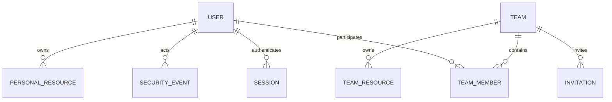
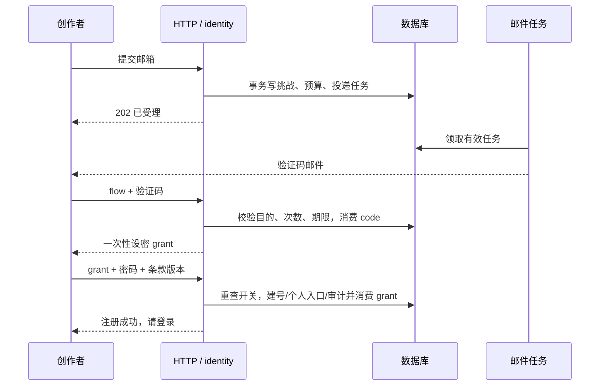

# 用户系统设计

状态：已授权实施，按切片评审；完整运行验收尚未完成。更新：2026-10-15。依据[用户系统软件需求规格](../requirement/01-用户系统需求.md)，支持个人创作者、团队创作者以及平台/团队两类管理职责。未接受的运行参数和协议发布条件见需求待决表。

下游[用户系统 PRD](../prd/01-用户系统.md)基于本设计及需求汇总产品交付定义，再由[执行总览](../plan/00-用户系统执行总览.md)拆解实施任务。

## 1. 实现盘点

以下为当前实现状态；代码、回滚测试与运行环境接受分别记录，完整证据见[执行总览](../plan/00-用户系统执行总览.md)。

| 能力       | 当前源码                                                                                                                                                                                                        | 剩余接受条件                                                       |
| ---------- | --------------------------------------------------------------------------------------------------------------------------------------------------------------------------------------------------------------- | ------------------------------------------------------------------ |
| 邮箱认证   | [auth-view.tsx](../../frontend/src/components/auth/auth-view.tsx) 已有邮箱登录、验证注册和找回流程；[email_auth.go](../../backend/internal/identity/adapter/http/email_auth.go) 提供对应接口                    | 现有服务切换、真实浏览器与邮件完整链路；正式协议发布前保持注册关闭 |
| 会话与身份 | [schema.sql](../../backend/db/schema.sql) 包含邮箱、会话安全版本、挑战、邀请及邮件任务；平台权限与团队成员关系分离                                                                                              | 逐项确认增量迁移与所有消费者接线，不能按物理 org_id 或旧角色放行   |
| 个人中心   | [account-page.tsx](../../frontend/src/app/account/_components/account-page.tsx) 已接入资料、偏好、设备、安全活动和软注销；头像与双邮箱换绑后端已完成切片评审                                                    | 头像及换绑界面、对象存储读回和当前会话下的端到端验证               |
| 平台管理   | [users-page.tsx](../../frontend/src/app/users/_components/users-page.tsx) 已展示邮箱目录；[governance.go](../../backend/internal/identity/application/governance.go) 提供独立治理动作                           | 完整治理界面、统计/受控导出及运行接受                              |
| 团队协作   | [team_governance.go](../../backend/internal/workspace/adapter/postgres/team_governance.go) 与范围授权实现成员、团队治理及资源访问约束                                                                           | 团队管理/空间切换界面、全部异步消费者与综合验收                    |
| 密码与注销 | [password_hash.go](../../backend/internal/identity/domain/password_hash.go) 与密码策略集中维护；[account_deletion.go](../../backend/internal/identity/application/account_deletion.go) 执行本人软删除和即时撤权 | 不以删除数据冒充注销；确认保留资源仍不能被已注销账号访问           |

显示名统一为 32 字符；已登录改密与邮件找回采用不同的验证流程。产品界面统一称“团队”。底层 organization/org_id 表示物理分区，资源访问仍必须验证当前个人/团队范围、会话和成员关系，不能将分区相同视为授权。

## 2. D1 身份与数据模型

对应 FR-USER-02/06/07/09/11/14/16/17；DR-01～08。同一个 user_id 拥有个人身份和零到多个团队成员身份。个人/团队创作者由当前空间和有效成员关系表达，平台权限为独立授权，不保存“团队创作者账号类型”字段。

| 对象              | 候选字段                                                                                                                                                                                                         | 核心约束与查询                                                                                                        |
| ----------------- | ---------------------------------------------------------------------------------------------------------------------------------------------------------------------------------------------------------------- | --------------------------------------------------------------------------------------------------------------------- |
| 全局账号          | id、email/email_key、email_verified_at、display_name、avatar_asset_id、platform_role、status、password_hash/scheme、must_change_password、credential_epoch、platform_epoch、revision、theme、prompt_suffix、时间 | email_key 全局唯一；platform_role 为 creator/platform_admin；不以单一 team_id 决定归属；平台目录按状态/验证/时间索引  |
| 团队              | id、name、avatar_asset_id、status、resume_status、governance_blocked、created_by、auth_epoch、revision、时间                                                                                                     | active/archived/suspended 独立于账号；停用恢复原状态；治理冻结单独控制写入；名称不唯一                                |
| 团队成员          | team_id、user_id、role、status、auth_epoch、revision、joined_at、joined_by/source、last_team_activity_at                                                                                                         | 主键/唯一键(team_id,user_id)，角色 team_admin/member；状态 active/suspended/removed；目录按 team_id/状态/加入时间索引 |
| 创作空间映射      | scope_id、kind、owner_user_id 或 team_id、physical_scope_id                                                                                                                                                      | 个人空间与团队空间二选一；每用户一个个人入口；保留已有物理隔离键及资源 ID，不把物理范围相同视为成员授权               |
| 邮箱挑战/注册授权 | id、purpose、email_key、user_id（可空）、operation_id、proof_digest、credential_revision、attempts、expires_at、consumed/revoked_at                                                                              | 目的闭集，单次消费；注册授权只建指定邮箱普通账号，不能调用业务接口                                                    |
| 会话              | id、user_id、token_hash、credential_epoch、created/last_active/expires_at、revoked_at、persistent、device_summary、reauth_at                                                                                     | token_hash 唯一；会话证明全局登录，不缓存永久有效的团队权限；当前空间只是 UI 选择                                     |
| 邀请              | id、kind、team_id（按 kind 可空）、email_key、team_role、inviter_id、status、revision、expires_at、accepted_user_id                                                                                              | kind 为普通平台账号/团队加入；不接受 platform_admin 角色；同邮箱/团队仅一有效邀请                                     |
| 授权与职责交接    | id、kind、team_id（条件字段）、source_user_id、target_user_id、proposed_role、status、revision、expires_at                                                                                                       | 平台授权和团队交接使用不同目的/处理函数；绑定现有已验证目标，目标接受后才生效，不能把提出方权限转成令牌万能权限       |
| 安全事件          | id、actor_id、target_user_id、team_id、scope_kind、action、result、reason、request_id、safe_diff、created_at                                                                                                     | 只追加，按平台/团队/本人投影；全局风控原因不出现在团队投影                                                            |
| 邮件任务          | event_id、template、recipient、encrypted_payload、status、attempt_count、next_attempt_at、provider_message_id、error_category                                                                                    | event_id 幂等、有限重试，凭据载荷短期加密；完成/到期清除，密钥与数据分开                                              |
| 管理导出任务      | id、actor_id、scope、filter_snapshot、as_of、status、row_count、expires_at、private_object_id                                                                                                                    | 同一过滤快照导出；生成和下载重查授权，过期撤销对象访问；无公开下载 URL                                                |
| 设置              | key、scope、value、revision、updated_by                                                                                                                                                                          | 全局公开注册/团队创建开关及团队邀请开关，写入审计；不创建通用权限配置平台                                             |

头像复用受控媒体引用，校验拥有者与实际格式。账号个人偏好保存在用户层，不因团队切换覆盖。账号注销按已接受的软删除规则撤权并保留数据；事件与导出保留规则单独记录，不承诺物理擦除。

## 3. D2 授权与状态

对应 FR-USER-01/03/08/12/14/15/19/20/21/23；BR-01～12。

授权按“全局身份 → 操作范围 → 当前平台权限或成员资格 → 对象权限”逐级判断。全局账号必须已验证、active、凭据版本与会话有效；受限改密会话仅允许改密和退出。个人操作检查 owner_user_id；团队业务检查有效成员、团队状态和具体资源授权；平台治理检查 platform_admin，**不把治理许可转换成团队内容权限**。

| 场景               | 授权来源                                      | 失效方式                                                            |
| ------------------ | --------------------------------------------- | ------------------------------------------------------------------- |
| 本人资料与个人创作 | 会话 + 本人/对象归属                          | 全局账号/credential_epoch/对象权限                                  |
| 团队内容与成员目录 | 会话 + 请求 team_id 的当前成员关系 + 资源权限 | team.auth_epoch、membership.auth_epoch 或状态改变；不需踢出其他团队 |
| 团队管理           | 上述身份 + 当前 team_admin                    | 角色变更或成员暂停/移除即失效                                       |
| 平台用户/团队治理  | 当前 platform_admin + 必要近期复验            | platform_epoch 变化；角色由服务端实时来源判断                       |
| 受邀加入/交接接受  | 指定邮箱或 user_id 的认证 + 有效目的授权      | 邀请/交接撤回、期限、目标/发起者失权、团队停用                      |

team_id 是请求上下文，不是可信身份；所有持久关系从服务端读取。普通成员目录与团队管理员目录使用不同字段投影，平台/团队/本人事件查询也分离。缓存键至少包含 user_id、scope_kind、team_id 和权限版本；切换范围取消旧请求并校验响应范围再渲染。

团队停用使所有团队业务访问失败，管理员可在治理入口读必要状态摘要；归档允许有效成员按权限只读。governance_blocked 阻止新写入/邀请，只开放经授权的交接修复。全局禁用优先于团队启用，平台恢复团队也不激活 suspended/removed 成员。

最后平台管理员以平台级锁保护；最后团队管理员以对应团队级锁保护。紧急全局禁用可用“先锁用户/涉及团队、复算管理员、原子冻结无管理员团队并撤销账号”的事务处理；锁顺序稳定，交接不得在已过期读取上执行。恢复团队治理须经 FR-USER-21 的目标成员确认。候选具体锁实现应在集成测试中验证死锁处理与重试上限。

长连接在发送受保护数据前、队列在后续敏感步骤、下载在发放内容前复核权限。撤权不能撤回已发出的数据或供应商调用；完成结果仅对仍有权的主体可见，费用按实际执行记录。

## 4. D3 平台用户与团队管理

对应 FR-USER-10～13/17～19/21～25。

| 管理面            | 能力                                                                 | 字段/权限控制                                     |
| ----------------- | -------------------------------------------------------------------- | ------------------------------------------------- |
| 平台用户目录/详情 | 全局查找、统计、状态、安全处理、公共资料治理、平台角色授权、受控导出 | 可看成员摘要，不能读私人内容、秘密或假冒用户      |
| 平台团队目录/详情 | 按团队/管理员查找、团队停用恢复、恶意邀请撤回、待接管处理            | 不必加入团队，但所有治理写入需要原因和审计        |
| 团队设置          | 创建、名称/头像维护、归档恢复、邀请开关                              | team_admin 仅当前团队；平台停用不可自行解除       |
| 团队成员/邀请     | 查找、最小目录、邀请、暂停恢复、角色、移除、退出、职责交接           | 不改全局密码/邮箱/账号状态，不查询其他团队        |
| 全局设置          | 公开注册和团队创建开关                                               | platform_admin + 版本/复验/审计；安全控制不能关闭 |

所有写入接收 expected_revision；创建/邀请/导出等使用 actor + action + scope + request_key 的幂等标识，并对规范化请求内容判等。同键不同输入返回冲突，重试返回同一操作结果。禁用/暂停/移除动作分别命名，不提供含义不清的通用“删除”。

平台注册邀请仅取得普通账号；团队邀请追加成员关系。已注册目标必须验证登录邮箱并主动接受，不能通过被邀请覆盖密码；新注册与邀请争用同邮箱时复用唯一账号，并再次确认加入团队。removed 重新加入可更新同一当前关系并记录新加入事件；suspended 成员需管理员明确恢复，新邀请不能绕过。

团队管理员提升成员为团队管理员要复验，最后管理员职责交接另需接收者接受；平台管理员授予走独立授权提案并要求目标接受。所有接受都重查发起者/目标/团队和版本；撤回/接受竞争只有一个成功。

全局状态与团队状态分别通知。平台公开资料治理只重置显示名/头像；支持恢复不是任意修改邮箱入口。统计独立计算互斥账号状态、可重叠验证标签及有效成员去重人数，带 as_of；成员关系数不能冒充用户数。

导出 P1 使用有上限的私有任务，过滤快照和 as_of 固定，生成与下载都检查当前授权；超 10,000 行拒绝并要求缩小范围；下载限时且鉴权，对 CSV 公式前缀做安全编码。文件完成不代表发起者永久获访问权，撤权后禁止下载并清理临时结果。

## 5. D4 事务、凭据与可靠执行

对应 FR-USER-02～05/07/11～14/23/25；NFR-02/05/07/08/12。

### 注册与邮件

先按规范化邮箱、来源和全局预算限流，统一受理公开注册与恢复，响应与可查询状态不暴露邮箱存在性。挑战与邮件任务同事务创建，worker 只投递未过期的当前版本；重发撤销旧凭据，不清空地址级尝试计数。验证锁定挑战，检查目的/到期/次数，签发一次性设密授权；最终建号再次校验公开注册开关或独立有效邀请、邮箱唯一性，原子建普通账号/个人空间入口、消费授权并写审计。

先验证后设密，防止未验证请求预置他人密码；注册授权不能建立创作会话。丢回执后可查询操作或重新验证后登录，不重新建号。有效邀请模式不依赖公开注册开关，但其团队、目标和权限条件始终执行。

### 密码、会话和换邮箱

新密码采用带版本参数的 Argon2id 与独立盐，参数参考 [OWASP 密码存储](https://cheatsheetseries.owasp.org/cheatsheets/Password_Storage_Cheat_Sheet.html) 后在基准环境定值；现有 bcrypt 仅核验既有密码，合法认证后升级，新密码弱于要求则受限改密，不因格式变化丢失身份。不得静默 trim/截断密码或外发原始密码做弱密码检查。

服务端不透明会话令牌只存摘要，生产 Cookie 使用 HttpOnly/Secure/同站策略，所有状态写入校验可信来源及 CSRF；私有接口 no-store。会话不永久携带团队权限。主动改密原子更新哈希、credential_epoch、撤销旧会话并轮换当前会话；恢复邮件设密撤销全部会话但不自动登录。参考 [OWASP 会话管理](https://cheatsheetseries.owasp.org/cheatsheets/Session_Management_Cheat_Sheet.html) 与 [找回密码](https://cheatsheetseries.owasp.org/cheatsheets/Forgot_Password_Cheat_Sheet.html)。

换绑绑定 user_id、原邮箱版本、新邮箱及双邮箱证明；消费时重查唯一性，原子更新邮箱、撤销全局会话/未完成身份挑战，通知两个地址。成员关系以 ID 关联不受影响；未消费的邮箱定向邀请不自动改投新邮箱，需重新邀请。

### 管理写入、职责保护与账号生命周期

账号/团队/成员/设置变更与安全审计、必要通知任务同事务；邮件故障不回滚已提交的安全变化，审计持久失败则回滚关键写入。成员撤权增加该成员 auth_epoch，团队停用增加该团队 auth_epoch，全局禁用提高 credential_epoch，作用范围不能混用。

团队创建与首位 team_admin 原子完成；容量/开关在提交时检查。列表与统计采用同一过滤语义，分页游标绑定范围、排序及查询条件；注册、最近登录和团队活动时间由服务端写入，变动列表按查询快照/稳定游标控制重复，统计明确 as_of。成员移除/退出保留团队资源归属与作者引用；账号注销必须完成最后管理职责交接；一个事务内软删除、撤销会话/证明/成员权限并保留个人资料和资源，团队资源继续归团队。不设冷静期、取消或物理清理任务。

备份恢复除账号数据外还必须恢复安全事件与治理冻结状态，或从独立持久源重放安全撤权；完成前阻止外部访问，并使恢复前会话全部失效。无法证明安全状态完整时停止开放，不能仅恢复旧库后让禁用账号复活。

## 6. D5 接口与界面边界

HTTP 路由、请求/响应、错误、版本、幂等、分页、Cookie/CSRF 与前端状态统一见[接口设计](03-用户系统接口设计.md)。表字段、索引、外键、锁序和清理合同统一见[数据库设计](02-用户系统数据库设计.md)，不在总体设计重复定义另一份详细合同。

页面分为公共认证、账号设置、个人/团队空间切换、团队设置和平台后台。平台入口按平台权限展示，团队管理入口按当前成员职责展示；直接 URL、刷新和异步任务仍由服务端授权。测试矩阵、部署、恢复和证据要求见[测试与运行设计](04-用户系统测试与运行设计.md)。

## 7. 邮件与外部依赖

注册验证、密码恢复、邮箱换绑、账号/团队邀请、权限授予与职责交接、安全通知使用目的不同的模板。邮件任务受理、供应商投递和实际收信分别记录；失败有限重试并告警。

验证码使用服务端密钥保护的摘要，随机长令牌只存摘要；必要待投递载荷短期加密，密钥隔离且日志不输出。链接 origin 由可信配置产生，不接受任意 Host/redirect；邮件落地无第三方跟踪、no-referrer，GET 不消费凭据，明确 POST 才执行。worker 回调验签与去重，过期任务不再发信。

IR-01～06 均需契约测试：邮件故障、媒体引用失败、项目/生成撤权、审计故障和配置缺失都必须有真实失败路径。供应商选择、测试邮箱、恢复支持政策与保留期限未定时，只能报告已完成的工程层证据。

## 8. D6 迁移与切换

对应 FR-USER-16；NFR-07/14。先授权目标环境与只读盘点，再执行单独审阅的增量，不重放最终态 schema。

1. 盘点账号、旧 org_id、role、个人/共享资源引用、无邮箱/冲突、现有管理员。对每个旧范围形成明确团队/物理范围映射；不因名为工作区就认为全部资源应共享。
2. 扩展全局邮箱与平台角色、团队/成员、空间映射、邀请/交接与权限版本；可以保留现有物理 organization/org_id 以避免破坏外键，但产品与授权使用显式团队语义。
3. 现有用户 ID 不变；核实的旧范围内 admin 可映射该团队 team_admin，不能升级 platform_admin。平台管理员单独指定并验证；团队多角色信息进入成员关系，不继续由单一 User.OrgID/Role 供所有请求使用。
4. 逐账号完成安全邮箱绑定；受控迁移授权只绑定当前 ID，不能作为业务会话。无邮箱、冲突、未明确归属的资源隔离处理，不猜测、不自动合并、不清库。
5. 改造所有身份消费者：HTTP principal、管理目录、媒体/下载、项目/画布、生成队列、审计/缓存/导出；检查全局身份与请求范围各自来源，不能只更新登录模块。
6. 在隔离副本对照 ID/资源归属/当前成员/旧授权映射，运行双团队多角色矩阵、并发保护与恢复演练。确认至少一可用平台管理员、每个可写团队有可用管理员。
7. 前后端同步切换邮箱及平台/团队接口，失效旧会话；关闭公开登录名入口与旧单范围管理权限绕过。临时绑定入口有截止时间，完结后删除。
8. 收尾删除无消费者的旧身份字段/契约前先证明引用已迁移。故障时关闭受影响写入并采用兼容新身份数据的修复或已演练恢复，不能把新多团队身份回退到只认识单组织的版本。

该计划不授权本轮写数据库；术语调整不等于已执行物理表/列重命名。

## 9. D7 质量验证与追踪

[需求规格第 6 节](../requirement/01-用户系统需求.md#6-非功能性需求)是指标唯一来源，设计不复制另一套数字。

| 非功能需求 | 设计落实点                                                | 验收  |
| ---------- | --------------------------------------------------------- | ----- |
| NFR-01     | D2 范围和对象授权、撤权版本、缓存/任务复核                | QA-01 |
| NFR-02     | D4 凭据/会话/CSRF、防枚举，邮件密钥与日志边界             | QA-02 |
| NFR-03     | D1 目录索引与 D5 有界接口；密码核验成本纳入压测           | QA-03 |
| NFR-04     | D3 限额/分页/导出和成员唯一约束                           | QA-04 |
| NFR-05     | D4 事务、幂等与版本，D2 最后管理员锁                      | QA-05 |
| NFR-06     | D4 异步邮件/权限源失败拒绝，运行探测                      | QA-06 |
| NFR-07     | D6 备份恢复，安全事件与治理冻结恢复检查                   | QA-07 |
| NFR-08     | D4/第 7 节邮件队列、过期、重试、退信与实测收信            | QA-08 |
| NFR-09     | D5 表单/管理界面焦点、反馈、响应式                        | QA-09 |
| NFR-10     | D5 浏览器合同与邮件 GET/POST 语义                         | QA-10 |
| NFR-11     | D1 字段投影/保留、D3 受控导出、D4 注销                    | QA-11 |
| NFR-12     | D1 安全事件与 D4 事务/outbox、告警                        | QA-12 |
| NFR-13     | identity 领域规则、workspace 团队边界、生成契约和注入时钟 | QA-13 |
| NFR-14     | D6 映射/回退检查，D4 服务端时钟与期限                     | QA-14 |

工程边界继续使用 `adapter → application → domain`，全局身份由 identity 负责，团队资料/成员生命周期按现有 workspace 业务边界实现；身份模块通过消费方小接口获取团队授权事实，避免循环依赖或创建通用权限微服务。客户端 DTO 由现有工具链生成。

完整 FR → D → 批次 → AC 对照在需求第 8 节；计划必须覆盖各批次适用 NFR/QA。自动化门禁、隔离存储、真实邮箱、浏览器与用户接受分别记录；本轮只校验文档结构与一致性。

## 10. 模块边界与方案取舍

沿用模块化单体：identity 负责全局身份、邮箱证明、会话、平台治理及安全事件；workspace 负责团队、成员、空间与资源归属；media 负责受控头像；已有任务基础设施负责投递与清理。composition 在 internal/app 注入依赖。HTTP 仅解码、校验及转换，事务由应用用例协调，领域规则不依赖 Gin/GORM。

| 选择                               | 结论与理由                                                           |
| ---------------------------------- | -------------------------------------------------------------------- |
| 扩展既有 identity/workspace        | 采用；单库事务可以覆盖禁用与团队冻结，当前不需要分布式一致性         |
| 外部 IdP 替换登录                  | 本轮不采用；尚无既定供应商，不能解决团队资源归属和存量角色映射       |
| 单一 User.Role 同时决定平台/团队权 | 不采用；不能表达 A 团队管理员、B 团队成员及独立平台管理职责          |
| 为所有用户建立一个“个人团队”       | 不采用；个人所有权是明确实体，不制造虚假团队或席位                   |
| 长期把授权角色放入 JWT             | 不采用；需求要求撤权提交后下一请求生效，使用服务器会话与当前权限查询 |

跨模块不互相调用应用服务形成循环：workspace 消费方定义 `ActorAccess` 小接口获取有效账号事实；业务资源消费者定义 `ScopeAccess` 获取范围事实；internal/app 适配 identity/workspace 实现。跨账号禁用和团队冻结的同库事务适配器放 composition 附近，持有明确数据库依赖，以同一事务执行两模块已定义的存储操作；不能先提交禁用再依赖最终一致事件补冻结。平台治理的团队读模型不投影作品。

### 注册时序

### 状态变化与失败边界

凭据消费/成员撤回竞争以数据库提交顺序为准。邮箱唯一冲突不得合并 ID；用户可重新登录已有身份。业务提交成功、发信失败时页面如实显示已完成操作及通知状态；数据库审计失败则整笔回滚。私有权限数据源不可用时拒绝访问，不能回退固定工作区。已派发第三方任务不能伪装为撤销成功，后续执行、资源写回和下载按当前权限处理。

新密码 Argon2id 候选初值 m=19456 KiB、t=2、p=1、salt=16 bytes、hash=32 bytes；这是依据 [OWASP 密码存储建议](https://cheatsheetseries.owasp.org/cheatsheets/Password_Storage_Cheat_Sheet.html)选择的测试起点，需按 NFR-03 的实际并发验证，并限制并行哈希数量避免内存耗尽。既有 bcrypt 仅验证及升级，不用旧 72 字节限制截断新密码。

## 11. 文档接受与实现边界

用户已确认邮箱加密码、注册验证邮箱、现有 SMTP、个人与团队创作者、独立平台管理权限，以及即时软删除并保留数据。指定存量账号的邮箱绑定和平台管理员迁移已执行。其余实现继续按任务推进；实际运行配置、正式协议版本、其他记录的保留规则及综合验收分别记录，不将这些未决项扩大为已接受功能的阻塞。设计评审关注接口/状态/事务/归属，实施评审关注 diff 与测试，产品验收关注实际使用结果，三者分开记录。
