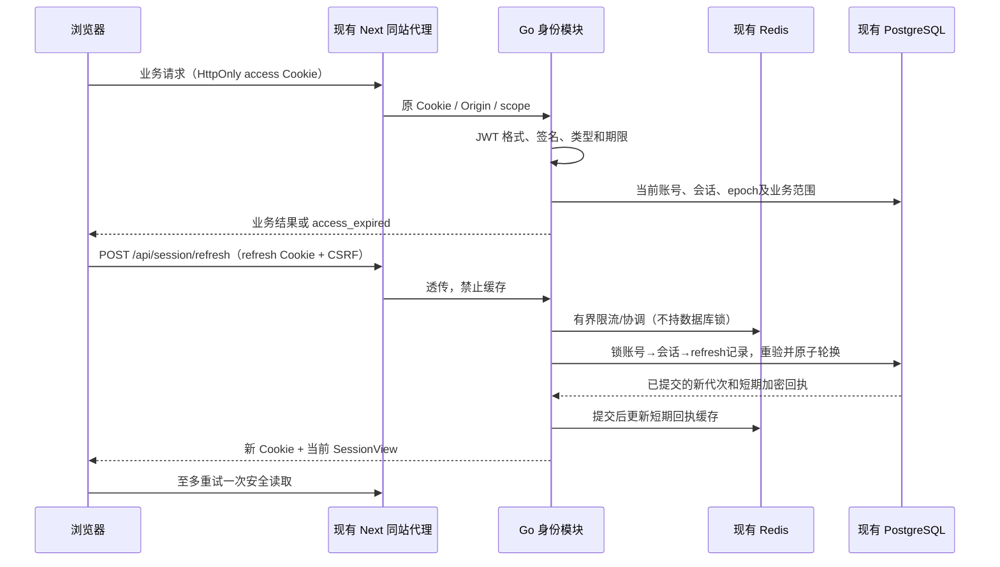

# 无感登录与会话续期调研设计

更新：2026-10-21（结构整理）；文档确认状态沿原来源，未重新认定方案接受。

## 1. 摘要

在可信同站入口恢复会话，透明续期并保持即时撤权及原业务幂等。

本文按设计、用户故事与测试场景结构整理。原需求、确认结论和历史验证沿来源记录保留；当前实施进度、剩余工作及阻塞项统一见 [BACKLOG](../../BACKLOG.md)。

## 2. 参与者

使用者与参与职责：保持登录的创作者及身份、BFF、前端会话消费者。维护职责及确认人沿下方原来源记录；未给出姓名的，不补造人员或排期。

## 3. 背景

需求来源：[02-用户系统需求](01-用户系统总体设计.md#36-需求原文与规则文首来源与范围)。产品范围来源：[01-用户系统](01-用户系统总体设计.md#34-产品定义文首来源与范围)。

下方保留来源的日期、适用范围与确认状态。早期盘点和历史结果只支持其原时点；整理文档不重新执行实现、测试、迁移或发布。

### 3.1 文首来源与范围

来源：原设计《05-无感登录与会话续期调研设计》文首。

适用范围：已确认方案B的设备会话、透明续期、撤销与恢复。文档版本：2026-10-20整理版；方案接受、工程完成与整体接受沿第8.3节区分。第8.5节为同日源码检查，不改变方案，也不关闭整体接受。维护职责：identity、BFF及前端会话消费者；评审人未指定。

需求来源：[用户系统需求](01-用户系统总体设计.md#757-需求原文与规则无感登录与自动续期增补)。用户已确认“在此设备保持登录”最长 **30 天**、连续 **7 天未使用**失效。用户于本轮确认本文方案B，并要求使用Superpowers拆计划、pm-execution统一文档；初始参数作为实施基线，性能及容量仍须实测。普通登录不强制重置密码，注销只做软删除，平台与团队的实时权限边界保持不变。

实施进度及调度字段见 [BACKLOG 第4.5节](../../BACKLOG.md#45-05-无感登录与会话续期调研设计文首来源与范围)。

### 3.2 调研时的实现与问题边界

来源：原设计《05-无感登录与会话续期调研设计》第1节。

本节记录实施前调研快照，不代表T-AUTH-01～09的最新源码，不等同于浏览器恢复、压测或部署验收。检查时 Git HEAD 为 `7fa8b7f1`；工作区有其他任务的未提交修改，本文未改动这些文件。

| 环节       | 当前证据                                                                                                                                                 | 结论                                                                               |
| ---------- | -------------------------------------------------------------------------------------------------------------------------------------------------------- | ---------------------------------------------------------------------------------- |
| 登录凭据   | [auth.go](../../backend/internal/identity/application/auth.go) 的 `newAuthSession` 生成 32 字节随机值，服务端保存 SHA-256 摘要                           | 当前是 PostgreSQL 权威的 opaque Cookie 会话，不是 JWT                              |
| 登录保持   | [email_auth.go](../../backend/internal/identity/adapter/http/email_auth.go) 的 `respond` 仅在 persistent 为真时设置 Cookie Expires                       | 已有保持登录勾选；它目前只改变浏览器持久性，不改变服务端期限                       |
| 服务端期限 | [domain/auth.go](../../backend/internal/identity/domain/auth.go) 的 `AuthSession.Valid` 与 `newAuthSession`                                              | 所有会话空闲 12 小时、绝对 7 天；到达任一边界拒绝                                  |
| 活跃滑动   | `Auth.Current` 校验当前账号、会话及凭据版本，并调用 `TouchSession`                                                                                       | 已有请求时刷新活跃时间；不能笼统称“完全没有续期”                                   |
| 页面恢复   | [session.tsx](../../frontend/src/components/auth/session.tsx) 启动时调用 `GET /api/session`，成功后恢复本人状态与 CSRF                                   | 已有有效 Cookie 下的免重复输密恢复；401 后进入游客或登录                           |
| 到期处理   | [request.ts](../../frontend/src/lib/request.ts) 将受保护接口的 401 发布为会话失效；无 refresh 调用                                                       | 缺少短期凭据到期后的透明恢复和并发协调                                             |
| CSRF       | [session_security.go](../../backend/internal/identity/application/session_security.go) 由当前会话 token 派生 CSRF，写入另校验 Origin                     | 直接轮换 token 会影响 CSRF，必须一并设计，不能只加一个刷新接口                     |
| 代理       | [BFF 路由](../../frontend/src/app/api/[...path]/route.ts) 有显式路由白名单，透传 Cookie、Origin 和 Set-Cookie                                            | 需要同步刷新接口、Cookie 和错误合同；BFF 不能伪造可信 Origin                       |
| Redis      | [wiring.go](../../backend/internal/app/wiring.go)、[roles_wiring.go](../../backend/internal/app/roles_wiring.go) 复用 Redis 连接并用于就绪检查、实时消息 | 项目已有 Redis 接入，但当前身份会话不是 Redis 会话；未验证其持久化、容量或认证用途 |

### 3.3 截图错误的独立原因

来源：原设计《05-无感登录与会话续期调研设计》第1.1节。

截图访问 `http://localhost:3200/assets`，提示文案来自 `origin_forbidden`。只读检查现有 `glowloom-backend` 的 `LV_PUBLIC_ORIGIN`，结果为 `http://127.0.0.1:3200`。[HTTP 中间件](../../backend/internal/platform/httpapi/protocol.go) 对 POST/PUT/PATCH/DELETE 的 Origin 作精确匹配，不同即拒绝；BFF 保留浏览器实际 Origin。

因此，当前地址与可信来源不匹配足以解释该提示。未重放截图中的登录请求；不把截图中的任何凭据作为测试输入。这个错误不是密码错误，也不能用 JWT 解决。`localhost` 与 `127.0.0.1` 的 Cookie 不共享；Next 的开发来源设置也不代替后端 Origin 校验。

### 3.4 本次要解决的用户结果

来源：原设计《05-无感登录与会话续期调研设计》第1.2节。

用户在同一可信设备、有效期限内重新打开页面或短期凭据到期时，不重复输入密码、不闪现登录弹窗、不丢创作输入；离线/服务故障可恢复，确定失效才重新登录。退出、账号禁用/软注销、凭据变更及团队撤权继续真实生效。无感登录不包含扫码登录、OAuth、SSO、Passkey 或替用户提交生成任务。

### 3.5 必要市场调研

来源：原设计《05-无感登录与会话续期调研设计》第2节。

范围仅为创作工作流的登录连续性、设备治理和身份基础设施。未评估市场规模、价格或采购，不推测竞品后端使用 JWT 或 Redis。资料于 2026-10-18 查阅；“公开事实”“本项目推导”“未知”分别记录。

### 3.6 创作产品的公开体验

来源：原设计《05-无感登录与会话续期调研设计》第2.1节。

| 产品   | 官方公开事实与依据                                                                                                                                                                                          | 对织光的推导                               | 证据边界                                                                   |
| ------ | ----------------------------------------------------------------------------------------------------------------------------------------------------------------------------------------------------------- | ------------------------------------------ | -------------------------------------------------------------------------- |
| Figma  | 默认连续 21 天不活跃后退出；Enterprise 可设更短空闲期，并在到期前提示。[官方说明](https://help.figma.com/hc/en-us/articles/14376092335127-Set-an-idle-session-timeout)                                      | 长创作流程需要区分活跃使用、闲置和真正失效 | 非对织光适用的认证标准；未观察其网络实现                                   |
| Adobe  | 账号登录 FAQ 将“保持登录”描述为关闭浏览器后仍可保持最多两周，共享设备应关闭此项。[官方 FAQ](https://helpx.adobe.com/business/enterprise/setup-onboarding/sign-in-and-access/adobe-account-sign-in-faq.html) | 保持登录是用户选择，不等于无限期会话       | 说明有账号类型适用范围，不能推断所有 Adobe 产品期限                        |
| Canva  | 区分退出当前会话与退出所有设备/浏览器。[官方帮助](https://www.canva.com/help/log-out-of-canva/)                                                                                                             | 连续登录必须配套真实设备撤销               | 未找到本轮可核验的统一会话时长或 token 格式                                |
| CapCut | 官方支持在移动端、PC、Web 登录同一账号，并强调使用相同登录方式，登录后载入同一账号数据。[官方帮助](https://www.capcut.com/help/how-to-log-in-one-account-to-multiple-devices)                               | 设备连续性与账号一致性需要一起验收         | 扫码属于另一个功能，本轮不引入；未披露刷新算法                             |
| 即梦   | [公开产品页](https://jimeng.jianying.com/) 可核验其 AI 创作与素材场景                                                                                                                                       | 可作为长创作流程的体验对照                 | 本轮未取得可核验的登录保持期限、refresh 或会话存储说明；不填造其架构和数值 |

结论：市场支持“有效会话期间连续创作、用户可控制设备”的产品方向，不支持把任何一家产品的期限或后端实现直接当成织光需求。30 天/7 天来自本项目用户确认。

### 3.7 认证产品与标准

来源：原设计《05-无感登录与会话续期调研设计》第2.2节。

| 来源                                                                                                                                                                     | 核验事实                                                                     | 采用方式                                                                        |
| ------------------------------------------------------------------------------------------------------------------------------------------------------------------------ | ---------------------------------------------------------------------------- | ------------------------------------------------------------------------------- |
| [Supabase Sessions](https://supabase.com/docs/guides/auth/sessions)                                                                                                      | 区分短期 JWT 与 refresh token；有绝对/空闲限制、轮换及并发或丢响应的复用例外 | 借鉴生命周期和异常场景，不照搬其默认时长、客户端存储或延迟撤销语义              |
| [Auth0 Rotation](https://auth0.com/docs/secure/tokens/refresh-tokens/refresh-token-rotation)                                                                             | 刷新时轮换凭据，检测旧凭据重用并处理 token family                            | 需要区分正常并发、结果丢失和真正重放，不能对重复请求直接踢号                    |
| [Clerk Session Tokens](https://clerk.com/docs/guides/sessions/session-tokens)、[Session Options](https://clerk.com/docs/guides/secure/session-options)                   | JWT 是短期会话凭据，会话另有空闲/最长时限                                    | token 到期不等于账号或设备会话失效                                              |
| [RFC 9700 §4.14](https://www.rfc-editor.org/rfc/rfc9700.html#section-4.14)                                                                                               | OAuth 刷新凭据需保护、限制范围，并考虑轮换、重放、撤销与不活跃到期           | 本项目借鉴防护原则，不宣称自己实现 OAuth/OIDC 或已符合标准                      |
| [RFC 8725](https://www.rfc-editor.org/rfc/rfc8725.html)                                                                                                                  | 校验算法、签发者、受众及 token 类型，隔离不同用途 JWT                        | 固定验证规则，拒绝由客户端头部决定密钥/算法                                     |
| [OWASP Session Management](https://cheatsheetseries.owasp.org/cheatsheets/Session_Management_Cheat_Sheet.html)                                                           | 会话应有服务端期限、Cookie 防护及撤销机制                                    | HttpOnly/Secure/SameSite 与 Origin/CSRF 配套，不能仅加长 Cookie                 |
| [Redis 原子脚本](https://redis.io/docs/latest/develop/programmability/eval-intro/)、[持久化](https://redis.io/docs/latest/operate/oss_and_stack/management/persistence/) | 脚本可原子执行；持久化模式各有丢失窗口                                       | Redis 原子性不等于 PostgreSQL＋Redis 的跨库事务，Redis 丢缓存不能恢复已撤销会话 |

这些是公开资料调研，不是竞品实机多日观察、现有 Redis 故障演练或本项目安全认证。

### 3.8 文首来源与范围

来源：原任务文档《08-无感登录与会话续期实施计划》文首。

2026-10-20 运行入口修正：已按用户要求删除运行时密钥文件加载和 Compose secret 挂载，统一 `.env` 值注入；现有 JWT 库保持不变。用户授权重新生成本地 JWT/回执密钥，保留原身份摘要与加密材料，服务健康检查 200，用户已重新登录。配置、身份、应用测试通过 race 检查；`go vet`、`golangci-lint` 通过，`govulncheck` 未发现可达漏洞（存在一项未调用的依赖模块漏洞）。

> 执行说明：保留原技术任务与验证步骤；本次按模板补齐规划内容，不要求调用特定技能或改变已约定的执行方式。

**Goal:** 在现有环境中完成可信站点上的无感登录和自动续期，保持原密码登录、即时撤权、创作空间及业务幂等边界。

**Architecture:** 采用已确认的短期 JWT＋轮换 refresh token，Redis 负责有界协调及派生缓存，PostgreSQL 保留身份、会话、权限、轮换与审计的权威事实。扩展现有 Go 身份模块、Next 同站代理和根级 SessionProvider，不建设第二套身份服务或前端会话状态。

**Tech Stack:** 现有 Go/Gin/GORM/Wire、PostgreSQL、go-redis、Next App Router、React、Axios、生成式 OpenAPI 客户端及 Vitest。JWT 适配器已固定 `github.com/golang-jwt/jwt/v5 v5.3.1`，依据[官方发布](https://github.com/golang-jwt/jwt/releases/tag/v5.3.1)；T-AUTH-03已固定依赖，T-AUTH-10工程检查包含govulncheck。

**Spec:** [设计05](#1-摘要)；[设计01第7.57节](01-用户系统总体设计.md#757-需求原文与规则无感登录与自动续期增补)；[用户系统PRD](01-用户系统总体设计.md#34-产品定义文首来源与范围)。用户于2026-10-18确认设计并要求拆计划；**用户已授权实施；T-AUTH-01已通过模块验证与独立审查；T-AUTH-02已完成兼容迁移和回滚验证；T-AUTH-03已通过模块验证及修复复审；T-AUTH-04已完成用例、修复复审与PG回滚验证；T-AUTH-05已通过HTTP验证、Cookie冲突修复复审及PG回滚验证；T-AUTH-06已通过组合验证及修复复审；T-AUTH-07已通过前端及合同验证与独立审查；T-AUTH-08已通过恢复协调验证及修复复审；T-AUTH-09已通过旧会话升级、修复复审及PG回滚验证；T-AUTH-10实施与限定运行验证、最终整包审查和修复复审完成；整体AC仍部分接受**。

## 4. 目标

在可信同站入口恢复会话，透明续期并保持即时撤权及原业务幂等。目标的规则、量化条件与非目标沿需求原文及下方已确认设计，不增加未经确认的指标。

## 5. 使用场景

参与者为保持登录的创作者及身份、BFF、前端会话消费者；在下方定义的输入、对象状态、权限和环境条件具备时执行相应操作。各故事按其独立前置条件核对，不能把测试夹具当成真实业务条件。

### 5.1 生命周期与使用体验

来源：原设计《05-无感登录与会话续期调研设计》第4节。

| 参数             | 普通登录                                                 | 勾选保持登录                      | 接受状态                             |
| ---------------- | -------------------------------------------------------- | --------------------------------- | ------------------------------------ |
| 设备会话绝对期限 | 创建后 7 天                                              | 创建后 30 天                      | 普通值沿用现有；保持登录值用户已确认 |
| 空闲期限         | 连续 12 小时                                             | 连续 7 天                         | 普通值沿用现有；保持登录值用户已确认 |
| access JWT       | 最多 15 分钟，且不越过会话绝对期限；PG仍严格校验空闲期限 | 同左                              | T-AUTH-09正式修正                    |
| 提前续期         | 前台正在使用时，预计到期前 60 秒                         | 同左                              | 设计建议                             |
| 浏览器持久性     | access/refresh/CSRF 均使用 session Cookie                | 仅固定 Expires，不使用相对Max-Age | 设计建议，保持登录默认不勾选         |
| 敏感操作复验     | 现有 5 分钟近期密码证明                                  | 同左，自动续期不得刷新 reauth_at  | 沿用现有约束                         |

续期不改变 created_at、sid 或 absolute_expires_at，只更新 token 代次。空闲期限取服务端认可的最近活动与绝对期限的较早值，恰好到期即拒绝。旧设备会话不因本次新规则被追溯延长。

有效活动定义为成功授权的用户业务访问，以及页面回到前台后的会话恢复；纯 refresh、心跳、SSE 保活和后台轮询不独立延长空闲期。前端隐藏后暂停续期计时，恢复可见或 online 时先校验一次；实施前需逐路由识别后台轮询，避免其借通用鉴权隐式 TouchSession。最近活动的安全时间由服务端采样，不接受客户端时间直接延长期限。

不承诺“关浏览器必定退出”：浏览器会话恢复功能可能保留 session Cookie，见 [MDN Set-Cookie](https://developer.mozilla.org/en-US/docs/Web/HTTP/Reference/Headers/Set-Cookie)。未勾选意味着不主动配置跨浏览器重启持久保存，服务端仍强制较短期限；共享设备可显式退出。

### 5.2 界面状态

来源：原设计《05-无感登录与会话续期调研设计》第4.1节。

| 状态          | 用户看到的内容                               | 行为                                                                         |
| ------------- | -------------------------------------------- | ---------------------------------------------------------------------------- |
| 恢复中        | 公共页面照常可浏览；私有区域使用现有加载状态 | 不抢先显示登录弹窗，不先展示上个账号内容                                     |
| 有效          | 正常创作                                     | 同账号续期不重挂页面、不清草稿、不切空间                                     |
| 正在续期      | 默认无额外弹窗                               | 同一会话只执行一份续期，其余请求等待或继续使用仍有效 JWT                     |
| 网络/依赖故障 | “暂时无法确认登录状态，重试”                 | 暂停新的私有操作，不伪装成游客/账号被删除，不清 Cookie 或丢输入              |
| 确定失效      | “登录已过期，请重新登录”                     | 清理私有缓存，保留同一账号可安全恢复的输入；登录后仍需用户确认生成/发布/删除 |
| 当前设备退出  | 回到游客状态                                 | 清理身份与私有缓存，其他设备不受影响                                         |
| 来源错误      | “请从配置的网站地址打开”及可信站点入口       | 不显示“密码错误”，不自动跨源提交表单                                         |

确定失效后的恢复仅保留实际创作入口中的**纯文本与换行**：RichGeneration 的现有草稿分支继续绑定原账号、项目和草稿；首页生成提示词与画布想法共用的输入绑定原账号及当前可写空间。这是有损保留，不保留参考素材、上传句柄、模型参数、私有视图、待保存/生成命令或回执，也不扩展为所有表单的通用恢复。登录过期期间隐藏全部私有内容；同一账号取得新 sid 后，仍须重新读取当前账号和原草稿权限，或重新确认首页原空间仍可写，才提供显式恢复按钮。用户选择后才采用文字，参考素材与生成设置需重新选择；不自动创建画布或执行生成、发布、删除。不同账号登录、主动退出或明确失去原范围权限时不得恢复；503/离线只保持锁定，允许之后重新核验，不把故障当作授权。

实现继续使用既有 IndexedDB 分支存储；同 store 的单条非凭据元数据保存清理代次、账号绑定与主动退出的旧 sid 墓碑，用事务比较阻止另一连接清理后旧写入或迟到读取复活输入。服务端身份读取之前捕获本地代次，激活时复核；即使退出 DELETE 尚未完成，旧 sid 的前台读取成功也不能重新取得写入许可。不同账号激活清除旧输入；合法新 sid 仍须经过服务端身份与范围确认。广播只通知清理，不发送 sid 或凭据；AT/RT/CSRF 不进入本地存储。纯 timer 续期不重新激活本地恢复权限，也不为此新增会推进 idle 的 GET。本地存储不可用时恢复关闭，但不否认成功的服务端登录。首页文字编辑只写本地分支，不逐字调用授权 API；已确认的空间切换清空旧内容后保留新范围输入的写入能力。

主动退出当前设备（包括设备目录中的当前行）的 DELETE 显式绕过待完成续期，保留 Origin/CSRF、身份代次及服务器撤销校验；旧身份回调不能清除新会话输入。撤销其他设备及普通业务写入继续等待续期且不自动重放。

本地恢复资格与服务端登录分离：同一元数据另记录 activeSession 与 active/input-only/cleared 状态，文字转交给新 sid 必须同时有被动脱敏事务成功提交的 input-only 状态，以及本模块见证该次成功清理的账号/epoch。收到其他标签的 identity-changed 通知时，先同步撤销本模块恢复见证、writer lease 与旧激活代次，再尝试前台身份读取；读取/IDB失败不能保留恢复资格，自身 source 的通知仍忽略。强清理或换号同步使本模块见证失效，即使 IDB 写入失败；重载/新模块没有见证时丢弃旧锁定文字，不能从持久旧标记推断期间没有发生退出。未确认身份的启动也不能仅凭旧 owner 元数据生成恢复资格。旧 active 会话、缺失或旧版含糊元数据不得证明已清理；新 sid 激活时原子丢弃这些旧行，不能从完整快照推导恢复输入。强清理失败的进程内意图优先于后续被动清理，防止主动退出被降级为保留文字。存储完全不可写时不承诺物理擦除或墓碑已落盘；恢复后必须先通过上述事务资格检查才授予本地读写能力，不能因旧 checkpoint 未变化就开放旧快照。该故障路径允许丢失本地输入，不删除服务端草稿，也不阻止成功的服务端登录。

RichGeneration 的 inputRecovery 分支不提供可用的“保留为副本”入口；点击“恢复此分支”须重新通过同账号、原草稿权限及 durable fence 读取最新文字，并检查当前编辑器、身份/空间代次和输入修订。最终核验与采用之间不再等待异步操作，不使用展示时缓存的旧正文。普通完整分支的既有恢复/副本语义保持原样。

## 6. 价值

减少重复登录，同时保住设备、空间与授权边界。

## 7. 方案

### 7.1 方案选择

来源：原设计《05-无感登录与会话续期调研设计》第3节。

| 方案                                                    | 能满足的目标                                                         | 代价/限制                                                                          | 结论                                                                                 |
| ------------------------------------------------------- | -------------------------------------------------------------------- | ---------------------------------------------------------------------------------- | ------------------------------------------------------------------------------------ |
| A：完善现有 opaque Cookie＋PostgreSQL                   | 能完成保持登录、页面恢复、滑动空闲期与即时撤销，无须 JWT             | 继续依赖服务端会话查询；凭据轮换和并发仍需补设计                                   | 改动最小的有效备选，不能因不使用 JWT 而否定其正确性                                  |
| B：短期 JWT＋轮换 refresh token＋现有 Redis＋PostgreSQL | 明确分开请求凭据与设备会话，可统一前后台到期合同，并复用既有基础设施 | 多一种 token 生命周期、轮换回执和密钥管理；为即时撤权仍查当前持久状态              | **用户已确认的目标方案**；收益是生命周期明确，不宣称“完全无状态”或未经测量的性能提升 |
| C：长效 JWT，仅靠签名/Redis 黑名单或新托管身份系统      | 单独验签较简单，托管服务可承接通用认证                               | 长效 JWT 放大泄漏窗口；黑名单/缓存丢失会破坏即时撤权；迁移托管超出复用现有环境边界 | 本轮不采用                                                                           |

下文详细设计 B。选择 A 时保留相同产品需求和验收，删除 JWT/refresh 专有机制即可；不同时建设两套长期认证系统。

### 7.2 架构与权限责任

来源：原设计《05-无感登录与会话续期调研设计》第5节。



JWT 只携带身份引用，不持久封装团队角色、成员列表、资源权限或可直接授权的 capabilities。受保护请求仍检查 PostgreSQL 中的账号 active/verified/非软删除、会话未撤销/未到期、credential epoch，以及当前平台/团队/资源资格。签名正确或 Redis 命中均不能跳过这些检查。

Redis 承担认证限流、跨实例刷新协调、已提交结果的短期缓存和失效提示；PostgreSQL 保留设备目录、撤销、凭据版本、期限、轮换状态和安全审计的权威事实。缓存不能成为正向授权依据，不借引入 JWT 将撤权放宽为“等待 15 分钟到期”。后台队列继续使用既有 durable actor/scope 检查，不把浏览器 JWT 当成长期 worker 凭据。

### 7.3 Token、Cookie 与密钥

来源：原设计《05-无感登录与会话续期调研设计》第6节。

原条目的当前实施进度和剩余工作已迁入 BACKLOG；其确认范围及历史证据仍按原来源使用。

### 7.4 access JWT

来源：原设计《05-无感登录与会话续期调研设计》第6.1节。

推荐固定 `RS256`，通过审阅后的 Go JWT 库实现，不自行编写验签算法。Header 含固定用途 `typ=at+jwt` 和已配置的 `kid`；Claims 为 `iss=glowloom.identity`、`aud=glowloom.web`、`sub=user_id`、`sid`、`jti`、`iat`、`nbf`、`exp`、credential epoch。issuer 是稳定逻辑身份，不随浏览器 Host 改变。

JWT 的 `exp` 不超过签发后15分钟及设备不可变的绝对期限；不按签发当时的空闲期限裁短。前台成功访问可以推进空闲期限，但每次请求与刷新仍先核验PG当前空闲/绝对期限，超过空闲边界时JWT尚未到期也拒绝。这样保留完整恢复窗，避免刚恢复前台后凭据按旧空闲时间提前失效。

固定允许算法、可信公钥集合与 issuer/audience/type；未知 kid、none、算法混用、非法主键或未来签发时间均拒绝。时钟偏差建议最多 30 秒，只用于 JWT 时间解析，不能延长持久会话空闲/绝对期限。公开内容不放邮箱、头像、作品、权限表或秘密。

2026-10-20 用户修正：JWT 私钥与身份摘要、邮件加密、刷新回执密钥按用途分开，统一由 `.env` 直接注入，不增加密钥目录或文件挂载。JWT 签发与验证复用 `github.com/golang-jwt/jwt/v5`，配置编码见[用户系统测试与运行设计](04-用户系统测试与运行设计.md)。旧验证公钥保留到已发 token 最大有效期及容差结束；丢失密钥后的本地重新生成已获得用户授权，需要重新登录，但不改密码或业务数据。密钥不进入浏览器、仓库、日志或报告。

### 7.5 refresh token 与 CSRF

来源：原设计《05-无感登录与会话续期调研设计》第6.2节。

Refresh 为至少 32 字节随机 opaque secret，绑定唯一 sid、代次和用途，不是可调用业务 API 的 JWT。服务端默认只存带用途隔离的安全摘要。CSRF 改为稳定绑定 sid 的独立随机证明与摘要，不再随 access JWT 字符串轮换；登录换号、主动改密或新设备会话重建时重新生成。

| Cookie                    | 浏览器可读           | 生产属性                                          | 生命周期                                                               |
| ------------------------- | -------------------- | ------------------------------------------------- | ---------------------------------------------------------------------- |
| `__Host-glowloom_access`  | 否                   | HttpOnly、Secure、SameSite=Lax、Path=/、无 Domain | JWT 到期；保持登录时持久期限最多 15 分钟                               |
| `__Host-glowloom_refresh` | 否                   | 同上                                              | 保持登录时浏览器期限不超过设备不可变的 absolute；服务端仍严格校验 idle |
| `__Host-glowloom_csrf`    | 是，仅随机 CSRF 证明 | Secure、SameSite=Lax、Path=/、无 Domain           | 与 refresh 的浏览器持久性一致                                          |

本地 HTTP 使用不同的非 `__Host-` 名称，并仅在已验证的本地环境关闭 Secure；不能把这种例外带到生产。不将 access/refresh 放在 localStorage、sessionStorage、URL、JS 状态或公开响应体。CSRF Cookie 可由 JS 读取并放入 `X-CSRF-Token`，但它不是身份凭据。所有写入仍校验精确 Origin，refresh 在 access 已到期时也独立验证 sid 绑定的 CSRF。

稳定 CSRF 保证单纯 access 续期不触发当前 `setCSRFToken` 的身份代次切换，不清空创作范围和草稿。账号切换与退出仍递增独立的 identity generation；refresh generation 与 identity generation 不混用。

### 7.6 接口合同草案

来源：原设计《05-无感登录与会话续期调研设计》第7节。

沿用现有公开认证接口，不新增另一套客户端。Go DTO/注解、OpenAPI 生成、BFF 白名单和前端生成客户端须同步；本轮不修改它们。

| 接口                                                 | 输入/身份                                     | 成功结果                                            | 失败与副作用                                                                                                                        |
| ---------------------------------------------------- | --------------------------------------------- | --------------------------------------------------- | ----------------------------------------------------------------------------------------------------------------------------------- |
| `POST /api/sessions`                                 | 现有 email/password/persistent                | 201；创建普通设备会话，签发三 Cookie                | 原密码正常核验；不要求重置密码                                                                                                      |
| `GET /api/session`                                   | 有效 access                                   | 200 SessionView；读取当前身份                       | access 过期或缺失但带 refresh Cookie 时返回 401 `access_expired`，由刷新端独立验证；无凭据为 `session_invalid`；不在 GET 中轮换凭据 |
| `POST /api/session/refresh`                          | refresh Cookie、CSRF、Origin、Idempotency-Key | 200 SessionView；轮换或重放同一短期结果，Set-Cookie | 不依赖 access 有效；无业务创作副作用；503/429 不注销                                                                                |
| `POST /api/session/upgrade`                          | 仍有效的旧 opaque Cookie、现有 CSRF/Origin    | 200；同一 sid 升级协议，保留原有效期限              | 已撤销/到期的旧凭据不能升级；窗口结束后移除入口                                                                                     |
| `DELETE /api/sessions/{id}`                          | 本人当前会话证明及 CSRF                       | 204；撤销目标；当前设备删除三 Cookie                | 当前设备退出可用 refresh 证明身份，不要求先成功续期；Redis 故障不阻止 PG 撤销                                                       |
| 既有 revoke-others / 平台撤销 / 改密 / 换邮 / 软注销 | 既有权限与近期证明                            | 保持原接口合同                                      | 同一 PG 事务撤销对应设备及刷新链；已有 JWT 下一次受保护请求拒绝                                                                     |

SessionView 保留现有 actor、session_id、persistent、csrf_token 等字段，新增 `access_expires_at`、`idle_expires_at`、`refresh_after_at`、`server_time`、`session_protocol` 和 `upgrade_available`。v1不伪造JWT专有日期，旧后端缺新增字段时前端保留v1兼容；只有服务端明确标示可升级时才调用升级接口。以服务端时间估计剩余时长，不读 HttpOnly Cookie 内部值。响应均 `Cache-Control: no-store`，BFF 逐条透传 Set-Cookie；CDN、路由缓存与 Service Worker 不缓存身份响应。

v2响应另包含持久化的 `refresh_generation` 十进制字符串（含0，上限9223372036854775807）；v1省略。前端无损比较同sid代次，迟到低代次不能覆盖较新状态，刷新与升级成功回执必须为v2。升级响应体丢失但Cookie已应用时，仅真实启动或前台事件允许一次GET确认同账号/sid/CSRF；纯timer不得借此Touch，保留身份与草稿等待前台恢复。

错误区分：`access_expired` 可尝试一次 refresh；`session_invalid`、`session_revoked`、`session_expired`、`refresh_reuse_detected` 为终态；`refresh_busy` / `refresh_raced` 为 409 协调冲突，同一single-flight最多在100ms、再5s后重试两次refresh POST，每次重新校验可读证明与身份/空间栅栏，覆盖无Web Locks及已关闭owner的5s租约；耗尽后保留unavailable，不循环GET或重放业务写入。`origin_forbidden` / `csrf_invalid` 为 403，不触发刷新循环；`dependency_unavailable` 为 503；429 按真实 Retry-After 等待。通用凭据登录仍使用不泄露账号存在性的错误，不将内部审计原因公开到未认证调用方。

### 7.7 持久化与 Redis 数据设计

来源：原设计《05-无感登录与会话续期调研设计》第8节。

仅为字段及约束设计，不提供可直接执行的迁移 SQL，也不预占迁移编号。复用现有数据库；实施时以当时的 schema 和已占用迁移编号复核。

### 7.8 PostgreSQL

来源：原设计《05-无感登录与会话续期调研设计》第8.1节。

| 对象                             | 变更建议                                                                                                                                                                          | 约束                                                                                                           |
| -------------------------------- | --------------------------------------------------------------------------------------------------------------------------------------------------------------------------------- | -------------------------------------------------------------------------------------------------------------- |
| `identity.user_session`          | 新增 `protocol_version`、`idle_timeout_seconds`、`refresh_generation`；复用 sid/account_id/created_at/last_active_at/absolute_expires_at/revoked_at/credential_revision/csrf_hash | protocol v1/v2 显式区分；期限正值；绝对时间不因 refresh 修改；旧 token_hash 仅用于 v1 兼容，不使 v2 可回退认证 |
| `identity.session_refresh_token` | id、session_id、generation、token_digest、issued_at、consumed_at、revoked_at、rotation_request_id、replay_until、短期 AEAD 加密轮换回执                                           | sid 外键；digest 唯一；(sid,generation) 唯一；每 sid 至多一个 active；消费与新代次/回执同事务提交              |
| 既有安全事件                     | 增加刷新重放检测、协议升级、刷新拒绝原因的事件类型                                                                                                                                | 不记录 token、Cookie、密码、CSRF、邮件或高基数身份指标标签                                                     |

Token 摘要历史保留至该设备绝对期限以识别已知旧凭据，普通错误随机 token 不能据 sid 触发全设备撤销。回执保存同一次刷新产生的下一个 refresh secret 和响应所需材料，使用独立用途密钥加密，AAD 绑定 sid、代次、操作 ID；**只在建议 10 秒的结果恢复窗内允许解密并返回**。过窗擦除密文，摘要历史仍保留；清理接入现有任务运行框架，目标一分钟内清掉过窗密文，不新增环境或独立服务。审计不保存回执密文。

一分钟清理目标以T-AUTH-10测得的支持容量为前提，不保证数据库故障、长期积压或任意超载下的延迟。当前实现每30秒调度；每批最多1000条，满批在同一轮内连续处理，共享最长10秒预算且最多32批。部分批结束本轮；错误或预算耗尽时记录固定脱敏原因、已处理行数/批次数及已知积压，等待下一次调度，避免故障重试风暴。T-AUTH-10须记录指定样本规模、数据库响应与实际过窗密文清理延迟，容量未实测前不能宣称一分钟目标已接受。

一次消费先完成 PG 提交，再返回 Cookie。已知旧 token 在恢复窗内可恢复原结果；恢复窗外的已知旧凭据按重放处理，撤销该 sid 的整条刷新链，保持其他设备不受影响。网络极度延迟超过恢复窗可能需要重新登录，这是安全取舍，不能为了“绝不掉线”无限接受旧凭据。

### 7.9 Redis

来源：原设计《05-无感登录与会话续期调研设计》第8.2节。

建议使用独立前缀 `glowloom:auth:v2:`，复用当前连接及容量。Key 不包含邮箱、明文 token 或可逆用户资料。

| 用途               | Key/值                                                 | 期限与权威性                                                                                 |
| ------------------ | ------------------------------------------------------ | -------------------------------------------------------------------------------------------- |
| 刷新并发协调       | `refresh-lock:{sid}` → 随机 owner                      | 建议 5 秒租期，带 owner 比较释放；无锁超时不得强制消费两次，PG CAS 是最终防线                |
| 已提交轮换回执缓存 | `refresh-receipt:{sid}:{generation}` → 加密结果/PG版本 | 最多 10 秒，不超过 PG replay_until；每次返回前核验 PG 当前链与会话仍有效                     |
| 刷新来源/会话预算  | `refresh-budget:{digest}` → 有界计数                   | 建议 peer 60 次/分钟、sid 12 次/分钟，需真实负载校准；重放不推动到期，不用账号临时密码锁替代 |
| 撤销提示           | `revoked:{sid}` → 已撤销版本                           | 不超过原会话绝对期限；可提前拒绝，但缓存缺失不能授予权限                                     |

上述 Lua/CAS 只用于 Redis 内部原子操作，不假定它与 PG 原子提交。Redis 网络调用不得放在已持有 PG 身份/会话锁的事务中。既有邮箱登录/密码 guard 继续有效，不把这次扩展变成全平台限流重构。

### 7.10 刷新原子性、并发与重放

来源：原设计《05-无感登录与会话续期调研设计》第9节。

1. 浏览器确认当前身份 generation 和页面状态；同标签页用 single-flight Promise。同源多标签页优先用 [Web Locks](https://developer.mozilla.org/en-US/docs/Web/API/Web_Locks_API) 协调，使用 [BroadcastChannel](https://developer.mozilla.org/en-US/docs/Web/API/BroadcastChannel) 只通知会话变更，不广播 token 或 CSRF。
2. 后端在事务外完成请求边界与 Redis 预算/协调。获得预算不等于获得权限；锁过期或服务重启也必须走 PG 的唯一消费条件。
3. 先只读定位 sid/account，再按既有全局顺序锁身份设置、账号、会话，最后锁 refresh 记录；取锁后采样服务端时间，复查凭据版本、当前摘要/代次、到期、撤销及 CSRF。不能沿用先前 CI 中 job→身份的反向锁序。
4. 当前有效 refresh 只允许一个 PG 事务消费。生成下一代、写消费历史与安全必要记录、保存短期加密回执，然后提交。PG 失败不发新 Cookie，不修改 Redis 为“已生效”。
5. 相同旧 token 的正常并发或丢响应，在 10 秒恢复窗内只返回同一已提交后继，不再次创建孙代、不移动空闲/绝对期限；新后继在该恢复窗内也合并为原结果，防止立即前进多个代次。
6. 缓存重放前仍检查账号/会话/epoch、当前后继及恢复窗；若已向更高代次前进，返回 409 `refresh_raced` 且不发旧 Cookie。有效当前 Cookie 可重新读取会话；不能沿用旧权限或由缓存复活撤销会话。
7. 已知旧 token 超窗重放，事务内撤销 sid 及刷新链并记录事件。摘要未知或随机猜测只拒绝，不允许攻击者只凭 sid 把他人踢下线。真正无效与正常并发分开统计。
8. Web Locks 不可用时仍依靠 single-flight 与后端恢复窗防双消费。失败后重读当前 Cookie 状态，有限恢复；不能宣称网络乱序下 Cookie 永远不会被旧响应覆盖。延迟/丢包/标签关闭属于必测场景，无法安全恢复时明确重新登录。

退出或换号发生后，旧请求不得更新 UI、恢复旧空间或重放旧业务。即便迟到的 Set-Cookie 被浏览器应用，已撤销的 sid 也不能再获访问；客户端 identity generation 防止其成为有效界面状态。自动续期不改变近期密码证明，不允许刷新接口为禁用/软删除账号建立新会话。

### 7.11 前端恢复与业务重试规则

来源：原设计《05-无感登录与会话续期调研设计》第10节。

页面启动先 `GET /api/session`；仅 `access_expired` 或缺少 access 但仍有可恢复的 refresh 场景进入刷新。刷新接口自行判定 Cookie，前端不读取 refresh secret；恢复成功后读回当前账号、空间与权限，再解除私有区域等待。

前台预计到期、`visibilitychange`、`pageshow`、`online` 均可触发一次恢复检查，复用同一 single-flight，不靠永久定时心跳保持登录。服务端区分“无 access 可恢复”与“所有设备凭据缺失”；未登录游客启动不进行持续刷新轮询。

| 请求类型                                               | 恢复后的动作                                                          |
| ------------------------------------------------------ | --------------------------------------------------------------------- |
| GET/HEAD 安全读取                                      | 同身份、同空间、未取消时，至多自动重试一次；第二次失败不循环          |
| 尚未发出的写入                                         | 先等待会话可用，再由用户原操作提交一次，保留同一幂等键                |
| 已发出的生成、发布、删除、付款、上传完成等写入         | 默认不自动重放；先查询真实回执/幂等结果，必要时让用户重新确认         |
| 上传中断/流式连接断开                                  | 使用模块已有续传或事件游标协议，重验权限；刷新不能假装上传/生成已完成 |
| 密码复验失败、scope 403/404、业务 409、Origin/CSRF 403 | 不触发会话刷新，也不替用户换空间重试                                  |

身份生命周期协调放在现有认证模块，底层 `request.ts` 仅承接有界恢复钩子和 generation 栅栏，不导入登录弹窗或路由页面。沿用生成的 `@/api/identity` 客户端；刷新自身、登录/注册/找回入口排除递归恢复。SSE 与后台任务继续按当前业务权限验收，不能用一次连接时验签替代撤权后的读取检查。

### 7.12 统一访问地址

来源：原设计《05-无感登录与会话续期调研设计》第11节。

保留现有 `LV_PUBLIC_ORIGIN` 作为唯一 canonical origin，当前本地默认仍为 `http://127.0.0.1:3200`。前端对已明确配置的本地别名 `localhost:3200` 的 GET/HEAD 在展示私有页面或登录前，跳转到 canonical origin；只保留安全相对路径，return_to 仍限同站，不反射任意 Host、Origin 或外部 URL。

POST 等写入不跨源自动跳转重放，直接给出可点击的可信站点入口。后端继续严格校验真实 Origin，BFF 不把不可信 Origin 改写成可信值，不使用 `*`、任意 loopback 或任意 Host 白名单。生产只允许受控 HTTPS 入口；开发例外不外推。

两个主机上的旧 Cookie 不相互搬运；用户若仅在别名主机保留旧登录，进入 canonical 后可能需要一次正常登录。这与 token 到期是不同原因，应分别记录。当前截图问题在代码实现阶段优先处理，但本轮不改容器参数或入口。

### 7.13 迭代规划与交付基线（2026-10-20）

来源：原任务文档《08-无感登录与会话续期实施计划》第1节。

| 规划项   | 本文结论                                                                                             |
| -------- | ---------------------------------------------------------------------------------------------------- |
| 目标     | 创作者在可信站点保持会话与自动续期，退出、撤权和业务幂等不会被后台恢复绕过。                         |
| 适用范围 | 原T-AUTH-01～10；01～09既有模块证据保留，T-AUTH-10按第8.26节区分自然续期、真实连接、负载与恢复缺口。 |

实施进度及调度字段见 [BACKLOG 第4.62节](../../BACKLOG.md#462-08-无感登录与会话续期实施计划迭代规划与交付基线2026-10-20)。

### 7.14 故事、范围与任务承接

来源：原任务文档《08-无感登录与会话续期实施计划》第1.1节。

用户故事按本节下方的统一字段展开；原优先级、估算、候选/承诺及就绪记录已迁入 BACKLOG。

故事优先级沿来源需求和原任务依赖，不因本次排列重新定级。接受条件沿原任务引用的 AC／QA；现有工程实现不因容量数据缺失被回退为未实现，但缺估算、责任或外部条件的剩余范围不自动列入新承诺。实际选入时先核对就绪条件，再从高优先级故事选择，达到容量停止；未选范围留待办，不重复计入跨计划的同一工作。

实施进度及调度字段见 [BACKLOG 第4.63节](../../BACKLOG.md#463-08-无感登录与会话续期实施计划故事范围与任务承接)。

### 7.15 Global Constraints

来源：原任务文档《08-无感登录与会话续期实施计划》第2节。

- 用户已授权按01→10实施、验证与审查；只复用现有环境。T-AUTH-02迁移先审阅，T-AUTH-10只更新既有应用；未经另行要求不提交或推送。
- 未来实施前重读AGENTS/PROJECT，检查Git根目录、分支和工作区，并记录并行路径/哈希；根级SessionProvider等现有改造先核对再接入，不覆盖、回滚或广泛暂存并行任务。
- 实施仅复用已连接的 PostgreSQL、Redis 及已启动应用环境；不创建测试库、schema、副本、容器、集群、工作流 namespace 或额外环境，不重放 `schema.sql`。
- 登录必须核验既有密码并建立普通会话，不能要求重置密码；`must_change_password` 不参与拒绝、导航或业务授权。
- 保持登录绝对30天/空闲7天；普通登录绝对7天/空闲12小时；access最多15分钟；前台到期前60秒检查。refresh不得延长绝对期限、近期复验仍为5分钟。
- 轮换恢复窗10秒，Redis协调租期5秒；建议peer每分钟60次、sid每分钟12次刷新。所有时间由服务端取锁后采样，边界无隐含宽限；JWT最多30秒容差不延长会话。
- 当前 canonical origin 沿用 `http://127.0.0.1:3200`。别名只对GET/HEAD安全导航，写入不得跨源重放，后端不放宽Origin，BFF不改写浏览器Origin。
- PostgreSQL身份设置→账号→会话→refresh记录→业务范围是统一锁序；Redis网络操作在PG事务外。JWT签名或缓存命中不能替代当前授权。
- access/refresh使用HttpOnly Cookie；独立CSRF证明可读，稳定绑定sid。不得写入localStorage、sessionStorage、URL、日志、聊天、指标标签或仓库。
- 账号注销只做既有软删除及撤权；团队撤权不退出个人身份。refresh不代替敏感操作复验，不重放已发生成/发布/删除/上传完成请求。
- 所有Go测试放`backend/tests/<业务模块>/`。现有业务库默认只允许只读预检及审阅过的合成数据外层回滚测试；T-AUTH-10的真实双连接竞争例外仅允许另行审阅的专属UUID合成样本、精确清理及不变性核验。禁用清库、全库过期扫描、DDL测试和故障注入到真实账号。
- 真实库的DDL已在T-AUTH-02审阅及前置核验后执行单份兼容增量；T-AUTH-10核验而不重放迁移。提交/推送与发布不由本计划自动授权。未来获授权提交时按任务文件白名单，保留并行工作。

### 7.16 文件与接线地图

来源：原任务文档《08-无感登录与会话续期实施计划》第5节。

下列新增路径是计划，不代表文件已创建。迁移当前最大编号为015，候选为`016_identity_session_refresh.sql`；执行时如已占用，先按最大编号+1更新本计划引用，不覆盖并行迁移。

| 范围       | 主要文件                                                                                                              | 职责/接线                                       |
| ---------- | --------------------------------------------------------------------------------------------------------------------- | ----------------------------------------------- |
| 领域       | `backend/internal/identity/domain/auth.go`；新增`session_policy.go`、`refresh_token.go`                               | 期限、协议代次、refresh记录                     |
| 应用       | `application/auth.go`、`session_security.go`；新增`session_tokens.go`、`session_refresh.go`、`session_cleanup.go`     | 扩展现有Auth与事务端口，不建立独立Auth服务      |
| PG         | `adapter/postgres/auth.go`、`self_profile.go`、`session_directory.go`；新增`session_refresh.go`、`session_revoke.go`  | 摘要定位、事务轮换、设备有效性、原子撤销        |
| 密码/治理  | `application/password_reset.go`；PG `governance.go`、`email_change.go`、`account_deletion.go`                         | 全会话撤销覆盖刷新链，保留现有业务事务          |
| Token/缓存 | 新增`adapter/sessiontoken/token.go`、`adapter/refreshredis/coordinator.go`、`adapter/sessiontoken/receipt.go`         | JWT验签、预算/租约、独立用途AEAD                |
| 数据       | `backend/db/schema.sql`；候选迁移016；`backend/tests/db/session_refresh_schema_test.go`                               | 最终态/增量对齐，不能向真实库加载整份schema     |
| 配置       | `backend/internal/platform/config/config.go`；新增`identity_session.go`；`docker-compose.yml`                         | 功能开关与已有secret挂载；不创建Redis/PG服务    |
| 组合       | `backend/internal/app/public_api.go`、`wiring.go`、生成`wire_gen.go`；`identityruntime/runtime.go`及新增`sessions.go` | 现有Redis连接→身份适配器→Auth→handler           |
| HTTP       | `backend/internal/identity/adapter/http/email_auth.go`、`auth.go`、`session_directory.go`；新增`session_refresh.go`   | 三Cookie、错误、当前设备退出、OpenAPI注解       |
| 前端入口   | 新增`frontend/src/proxy.ts`、`src/lib/canonical-origin.ts`；`next.config.ts`、`docker-compose.yml`                    | 服务端可信origin配置与GET/HEAD归一              |
| BFF/合同   | `frontend/src/app/api/[...path]/route.ts`；生成`src/api/identity.ts`、`typings.d.ts`                                  | 白名单、真实Origin、Set-Cookie和DTO生成         |
| 前端会话   | `components/auth/session.tsx`、`contracts.ts`、`auth-view.tsx`；新增`session-renewal.ts`；`lib/request.ts`            | 扩展现有根级SessionProvider，不重建第二Provider |

### 7.17 ST-AUTH-01：按已确认期限建立、轮换和撤销真实会话

**故事 ID 与标题：** ST-AUTH-01；按已确认期限建立、轮换和撤销真实会话

**描述：** 作为保持登录的创作者，希望按已确认期限建立、轮换和撤销真实会话，以便减少重复登录，同时保住设备、空间与授权边界。

**来源与设计：** [08-无感登录与会话续期实施计划的原故事及承接关系](05-无感登录与会话续期调研设计.md#714-故事范围与任务承接)；需求来源见第3节。

**讨论：** 原任务或证据落点：T-AUTH-01～T-AUTH-06。候选、估算和就绪情况只在 BACKLOG 维护。

**确认条件：** 沿用原故事对应任务的退出条件及来源 AC／QA；正常结果、边界、失败和权限场景逐项核对，不将本次描述整理升级为新确认。

**追踪：** [CASE-AUTH-01](#830-case-auth-01按已确认期限建立轮换和撤销真实会话)；实施状态见 [BACKLOG](../../BACKLOG.md)。

### 7.18 ST-AUTH-02：同站代理和根Provider恢复会话且不重放业务写入

**故事 ID 与标题：** ST-AUTH-02；同站代理和根Provider恢复会话且不重放业务写入

**描述：** 作为保持登录的创作者，希望同站代理和根Provider恢复会话且不重放业务写入，以便减少重复登录，同时保住设备、空间与授权边界。

**来源与设计：** [08-无感登录与会话续期实施计划的原故事及承接关系](05-无感登录与会话续期调研设计.md#714-故事范围与任务承接)；需求来源见第3节。

**讨论：** 原任务或证据落点：T-AUTH-07、T-AUTH-08。候选、估算和就绪情况只在 BACKLOG 维护。

**确认条件：** 沿用原故事对应任务的退出条件及来源 AC／QA；正常结果、边界、失败和权限场景逐项核对，不将本次描述整理升级为新确认。

**追踪：** [CASE-AUTH-02](#831-case-auth-02同站代理和根provider恢复会话且不重放业务写入)；实施状态见 [BACKLOG](../../BACKLOG.md)。

### 7.19 ST-AUTH-03：旧设备升级并在真实运行中证明续期、撤权和回退

**故事 ID 与标题：** ST-AUTH-03；旧设备升级并在真实运行中证明续期、撤权和回退

**描述：** 作为保持登录的创作者，希望旧设备升级并在真实运行中证明续期、撤权和回退，以便减少重复登录，同时保住设备、空间与授权边界。

**来源与设计：** [08-无感登录与会话续期实施计划的原故事及承接关系](05-无感登录与会话续期调研设计.md#714-故事范围与任务承接)；需求来源见第3节。

**讨论：** 原任务或证据落点：T-AUTH-09、T-AUTH-10。候选、估算和就绪情况只在 BACKLOG 维护。

**确认条件：** 沿用原故事对应任务的退出条件及来源 AC／QA；正常结果、边界、失败和权限场景逐项核对，不将本次描述整理升级为新确认。

**追踪：** [CASE-AUTH-03](#832-case-auth-03旧设备升级并在真实运行中证明续期撤权和回退)；实施状态见 [BACKLOG](../../BACKLOG.md)。

## 8. 实施与验收

### 8.1 依赖故障、撤销与迁移

来源：原设计《05-无感登录与会话续期调研设计》第12节。

| 场景                                 | 设计行为                                                                                                                           |
| ------------------------------------ | ---------------------------------------------------------------------------------------------------------------------------------- |
| Redis 不可用                         | 新登录/刷新若无法执行必要预算，返回 503，不发新凭据、不清现有 Cookie；尚有效 access 的受保护请求可走完整 PG 校验，不以缓存缺失放行 |
| Redis 清空、淘汰或恢复旧数据         | 从 PG 重建派生缓存；旧回执每次仍校验 PG，不能复活旧代次/撤销会话，不依赖未经核验的 AOF 配置保证安全                                |
| PG 不可用                            | 受保护请求及刷新返回 503；不能凭 JWT 签名和 Redis 旧快照放行                                                                       |
| PG 已提交，Redis 写缓存失败/响应丢失 | 同一操作可从 PG 短期加密回执恢复；不再次消费，不把已提交轮换报告成“尚未发生”                                                       |
| 账号禁用、软注销、邮箱变更、重置密码 | 复用既有身份事务推进 epoch/撤销全部会话和刷新链；下一次受保护请求即拒绝，Redis 失效提示失败不改变安全结果                          |
| 团队移除、暂停或降权                 | 不误退出个人账号；该团队下一次动作按最新成员关系拒绝，不信 JWT 内旧角色                                                            |
| 普通 access 正常过期                 | 仅触发透明恢复，不要求密码重置，也不自行生成近期密码复验记录                                                                       |

迁移采用显式 v1/v2：先扩展结构与协议，再允许有效旧会话通过受保护 POST 原位升级；保留原 sid、创建时间、撤销状态、原期限和当前 CSRF 证明的绑定，不复活已失效会话，不重设密码。新登录才按 30 天/7 天保持登录策略创建新设备会话。迁移窗口使用固定 UTC RFC3339 截止时间 `LV_IDENTITY_LEGACY_UPGRADE_UNTIL`，启动时最多允许未来7天，重复部署不重算；过去截止时间允许启动但关闭新升级、v1验证及签发。零值仅兼容首次切换前的v1基线，切换后不得清空截止时间重新开窗。升级保留旧摘要作为已消费第0代及10秒回执，返回第1代；窗口关闭不阻止已提交升级在原10秒内恢复同一后继。

回退不能把 v2 token 当旧 Cookie 验证，也不能恢复旧撤销状态；先停止新 v2 签发，保留 v2 验证/退出能力，按风险终止受影响会话。固定窗口结束且关闭新v2签发时，新登录返回503，不能改发立即失效的v1；启用v2签发后原密码仍正常登录。回退必须保留识别v2的二进制与公钥，不允许回到仅识别v1的版本。用户密码哈希、邮箱验证、团队成员、作品与软删除记录不作迁移改写。

签名能力由已配置私钥显式声明，不通过试签 token 探测。仅有验证公钥时，access 验证与退出保留；所有 refresh 分支（含恢复窗回执和超窗复用）在读取候选或接触 PG/Redis 前返回503依赖不可用，不恢复秘密或撤销链。

### 8.2 验收与可观测性

来源：原设计《05-无感登录与会话续期调研设计》第13节。

本节定义验收标准，逐项实际状态见[设计05接受表](05-无感登录与会话续期调研设计.md#826-t-auth-10实际接受记录)。已有工程、PG、Redis和浏览器证据不自动覆盖整行场景；未执行项仍未接受。

| 场景                                         | 必须观察到的结果                                                    |
| -------------------------------------------- | ------------------------------------------------------------------- |
| access 15 分钟到期但设备有效                 | 自动恢复，同账号同空间、不闪登录、不清草稿                          |
| 保持登录第 6 天回来/连续 7 天未使用/第 30 天 | 分别恢复/精确拒绝/精确拒绝；刷新不延长绝对期限                      |
| 普通登录 12 小时空闲与 7 天绝对边界          | 按原边界拒绝；不接受反时钟回退                                      |
| 浏览器关闭重开、睡眠、后台冻结、离线后恢复   | 有效会话恢复；故障显示重试，失效才登录；不以永不停的计时器伪造通过  |
| 20 个并发读取、多个标签、无 Web Locks        | 一次有效轮换；正常并发不误撤销；所有读响应受同账号/空间栅栏约束     |
| refresh 消费后响应丢失/服务重启              | 恢复窗内取得同一后继，不创建额外代次；超窗按明确安全策略处理        |
| 旧 token 真重放、随机 token、乱序响应        | 真重放撤销对应链；随机猜测不能踢他人；旧响应不恢复权限或跨账号 UI   |
| 刷新与退出、账号禁用、软注销、改密并发       | PG 锁序稳定；旧 JWT/refresh 下一次访问拒绝；不丢停止事实、不死锁    |
| 团队撤权后 refresh 成功                      | 仅保持全局账号，旧团队资源仍拒绝，后台 actor/scope 规则不变         |
| Redis 故障/清空/旧快照、PG 故障              | 503 与 401 区分；无缓存绕过、无撤销复活；故障恢复不丢原创作输入     |
| 生成/删除已提交但网络失败                    | 不因 refresh 重提，先核验原幂等回执/实际任务                        |
| 未信任别名登录                               | GET 进入 canonical；写入不重放、不伪造 Origin；截图错误得到独立定位 |
| 注册、恢复、主动改密、设备管理与原密码登录   | 原合同回归通过，无强制改密；近期复验不被后台 refresh 延长           |

指标记录刷新成功/拒绝/503/429、single-flight 等待、重放检测、迟到响应、恢复耗时、PG 锁等待和 Redis 延迟；不以邮箱、sid、token、IP 原文作指标标签。使用 request_id 关联脱敏安全事件。建议健康依赖下续期 p95≤500ms、页面恢复 p95≤1s，指标为设计目标，需约定环境与负载后实测，不填造成功率。

### 8.3 评审结论与下一步边界

来源：原设计《05-无感登录与会话续期调研设计》第14节。

已确认：方案B、30天最长/7天空闲、本文初始生命周期/回执/错误及权限边界；保留邮箱密码、原密码正常登录、软注销及现有数据库/启动环境。已核验的源码与公开资料仍属于调研证据，不代表运行验收。

用户已授权按[设计05](#1-摘要)实施，T-AUTH-01～09已完成模块审查及指定PG回滚。T-AUTH-10已通过真实PG双连接和Lua验证，在同一既有应用开启v2并观察到原设备无密码重输自动升级。保持原sid/密码/CSRF/创建/absolute/idle/reauth；固定升级截止2026-10-24T18:44:16Z，回退也不得滚动重开。持久Cookie固定Expires、Redis负向hint使用毫秒PXAT的修复均已审查及验证。剩余产品/性能/回退边界按实际接受表记录；未经另行要求不提交或推送。

### 8.4 会话方案评审与交接索引（2026-10-20整理）

来源：原设计《05-无感登录与会话续期调研设计》第15节。

| 最低设计内容             | 精确阅读位置                                                                                                                        |
| ------------------------ | ----------------------------------------------------------------------------------------------------------------------------------- |
| 目标/现状/约束及方案比较 | 第1～3节；7fa8b7f1为调研快照，用户已确认B和30天/7天，不从竞品期限另定规则                                                           |
| 用户流程与故障界面       | 第4、10～11节；恢复、续期、失效、退出及来源错误分流，业务写入不自动重放                                                             |
| 模块与接口合同           | 第5～7节；identity为权威，BFF逐条透传，前端有界协调；JWT不是团队权限快照                                                            |
| 数据/原子性/跨连接一致性 | 第8～9节；PG消费/后继/加密回执同事务，Redis仅协调/派生缓存，本地清理栅栏不代表服务端授权                                            |
| 异常安全恢复与兼容       | 第4.1、9、12节；原sid/期限、固定升级截止及仅公钥模式不能降级放行                                                                    |
| 验证/接受/发布限制       | 第13～14节；[运行设计第8.8节](04-用户系统测试与运行设计.md#88-计划08既有环境运行与复核手册)和设计05实际接受表分别维护复核合同及结果 |

发布顺序是兼容结构与验证能力→生成合同/BFF/客户端→受控开启签发/有界升级→旧窗口收敛；回退保留v2校验、退出、公钥和原固定截止，不能复活v1或重算旧设备期限。本次整理不生成密钥、不改签发开关或升级窗口。

| 影响及关闭条件                                                                                         | 责任职责/阻断                              |
| ------------------------------------------------------------------------------------------------------ | ------------------------------------------ |
| 这些表述保留原设计阶段限制；后续实现/运行依据第8.3节及设计05，不用原草案当现状，也不据实现推定整体接受 | 身份/运行职责；阻断当前版本交接声明        |
| 初始实施参数保留；按第8/13节取得指定容量/故障/时间分布证据，单条自然清理不证明批量容量                 | 身份/测试/运行职责；阻断对应容量与性能接受 |
| 源码组合和适配器通过只支持该层；真实浏览器按设计05补被动失效、主动退出、跨标签及存储失败证据           | 前端/测试职责；阻断相应真实恢复接受        |
| 现有postgres连接、签发开关回退不替代；在实际授权环境取得角色与撤权恢复、公钥模式运行证据               | 运行/数据库职责；阻断生产部署及相关QA      |

方案B与原业务约束已接受；本次新增索引及缺口说明待评审。文中Superpowers/pm-execution为当时方法记录，不成为后续实施必须调用技能的产品或工程门禁。

实施进度及调度字段见 [BACKLOG 第4.6节](../../BACKLOG.md#46-05-无感登录与会话续期调研设计会话方案评审与交接索引2026-10-20整理)。

### 8.5 角色校验与续期路径检查（2026-10-20）

来源：原设计《05-无感登录与会话续期调研设计》第16节。

检查对象是已经确认的方案B，不是另一套登录。对照来源是[设计01第7.57节](01-用户系统总体设计.md#757-需求原文与规则无感登录与自动续期增补)和[设计01第3.8节](01-用户系统总体设计.md#38-需求原文与规则角色体系与可靠校验的原始需求整理2026-10-20)。第8.2节的用词映射仍待确认；本节只核对现有续期路径是否已经按“当前账号、当前职责”工作。本次没有重跑设计05的测试，没有改密钥、签发开关或升级截止，也不把源码阅读写成新的产品接受。

### 8.6 检查结论

来源：原设计《05-无感登录与会话续期调研设计》第16.1节。

无感登录和访问凭据自动续期继续使用方案B：短期访问凭据、轮换刷新凭据、Redis 协调，权限事实留在 PostgreSQL。访问凭据只指向账号和设备会话。全局禁用使下一次访问和刷新都失败。平台职责变化不签发新的职责凭据，下一次平台请求读取当前账号上的职责。

因此不需要为 user、admin、ban 再设计一套令牌或 Redis 用户库。确认第13.3节之前，实现保持本节观察到的边界。

### 8.7 本次读到的路径

来源：原设计《05-无感登录与会话续期调研设计》第16.2节。

阅读范围是当前工作区的身份源码，时间是 2026-10-20。下表记录读到的行为，不替代设计05里已经分层记录的运行证据。

| 检查点           | 读到的行为                                                                                             | 与方案B的关系                                                  |
| ---------------- | ------------------------------------------------------------------------------------------------------ | -------------------------------------------------------------- |
| 访问凭据内容     | 签名声明只有签发者、受众、账号、凭据编号、时间、会话和凭据版本。没有平台职责、团队职责、邮箱或禁用标记 | 符合第5、6.1节：凭据是身份引用                                 |
| 普通受保护请求   | 先验签，再用当前账号和会话复查可用状态、凭据版本、撤销、空闲期限和绝对期限                             | 签名正确不能跳过持久复查                                       |
| 自动刷新         | 刷新前先读当前账号和会话；不可用、未验证或已撤销时不发新凭据                                           | 续期不能为禁用账号建立新会话                                   |
| 全局禁用         | 账号变为不可用，凭据版本前进，并撤销该账号的会话                                                       | 禁用是状态和撤权，不是写进凭据的角色                           |
| 平台职责变更     | 只改当前平台职责及其版本，不因此撤销个人设备会话                                                       | 降为普通创作者后，个人会话可继续，下一次平台入口按当前职责拒绝 |
| Redis 撤销提示   | 命中可提前拒绝；读取失败被忽略，随后仍做持久复查。没有提示不能单独放行                                 | 符合第8.2、12节                                                |
| 旧的账号角色字段 | 领域说明保留 admin/producer 只作历史存储，当前授权使用平台职责和范围                                   | 续期与平台入口不能改读这个旧字段来实现本轮的 admin             |

平台入口在每次请求上使用刚读出的当前平台职责，不使用凭据里的声明。团队成员资格仍由后续范围检查读取，刷新成功只保留全局账号。

### 8.8 仍未由本次检查关闭的项

来源：原设计《05-无感登录与会话续期调研设计》第16.3节。

这些缺口沿设计05第8.26节保留。源码符合设计，不等于下列场景已经在真实环境接受。

| 缺口                                         | 影响                                                                           |
| -------------------------------------------- | ------------------------------------------------------------------------------ |
| 真实禁用、改密、软注销和团队撤权与刷新的交错 | 仍只有合成或回滚层证据，本次没有对真实管理员执行                               |
| 共享 Redis 或 PostgreSQL 故障、清空和旧快照  | 未在运行实例上注入；不能把适配器拒绝写成故障演练通过                           |
| 连续 7 天、30 天和约定负载                   | 注入时钟和一次自然 15 分钟周期不能代替                                         |
| 旧会话升级窗口                               | 固定截止仍是 2026-10-24T18:44:16Z。窗口内行为沿第8.1节，本次不重开、不提前关闭 |

旧会话升级窗口在本次检查时尚未到期。到期后的关闭规则维持第8.1节，不在这里另定。

### 8.9 顺序、关键依赖与风险

来源：原任务文档《08-无感登录与会话续期实施计划》第1.2节。

T-AUTH-01 → 02 → 03 → 04 → 05 → 06 → 07 → 08 → 09 → 10；具体端口接线和前置按原文件地图。自然观察和长周期目标不能以缩短测试窗口替代。

上述为依赖链与候选关键路径；缺少工时和资源日历，不能据此计算最长工期。外部依赖负责人和关键知识备份未在原记录明确的，纳入迭代前落实，不臆造人员。

| 风险与触发条件                         | 对用户或交付的影响         | 应对及承接位置                                              |
| -------------------------------------- | -------------------------- | ----------------------------------------------------------- |
| PG/Redis并发、签名轮换和旧设备升级组合 | 恢复已撤权身份或轮换错误   | 按T-AUTH-04/09/10的真实连接和竞态场景补齐，不替换成内存证据 |
| 自然15分钟周期证据被扩为全部期限证明   | 长期/容量/备份恢复被误接受 | 第8.26节逐项保留观察条件与未完成项                          |

### 8.10 完成标准、证据与待决

来源：原任务文档《08-无感登录与会话续期实施计划》第1.3节。

完成标准仍是对应故事的 AC／QA 和原任务退出条件。工程、模拟、真实数据库、浏览器、真实第三方、产品接受及发布逐层记录；本次只整理文档，没有重新执行历史验证、迁移或真实调用。

证据入口：第8.26节及运行设计04第8.8节；本轮不读取密钥、不切换应用、不重新声明已通过。

实施进度及调度字段见 [BACKLOG 第4.64节](../../BACKLOG.md#464-08-无感登录与会话续期实施计划完成标准证据与待决)。

### 8.11 Review Focus

来源：原任务文档《08-无感登录与会话续期实施计划》第3节。

1. 全部Cookie被删除、缺CSRF或Cookie名称冲突：停止恢复循环，明确登录；不放宽CSRF。归属T-AUTH-05/08，测试`TestSessionV2MissingCSRF`和`restoreWithoutCookiesStops`。
2. 控制权切换、换号与迟到刷新响应：旧身份不能回写、旧团队不能读、写入不能重放。归属T-AUTH-04/08/09。
3. 身份验证通过但锁等待期间到期，或数据库投影仍使用固定12小时：必须拒绝越界，7天会话又不能提前失效。归属T-AUTH-01/02/04。
4. PG已提交但缓存/网络失败，客户端与多标签同时恢复：只恢复同一后继，不创建多个代次或误撤销。归属T-AUTH-03/04/08。
5. 旧协议关闭、签名密钥轮换与缺少部署权限：不回退到弱校验，不强制改密，不把未运行测试说成通过。归属T-AUTH-03/09/10。

---

### 8.12 pm-execution 统一组织与执行顺序

来源：原任务文档《08-无感登录与会话续期实施计划》第4节。

本计划用Superpowers `writing-plans`组织文件、接口、Red→Green步骤，用pm-execution `create-prd`核对人群/价值/目标/范围，用`test-scenarios`组织目标、前置、角色、动作和可观察结果。需求定义规则，设计定义机制，PRD定义交付，计划定义顺序；不将四类文档改成重复PRD，也不虚构联系人、排期或已通过指标。

| 顺序 | 任务                       | 必须依赖   | 独立可审阅交付                          |
| ---- | -------------------------- | ---------- | --------------------------------------- |
| 01   | 统一期限与活动语义         | 已确认设计 | 领域策略及所有硬编码消费者一致          |
| 02   | 增量结构与PG事务适配       | 01         | 数据约束、回执、投影及迁移脚本可审阅    |
| 03   | JWT/密钥与Redis适配        | 01         | 可替换端口、固定算法、限流/租约合同     |
| 04   | 登录签发、刷新与原子撤销   | 02、03     | 应用用例，原密码/复验/权限全链正确      |
| 05   | HTTP Cookie与身份合同      | 04         | 登录/刷新/升级/退出的真实Gin入口        |
| 06   | 既有进程依赖接线           | 05         | Redis真正进入身份运行时，清理循环可停止 |
| 07   | 可信地址、BFF与生成客户端  | 05、06     | 真实站点唯一入口和客户端合同闭环        |
| 08   | 根级会话恢复与前端请求协调 | 07         | 前后台连续性、单飞、读重试/写禁止重放   |
| 09   | 旧会话升级、回退与安全竞态 | 06、08     | 有界迁移、不复活旧身份、可回退          |
| 10   | 既有数据库/启动环境接受    | 01～09     | 分层证据、真实接通、性能与回退接受      |

必须按01→10验收，不能完成前端后宣称后端已接线；v2签发开关在T-AUTH-10切换之前保持关闭。每任务步骤里的命令是实施门禁定义，按实际执行记录结果，不得将未运行项写成完成。

### 8.13 实施任务

来源：原任务文档《08-无感登录与会话续期实施计划》第6节。

原条目的当前实施进度和剩余工作已迁入 BACKLOG；其确认范围及历史证据仍按原来源使用。

### 8.14 T-AUTH-01：期限模型与活动分类

来源：原任务文档《08-无感登录与会话续期实施计划》第6.1节。

**Files:** 修改领域`auth.go`、应用`auth.go`/`session_security.go`；创建领域`session_policy.go`；测试`backend/tests/identity/session_v2_policy_test.go`。

**Interfaces:** 产出`domain.SessionPolicyFor(persistent bool) SessionPolicy`，`SessionPolicy{IdleTTL,AbsoluteTTL time.Duration}`；AuthSession增加`ProtocolVersion int16`、`IdleTimeoutSeconds int32`、`RefreshGeneration int64`。`Valid(user,now)`依旧是统一安全判定，v1兼容值为43200秒。应用定义`SessionActivity`枚举`NoActivity`/`UserActivity`，后续任务不得自己定义第二份类型。

- 写`TestSessionV2Policy`：断言`SessionPolicyFor(true).IdleTTL == 7*24*time.Hour`、`AbsoluteTTL == 30*24*time.Hour`；false为12小时/7天；过期前1ns有效、到期时无效、时钟回退拒绝；reauth_at不因续期改变。
- 执行`cd backend && go test -race ./tests/identity -run '^TestSessionV2Policy$' -count=1`，确认旧代码不能满足新策略。
- 以服务端时间实现领域策略；v1创建和已有会话继续12小时/7天，只有配置启用后创建的v2会话采用新persistent策略，不能因先部署领域代码提前延长旧会话。将当前`Auth.Current`中无条件Touch区分为业务访问/前台恢复与NoActivity。HTTP显式传入分类，refresh、心跳、SSE和后台轮询不滑动空闲期；不得依赖浏览器提交的时间戳。
- 原命令转绿；审查`rg -n '12\*time.Hour|12 \* time.Hour|last_active_at' backend/internal/identity`的所有命中，列入T-AUTH-02的投影修改，不遗漏设备目录与本人事务。
- 记录代码/测试差异及退出条件；仅在另获提交授权后按本任务精确文件清单提交，建议标题`impl(auth): 统一会话期限与活动判定`。

实施进度及调度字段见 [BACKLOG 第4.65节](../../BACKLOG.md#465-08-无感登录与会话续期实施计划t-auth-01期限模型与活动分类)。

### 8.15 T-AUTH-02：PG增量、轮换记录与设备投影

来源：原任务文档《08-无感登录与会话续期实施计划》第6.2节。

**Files:** 地图中的数据/PG文件；新增`backend/tests/identity/session_v2_repository_integration_test.go`和`backend/tests/db/session_refresh_schema_test.go`。

**Interfaces:** 扩展既有`AuthTx`，`EmailTx`继续嵌入它；不建立独立数据库连接。增加`SessionByID(id uuid.UUID,lock bool)(domain.AuthSession,error)`、`FindRefresh(digest []byte,lock bool)(domain.RefreshToken,error)`、`InsertRefresh(domain.RefreshToken) error`、`RotateRefresh(old,next domain.RefreshToken,operation uuid.UUID,replayUntil time.Time,receipt []byte) error`、`RevokeRefreshChain(sid uuid.UUID,now time.Time) error`、`AppendSessionSecurityEvent(actor,sid,operation uuid.UUID,action,reason string,now time.Time) error`、`CleanupExpiredRefresh(now time.Time,limit int)(int,error)`。安全事件复用既有identity.security_event的reason/request_id/safe_diff，不将新动作塞入只允许旧五类的auth_event约束，也不新增重复审计表。

`domain.RefreshToken`固定字段：ID/SessionID/AccountID/RotationRequestID为uuid.UUID，Generation为int64，Digest/ReceiptCiphertext为[]byte，IssuedAt为time.Time，ConsumedAt/RevokedAt/ReplayUntil为*time.Time；AccountID可由父会话联接投影，锁后仍复查绑定。

- 写`TestSessionV2RepositorySchema`，静态核对最终态与增量有protocol_version、idle_timeout_seconds、refresh_generation、refresh表、唯一摘要、(sid,generation)唯一、每sid最多一个active、会话FK、恢复窗字段配对及运行角色最小权限；不得执行DDL来测试业务库。
- 执行`cd backend && go test ./tests/db -run '^TestSessionV2RepositorySchema$' -count=1`观察RED；写候选016和schema最终态后转绿，**暂不应用迁移**。旧行默认v1/43200秒/代次0，不改密码/账号/团队/作品。
- 写`TestSessionV2RepositoryRollback`：合成父会话/两代凭据全部外层回滚；断言一次消费、重复消费冲突、密文AAD绑定sid/代次/操作、审计失败全部回滚。补1天未使用的persistent会话仍能被设备目录与lockSelfActor识别，普通会话相同时间则拒绝。未来实施先只读核验现有schema/角色/恢复机制，审阅单份增量及锁影响后，仅向现有库应用该兼容增量；设置lock_timeout并在锁阻塞时退出，不创建库/schema、不执行DDL故障测试。缺权限则本任务未完成，不能开启v2。
- 实现端口及SQL投影；`self_profile.go`不得只SELECT旧字段，`session_directory.go`不得再用固定`now.Add(-12*time.Hour)`。明确身份→会话→token锁序，摘要未知只拒绝、不按sid撤销。
- 在该单份增量已应用后，用已连接库审阅过的回滚入口执行`go test -race ./tests/identity -run '^TestSessionV2RepositoryRollback$' -count=1 -v`；无DSN跳过不算通过。记录迁移前后列/约束/角色与账号/资源不变证据，确认v1仍可运行；未来获授权提交标题`impl(auth): 增加可撤销刷新记录与期限投影`。

实施进度及调度字段见 [BACKLOG 第4.66节](../../BACKLOG.md#466-08-无感登录与会话续期实施计划t-auth-02pg增量轮换记录与设备投影)。

### 8.16 T-AUTH-03：JWT、回执密钥与Redis端口

来源：原任务文档《08-无感登录与会话续期实施计划》第6.3节。

**Files:** 地图中的Token/缓存/配置文件；`backend/go.mod`/`go.sum`；新增`backend/tests/identity/session_v2_tokens_test.go`、`session_v2_redis_test.go`。

**Interfaces:** 应用`session_tokens.go`定义`AccessClaims{UserID,SessionID,TokenID uuid.UUID; CredentialEpoch int64; IssuedAt,NotBefore,ExpiresAt time.Time}`与`AccessTokenCodec{Sign(AccessClaims)(string,error); Verify(string,time.Time)(AccessClaims,error)}`。`RefreshReceiptProtector`提供`Seal(sid uuid.UUID,generation int64,operation uuid.UUID,raw []byte)([]byte,error)`及同参`Open`。`RefreshCoordinator`提供`Admit(ctx context.Context,sid uuid.UUID,source string)(release func(context.Context) error,err error)`、`ReadReceipt(ctx context.Context,sid uuid.UUID,generation int64)([]byte,error)`、`WriteReceipt(ctx context.Context,sid uuid.UUID,generation int64,sealed []byte,expiresAt time.Time) error`、`MarkRevoked(ctx context.Context,sid uuid.UUID,expiresAt time.Time) error`和`IsRevoked(ctx context.Context,sid uuid.UUID)(bool,error)`；缓存只优化已提交结果，不能代替PG验证。

- 写`TestSessionV2Tokens`，断言RS256、at+jwt、固定issuer/audience、未知kid/none/错算法拒绝、15分钟上限与30秒容差；写回执跨sid/代次/operation解密失败、旧公钥窗口及私钥缺失拒绝启动。
- 写`TestSessionV2RedisContract`，使用消费方fake/注入故障，断言5秒owner租约比较释放、peer60/min与sid12/min、10秒回执上界、无明文token键、故障返回dependency错误；不得对共享Redis使用FLUSHDB/FLUSHALL、CONFIG SET或停止服务。
- 执行`cd backend && go test -race ./tests/identity -run '^TestSessionV2(Tokens|RedisContract)$' -count=1`观察RED；实现适配器并固定依赖v5.3.1。密钥按2026-10-20修正只通过`.env`直接注入，JWT/回执用途与身份摘要密钥隔离；不手写JWT密码学。
- 原命令转绿，执行`govulncheck ./...`。新增配置为`LV_IDENTITY_SESSION_V2_ENABLED`、`LV_IDENTITY_LEGACY_UPGRADE_UNTIL`、`LV_IDENTITY_JWT_PRIVATE_KEY`、`LV_IDENTITY_JWT_VERIFY_KEYS`、`LV_IDENTITY_JWT_ACTIVE_KID`、`LV_IDENTITY_REFRESH_RECEIPT_KEY`，映射Config的`IdentitySessionV2Enabled bool`、`IdentityLegacyUpgradeUntil time.Time`、`IdentityJWTPrivateKey string`、`IdentityJWTVerifyKeys string`、`IdentityJWTActiveKID string`、`IdentityRefreshReceiptKey string`。开关默认false；验证公钥为kid到Base64公钥PEM的JSON映射，算法固定RS256；没有新的DB/Redis连接项。
- 记录代码检查与密钥轮换证据；未来获授权提交标题`impl(auth): 增加会话签名与刷新协调适配器`。公钥清单的kid与算法映射固定，客户端kid不能变成任意文件路径。

实施进度及调度字段见 [BACKLOG 第4.67节](../../BACKLOG.md#467-08-无感登录与会话续期实施计划t-auth-03jwt回执密钥与redis端口)。

### 8.17 T-AUTH-04：登录签发、刷新与即时撤销

来源：原任务文档《08-无感登录与会话续期实施计划》第6.4节。

**Files:** 应用`auth.go`、`session_security.go`、新增`session_access.go`、`session_refresh.go`、`session_password.go`；PG `session_revoke.go`及地图中的治理/换邮/注销文件；新增`backend/tests/identity/session_v2_application_test.go`、`session_v2_revocation_integration_test.go`。

**Interfaces:** 在既有Auth增加`WithSessionSecurity(codec AccessTokenCodec,receipts RefreshReceiptProtector,coordinator RefreshCoordinator) *Auth`；`CurrentAccess(ctx context.Context,token,csrf string,activity SessionActivity)(AuthResult,error)`；`Refresh(ctx context.Context,token,csrf,source string,operation uuid.UUID)(AuthResult,error)`；`LogoutCurrentWithRefresh(ctx context.Context,token,csrf string,target uuid.UUID) error`；`ReauthenticateCurrent(ctx context.Context,actor Principal,password string) error`；`ChangePasswordCurrent(ctx context.Context,actor Principal,epoch int64,current,next,confirmation string)(AuthResult,error)`。AuthResult增加`AccessToken,RefreshToken string`及`AccessExpiresAt,RefreshAfterAt,ServerTime time.Time`；这些秘密只由HTTP层写Cookie，不进入JSON。CurrentAccess校验稳定CSRF Cookie证明的摘要后才投影它，不能从hash逆推或反射未经验证的CSRF。

执行前合同核对：为满足“新后继在10秒内仍合并原结果”，本任务补充窄端口`RefreshByGeneration(sid uuid.UUID,generation int64,lock bool)(domain.RefreshToken,error)`及PG实现，按父会话与代次读取已提交父回执；仍在身份/会话锁后校验当前链，不新增结构或连接。

- 写`TestSessionV2Application`：原密码及历史短密码正常签发，csrf稳定、绝对期限不变、refresh不Touch、不延长reauth、同旧token并发返回同一后继、错误签名/epoch拒绝；签名、密文或审计失败时断言会话/代次全部未提交。
- 运行`cd backend && go test -race ./tests/identity -run '^TestSessionV2Application$' -count=1`观察RED；在同一个EmailTransaction中创建v2会话/初代refresh，刷新按PG CAS消费并保存10秒加密回执；Redis预算和候选回执读取在事务前，候选结果必须与取锁后的PG当前链核对；提交后才写回缓存/撤销提示。IsRevoked可提前拒绝，缺失仍查PG；缓存或提示写失败不能把已提交撤销改报失败。
- 实现10秒内旧token与新后继合并为同一结果；已前进到更高代次返回409且不发旧Cookie；超窗已知旧token撤销该链，随机摘要不踢号。CurrentAccess取锁后再次核对token/会话期限和当前用户资格，不用JWT旧角色授权。
- 写并在T-AUTH-02已核准的回滚入口执行`TestSessionV2RevocationRollback`：覆盖当前/其他设备退出、管理员撤销、禁用、主动改密、找回、换邮及软注销；所有直接写`revoked_at`的PG入口同事务撤销刷新链。团队暂停/移除只拒绝该范围，个人会话仍有效；原业务作者引用不变。
- 复验共用密码guard与通知入队回滚；未来获授权提交标题`impl(auth): 原子签发轮换并保持即时撤权`。旧Reauthenticate/ChangePassword只能用于有界v1路径，新接口不能把JWT当opaque token传给旧SessionByHash。

实施进度及调度字段见 [BACKLOG 第4.68节](../../BACKLOG.md#468-08-无感登录与会话续期实施计划t-auth-04登录签发刷新与即时撤销)。

### 8.18 T-AUTH-05：HTTP、Cookie、错误及OpenAPI

来源：原任务文档《08-无感登录与会话续期实施计划》第6.5节。

**Files:** HTTP地图文件；新增`backend/tests/identity/session_v2_http_test.go`；扩展现有`no_forced_password_integration_test.go`、`session_clock_integration_test.go`的兼容分支，不删除原断言。

**Interfaces:** `EmailAuthHandler`继续注册`POST /api/sessions`、`GET /api/session`；新增`POST /api/session/refresh`、`POST /api/session/upgrade`（升级用例T-AUTH-09实现，未就绪保持关闭）。SessionView新增access_expires_at、idle_expires_at、refresh_after_at、server_time、session_protocol、upgrade_available；v1不伪造JWT日期，JWT专有字段为空，upgrade_available由开关及固定窗口决定，v2字段必须完整。旧后端无这些字段时前端按v1/不可升级处理。epoch/代次若公开均为十进制字符串。HTTP新增`SessionHTTPPolicy{V2Enabled bool; LegacyUpgradeUntil time.Time}`及`WithSessionPolicy(SessionHTTPPolicy) *EmailAuthHandler`，由RegisterSelf传入配置。内部方法`authenticateRequest(c *gin.Context,activity application.SessionActivity)(application.AuthResult,error)`统一选择显式v1/v2，并读取稳定CSRF Cookie给CurrentAccess，不在失败后降级。

- 写`TestSessionV2HTTP`：201登录三Cookie属性/期限正确、200当前会话无秘密、access过期/缺失但有refresh为access_expired、无Cookie为session_invalid；refresh无需有效access，但必须Origin、CSRF、幂等键全部通过。
- 写`TestSessionV2MissingCSRF`，断言缺/错csrf为403且没有轮换；随机Cookie最多一次恢复后终态。执行`cd backend && go test -race ./tests/identity -run '^TestSessionV2(HTTP|MissingCSRF)$' -count=1`观察RED。
- 接入T-AUTH-04用例与独立Cookie读写帮助函数：生产三Cookie使用__Host前缀、Secure/Lax/Path=/、无Domain，access/refresh另加HttpOnly；本地使用非__Host名称。错误401/403/409/429/503精确分类并no-store，GET不消费refresh。
- 接通现有`/api/me/reauthentication`与`/api/me/password`到Current版本用例；重接现有DELETE单一路由，不能先经过仅接受access的authenticated中间件：有有效access时走本人设备目录；否则只可调用LogoutCurrentWithRefresh，要求target等于该refresh绑定的sid、CSRF与Origin有效，绝不能用refresh撤销其他设备。该路径不能依赖提前续期成功；重复撤销保持幂等。退出、换邮、注销删除三Cookie和旧Cookie。
- 原命令及既有无强制改密/锁后时钟回归转绿；补充唯一operationId注解；审阅安全性后精确执行既有`TestHistoricalPasswordFlagNeverRestrictsAuthenticatedAccount`、`TestSessionClockSamplesAfterSessionRowLock`，保留原断言。未来获授权提交标题`impl(auth): 接通双凭据会话与安全退出接口`。

实施进度及调度字段见 [BACKLOG 第4.69节](../../BACKLOG.md#469-08-无感登录与会话续期实施计划t-auth-05httpcookie错误及openapi)。

### 8.19 T-AUTH-06：真实运行时组合与短期回执清理

来源：原任务文档《08-无感登录与会话续期实施计划》第6.6节。

**Files:** `backend/internal/app/wiring.go`、`public_api.go`、`wire.go`/生成`wire_gen.go`；`identityruntime/runtime.go`及新增`sessions.go`；应用`session_cleanup.go`；新增`backend/tests/app/session_v2_wiring_test.go`。

**Interfaces:** runtime定义`SessionDependencies{Tokens application.AccessTokenCodec; Receipts application.RefreshReceiptProtector; Coordinator application.RefreshCoordinator}`及`NewSessionDependencies(cfg config.Config,client *redis.Client)(SessionDependencies,error)`、`ConfigureSessionSecurity(auth *application.Auth,cfg config.Config,deps SessionDependencies) error`。`NewBusinessRouter`显式增加该依赖参数，在现有NewAuth之后、RegisterSelf之前调用Configure；`provideAPIServer`接收现有`*redisconn.Connection`，不能自行再Open Redis。NewAuth原有基础身份构造签名不变，CLI不接入浏览器凭据签发。公共运行时配置关闭v2才允许空依赖，开启时缺项立即失败。

- 写`TestSessionV2Wiring`，使用真实构造边界/可观察消费方fake，断言开关开启确实调用JWT与Redis适配器、缺依赖拒绝、关闭时v1可用；不能只在health里Ping Redis当作认证已接线。
- 执行`cd backend && go test -race ./tests/app -run '^TestSessionV2Wiring$' -count=1`观察RED；依次串起既有Redis→SessionDependencies→Auth→handler，并保持readiness原依赖。
- 更新所有router构造调用：`tests/app/media_library_composition_integration_test.go`、`media_package_composition_integration_test.go`、`public_contract_test.go`、`subject_recovery_integration_test.go`、`tests/canvas/http_integration_test.go`、`tests/identity/final_composition_integration_test.go`。`tests/app/identity_runtime_test.go`增加Configure接线断言，`identityoperator/operator.go`和旧fixture继续基础NewAuth用途，不为CLI新建Redis连接。测试关闭v2的明确值不等于公共运行时缺依赖可放行。
- 实现`NewSessionReceiptCleanup(store EmailStore,now func() time.Time) *SessionReceiptCleanup`，其`RunOnce(ctx context.Context,limit int)(int,error)`通过同一EmailTransaction调用CleanupExpiredRefresh；后者有界清除过窗密文及绝对过期的摘要历史。增加`identityruntime.StartSessionReceiptCleanupLoop(ctx context.Context,cleanup *application.SessionReceiptCleanup,logger *zap.Logger,interval time.Duration)(stop func(),err error)`：现有API进程内有界批次，最多60秒清除过窗回执密文，保留摘要到绝对期限；stop取消并等待。**真实库不跑全库清理测试**，只测合成sid或应用fake；无独立服务。
- 运行`cd backend && go run github.com/google/wire/cmd/wire@v0.7.0 ./internal/app`生成接线，审查差异后原测试转绿；未来获授权提交标题`impl(auth): 将现有缓存与清理任务接入身份运行时`。主进程先停止清理/邮件/导出循环，再关闭数据库。

实施进度及调度字段见 [BACKLOG 第4.70节](../../BACKLOG.md#470-08-无感登录与会话续期实施计划t-auth-06真实运行时组合与短期回执清理)。

### 8.20 T-AUTH-07：可信地址、BFF与生成客户端

来源：原任务文档《08-无感登录与会话续期实施计划》第6.7节。

**Files:** 创建`frontend/src/lib/canonical-origin.ts`、`frontend/src/proxy.ts`及相应测试；修改`frontend/src/app/api/[...path]/route.ts`、`route.test.ts`、`docker-compose.yml`；通过生成命令更新`src/api/identity.ts`、`typings.d.ts`及实际生成差异清单。

**Interfaces:** `canonicalNavigation(requestURL: URL,method: string,canonicalOrigin: string): URL | null`仅计算可信GET/HEAD别名跳转，供proxy消费；配置使用服务端`LV_PUBLIC_ORIGIN`，沿用后端同一值，禁止NEXT_PUBLIC暴露内部后端地址。新增生成operationId为`refreshSession`、`upgradeSession`，输入只有现有幂等键/CSRF头及Cookie，无明文token JSON。

- 写`canonical-origin.test.ts`：localhost:3200的GET/HEAD到固定127.0.0.1:3200，路径仅相对站内；恶意Host/外链return_to不反射，POST/PUT/PATCH/DELETE不重放；浏览器真实Origin仍被透传。
- 写BFF测试：refresh/upgrade仅POST、三个Set-Cookie独立保留、200/401/403/409/429/503不改语义、no-store、不得缓存恢复回执。执行`cd frontend && pnpm exec vitest run src/lib/canonical-origin.test.ts 'src/app/api/[...path]/route.test.ts'`观察RED。
- 实现proxy与BFF白名单，Compose只给现有frontend注入同一个`LV_PUBLIC_ORIGIN`，不添加依赖服务，不配置任意loopback白名单，不改写Origin。浏览器本地别名Cookie不复制至canonical；需要时正常登录一次。
- 执行`cd frontend && pnpm api:generate && pnpm api:check`，只能让Go注解→swag→openapi2ts产生客户端；补合同断言`refreshSession`/`upgradeSession`及新增DTO元数据存在且公开响应无access/refresh secret。`pnpm api:check`不启动后端。
- 原Vitest命令转绿；未来获授权提交标题`impl(auth): 统一可信站点与同站刷新合同`。T-AUTH-07当时未更新运行容器；此步骤的Compose变化已在T-AUTH-10按已审阅运行源码包应用。

实施进度及调度字段见 [BACKLOG 第4.71节](../../BACKLOG.md#471-08-无感登录与会话续期实施计划t-auth-07可信地址bff与生成客户端)。

### 8.21 T-AUTH-08：SessionProvider与请求恢复单飞

来源：原任务文档《08-无感登录与会话续期实施计划》第6.8节。

**Files:** 修改`frontend/src/components/auth/session.tsx`、`contracts.ts`、`auth-view.tsx`、`frontend/src/lib/request.ts`；新增`session-renewal.ts`、`session-renewal.test.ts`；扩展`session.test.tsx`、`session-activation.test.tsx`、`request.test.ts`，保留并行根级Provider改造。

**Interfaces:** 认证模块导出`ensureSessionFresh(signal?: AbortSignal): Promise<API.EmailSessionView>`和`disposeSessionRenewal(): void`；请求层提供`setSessionRecovery(handler: ((signal: AbortSignal) => Promise<void>) | null): void`，不反向导入认证UI；增加`RequestOptions.sessionRecovery?: 'auto' | 'never'`，从Axios配置中剥离。identity generation沿用现有栅栏，refresh generation从DTO独立处理；T-AUTH-08阶段先保留独立客户端续期栅栏；T-AUTH-09已补真实十进制字符串`refresh_generation`、重新生成客户端并验证同sid代次单调性，在运行开启前完成。

- 写`restoreWithoutCookiesStops`、`refreshIsSingleFlightAcrossTwentyReads`、`refreshKeepsScopeAndDraft`、`lateRefreshCannotReplaceNewAccount`、`alreadySentMutationIsNeverReplayed`：断言恢复只尝试一次、安全GET最多重试一次、写入次数仍为1、csrf稳定、sid/账号/当前scope不变，登出/换号使迟到结果失效。
- 执行`cd frontend && pnpm exec vitest run src/components/auth/session-renewal.test.ts src/components/auth/session.test.tsx src/components/auth/session-activation.test.tsx src/lib/request.test.ts`观察RED。
- 扩展根级SessionProvider，启动GET session后按错误区分恢复/游客/故障；前台到期前60秒及visibilitychange/pageshow/online复用单飞，隐藏后停计时。Web Locks锁内使用最新Cookie，BroadcastChannel只发身份变更通知；无Web Locks也受服务端恢复窗保护，清理监听和定时器。
- 注入生成`refreshSession`调用并设`sessionRecovery:'never'`防递归；csrf缺失不盲刷。请求的identity/scope在等待前后必须相同，取消仍保留Axios取消语义；403权限拒绝、密码复验失败、业务409及503不误登出。登录表单与首次恢复使用同一元数据校验，不手写fetch业务接口。
- 原命令转绿；测试后台定时/轮询不推进idle、睡眠/离线恢复不闪登录、退出清私有缓存但非身份故障不清草稿；未来获授权提交标题`impl(auth): 在根级会话中协调无感续期`。

实施进度及调度字段见 [BACKLOG 第4.72节](../../BACKLOG.md#472-08-无感登录与会话续期实施计划t-auth-08sessionprovider与请求恢复单飞)。

### 8.22 T-AUTH-09：旧会话升级、密钥回退与竞态接受

来源：原任务文档《08-无感登录与会话续期实施计划》第6.9节。

**Files:** 新增`backend/internal/identity/application/session_upgrade.go`；修改HTTP refresh、配置与runtime；新增`backend/tests/identity/session_v2_upgrade_integration_test.go`、`session_v2_race_test.go`；扩展前端`session-renewal.test.ts`。

**Interfaces:** `Auth.UpgradeLegacy(ctx context.Context,token,csrf,source string,operation uuid.UUID)(AuthResult,error)`原位升级，保留sid/created_at/absolute_expires_at/原idle_timeout和CSRF绑定；`LV_IDENTITY_LEGACY_UPGRADE_UNTIL`是显式UTC截止时间，最多在启用后7天，重复部署不重算窗口。

- 写`TestSessionV2UpgradeRollback`：有效旧session升级，旧密码/哈希不变；过期/撤销/软删除不升级；截止时拒绝；新协议失败不得回退旧验证；旧session保持原12小时/7天期限。
- 写`TestSessionV2RaceContracts`，用可控屏障覆盖refresh对logout/disable/password change、PG提交后缓存失败、同token丢响应及更高代次迟到回执，断言没有权限复活或重复消费。fake/单事务调度通过必须标为模型证据，不称多连接并发已通过。
- 实现升级；受保护POST校验原CSRF/Origin，同一事务变更协议、首代refresh和恢复回执。前端仅在v1且SessionView.upgrade_available为真时调用upgrade，缺提示不盲试；v2不再尝试升级。窗口关闭时停新v1升级/签发，保留v2验证/退出；旧Cookie验证入口按窗口下线，不自动清除用户密码或资源。
- 执行`cd backend && go test -race ./tests/identity -run '^TestSessionV2RaceContracts$' -count=1`；真实升级在T-AUTH-02已核准回滚入口执行`-run '^TestSessionV2UpgradeRollback$'`。验证两次刷新换kid后旧公钥仍在已发token15分钟+容差内可用，未知kid拒绝；回退不能回退到不识别v2的旧二进制。
- 补近空闲边界回归：前台成功GET推进idle但不发凭据；JWT上限15分钟/原absolute，持久refresh/CSRF Cookie按原absolute保留，服务端idle仍精确拒绝。验证旧idle后、10秒窗内同一后继可恢复；不缩短恢复窗、不让refresh推进idle。
- 记录可回退配置：关闭新v2签发而保留v2验证/撤销，或按风险撤销受影响会话后原密码正常重登；未来获授权提交标题`impl(auth): 增加有界旧会话升级与安全回退`。

实施进度及调度字段见 [BACKLOG 第4.73节](../../BACKLOG.md#473-08-无感登录与会话续期实施计划t-auth-09旧会话升级密钥回退与竞态接受)。

### 8.23 T-AUTH-10：现有环境接通与最终接受

来源：原任务文档《08-无感登录与会话续期实施计划》第6.10节。

**Files:** 本计划及`docs/design/04-用户系统测试与运行设计.md`接受记录；前九任务的精确差异清单，不新增环境文件/启动脚本。

**Interfaces:** 消费所有已通过模块合同；产出AC-AUTH-01～AC-AUTH-10的实际结果、环境/版本/证据位置及残余限制，任何未执行/跳过均不能填通过。

- 只读盘点当前数据库schema版本、现有Redis连接及应用容器/端口、可信origin、旧会话期限、secret挂载权限；配置只在内存核验，不打印DSN/密钥。迁移脚本、运行角色权限、SQL锁影响及现有恢复机制先审阅，不新建备份库或复制环境。
- 核验T-AUTH-02已在现有库应用的单份增量、最终schema约束及运行角色权限，不重放迁移或schema.sql，不删除旧列/会话。对照迁移前后列/约束/行数及不变的账号ID/哈希/资源引用；迁移成功但后续失败时保留兼容扩展，不用删表回退。
- 执行已审阅的合成数据外层回滚测试：RepositoryRollback、RevocationRollback、UpgradeRollback。外层事务使用独立有界context，Cleanup先rollback再cancel；临时数据含唯一UUID，只接当前既有数据库，不设置其他套件DSN或执行整包旧集成测试。
- 真实数据库双连接竞争只能使用当前既有库的两条连接和明确可删除的专属合成sid/测试账号集合，在开发侧无真实业务时执行；用例负责幂等精确清理，不对真实管理员禁用/改密/注销，不创建新库/schema。缺少获授权的专属样本时保持该项未验收，不以单事务回滚假冒双连接接受。
- Redis真实验证只操作随机专属auth测试前缀，删除也只删除该清单；停止Redis/PG、FLUSH和全库过期扫描禁止。真实故障用现有进程注入适配器拒绝，不改共享服务配置；这种证据标为故障模拟，不称实例故障恢复已实测。
- 运行适用质量门禁：Go gofmt/goimports/vet/lint/Race/govulncheck，前端eslint/Prettier/next typegen/tsc/Vitest/build、api:check。全量Go Race清空LV_TEST_*只取无副作用层；旧真实集成门禁须逐项审查后使用现有环境，禁止因本地Skip而放宽CI。记录命令、退出码、pass/skip和已执行的实际集成项。
- 未来实施获准更新运行代码时，只更新既有glowloom前后端应用，沿PROJECT既有Compose流程使用`docker compose up -d --build --no-deps backend frontend`，不启动依赖或新服务；以已运行服务执行第8.25节场景，v2开关先关闭通过v1回归，再注入已受控secret、设置固定升级截止并开启v2。页面登录由本人输入原密码，不索取聊天密码；无需收验证邮件或强制重置。
- Go的HTTP recorder/数据库回滚测试通过构造时注入时钟覆盖15分钟/7天/30天边界，仅作用合成会话，不改系统时钟、真实账号日期或运行服务，也不暴露测试时钟接口。真实浏览器使用已运行服务，按实际15分钟期限观察至少一次完整续期，再测Cookie重开、两标签、睡眠/离线、canonical、原密码登录及跨角色访问；7天/30天的注入时钟证据不称为连续实机观察。性能以现有环境记录CPU/请求数/样本量，目标p95续期≤500ms、恢复≤1s；不足或超标如实列出。
- 完成范围与安全复审、回退演练；只有所有必需AC具实际证据才标整体接受。用户未另行要求Git提交/推送或发布时，停在可审阅差异与接受报告，不主动操作远端。

实施进度及调度字段见 [BACKLOG 第4.74节](../../BACKLOG.md#474-08-无感登录与会话续期实施计划t-auth-10现有环境接通与最终接受)。

### 8.24 T-AUTH-10质量命令与结果口径

来源：原任务文档《08-无感登录与会话续期实施计划》第6.11节。

以下是质量门禁命令，实际执行范围与退出码见7.1节；Go全量Race启动前清除全部`LV_TEST_*`环境变量，既有数据库集成只执行上文审阅的精确名称。无DSN产生的Skip不能充当相应集成验收。不得通过改门禁、跳过失败或创建测试环境取得绿色结果。

```bash
cd backend
 test -z "$(gofmt -l .)"
 test -z "$(goimports -local github.com/StephenQiu30/glowloom-server/backend -l .)"
 go vet ./...
 golangci-lint run ./...
 go test -race -count=1 -json ./...
 govulncheck ./...
cd ../frontend
 pnpm exec eslint .
 pnpm exec prettier --check .
 pnpm exec next typegen
 pnpm exec tsc --noEmit
 pnpm exec vitest run
 pnpm api:check
 pnpm exec next build
```

格式检查无文件输出，lint/vet/类型检查无错误，Race/Vitest无失败，api:check无生成差异，build成功才分别接受该层。数据库迁移、真实双连接、浏览器和运行时接受另有证据，不能被这些命令替代；Phase B只更新文档，不重跑既有服务或已通过门禁。

### 8.25 pm-execution 验收场景与需求追踪

来源：原任务文档《08-无感登录与会话续期实施计划》第7节。

共用前置：只使用已存在环境；7天/30天边界用专属测试会话和注入时钟；自然15分钟另以真实浏览器观察。数据库回滚、模型模拟、真实双连接、浏览器和运行接受分别记录。每行均给出目标、前置、角色、步骤及预期，定义不是执行结果；逐项实际证据见7.1节，尚有缺口，未整体接受。

| AC / 需求 / 归属                             | 目标、前置与角色                            | 操作步骤 → 可观察结果                                                                                                                                        |
| -------------------------------------------- | ------------------------------------------- | ------------------------------------------------------------------------------------------------------------------------------------------------------------ |
| AC-AUTH-01 / FR02/03、NFR01 / 01、02、04、10 | 本人；普通及persistent专属会话，时间可控    | ①access到期前后访问→设备有效时恢复；②last_active+7天及created+30天→准确拒绝；③普通12小时/7天→准确拒绝；④等待锁后跨界→拒绝而非钳制时钟                        |
| AC-AUTH-02 / FR04、NFR02 / 03、04、08、09    | 本人；两标签、20并发读、一次有效refresh     | ①同时请求→只产生一后继；②关闭一标签/丢响应→窗内同结果；③后继立即再用→合并原结果；④无Web Locks→有限恢复，无无限循环或旧Cookie越权                             |
| AC-AUTH-03 / FR04、NFR02 / 02、04、09        | 安全测试角色；专属链摘要已记录              | ①已知旧token超10秒重放→撤销该sid；②其他设备请求→仍有效；③随机摘要带他人sid信息→拒绝但不踢他人；④更高代次后迟到回执→409且不Set旧Cookie                        |
| AC-AUTH-04 / FR06、NFR03 / 04、05、09        | 测试管理员/普通成员；专属账号及团队         | ①refresh与logout/disable/改密/软注销交错→提交后旧请求拒绝；②移除团队成员后refresh→个人可用、团队拒绝；③近期复验5分钟到期→后台refresh不续复验；④无死锁/多消费 |
| AC-AUTH-05 / FR04/08、NFR04 / 03、04、08、10 | 本人；故障注入仅针对测试适配器              | ①Redis预算拒绝→503不消费；②PG不可用→不凭JWT/缓存放行；③PG提交后缓存写失败→用持久回执恢复；④恢复旧缓存→重新校验PG；⑤无误登出、不清输入                        |
| AC-AUTH-06 / FR01/08、NFR05 / 07、08、10     | 本人；桌面及390×600、已保存安全创作输入     | ①关闭重开/恢复前台→先恢复身份不闪登录；②离线再online→一次检查；③session Cookie被浏览器恢复→服务端期限仍有效；④切账号/退出→旧私有缓存不回流                   |
| AC-AUTH-07 / FR05、NFR06 / 08、09            | 本人；生成等API的协议替身/既有无费用回执    | ①写入已提交但响应丢失→不自动发第二次；②先查询原幂等回执→展示真实状态；③安全GET401→只重试1次；④请求等待时换空间→取消旧上下文，不付费外发                      |
| AC-AUTH-08 / FR08、NFR07 / 06、08、10        | 运行验收者；现有服务固定负载及脱敏监控      | ①记录硬件、版本、请求量及样本→可复核；②统计p95并对照500ms/1s→实测值；③查日志指标→无token/CSRF/邮箱明文；④清理循环停止→goroutine退出后再关DB                  |
| AC-AUTH-09 / FR01/02/06、NFR08 / 05、09、10  | 本人；仍有效旧会话及已到期/撤销对照         | ①升级有效v1→sid/原期限/哈希不变；②过期或被撤销→不能升级；③窗口截止→不续开；④关闭新签发并保留v2验证→安全回退；⑤原密码及历史短密码正常登录，无改密跳转         |
| AC-AUTH-10 / FR07、NFR08 / 05、07、10        | 游客/本人；现有127.0.0.1站点及localhost别名 | ①GET/HEAD别名→canonical原路径；②非GET别名→明确拒绝且请求未重放；③恶意Origin/Host/return_to→拒绝；④有效canonical登录→不出现来源错误；⑤Cookie无跨主机复制      |

真实破坏性安全操作只对未来获授权的专属合成账号执行，不对当前管理员操作。未提供样本/权限时继续完成其他检查，保留该AC缺口，不擅自扩环境或创造“已通过”记录。

### 8.26 T-AUTH-10实际接受记录

来源：原任务文档《08-无感登录与会话续期实施计划》第7.1节。

记录时间：2026-10-18；当前结论：**T-AUTH-10实现与限定运行验证、最终整包审查和修复复审已完成；I1/I2/M1均已关闭，整体AC仍部分接受**。需求和场景仍以上表为标准，以下只记录观察范围。环境为同一既有Glowloom应用与PG/Redis；host arm64、10逻辑CPU，host Go1.26.5，Redis8.8.1，Next16.3.6，pnpm12.4.2。当前PG连接为postgres，不是最小权限生产部署。没有新环境、真实管理员改密/禁用/注销、SMTP或付费生成；以下是提交前的限定运行快照，不包含CI或备份恢复接受结论，Git交付以对应提交和Actions结果为准。

| AC         | 已有证据与层级                                                                                                                                                                                                                | 仍未接受的范围                                                                                                                               |
| ---------- | ----------------------------------------------------------------------------------------------------------------------------------------------------------------------------------------------------------------------------- | -------------------------------------------------------------------------------------------------------------------------------------------- |
| AC-AUTH-01 | 注入时钟覆盖普通7天/12小时、保持登录30天/7天及锁后边界；旧设备真实升级保持原absolute/idle；已观察1次自然access周期，timer refresh200推进gen1→2且last_active/absolute/device/password不变，越过原期限后session GET200。        | 注入时钟不等于连续7天/30天实机观察；一次自然周期不代表长期稳定性或负载容量。                                                                 |
| AC-AUTH-02 | 实际PG双连接refresh_refresh同一后继、代次只推进一次；Redis Lua来源预算隔离与sid预算/owner租约通过。真实两标签均恢复原账号，原标签当前输入保留。                                                                               | 两标签恢复不是同时refresh证明；实际20并发浏览器读取、关闭owner/lost-body仅有模型/合同证据。                                                  |
| AC-AUTH-03 | 应用/HTTP及PG回滚验证已知旧token复用、未知摘要和乱序边界；摘要历史与回执权限遵循PG。                                                                                                                                          | 未对真实用户重放凭据或撤销，未把模型/回滚称为真实浏览器攻击验收。                                                                            |
| AC-AUTH-04 | 实际PG revoke_refresh与refresh_revoke均PASS，已提交撤销不复活且父子回执擦除；既有精确回滚覆盖其他撤权路径。                                                                                                                   | 真实禁用、改密、软注销、团队交错仅有合成/回滚层证据，不操作真实管理员。                                                                      |
| AC-AUTH-05 | 适配器拒绝、缓存写失败后durable receipt恢复及故障分类合同通过；真实Redis Lua与PXAT通过。                                                                                                                                      | 未停止共享PG/Redis、恢复其旧快照或验证实例故障恢复；浏览器离线仅UI保留观察，不声称真实请求失败/lost-body。                                   |
| AC-AUTH-06 | 5次warm重载账号恢复无稳态警告；390×600无横向溢出，profile可见；专属标签offline/online期间profile及输入保留；alias第二标签归一后恢复原账号，原标签当前draft由DOM value确认保留。                                               | OS睡眠、浏览器进程关闭重开未测；移动端重载后草稿持久化未验证（先前innerText读取textarea无效，不据此判失败或通过）。                          |
| AC-AUTH-07 | 请求层及Provider合同测试：已发写入不自动重放、同身份/空间等待与有限GET恢复；未触发真实收费调用。                                                                                                                              | 实际业务写入成功但响应丢失后的供应商/账单回执场景未执行。                                                                                    |
| AC-AUTH-08 | 工程门禁通过；同环境5次warm恢复773/466/440/610/599ms，nearest-rank p95=773ms，样本内低于1s；单次旧设备upgrade约41.45ms；自然timer refresh样本1次51.82ms；单条回执首次清除观察上界为replay_until后20.048362秒，低于60秒。      | 样本小、无约定负载，refresh n=1不能计算有代表性的p95；未证明批量清理/负载容量。原168秒迟观察仅证明最终清除，未用于60秒接受。                 |
| AC-AUTH-09 | 真实原设备自动Upgrade200：protocol1/gen0→2/gen1，device、password/CSRF指纹、created/absolute/idle/reauth不变；未重输密码/未重置。真实开关false后canonical session200/profile保留，再true且原固定截止/keys保留，4健康端口200。 | 不把自动升级当作真实重新输入原密码登录；原密码/历史短密码由指定合成回滚/HTTP验证。验证公钥单独运行属模块证据，配置回退不等于数据库备份恢复。 |
| AC-AUTH-10 | 实际localhost GET保留路径/query以307归一并no-store；alias POST403 origin_mismatch且不重定向；恶意Host400/Origin403。浏览器第二标签localhost/assets归一至127.0.0.1并恢复profile。                                              | 不跨主机复制Cookie；未因别名失败放宽Origin或重放写入。其余恶意return_to组合有模块证据。                                                      |

### 8.27 工程与真实连接证据

来源：原任务文档《08-无感登录与会话续期实施计划》第7.1.1节。

- 认证源码包以原运行基线加已审阅认证差异生成，没有将dirty后端的catalog/canvas/storage等并行工作部署。包基线全Go Race记录2112 pass、938 conditional Skip、0 fail；Skip不算其对应真实集成通过。全量vet/lint/govulncheck/build退出0。govulncheck未发现called/imported漏洞，但保留1条required-module-only通告GO-2026-5932（未使用的x/crypto/openpgp）；exit0不表示零通告。最后Cookie固定Expires及Redis PXAT增量另有focused Race、全量vet/lint/build退出0；不宣称该增量后重跑了全量Race或漏洞检查。
- 最终修复前的历史前端记录为75 files/422 tests通过，eslint、Prettier、next typegen、tsc、api:check、build退出0，冻结检查无hash漂移。原日志存在两项既有非阻断提示：jsdom重复创建的性能提示，以及未来Vite native config loader不支持当前以CommonJS加载的ESM配置；未修改测试隔离/配置或隐藏提示。该运行挂载保留现有并行前端，质量通过不改变任务所有权。
- 首轮I1/I2/M1修复的历史前端记录为**76 files/447 tests通过，0 fail/0 skip**；eslint、Prettier、next typegen、tsc、api:check、next build均退出0，门禁前后全frontend/src与tests哈希无漂移，所有命令清除进程中的LV_TEST_*。新增25项HTTP/原生存储适配边界组合测试，覆盖续期503不阻塞当前设备退出、其他设备保持等待、终态清理仅留文字、同账号新sid与原范围重新授权、显式恢复、跨连接清理代次和退出墓碑、旧身份回调、实际首页输入与不可用本地存储；真实Home与Provider的纯timer轮换组合断言没有新增活动GET。未重新运行Go/PG/Redis测试或新增真实破坏性操作。Vite CommonJS/ESM未来loader警告与jsdom重建性能提示仍原样保留；没有通过改配置压制。
- 最终修复的RED与门禁失败原记录保留：退出等待和输入丢失、已过期会话主动退出、pending DELETE旧sid重新激活、设备目录当前行/旧回调、首页恢复、切换空间后本地writer失效均先记录失败再修复。初始HTTP/标签选择夹具错误不计行为RED；旧测试缺少新增journal端口、standalone身份协调器与跨层测试目录位置的问题也保留失败记录后修正。一次主动中断的tsc为exit130，不计通过。最终冻结门禁全部重跑通过，详见受控目录final-fix-report.md、final-fix-gates.json及final-fix-hashes.json；本层不替代上表尚未执行的真实接受。
- I2残余F1/F2首轮限定修复的历史记录为**76 files/470 tests通过，0 fail/0 skip**；eslint、Prettier、next typegen、tsc、api:check、next build全部exit0，279个frontend/src与tests文件门禁前后哈希一致，进程LV_TEST_*已清除。新增23项组合回归，含预存完整分支的open失败/事务abort、新模块与新sid、强清理优先级、旧版资格拒绝、不可用存储期间登录，已存文字在不可写期间重登再退出后新模块不得恢复、未知启动不生成恢复资格，以及实际RichGeneration副本禁用/恢复时账号和范围fence复核/最新文字采用。先记录10项行为RED，再记录actor/fence两项RED及持久旧文字标记重用反例RED；一次夹具同步失败及未处理拒绝保留，改为等待Provider确认协调器后通过，未改I1产品路径。既有Vite和jsdom提示继续原样保留。证据为final-residual-report.md、final-residual-gates.json及final-residual-hashes.json；原final-fix证据不改写。未追加Go/PG/Redis、真实浏览器故障或破坏性操作，不扩大整体AC接受。
- 已观测外部身份通知的最小接线修复后为**76 files/474 tests通过，0 fail/0 skip**；七项前端门禁全部exit0，279个源码/测试文件前后哈希一致，LV_TEST_*清除。新增4项实际Provider/journal组合用例：不可写期间外部登录/退出通知使见证失效、旧writer即时拒绝、旧activation迟到拒绝、自身source正常恢复；先取得2项行为RED后GREEN。初始测试helper括号错误的0测试失败记录保留，不算行为RED。纯timer、I1当前/其他设备撤销与全部原回归继续通过；Vite/jsdom提示保留。证据final-identity-fence-report.md、final-identity-fence-gates.json、final-identity-fence-hashes.json独立冻结，不覆盖前两轮证据；未收到通知且介质完全不可写的不可知历史及真实native跨标签fault不声称已验证。
- TestSessionV2ActualPostgresCompetition三个子场景全部PASS/noSkip：refresh_refresh、revoke_refresh、refresh_revoke；3组随机UUID专属creator/session等fixture精确清理残留0，独立8表业务counts/fingerprints完全不变。PG两连接真实，codec/coordinator故障为本地适配器模拟。
- 最终独立复审核对I1/I2/M1及已观测外部身份通知接线均已关闭；最后范围复审Spec/Quality通过，0 Critical/Important/Minor。控制器核对累计105个范围文件和279个前端源码/测试文件哈希无漂移。最终源码下只读重载原账号设置页成功，session GET200（137.01ms），没有密码重置提示；四个现有服务健康检查200。浏览器只读重载不替代真实退出/存储故障验收。该实测快照生成时main未暂存、未提交或推送，另71个既有/并行修改保留，不能整文件盲目暂存；后续交付状态以Git和Actions为准。复审与只读证据分别为final-identity-fence-review.md、controller-final-identity-fence-state.json、final-identity-fence-browser-read-only.json。
- TestSessionV2ActualRedisLua在Redis8.8.1第二次PASS/noSkip，8专属键残留0。第一次真实FAIL保留：MarkRevoked的go-redis ExpireAt编码秒级EXAT，未保持原毫秒deadline；通过无网络Hook RED→GREEN改为绝对PXAT后复审、原实际断言复跑通过，未改宽门禁。专属键主动到期/种预算不冒充自然等待或共享故障。
- T-AUTH-09 UpgradeRollback首次因Go time结构比较失败的原记录保留；改为Time.Equal并验证1ns修改会被拒绝后第二次PASS/noSkip、业务指纹不变。实际失败与修复后结果并存，不删失败证据。

证据索引（受控验收工作目录中的相对文件名）：task-10-pg-actual-result.json、task-10-redis-attempt-01-result.json、task-10-redis-actual-result.json、task-10-backend-final-delta-gates.json、task-10-runtime-v1-cache-recheck.json、task-10-live-session-before-v2.json、task-10-live-session-after-v2.json、task-10-live-session-cleanup-check.json、task-10-runtime-rollback-off.json、task-10-runtime-rollback-on.json、task-10-runtime-rollback-health.json、task-10-trusted-origin-actual.json、task-10-browser-alias.json、task-10-browser-two-tabs.json。这些是复核线索，本节已固化关键结果；不能只靠本机绝对ignored链接维持接受依据。

### 8.28 运行结果与残余限制

来源：原任务文档《08-无感登录与会话续期实施计划》第7.1.2节。

本轮先在v2关闭时更新同一backend/frontend，backend8080/8081/8082健康，frontend旧Next dev缓存导致API/healthz HTML404；保留纯生成缓存并重启同一frontend后health200/匿名session401，原canonical账号恢复200，无源码修复。随后受控RSA2048与独立AEAD32及keyring/public权限host/container均0600，固定升级截止2026-10-24T18:44:16Z，开启v2后四端口健康。原账号自动升级，既有设备原期限未延长。

初始切换曾短暂显示“登录续期暂不可用，正在自动重试”，随后Upgrade200后清除；没有观察到对应失败HTTP响应，原因未确认，不宣称已定位。5次稳态warm重载未再出现该警告。自然续期与单条清理观察如下，仍不延伸为容量或整体AC接受。

自然周期：初始child1于UTC 2026-10-17T19:45:49.712432Z签发，原access预期期限20:00:49.712432Z。约19:59:49纯timer发出POST /api/session/refresh，200/51.82ms，PG gen1→2；和timer前只读样本比较last_active未推进，原absolute/device/password不变。刷新期间profile与当前textarea.value输入保留。UTC20:01:23.877Z（越过原access期限）实际GET /api/session返回200/336.34ms，账号页正常，无重置密码提示。样本n=1，不计算统计p95或声称负载接受；截图desktop-natural-renewal.png、account-after-natural-renewal.png只作辅助。浏览器工具隐藏HttpOnly Set-Cookie，network记录的set_cookie_header_visible=false不证明未写Cookie；升级/刷新后真实v2 GET200证明凭据已应用，未保留原始token或headers。

单条清理：replay_until为本地03:59:59.101197，首次观察receipt/replay均清除为04:00:19.149559，相差20.048362秒；37条只读样本支持此观察上界，满足这一条回执的60秒目标，不证明批量容量。初始监视器完成条件错误要求replay_until仍非空，实际清理会同时清空receipt与replay_until，故它未自动结束；以保留的早期deadline和后续首次清除样本重算。该监视器因此会超时退出1；这是观察器完成条件错误，不是实际产品清理测试失败，也不否认已观察序列。证据为task-10-browser-natural-result.json、task-10-browser-network.json、task-10-natural-renewal-result.json、task-10-natural-cleanup-result.json及保留的natural-pg-observations。此前168秒迟采样继续保留但不参与60秒证明。

现有应用绑定受控认证源码包与密钥，ignored工作目录不可自动清理；后续迁移位置须另行验证。操作/精确fixture/回退/证据保管步骤见[运行设计第8.8节](04-用户系统测试与运行设计.md#88-计划08既有环境运行与复核手册)。最终范围复审已通过；整体AC、负载容量、最小权限部署与备份恢复各自保留状态，不以工程绿灯替代。

### 8.29 计划自审与交接

来源：原任务文档《08-无感登录与会话续期实施计划》第8节。

自审：设计1～3节由现状/方案基线承接，4节→T-AUTH-01/08，5～8节→02～07，9～10节→04/08/09，11节→07，12节→04/06/09/10，13节→本计划全部AC。Review Focus的5类输入均有指定测试；端口类型在01～04定义后复用，未将JWT当legacy token传入。

用户已授权实施，T-AUTH-01～09已完成模块审查和指定PG回滚；T-AUTH-10的代码、迁移、工程、实际连接、浏览器和性能结果见7.1节，未完成项保留，不因文档更新自动接受。

本轮采用逐任务实现与独立复审，PG事务、运行时、BFF和Provider合同连续核对，最终整包审查与范围修复复审均已完成。计划中代码差异、数据库接通、浏览器、真实并发、性能、提交与部署状态分开报告。

### 8.30 CASE-AUTH-01：按已确认期限建立、轮换和撤销真实会话

**场景 ID 与名称：** CASE-AUTH-01；核对原故事 ST-AUTH-01 的结果。本条是场景索引，具体步骤与预期沿本节保留的原 AC 和测试定义。

**目标：** 按已确认期限建立、轮换和撤销真实会话

**前置条件：** 原任务或证据落点：T-AUTH-01～T-AUTH-06

**角色：** 保持登录的创作者及身份、BFF、前端会话消费者，仅使用来源规则允许的操作。

**步骤与结果：** 按 [ST-AUTH-01](#717-st-auth-01按已确认期限建立轮换和撤销真实会话) 对应原任务及 AC／QA 的步骤执行，逐步核对可观察结果；相关原任务、断言、故障注入及验证矩阵在本节保留，不用接口成功替代持久化或用户结果。

**例外：** 沿原任务和 AC 的非法输入、边界、权限、并发及恢复路径；只选原规则适用项，不新增未经确认的条件。

**证据：** 历史命令、样例、结果及未覆盖边界见本节原验证记录；仅有计划而无执行记录的场景仍是“未执行”。本次整理未重跑验证，不改写原通过、失败、跳过或未执行结论。

### 8.31 CASE-AUTH-02：同站代理和根Provider恢复会话且不重放业务写入

**场景 ID 与名称：** CASE-AUTH-02；核对原故事 ST-AUTH-02 的结果。本条是场景索引，具体步骤与预期沿本节保留的原 AC 和测试定义。

**目标：** 同站代理和根Provider恢复会话且不重放业务写入

**前置条件：** 原任务或证据落点：T-AUTH-07、T-AUTH-08

**角色：** 保持登录的创作者及身份、BFF、前端会话消费者，仅使用来源规则允许的操作。

**步骤与结果：** 按 [ST-AUTH-02](#718-st-auth-02同站代理和根provider恢复会话且不重放业务写入) 对应原任务及 AC／QA 的步骤执行，逐步核对可观察结果；相关原任务、断言、故障注入及验证矩阵在本节保留，不用接口成功替代持久化或用户结果。

**例外：** 沿原任务和 AC 的非法输入、边界、权限、并发及恢复路径；只选原规则适用项，不新增未经确认的条件。

**证据：** 历史命令、样例、结果及未覆盖边界见本节原验证记录；仅有计划而无执行记录的场景仍是“未执行”。本次整理未重跑验证，不改写原通过、失败、跳过或未执行结论。

### 8.32 CASE-AUTH-03：旧设备升级并在真实运行中证明续期、撤权和回退

**场景 ID 与名称：** CASE-AUTH-03；核对原故事 ST-AUTH-03 的结果。本条是场景索引，具体步骤与预期沿本节保留的原 AC 和测试定义。

**目标：** 旧设备升级并在真实运行中证明续期、撤权和回退

**前置条件：** 原任务或证据落点：T-AUTH-09、T-AUTH-10

**角色：** 保持登录的创作者及身份、BFF、前端会话消费者，仅使用来源规则允许的操作。

**步骤与结果：** 按 [ST-AUTH-03](#719-st-auth-03旧设备升级并在真实运行中证明续期撤权和回退) 对应原任务及 AC／QA 的步骤执行，逐步核对可观察结果；相关原任务、断言、故障注入及验证矩阵在本节保留，不用接口成功替代持久化或用户结果。

**例外：** 沿原任务和 AC 的非法输入、边界、权限、并发及恢复路径；只选原规则适用项，不新增未经确认的条件。

**证据：** 历史命令、样例、结果及未覆盖边界见本节原验证记录；仅有计划而无执行记录的场景仍是“未执行”。本次整理未重跑验证，不改写原通过、失败、跳过或未执行结论。

[返回设计导航](00-设计导航.md)
