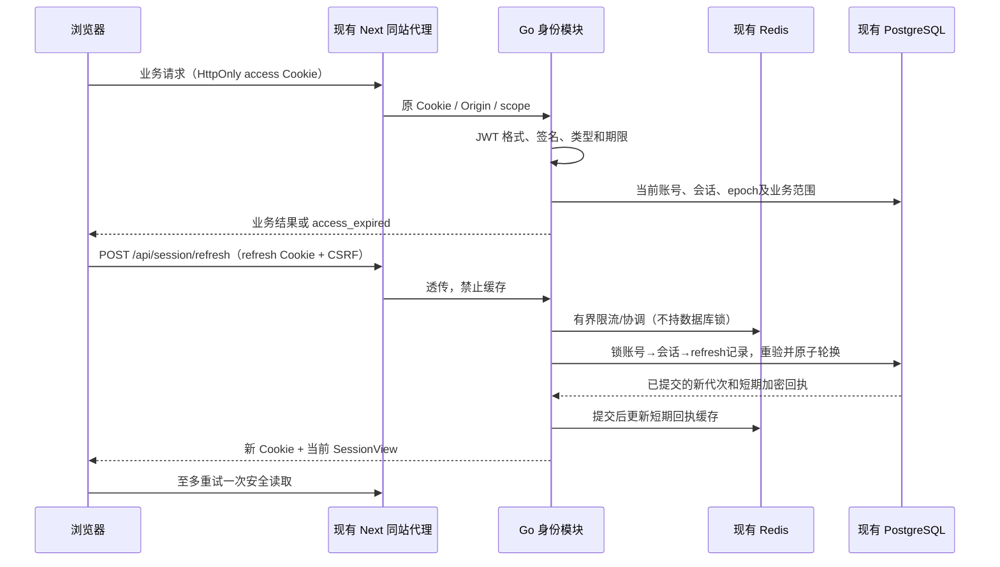

# 无感登录与会话续期调研设计

适用范围：已确认方案B的设备会话、透明续期、撤销与恢复。文档版本：2026-10-20整理版；方案接受、工程完成与整体接受沿第14节区分，本次补充待评审。维护职责：identity、BFF及前端会话消费者；评审人未指定。

更新：2026-10-18。状态：**T-AUTH-01～09已完成模块实现、审查及指定PG回滚；T-AUTH-10已接通既有环境并开启v2，整体接受未完成**。真实双连接/Lua、旧设备升级及1次自然续期已验证；各层结果与剩余边界见[计划08](../plan/08-无感登录与会话续期实施计划.md#71-t-auth-10实际接受记录)。未提交或推送。

需求来源：[用户系统需求](../requirement/02-用户系统需求.md#10-无感登录与自动续期增补)。用户已确认“在此设备保持登录”最长 **30 天**、连续 **7 天未使用**失效。用户于本轮确认本文方案B，并要求使用Superpowers拆计划、pm-execution统一文档；初始参数作为实施基线，性能及容量仍须实测。普通登录不强制重置密码，注销只做软删除，平台与团队的实时权限边界保持不变。

## 1. 调研时的实现与问题边界

本节记录实施前调研快照，不代表T-AUTH-01～09的最新源码，不等同于浏览器恢复、压测或部署验收。检查时 Git HEAD 为 `7fa8b7f1`；工作区有其他任务的未提交修改，本文未改动这些文件。

| 环节       | 当前证据                                                                                                                                                 | 结论                                                                               |
| ---------- | -------------------------------------------------------------------------------------------------------------------------------------------------------- | ---------------------------------------------------------------------------------- |
| 登录凭据   | [auth.go](../../backend/internal/identity/application/auth.go) 的 `newAuthSession` 生成 32 字节随机值，服务端保存 SHA-256 摘要                           | 当前是 PostgreSQL 权威的 opaque Cookie 会话，不是 JWT                              |
| 登录保持   | [email_auth.go](../../backend/internal/identity/adapter/http/email_auth.go) 的 `respond` 仅在 persistent 为真时设置 Cookie Expires                       | 已有保持登录勾选；它目前只改变浏览器持久性，不改变服务端期限                       |
| 服务端期限 | [domain/auth.go](../../backend/internal/identity/domain/auth.go) 的 `AuthSession.Valid` 与 `newAuthSession`                                              | 所有会话空闲 12 小时、绝对 7 天；到达任一边界拒绝                                  |
| 活跃滑动   | `Auth.Current` 校验当前账号、会话及凭据版本，并调用 `TouchSession`                                                                                       | 已有请求时刷新活跃时间；不能笼统称“完全没有续期”                                   |
| 页面恢复   | [session.tsx](../../frontend/src/components/auth/session.tsx) 启动时调用 `GET /api/session`，成功后恢复本人状态与 CSRF                                   | 已有有效 Cookie 下的免重复输密恢复；401 后进入游客或登录                           |
| 到期处理   | [request.ts](../../frontend/src/lib/request.ts) 将受保护接口的 401 发布为会话失效；无 refresh 调用                                                       | 缺少短期凭据到期后的透明恢复和并发协调                                             |
| CSRF       | [session_security.go](../../backend/internal/identity/application/session_security.go) 由当前会话 token 派生 CSRF，写入另校验 Origin                     | 直接轮换 token 会影响 CSRF，必须一并设计，不能只加一个刷新接口                     |
| 代理       | [BFF 路由](../../frontend/src/app/api/[...path]/route.ts) 有显式路由白名单，透传 Cookie、Origin 和 Set-Cookie                                            | 需要同步刷新接口、Cookie 和错误合同；BFF 不能伪造可信 Origin                       |
| Redis      | [wiring.go](../../backend/internal/app/wiring.go)、[roles_wiring.go](../../backend/internal/app/roles_wiring.go) 复用 Redis 连接并用于就绪检查、实时消息 | 项目已有 Redis 接入，但当前身份会话不是 Redis 会话；未验证其持久化、容量或认证用途 |

### 1.1 截图错误的独立原因

截图访问 `http://localhost:3200/assets`，提示文案来自 `origin_forbidden`。只读检查现有 `glowloom-backend` 的 `LV_PUBLIC_ORIGIN`，结果为 `http://127.0.0.1:3200`。[HTTP 中间件](../../backend/internal/platform/httpapi/protocol.go) 对 POST/PUT/PATCH/DELETE 的 Origin 作精确匹配，不同即拒绝；BFF 保留浏览器实际 Origin。

因此，当前地址与可信来源不匹配足以解释该提示。未重放截图中的登录请求；不把截图中的任何凭据作为测试输入。这个错误不是密码错误，也不能用 JWT 解决。`localhost` 与 `127.0.0.1` 的 Cookie 不共享；Next 的开发来源设置也不代替后端 Origin 校验。

### 1.2 本次要解决的用户结果

用户在同一可信设备、有效期限内重新打开页面或短期凭据到期时，不重复输入密码、不闪现登录弹窗、不丢创作输入；离线/服务故障可恢复，确定失效才重新登录。退出、账号禁用/软注销、凭据变更及团队撤权继续真实生效。无感登录不包含扫码登录、OAuth、SSO、Passkey 或替用户提交生成任务。

## 2. 必要市场调研

范围仅为创作工作流的登录连续性、设备治理和身份基础设施。未评估市场规模、价格或采购，不推测竞品后端使用 JWT 或 Redis。资料于 2026-10-18 查阅；“公开事实”“本项目推导”“未知”分别记录。

### 2.1 创作产品的公开体验

| 产品   | 官方公开事实与依据                                                                                                                                                                                          | 对织光的推导                               | 证据边界                                                                   |
| ------ | ----------------------------------------------------------------------------------------------------------------------------------------------------------------------------------------------------------- | ------------------------------------------ | -------------------------------------------------------------------------- |
| Figma  | 默认连续 21 天不活跃后退出；Enterprise 可设更短空闲期，并在到期前提示。[官方说明](https://help.figma.com/hc/en-us/articles/14376092335127-Set-an-idle-session-timeout)                                      | 长创作流程需要区分活跃使用、闲置和真正失效 | 非对织光适用的认证标准；未观察其网络实现                                   |
| Adobe  | 账号登录 FAQ 将“保持登录”描述为关闭浏览器后仍可保持最多两周，共享设备应关闭此项。[官方 FAQ](https://helpx.adobe.com/business/enterprise/setup-onboarding/sign-in-and-access/adobe-account-sign-in-faq.html) | 保持登录是用户选择，不等于无限期会话       | 说明有账号类型适用范围，不能推断所有 Adobe 产品期限                        |
| Canva  | 区分退出当前会话与退出所有设备/浏览器。[官方帮助](https://www.canva.com/help/log-out-of-canva/)                                                                                                             | 连续登录必须配套真实设备撤销               | 未找到本轮可核验的统一会话时长或 token 格式                                |
| CapCut | 官方支持在移动端、PC、Web 登录同一账号，并强调使用相同登录方式，登录后载入同一账号数据。[官方帮助](https://www.capcut.com/help/how-to-log-in-one-account-to-multiple-devices)                               | 设备连续性与账号一致性需要一起验收         | 扫码属于另一个功能，本轮不引入；未披露刷新算法                             |
| 即梦   | [公开产品页](https://jimeng.jianying.com/) 可核验其 AI 创作与素材场景                                                                                                                                       | 可作为长创作流程的体验对照                 | 本轮未取得可核验的登录保持期限、refresh 或会话存储说明；不填造其架构和数值 |

结论：市场支持“有效会话期间连续创作、用户可控制设备”的产品方向，不支持把任何一家产品的期限或后端实现直接当成织光需求。30 天/7 天来自本项目用户确认。

### 2.2 认证产品与标准

| 来源                                                                                                                                                                     | 核验事实                                                                     | 采用方式                                                                        |
| ------------------------------------------------------------------------------------------------------------------------------------------------------------------------ | ---------------------------------------------------------------------------- | ------------------------------------------------------------------------------- |
| [Supabase Sessions](https://supabase.com/docs/guides/auth/sessions)                                                                                                      | 区分短期 JWT 与 refresh token；有绝对/空闲限制、轮换及并发或丢响应的复用例外 | 借鉴生命周期和异常场景，不照搬其默认时长、客户端存储或延迟撤销语义              |
| [Auth0 Rotation](https://auth0.com/docs/secure/tokens/refresh-tokens/refresh-token-rotation)                                                                             | 刷新时轮换凭据，检测旧凭据重用并处理 token family                            | 需要区分正常并发、结果丢失和真正重放，不能对重复请求直接踢号                    |
| [Clerk Session Tokens](https://clerk.com/docs/guides/sessions/session-tokens)、[Session Options](https://clerk.com/docs/guides/secure/session-options)                   | JWT 是短期会话凭据，会话另有空闲/最长时限                                    | token 到期不等于账号或设备会话失效                                              |
| [RFC 9700 §4.14](https://www.rfc-editor.org/rfc/rfc9700.html#section-4.14)                                                                                               | OAuth 刷新凭据需保护、限制范围，并考虑轮换、重放、撤销与不活跃到期           | 本项目借鉴防护原则，不宣称自己实现 OAuth/OIDC 或已符合标准                      |
| [RFC 8725](https://www.rfc-editor.org/rfc/rfc8725.html)                                                                                                                  | 校验算法、签发者、受众及 token 类型，隔离不同用途 JWT                        | 固定验证规则，拒绝由客户端头部决定密钥/算法                                     |
| [OWASP Session Management](https://cheatsheetseries.owasp.org/cheatsheets/Session_Management_Cheat_Sheet.html)                                                           | 会话应有服务端期限、Cookie 防护及撤销机制                                    | HttpOnly/Secure/SameSite 与 Origin/CSRF 配套，不能仅加长 Cookie                 |
| [Redis 原子脚本](https://redis.io/docs/latest/develop/programmability/eval-intro/)、[持久化](https://redis.io/docs/latest/operate/oss_and_stack/management/persistence/) | 脚本可原子执行；持久化模式各有丢失窗口                                       | Redis 原子性不等于 PostgreSQL＋Redis 的跨库事务，Redis 丢缓存不能恢复已撤销会话 |

这些是公开资料调研，不是竞品实机多日观察、现有 Redis 故障演练或本项目安全认证。

## 3. 方案选择

| 方案                                                    | 能满足的目标                                                         | 代价/限制                                                                          | 结论                                                                                 |
| ------------------------------------------------------- | -------------------------------------------------------------------- | ---------------------------------------------------------------------------------- | ------------------------------------------------------------------------------------ |
| A：完善现有 opaque Cookie＋PostgreSQL                   | 能完成保持登录、页面恢复、滑动空闲期与即时撤销，无须 JWT             | 继续依赖服务端会话查询；凭据轮换和并发仍需补设计                                   | 改动最小的有效备选，不能因不使用 JWT 而否定其正确性                                  |
| B：短期 JWT＋轮换 refresh token＋现有 Redis＋PostgreSQL | 明确分开请求凭据与设备会话，可统一前后台到期合同，并复用既有基础设施 | 多一种 token 生命周期、轮换回执和密钥管理；为即时撤权仍查当前持久状态              | **用户已确认的目标方案**；收益是生命周期明确，不宣称“完全无状态”或未经测量的性能提升 |
| C：长效 JWT，仅靠签名/Redis 黑名单或新托管身份系统      | 单独验签较简单，托管服务可承接通用认证                               | 长效 JWT 放大泄漏窗口；黑名单/缓存丢失会破坏即时撤权；迁移托管超出复用现有环境边界 | 本轮不采用                                                                           |

下文详细设计 B。选择 A 时保留相同产品需求和验收，删除 JWT/refresh 专有机制即可；不同时建设两套长期认证系统。

## 4. 生命周期与使用体验

| 参数             | 普通登录                                                 | 勾选保持登录                      | 接受状态                             |
| ---------------- | -------------------------------------------------------- | --------------------------------- | ------------------------------------ |
| 设备会话绝对期限 | 创建后 7 天                                              | 创建后 30 天                      | 普通值沿用现有；保持登录值用户已确认 |
| 空闲期限         | 连续 12 小时                                             | 连续 7 天                         | 普通值沿用现有；保持登录值用户已确认 |
| access JWT       | 最多 15 分钟，且不越过会话绝对期限；PG仍严格校验空闲期限 | 同左                              | T-AUTH-09正式修正                    |
| 提前续期         | 前台正在使用时，预计到期前 60 秒                         | 同左                              | 设计建议                             |
| 浏览器持久性     | access/refresh/CSRF 均使用 session Cookie                | 仅固定 Expires，不使用相对Max-Age | 设计建议，保持登录默认不勾选         |
| 敏感操作复验     | 现有 5 分钟近期密码证明                                  | 同左，自动续期不得刷新 reauth_at  | 沿用现有约束                         |

续期不改变 created_at、sid 或 absolute_expires_at，只更新 token 代次。空闲期限取服务端认可的最近活动与绝对期限的较早值，恰好到期即拒绝。旧设备会话不因本次新规则被追溯延长。

有效活动定义为成功授权的用户业务访问，以及页面回到前台后的会话恢复；纯 refresh、心跳、SSE 保活和后台轮询不独立延长空闲期。前端隐藏后暂停续期计时，恢复可见或 online 时先校验一次；实施前需逐路由识别后台轮询，避免其借通用鉴权隐式 TouchSession。最近活动的安全时间由服务端采样，不接受客户端时间直接延长期限。

不承诺“关浏览器必定退出”：浏览器会话恢复功能可能保留 session Cookie，见 [MDN Set-Cookie](https://developer.mozilla.org/en-US/docs/Web/HTTP/Reference/Headers/Set-Cookie)。未勾选意味着不主动配置跨浏览器重启持久保存，服务端仍强制较短期限；共享设备可显式退出。

### 4.1 界面状态

| 状态          | 用户看到的内容                               | 行为                                                                         |
| ------------- | -------------------------------------------- | ---------------------------------------------------------------------------- |
| 恢复中        | 公共页面照常可浏览；私有区域使用现有加载状态 | 不抢先显示登录弹窗，不先展示上个账号内容                                     |
| 有效          | 正常创作                                     | 同账号续期不重挂页面、不清草稿、不切空间                                     |
| 正在续期      | 默认无额外弹窗                               | 同一会话只执行一份续期，其余请求等待或继续使用仍有效 JWT                     |
| 网络/依赖故障 | “暂时无法确认登录状态，重试”                 | 暂停新的私有操作，不伪装成游客/账号被删除，不清 Cookie 或丢输入              |
| 确定失效      | “登录已过期，请重新登录”                     | 清理私有缓存，保留同一账号可安全恢复的输入；登录后仍需用户确认生成/发布/删除 |
| 当前设备退出  | 回到游客状态                                 | 清理身份与私有缓存，其他设备不受影响                                         |
| 来源错误      | “请从配置的网站地址打开”及可信站点入口       | 不显示“密码错误”，不自动跨源提交表单                                         |

确定失效后的恢复仅保留实际创作入口中的**纯文本与换行**：RichGeneration 的现有草稿分支继续绑定原账号、项目和草稿；首页生成提示词与画布想法共用的输入绑定原账号及当前可写空间。这是有损保留，不保留参考素材、上传句柄、模型参数、私有视图、待保存/生成命令或回执，也不扩展为所有表单的通用恢复。登录过期期间隐藏全部私有内容；同一账号取得新 sid 后，仍须重新读取当前账号和原草稿权限，或重新确认首页原空间仍可写，才提供显式恢复按钮。用户选择后才采用文字，参考素材与生成设置需重新选择；不自动创建画布或执行生成、发布、删除。不同账号登录、主动退出或明确失去原范围权限时不得恢复；503/离线只保持锁定，允许之后重新核验，不把故障当作授权。

实现继续使用既有 IndexedDB 分支存储；同 store 的单条非凭据元数据保存清理代次、账号绑定与主动退出的旧 sid 墓碑，用事务比较阻止另一连接清理后旧写入或迟到读取复活输入。服务端身份读取之前捕获本地代次，激活时复核；即使退出 DELETE 尚未完成，旧 sid 的前台读取成功也不能重新取得写入许可。不同账号激活清除旧输入；合法新 sid 仍须经过服务端身份与范围确认。广播只通知清理，不发送 sid 或凭据；AT/RT/CSRF 不进入本地存储。纯 timer 续期不重新激活本地恢复权限，也不为此新增会推进 idle 的 GET。本地存储不可用时恢复关闭，但不否认成功的服务端登录。首页文字编辑只写本地分支，不逐字调用授权 API；已确认的空间切换清空旧内容后保留新范围输入的写入能力。

主动退出当前设备（包括设备目录中的当前行）的 DELETE 显式绕过待完成续期，保留 Origin/CSRF、身份代次及服务器撤销校验；旧身份回调不能清除新会话输入。撤销其他设备及普通业务写入继续等待续期且不自动重放。

本地恢复资格与服务端登录分离：同一元数据另记录 activeSession 与 active/input-only/cleared 状态，文字转交给新 sid 必须同时有被动脱敏事务成功提交的 input-only 状态，以及本模块见证该次成功清理的账号/epoch。收到其他标签的 identity-changed 通知时，先同步撤销本模块恢复见证、writer lease 与旧激活代次，再尝试前台身份读取；读取/IDB失败不能保留恢复资格，自身 source 的通知仍忽略。强清理或换号同步使本模块见证失效，即使 IDB 写入失败；重载/新模块没有见证时丢弃旧锁定文字，不能从持久旧标记推断期间没有发生退出。未确认身份的启动也不能仅凭旧 owner 元数据生成恢复资格。旧 active 会话、缺失或旧版含糊元数据不得证明已清理；新 sid 激活时原子丢弃这些旧行，不能从完整快照推导恢复输入。强清理失败的进程内意图优先于后续被动清理，防止主动退出被降级为保留文字。存储完全不可写时不承诺物理擦除或墓碑已落盘；恢复后必须先通过上述事务资格检查才授予本地读写能力，不能因旧 checkpoint 未变化就开放旧快照。该故障路径允许丢失本地输入，不删除服务端草稿，也不阻止成功的服务端登录。

RichGeneration 的 inputRecovery 分支不提供可用的“保留为副本”入口；点击“恢复此分支”须重新通过同账号、原草稿权限及 durable fence 读取最新文字，并检查当前编辑器、身份/空间代次和输入修订。最终核验与采用之间不再等待异步操作，不使用展示时缓存的旧正文。普通完整分支的既有恢复/副本语义保持原样。

## 5. 架构与权限责任

JWT 只携带身份引用，不持久封装团队角色、成员列表、资源权限或可直接授权的 capabilities。受保护请求仍检查 PostgreSQL 中的账号 active/verified/非软删除、会话未撤销/未到期、credential epoch，以及当前平台/团队/资源资格。签名正确或 Redis 命中均不能跳过这些检查。

Redis 承担认证限流、跨实例刷新协调、已提交结果的短期缓存和失效提示；PostgreSQL 保留设备目录、撤销、凭据版本、期限、轮换状态和安全审计的权威事实。缓存不能成为正向授权依据，不借引入 JWT 将撤权放宽为“等待 15 分钟到期”。后台队列继续使用既有 durable actor/scope 检查，不把浏览器 JWT 当成长期 worker 凭据。

## 6. Token、Cookie 与密钥

### 6.1 access JWT

推荐固定 `RS256`，通过审阅后的 Go JWT 库实现，不自行编写验签算法。Header 含固定用途 `typ=at+jwt` 和已配置的 `kid`；Claims 为 `iss=glowloom.identity`、`aud=glowloom.web`、`sub=user_id`、`sid`、`jti`、`iat`、`nbf`、`exp`、credential epoch。issuer 是稳定逻辑身份，不随浏览器 Host 改变。

JWT 的 `exp` 不超过签发后15分钟及设备不可变的绝对期限；不按签发当时的空闲期限裁短。前台成功访问可以推进空闲期限，但每次请求与刷新仍先核验PG当前空闲/绝对期限，超过空闲边界时JWT尚未到期也拒绝。这样保留完整恢复窗，避免刚恢复前台后凭据按旧空闲时间提前失效。

固定允许算法、可信公钥集合与 issuer/audience/type；未知 kid、none、算法混用、非法主键或未来签发时间均拒绝。时钟偏差建议最多 30 秒，只用于 JWT 时间解析，不能延长持久会话空闲/绝对期限。公开内容不放邮箱、头像、作品、权限表或秘密。

JWT 私钥与当前身份摘要/邮件加密密钥分开，通过现有服务端 secret 文件机制供给，不进入 `.env`、浏览器或仓库。旧验证公钥保留到已发 token 最大有效期及容差结束；泄露应急通过撤销对应会话/凭据版本处理，不能为迁移要求用户改密码。具体受控密钥文件与轮换演练在实施评审时绑定现有部署配置，本轮不生成密钥。

### 6.2 refresh token 与 CSRF

Refresh 为至少 32 字节随机 opaque secret，绑定唯一 sid、代次和用途，不是可调用业务 API 的 JWT。服务端默认只存带用途隔离的安全摘要。CSRF 改为稳定绑定 sid 的独立随机证明与摘要，不再随 access JWT 字符串轮换；登录换号、主动改密或新设备会话重建时重新生成。

| Cookie                    | 浏览器可读           | 生产属性                                          | 生命周期                                                               |
| ------------------------- | -------------------- | ------------------------------------------------- | ---------------------------------------------------------------------- |
| `__Host-glowloom_access`  | 否                   | HttpOnly、Secure、SameSite=Lax、Path=/、无 Domain | JWT 到期；保持登录时持久期限最多 15 分钟                               |
| `__Host-glowloom_refresh` | 否                   | 同上                                              | 保持登录时浏览器期限不超过设备不可变的 absolute；服务端仍严格校验 idle |
| `__Host-glowloom_csrf`    | 是，仅随机 CSRF 证明 | Secure、SameSite=Lax、Path=/、无 Domain           | 与 refresh 的浏览器持久性一致                                          |

本地 HTTP 使用不同的非 `__Host-` 名称，并仅在已验证的本地环境关闭 Secure；不能把这种例外带到生产。不将 access/refresh 放在 localStorage、sessionStorage、URL、JS 状态或公开响应体。CSRF Cookie 可由 JS 读取并放入 `X-CSRF-Token`，但它不是身份凭据。所有写入仍校验精确 Origin，refresh 在 access 已到期时也独立验证 sid 绑定的 CSRF。

稳定 CSRF 保证单纯 access 续期不触发当前 `setCSRFToken` 的身份代次切换，不清空创作范围和草稿。账号切换与退出仍递增独立的 identity generation；refresh generation 与 identity generation 不混用。

## 7. 接口合同草案

沿用现有公开认证接口，不新增另一套客户端。Go DTO/注解、OpenAPI 生成、BFF 白名单和前端生成客户端须同步；本轮不修改它们。

| 接口                                                 | 输入/身份                                     | 成功结果                                            | 失败与副作用                                                                                                                        |
| ---------------------------------------------------- | --------------------------------------------- | --------------------------------------------------- | ----------------------------------------------------------------------------------------------------------------------------------- |
| `POST /api/sessions`                                 | 现有 email/password/persistent                | 201；创建普通设备会话，签发三 Cookie                | 原密码正常核验；不要求重置密码                                                                                                      |
| `GET /api/session`                                   | 有效 access                                   | 200 SessionView；读取当前身份                       | access 过期或缺失但带 refresh Cookie 时返回 401 `access_expired`，由刷新端独立验证；无凭据为 `session_invalid`；不在 GET 中轮换凭据 |
| `POST /api/session/refresh`                          | refresh Cookie、CSRF、Origin、Idempotency-Key | 200 SessionView；轮换或重放同一短期结果，Set-Cookie | 不依赖 access 有效；无业务创作副作用；503/429 不注销                                                                                |
| `POST /api/session/upgrade`                          | 仍有效的旧 opaque Cookie、现有 CSRF/Origin    | 200；同一 sid 升级协议，保留原有效期限              | 已撤销/到期的旧凭据不能升级；窗口结束后移除入口                                                                                     |
| `DELETE /api/sessions/{id}`                          | 本人当前会话证明及 CSRF                       | 204；撤销目标；当前设备删除三 Cookie                | 当前设备退出可用 refresh 证明身份，不要求先成功续期；Redis 故障不阻止 PG 撤销                                                       |
| 既有 revoke-others / 平台撤销 / 改密 / 换邮 / 软注销 | 既有权限与近期证明                            | 保持原接口合同                                      | 同一 PG 事务撤销对应设备及刷新链；已有 JWT 下一次受保护请求拒绝                                                                     |

SessionView 保留现有 actor、session_id、persistent、csrf_token 等字段，新增 `access_expires_at`、`idle_expires_at`、`refresh_after_at`、`server_time`、`session_protocol` 和 `upgrade_available`。v1不伪造JWT专有日期，旧后端缺新增字段时前端保留v1兼容；只有服务端明确标示可升级时才调用升级接口。以服务端时间估计剩余时长，不读 HttpOnly Cookie 内部值。响应均 `Cache-Control: no-store`，BFF 逐条透传 Set-Cookie；CDN、路由缓存与 Service Worker 不缓存身份响应。

v2响应另包含持久化的 `refresh_generation` 十进制字符串（含0，上限9223372036854775807）；v1省略。前端无损比较同sid代次，迟到低代次不能覆盖较新状态，刷新与升级成功回执必须为v2。升级响应体丢失但Cookie已应用时，仅真实启动或前台事件允许一次GET确认同账号/sid/CSRF；纯timer不得借此Touch，保留身份与草稿等待前台恢复。

错误区分：`access_expired` 可尝试一次 refresh；`session_invalid`、`session_revoked`、`session_expired`、`refresh_reuse_detected` 为终态；`refresh_busy` / `refresh_raced` 为 409 协调冲突，同一single-flight最多在100ms、再5s后重试两次refresh POST，每次重新校验可读证明与身份/空间栅栏，覆盖无Web Locks及已关闭owner的5s租约；耗尽后保留unavailable，不循环GET或重放业务写入。`origin_forbidden` / `csrf_invalid` 为 403，不触发刷新循环；`dependency_unavailable` 为 503；429 按真实 Retry-After 等待。通用凭据登录仍使用不泄露账号存在性的错误，不将内部审计原因公开到未认证调用方。

## 8. 持久化与 Redis 数据设计

仅为字段及约束设计，不提供可直接执行的迁移 SQL，也不预占迁移编号。复用现有数据库；实施时以当时的 schema 和已占用迁移编号复核。

### 8.1 PostgreSQL

| 对象                             | 变更建议                                                                                                                                                                          | 约束                                                                                                           |
| -------------------------------- | --------------------------------------------------------------------------------------------------------------------------------------------------------------------------------- | -------------------------------------------------------------------------------------------------------------- |
| `identity.user_session`          | 新增 `protocol_version`、`idle_timeout_seconds`、`refresh_generation`；复用 sid/account_id/created_at/last_active_at/absolute_expires_at/revoked_at/credential_revision/csrf_hash | protocol v1/v2 显式区分；期限正值；绝对时间不因 refresh 修改；旧 token_hash 仅用于 v1 兼容，不使 v2 可回退认证 |
| `identity.session_refresh_token` | id、session_id、generation、token_digest、issued_at、consumed_at、revoked_at、rotation_request_id、replay_until、短期 AEAD 加密轮换回执                                           | sid 外键；digest 唯一；(sid,generation) 唯一；每 sid 至多一个 active；消费与新代次/回执同事务提交              |
| 既有安全事件                     | 增加刷新重放检测、协议升级、刷新拒绝原因的事件类型                                                                                                                                | 不记录 token、Cookie、密码、CSRF、邮件或高基数身份指标标签                                                     |

Token 摘要历史保留至该设备绝对期限以识别已知旧凭据，普通错误随机 token 不能据 sid 触发全设备撤销。回执保存同一次刷新产生的下一个 refresh secret 和响应所需材料，使用独立用途密钥加密，AAD 绑定 sid、代次、操作 ID；**只在建议 10 秒的结果恢复窗内允许解密并返回**。过窗擦除密文，摘要历史仍保留；清理接入现有任务运行框架，目标一分钟内清掉过窗密文，不新增环境或独立服务。审计不保存回执密文。

一分钟清理目标以T-AUTH-10测得的支持容量为前提，不保证数据库故障、长期积压或任意超载下的延迟。当前实现每30秒调度；每批最多1000条，满批在同一轮内连续处理，共享最长10秒预算且最多32批。部分批结束本轮；错误或预算耗尽时记录固定脱敏原因、已处理行数/批次数及已知积压，等待下一次调度，避免故障重试风暴。T-AUTH-10须记录指定样本规模、数据库响应与实际过窗密文清理延迟，容量未实测前不能宣称一分钟目标已接受。

一次消费先完成 PG 提交，再返回 Cookie。已知旧 token 在恢复窗内可恢复原结果；恢复窗外的已知旧凭据按重放处理，撤销该 sid 的整条刷新链，保持其他设备不受影响。网络极度延迟超过恢复窗可能需要重新登录，这是安全取舍，不能为了“绝不掉线”无限接受旧凭据。

### 8.2 Redis

建议使用独立前缀 `glowloom:auth:v2:`，复用当前连接及容量。Key 不包含邮箱、明文 token 或可逆用户资料。

| 用途               | Key/值                                                 | 期限与权威性                                                                                 |
| ------------------ | ------------------------------------------------------ | -------------------------------------------------------------------------------------------- |
| 刷新并发协调       | `refresh-lock:{sid}` → 随机 owner                      | 建议 5 秒租期，带 owner 比较释放；无锁超时不得强制消费两次，PG CAS 是最终防线                |
| 已提交轮换回执缓存 | `refresh-receipt:{sid}:{generation}` → 加密结果/PG版本 | 最多 10 秒，不超过 PG replay_until；每次返回前核验 PG 当前链与会话仍有效                     |
| 刷新来源/会话预算  | `refresh-budget:{digest}` → 有界计数                   | 建议 peer 60 次/分钟、sid 12 次/分钟，需真实负载校准；重放不推动到期，不用账号临时密码锁替代 |
| 撤销提示           | `revoked:{sid}` → 已撤销版本                           | 不超过原会话绝对期限；可提前拒绝，但缓存缺失不能授予权限                                     |

上述 Lua/CAS 只用于 Redis 内部原子操作，不假定它与 PG 原子提交。Redis 网络调用不得放在已持有 PG 身份/会话锁的事务中。既有邮箱登录/密码 guard 继续有效，不把这次扩展变成全平台限流重构。

## 9. 刷新原子性、并发与重放

1. 浏览器确认当前身份 generation 和页面状态；同标签页用 single-flight Promise。同源多标签页优先用 [Web Locks](https://developer.mozilla.org/en-US/docs/Web/API/Web_Locks_API) 协调，使用 [BroadcastChannel](https://developer.mozilla.org/en-US/docs/Web/API/BroadcastChannel) 只通知会话变更，不广播 token 或 CSRF。
2. 后端在事务外完成请求边界与 Redis 预算/协调。获得预算不等于获得权限；锁过期或服务重启也必须走 PG 的唯一消费条件。
3. 先只读定位 sid/account，再按既有全局顺序锁身份设置、账号、会话，最后锁 refresh 记录；取锁后采样服务端时间，复查凭据版本、当前摘要/代次、到期、撤销及 CSRF。不能沿用先前 CI 中 job→身份的反向锁序。
4. 当前有效 refresh 只允许一个 PG 事务消费。生成下一代、写消费历史与安全必要记录、保存短期加密回执，然后提交。PG 失败不发新 Cookie，不修改 Redis 为“已生效”。
5. 相同旧 token 的正常并发或丢响应，在 10 秒恢复窗内只返回同一已提交后继，不再次创建孙代、不移动空闲/绝对期限；新后继在该恢复窗内也合并为原结果，防止立即前进多个代次。
6. 缓存重放前仍检查账号/会话/epoch、当前后继及恢复窗；若已向更高代次前进，返回 409 `refresh_raced` 且不发旧 Cookie。有效当前 Cookie 可重新读取会话；不能沿用旧权限或由缓存复活撤销会话。
7. 已知旧 token 超窗重放，事务内撤销 sid 及刷新链并记录事件。摘要未知或随机猜测只拒绝，不允许攻击者只凭 sid 把他人踢下线。真正无效与正常并发分开统计。
8. Web Locks 不可用时仍依靠 single-flight 与后端恢复窗防双消费。失败后重读当前 Cookie 状态，有限恢复；不能宣称网络乱序下 Cookie 永远不会被旧响应覆盖。延迟/丢包/标签关闭属于必测场景，无法安全恢复时明确重新登录。

退出或换号发生后，旧请求不得更新 UI、恢复旧空间或重放旧业务。即便迟到的 Set-Cookie 被浏览器应用，已撤销的 sid 也不能再获访问；客户端 identity generation 防止其成为有效界面状态。自动续期不改变近期密码证明，不允许刷新接口为禁用/软删除账号建立新会话。

## 10. 前端恢复与业务重试规则

页面启动先 `GET /api/session`；仅 `access_expired` 或缺少 access 但仍有可恢复的 refresh 场景进入刷新。刷新接口自行判定 Cookie，前端不读取 refresh secret；恢复成功后读回当前账号、空间与权限，再解除私有区域等待。

前台预计到期、`visibilitychange`、`pageshow`、`online` 均可触发一次恢复检查，复用同一 single-flight，不靠永久定时心跳保持登录。服务端区分“无 access 可恢复”与“所有设备凭据缺失”；未登录游客启动不进行持续刷新轮询。

| 请求类型                                               | 恢复后的动作                                                          |
| ------------------------------------------------------ | --------------------------------------------------------------------- |
| GET/HEAD 安全读取                                      | 同身份、同空间、未取消时，至多自动重试一次；第二次失败不循环          |
| 尚未发出的写入                                         | 先等待会话可用，再由用户原操作提交一次，保留同一幂等键                |
| 已发出的生成、发布、删除、付款、上传完成等写入         | 默认不自动重放；先查询真实回执/幂等结果，必要时让用户重新确认         |
| 上传中断/流式连接断开                                  | 使用模块已有续传或事件游标协议，重验权限；刷新不能假装上传/生成已完成 |
| 密码复验失败、scope 403/404、业务 409、Origin/CSRF 403 | 不触发会话刷新，也不替用户换空间重试                                  |

身份生命周期协调放在现有认证模块，底层 `request.ts` 仅承接有界恢复钩子和 generation 栅栏，不导入登录弹窗或路由页面。沿用生成的 `@/api/identity` 客户端；刷新自身、登录/注册/找回入口排除递归恢复。SSE 与后台任务继续按当前业务权限验收，不能用一次连接时验签替代撤权后的读取检查。

## 11. 统一访问地址

保留现有 `LV_PUBLIC_ORIGIN` 作为唯一 canonical origin，当前本地默认仍为 `http://127.0.0.1:3200`。前端对已明确配置的本地别名 `localhost:3200` 的 GET/HEAD 在展示私有页面或登录前，跳转到 canonical origin；只保留安全相对路径，return_to 仍限同站，不反射任意 Host、Origin 或外部 URL。

POST 等写入不跨源自动跳转重放，直接给出可点击的可信站点入口。后端继续严格校验真实 Origin，BFF 不把不可信 Origin 改写成可信值，不使用 `*`、任意 loopback 或任意 Host 白名单。生产只允许受控 HTTPS 入口；开发例外不外推。

两个主机上的旧 Cookie 不相互搬运；用户若仅在别名主机保留旧登录，进入 canonical 后可能需要一次正常登录。这与 token 到期是不同原因，应分别记录。当前截图问题在代码实现阶段优先处理，但本轮不改容器参数或入口。

## 12. 依赖故障、撤销与迁移

| 场景                                 | 设计行为                                                                                                                           |
| ------------------------------------ | ---------------------------------------------------------------------------------------------------------------------------------- |
| Redis 不可用                         | 新登录/刷新若无法执行必要预算，返回 503，不发新凭据、不清现有 Cookie；尚有效 access 的受保护请求可走完整 PG 校验，不以缓存缺失放行 |
| Redis 清空、淘汰或恢复旧数据         | 从 PG 重建派生缓存；旧回执每次仍校验 PG，不能复活旧代次/撤销会话，不依赖未经核验的 AOF 配置保证安全                                |
| PG 不可用                            | 受保护请求及刷新返回 503；不能凭 JWT 签名和 Redis 旧快照放行                                                                       |
| PG 已提交，Redis 写缓存失败/响应丢失 | 同一操作可从 PG 短期加密回执恢复；不再次消费，不把已提交轮换报告成“尚未发生”                                                       |
| 账号禁用、软注销、邮箱变更、重置密码 | 复用既有身份事务推进 epoch/撤销全部会话和刷新链；下一次受保护请求即拒绝，Redis 失效提示失败不改变安全结果                          |
| 团队移除、暂停或降权                 | 不误退出个人账号；该团队下一次动作按最新成员关系拒绝，不信 JWT 内旧角色                                                            |
| 普通 access 正常过期                 | 仅触发透明恢复，不要求密码重置，也不自行生成近期密码复验记录                                                                       |

迁移采用显式 v1/v2：先扩展结构与协议，再允许有效旧会话通过受保护 POST 原位升级；保留原 sid、创建时间、撤销状态、原期限和当前 CSRF 证明的绑定，不复活已失效会话，不重设密码。新登录才按 30 天/7 天保持登录策略创建新设备会话。迁移窗口使用固定 UTC RFC3339 截止时间 `LV_IDENTITY_LEGACY_UPGRADE_UNTIL`，启动时最多允许未来7天，重复部署不重算；过去截止时间允许启动但关闭新升级、v1验证及签发。零值仅兼容首次切换前的v1基线，切换后不得清空截止时间重新开窗。升级保留旧摘要作为已消费第0代及10秒回执，返回第1代；窗口关闭不阻止已提交升级在原10秒内恢复同一后继。

回退不能把 v2 token 当旧 Cookie 验证，也不能恢复旧撤销状态；先停止新 v2 签发，保留 v2 验证/退出能力，按风险终止受影响会话。固定窗口结束且关闭新v2签发时，新登录返回503，不能改发立即失效的v1；启用v2签发后原密码仍正常登录。回退必须保留识别v2的二进制与公钥，不允许回到仅识别v1的版本。用户密码哈希、邮箱验证、团队成员、作品与软删除记录不作迁移改写。

签名能力由已配置私钥显式声明，不通过试签 token 探测。仅有验证公钥时，access 验证与退出保留；所有 refresh 分支（含恢复窗回执和超窗复用）在读取候选或接触 PG/Redis 前返回503依赖不可用，不恢复秘密或撤销链。

## 13. 验收与可观测性

本节定义验收标准，逐项实际状态见[计划08接受表](../plan/08-无感登录与会话续期实施计划.md#71-t-auth-10实际接受记录)。已有工程、PG、Redis和浏览器证据不自动覆盖整行场景；未执行项仍未接受。

| 场景                                         | 必须观察到的结果                                                    |
| -------------------------------------------- | ------------------------------------------------------------------- |
| access 15 分钟到期但设备有效                 | 自动恢复，同账号同空间、不闪登录、不清草稿                          |
| 保持登录第 6 天回来/连续 7 天未使用/第 30 天 | 分别恢复/精确拒绝/精确拒绝；刷新不延长绝对期限                      |
| 普通登录 12 小时空闲与 7 天绝对边界          | 按原边界拒绝；不接受反时钟回退                                      |
| 浏览器关闭重开、睡眠、后台冻结、离线后恢复   | 有效会话恢复；故障显示重试，失效才登录；不以永不停的计时器伪造通过  |
| 20 个并发读取、多个标签、无 Web Locks        | 一次有效轮换；正常并发不误撤销；所有读响应受同账号/空间栅栏约束     |
| refresh 消费后响应丢失/服务重启              | 恢复窗内取得同一后继，不创建额外代次；超窗按明确安全策略处理        |
| 旧 token 真重放、随机 token、乱序响应        | 真重放撤销对应链；随机猜测不能踢他人；旧响应不恢复权限或跨账号 UI   |
| 刷新与退出、账号禁用、软注销、改密并发       | PG 锁序稳定；旧 JWT/refresh 下一次访问拒绝；不丢停止事实、不死锁    |
| 团队撤权后 refresh 成功                      | 仅保持全局账号，旧团队资源仍拒绝，后台 actor/scope 规则不变         |
| Redis 故障/清空/旧快照、PG 故障              | 503 与 401 区分；无缓存绕过、无撤销复活；故障恢复不丢原创作输入     |
| 生成/删除已提交但网络失败                    | 不因 refresh 重提，先核验原幂等回执/实际任务                        |
| 未信任别名登录                               | GET 进入 canonical；写入不重放、不伪造 Origin；截图错误得到独立定位 |
| 注册、恢复、主动改密、设备管理与原密码登录   | 原合同回归通过，无强制改密；近期复验不被后台 refresh 延长           |

指标记录刷新成功/拒绝/503/429、single-flight 等待、重放检测、迟到响应、恢复耗时、PG 锁等待和 Redis 延迟；不以邮箱、sid、token、IP 原文作指标标签。使用 request_id 关联脱敏安全事件。建议健康依赖下续期 p95≤500ms、页面恢复 p95≤1s，指标为设计目标，需约定环境与负载后实测，不填造成功率。

## 14. 评审结论与下一步边界

已确认：方案B、30天最长/7天空闲、本文初始生命周期/回执/错误及权限边界；保留邮箱密码、原密码正常登录、软注销及现有数据库/启动环境。已核验的源码与公开资料仍属于调研证据，不代表运行验收。

用户已授权按[计划08](../plan/08-无感登录与会话续期实施计划.md)实施，T-AUTH-01～09已完成模块审查及指定PG回滚。T-AUTH-10已通过真实PG双连接和Lua验证，在同一既有应用开启v2并观察到原设备无密码重输自动升级。保持原sid/密码/CSRF/创建/absolute/idle/reauth；固定升级截止2026-10-24T18:44:16Z，回退也不得滚动重开。持久Cookie固定Expires、Redis负向hint使用毫秒PXAT的修复均已审查及验证。剩余产品/性能/回退边界按实际接受表记录；未经另行要求不提交或推送。

## 15. 会话方案评审与交接索引（2026-10-20整理）

| 最低设计内容             | 精确阅读位置                                                                                                                     |
| ------------------------ | -------------------------------------------------------------------------------------------------------------------------------- |
| 目标/现状/约束及方案比较 | 第1～3节；7fa8b7f1为调研快照，用户已确认B和30天/7天，不从竞品期限另定规则                                                        |
| 用户流程与故障界面       | 第4、10～11节；恢复、续期、失效、退出及来源错误分流，业务写入不自动重放                                                          |
| 模块与接口合同           | 第5～7节；identity为权威，BFF逐条透传，前端有界协调；JWT不是团队权限快照                                                         |
| 数据/原子性/跨连接一致性 | 第8～9节；PG消费/后继/加密回执同事务，Redis仅协调/派生缓存，本地清理栅栏不代表服务端授权                                         |
| 异常安全恢复与兼容       | 第4.1、9、12节；原sid/期限、固定升级截止及仅公钥模式不能降级放行                                                                 |
| 验证/接受/发布限制       | 第13～14节；[运行设计第7节](04-用户系统测试与运行设计.md#7-计划12既有环境运行与复核手册)和计划08实际接受表分别维护复核合同及结果 |

发布顺序是兼容结构与验证能力→生成合同/BFF/客户端→受控开启签发/有界升级→旧窗口收敛；回退保留v2校验、退出、公钥和原固定截止，不能复活v1或重算旧设备期限。本次整理不生成密钥、不改签发开关或升级窗口。

| 剩余问题                                        | 影响及关闭条件                                                                                        | 责任职责/阻断                              |
| ----------------------------------------------- | ----------------------------------------------------------------------------------------------------- | ------------------------------------------ |
| 第6/7/8/11节“本轮不修改/不生成”与文首已实现状态 | 这些表述保留原设计阶段限制；后续实现/运行依据第14节及计划08，不用原草案当现状，也不据实现推定整体接受 | 身份/运行职责；阻断当前版本交接声明        |
| 恢复窗10秒、Redis预算/租期和清理容量            | 初始实施参数保留；按第8/13节取得指定容量/故障/时间分布证据，单条自然清理不证明批量容量                | 身份/测试/运行职责；阻断对应容量与性能接受 |
| 真实多标签/重启/IDB故障与身份栅栏               | 源码组合和适配器通过只支持该层；真实浏览器按计划08补被动失效、主动退出、跨标签及存储失败证据          | 前端/测试职责；阻断相应真实恢复接受        |
| 生产最小权限、备份恢复及公钥单独部署            | 现有postgres连接、签发开关回退不替代；在实际授权环境取得角色与撤权恢复、公钥模式运行证据              | 运行/数据库职责；阻断生产部署及相关QA      |

方案B与原业务约束已接受；本次新增索引及缺口说明待评审。文中Superpowers/pm-execution为当时方法记录，不成为后续实施必须调用技能的产品或工程门禁。
