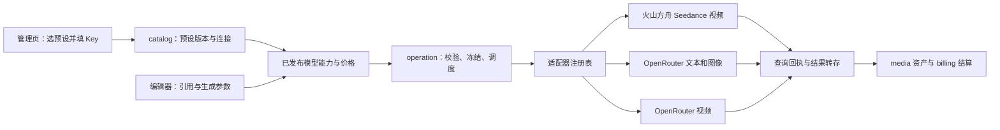

# AI 平台接入市场调研与架构设计

更新：2026-10-18。用户已授权实现。调研采用 pm-market-research 的 competitor-analysis 方法，关注接入平台与预设管理替代方案。下文源码盘点保留调研时基线；当前管理页和本仓库 provider/media worker 已实现，最新证据与限制见[实施验证与上线手册](../plan/09-AI平台接入实施验证与上线手册.md)。需求来源：[需求03](../requirement/03-AI平台接入与预设管理需求.md)。

## 1. 已确认方向与本次实施基线

采用“版本化平台预设 → 账号连接 → 模型能力配置 → 统一任务编排 → 平台协议适配器”。火山引擎的火山方舟作为首轮 Seedance 视频直连通道，OpenRouter 提供多模型接入；其视频协议单独适配。CC Switch 用作添加和管理连接的交互参考。先复用当前 catalog、operation、billing、media 模块，不增加独立网关服务。

首轮由平台管理员统一管理 Key，交付火山方舟和 OpenRouter 两个平台的预设与连接闭环，支持管理员维护自定义预设，按能力选择默认模型。个人/团队 BYOK 不在首轮范围。fal、Replicate 作为后续多媒体扩展候选；LiteLLM 作为未来网关评估项。本建议依据协议匹配和现有架构，不是质量、速度或价格实测排名。

Seedance 是模型，不是独立平台；BytePlus 与火山方舟应分别建立平台预设和凭据边界。可以复用部分 Ark 协议实现，但账号、区域、模型 ID、权限、价格及支持参数不可推定互通。BytePlus 保留为市场调研与后续候选，首轮交付使用火山方舟。

## 2. 市场范围与五类备选（调研参考，不等于首轮名单）

目标用户是个人创作者、小型内容团队及维护生成服务的管理员。接入层成功标准：首次配置容易、能力不缩水、收费可解释、任务可恢复、模型升级不破坏已有项目。以下平台是采购/技术替代关系，也可能是合作供应商；CC Switch 为相邻工具。未获取可靠且可比的市场份额、融资、留存或市场规模数据，故不提供数字排名。

| 备选              | 定位、客户与获客方式                                       | 公开能力与优势                                | 对织光的局限/切换成本判断                                                | 商业模式与建议                                                                          |
| ----------------- | ---------------------------------------------------------- | --------------------------------------------- | ------------------------------------------------------------------------ | --------------------------------------------------------------------------------------- |
| BytePlus ModelArk | 模型原厂平台，开发者文档/控制台及企业销售                  | Seedance 原生任务接口，适合追踪原生能力       | 需逐账号核对开通；区域、模型参数和媒体获取约束必须显式处理               | 按模型用量/资源包；后续候选 [S1～S3]                                                    |
| OpenRouter        | 多模型聚合平台，以统一 API、模型目录和开发者生态吸引客户   | 模型发现与多供应商路由；已有独立视频任务 API  | 文本、图像、视频的协议能力不同；增加平台和上游两层故障定位               | 按用量；当前标准方案平台费标示 5.5%，具体收费基数/付款方式以账单为准；优先接入 [S4～S6] |
| fal               | 多媒体模型 API 与推理平台，模型页/SDK/开发者生态及企业销售 | 队列、查询、取消、回调；模型结果结构明确      | 每个模型的输入输出仍不同；运行中取消不保证立即停止                       | 按用量，具体模型价单独核对；作为第二阶段候选 [S7～S8]                                   |
| Replicate         | 托管模型平台，面向试验和部署模型的开发者                   | prediction 生命周期统一，覆盖公开与自部署模型 | 模型版本和输入结构需分别管理；专用部署增加运维/空闲成本                  | 多数公开模型按运行时间，部分按输入输出；私有专用实例可能计算空闲时间 [S9～S10]          |
| LiteLLM           | 自托管 AI 网关，面向多供应商治理团队，开源社区与企业支持   | 统一入口及路由、重试、限流等治理能力          | 额外服务运维；不能替代织光的素材、任务和计费语义；具体视频适配覆盖未实测 | 开源网关可免费自托管，企业能力付费；首轮借鉴机制，不直接引入 [S11～S12]                 |

表中的“局限”是针对织光适配成本的分析，不是客户满意度结论。上述五种方案覆盖原厂、聚合、多媒体托管、模型托管与自托管治理，没有虚构五个同质的直接竞品。

### 2.1 CC Switch 可以借鉴什么

官方添加指南描述了“选预设 → 填表”，预填名称/端点、输入 Key，以及自定义配置；模型发现依赖平台提供相应端点。指南也明确现有连接保存创建时的预设快照，不自动跟随预设更新。[CC Switch 添加指南](https://github.com/farion1231/cc-switch/blob/main/docs/user-manual/en/2-providers/2.1-add.md)

织光建议复用这种低配置负担的体验，再增加预设版本差异、任务引用保护、能力校验和计费约束。以下版本发布、派生副本、作用域与升级机制是织光建议，不声称 CC Switch 已完整实现。它主要管理本地 AI 工具配置；织光要处理多用户与长期生成任务，因此不照搬本地配置文件切换。

OpenRouter 自己也有保存模型、路由与生成参数的 Presets，但这是平台内推理配置，不应成为织光跨平台连接配置的唯一事实来源，也未据此确认它适用于视频端点。[OpenRouter Presets](https://openrouter.ai/docs/guides/features/presets)

### 2.2 差异化机会与经济性

建议织光强调“模型能力与创作素材一致、配置一次持续可用、费用和历史可追溯”。基础设施越来越容易聚合，长期价值应来自编辑器、多参考资产、项目上下文和可靠生成流程，而非平台数量。

成本比较使用同一模型版本、模式、分辨率、时长、音频及参考输入；记录供应商成本、平台费用、存储流量和人工恢复成本。建议指标为“总实际成本 / 被创作者接受的结果数”，并同时记录失败率和等待时间。没有统一样本和真实账单，不能认定直连或聚合一定更便宜。

未来 12～18 个月主要风险是模型参数/价格变动、聚合平台覆盖原厂能力、原厂强化工作流产品；机会是用稳定的项目和资产体验降低更换模型成本。上述为情景判断，不是市场增长预测。此轮不购买资源包、不进行收费对比实验。

## 3. 平台协议核验与设计影响

| 关注点              | 已核验公开事实                                                                                                   | 织光设计影响                                                 |
| ------------------- | ---------------------------------------------------------------------------------------------------------------- | ------------------------------------------------------------ |
| BytePlus 地址/鉴权  | ModelArk 文档给出 `https://ark.ap-southeast.bytepluses.com/api/v3`，使用 API Key [S1]                            | 作为该预设默认地址；区域独立存储，不能用火山 Key 直接替代    |
| Seedance 提交       | `POST /contents/generations/tasks`，内容与参数按具体模型定义 [S2]                                                | 使用 Ark 视频适配器；按模型核对参考角色/数量/时长            |
| BytePlus 恢复/媒体  | 查询 `/contents/generations/tasks/{id}`；文档标注查询近 7 天任务、视频 URL 有效期 24 小时，取消仅限排队任务 [S3] | 结果及时转存；过期和取消失败单独处理；不把删除记录当停止运行 |
| OpenRouter 视频     | 独立 `/api/v1/videos` 异步提交，视频模型目录、查询及 content 下载接口 [S4]                                       | 与聊天接口拆开；下载凭据仅发往核验过的 OpenRouter 原站       |
| OpenRouter 文本路由 | Chat Completions 文档提供供应商排序、fallback 与参数支持约束 [S5]                                                | 只在相应适配器采用；不默认套给视频                           |
| fal 队列            | 排队与运行中取消语义不同，媒体响应结构按模型变化 [S7]                                                            | `Cancel` 返回结果而非布尔成功；每模型解析输出                |

OpenRouter 视频文档区分首尾帧与参考图，且说明视频不适用 ZDR；因此“支持视频输入”不代表“支持视频生成”，聊天隐私设置也不能直接复制到视频。其取消接口和其他扩展能力，在未完成专项核验前按不支持处理。[OpenRouter 视频文档](https://openrouter.ai/docs/guides/overview/multimodal/video-generation)

BytePlus 英文页面部分正文依赖 JavaScript，此轮结合官方搜索索引、API Explorer 和查询任务文档交叉核对；对未取得完整正文的字段不写死。此次没有账号验证、生成质量或延迟实测。最新型号不作为硬编码默认值；首批确切模型 ID 在接入时从已开通目录核验并冻结。

### 3.1 火山方舟与 OpenRouter 首轮合同

首轮预设固定火山方舟北京区 `https://ark.cn-beijing.volces.com/api/v3` 和 OpenRouter `https://openrouter.ai/api/v1`。前者的地区字段为 `cn-beijing`，现有 `region=domestic` 继续表示处理区域类别；两字段不得混用。OpenRouter 的入口不代表全部上游有相同处理地域，目录显示海外/依上游策略，不能承诺数据本地化。

| 执行能力           | 协议边界                                                                    | 首轮接受范围                                                                    |
| ------------------ | --------------------------------------------------------------------------- | ------------------------------------------------------------------------------- |
| 火山 Seedance 视频 | `POST /contents/generations/tasks`；GET 同路径 `/{id}` 查询；Bearer API Key | 至少一款开通型号的文生视频、首帧图生视频；首尾帧/多参考按声明支持的模式逐项验证 |
| OpenRouter 文本    | Chat Completions；与视频分开的请求、用量和响应处理                          | 至少一款已开通模型的非流式文本生成；不因此新增完整聊天产品或 Agent 工具执行     |
| OpenRouter 图像    | 独立 `POST /images`；图像目录及端点能力；响应图片解码/转存                  | 至少一款型号的文生图；声明支持参考图时另测角色与数量                            |
| OpenRouter 视频    | `/videos` 异步任务及 content 结果获取                                       | 至少一款型号的文生视频；取消能力没有完整合同证据时关闭                          |

火山提交/查询路径及 API Key 来自[创建任务](https://docs.volcengine.com/docs/ark/create-video-generation-task-api?lang=zh)和[查询任务](https://docs.volcengine.com/docs/ark/get-video-generation-task-api?lang=zh)。火山查询文档说明任务查询窗口与媒体地址有效期，适配器应及时转存，并区分排队取消和运行中任务。本轮不将 BytePlus 字段直接视为火山合同。

OpenRouter 图像官方文档现有专用 Image API；模型层能力可能是多个端点的并集，具体端点能力才是有效约束。不能把图像全部按聊天响应解析。[OpenRouter 图像生成](https://openrouter.ai/docs/guides/overview/multimodal/image-generation)

本基线是本次细化的交付定义；具体 model ID/模式、协议响应及价格通过计划 A0 固定。上游尚未核验的附加模式保持关闭，不能因模板中列出了能力就全部放行。接口兼容性由适配器测试证明；未来新增型号的普通配置变更不要求新增一套平台。

非生成检查：OpenRouter 可用 `GET /key` 核对当前 Key 元数据，再独立获取模型目录；目录成功不等于 Key 有权限。火山免费鉴权/账号可用目录的确切协议尚未核实，A0 需要确认；没有可证明无生成成本的接口时返回 unsupported，采用内置模板或手动模型 ID，再通过管理员明确确认的试运行证明能力。不索取云账号 AK/SK 以绕过该限制。[OpenRouter 当前 Key](https://openrouter.ai/docs/api/api-reference/api-keys/get-current-api-key)

## 4. 当前仓库事实与缺口

基线：`glowloom-server`、`main`。初次调研开始时工作区干净；本次细化开始时已有用户系统、编辑器及本模块文档修改，全部保留，仅编辑本任务文档。仅静态阅读代码，未连接业务数据库或核验部署。

| 当前源码                                                                             | 已有机制                                                                   | 本次需要补充的设计                                                             |
| ------------------------------------------------------------------------------------ | -------------------------------------------------------------------------- | ------------------------------------------------------------------------------ |
| [provider.go](../../backend/internal/catalog/domain/provider.go)                     | Provider、区域、启用状态、乐观版本；Credential 密文与安全摘要              | Provider 当前是平台级配置，可逐步承担连接实例，新增预设来源与配置快照          |
| [凭据注册表](../../backend/internal/catalog/adapter/credentialschema/registry.go)    | 声明 `volcengine_ark`、`minimax`、`openrouter` 字段                        | 首轮两平台已有字段声明；还须确认执行能力，BytePlus 不在首轮                    |
| [模型注册](../../backend/internal/catalog/domain/model_registry.go)                  | ModelProfile、不可变 ModelVersion、ParamSchema、Limits、查询/取消/回调标志 | 复用模型版本；增加模板来源、能力证据与连接绑定，避免另造平行模型目录           |
| [管理路由](../../backend/internal/catalog/adapter/http/admin.go)                     | providers、credentials、models、版本和价格接口                             | 扩展预设与实例化；沿用现有生成 API 合同流程                                    |
| [工作流边界](../../backend/internal/operation/adapter/workflow/provider_contract.go) | submit/query/cancel 与 accepted/completed/unknown 等结果类型               | 补全协议能力矩阵和平台映射，不用普通 HTTP 成功代替生成成功                     |
| [调用记录](../../backend/internal/operation/adapter/workflow/provider_calls.go)      | 持久调用记录，提交超时归为 unknown                                         | 继续保护不确定提交；现有异步 submit 不直接接受 completed，需要按能力走正确路径 |
| [图像调用](../../backend/internal/operation/adapter/workflow/image_calls.go)         | 同步图像回执身份校验                                                       | 同步图像与异步视频分别验证，不强行用同一结果流程                               |
| [冻结配置](../../backend/internal/operation/application/workflow.go)                 | 工作流保存非秘密供应商事实                                                 | 补齐连接配置版本及凭据引用生命周期                                             |

调研时仅确认 `provider.submit/query/cancel` 骨架。2026-10-15 已在本仓库实现 `providerhttp`、`managed` 和 provider 队列的 `provider.managed` 活动，media 队列注册 `media.IngestManaged`。当前缺口是实际部署及真实账号接受，不能将本地 fixture 当作平台已经可用的证据。

### 4.1 本次细化发现的必要改造

- [现有 Provider 存储](../../backend/internal/catalog/adapter/postgres/store.go)只接受 active 初始连接；ReplaceCredential 会立即禁用旧凭据，FindActiveCredential 还要求连接 active。必须支持停用状态下的配置测试，以及任务绑定的旧凭据恢复查询，不能直接复用新提交的查询方法。
- [现有管理员校验](../../backend/internal/catalog/adapter/postgres/set_credential.go)按旧 org 与 RoleAdmin 判断；目标改为用户系统的平台管理员能力检查，保持事务内当前权限复核。不能只改前端菜单权限。
- [版本发布命令](../../backend/internal/catalog/application/publish_model_version.go)同时推进当前模型版本；新增上线发布组合后，创作者目录和报价必须读明确 release，不把保存版本自动变成生产切换。
- [供应商页](../../frontend/src/app/providers/page.tsx)和[模型页](../../frontend/src/app/models/page.tsx)已实现预设、连接、网页 Key、模型版本、试运行及发布管理。浏览器检查使用模拟 API，不代表生产服务接受。
- [当前 Schema](../../backend/db/schema.sql)的 ParamSchema 是数组，价格有单位/货币约束。模型表单要显式转换到现有校验器，不直接塞入第三方 JSON Schema；价格需要按上游单位规范化，不能把视频 token 成本当秒价。

## 5. 推荐设计模式与模块边界

| 模式                | 解决的问题                     | 建议落点与边界                                                                                     |
| ------------------- | ------------------------------ | -------------------------------------------------------------------------------------------------- |
| Adapter + 防腐层    | 上游参数/状态/错误不一致       | 平台 DTO 在 adapter 内转换；业务层只使用明确的输入、结果与错误类型                                 |
| Registry + 简单工厂 | 避免业务代码散布平台名称分支   | 通过已注册的协议键和能力找执行器；无需抽象工厂类层级或动态插件加载                                 |
| Strategy            | 不同能力的连接选择             | 首轮固定选择；有真实需求再引入优先级、预算和健康筛选                                               |
| 组合与小接口        | 同步、异步、查询、取消能力各异 | 消费方定义 `Submit`、`Query`、`Cancel`、`DiscoverModels`、`Probe` 小接口；不要求所有平台实现伪方法 |
| 版本快照            | 管理员修改配置不改变运行任务   | catalog 发布不可变配置版本，operation 保存引用和必要快照                                           |
| 状态机 + Outbox     | 提交不确定、刷新恢复、回调重复 | 复用现有工作流与事务事件；以任务尝试和回执身份去重                                                 |

不推荐首轮为每个平台建立微服务，也不引入“万能 JSON 请求模板执行器”。模板只描述允许的数据；协议转换、鉴权和计费语义必须由可测试代码负责。共享重试、限流、观测可用组合包装，不建立继承式 BaseProvider。

应用层选中执行器后先校验完整参数和参考，再生成上游 DTO；`context.Context` 沿调用传递。公共重试包装器默认只重试安全查询，提交是否可重试由适配器返回的确定性证据决定。

## 6. 数据对象与配置合并

以下是逻辑字段建议，不是已执行的数据库 Schema。既有数据必须用单独审阅的增量迁移，不重放初始化 SQL。

| 对象                                   | 主要字段                                                                                                                  | 生命周期                                                          |
| -------------------------------------- | ------------------------------------------------------------------------------------------------------------------------- | ----------------------------------------------------------------- |
| ProviderPreset / PresetVersion（新增） | 稳定 ID、名称、来源、版本、adapter/protocol、base URL、区域、credential schema、model templates、更新时间、最小适配器版本 | 草稿 → 发布 → 停用/归档；已发布版本不可变                         |
| Provider 连接（扩展现有）              | preset/version 引用、名称、非秘密 config snapshot、显式 overrides、状态、revision、配额                                   | 同一预设可实例化多个 Provider；初始停用；不另建同义 Connection 表 |
| Credential（复用）                     | 连接 ID、密文、key ID、末四位、版本/状态、测试摘要                                                                        | 轮换后旧版 draining；撤销不可恢复；仅执行端解密                   |
| ModelProfile/Version（复用）           | ProviderID、上游 model ID、模式、限制、参数 schema、输出、能力证据、版本                                                  | 从模板实例化到连接；已发布不可变；目录同步先产生差异              |
| 默认配置（最小新增）                   | 能力、release ID、revision（连接/模型由 release 关联）                                                                    | 首轮每能力一个默认项，无复杂路由 DSL                              |

有效配置规则：`预设指定版本的默认值 + 显式连接覆盖 + 请求中允许的参数`。不是任意深层 JSON merge：请求不能覆盖地址、鉴权头、区域、归属、价格或权限；数组整体替换并重新验证；`null` 与未提供必须分开定义。不支持字段直接报错，不静默丢弃。

首批内置预设：`volcengine-ark` 与 `openrouter`，分别映射现有 adapter key `volcengine_ark`、`openrouter`；执行协议由能力再细分。BytePlus 不自动导入或替换现有连接。OpenRouter 连接引用同一账号凭据，按能力选择不同协议执行器，避免让用户重复添加相同 Key。

模型模板保留配置来源和人工审核时间；真实验证证据绑定连接、凭据及发布组合，不随模板复制；模型公开可发现、账号有权使用、织光已适配、近期试运行成功是四件事。精确支持范围由“平台 + 模型版本 + 能力/模式 + 区域”共同决定。

### 6.1 预设管理与升级

内置预设随应用发布，后台可归档/隐藏或另行紧急停用；修改时复制为自定义派生预设。自定义预设只能引用已经安装的协议。发布前静态校验结构、域名、凭据字段、参数 schema 和适配器兼容性；新配置保持未验证状态。

升级页面对比旧预设、新预设、连接覆盖值：无冲突字段可预选，有冲突字段逐项决定；改变地址或协议必须重新测试。应用升级创建连接配置新版本，不修改运行任务。回退选择可用旧版本，重新验证；不能回退到已撤销密钥或不可用模型。安全紧急停用另有明确操作，不借普通升级偷偷切换。

JSON 导入导出携带 schemaVersion、来源与版本，仅含可移植非秘密字段；拒绝脚本、未知协议和危险地址。重复导入不覆盖同名对象，需显示新增/冲突预览。引用中的预设只能归档；未引用草稿可删除。

### 6.2 持久化与上线发布组合

以下表名/字段是待实现设计。本轮不创建迁移或修改 schema.sql。新增对象均属于 catalog，不引入新的配置服务。

| 对象                            | 最小字段及约束                                                                                           | 写入/引用规则                                                                                     |
| ------------------------------- | -------------------------------------------------------------------------------------------------------- | ------------------------------------------------------------------------------------------------- |
| `provider_preset`               | UUID、唯一 slug、name、origin=builtin/custom、parent_id、lifecycle、revision                             | 内置来源不可伪造；草稿更新 CAS；发布、归档、紧急停用有独立审计动作                                |
| `provider_preset_version`       | UUID、preset_id、version_no、schema_version、非秘密 payload、content_hash、created_by/at                 | 唯一 `(preset_id, version_no)`；payload 通过白名单结构校验；已发布只读                            |
| `provider_config_version`       | UUID、provider_id、preset_version_id（旧配置可空）、version_no、effective_config、overrides、config_hash | 唯一 `(provider_id, version_no)`；引用的预设保留；端点/协议配置不可原地修改                       |
| 现有 `provider` 扩展            | current_config_version_id、lifecycle（可归档）、revision；现有 status 保留 active/disabled               | 初始 disabled；激活不等于所有模型自动上线；同平台多连接 key 唯一                                  |
| 现有 `provider_credential` 调整 | 状态 active/draining/disabled；凭据 UUID 即版本身份                                                      | 每连接最多一个 active；draining 只能供绑定的历史任务恢复；disabled 不能使用；末四位仅供管理员识别 |
| `provider_check`                | UUID、provider/config/credential 引用、kind、状态、分项结果、时间、expires_at、safe_error                | 返回 operation-independent 测试 ID；仅保存诊断元数据，不存请求密钥或完整外部响应                  |
| 模型候选                        | source、upstream_model_id、capability、raw_catalog_hash、normalized fields、发现时间                     | 有界候选批次；不自动创建 active 模型；重复发现按连接+能力+上游 ID 去重                            |
| `model_validation`              | UUID、config/model/credential/adapter version、mode、input_digest、operation_id、result、validated_at    | 验证覆盖精确模式；真实样本在有权限资产中保存，不写进公开目录                                      |
| `model_release`                 | UUID、model_id、model_version_id、price_version_id、config_version_id、validation_ids、revision/status   | 一个上线组合引用同一模型/连接；价格生效期满足；历史组合不可改内容，状态可停用                     |
| `capability_default`            | capability、release_id、revision                                                                         | 首轮平台级唯一 capability；不按团队覆盖；只指向可用组合                                           |

`model_profile.current_version_id` 作为最近保存的版本，目标新增 `active_release_id` 供创作者目录使用。默认项固定 release_id；新组合启用时，界面列出哪些默认项仍指向旧组合，管理员明确选择替换，事务同时更新组合状态及所选默认项。未替换的旧默认只要仍可用就保留；若显式停用旧组合，必须清空或替换引用，不能隐式路由到另一平台。

价格仍用现有 price_rule_version；上游成本信息与平台售价分别展示。实际成本不直接等于用户扣费。外币价必须具备带日期/版本的汇率和既有价格单位映射；无法报价的模式不能启用。模型定义、价格、连接配置都冻结在 release 中，quote/confirm 使用同一组合；价格更新形成新组合并要求重新报价。

新提交准备时绑定当时 active credential ID；轮换不改已有绑定。已派发恢复使用 `ResolveCredentialForOperation(operation_id, credential_id, action)` 的消费方接口：核实任务与连接绑定，只允许 query/cancel/download，确认未撤销；不提供任意凭据读取 API。旧凭据引用清零且无不确定任务后才可清理。诊断测试走管理员授权的独立入口，可对 disabled 连接测试，不借此打开普通提交。

事务锁序由 A1 固定为权限快照 → preset 紧急状态 → provider → 相关凭据 → model/default → operation/预算；仅锁实际涉及对象，同类对象按 UUID 排序。停用与 BeginProviderDispatch 必须竞争相同资格锁。审核/下载等慢网络操作在事务外进行，通过短事务记录意图和结果；不得持有数据库锁等待上游。

配置版本的 current 指针是新候选的编辑基线，不让旧 release 自动改用新配置。应用预设升级后，界面标记“尚未应用到已上线模型”，管理员为需要迁移的模型生成新组合、验证后启用；未迁移组合仍使用旧配置，除非被明确停用。不能把 current 指针变化作为旧 release 自动作废的依据，也不能把旧 Key 发到升级后的新域名。

管理员试运行的准入仅放宽“候选未公开/连接未启用”两项，仍强制平台管理权限、素材授权、有效凭据、执行器/网络地址限制、预算和幂等。预设紧急停用、连接归档、Key 撤销等明确阻断状态不能被 admin_validation 绕过。新 Key 未经鉴权验证且免费探测 unsupported 时，试运行本身可验证身份；一旦获得明确 auth_failed，就应先修复 Key，不能自动反复收费尝试。

### 6.3 旧数据与回退

旧 Provider 保留 ID、凭据和历史模型引用，转换成来源 legacy 的配置版本，不凭名称猜测它属于哪个内置预设；不能更换成首批平台或复制为新账号。原 active 状态仅作为迁移记录，新增准入先在影子检查中列出缺少的配置/版本/证据，原执行链路在切换评审前保持原策略；逐连接完成核对才切到新 release。新建连接始终使用新规则，未核对旧连接不自动加入新预设目录或成为默认项。

迁移先加可空字段和新表，回填只处理可证明的关联；模型仍有不明字段时保持 legacy，不伪造 verified。切换前用隔离库验证当前 worker 与在途任务的读取兼容。回退应用与指针时保留新增引用/历史/账单，不删表；旧程序不能正确处理 draining 或新工作流版本时，不允许直接退回，应先停新提交、保留兼容 worker 恢复旧任务。

## 7. 管理交互与接口建议

管理页设“平台连接”“预设库”“模型配置”三个入口。连接列表展示名称、平台、区域、Key 末四位、启用状态、最近测试、可用能力和用量。详情可以更新 Key、验证、选择模型、设置默认及停用；不显示可复制的明文 Key。

添加流程：选预设 → 填 Key（名称自动生成）→ 保存并验证 → 查看开通模型/缺失条件 → 启用推荐配置。凭据可先保存为未验证，发现失败允许重试；配置/发现操作不得伪装收费生成。没有安全鉴权探测接口时显示“无法通过免费检查确认”，允许管理员在产品中明确确认的受预算约束试运行；没有账号与预算授权时不执行。

首轮固定每能力默认项；创建页仍显示实际模型、平台和估算费用。高级连接参数默认收起。手机抽屉转为全屏；未保存切换、重复提交、版本冲突、鉴权失败、额度不足、模型未开通各有独立状态。

| API 建议                                                     | 语义                                       | 当前状态          |
| ------------------------------------------------------------ | ------------------------------------------ | ----------------- |
| `/api/admin/provider-presets` 列表/新建及详情编辑            | 管理草稿与非秘密元数据                     | 新增候选          |
| `/api/admin/provider-presets/{id}/versions`                  | 发布不可变版本，校验 revision              | 新增候选          |
| `/api/admin/provider-presets/{id}/archive`                   | 归档并保留引用                             | 新增候选          |
| `/api/admin/provider-presets/import-preview`、`/{id}/export` | 校验导入和无秘密导出；预览不写入           | 新增候选          |
| `/api/admin/providers`                                       | 扩展创建参数，原子实例化预设版本并记录快照 | 复用现有          |
| `/api/admin/providers/{id}/credentials` 与测试接口           | Key 只写入；测试返回请求 ID，结果异步查询  | 复用/补齐结果查询 |
| `/api/admin/providers/{id}/discover-models`                  | 发现候选模型，禁止自动发布                 | 新增候选          |
| `/api/admin/providers/{id}/upgrade-preview`、`/apply-preset` | 差异预览与显式升级/回退                    | 新增候选          |
| `/api/admin/models` 及版本/价格/状态接口                     | 确认模型能力与定价，再启用                 | 复用现有          |

新建与发布使用幂等键；修改携带 expectedRevision，冲突返回 409；详细敏感信息不出现在错误体。所有授权在服务端执行。下方补充首轮请求/响应和事务边界；这些是目标合同，不能将候选路径写成现有可用 API。

### 7.1 页面与操作明细

复用 `/providers` 作为“AI 平台”管理页，内含“连接”“预设”两个页签；模型配置沿用 `/models`。新详情可用 `/providers/{id}`、`/providers/presets/{id}`、`/models/{id}`；它们是拟新增路由。页面独有实现置于各自 `_components/`，共享表单和状态组件按实际消费者复用，复用 ProductShell、shadcn 和当前同站代理。

| 页面          | 内容与主要操作                                                                     | 关键状态                                                                           |
| ------------- | ---------------------------------------------------------------------------------- | ---------------------------------------------------------------------------------- |
| 连接列表      | 名称/平台/区域/启用、分项健康、Key 摘要、模型数；添加、编辑、测试、停用            | 空列表给两平台入口；网络失败显示重试，不伪装空；无权限不发管理查询                 |
| 添加/连接详情 | 基础、Key、模型、验证记录、历史；步骤进度由服务端数据派生                          | 未保存提示；刷新从连接 ID 恢复；重复点击使用同一请求 ID；Key 输入成功后清空        |
| 预设库/详情   | 内置/自定义、搜索/筛选、版本、派生来源；复制、保存、发布、归档、导入导出、紧急停用 | 内置编辑入口为“复制并编辑”；发布 diff；引用占用时禁硬删；升级冲突逐字段选择        |
| 模型列表/详情 | 连接、能力、上游 ID、公开状态；基础/输入/参数/价格/验证/版本                       | 发现候选与已上线分开；变更先保存草稿；发布组合前列出阻断原因                       |
| 试运行        | 模型和模式、受授权素材、参数、估算/费用上限、提交按钮                              | 明确标注会产生费用；默认不自动执行；未知结果恢复原任务；管理日志不显示私有素材地址 |
| 默认配置      | 按文本/图像/视频选择有效 release；显示影响范围                                     | 停用默认项先替换或清空；清空后该能力明确不可用，不自动 fallback                    |

连接表单字段：名称（自动建议、可改）、平台（创建后不跨平台修改）、预设版本、区域、端点（高级）、并发/速率（高级）、Key（只写）、备注（非秘密）。更换平台创建新连接；避免把原凭据送到新供应商。自定义端点仅平台管理员能改，必须经过网络地址校验；从官方端点改成其他域名需要重新录入 Key 并新建凭据版本，不自动沿用旧秘密。

预设字段：名称、slug、平台 adapter key、能力协议集合、base URL、地区/处理地域、凭据字段固定声明、文档/控制台地址、模型模板、来源与说明。首轮自定义只允许两个已部署平台的协议，不能导入第三平台协议。连接配置不含 Key；可选模型模板包含管理员审核的模型 ID、能力配置、平台价格及上游成本来源，不含凭据、账号账单、私有素材或验证证据。含账号专属模型 ID 的模板仅能在管理员确认兼容的账号间使用；缺少权限时显示真实失败，不替换模型。

### 7.2 接入向导及中断恢复

1. **选预设**：火山方舟/OpenRouter；展示可提供能力和账号开通说明。后台模板若缺 model ID，只能说明还需模型配置，不把“只填 Key”变为无条件承诺。
2. **创建连接**：保存 disabled Provider 与配置快照；返回 ID/revision。连接创建与 Key 写入分步提交，失败可以留在原对象补 Key，不重复创建。客户端只在 URL/内存中保留 ID，Key 不写浏览器持久存储。
3. **保存 Key**：接收后加密；响应只返回 credential ID、last4 和安全结果。网络未知先用原 request ID 查写入回执；确认未接受才重新填写，不能凭空重试一个空 Key 或重复轮换。
4. **验证/发现**：分项展示 schema_valid、adapter_available、auth、discovery。probe=unsupported 不等于 Key 错；目录为空不等于鉴权失败。查不到账号目录时从内置模型模板/手动 ID 建候选。
5. **配置与试运行**：选择模型、确认模式/限制、保存版本、填写平台价规则；形成候选发布组合后，管理员明确确认试运行。试运行走 operation/billing，但用途固定 admin_validation，仅管理员可访问；不加入公开模型目录。
6. **启用**：查看验证证据、模式清单、价格版本与影响。原子启用所选组合和连接，可选设默认。未通过项目保持 disabled；多个模型允许逐项启用，不能显示整个连接“全部模型可用”。

向导刷新后的步骤来自 `GET provider detail` 和检查/发布记录；浏览器不保存待录入 Key。测试、发现、试运行各自有 ID、进度和终态，不用一条通用成功消息替代。创建/Key 写入跨刷新未知结果通过请求回执解决，界面不能只依赖 React 的 pending 状态。

### 7.3 模型配置合同

| 分组         | 必填/条件字段                                                               | 校验与显示                                                                 |
| ------------ | --------------------------------------------------------------------------- | -------------------------------------------------------------------------- |
| 身份         | connection ID、显示名、上游 model ID、capability、protocol                  | capability 为 text/image/video；不能仅凭名字推断；同连接按上游 ID+能力去重 |
| 输入模式     | modes、有序角色 definitions、媒体类型、每角色数量、总数/大小/时长、组合约束 | 未声明的角色不可传；按模式绑定限制；必需首帧不可被普通参考替代             |
| 参数         | 名称、类型、默认值、枚举或范围、required、单位、条件依赖                    | 显示 schema 转换为现有 ParamSchema 数组；默认必须合法；不透传未知键        |
| 输出/任务    | 输出类型/数量/格式、同步或异步、query/cancel/callback 支持、超时和轮询策略  | 取消需有合同；不能把支持查询当支持按客户端幂等键查回执                     |
| 上游端点策略 | 固定 provider/endpoint（若协议支持）、参数白名单、地域约束                  | 使用端点能力，不取并集；无法固定时只开放所有允许端点能力的交集             |
| 价格         | unit、currency、rule、外币汇率及来源日期、生效时间；成本来源                | 平台价格规则和上游成本分别展示；有效范围覆盖所有开放参数组合               |
| 验证/发布    | 模型/配置版本、模式覆盖、样本摘要、adapter 版本、价格版本                   | 显示哪些模式已验证；未覆盖模式不纳入该 release；保存不自动启用             |

模式间的参数/参考变化采用编辑器需求02的事务与确认规则，本模块只提供版本化能力合同。能力刷新不能直接改写草稿；报价冻结 release ID，确认再次检查有效性。当前 OpenRouter 图像文档的模型级支持参数是并集，必须将端点范围收窄或取交集，并验证实际投递策略；不能用 `require_parameters` 聊天字段猜测图像/视频路由行为。

后台默认推荐值优先使用审核过的模板；参数不适用时显示原因而不是偷偷补值。单纯发现新模型只形成候选；上游删除/变更模型给出差异告警，管理员确认新 release 或下架，历史任务仍保留原引用。

### 7.4 写入合同与结果恢复

下表均为待实现合同；沿用已有路由时同步修改 Handler 注解和生成调用，不手改生成文件。分页使用有界 cursor，limit 默认 20、最大 100；输入上限由统一校验常量覆盖并测试。

| 动作/路径                                                               | 请求关键字段                                                                                                                                  | 响应及规则                                                                                    |
| ----------------------------------------------------------------------- | --------------------------------------------------------------------------------------------------------------------------------------------- | --------------------------------------------------------------------------------------------- |
| POST `/api/admin/provider-presets`                                      | name、slug、parent_id?、draft_payload                                                                                                         | 201 id/revision；复制内置产生 custom，不复制凭据                                              |
| PATCH `/api/admin/provider-presets/{id}`                                | expected_revision、draft_payload/name                                                                                                         | 200 revision；仅草稿字段可改；发布版本不修改                                                  |
| POST `/api/admin/provider-presets/{id}/versions`                        | expected_revision、draft_hash                                                                                                                 | 201 version ID/hash；同事务校验与审计；草稿变化拒绝旧预览                                     |
| POST `/api/admin/provider-presets/import-preview` 与 `/imports`         | schema_version、payload；提交携带 preview_id/hash                                                                                             | 预览无业务写入；提交重新校验内容/目标版本；同 slug 冲突不静默覆盖                             |
| POST `/api/admin/providers`                                             | preset_version_id、name、allowed overrides                                                                                                    | 201 id/config_version_id/revision/status=disabled；不接受客户端 active                        |
| PUT `/api/admin/providers/{id}/credentials`                             | expected_revision、secret.api_key、rotation_mode                                                                                              | 200 credential ID/last4/revision；旧版按 normal→draining、emergency→disabled；密文不返回      |
| POST `/api/admin/providers/{id}/credentials/{cid}/test`                 | config_version_id、expected_revision                                                                                                          | 202 check_id；原有 test_id 可保留兼容投影；GET `/api/admin/provider-checks/{id}` 查询分项结果 |
| POST `/api/admin/providers/{id}/discover-models`                        | config_version_id、credential_id、capabilities                                                                                                | 202 check_id；返回候选批次与来源；不改变上线模型                                              |
| POST `/api/admin/providers/{id}/upgrade-preview` 与 `/apply-preset`     | target_version_id；应用时 preview_hash、expected_revision、字段选择                                                                           | 前者只读；后者创建新配置版本；不自动迁移已有模型 release                                      |
| POST `/api/admin/models/{id}/versions`、`/prices`                       | 既有字段及 expected_revision；版本 DTO 对齐现有 schema                                                                                        | 保存不可变内容，保持当前 active_release 不变                                                  |
| POST `/api/admin/models/{id}/releases`                                  | config_version_id、model_version_id、price_version_id                                                                                         | 201 候选 release；校验三者同属连接/模型；未验证不得 active                                    |
| POST `/api/admin/model-releases/{id}/validation-quotes`                 | mode、受授权输入、params、budget_cap                                                                                                          | 返回 quote/摘要/确认标识；确认复用受控任务入口，不能自动发起收费                              |
| POST `/api/admin/model-releases/{id}/activate`                          | expected_revision、expected_provider_revision、validation_ids、defaults_to_replace（含每项 capability/expected_revision/expected_release_id） | 原子启用组合/必要的连接状态/显式默认变更；需权限、证据及配置当前有效                          |
| PATCH `/api/admin/capability-defaults/{capability}`                     | release_id 或 null、expected_revision                                                                                                         | 200 revision；不接受无能力匹配的 release；引用状态在事务中复核                                |
| POST `/api/admin/provider-presets/{id}/archive` 或 `/emergency-disable` | expected_revision、reason                                                                                                                     | 归档停止采用；紧急停用阻止新派发；恢复是显式操作并复核资格                                    |

另保留详情/列表、未引用草稿 DELETE、连接 PATCH 停用/归档、release 停用/回退接口。回退通过激活已存在且仍有效的 release，不改旧版本内容；默认替换使用同样并发控制。首轮 UI 不暴露第三方私有端点/Key 的导入快捷路径。

所有改变状态的请求有客户端 UUID 请求标识；服务器按 actor+操作类型+目标+请求 ID 保存安全回执。原标识相同内容返回原结果，不同内容返回 409。含 Key 的请求摘要使用服务端带密钥摘要而不是将明文/裸 hash 写入回执。回执读取 `/api/admin/config-requests/{request_id}?action=...&target_id=...` 同样检查平台管理员及原操作者；不返回 secret。

客户端在首次请求前持久化非秘密请求标识及目标；恢复会话并核权后查询回执。Key 本身仅在内存，不随草稿保存。写入事务成功与回执提交同事务；没有回执且仍无法排除在途请求时保持待核实，可用原键查询/重放而不生成新键。目标保留创建 request ID/credential write request ID，普通缓存回执过期仍能定位最终结果。

错误分类：401 未登录、403 非平台管理员、404 对象不可见/不存在、409 版本或幂等冲突、422 字段/能力/上线前置条件不满足、429 本地限流、503 执行端不可用。上游错误映射成 `auth_failed`、`permission_denied`、`quota_exceeded`、`rate_limited`、`unsupported`、`unreachable`、`unknown_submission` 等安全码；HTTP 200 的失败检查仍显示真实分项失败。

## 8. 任务、重试、凭据与成本

1. operation 校验用户/项目权限、连接状态、素材授权和模型能力；固定连接配置、模型/价格版本，形成报价与预算预留。
2. 工作流仅携带非秘密配置及凭据引用；短时 activity 在调用前取凭据。现有合同允许携带加密凭据，实施时需核验实际 payload 路径与 Temporal 历史保留，不能仅凭类型注释宣称完全隔离。
3. 持久记录请求标识后提交。服务端幂等键只能防本地重复，不能推断上游支持幂等；需要协议证据后才能原键重投。
4. 获得任务 ID 后查询原平台；提交结果未知时先查证。如果平台不能按客户端标识查询且任务 ID 丢失，进入人工/对账恢复，不自动重投或跨平台 fallback。
5. 回调验签与重放保护、任务绑定检查、重复事件去重后唤醒查询。未核实签名方案的平台，回调只作提示，主动查询确认，不凭裸回调结算。
6. 上游生成成功后转存到受控资产库；转存失败可重试下载，不重新生成。持久保存后完成用户可见结果；上游已产生的成本独立记录，不能因下载失败假定免费。
7. 取消分为“请求取消”“确认取消”“未取消”“未知”，按上游最终事实结算。停用连接阻止新提交，保留恢复旧任务能力；紧急撤销 Key 导致不可恢复时需明确提示。

推荐状态扩展说明：`prepared → submitting → accepted/running → succeeded → ingesting → completed`；`submitting → unknown → reconciliation`。这是设计状态图，不是现有枚举变更。失败、取消和过期按适配器映射，unknown 不能当作失败退款并自动再生成。

Key 轮换默认保留旧凭据供已有任务恢复，到所有引用结束再停用；紧急泄露撤销优先，不能为恢复任务继续使用已撤销 Key。新 Key 是否可查旧任务须确认同一账号权限，禁止任意换账号查询。

成本记录建议包含币种、计费单位、预估来源/时间、上游原始 usage 的安全规范化结果、实际成本及平台结算版本。平台展示余额仅在官方接口支持时提供；不支持显示未知。自动 fallback 如后续引入，必须同时满足能力等价、数据地域、预算和未产生不可确定收费的条件。

## 9. 实施顺序与验证建议

本节是评审用顺序建议，不替代 PRD/实施计划；尚未开始执行。

| 阶段            | 可审阅产物/代码落点                                                                | 退出条件与需求映射                                                             |
| --------------- | ---------------------------------------------------------------------------------- | ------------------------------------------------------------------------------ |
| A：确认接入合同 | 查明 provider 活动执行端；核对两平台账号/模型/免费探测；对接已确认的平台管理员权限 | 公开协议、账号开通与待验证差异清楚；AI-FR-02/06/07                             |
| B：配置闭环     | catalog 预设版本、Provider 快照、管理页与原有凭据/模型接口                         | 两平台从预设填 Key、管理多个连接、发布/升级/回退和无秘密导入导出；AI-AC-01～07 |
| C：执行闭环     | 执行端的火山 Seedance 视频、OpenRouter 首批能力适配；复用 operation/media/billing  | 提交、恢复、转存、结算完整；AI-AC-08～12；同步/异步分测                        |
| D：真实接受     | 限定模型、输入、预算的实际账号试运行，记录输入/输出、账单和故障恢复                | 火山 Seedance 视频与 OpenRouter 文本/图像/视频分别通过；失败不得称已接入       |

必要故障用例：上游已接收但丢响应；轮询超时；重复/乱序回调；429 与 Retry-After；401 失效；403 未开通；无效模型参数；停用运行中连接；凭据轮换；下载链接过期；下载重定向带走鉴权头；转存失败；预设升级冲突。契约 fixture 和 UI 通过仅证明受控行为，不能证明真实生成或账单正确。

建议产品指标：首次成功接入时间、仅填 Key 完成比例、首次真实生成成功率、可解释失败比例、状态未知任务数、单位被采用结果成本、预设升级失败率。当前没有基线数据，不编造达标结果或 SLA。

已补齐 [PRD03](../prd/03-AI平台接入与预设管理.md) 与 [计划08](../plan/08-AI平台接入与预设管理实施计划.md)。本节仅作顺序概览，任务、依赖及验收追踪以计划08为准；执行状态以计划08及实施手册09为准，不承诺排期。

## 10. 来源与证据边界

以下均为 2026-10-14 查阅的一手公开资料。官方文档会更新，实施前复核具体端点及模型版本；没有读取用户 Key、CC Switch 本地数据库或私有配置。

| 来源 | 链接与支撑范围                                                                                                                                                                                                                                                          |
| ---- | ----------------------------------------------------------------------------------------------------------------------------------------------------------------------------------------------------------------------------------------------------------------------- |
| S1   | [BytePlus 区域](https://docs.byteplus.com/en/docs/modelark/region-availability?redirect=1)：默认地址/鉴权，正文部分依赖索引                                                                                                                                             |
| S2   | [BytePlus 创建视频任务](https://docs.byteplus.com/en/docs/modelark/create-video-generation-task-api)、[官方 API Explorer](https://api.byteplus.com/api-explorer/?action=CreateContentsGenerationsTasks&groupName=Chat+API&serviceCode=ark&version=2024-01-01)：提交协议 |
| S3   | [BytePlus 查询视频任务](https://docs.byteplus.com/en/docs/modelark/get-video-generation-task-api?redirect=1)：查询、状态、有效期；[ModelArk 定价](https://www.byteplus.com/en/product/modelark/pricing)：计费按模型区分                                                 |
| S4   | [OpenRouter 视频生成](https://openrouter.ai/docs/guides/overview/multimodal/video-generation)：视频目录、异步 API、下载及隐私限制                                                                                                                                       |
| S5   | [OpenRouter 供应商路由](https://openrouter.ai/docs/guides/routing/provider-selection)：Chat Completions 路由合同                                                                                                                                                        |
| S6   | [OpenRouter 定价](https://openrouter.ai/pricing)：平台商业模式及费用                                                                                                                                                                                                    |
| S7   | [fal 异步队列](https://fal.ai/docs/documentation/model-apis/inference/queue)：查询、取消、结果及回调语义                                                                                                                                                                |
| S8   | [fal 定价](https://fal.ai/pricing)：按用量与企业服务                                                                                                                                                                                                                    |
| S9   | [Replicate prediction 生命周期](https://replicate.com/docs/topics/predictions/lifecycle)：任务状态模型                                                                                                                                                                  |
| S10  | [Replicate 定价](https://replicate.com/pricing)：运行时长/输出计费和专用实例成本                                                                                                                                                                                        |
| S11  | [LiteLLM Router](https://docs.litellm.ai/docs/routing)：路由/治理参考                                                                                                                                                                                                   |
| S12  | [LiteLLM 定价](https://www.litellm.ai/pricing)：自托管与企业方案                                                                                                                                                                                                        |
| S13  | [CC Switch 官方项目](https://github.com/farion1231/cc-switch)、[添加指南](https://github.com/farion1231/cc-switch/blob/main/docs/user-manual/en/2-providers/2.1-add.md)：预设添加与快照机制                                                                             |

证据限制：CC Switch 已读取官方手册，本轮尝试 GitHub 树 API 遇公共访问限流，未完成源码级预设实现审计；因此不声称已核验其内部类结构或完整版本迁移行为。所有织光设计模式、数据对象、UI 和实现排序均为基于上述事实及本地源码的建议。

## 11. 2026-10-18 复核：预设驱动接入

本次重新核对 [CC Switch 添加手册](https://github.com/farion1231/cc-switch/blob/main/docs/user-manual/en/2-providers/2.1-add.md) 和 [OpenRouter Quickstart](https://openrouter.ai/docs/quickstart)。CC Switch 的预设自动填充连接配置，用户填写密钥；OpenRouter 用统一入口与 Key、显式模型标识发请求。借鉴的是预设与凭据解耦、复用配置和统一调用边界，不据此推断任意中转站具备相同多媒体协议。以下是织光设计决定。

`PresetDocument` 新增可选 `model_templates`（最多16个）。每个模板是无身份、无凭据的值对象：模板 key/name、capability、provider_model_id、modes、limits、param_schema、expected_max_ms、price（unit/rule/currency/fx_rate_to_cny）、upstream_cost（currency/max_micros/source/reviewed_at）。沿用版本1的可选字段扩展；旧预设省略此字段仍有效，空模型模板不作可生成承诺。

预览、保存预设及实例化时复用模型参数和价格校验。预设文档总大小最多256 KiB，未知/重复字段及秘密字段拒绝导入。模板参数与实际执行共用协议参数白名单，避免模板接受 `api_key`、鉴权头或执行器不支持的字段。连接创建在原有幂等事务内保存 provider/config、停用模型、不可变模型版本/价格版本和 draft release；release 绑定新 config，没有验证记录，没有默认切换。模板只支持该协议已实现的能力/模式/价格单位；异常时整笔回滚。连接摘要与回执仅含新对象ID。Key 使用既有凭据接口加密写入，沿用带密钥请求摘要，不并入预设JSON或连接创建的普通指纹。

前端添加连接的基础输入为预设和 API Key，名称折叠到可选设置。创建和保存 Key 的请求标识分别恢复；未知创建不继续写 Key，未知写 Key 不重复新建连接。刷新可用 URL 中非秘密连接ID回到原详情补齐，Key 必须重新输入。预设编辑使用结构化连接表单及“从现有发布复制模型模板”；高级JSON继续走严格预览，修改后使旧预览失效。模型配置/价格模板修改只生成预设新版本，不回写已有实例；当前升级页只处理连接配置，界面明确说明。

审查确认的差异：原表单必填名称和slug而没有API Key、预设编辑仅JSON、模型模板数据缺失、导航入口缺失及部分“本轮仅文档/任务待执行”状态过时。本轮修复范围按计划08补充记录；真实供应商与部署接受仍单独记录。

## 12. AI 服务接入页面与组件设计

本节为 2026-10-18 的页面设计补充；依据现有 PRD03、API 合同、共享顶栏设计08及 shadcn/Radix Nova。`providers` 保留既有连接、预设与 Key 接口，按统一 Figma 页面重组为 Tabs、接入 Dialog、详情与预设编辑 Sheet，列表使用 Table/Item，加载和空态复用官方组件。设计、前端工程验证、真实管理接口读取与真实供应商接受分别记录；页面实现不代表已配置可用模型或通过供应商验收。

Figma：[页面与交互](https://www.figma.com/design/uLqmeRWuQuzfrp9xOYg6FT/Glowloom?node-id=687-26546)、[组件与状态](https://www.figma.com/design/uLqmeRWuQuzfrp9xOYg6FT/Glowloom?node-id=686-25530)。包含连接列表、接入弹窗、预设管理、详情抽屉、状态恢复、三种手机视图及结构化预设编辑；连接/预设切换、打开与关闭入口可在原型中查看。组件使用可编辑文本、矢量图标和实例，不包含整页贴图。

### 12.1 页面框架与信息层级

- 对应 `/providers`，产品显示名“AI 服务接入”，仅平台管理员可见；普通创作者及团队管理员不开放配置权限。沿用 BasicLayout、纯导航 Sidebar、无底边框 ProductHeader、全局 Command 搜索、主题与账号入口。默认深色，复用 Neutral token、Geist 与中文系统字形，不加入品牌渐变、营销配色、积分、会员或概览统计卡。
- 页面标题下仅一行说明“管理平台连接与预设。”；右侧为主要操作“接入服务”和次要链接“模型管理”。连接与预设使用官方 Tabs 的选中块，不用下划线或一组手写切换按钮。进入预设页时主要操作改为“新建预设”。
- “连接”展示服务名/连接名、连接或鉴权状态、Key 摘要、模型发布状态及操作。保存配置、写入 Key、鉴权检查、模型发布分别表达，不用一个“已接入”徽章合并。列表数量、末四位、版本、日期与模型数以服务端字段为准，缺失显示未知或未配置，不填示例业务数据。
- “预设管理”展示平台/协议、区域、版本、内置或自定义、模型模板情况和使用/复制/编辑入口；首轮仅火山方舟和 OpenRouter。平台名称是预设数据，不在组件内硬编码供应商列表。无模板必须直说“不包含模型模板”，不暗示加 Key 即可生成。
- 全局搜索负责导航及当前页已加载连接/预设检索；未接入全量搜索时提示检索范围，不把前端筛选冒充服务端全量搜索。列表与预设分页继续保留现有合同。

### 12.2 新建与详情

“接入服务”打开 Dialog：标题、平台预设选择、API Key、可选设置与固定操作区。预设选择为受控单选项，展示平台名称、区域和支持协议；不可用/归档/紧急停用预设不进入可选列表。先选预设再填 Key。默认自动命名，“连接名称”放入 Collapsible 可选设置；普通路径不要求 URL、协议、slug 或 JSON。Key 采用 Field + InputGroup/密码输入，显示切换按钮有可访问名称，不自动填入已有 Key；说明仅为“Key 加密保存，保存后不可查看。”。

主要按钮为“保存连接”，提交中使用 Spinner 并阻止重复提交。连接创建成功后再写入 Key；创建请求未确认时不得继续写 Key或新建另一连接。Key 写入结果未确认时保留非秘密连接标识与查询恢复入口，不持久化密钥，不用新幂等键盲目重发。只有确定尚未写入时要求重新输入 Key 并补齐同一连接。保存成功读回后关闭弹窗、选中该连接并显示一次 Sonner；连接仍待检查和发布，保存不触发收费测试或自动启用。

点击连接打开右侧 Sheet，桌面宽约 520px、窄屏占可用宽度。标题区展示连接名称和区域；概览、Key、配置使用 Tabs。概览提供鉴权/协议/发现等真实分项结果与最后检查信息；“检查连接”明确为非生成检查，不把不支持的检测写成成功；“模型管理”前往该连接模型。Key 仅展示安全摘要及状态，替换使用新输入并遵循旧凭据 draining/撤销合同。配置显示绑定预设版本与端点；升级先显示差异，应用不静默修改已发布模型或在途任务。

行菜单使用 DropdownMenu：查看详情、模型管理、可用的重命名/停用操作。停用与紧急撤销使用 AlertDialog，说明停止新任务和历史任务恢复的实际影响；不将普通停用等同于立即销毁旧 Key。已停用连接不出现误导性的再次停用操作。

预设编辑使用 Sheet 与 FieldGroup/Field，基础名称、已支持协议、区域和端点为结构化控件；模型模板从现有发布复制或在专门区域编辑，JSON 仅置于高级导入/预览。内置预设只读，主要操作是复制为自定义预设；升级/归档和紧急停用沿用既有预览、版本和授权边界。

### 12.3 状态与恢复

| 状态                 | 页面表达与操作                                      | 官方组件                  |
| -------------------- | --------------------------------------------------- | ------------------------- |
| 首次加载             | 保留 BasicLayout，正文相同结构骨架，无虚假连接数量  | Skeleton、Table/Card      |
| 空连接               | 简短“还没有连接”，一个“接入服务”按钮                | Empty、Button             |
| 加载失败             | 一次 Sonner；正文仅保留恢复入口，不挤出红色横幅     | Sonner、Empty、Button     |
| 保存中               | 字段和提交受控禁用，按钮“正在保存…”                 | Field、Spinner、Button    |
| 连接已建、Key 未写入 | 持久显示“Key 未配置”，继续同一连接                  | Badge、Field、Button      |
| 保存结果未确认       | 持久状态“保存待确认”，查询原回执；不直接声称失败    | Badge、Button、Sonner     |
| 检查进行中           | 单一 Spinner 和“正在检查”，保留已有列表             | Spinner、Badge            |
| 检查失败/不支持      | 列表留真实状态，详情显示分项原因，操作错误用 Sonner | Badge、Item/Table、Sonner |
| 无权限               | 不渲染配置或安全摘要，可返回创作                    | Empty、Button             |
| 版本冲突             | 保留输入、重新读取并复核差异，拒绝自动覆盖          | Dialog/Sheet、Sonner      |

### 12.4 响应式与组件落点

桌面继承现有 240px 侧栏和 64px 顶栏，不另起管理后台。正文随容器宽度收缩，左右约 24–32px；列表优先 Table，内容允许换行，长端点/名称截断时可读完整内容。小于 768px 改为一列连接 Item/Card，每行仍能读到名称、状态及操作；Sidebar 使用原抽屉，不叠加第二套导航。320/390px 下弹窗保留两侧约 16px，表单单列，视口矮时内部滚动，操作按钮可见；手机交互目标至少 44px。弹层使用组件定位，不手动计算 top/left 或修改 body 滚动锁。

| 设计组件                                | 前端对应                                   | 责任                             |
| --------------------------------------- | ------------------------------------------ | -------------------------------- |
| AIService/PageHeader 与 Tabs            | `providers-page.tsx`，共享 BasicLayout     | 标题、视图与主要操作             |
| AIService/ConnectionRow、ConnectionItem | providers 页面私有组件，Table/Item         | 真实连接摘要与菜单               |
| AIService/PresetCard                    | providers 页面私有组件，Card               | 版本、模板与使用入口             |
| AIService/ConnectDialog                 | 重组 `preset-connect.tsx`，Dialog/Field    | 两阶段保存、Key 内存和原请求恢复 |
| AIService/ConnectionSheet               | 重组 `connection-detail.tsx`，Sheet/Tabs   | 检查、Key 生命周期与配置版本     |
| AIService/PresetEditor                  | `preset-editor.tsx` 与 `preset-models.tsx` | 结构化预设和模型模板             |
| AIService/Status                        | 现有 Badge/Spinner 和安全状态映射          | 文本与图标共同表达状态           |

设计稿中的连接名与检查结果仅为状态示例，不代表真实账号、已验证模型、费用或供应商接受。所有图标使用现有 Lucide 矢量，平台名称保持文字，不使用截图或图片拼装控件。焦点、键盘、关闭返回触发器和读屏名称使用官方原语。正式实现前应以本节与 Figma 确定的组件/状态逐项对照；不得仅为通过测试放宽权限、回执或发布门禁。
