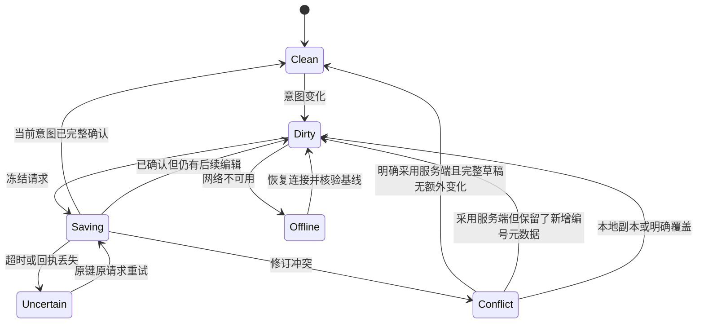

# 多参考提示词编辑器调研与设计

> 2026-10-23：当前Tiptap共享富文本与全能参考展示设计见第7.21节；此前实施记录为历史，不证明替换后的画布已接入。

## 1. 摘要

在同一编辑会话维护文字、引用、模式和参数，保存重开及提交保持一致。

## 2. 参与者

使用者与参与职责：图片、视频及多参考创作者。维护职责及确认人沿下方原来源记录；未给出姓名的，不补造人员或排期。

## 3. 背景

原始需求：[03-多参考提示词编辑器需求](../requirement/03-多参考提示词编辑器需求.md)。关联需求与验收：[02-多参考提示词编辑器](../prd/02-多参考提示词编辑器.md)。本文维护技术合同；相关实施步骤与证据见 Plan，状态与调度见 [BACKLOG](../../BACKLOG.md)。

### 3.1 文首来源与范围

适用范围：Tiptap多参考编辑、保存恢复、引用编译与提交一致性。维护职责：编辑器及prompt/canvas/operation消费者；评审人未指定。

更新：2026-10-15。用户已确认采用 Tiptap，本文细化交互和一致性设计，产品交付定义见下游[PRD](../prd/02-多参考提示词编辑器.md)，执行顺序见[任务与验证](#1-摘要)。前期使用 pm-market-research 的 competitor-analysis 方法比较官方资料；保留选型依据，不重复选型。产品行为唯一来源是[多参考提示词编辑器需求](../requirement/03-多参考提示词编辑器需求.md)。当前已锁定 Tiptap 3.32.0，实现 T-REF-01～T-REF-05 与 T-REF-06 入口整合；实际合同和验证边界见第716节。真实输入法、多设备及供应商结果尚未接受。

### 3.2 结论与研究范围

采用已确认的 **Tiptap 开源 Editor + 自定义 Reference 节点 + Suggestion 候选交互 + 现有 shadcn/Radix 组件**，构建织光多参考提示词编辑器。决定性因素是行内语义节点、可控 UI、JSON 持久化和现有 React/Next.js 体系的匹配。

市场范围是可嵌入创作产品的 Web 编辑器组件，不是办公文档 SaaS。使用者分为创作者与负责集成的工程团队；选择成功与否主要取决于引用身份正确性、输入法/剪贴板、扩展成本、授权方式和数据可控性。本次没有可信市场规模、份额、融资或用户留存数据，这些信息也不决定当前组件选型，因此不作估算。竞争定位与开发成本均为基于文档的定性判断，不是基准测试结果。

即梦是项目既定交互方向；本轮没有登录操作即梦或核验其所有界面细节。场景依据使用火山方舟官方参考生成文档，而不把模型 API、即梦消费端 UI 与织光现有能力混为一谈。官方指南强调对不同素材及其元素明确指代，并区分参考、编辑与延长的表达，这支持“正文引用必须与具体输入一一对应”的需求。[Seedance 提示词指南](https://docs.volcengine.com/docs/ark/seedance-2-0-prompt-guide?lang=zh&redirect=1)

### 3.3 组件竞争比较

Tiptap 为首选基准，以下五项是同一嵌入式编辑任务的替代方案。全部都能扩展，并非只有 Tiptap 能实现引用。

| 方案与定位                       | 官方已证实能力                                                                                                                                            | 对织光的优势与限制（判断）                                                                     | 授权/商业模式                                                                                               | 结论                   |
| -------------------------------- | --------------------------------------------------------------------------------------------------------------------------------------------------------- | ---------------------------------------------------------------------------------------------- | ----------------------------------------------------------------------------------------------------------- | ---------------------- |
| Tiptap：无预设 UI 的扩展式编辑器 | Mention、Suggestion、自定义 NodeView、JSON；[产品](https://tiptap.dev/product/editor)、[Mention](https://tiptap.dev/docs/editor/extensions/nodes/mention) | 适合引用标签和项目既有 UI；业务引用、上传、权限仍要自建，需掌握 ProseMirror 事务               | 开源仓库 [MIT](https://github.com/ueberdosis/tiptap/blob/main/LICENSE.md)；平台/高级能力另收费              | 首选                   |
| Lexical：可扩展编辑器框架        | 自定义 TextNode/DecoratorNode 与序列化；[节点](https://lexical.dev/docs/concepts/nodes)                                                                   | 可构建轻量提示词输入；要自行组合搜索、引用菜单及业务节点行为，当前没有足够收益推翻 Tiptap 偏好 | 核心 [MIT](https://github.com/facebook/lexical/blob/main/LICENSE)，框架不是托管业务服务                     | 首要备选               |
| Slate：高度可定制的编辑框架      | inline/void 与 Mention 建模；[Element](https://docs.slatejs.org/api/nodes/element)                                                                        | React 自定义自由度高；需负责更多规范化、选区与边界行为，收益依赖团队经验                       | 核心 [MIT](https://github.com/ianstormtaylor/slate/blob/main/License.md)                                    | 有 Slate 积累时可选    |
| BlockNote：块式文档编辑器        | 自定义行内内容与 Mention 示例；[Inline Content](https://www.blocknotejs.org/docs/features/custom-schemas/custom-inline-content)                           | 适合长文档与块操作；紧凑提示词区不需要其主要块式交互，要调整默认体验                           | 核心 MPL-2.0，XL 功能另有 GPL/商业许可；[价格与许可说明](https://www.blocknotejs.org/pricing)               | 更适合后续剧本文档场景 |
| CKEditor 5：完整商业文档编辑器   | Mention feed、候选渲染和转换扩展；[Mentions](https://ckeditor.com/docs/ckeditor5/latest/features/mentions.html)                                           | 完整文档功能与商业支持较匹配办公需求；织光仍须自建媒体引用语义，当前功能重心不匹配             | GPL 2+ 或商业许可；Free Plan 属商业许可；[官方许可](https://ckeditor.com/legal/ckeditor-licensing-options/) | 本轮不选               |
| Quill：模块化富文本编辑器        | Parchment/Blot 内容扩展与自定义模块；[Customization](https://quilljs.com/docs/customization)                                                              | 常规富文本输入可用；复杂引用节点、React 交互和业务序列化需额外集成                             | [BSD 三条款许可](https://github.com/slab/quill/blob/main/LICENSE)，社区核心                                 | 本轮不选               |

开源框架主要通过开发者文档和包生态采用；Tiptap、BlockNote、CKEditor 的付费产品增加托管、高级功能或支持。成本比较应计入节点开发、跨浏览器维护和供应商适配，不能仅按软件订阅费衡量。未实际测量包体或开发时间，不给虚构性能排名。

Tiptap 官网价格页本次显示平台月付 Start $49、Team $149、Business $999，Enterprise 询价；这是平台方案报价，并不等于开源 Editor 的使用费，也不保证这些方案包含所有附加能力。本需求推荐只用开源能力，不采购平台。未来需要协同、评论、导出或 AI Toolkit 时，重新核对对应包许可与当时价格。[官方价格](https://tiptap.dev/pricing)

织光的差异化应放在“引用可解释、不同模型可验证、历史可回放”，而不是重复实现通用富文本工具栏。未来 12～18 个月的主要技术风险是模型输入合同变化、编辑器扩展升级和自定义节点格式锁定；用版本化业务数据、确定性编译与往返测试控制，现阶段不引入第二个编辑器抽象或双引擎兼容层。

## 4. 目标

在同一编辑会话维护文字、引用、模式和参数，保存重开及提交保持一致。目标的规则、量化条件与非目标沿需求原文及下方已确认设计，不增加未经确认的指标。

## 5. 使用场景

参与者为图片、视频及多参考创作者；在下方定义的输入、对象状态、权限和环境条件具备时执行相应操作。各故事按其独立前置条件核对，不能把测试夹具当成真实业务条件。

### 5.1 交互结构与操作细节

对应 FR-REF-01～FR-REF-08、12。以下为布局与行为规格，不是已完成的 Figma 或可操作原型。

```text
┌ 视频生成 · 全能参考 ▾   模型 ▾           已保存 ┐
│ 本次参考 4 项       图片 2 / 视频 1 / 音频 1   │
│ [图片1 人物 ✓] [图片2 场景 ✓] [视频1 动作 ✓]  │
│ [音频1 雨声 处理中…]               [+ 添加]  │
│ 让 [图片1·人物] 走进 [图片2·场景]，            │
│ 动作参考 [视频1·动作]，声音使用 [音频1·雨声]。 │
│ @ 引用   展开编辑                    文本计数 │
│ 比例 ▾  时长 ▾   1 项素材仍在处理             │
│                              [检查输入与费用]│
└─────────────────────────────────────────────┘
```

“已保存”与“处理中”可以同时出现：保存的是创作意图，不代表媒体可生成。数量分开显示唯一参考数与正文提及次数，主体展开另显示实际输入数。上限从当前模型能力读取，未知能力不显示“无限”。桌面输入区建议高度 120～320px、超出局部滚动，支持展开；手机随可视高度调整，不遮软键盘和主要操作。这些尺寸是待断点验证的初值。

| 触发                      | 展示与确认                                                      | 完成/取消结果                                                  |
| ------------------------- | --------------------------------------------------------------- | -------------------------------------------------------------- |
| 正文 `@`                  | 先展示当前参考，再检索有权素材/主体；已选条目标“已在本次参考中” | 选择替换当前 `@查询词` 范围并插标签；Escape 保留输入文字       |
| 插入到正文                | 保存选区，多选按选中顺序插入                                    | 返回原插入位置；位置已失效时提示并使用当前合法位置，不用旧下标 |
| 添加参考                  | 只添加卡片，明确标记本次会提交                                  | 不移动光标，不强制加入正文                                     |
| 标签激活                  | 定位卡片，显示预览/替换/定位其他提及                            | 关闭回到该标签或原选区，不自动播放媒体                         |
| 同类型替换                | 显示受影响提及数量                                              | 保留 referenceId 和编号，全体提及更新，一次撤销恢复            |
| 移除参考                  | 有提及时提示“移除本次参考及正文 N 处引用，素材库原件保留”       | 确认后原子移除；没有提及时直接操作并提供撤销                   |
| 相邻标签 Backspace/Delete | 第一次选中、第二次删除；明确选区可直接整体删除                  | 只删正文提及，提示“参考仍将提交，可在素材区移除”               |

候选不使用多个输入框争抢焦点；组合输入期间不发选择命令。异步候选以 `contextKey + querySeq` 校验，只接受当前会话最后一次查询。重复引用复用同角色绑定，只增加正文出现位置。显示编号使用按类型递增计数器，删除、撤销与重做都不回收已分配编号；展开/收起编辑器继续使用同一文档和选区。

错误摘要可逐项定位标签、卡片或参数。参考分别具有处理状态、模式兼容性与访问状态，不用一个 status 混淆“上传成功但模式不兼容”。典型文案为“当前模式不支持视频参考”“图片尚未分配首帧或尾帧”“素材已无法访问”。仅预览失败时保留已验证的生成资格；失权则移除缓存私有详情。

## 6. 价值

减少参考错绑、输入丢失和报价与执行不一致。

## 7. 方案

### 7.1 Tiptap 能力与缺口

| 需求能力         | 可采用的机制与证据                                                                                                                        | 必须由织光补齐                                                |
| ---------------- | ----------------------------------------------------------------------------------------------------------------------------------------- | ------------------------------------------------------------- |
| `@` 与候选选择   | [Mention](https://tiptap.dev/docs/editor/extensions/nodes/mention)、[Suggestion](https://tiptap.dev/docs/editor/api/utilities/suggestion) | 项目/主体检索、权限、过滤、错误态、候选可访问性与光标恢复     |
| 带状态的行内标签 | [React NodeView](https://tiptap.dev/docs/editor/extensions/custom-extensions/node-views/react)                                            | 稳定 referenceId、类型/名称/失效态、删除/替换/定位行为        |
| 文档保存和恢复   | [JSON/HTML 输出](https://tiptap.dev/docs/guides/output-json-html)                                                                         | 版本、引用集合、原子修订、冲突处理和历史快照                  |
| 文件拖入/粘贴    | [FileHandler](https://tiptap.dev/docs/editor/extensions/functionality/filehandler) 仅处理事件，不提供服务器上传                           | 现有媒体上传链路、进度/重试、校验、临时引用替换与迟到回执治理 |
| Next.js 集成     | [Next.js 官方集成示例](https://tiptap.dev/docs/editor/getting-started/install/nextjs) 建议 `immediatelyRender: false`                     | 客户端编辑边界、加载占位、当前 React/Next.js 版本的集成验证   |
| 模型输入         | 以上文档没有提供织光供应商输入合同                                                                                                        | 业务编译、媒体排序、角色映射、报价绑定、权限和幂等执行        |

Suggestion 当前在线文档包含异步候选和取消机制，但不能假定任意旧包都有同样 API。实施时锁定同一兼容版本的 Tiptap 包，检查对应发布版本，不照抄在线最新示例。NodeView 是编辑器内渲染机制，不自动定义复制到外部的文本/HTML或供应商序列化。

建议自定义 `reference` 行内原子节点，并复用 Suggestion 的触发与候选基础机制；Mention 用于验证交互和实现参考，不直接把“用户提及”的默认字段当作完整媒体合同。仅注册 Document、Paragraph、Text、HardBreak、业务撤销重做（第 10 节）、Placeholder 和业务引用等所需能力；具体包名、版本和最低集合在技术验证中确定，不直接安装全功能模板。

### 7.2 候选组件与模块边界


| 组件职责（候选名称） | 输入/输出与边界                                                                          |
| -------------------- | ---------------------------------------------------------------------------------------- |
| PromptEditor         | 编辑结构化正文，发出事务；不负责上传、查询所有素材或直接调用生成                         |
| ReferenceToken       | 展示并定位绑定；由当前可访问状态渲染；不自行保存 URL 或加载播放器                        |
| ReferencePicker      | 当前范围内素材/主体候选、搜索、类型过滤和选择；复用已有媒体/主体合同                     |
| ReferenceTray        | 本次参考卡片、顺序、具名槽位、状态、替换与移除                                           |
| ReferencePreview     | 授权后的预览，视频/音频按需加载并可停止                                                  |
| ComposerDraft        | 同一草稿修订内协调正文、绑定表、模式和参数；管理保存与恢复                               |
| 引用编译职责         | 由现有后端 prompt/operation 业务边界承载；按能力快照解析引用并冻结执行输入，不新建微服务 |

共享实现位置优先落在现有 `frontend/src/components/generation/`，页面专用接入留在页面目录；只有真实复用需求出现时再拆更小 feature。shadcn/Radix 提供 Dialog/Popover/Button/列表等 UI 原语；不把 cmdk 或第三方完整编辑器模板当作必装依赖。候选弹层与编辑器选区需共同验证，直接复用 Popover 不代表焦点行为天然正确。

### 7.3 候选数据合同

需求对应 DR-REF-01～DR-REF-12。下列字段表达设计意图，不是已经存在的 API、数据库字段或迁移脚本。

| 对象         | 候选字段                                                                                               | 关键约束                                                   |
| ------------ | ------------------------------------------------------------------------------------------------------ | ---------------------------------------------------------- |
| 草稿         | schemaVersion、revision、scope、modelVersion、mode、document、references、params、labelState           | scope 含所属空间/项目/创作对象，服务端从身份与对象重新核验 |
| 正文引用节点 | type=reference，attrs.referenceId                                                                      | referenceId 关联绑定；名称与序号由绑定派生，不存成资源身份 |
| 引用绑定     | id、source（互斥联合）、bindingGeneration、mediaKind、role、displayLabel、order                        | 稳定身份；异步状态是可刷新的业务状态，不由文档自行证明有效 |
| 主体展开     | subjectId/version、选定描述、实际媒体版本列表、来源映射                                                | 确定性展开、权限检查、底层输入去重与数量核验               |
| 冻结输入     | 原文档、绑定快照、compiledPrompt、orderedMediaInputs、referenceMap、compilerVersion、capabilityVersion | 与本次报价绑定，既可重放也可解释实际发送内容               |

正文示意：

```json
{
  "type": "doc",
  "content": [
    {
      "type": "paragraph",
      "content": [
        { "type": "text", "text": "让" },
        { "type": "reference", "attrs": { "referenceId": "ref-person" } },
        { "type": "text", "text": "走进" },
        { "type": "reference", "attrs": { "referenceId": "ref-scene" } }
      ]
    }
  ]
}
```

这里的 ID 是示例。文档允许出现多处相同 referenceId；素材集合按绑定去重，供应商输出再按“媒体版本 + 输入角色”及其合同判断是否可合并。不同首尾帧槽位即使使用同一底图也保留角色；主体展开与直接引用共用同一底图时，保留多来源到同一物理输入的映射。

显示序号可以稀疏而保持稳定，例如删除图片1后仍有图片2；供应商可能要求连续编号。必须遍历结构化节点生成实际文字，并把图片2绑定转换成对应供应商槽位，同时更新输入摘要映射。不能对全文做字符串替换，避免修改用户手写“图片2”或误改普通数字。

### 7.4 可保存的上传占位

对应 DR-REF-09、AC-REF-22。绑定公共字段为 `id、bindingGeneration、mediaKind、role、order`，显示编号从 labelState 取得；`source` 仅允许以下一个变体，不能混合字段：

| source.kind    | 持久化字段                                            | 保存和生成边界                                          |
| -------------- | ----------------------------------------------------- | ------------------------------------------------------- |
| pending_upload | clientUploadId、uploadAttemptId、可选 uploadSessionId | 无素材 ID 也可保存；永远不可直接编译生成                |
| media          | sourceId、sourceVersion                               | 保存时核验媒体归属/版本；生成时另核验处理状态和模型能力 |
| subject        | sourceId、sourceVersion、选定描述及媒体版本映射       | 核验主体及展开资源权限；展开结果也需满足生成约束        |

pending 的 clientUploadId 只是随机关联标识，不是资源权限凭据；不接收 sourceId、sourceVersion、ready 标记、私有 URL 或文件二进制。服务端先验证草稿写权限、大小/类型白名单和绑定结构；若有 uploadSessionId，再验证该上传会话归当前账号及项目，并与本次 attempt 匹配；clientUploadId 仅为本地关联，不充当服务端授权事实。外部伪造会话不能变为素材读取或写入权。来源失权占位沿用已保存绑定的受限投影，不是客户端可新建的任意私有 ID。

上传解析由 `contextKey + replicaId + referenceId + bindingGeneration + uploadAttemptId` 定位。回执仅在当前分支该绑定仍活跃且全部标识匹配时，将 source 从 pending 原子变为 media 并触发保存；media 身份仍需服务端鉴权，不信客户端状态。重选文件递增 generation 并换 attempt；明确新尝试更换 attempt；网络结果未知时重放原键原文件，不更换 attempt。pending 的失败/进度是运行状态，恢复不能仅凭缓存显示已就绪：有会话先查询，没有可恢复文件就原位显示“重新选择文件”。主体/媒体的处理完成状态同样以服务端事实为准。

复制到另一个草稿或“保留本地为副本”时，pending 改用新 clientUploadId/attempt，不继承上传会话；正文 referenceId 统一映射到新绑定，并提示重选。原分支迟到上传只作用于原分支。已解析媒体/主体则在目标范围重新鉴权。

### 7.5 显示编号与两类摘要

对应 DR-REF-12、AC-REF-25。`labelState` 包含按显示类型递增的 `highWater`，以及 `allocations[referenceId] = {labelKind, ordinal}`。allocations 保留删除绑定的最小分配记录，不含名称、来源 ID、URL 或媒体内容；作用是允许同一绑定撤销恢复原号，同时拒绝其他绑定复用该号。它不是用户撤销栈；随草稿生命周期保存，不因退出编辑、删除引用或撤销回退。独立草稿新编号从当前分支highWater + 1分配，与用户编辑进入同一本地恢复快照后CAS保存；画布编号与绑定走设计17的共享接受规则，只保留本页内存，不用多端各自的highWater直接覆盖共享编号。结构有界且溢出时报错，不回绕编号或丢弃分配记录。

服务端验证请求包含既有分配且上界不下降，遗漏或试图清空返回 label_allocation_conflict，不静默合并成与请求不同的草稿；同一类型的 ordinal 不能分配给不同 referenceId。普通用户操作只增分配记录，重做已有绑定复用其记录。跨窗口未保存的新号标为本地未同步：A/B 同从上界2分配图片3时，A 保存后 B 的旧基线必须冲突。B 可保留为新的草稿（复制该分支 labelState），或明确选择覆盖原稿；后者合并已知上界，对尚未获服务端接受且冲突的绑定分配大于双方上界的新号，列出标签变化并确认后 CAS 保存。原服务端分配永不被改为其他绑定。采用服务端版本仍合并当前分支不冲突的分配记录；碰撞记录保留在原本地分支，未保存的新号不冒充服务端稳定编号。

粘贴时同来源/版本/角色复用目标已有绑定；新绑定使用新 referenceId 和目标编号，不导入来源草稿的分配计数器。保留副本以新对象为编号命名空间，可完整保留所选分支编号；后续新增继续递增。显式重命名/同类型替换仍保留该绑定编号，普通文本中的手写编号不改写。

`draft_hash` 覆盖完整规范化可保存草稿，包括 pending 来源和 labelState；仅完整草稿摘要相同才可省略持久化。`input_hash` 覆盖实际生成意图，不含编号分配上界、删除分配记录或预览缓存；待上传草稿没有可报价的 input_hash。分配后撤销即使生成内容回到原样，draft_hash 仍变化，必须保存元数据。画布此类纯元数据变更只增加 canvasRevision，不增加节点 inputRevision；独立草稿 revision 仍增加，可以保守地要求重新报价。保存回执按 draft_hash 确认，不能用 input_hash 冒充全部已保存。

### 7.6 编译、保存与接口方向

编译次序建议为：校验文档结构与修订 → 验证引用和来源权限 → 冻结主体展开 → 获取模型/模式能力 → 校验所有启用参考和组合 → 按稳定顺序生成实际媒体列表与映射 → 遍历节点生成文本 → 完成最终长度/角色/模板一致性校验 → 冻结报价输入。

供应商适配器决定实际指代语法、媒体顺序和角色；界面中的 `@图片1` 不是通用 API 语法。已有模板编译必须在语义引用仍可追踪时处理，或在编译后验证映射完整；不能让模板二次修改已冻结文本。首尾帧槽位始终独立映射，不能从自然语言推断。

服务端成为最终编译权威；前端摘要只是预览，报价返回服务端确认的输入。细化后采用“先保存完整文档，再按保存版本报价”：保存请求携带文档与参考集合，富文本报价仅携带保存快照指针，避免提交两份可冲突输入。旧纯文本合同保留显式过渡分支；同一请求混用两个分支则拒绝。具体合同见第 13 节，不手改生成的前端 API 文件。

保存正文与参考集合使用同一草稿修订；媒体处理回执先验证所属草稿及临时绑定仍存在，再应用事务。将引用增删、媒体集合变更和撤销视为同一用户操作；只依赖编辑器自身文字 history，不能保证外部卡片同步撤销。网络上传本身不被撤销“回滚”，撤销的是本次引用关系，已上传原件按素材生命周期处理。

历史旧文档按版本读取，不运行文本正则自动找引用；读取失败不自动写回空文档。现有数据库增量更新、草稿版本迁移和纯文本兼容路径另行审阅，不能重放 Schema 或批量改写旧业务数据。

### 7.7 草稿事务与撤销

对应 FR-REF-03/04/09、DR-REF-01～DR-REF-04。同一编辑实例内每个创作对象只有一个 `ComposerSession`，跨窗口/设备实例由服务端 CAS 仲裁，不由正文、卡片和模型选择各自保存。

| 状态边界   | 内容                                                                                | 保存与撤销                                 |
| ---------- | ----------------------------------------------------------------------------------- | ------------------------------------------ |
| 创作意图   | 正文、绑定、顺序、角色/槽位、模型/模式、参数、主体版本                              | 原子保存；用户操作进入同一撤销序列         |
| 编号元数据 | labelState 的分配记录与上界                                                         | 与草稿同修订保存，不随用户撤销回退         |
| 同步控制   | replicaId、localSeq、ackedSeq、serverRevision、pendingSave、pendingSubmission、冲突 | 用于恢复请求，不进入用户撤销               |
| 运行状态   | 选区、候选、上传进度、资源解析记录、权限/预览状态                                   | 不作为生成事实；不进入撤销；按当前权限重取 |

| 命令                         | 一次提交的变化                             | 不变量                                          |
| ---------------------------- | ------------------------------------------ | ----------------------------------------------- |
| InsertReference              | 新建/复用绑定，同时插标签；或仅添加卡片    | 不生成悬空引用                                  |
| RemoveOccurrence             | 删除一处标签                               | 不移除素材集合                                  |
| RemoveReference              | 删除绑定、全部正文提及与槽位占用           | 一次撤销恢复整组；空槽位显示待处理              |
| ReplaceReference             | 同类型更新源与版本；异类型新建并明确重定向 | 不按名称全局替换，不影响其他绑定                |
| Reorder / AssignSlot         | 改媒体顺序或槽位角色                       | 正文 ID 不变，槽位基数按能力核验                |
| ChangeMode / ApplyConversion | 改模式或应用确认后的转换                   | 保留未处理输入；转换基于最新 localSeq           |
| UpdateParams                 | 修改值或明确采用一组推荐值                 | 显示默认值不等于用户已保存值                    |
| RestoreHistory               | 恢复一组完整意图与选区                     | localSeq 仍递增，不回退服务器版本，不复活旧报价 |

Tiptap 官方区分内容更新、选区更新和事务；其内建 UndoRedo 是文档历史，不承诺同步应用外部卡片与模型参数。[事件文档](https://tiptap.dev/docs/editor/api/events)、[UndoRedo](https://tiptap.dev/docs/editor/extensions/functionality/undo-redo)

设计选择**应用级草稿历史**协调完整意图，Tiptap 提供文字事务与选区映射。默认不同时开启内建 UndoRedo；业务 undo/redo 覆盖键盘、工具按钮及浏览器 `historyUndo/historyRedo`。普通输入从事务捕获，不每键调用 `setContent` 回写；仅恢复历史、切对象或明确采用服务器版本时恢复文档，并抑制回环事件。UI 不另维护可独立编辑的 prompt 字符串和 media 数组。

建议历史最多 100 组、相邻文字 500ms 合并，IME 一次组合一组；引用、模式和参数操作各自成组，切选区或对象不合并。使用结构共享的意图前后值/片段和选区，避免每键深拷贝媒体集合。历史仅限会话，刷新仅恢复文档。此桥接需通过计划 T-REF-01 实测，失败则修订桥接实现，不能降低整组撤销要求。

每次上传带 `contextKey + replicaId + referenceId + bindingGeneration + uploadAttemptId`，替换使 generation 递增。回执仅更新对应来源解析记录，不自行插节点；有效解析结果形成系统修订并触发保存，但不新增用户历史项。移除整个参考使绑定失活并取消可取消的上传；删一处标签不取消仍在集合中的上传。

撤销移除后，仅同 generation 已成功且仍有权的素材可复用；取消/未知上传显示需重试，不复活原请求。解析记录与用户历史分开，历史恢复和保存都合并当前活跃绑定的有效解析结果；已实际上传的原件不被撤销删除。保存/进度回执不能修改用户撤销顺序或把已删除绑定重新加入。

### 7.8 编辑内核合同

[客户端文档合同](../../frontend/src/components/generation/prompt-document.ts)、[ComposerSession](../../frontend/src/components/generation/composer-session.ts) 与 [PromptEditor](../../frontend/src/components/generation/prompt-editor.tsx) 是当前实现落点。Tiptap core/react/pm、Document/Paragraph/Text/HardBreak 均精确锁定 3.32.0；不装 StarterKit 或内建 UndoRedo。Suggestion 与授权来源在 T-REF-03 有真实候选消费者时接入，首轮完整范围不变。[官方 React 集成](https://tiptap.dev/docs/editor/getting-started/install/react)、[自定义 Node](https://tiptap.dev/docs/editor/extensions/custom-extensions/create-new/node)

完整意图历史由一个 ProseMirror 插件承载，保留结构共享的文档节点、引用集合、模式、参数及选区；100 组上限、相邻文字 500ms 合并。内容相同的规范化事务不增加历史或 localSeq。引用原子节点只存 referenceId，标签由 labelState 派生；普通正文输入不调用 setContent，恢复历史以一次事务同时恢复文档和元数据。labelState 独立于历史，保留删除分配记录；T-REF-01 客户端暂以 10,000 条分配记录和安全整数作为显式防溢出边界，达到边界报错，不回收旧号。这是内核保护值，不是供应商输入数量上限，T-REF-02 服务端现采用相同分配上限、安全整数及 255 个活跃绑定的结构保护；供应商上限仍由版本化模型能力单独校验。

待选模式使用 contextKey、replicaId、selectionEpoch 与目标四重匹配。undo/redo 即使没有历史也取消待选；销毁旧编辑器使回执失效。合成期间到达的当前模式结果先留在运行状态，待组合结束及最终文字事务处理后应用；取消或新选择继续使之失效。Ctrl/Cmd+S 在合成期间仅排队一次快照请求，组合结束后冻结完整文字；待选模式暂停提交快捷键。该回调不是自动保存或服务端保存回执。

snapshot 返回独立副本，包含完整草稿、contextKey、replicaId、localSeq；不包含待选模式、历史或临时选区。pending_upload 可通过客户端结构校验与序列化，但尚未证明任何素材权限或上传就绪；客户端不产出 draft_hash/input_hash，不显示服务端“已保存”。独立草稿与画布的保存协议分别服从其持久所有者。

React 使用 immediatelyRender=false，普通事务不触发编辑器组件重渲染；仅对象/实例身份改变才重新创建编辑器，同对象重传 seed 不覆盖现有内容。首页、生成弹窗和画布共用编辑内核，文件粘贴/拖入、授权结构粘贴与来源选择见第716节。外部 HTML 不解析 reference 身份，未知标签只作为可读文字。

### 7.9 模式切换与转换矩阵

对应 FR-REF-06、AC-REF-16/20。模式是同一草稿的字段，不以 `key={mode}` 重建表单，不保留隐藏模式副本。模型/模式能力异步获取期间保留原生效选择，pending 目标只用于展示；仅最后一次选择的成功回执可应用。查询失败不清空现有输入。

| 当前 → 目标         | 保留内容                               | 待处理项                                 | 显式转换                                           |
| ------------------- | -------------------------------------- | ---------------------------------------- | -------------------------------------------------- |
| 全能参考 → 首尾帧   | 全部文字、图片、视频、音频、用途和参数 | 未指派图片、不支持媒体、缺帧和参数不兼容 | 选择首尾帧，列出额外参考及正文影响，确认后整体转换 |
| 首尾帧 → 全能参考   | 原图与原具名角色                       | 新模式不支持 first/last 时标记           | “转为参考图片”，展示转换后顺序再应用               |
| 多参考 → 纯文本     | 原文与所有引用                         | 不支持的媒体仍可见且阻止报价             | 明确移除引用，保留周围文字，不自动降为普通名称     |
| 纯文本 → 全能参考   | 原文和已有参数                         | 缺必需媒体/参数                          | 根据能力添加引用，不额外强迫模型允许的空媒体输入   |
| 相同模式 → 其他模型 | 正文、源版本、顺序、全部原参数         | 数量/时长/组合及参数差异                 | 替换、移除或明确采用推荐参数                       |
| 切回旧模式          | 当前完整草稿                           | 重新核验能力                             | 不恢复过时的旧模式文本；回退具体修改使用撤销       |

兼容切换直接完成；不兼容切换显示“已切换，N 项待处理”，可保存但不可报价。只有移除/替换输入、转换角色、重置参数的批量方案需要用户确认。面板展示保留、用途变化、移除、参数变化与正文影响；面板期间 localSeq 或能力版本变化使方案过期，重新计算，不提交旧计划。

不设隐藏的“不参与提交”参考列表：不兼容项仍属当前输入并阻止生成；不用则明确移除。槽位是绑定角色的唯一表示，不额外保存一份可能失配的首帧数组。确认请求已发出但结果未知期间锁定本次编辑；确认结果已知并按第715节释放提交槽位后，继续编辑属于后续意图，不改正在执行的快照。

当前有效回执中的停用、缺失或模式下线事实先更新能力缓存，再判定能否切换；被 selectionEpoch 拒绝的旧回执不更新缓存。切换失败仍保留旧模式/输入，但旧模式所在模型已失效时生成资格同步关闭。

### 7.10 待选模式与历史命令

对应 DR-REF-11、AC-REF-24。能力查询携带 `{contextKey, replicaId, selectionEpoch, targetModel, targetMode}`；selectionEpoch 是当前编辑会话内递增代次，不进用户历史，不从旧草稿恢复。新选择、取消、undo、redo、采用服务端、切对象和销毁会话均先使旧代次失效。实际请求即使无法 abort，旧回执也只能丢弃，不能改模式、错误状态或生成资格。

| 事件                   | 状态与历史结果                                                                                               |
| ---------------------- | ------------------------------------------------------------------------------------------------------------ |
| 开始选择 C             | 原生效模式保持；设置 pendingTarget 并作废旧报价，暂停报价/确认；待选目标不保存、不入撤销栈                   |
| pending 时 undo/redo   | 先清 pending、增加代次，再执行一次已提交历史操作；无历史则只取消；恢复模式重新校验能力                       |
| 单独取消选择           | 清 pending 并增加代次，保留生效意图；能力仍有效即可恢复生成资格                                              |
| 采用服务端/切对象/卸载 | 增加代次并使旧回执失效；新上下文按自身状态重新取得能力                                                       |
| 当前回执成功           | 同时核验上下文、replicaId、代次和目标；对回执到达时的最新正文/引用/参数计算兼容性，再原子提交一次 ChangeMode |
| 当前回执失败           | 清 pending，显示目标未切换；原模式能力有效时可继续生成，原能力未知/失效时仍禁用                              |

普通输入不取消用户正在等待的模式选择，但改变转换面板的 localSeq，使旧转换方案失效。历史恢复只恢复模式意图，不恢复 pending 查询、旧兼容结果或报价。提交结果未知时，FR-REF-10 的锁定优先，不能通过 undo/redo 绕过。A→B 已提交、C 待返回后 undo 的结果是 A；迟到 C 被丢弃，再 redo 只恢复 B。

### 7.11 保存、恢复和并发时序

持久化按所有者分流：下述整份草稿CAS、本地分支与DraftSaver调度仅适用于首页/独立草稿。画布节点及展开视图的正文/参考仍沿本设计，持久化与协作由[设计14](14-画布数据与接口设计.md)、[设计15](15-画布WebSocket实时通道设计.md)、[设计17](17-画布Yjs协作编辑设计.md)负责；不接入IDB、800ms/5s定时整图保存或独立prompt草稿写入口。本文提到的旧UpdateNodeConfig/CAS实现只说明已有适配，不是目标Yjs并发协议。

对应 FR-REF-09、AC-REF-17～AC-REF-19/21/22/25。结构完整/身份合法是保存前提，模型兼容和媒体就绪只决定能否生成。缺帧、超模型数量、待上传及旧参数可保存。新媒体/主体绑定必须鉴权；pending_upload 只按第 6.1 节校验占位和上传会话，不要求尚不存在的素材 ID；已保存绑定后来失权可保留安全失效占位以便修复，不能以此接受任意伪造 ID 或读出失权素材详情。



还包括 auth_required（暂停同步，同账号登录后重新读回）、read_only（撤权/未知 schema）、save_error（确定失败，修复后新请求）。内部状态名不直接展示给用户；网络失败不等于会话失效。

| 字段                            | 含义                                                                      |
| ------------------------------- | ------------------------------------------------------------------------- |
| contextKey                      | 账号 + 空间 + 项目 + 持久化所有者 + 对象 ID；回执归属依据                 |
| replicaId / localRecordRevision | 每次页面编辑实例新建的恢复分支 ID / IndexedDB 条件写入版本                |
| pendingSubmission               | 与 pendingSave 分离的报价/确认恢复信息，见第 13.1 节                      |
| localSeq / ackedSeq             | 本地递增保存序号（含意图/持久化元数据变化）/ 已确认序号，不等于数据库修订 |
| serverRevision                  | 独立草稿修订；画布使用 canvasRevision 与 inputRevision                    |
| pendingSave                     | 不可变请求体、摘要、基础修订、capturedSeq、幂等键                         |
| latestQueued                    | 请求在途期间的最新意图，可合并排队，不能修改 pendingSave                  |

示例：基线 r7，保存 localSeq=10，在途继续编辑到 12；成功 r8 只将 ackedSeq 记为 10，当前仍 dirty，绝不 `setContent` 覆盖 12。接着以 r8 保存 12，成功 r9 才显示已保存。撤销也增加 localSeq；只有完整 draft_hash（含 labelState）等于已确认内容才可消除冗余保存；input_hash 相同不能跳过编号元数据保存，用户撤销仍使旧报价失效。

独立草稿每个编辑实例的持久化协调器最多一个在途写请求；跨窗口/设备可有多个实例，服务端用幂等与CAS处理并发。画布布局与所有节点共用设计15的P/Q队列和设计17的Yjs共享会话，不把独立草稿CAS并发规则套到画布。未知结果先用原键原请求恢复；服务端幂等重放必须先于 CAS 修订判断并返回原回执。回执保留期过后无法恢复时，读取最新文档及完整摘要；只有证明内容相同才能确认，否则冲突，不能猜测成功。默认保存调度及关闭行为以 FR-REF-09 为准。

### 7.12 画布与独立草稿

当前画布编辑器（历史路径：`frontend/src/app/canvas/editor.tsx`，文件已退出当前实现）已有请求冻结与新输入保留；[画布存储](../../backend/internal/canvas/adapter/postgres/draft_save.go)已有保存回执和节点输入版本。继续扩展这些机制：

- 画布保留完整版本化ComposerDraft字段及稳定引用；当前Go的UpdateNodeConfig/CAS适配是实现基线。目标按设计17的共享粒度保存，布局与节点输入统一经设计15队列自动提交，不分别创建保存协调器，也不把整份JSON覆盖当作多人合并。
- canvasRevision 是画布修订，inputRevision 是节点生成意图版本。移动节点仅改前者；正文/参考/模式/参数改动增加后者，保存回执同时核验，不用 localSeq 代替。
- 从 A 节点切 B 只切视图，A 的在途会话归 A；A 回执不能选中 A 或写入 B。离开画布统一 flush，后台对象的状态可查看。
- 首页/独立生成弹窗新增项目草稿持久化，归现有 prompt 模块；创建一次 draftId，弹窗共享同一会话。画布节点不复制为独立草稿，避免双写。
- 游客/未选项目时使用明确标为本地的临时输入；认证并选项目后幂等创建和一次导入，完成前不切换所有者。取消认证保留输入，不自动生成。

### 7.13 恢复、冲突与退出

对应 DR-REF-08、AC-REF-21；原 AC-REF-10/18/19 继续覆盖服务端保存、冲突和对象隔离。

本节本地分支仅适用于首页/独立草稿；画布节点只允许本页内存恢复，按设计15/17处理，不提供浏览器业务记录恢复入口。独立草稿的本地恢复副本使用 IndexedDB，键为 `{contextKey, replicaId}`；保存完整草稿（含 labelState）、serverRevision 基线、localRecordRevision、localSeq/ackedSeq、pendingSave 与 pendingSubmission，不存媒体二进制、签名 URL 或凭据。写入失败/配额不足提示“本地恢复不可用”，不承诺强制关闭后零丢失。游客只保存不含私人素材的会话输入。退出/切账号清理缓存并通知其他窗口；页面再次激活先核验身份，不先展示残留私人内容。

每次页面启动生成新的 replicaId，不能从被复制标签页的 sessionStorage 继承写者身份；同页首页/弹窗复用实例。自动保存和已保存清理只更新自己的分支，以 localRecordRevision 条件写入/删除，不按 contextKey 批量删除。其他分支仅在用户明确丢弃后条件删除；期间版本变化则拒绝清理。退出账号是独立的账号级清理操作，各窗口核验身份前不得重新展示或写回旧私有缓存。

恢复顺序：身份核验 → 发现该对象未决提交并设置提交锁 → 读取服务端草稿及本地分支 → 优先查询/重放各分支原未知保存 → 比较各自基线及 draft_hash → 用户选取恢复分支。即使没有本地副本，也必须进行服务端提交发现。分支 localSeq 只在本分支有意义，不跨分支取最大值或按更新时间自动覆盖。恢复一个候选时将快照复制到当前新 replicaId，原候选保持不动；清理原候选需要明确操作和记录版本条件。原 pendingSave 重试沿用原键原体，不因复制分支产生新保存身份。

服务端基线相同且只有一份不同的本地意图时可提示恢复；多份不同内容或基线变化时展示候选差异，保留本地为副本/明确采用服务端。用户清理缓存后未同步内容无法恢复，但服务端未决提交发现不依赖缓存。网络或身份无法核验时停留“恢复待核验”，不自动回写/生成；已通过身份核验的现有会话可继续离线编辑自己的分支。未知 schema 只读保留，不降为空白保存。

冲突显示正文、引用增删/源版本、模式和参数差异。默认操作为采用服务端版本或保留本地副本；明确覆盖属于高级操作，以最新 revision 条件写入，再次冲突不得强制覆盖。独立草稿副本使用新ID；画布冲突先按设计17保留兼容编辑并处理拒绝依赖，不自动复制成新节点。用户显式新建节点属于新的合法编辑，不能替代原请求查证或删除恢复；权限不足不提供越权保存。

关闭仅隐藏视图且所有者仍存在时继续保存；真正卸载前先 flush。保存失败/未知时继续等待、重试或明确放弃未保存改动。“放弃”不能撤销已发出的写入，提示其可能已成功，下次读取真实结果。Abort、unload/sendBeacon 都不能充当服务端保存/撤销证据。

画布恢复与保存共用同一会话门禁：先查清原未知请求，再从服务器已接受状态及本页意图重建；核对会话、权限、对象代次与最新版本。不得读取旧IDB分支或把旧快照覆盖新输入。独立草稿的本地分支条件清理不适用于画布。

### 7.14 服务端合同与报价绑定

沿用现有 Problem 错误和 Idempotency-Key，DTO 在实现阶段统一生成客户端。

| 接口/对象                                 | 请求与回执                                                                                                             | 约束                                                                 |
| ----------------------------------------- | ---------------------------------------------------------------------------------------------------------------------- | -------------------------------------------------------------------- |
| 新增 POST /projects/:pid/prompt-drafts    | schema_version、完整 draft；返回 draft_id、revision、draft_hash、draft                                                 | 幂等创建；服务端授权项目/所有者                                      |
| 新增 GET /projects/:pid/prompt-drafts/:id | 当前完整草稿、修订                                                                                                     | 对象权限；未知版本不转空白                                           |
| 新增 GET /projects/:pid/prompt-drafts     | 当前有权草稿摘要、游标分页                                                                                             | 按项目与调用者权限过滤，支持再次登录找回，不能仅依赖本地记录 draftId |
| 新增 PUT /projects/:pid/prompt-drafts/:id | expected_revision、schema_version、完整 draft；返回新修订/draft_hash/规范化 draft                                      | 原子替换正文/绑定/模式/参数；先幂等重放再 CAS；无需生成就绪          |
| 扩展 POST /canvases/:id/commands          | 现有命令、revision、键；UpdateNodeConfig 含版本化 composer                                                             | 保留画布事务和 inputRevision，不另建并行节点写入                     |
| 扩展 POST /projects/:pid/free-operations  | 富文本分支 input_source、force_regenerate、expected_submission_epoch；返回 submission/operation 身份、确认键及快照报价 | 模型/模式/参数/数量从保存快照读取；epoch 仅是提交并发控制，见 13.1   |
| 现有确认与任务查询                        | operationId、确认幂等键                                                                                                | 仅确认冻结输入，执行条件变化时拒绝，不重新编译为另一份输入           |

input_source 为互斥联合：独立草稿 `{kind: prompt_draft, draft_id, revision}`；画布 `{kind: canvas_input, canvas_id, node_id, canvas_revision, input_revision}`。若同时带旧 prompt/media_inputs/model/mode/params 等意图字段则返回 422；旧纯文本调用走旧分支，两个分支不能互相覆盖。

独立草稿需要当前行与保存回执，已报价版本留在 operation 输入快照；不为每个按键建立永久历史。画布复用 canvas.node_input。结构与引用纯校验属于 prompt/domain；独立草稿读写属于 prompt/application 与 adapter；canvas 消费稳定领域值，operation 消费注入的快照读取/编译接口，prompt 不反向依赖 operation 或其存储层。

报价事务检查输入指针确实为当前可报价版本，并冻结媒体/主体事实。[现有画布来源检查](../../backend/internal/operation/adapter/postgres/quote_canvas_source.go)现由 prompt 输入所有者读取和 operation 富文本报价适配共同校验完整快照及 inputRevision；旧 source 分支不能替代该校验。input_hash 覆盖规范化正文、绑定源/版本、顺序/角色、模型版本、模式、参数与数量；不包含时间戳、预览状态或名称缓存。服务端最终校验与编译是权威，客户端摘要只用于检测过期。

生成步骤：完成当前输入法组合 → 捕获提交序列 → 保存该序列并取得回执 → 对同一保存版本报价 → 展示服务端摘要/费用 → 用户确认。期间继续编辑会取消本次提交意图，保存可完成但迟到报价不可确认；不能拿旧输入冒充新内容。确认请求发出至确认结果查明期间锁定该次提交，只用原键恢复，不创建新收费意图；确认结果指已接受/确定拒绝，不要求生成任务完成。跨刷新及无本地缓存时的锁定和解锁规则见第 13.1 节。

确认边界还须比较当前草稿意图版本与报价绑定：另一窗口已保存不同意图时返回 quote_source_stale，不只靠前端禁用按钮。画布仅布局改变且 inputRevision 未变化时不改变生成意图，可在重新核验来源及权限后确认；输入版本改变则必须重新报价。事务中锁定/比较输入与建立执行意图，避免先检查再异步确认的竞态。确认已成功后才发生的草稿编辑不改旧任务，形成后续输入。

错误至少区分 revision_conflict、idempotency_conflict、unsupported_schema、reference_unavailable、model_input_incompatible、quote_source_stale 及认证/权限错误；复用已有同义码，新增码随接口固定。422 可定位 referenceId/参数，403/404 不泄露资源详情，5xx/超时不当作确定未写入。

### 7.15 未决提交的持久恢复与串行裁决

对应 DR-REF-10、AC-REF-23。`pendingSave` 只管理草稿写入；`pendingSubmission` 管理报价/确认，包括 contextKey、input_source、冻结请求体、quoteRequestKey、expectedSubmissionEpoch、submissionId、operationId、confirmKey、phase（quote_requested/quoted/confirm_requested/confirm_unknown/accepted/rejected）。独立草稿报价前写入本地恢复记录，取得操作身份后补全；画布只在本页内存保留待发身份，靠下述服务端提交槽位发现跨刷新未决生成，不因报价恢复写入节点本地业务缓存。本地恢复不可用不影响服务端记录的可发现性，不能换键绕过未知状态。键是去重标识，不是访问凭据；每次查询/重放都重新鉴权。

服务端为 `(actorId, projectId, ownerKind, ownerId)` 保存提交槽位与单调 `submissionEpoch`。owner 为独立 draftId 或 canvasId/nodeId，不含内容修订，避免改文本就绕过原未决提交。不同账号彼此不读取私有提交；共享项目访问权不能替代原提交人权限。槽位有上述 owner 键的唯一约束，首次创建采用原子插入/冲突后加锁，不能依赖“先查无记录再插入”。没有历史槽位时 current 返回 epoch=0；首次报价事务创建槽位并与 operation、冻结输入、canonical confirmKey 一起提交，操作状态与回执可按该来源发现；不只保存在浏览器。

| 拟新增/扩展合同                                                                            | 返回/事务语义                                                                                                                                                                          |
| ------------------------------------------------------------------------------------------ | -------------------------------------------------------------------------------------------------------------------------------------------------------------------------------------- |
| GET /projects/:pid/prompt-submissions/current（owner_kind、draft_id 或 canvas_id/node_id） | 当前调用者的 slotEpoch、未决 submission/operation、状态、可读回执及 canonical confirmKey；明确 empty 与 unavailable/无权不同，不返回他人私有输入                                       |
| POST /projects/:pid/free-operations 富文本分支                                             | 原报价键先重放；锁定所有者槽位，核验 expected_submission_epoch 与当前输入版本；空槽位才创建并递增 epoch；已有未决提交则返回 submission_unresolved 和可恢复身份，不创建第二个 operation |
| 现有 operation 确认/查询                                                                   | 使用 canonical confirmKey；槽位、输入版本及 operation 在同一事务判定；重复确认重放原回执，确认成功即持久记录 accepted 与执行身份                                                       |
| POST /projects/:pid/prompt-submissions/:id/resolve                                         | action 为 acknowledge_result 或 discard_quote，带 expected_epoch；明确处理当前槽位后递增 epoch，保留原操作及必要去重/关闭记录                                                          |

输入编辑已使旧报价失效时，current 仍可找到该报价，界面提供“放弃旧报价并重新检查”；用户点击后先 discard_quote 成功，再按最新保存版本和新 epoch 报价。如果旧确认实际已接受，则先展示原任务，不能以失效 UI 强行放弃。

UI 启动先查询 current；empty 的响应也带 epoch。新报价必须携带该 epoch，所以“查询为空后旧报价请求才到达”的竞态仍由服务端裁决：先接受的一次占槽并推进 epoch，迟到旧请求不能在槽位释放后重新创建。原键原体重放优先于 epoch 检查，但重放先核验当前权限；键重用异体报错。报价回执过期且不能重放时，旧 epoch 仍禁止创建替代操作，转为查找槽位/原 operation；不得把回执清理当作从未提交。

| 服务端恢复结果            | 用户操作与后续状态                                                                                                               |
| ------------------------- | -------------------------------------------------------------------------------------------------------------------------------- |
| quoted，尚无接受结果      | 展示原输入和费用；无本地“已发送确认”证据时不自动确认，用户可明确继续确认或放弃；有原确认请求记录才可同键重试                     |
| accepted（生成可仍运行）  | 展示原任务与接受回执；恢复界面由用户选择“继续创作”，正常收回执时由下一次明确创作动作触发 acknowledge_result 释放槽位，不取消任务 |
| 确定拒绝/未执行且已过期   | 在槽位和 operation 锁内标记不可再接受确认后展示原因，acknowledge_result 后才可新报价；未知/超时不归入确定拒绝                    |
| unavailable、未知或无权限 | 保持恢复待核验；不自动放行新报价，不泄露私有摘要；同账号权限恢复后查询                                                           |

`discard_quote` 只在锁定槽位和 operation 后证明仍未接受且未进入执行时，把报价原子标记关闭并释放槽位。与确认竞态：确认先成功则 discard 被拒绝并返回已接受结果；discard 先成功则迟到确认被拒绝，不建立任务。已经接受的操作只能 acknowledge_result，不能以“放弃报价”撤销。报价过期也先核验实际状态；仅关闭弹窗不执行 resolve。确认幂等重放可读原回执，但不能复活已关闭报价或重占槽位。

acknowledge_result/discard_quote 自身使用幂等键；回执未知时重试原动作或查询槽位，不能清除另一设备后来建立的提交，expected_epoch 和 submissionId 必须同时匹配。解除旧槽位不等于自动确认新报价；每个新意图仍需用户查看摘要并明确确认。原操作及关闭状态与业务记录生命周期一致，保留足以拒绝迟到请求的 epoch/去重信息，不能因普通幂等回执到期重置 epoch。权限撤销/对象删除继续阻止新操作，不通过历史恢复绕过。

锁序统一为提交槽位 → 输入所有者/快照 → operation（再进入现有执行事务），报价、确认和 resolve 使用同一顺序；保存只写输入所有者，不反向申请提交槽位。迁移及回退期间仍保留 current/resolve 和确认状态读取，不能因关闭新版编辑入口而丢失未决执行的恢复入口。错误补充 submission_unresolved、submission_epoch_conflict、submission_already_accepted、upload_binding_invalid、label_allocation_conflict，固定合同后生成客户端。

### 7.16 集成合同与边界

- Tiptap core/react/pm/基础节点/Suggestion 均为 3.32.0。`ComposerSession` 管理单一历史、绑定、单调编号和 selectionEpoch；`ReferenceControls` 管理来源和上传运行状态。`@` 先展示已绑定参考，再进入按类型检索当前授权项目素材/主体的候选。现有列表 API 没有服务端全文搜索参数，因此有界扫描分页并显式继续检索，旧查询 abort/代次隔离；不能把未扫描页称为空库。批量候选按勾选顺序插入并可一次撤销。
- 全局添加只加入参考集合；正文提及、标签定位卡片与卡片定位正文独立。替换、重排、整组移除、首尾帧交换、主体版本更新均保留稳定身份规则。主体描述与默认底图固定版本，后续更新需明确操作。
- 草稿结构只保存文本、换行、引用身份与来源；原生外部粘贴不导入 HTML 身份。站内“复制正文与引用”复制完整结构，目标项目重新鉴权后导入；授权失败时可明确选择文字加“[不可用引用]”占位，不携带来源身份、URL 或主体描述。跨项目素材须先走既有明确导入流程。
- `pending_upload` 的 uploadAttemptId 同时作为现有上传 API 的幂等键。网络未知时原键原文件重试；原位选择新文件增加 generation 并分配新 attempt。新增 `GET /projects/:pid/prompt-uploads/:attempt`：重新鉴权 actor/project 后查询原成功回执并核验媒体，刷新先查询再提示重选；查无不等于原请求被取消。可选 uploadSessionId 必须等于该 attempt 且属于当前账号/项目。迟到结果只进入匹配 generation/attempt 的解析记录，不新增撤销项、不复活已删除绑定。
- 独立草稿 `POST/GET /projects/:pid/prompt-drafts` 与 `GET/PUT /projects/:pid/prompt-drafts/:id`；正文、绑定、labelState、模型/模式和参数同事务提交。`POST /projects/:pid/prompt-references/validate` 用于授权结构粘贴与当前来源核验。未知 schema/混合来源字段拒绝。接口通过 `frontend/openapi2ts.config.ts` 生成至 `frontend/src/api`，不手改生成文件。
- 画布复用同一composer字段合同且不另建独立草稿；编号元数据与生成输入版本分开，丰富结构不降级覆盖。目标共享模型、原子接受和自动P/Q队列沿设计14/15/17，不能只保留最后一份JSON而丢失中间因果更新。
- 首页/独立草稿的`DraftSaver`为每个实例单飞保存，800ms 防抖、持续编辑最长 5s 尝试，输入法组合期延后；contextKey/replicaId 隔离 IndexedDB，按记录版本条件写入与删除。退出弹窗/复用历史先 flush；失败可继续等待或明确离开并保留本地分支。身份无法核验暂停私有写入，可重新核验后恢复。恢复不按时间挑选赢家；冲突展示服务端/本地完整意图，明确覆盖时重分配冲突新编号并再次 CAS。
- catalog 版本化角色规则补充可选 min_count、for_modes；客户端提示与服务端校验一致。能力查询不进入用户历史，旧回执受对象/实例/代次约束；模式不兼容保留草稿，禁止静默漏传。
- 报价只接受保存指针与 expected_submission_epoch。`prompt-reference-v1` 编译器固定最终文字、来源版本、角色、顺序与一基媒体位置映射；相同来源/版本/角色物理去重，主体描述展开固定。报价摘要与历史查询包含 editor_draft、compiler_version 和 reference_mapping。这些数据不证明所有供应商能理解相同标记语法，真实模式开放仍需 AC-REF-14。
- 未决提交以 actor+project+owner 唯一槽位和单调 epoch 持久化；报价/确认/resolve 统一锁序为槽位→项目/输入所有者→operation。恢复只显示未确认报价，明确确认才使用 canonical confirmKey；discard 与 confirm 只能一方成功。旧 resolve 不能释放新槽位，原确认重放仍重新鉴权。

T-REF-06 接线补充（对应需求 FR-REF-06/07/09/10，验收见计划09第73节）：

- 托管平台模型报价以 `active_release_id → model_release.model_version_id` 为版本来源，与项目模型列表和执行绑定一致；非托管旧适配器保留 `current_version_id`。未激活版本不替换线上版本。
- 来源核验以引用集合与核验代次关联，重新可见、联网或用户重试增加代次，清除旧成功资格；旧请求 abort 后不能回填。核验通过后才恢复来源预览及报价/确认资格，身份失效仍按会话暂停处理。
- 从服务端恢复的独立草稿报价需额外比较 `input_source.revision` 与当前保存修订，内容相同也不能绕过版本检查；已发送但结果未知的确认仍沿原 canonical key 查询/重试。
- 当前 `prompt-reference-v1` 文本标签及映射已到达适配边界；供应商是否正确理解重排后的显示编号、主体展开以及视频/音频组合仍待单独接受。按用户本轮范围不发起真实生成，不因本地联验开放未验证能力。

### 7.17 ST-REF-01：输入与引用共享历史，保存重开和离线分支不静默丢失

**故事 ID 与标题：** ST-REF-01；输入与引用共享历史，保存重开和离线分支不静默丢失

**描述：** 作为图片、视频，希望输入与引用共享历史，保存重开和离线分支不静默丢失，以便减少参考错绑、输入丢失和报价与执行不一致。

**来源与设计：** [09-多参考提示词编辑器实施计划的原故事及承接关系](../plan/09-多参考提示词编辑器实施计划.md#11-故事范围与任务承接)；需求来源见第3节。

**讨论：** 原任务或证据落点：T-REF-01、T-REF-02。候选、估算和就绪情况只在 BACKLOG 维护。

**确认条件：** 沿用原故事对应任务的退出条件及来源 AC／QA；正常结果、边界、失败和权限场景逐项核对，不将场景描述当作执行证明。

**追踪：** [CASE-REF-01](#83-case-ref-01输入与引用共享历史保存重开和离线分支不静默丢失)；实施状态见 [BACKLOG](../../BACKLOG.md)。

### 7.18 ST-REF-02：选择真实素材及主体，模式切换保留合法引用和参数

**故事 ID 与标题：** ST-REF-02；选择真实素材及主体，模式切换保留合法引用和参数

**描述：** 作为图片、视频，希望选择真实素材及主体，模式切换保留合法引用和参数，以便减少参考错绑、输入丢失和报价与执行不一致。

**来源与设计：** [09-多参考提示词编辑器实施计划的原故事及承接关系](../plan/09-多参考提示词编辑器实施计划.md#11-故事范围与任务承接)；需求来源见第3节。

**讨论：** 原任务或证据落点：T-REF-03、T-REF-04。候选、估算和就绪情况只在 BACKLOG 维护。

**确认条件：** 沿用原故事对应任务的退出条件及来源 AC／QA；正常结果、边界、失败和权限场景逐项核对，不将场景描述当作执行证明。

**追踪：** [CASE-REF-02](#84-case-ref-02选择真实素材及主体模式切换保留合法引用和参数)；实施状态见 [BACKLOG](../../BACKLOG.md)。

### 7.19 ST-REF-03：报价/确认/执行固定同一输入，未知结果可以恢复

**故事 ID 与标题：** ST-REF-03；报价/确认/执行固定同一输入，未知结果可以恢复

**描述：** 作为图片、视频，希望报价/确认/执行固定同一输入，未知结果可以恢复，以便减少参考错绑、输入丢失和报价与执行不一致。

**来源与设计：** [09-多参考提示词编辑器实施计划的原故事及承接关系](../plan/09-多参考提示词编辑器实施计划.md#11-故事范围与任务承接)；需求来源见第3节。

**讨论：** 原任务或证据落点：T-REF-05。候选、估算和就绪情况只在 BACKLOG 维护。

**确认条件：** 沿用原故事对应任务的退出条件及来源 AC／QA；正常结果、边界、失败和权限场景逐项核对，不将场景描述当作执行证明。

**追踪：** [CASE-REF-03](#85-case-ref-03报价确认执行固定同一输入未知结果可以恢复)；实施状态见 [BACKLOG](../../BACKLOG.md)。

### 7.20 ST-REF-04：用完整跨媒体和恢复场景证明产品接受

**故事 ID 与标题：** ST-REF-04；用完整跨媒体和恢复场景证明产品接受

**描述：** 作为图片、视频，希望用完整跨媒体和恢复场景证明产品接受，以便减少参考错绑、输入丢失和报价与执行不一致。

**来源与设计：** [09-多参考提示词编辑器实施计划的原故事及承接关系](../plan/09-多参考提示词编辑器实施计划.md#11-故事范围与任务承接)；需求来源见第3节。

**讨论：** 原任务或证据落点：T-REF-06。候选、估算和就绪情况只在 BACKLOG 维护。

**确认条件：** 沿用原故事对应任务的退出条件及来源 AC／QA；正常结果、边界、失败和权限场景逐项核对，不将场景描述当作执行证明。

**追踪：** [CASE-REF-04](#86-case-ref-04用完整跨媒体和恢复场景证明产品接受)；实施状态见 [BACKLOG](../../BACKLOG.md)。

### 7.21 Tiptap统一富文本与全能参考展示设计（2026-10-23）

#### 7.21.1 决定、依据与当前差距

已确认方向：需求03的SRC-REF-20261023要求基于现有Tiptap设计全能参考展示。沿用已安装的3.32.0及现有组件，不重新选型。下述交互承接FR-REF-01～04/07/08/12；新增尺寸与素材卡片样式为本轮设计建议，不冒充既有实现或已修改的Figma。

设计参考[共享组件集](https://www.figma.com/design/uLqmeRWuQuzfrp9xOYg6FT?node-id=1254-100085)、[桌面视频填入态](https://www.figma.com/design/uLqmeRWuQuzfrp9xOYg6FT?node-id=853-91672)及[共享正文填入态](https://www.figma.com/design/uLqmeRWuQuzfrp9xOYg6FT?node-id=1254-100107)。现稿采用参考栏→正文行内引用→模型/模式/参数/动作的纵向结构，正文标签为`@图片1`与`@视频1`。稿中的具体模型名、参数和积分不是运行能力依据。

| 设计前审计事实                                                                                                       | 设计落点                                                                                 |
| -------------------------------------------------------------------------------------------------------------------- | ---------------------------------------------------------------------------------------- |
| `PromptEditor`、`useEditorSurface`已有Tiptap生命周期；`ComposerSession`已有reference原子节点、Suggestion、绑定和历史 | 复用该内核，补齐引用展示层，不新建独立contenteditable编辑器                              |
| `referenceToken`当前NodeView只创建带编号文字的span                                                                   | 丰富选中、状态、预览和定位；身份仍只由referenceId决定                                    |
| `ReferenceControls`、`ReferenceMentionMenu`已有选择/上传消费者                                                       | 收敛参考卡片、候选行与预览的展示模型，避免各入口各画一套                                 |
| `DocumentEditor`支持文档格式；`PromptTextEditor`为纯文本合同适配器                                                   | 共用Tiptap生命周期和视觉原语，按内容合同装配能力；不把Markdown与PromptDocument互相强转   |
| 设计前`canvas/node.tsx`以Textarea编辑正文；服务适配只接受plain文本                                                   | 这是当前画布接入缺口。换编辑器与保存引用须一起验收；不得以历史画布接线记录宣称当前已支持 |

#### 7.21.2 展示层与布局

目标是让创作者读懂“哪份素材、在正文哪里被使用、当前能否提交”。共享结构如下；示意名称和媒体均是说明，不是真实项目素材。

```text
┌ 添加参考  [图片1·人物] [图片2·场景] [视频1·运镜] ┐
│ 让 [@图片1] 中的人物走入 [@图片2] 的场景，      │
│ 镜头运动参考 [@视频1]，保留人物外观。           │
│                                               │
│ @引用                                  展开 ↗ │
│ 模型 ▾   全能参考 ▾   参数 ▾    [检查输入与费用]│
└───────────────────────────────────────────────┘
```

- **参考栏**：每个绑定只有一张卡片，正文可以重复提及。沿稿保留紧凑参考项；建议展开/预览态使用64×64缩略图及类型、编号、文件名、状态，图片/视频保留原色，音频用类型图标及真实时长，主体用已授权封面和名称。无封面显示类型占位，不生成虚构封面/波形。拖拽重排与键盘移动改变输入顺序，不改变编号。
- **正文**：唯一可编辑区域是Tiptap的EditorContent；文字和行内标签自然换行，参考不是浮在文字上方的装饰层。默认沿稿使用紧凑的`@类型+编号`标签，缩略图与长文件名留在卡片/预览，避免媒体撑高每一行。引用必须整体选中和删除，标签内部不可编辑。
- **辅助操作**：`@引用`、展开及必要的输入计数贴近正文；不堆入字体选择、表格等与全能参考无关的工具。文档型正文可保留其受支持的格式工具，不自动进入生成提示词schema。
- **底部操作**：模型、模式、参数和提交是宿主插槽。显示一次全能参考模式，参数摘要不重复模式及已独立显示的时长。无可用模型保留输入并说明原因；新增生成草稿默认全能参考，旧草稿保留原模式。

沿现有Geist、Lucide、shadcn/Radix及语义token。首页最大宽1012px，画布创作面板常规680px，手机可用宽为视口减两侧16px，编辑区内边距16px。沿Figma标签视觉高26px；正文15px/23px为桌面参考，移动正文建议16px/24px，实际输入不得因浏览器自动缩放破坏布局。独立按钮与移动候选行保持至少44px触控命中；密集行内标签允许点击选中，并由44px候选行/卡片提供等价预览和删除操作，不用透明命中区覆盖相邻文字。

正文建议最小96px、常规最大320px后局部滚动；参考栏可横向滚动并提供“查看全部”，不能裁掉错误提示。展开采用同一Editor实例及同一文档/选区/历史的布局变体，容器切换不得重建编辑器。只挂载一个EditorContent；输入法组合期间延后可能重挂载的布局操作。窄屏展开按可视视口与软键盘高度布局，正文滚动不平移/缩放画布。

#### 7.21.3 引用交互与状态

| 用户动作/状态     | 展示及行为                                                                                                                         | 身份与撤销规则                                                                                          |
| ----------------- | ---------------------------------------------------------------------------------------------------------------------------------- | ------------------------------------------------------------------------------------------------------- |
| 输入`@`或点击引用 | 光标附近展示当前参考优先的候选，类型图标/缩略图、编号、名称及已引用状态；可继续搜索授权素材/主体。桌面Popover+Command，手机用Sheet | 打开前记录ProseMirror选区并随事务映射；候选变化不夺取正文焦点；确认替换当前查询范围，Escape保留查询文字 |
| 添加参考          | 添加卡片并显示其会进入本次输入；卡片有明确“插入正文”动作                                                                           | 仅添加不自动移动光标或插入正文；重复提及复用原绑定，同素材不同角色按既有合同分别处理                    |
| 选择正文标签      | 标签单层焦点/选中反馈，定位并强调对应卡片；Enter/点击显式打开详情                                                                  | referenceId不变；预览打开与关闭不产生编辑历史，不把鼠标悬停当成修改                                     |
| 预览              | 图片完整适配；视频/音频点击后播放；显示编号、名称、类型和可用动作                                                                  | 一个宿主预览层，关闭停止媒体并恢复选择；预览URL到期更新缓存，不写正文/不生成新修订                      |
| 删除标签/移除卡片 | 标签边界首次删除选中、再次删除；移除卡片有正文提及时说明影响数                                                                     | 删除标签只删一处提及；移除绑定与全部提及为一个事务，可整体撤销；素材原件保留                            |
| 替换参考          | 同类型替换前展示影响范围；新素材完成上传/授权后全部提及显示新内容                                                                  | 保留referenceId和编号，绑定版本递增；取消或迟到上传不能覆盖新选择                                       |
| 上传中/失败       | 卡片显示进度或重试/取消；正文相应标签有状态文字；不要只靠颜色                                                                      | 占位可保留但禁止生成；原请求身份、bindingGeneration与attempt校验沿既有合同                              |
| 模式不兼容        | 原卡片/标签保留，标注“不适用当前模式”，错误入口可定位                                                                              | 不静默删素材，不改编号；切回或显式修复后重新校验                                                        |
| 预览失败/失权     | 预览失败显示重试且保留名称；失权撤去私有缩略图/详情，显示不可访问                                                                  | 预览失败不等于素材不可生成；失权必须禁用使用并由宿主重新授权                                            |
| 只读              | 正文可选择复制，标签与卡片可预览，全部写动作禁用                                                                                   | 只读不对整个浏览区域设置inert；授权失效则遵守宿主私有内容边界                                           |

编号由已有labelState维护；删除不重排，同一绑定在正文和卡片使用同一编号。状态、名称变化只刷新展示；中文组合输入期间不运行候选确认、删除原子或提交快捷键。输入框Enter换行，生成由明确按钮或宿主既有带修饰键快捷键请求；不得把IME确认当成生成。

#### 7.21.4 Tiptap组件与数据边界

沿既有`PromptEditor → ComposerSession → referenceToken/Suggestion`维护事务，`useEditorSurface`维护实例生命周期。现有DocumentEditor保留文档schema；同一组件集不意味着所有场景强行使用同一种schema。

| 职责      | 技术设计                                                                                                                                            | 持久边界                                                                                                                                   |
| --------- | --------------------------------------------------------------------------------------------------------------------------------------------------- | ------------------------------------------------------------------------------------------------------------------------------------------ |
| 正文      | PromptDocument只包含已支持的段落、text、hardBreak、reference                                                                                        | 使用结构化JSON，禁止getText/Markdown扁平化后保存引用正文                                                                                   |
| 引用节点  | 延续`inline:true / atom:true / selectable:true`；建议在当前扩展内用ReactNodeViewRenderer承载共享ReferenceToken展示，保持span及contentEditable=false | attrs仅存referenceId；名称、缩略图、上传进度、选中态和URL不写attrs                                                                         |
| 引用视图  | 宿主按referenceId提供经授权的展示缓存；NodeView、卡片和候选读取同一来源                                                                             | 不为每个标签单独请求媒体；缓存按身份/项目/素材版本隔离，失权清理                                                                           |
| 参考集合  | 沿ReferenceBinding、labelState、bindingGeneration、sourceId/sourceVersion                                                                           | 绑定和正文同一事务修订；计数/预览不另存一份可编辑media数组                                                                                 |
| 候选      | 沿现有Suggestion与ReferenceMentionMenu，搜索取消/代次隔离                                                                                           | query、锚点、打开状态属于会话；不信任外部HTML中的referenceId                                                                               |
| 历史/保存 | 独立草稿沿ComposerSession；正式画布由设计14/15/17的唯一持久与协同所有者驱动                                                                         | 独立草稿沿ComposerSession；正式画布从输入到接受均按设计17跟踪本人贡献，不因保存成功切换成整图撤销器；既有Go有限字段组适配不作为Yjs接受证据 |

复制到外部输出可读编号文字；站内结构化粘贴按来源合同重新授权和映射身份。未知节点或引用格式不能静默过滤后保存。

本轮核对的官方机制：[React NodeView](https://tiptap.dev/docs/editor/extensions/custom-extensions/node-views/react)支持自定义React节点视图；[Suggestion](https://tiptap.dev/docs/editor/api/utilities/suggestion)提供触发/候选基础；[Next.js集成](https://tiptap.dev/docs/editor/getting-started/install/nextjs)建议`immediatelyRender:false`，当前useEditorSurface已采用。在线文档不替代安装版本验证，实施时核对3.32.0类型，不因阅读最新文档升级依赖。

#### 7.21.5 首页、画布及展开的接入合同

首页与生成弹窗使用同一PromptEditor与引用展示组件集，每个创作对象有独立会话；“共享组件”不表示不同项目共用同一个编辑器实例。展开/收起则必须保留当前对象的实例、光标和撤销历史。

画布文本与提示词统一基于Tiptap，正文绑定Yjs共享富文本，引用保留稳定身份、绑定版本与编号元数据。展开与内嵌编辑共用同一会话。持久保存沿[数据设计14](14-画布数据与接口设计.md)，多人编辑与个人撤销沿[Yjs设计17](17-画布Yjs协作编辑设计.md)。

画布中编辑、选词、候选选择、上传和预览不启动节点拖动或画布快捷键；已有媒体节点只展示素材，不因本次富文本设计自动挂上生成面板。浮层在屏幕坐标定位、遵循设计10的避让与取消规则。

#### 7.21.6 展示验收矩阵

沿现有AC-REF-01～09/13/15/19/22/25补充可视检查，不重新编号重复验收。

| 场景                                  | 必须看到/保留的结果                                                     |
| ------------------------------------- | ----------------------------------------------------------------------- |
| 空态、仅文字、一张参考、混合四类参考  | 同一正文组件；类型和编号可辨；没有伪素材/伪波形；无引用时不出现空卡片架 |
| 同一参考重复三次、同名不同素材        | 一张绑定卡片对应三处提及；同名资产不混绑；正文与卡片编号一致            |
| @中途输入中文、选择、取消、插入后撤销 | 组合输入完整；插入位置正确；取消不丢文字；一次撤销恢复整个引用操作      |
| 替换、移除、上传失败与迟到回执        | 受影响提及同步；原文件保留；错误可定位修复；旧回执不污染新会话          |
| 常规→展开→收起、切换模型/模式         | editor实例身份、选区、正文、绑定和历史保持；不兼容输入保留且阻止生成    |
| 明暗主题、320/390px、短屏、软键盘     | 一层边框/焦点、媒体保留原色；候选、错误和提交动作可达；无整页横向溢出   |
| 保存重开、协同及只读                  | 持久身份/编号/正文一致；远端更新不抹本地输入；只读可浏览但不能写入      |

本节交付为设计合同及现稿核查，不包含新的Figma变更、组件实现或真实供应商接受。调度和下一步仅见BACKLOG，实施与验证见计划09。

## 8. 实施与验收

以下定义验收条件；执行步骤与版本化结果见[对应实施计划](../plan/09-多参考提示词编辑器实施计划.md)。未执行或未覆盖的场景不能视为通过。

### 8.1 风险与验证安排

| 风险                               | 设计措施                                       | 必须取得的证据                                                    |
| ---------------------------------- | ---------------------------------------------- | ----------------------------------------------------------------- |
| 中文输入法、原子节点边界与手机选区 | composition 期间抑制业务快捷键；明确整节点操作 | Chromium/Firefox/Safari、iOS/Android 实际输入与粘贴；AC-REF-01/13 |
| 弹层夺焦点、画布快捷键冲突         | 保存/恢复选区，编辑焦点内隔离画布操作          | 弹窗、画布浮层、软键盘与短屏验证                                  |
| 异步回执导致引用串稿               | 草稿身份、修订与取消/过期结果检查              | AC-REF-02/08/10 的确定性竞态用例                                  |
| 卡片和正文两份状态失配             | 原子事务、统一绑定表、跨状态撤销               | AC-REF-03/04/05；保存往返与连续撤销                               |
| 显示引用和实际模型输入不一致       | 服务端结构化编译、映射表、冻结报价             | AC-REF-07/11/14；不以文本快照单测替代供应商验收                   |
| 未知节点/跨项目粘贴导致误读        | 版本校验、属性白名单、服务端对象权限           | AC-REF-09/10，包括伪造 ID、旧 schema 和撤权                       |
| React NodeView 数量导致重渲染      | 按需加载编辑器，缩小订阅，预览不常驻标签       | 规定负载下记录输入延迟与包体，不先宣称轻量                        |
| 模型或库升级改变行为               | 包版本和能力版本固定，升级执行往返/编译回归    | 实际锁定版本的兼容性与升级测试                                    |

后续按[任务与验证](#1-摘要)推进：先验证统一事务与输入法，再建立草稿持久化、引用交互、模式转换和报价闭环。现已有 T-REF-01 单元/契约与 Chromium 夹具证据，见计划09第71节；尚无真实系统输入法、性能预算、数据库及真实生成验收。

### 8.2 兼容与验收条件

先具备结构读取、写入和服务端编译，再接入入口。兼容旧纯文本分支、富文本保存指针及未决提交；混合新旧意图拒绝，关闭入口仍保留 current/resolve 与原确认读取。回退不得丢失提交槽位、以标量覆写 rich composer、自动写回未知结构或降低 schema。

独立草稿与画布节点各有唯一持久所有者。浏览器、输入法、性能、跨设备恢复及 AC-REF-14 的精确模型/模式分别验证；编译映射到达适配器不证明模型理解。实施步骤、迁移和实际结果见[Plan09](../plan/09-多参考提示词编辑器实施计划.md)。

### 8.3 CASE-REF-01：输入与引用共享历史，保存重开和离线分支不静默丢失

**场景 ID 与名称：** CASE-REF-01；核对原故事 ST-REF-01 的结果。本场景按下列来源 AC／QA 组织，具体测试与故障注入定义仍保留在本节。

**目标：** 输入与引用共享历史，保存重开和离线分支不静默丢失

**前置条件：** 原任务或证据落点：T-REF-01、T-REF-02

**角色：** 图片、视频及多参考创作者，仅使用来源规则允许的操作。

**步骤与结果：** 逐项执行以下关联的原验收定义；每项沿用其角色、前置、动作、结果与边界。原文标为建议、草案或待确认的，继续保持原状态。

| 原验收 ID                                                           | 原定义中的前置、操作、结果及证据要求                                                                                                                                                                                |
| ------------------------------------------------------------------- | ------------------------------------------------------------------------------------------------------------------------------------------------------------------------------------------------------------------- |
| [AC-REF-01](../requirement/03-多参考提示词编辑器需求.md#5-验收追踪) | 对应需求：FR-REF-01、FR-REF-12；场景与通过条件：中文输入法候选确认、换行、Emoji、快捷键、撤销重做均不误生成、不误删引用、不触发画布快捷键                                                                           |
| [AC-REF-02](../requirement/03-多参考提示词编辑器需求.md#5-验收追踪) | 对应需求：FR-REF-02；场景与通过条件：输入 `@` 后按类型搜索、键盘选择；慢请求后返回不能覆盖新查询；取消后焦点与选区正确                                                                                              |
| [AC-REF-03](../requirement/03-多参考提示词编辑器需求.md#5-验收追踪) | 对应需求：FR-REF-03、DR-REF-02/04；场景与通过条件：两张同名图片和一段视频混排；重命名、重排、删除中间项后，标签仍指向原素材，实际模型映射逐项一致                                                                   |
| [AC-REF-04](../requirement/03-多参考提示词编辑器需求.md#5-验收追踪) | 对应需求：FR-REF-04、DR-REF-03；场景与通过条件：同一参考提及三次；删一处不移除输入，移除参考一次影响三处，一次撤销恢复，原素材不被删除                                                                              |
| [AC-REF-05](../requirement/03-多参考提示词编辑器需求.md#5-验收追踪) | 对应需求：FR-REF-04/06；场景与通过条件：未正文提及参考清晰显示会提交；首尾帧具名设置；重复提及不多计名额，相同素材不同角色不误合并                                                                                  |
| [AC-REF-06](../requirement/03-多参考提示词编辑器需求.md#5-验收追踪) | 对应需求：FR-REF-05；场景与通过条件：主体展开、更新版本、重复底图、超限和失效逐项正确；旧草稿/历史不被主体更新改写                                                                                                  |
| [AC-REF-07](../requirement/03-多参考提示词编辑器需求.md#5-验收追踪) | 对应需求：FR-REF-06；场景与通过条件：按模型测试上限 N-1/N/N+1、总量/总时长/互斥组合、纯音频和空文本；缺能力或切模式时无静默丢输入                                                                                   |
| [AC-REF-08](../requirement/03-多参考提示词编辑器需求.md#5-验收追踪) | 对应需求：FR-REF-07；场景与通过条件：上传中编辑、部分失败、删除临时引用、切草稿后迟到成功均不串数据；预览失败与真实素材失效区分                                                                                     |
| [AC-REF-09](../requirement/03-多参考提示词编辑器需求.md#5-验收追踪) | 对应需求：FR-REF-08、DR-REF-05/07；场景与通过条件：站内/跨项目/外部粘贴、伪造标签与 HTML 均按权限处理；无权内容不泄露；纯文本不自动绑定                                                                             |
| [AC-REF-10](../requirement/03-多参考提示词编辑器需求.md#5-验收追踪) | 对应需求：FR-REF-09、DR-REF-01/03/06；场景与通过条件：服务端保存读回、刷新、断网、会话过期、切账号、冲突和未知版本不丢已保存内容、不串账号；旧文档保真                                                              |
| [AC-REF-11](../requirement/03-多参考提示词编辑器需求.md#5-验收追踪) | 对应需求：FR-REF-10、DR-REF-04/05；场景与通过条件：报价后编辑或撤权须重校验；未知回执与重复确认不重复建任务；原始输入、模板输出和最终媒体映射一致                                                                   |
| [AC-REF-12](../requirement/03-多参考提示词编辑器需求.md#5-验收追踪) | 对应需求：FR-REF-11；场景与通过条件：历史还原实际输入；再生成复核版本与价格，旧记录不变；失效媒体不因回放重新获得权限                                                                                               |
| [AC-REF-13](../requirement/03-多参考提示词编辑器需求.md#5-验收追踪) | 对应需求：FR-REF-12；场景与通过条件：四个尺寸、明暗主题、屏幕阅读器、纯键盘、手机软键盘逐项检查；性能记录满足确认后的预算                                                                                           |
| [AC-REF-14](../requirement/03-多参考提示词编辑器需求.md#5-验收追踪) | 对应需求：FR-REF-06/10/11；场景与通过条件：使用已授权真实供应商完成混合参考任务，核对发出请求、生成结果和费用；fixture 通过不能替代此证据                                                                           |
| [AC-REF-15](../requirement/03-多参考提示词编辑器需求.md#5-验收追踪) | 对应需求：FR-REF-03/04、DR-REF-03；场景与通过条件：文字编辑→插入重复引用→替换→切模式→删引用→连续撤销/重做；每一步正文、绑定、槽位、参数一致，任何回执不复活已删引用                                                 |
| [AC-REF-16](../requirement/03-多参考提示词编辑器需求.md#5-验收追踪) | 对应需求：FR-REF-06/09；场景与通过条件：全能参考→首尾帧→纯文本→切回；不兼容项可保存且阻止提交，未操作内容零丢失；显式转换可整体撤销；模型查询乱序不回退选择                                                         |
| [AC-REF-17](../requirement/03-多参考提示词编辑器需求.md#5-验收追踪) | 对应需求：FR-REF-09、DR-REF-03；场景与通过条件：保存本地序列 10 时继续编辑到 12；10 的迟到成功不得覆盖 12 或显示全部已保存；随后保存 12，刷新读回一致                                                               |
| [AC-REF-18](../requirement/03-多参考提示词编辑器需求.md#5-验收追踪) | 对应需求：FR-REF-09/10；场景与通过条件：保存已提交但回执丢失，按原幂等键恢复只生成一个修订；并发窗口产生冲突，不静默覆盖，不以本地未确认版本报价                                                                    |
| [AC-REF-19](../requirement/03-多参考提示词编辑器需求.md#5-验收追踪) | 对应需求：FR-REF-02/07/09；场景与通过条件：A 节点上传并保存时切到 B，A 回执仅更新 A；关闭重开恢复正确对象；删除后撤销、退出再登录不复活无效上传或泄露其他账号                                                       |
| [AC-REF-20](../requirement/03-多参考提示词编辑器需求.md#5-验收追踪) | 对应需求：FR-REF-06/10/11；场景与通过条件：生成点击后修改草稿，旧报价不再可确认；确认请求超时期间不能重发新意图；恢复后任务输入等于用户确认的完整快照                                                               |
| [AC-REF-21](../requirement/03-多参考提示词编辑器需求.md#5-验收追踪) | 对应需求：FR-REF-09、DR-REF-08；场景与通过条件：同对象双窗口离线分别编辑并关闭重开，两份本地分支均可恢复；一方保存/清理不删另一方；复制标签页不共享写入身份；恢复保存仍受 CAS 与账号权限约束                        |
| [AC-REF-22](../requirement/03-多参考提示词编辑器需求.md#5-验收追踪) | 对应需求：FR-REF-02/07/09、DR-REF-09；场景与通过条件：无素材 ID 的占位可保存读回但不能生成；刷新后原位重选，旧上传成功不覆盖新尝试；伪造就绪/越权上传会话被拒绝；失败不丢其他正文与参考                             |
| [AC-REF-23](../requirement/03-多参考提示词编辑器需求.md#5-验收追踪) | 对应需求：FR-REF-10、DR-REF-10；场景与通过条件：报价或确认回执丢失后刷新、清本地缓存及换设备，均发现原未决提交；未确认报价不自动执行；确认与放弃竞态、旧键重放均最多一个执行意图，结果恢复前不得创建替代提交        |
| [AC-REF-24](../requirement/03-多参考提示词编辑器需求.md#5-验收追踪) | 对应需求：FR-REF-06、DR-REF-11；场景与通过条件：A→B 完成、C 能力待返回时撤销到 A；迟到 C 不生效；重做、取消、采用服务端及切对象亦作废旧请求，普通输入后回执按当前内容核验，恢复模式重新校验能力                     |
| [AC-REF-25](../requirement/03-多参考提示词编辑器需求.md#5-验收追踪) | 对应需求：FR-REF-03/08/09、DR-REF-12；场景与通过条件：删除最大编号或撤销分配后保存/刷新，再新增不复用旧号；生成内容相同但编号元数据不同仍保存；粘贴按目标分配；双窗口号冲突须保留副本或明确改号，原已保存绑定不换号 |

**例外：** 沿原任务和 AC 的非法输入、边界、权限、并发及恢复路径；只选原规则适用项，不新增未经确认的条件。

### 8.4 CASE-REF-02：选择真实素材及主体，模式切换保留合法引用和参数

**场景 ID 与名称：** CASE-REF-02；核对原故事 ST-REF-02 的结果。本场景按下列来源 AC／QA 组织，具体测试与故障注入定义仍保留在本节。

**目标：** 选择真实素材及主体，模式切换保留合法引用和参数

**前置条件：** 原任务或证据落点：T-REF-03、T-REF-04

**角色：** 图片、视频及多参考创作者，仅使用来源规则允许的操作。

**步骤与结果：** 逐项执行以下关联的原验收定义；每项沿用其角色、前置、动作、结果与边界。原文标为建议、草案或待确认的，继续保持原状态。

| 原验收 ID                                                           | 原定义中的前置、操作、结果及证据要求                                                                                                                                                                                |
| ------------------------------------------------------------------- | ------------------------------------------------------------------------------------------------------------------------------------------------------------------------------------------------------------------- |
| [AC-REF-22](../requirement/03-多参考提示词编辑器需求.md#5-验收追踪) | 对应需求：FR-REF-02/07/09、DR-REF-09；场景与通过条件：无素材 ID 的占位可保存读回但不能生成；刷新后原位重选，旧上传成功不覆盖新尝试；伪造就绪/越权上传会话被拒绝；失败不丢其他正文与参考                             |
| [AC-REF-24](../requirement/03-多参考提示词编辑器需求.md#5-验收追踪) | 对应需求：FR-REF-06、DR-REF-11；场景与通过条件：A→B 完成、C 能力待返回时撤销到 A；迟到 C 不生效；重做、取消、采用服务端及切对象亦作废旧请求，普通输入后回执按当前内容核验，恢复模式重新校验能力                     |
| [AC-REF-25](../requirement/03-多参考提示词编辑器需求.md#5-验收追踪) | 对应需求：FR-REF-03/08/09、DR-REF-12；场景与通过条件：删除最大编号或撤销分配后保存/刷新，再新增不复用旧号；生成内容相同但编号元数据不同仍保存；粘贴按目标分配；双窗口号冲突须保留副本或明确改号，原已保存绑定不换号 |

**例外：** 沿原任务和 AC 的非法输入、边界、权限、并发及恢复路径；只选原规则适用项，不新增未经确认的条件。

### 8.5 CASE-REF-03：报价/确认/执行固定同一输入，未知结果可以恢复

**场景 ID 与名称：** CASE-REF-03；核对原故事 ST-REF-03 的结果。本场景按下列来源 AC／QA 组织，具体测试与故障注入定义仍保留在本节。

**目标：** 报价/确认/执行固定同一输入，未知结果可以恢复

**前置条件：** 原任务或证据落点：T-REF-05

**角色：** 图片、视频及多参考创作者，仅使用来源规则允许的操作。

**步骤与结果：** 逐项执行以下关联的原验收定义；每项沿用其角色、前置、动作、结果与边界。原文标为建议、草案或待确认的，继续保持原状态。

| 原验收 ID                                                           | 原定义中的前置、操作、结果及证据要求                                                                                                                                                                         |
| ------------------------------------------------------------------- | ------------------------------------------------------------------------------------------------------------------------------------------------------------------------------------------------------------ |
| [AC-REF-23](../requirement/03-多参考提示词编辑器需求.md#5-验收追踪) | 对应需求：FR-REF-10、DR-REF-10；场景与通过条件：报价或确认回执丢失后刷新、清本地缓存及换设备，均发现原未决提交；未确认报价不自动执行；确认与放弃竞态、旧键重放均最多一个执行意图，结果恢复前不得创建替代提交 |

**例外：** 沿原任务和 AC 的非法输入、边界、权限、并发及恢复路径；只选原规则适用项，不新增未经确认的条件。

### 8.6 CASE-REF-04：用完整跨媒体和恢复场景证明产品接受

**场景 ID 与名称：** CASE-REF-04；核对原故事 ST-REF-04 的结果。本场景按下列来源 AC／QA 组织，具体测试与故障注入定义仍保留在本节。

**目标：** 用完整跨媒体和恢复场景证明产品接受

**前置条件：** 原任务或证据落点：T-REF-06

**角色：** 图片、视频及多参考创作者，仅使用来源规则允许的操作。

**步骤与结果：** 逐项执行以下关联的原验收定义；每项沿用其角色、前置、动作、结果与边界。原文标为建议、草案或待确认的，继续保持原状态。

| 原验收 ID                                                           | 原定义中的前置、操作、结果及证据要求                                                                                                                                                                                |
| ------------------------------------------------------------------- | ------------------------------------------------------------------------------------------------------------------------------------------------------------------------------------------------------------------- |
| [AC-REF-01](../requirement/03-多参考提示词编辑器需求.md#5-验收追踪) | 对应需求：FR-REF-01、FR-REF-12；场景与通过条件：中文输入法候选确认、换行、Emoji、快捷键、撤销重做均不误生成、不误删引用、不触发画布快捷键                                                                           |
| [AC-REF-02](../requirement/03-多参考提示词编辑器需求.md#5-验收追踪) | 对应需求：FR-REF-02；场景与通过条件：输入 `@` 后按类型搜索、键盘选择；慢请求后返回不能覆盖新查询；取消后焦点与选区正确                                                                                              |
| [AC-REF-03](../requirement/03-多参考提示词编辑器需求.md#5-验收追踪) | 对应需求：FR-REF-03、DR-REF-02/04；场景与通过条件：两张同名图片和一段视频混排；重命名、重排、删除中间项后，标签仍指向原素材，实际模型映射逐项一致                                                                   |
| [AC-REF-04](../requirement/03-多参考提示词编辑器需求.md#5-验收追踪) | 对应需求：FR-REF-04、DR-REF-03；场景与通过条件：同一参考提及三次；删一处不移除输入，移除参考一次影响三处，一次撤销恢复，原素材不被删除                                                                              |
| [AC-REF-05](../requirement/03-多参考提示词编辑器需求.md#5-验收追踪) | 对应需求：FR-REF-04/06；场景与通过条件：未正文提及参考清晰显示会提交；首尾帧具名设置；重复提及不多计名额，相同素材不同角色不误合并                                                                                  |
| [AC-REF-06](../requirement/03-多参考提示词编辑器需求.md#5-验收追踪) | 对应需求：FR-REF-05；场景与通过条件：主体展开、更新版本、重复底图、超限和失效逐项正确；旧草稿/历史不被主体更新改写                                                                                                  |
| [AC-REF-07](../requirement/03-多参考提示词编辑器需求.md#5-验收追踪) | 对应需求：FR-REF-06；场景与通过条件：按模型测试上限 N-1/N/N+1、总量/总时长/互斥组合、纯音频和空文本；缺能力或切模式时无静默丢输入                                                                                   |
| [AC-REF-08](../requirement/03-多参考提示词编辑器需求.md#5-验收追踪) | 对应需求：FR-REF-07；场景与通过条件：上传中编辑、部分失败、删除临时引用、切草稿后迟到成功均不串数据；预览失败与真实素材失效区分                                                                                     |
| [AC-REF-09](../requirement/03-多参考提示词编辑器需求.md#5-验收追踪) | 对应需求：FR-REF-08、DR-REF-05/07；场景与通过条件：站内/跨项目/外部粘贴、伪造标签与 HTML 均按权限处理；无权内容不泄露；纯文本不自动绑定                                                                             |
| [AC-REF-10](../requirement/03-多参考提示词编辑器需求.md#5-验收追踪) | 对应需求：FR-REF-09、DR-REF-01/03/06；场景与通过条件：服务端保存读回、刷新、断网、会话过期、切账号、冲突和未知版本不丢已保存内容、不串账号；旧文档保真                                                              |
| [AC-REF-11](../requirement/03-多参考提示词编辑器需求.md#5-验收追踪) | 对应需求：FR-REF-10、DR-REF-04/05；场景与通过条件：报价后编辑或撤权须重校验；未知回执与重复确认不重复建任务；原始输入、模板输出和最终媒体映射一致                                                                   |
| [AC-REF-12](../requirement/03-多参考提示词编辑器需求.md#5-验收追踪) | 对应需求：FR-REF-11；场景与通过条件：历史还原实际输入；再生成复核版本与价格，旧记录不变；失效媒体不因回放重新获得权限                                                                                               |
| [AC-REF-13](../requirement/03-多参考提示词编辑器需求.md#5-验收追踪) | 对应需求：FR-REF-12；场景与通过条件：四个尺寸、明暗主题、屏幕阅读器、纯键盘、手机软键盘逐项检查；性能记录满足确认后的预算                                                                                           |
| [AC-REF-14](../requirement/03-多参考提示词编辑器需求.md#5-验收追踪) | 对应需求：FR-REF-06/10/11；场景与通过条件：使用已授权真实供应商完成混合参考任务，核对发出请求、生成结果和费用；fixture 通过不能替代此证据                                                                           |
| [AC-REF-15](../requirement/03-多参考提示词编辑器需求.md#5-验收追踪) | 对应需求：FR-REF-03/04、DR-REF-03；场景与通过条件：文字编辑→插入重复引用→替换→切模式→删引用→连续撤销/重做；每一步正文、绑定、槽位、参数一致，任何回执不复活已删引用                                                 |
| [AC-REF-16](../requirement/03-多参考提示词编辑器需求.md#5-验收追踪) | 对应需求：FR-REF-06/09；场景与通过条件：全能参考→首尾帧→纯文本→切回；不兼容项可保存且阻止提交，未操作内容零丢失；显式转换可整体撤销；模型查询乱序不回退选择                                                         |
| [AC-REF-17](../requirement/03-多参考提示词编辑器需求.md#5-验收追踪) | 对应需求：FR-REF-09、DR-REF-03；场景与通过条件：保存本地序列 10 时继续编辑到 12；10 的迟到成功不得覆盖 12 或显示全部已保存；随后保存 12，刷新读回一致                                                               |
| [AC-REF-18](../requirement/03-多参考提示词编辑器需求.md#5-验收追踪) | 对应需求：FR-REF-09/10；场景与通过条件：保存已提交但回执丢失，按原幂等键恢复只生成一个修订；并发窗口产生冲突，不静默覆盖，不以本地未确认版本报价                                                                    |
| [AC-REF-19](../requirement/03-多参考提示词编辑器需求.md#5-验收追踪) | 对应需求：FR-REF-02/07/09；场景与通过条件：A 节点上传并保存时切到 B，A 回执仅更新 A；关闭重开恢复正确对象；删除后撤销、退出再登录不复活无效上传或泄露其他账号                                                       |
| [AC-REF-20](../requirement/03-多参考提示词编辑器需求.md#5-验收追踪) | 对应需求：FR-REF-06/10/11；场景与通过条件：生成点击后修改草稿，旧报价不再可确认；确认请求超时期间不能重发新意图；恢复后任务输入等于用户确认的完整快照                                                               |
| [AC-REF-21](../requirement/03-多参考提示词编辑器需求.md#5-验收追踪) | 对应需求：FR-REF-09、DR-REF-08；场景与通过条件：同对象双窗口离线分别编辑并关闭重开，两份本地分支均可恢复；一方保存/清理不删另一方；复制标签页不共享写入身份；恢复保存仍受 CAS 与账号权限约束                        |
| [AC-REF-22](../requirement/03-多参考提示词编辑器需求.md#5-验收追踪) | 对应需求：FR-REF-02/07/09、DR-REF-09；场景与通过条件：无素材 ID 的占位可保存读回但不能生成；刷新后原位重选，旧上传成功不覆盖新尝试；伪造就绪/越权上传会话被拒绝；失败不丢其他正文与参考                             |
| [AC-REF-23](../requirement/03-多参考提示词编辑器需求.md#5-验收追踪) | 对应需求：FR-REF-10、DR-REF-10；场景与通过条件：报价或确认回执丢失后刷新、清本地缓存及换设备，均发现原未决提交；未确认报价不自动执行；确认与放弃竞态、旧键重放均最多一个执行意图，结果恢复前不得创建替代提交        |
| [AC-REF-24](../requirement/03-多参考提示词编辑器需求.md#5-验收追踪) | 对应需求：FR-REF-06、DR-REF-11；场景与通过条件：A→B 完成、C 能力待返回时撤销到 A；迟到 C 不生效；重做、取消、采用服务端及切对象亦作废旧请求，普通输入后回执按当前内容核验，恢复模式重新校验能力                     |
| [AC-REF-25](../requirement/03-多参考提示词编辑器需求.md#5-验收追踪) | 对应需求：FR-REF-03/08/09、DR-REF-12；场景与通过条件：删除最大编号或撤销分配后保存/刷新，再新增不复用旧号；生成内容相同但编号元数据不同仍保存；粘贴按目标分配；双窗口号冲突须保留副本或明确改号，原已保存绑定不换号 |

**例外：** 沿原任务和 AC 的非法输入、边界、权限、并发及恢复路径；只选原规则适用项，不新增未经确认的条件。

[返回设计导航](00-设计导航.md)
