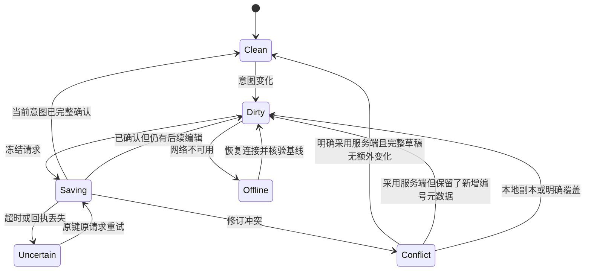

# 多参考提示词编辑器调研与设计

更新：2026-10-21（结构整理）；文档确认状态沿原来源，未重新认定方案接受。

## 1. 摘要

在同一编辑会话维护文字、引用、模式和参数，保存重开及提交保持一致。

本文按设计、用户故事与测试场景结构整理。原需求、确认结论和历史验证沿来源记录保留；当前实施进度、剩余工作及阻塞项统一见 [BACKLOG](../../BACKLOG.md)。

### 1.1 产品定义：摘要

来源：原PRD《02-多参考提示词编辑器》第1节。

为个人及团队创作者提供基于 Tiptap 的多参考提示词编辑器，让图片、视频、音频和主体能在正文中被明确引用。用户从组织素材、切换模式、保存草稿到确认生成，都能知道哪些输入将被采用，并能继续修改和复用。

## 2. 参与者

使用者与参与职责：图片、视频及多参考创作者。维护职责及确认人沿下方原来源记录；未给出姓名的，不补造人员或排期。

### 2.1 产品定义：目标用户

来源：原PRD《02-多参考提示词编辑器》第4节。

| 人群             | 需要完成的任务                                         | 约束                                                             |
| ---------------- | ------------------------------------------------------ | ---------------------------------------------------------------- |
| 个人多参考创作者 | 用多份素材表达一个生成意图，在不同模式间调整并继续创作 | 需要识别同名素材、正确设置用途，失败或离开后可恢复               |
| 团队项目创作者   | 在获授权的项目中复用素材、主体和画布结果，恢复与再生成 | 项目归属与访问权明确；历史或粘贴不能绕过权限；不包含多人同时编辑 |

首轮选择这两类人群，是为了覆盖个人表达与授权项目复用的共同一致性问题；多人同时编辑不在本轮。

## 3. 背景

需求来源：[03-多参考提示词编辑器需求](06-多参考提示词编辑器调研与设计.md#38-需求原文与规则文首来源与范围)。产品范围来源：[02-多参考提示词编辑器](06-多参考提示词编辑器调研与设计.md#36-产品定义文首来源与范围)。

下方保留来源的日期、适用范围与确认状态。早期盘点和历史结果只支持其原时点；整理文档不重新执行实现、测试、迁移或发布。

### 3.1 文首来源与范围

来源：原设计《06-多参考提示词编辑器调研与设计》文首。

适用范围：Tiptap多参考编辑、保存恢复、引用编译与提交一致性。文档版本：2026-10-20整理版；Tiptap选择已确认，具体实现与接受沿第7.16节和下游计划，新增交接说明待评审。维护职责：编辑器及prompt/canvas/operation消费者；评审人未指定。

更新：2026-10-15。用户已确认采用 Tiptap，本文细化交互和一致性设计，产品交付定义见下游[PRD](06-多参考提示词编辑器调研与设计.md#36-产品定义文首来源与范围)，执行顺序见[任务与验证](#1-摘要)。前期使用 pm-market-research 的 competitor-analysis 方法比较官方资料；保留选型依据，不重复选型。产品行为唯一来源是[多参考提示词编辑器需求](06-多参考提示词编辑器调研与设计.md#38-需求原文与规则文首来源与范围)。当前已锁定 Tiptap 3.32.0，实现 T-REF-01～T-REF-05 与 T-REF-06 入口整合；实际合同和验证边界见第7.16节。真实输入法、多设备及供应商结果尚未接受。

### 3.2 结论与研究范围

来源：原设计《06-多参考提示词编辑器调研与设计》第1节。

采用已确认的 **Tiptap 开源 Editor + 自定义 Reference 节点 + Suggestion 候选交互 + 现有 shadcn/Radix 组件**，构建织光多参考提示词编辑器。决定性因素是行内语义节点、可控 UI、JSON 持久化和现有 React/Next.js 体系的匹配。

市场范围是可嵌入创作产品的 Web 编辑器组件，不是办公文档 SaaS。使用者分为创作者与负责集成的工程团队；选择成功与否主要取决于引用身份正确性、输入法/剪贴板、扩展成本、授权方式和数据可控性。本次没有可信市场规模、份额、融资或用户留存数据，这些信息也不决定当前组件选型，因此不作估算。竞争定位与开发成本均为基于文档的定性判断，不是基准测试结果。

即梦是项目既定交互方向；本轮没有登录操作即梦或核验其所有界面细节。场景依据使用火山方舟官方参考生成文档，而不把模型 API、即梦消费端 UI 与织光现有能力混为一谈。官方指南强调对不同素材及其元素明确指代，并区分参考、编辑与延长的表达，这支持“正文引用必须与具体输入一一对应”的需求。[Seedance 提示词指南](https://docs.volcengine.com/docs/ark/seedance-2-0-prompt-guide?lang=zh&redirect=1)

### 3.3 组件竞争比较

来源：原设计《06-多参考提示词编辑器调研与设计》第2节。

Tiptap 为首选基准，以下五项是同一嵌入式编辑任务的替代方案。全部都能扩展，并非只有 Tiptap 能实现引用。

| 方案与定位                       | 官方已证实能力                                                                                                                                            | 对织光的优势与限制（判断）                                                                     | 授权/商业模式                                                                                               | 结论                   |
| -------------------------------- | --------------------------------------------------------------------------------------------------------------------------------------------------------- | ---------------------------------------------------------------------------------------------- | ----------------------------------------------------------------------------------------------------------- | ---------------------- |
| Tiptap：无预设 UI 的扩展式编辑器 | Mention、Suggestion、自定义 NodeView、JSON；[产品](https://tiptap.dev/product/editor)、[Mention](https://tiptap.dev/docs/editor/extensions/nodes/mention) | 适合引用标签和项目既有 UI；业务引用、上传、权限仍要自建，需掌握 ProseMirror 事务               | 开源仓库 [MIT](https://github.com/ueberdosis/tiptap/blob/main/LICENSE.md)；平台/高级能力另收费              | 首选                   |
| Lexical：可扩展编辑器框架        | 自定义 TextNode/DecoratorNode 与序列化；[节点](https://lexical.dev/docs/concepts/nodes)                                                                   | 可构建轻量提示词输入；要自行组合搜索、引用菜单及业务节点行为，当前没有足够收益推翻 Tiptap 偏好 | 核心 [MIT](https://github.com/facebook/lexical/blob/main/LICENSE)，框架不是托管业务服务                     | 首要备选               |
| Slate：高度可定制的编辑框架      | inline/void 与 Mention 建模；[Element](https://docs.slatejs.org/api/nodes/element)                                                                        | React 自定义自由度高；需负责更多规范化、选区与边界行为，收益依赖团队经验                       | 核心 [MIT](https://github.com/ianstormtaylor/slate/blob/main/License.md)                                    | 有 Slate 积累时可选    |
| BlockNote：块式文档编辑器        | 自定义行内内容与 Mention 示例；[Inline Content](https://www.blocknotejs.org/docs/features/custom-schemas/custom-inline-content)                           | 适合长文档与块操作；紧凑提示词区不需要其主要块式交互，要调整默认体验                           | 核心 MPL-2.0，XL 功能另有 GPL/商业许可；[价格与许可说明](https://www.blocknotejs.org/pricing)               | 更适合后续剧本文档场景 |
| CKEditor 5：完整商业文档编辑器   | Mention feed、候选渲染和转换扩展；[Mentions](https://ckeditor.com/docs/ckeditor5/latest/features/mentions.html)                                           | 完整文档功能与商业支持较匹配办公需求；织光仍须自建媒体引用语义，当前功能重心不匹配             | GPL 2+ 或商业许可；Free Plan 属商业许可；[官方许可](https://ckeditor.com/legal/ckeditor-licensing-options/) | 本轮不选               |
| Quill：模块化富文本编辑器        | Parchment/Blot 内容扩展与自定义模块；[Customization](https://quilljs.com/docs/customization)                                                              | 常规富文本输入可用；复杂引用节点、React 交互和业务序列化需额外集成                             | [BSD 三条款许可](https://github.com/slab/quill/blob/main/LICENSE)，社区核心                                 | 本轮不选               |

开源框架主要通过开发者文档和包生态采用；Tiptap、BlockNote、CKEditor 的付费产品增加托管、高级功能或支持。成本比较应计入节点开发、跨浏览器维护和供应商适配，不能仅按软件订阅费衡量。未实际测量包体或开发时间，不给虚构性能排名。

Tiptap 官网价格页本次显示平台月付 Start $49、Team $149、Business $999，Enterprise 询价；这是平台方案报价，并不等于开源 Editor 的使用费，也不保证这些方案包含所有附加能力。本需求推荐只用开源能力，不采购平台。未来需要协同、评论、导出或 AI Toolkit 时，重新核对对应包许可与当时价格。[官方价格](https://tiptap.dev/pricing)

织光的差异化应放在“引用可解释、不同模型可验证、历史可回放”，而不是重复实现通用富文本工具栏。未来 12～18 个月的主要技术风险是模型输入合同变化、编辑器扩展升级和自定义节点格式锁定；用版本化业务数据、确定性编译与往返测试控制，现阶段不引入第二个编辑器抽象或双引擎兼容层。

### 3.4 调研时仓库基线（历史）

来源：原设计《06-多参考提示词编辑器调研与设计》第4节。

以下为 2026-10-14 调研时的源码事实，现行实现见第7.16节。T-REF-01 新增编辑内核与浏览器回归夹具，正式入口仍使用原有纯文本编辑和画布保存机制；现有用户系统与 AI 接入等并行修改保留。工程验证与产品验收分开记录。

| 位置                                                                               | 观察                                                                                | 与目标差异                                                                          |
| ---------------------------------------------------------------------------------- | ----------------------------------------------------------------------------------- | ----------------------------------------------------------------------------------- |
| [package.json](../../frontend/package.json)                                        | Next.js 16.3.6、React 19.2.8，新增 Tiptap 3.32.0 最小包                             | 单元、类型与构建已验证；真实输入法及生产入口待验                                    |
| [GenerationDialog](../../frontend/src/components/generation/generation-dialog.tsx) | 提示词字符串和 `media_inputs` 分开维护；主体描述拼入文本、参考图加入媒体集合        | 有参考输入基础，但没有结构化正文绑定；`key={mode}` 重建表单需特别审查切换时草稿保持 |
| [画布草稿](../../frontend/src/app/canvas/document.ts)                              | Draft 保存 prompt、negative_prompt、aspect_ratio、candidate_count                   | 需要扩展草稿序列化与修订检查，不能只替换可见输入框                                  |
| [报价 HTTP 合同](../../backend/internal/operation/adapter/http/handler.go)         | `QuoteItemRequest` 接收 prompt 与有序 role/media_asset_id；包含独立 prompt_template | 没有多参考编辑文档、绑定表与编译版本字段                                            |
| [提示词准备](../../backend/internal/operation/application/quote_prompt.go)         | 已有模板编译与准备证据绑定                                                          | 新引用编译应明确与模板处理顺序，复用现有业务边界，不能绕开或重复建立提交入口        |

现有媒体列表与有序合同不是“完全不支持参考”；缺口在于正文身份、草稿持久化与实际提交的一致性。本轮未查询模型配置、账号开通状态或数据库，不声称当前服务可运行全能参考。

### 3.5 文首来源与范围

来源：原任务文档《09-多参考提示词编辑器实施计划》文首。

实施进度及调度字段见 [BACKLOG 第4.75节](../../BACKLOG.md#475-09-多参考提示词编辑器实施计划文首来源与范围)。

### 3.6 产品定义：文首来源与范围

来源：原PRD《02-多参考提示词编辑器》文首。

| 项目       | 内容                                                                                            |
| ---------- | ----------------------------------------------------------------------------------------------- |
| 版本与更新 | 2026-10-20 整理版；沿用原业务版本与下述盘点日期                                                 |
| 文档状态   | 本次为结构整理；既有确认、实施与接受状态如下，不新增产品接受结论                                |
| 维护与决策 | 维护人未指定；范围与接受以已记录的用户确认及上游依据为准                                        |
| 交付范围   | 多参考编辑、草稿、模式、报价、历史及三入口整合                                                  |
| 上游依据   | [需求03](06-多参考提示词编辑器调研与设计.md#38-需求原文与规则文首来源与范围)、[设计06](#1-摘要) |
| 迭代与证据 | [设计06](#1-摘要)；各证据层次及未执行项分别记录                                                 |

更新：2026-10-15。Tiptap 方向已由用户确认；产品细则沿用现行需求与设计，T-REF-01～T-REF-05 与 T-REF-06 入口整合已实现并进行工程、隔离存储及浏览器验证；完整产品接受尚未完成，真实输入法、多设备及真实供应商费用/结果仍待验。

文档链路：[requirement · 需求](06-多参考提示词编辑器调研与设计.md#38-需求原文与规则文首来源与范围) → [design · 交互及技术设计](#1-摘要) → **prd · 本文** → [plan · 任务与验证](#1-摘要)。本文汇总产品目标、交付范围和接受条件；具体行为与 AC 统一维护在需求中，状态、数据和接口机制统一维护在设计中。

### 3.7 产品定义：背景

来源：原PRD《02-多参考提示词编辑器》第2节。

全能参考需要同时表达人物、场景、动作和声音等关系。仅有文字与附件列表无法保证正文指代、素材用途和实际输入一致；模式变化、上传回执及自动保存还可能使同一创作意图在多个位置失配。这是本次需要解决的产品风险，不是已经测得的线上事故或用户访谈结论。

用户已确认采用 Tiptap，并要求重点保证多参考引用、模式切换和草稿保存的一致性。已有需求、组件调研和交互设计，当前补齐从设计到执行之间的产品交付定义；本轮不重开选型，也不把组件能力等同于生成能力。

### 3.8 需求原文与规则：文首来源与范围

来源：原需求《03-多参考提示词编辑器需求》文首。

| 文档管理项     | 内容                                                                                                                                      |
| -------------- | ----------------------------------------------------------------------------------------------------------------------------------------- |
| 版本与更新     | 结构整理 v0.1；2026-10-20；原规则与编号保留                                                                                               |
| 文档状态       | Tiptap选型已确认；行为基线及原分层实现记录见第1/6节，完整产品接受未完成；本次补充待评审                                                   |
| 维护与评审     | 创作编辑器产品、交互与工程职责；具体评审人未指定                                                                                          |
| 原始来源与性质 | 第4.5节记录的用户多参考诉求与2026-10-14选型确认；其余推荐需求、建议参数和第7.38节历史夹具测量分别保留性质，不扩大为用户逐条确认或当前实测 |
| 适用范围       | 全能参考及第4.5节列明模式、首页/生成弹窗/画布共享编辑；下游文档沿第4.5节链路                                                              |

更新：2026-10-15。适用产品：Glowloom（织光）。本文定义全能参考及相关创作模式的现行需求；调研依据、选型理由与细化交互设计见[编辑器调研与设计](#1-摘要)。

## 4. 目标

在同一编辑会话维护文字、引用、模式和参数，保存重开及提交保持一致。目标的规则、量化条件与非目标沿需求原文及下方已确认设计，不增加未经确认的指标。

### 4.1 必须共同交付的结果

来源：原任务文档《09-多参考提示词编辑器实施计划》第2节。

编辑器必须保证：正文标签与参考集合一致；模式切换保留同一份意图；草稿保存不会被迟到回执覆盖；用户确认的输入等于实际任务冻结输入。产品目标、首轮范围与开放条件由 PRD 汇总，以下 INV、T-REF-01～T-REF-06 和 AC 是其实现与接受追踪。仅把 textarea 换成 Tiptap、仅做 `@` 菜单、仅通过 fixture 都不能作为全能参考交付完成。

实现范围为共享生成编辑器、独立项目草稿与画布节点接入，覆盖已接入模型的图片/视频/音频和主体引用。未接入供应商或未验证的模式保留需求与禁用原因，不伪装开放。团队入口依赖真实团队对象权限，不能因用户体系文档存在就认为权限实现已完成；现有合法项目范围可先开展隔离实现。

### 4.2 一致性不变量

来源：原任务文档《09-多参考提示词编辑器实施计划》第2.1节。

| 标识       | 不可退让的条件                                                                    | 验收               |
| ---------- | --------------------------------------------------------------------------------- | ------------------ |
| INV-REF-01 | 正文每个 referenceId 有绑定；重复提及不重复构造物理输入，同素材不同角色不误合并   | AC-REF-03/05/06    |
| INV-REF-02 | 引用增删、替换、排序、模式转换可按一次用户操作完整撤销，不存在两套互相失配历史    | AC-REF-04/15       |
| INV-REF-03 | 切换模式不重建/覆盖草稿；不兼容输入可保存但不能被静默漏传                         | AC-REF-07/16/24    |
| INV-REF-04 | 已保存状态对应完整服务端快照；迟到保存或上传只更新原对象和原请求                  | AC-REF-08/10/17/19 |
| INV-REF-05 | 每个实例协调器最多一个在途保存；跨实例 CAS；本地分支独立，未知结果按原键原体恢复  | AC-REF-18/21       |
| INV-REF-06 | 报价只从已确认保存版本读取；修改使报价失效；未知确认不产生第二个收费意图          | AC-REF-11/12/20/23 |
| INV-REF-07 | pending 来源可保存但不可生成；转换为真实来源必须鉴权且匹配绑定 generation/attempt | AC-REF-22          |
| INV-REF-08 | labelState 不随撤销回退；draft_hash 含编号记录，input_hash 相同不能省略元数据保存 | AC-REF-25          |

### 4.3 一致性要求的四阶段追踪

来源：原任务文档《09-多参考提示词编辑器实施计划》第2.2节。

| 主题           | requirement                | design              | PRD                        | 本计划与验收                                   |
| -------------- | -------------------------- | ------------------- | -------------------------- | ---------------------------------------------- |
| 本地多分支     | FR-REF-09、DR-REF-08       | 设计06第7.13节      | KR-REF-02及首轮接受边界    | T-REF-02/T-REF-06；AC-REF-21                   |
| 上传占位       | FR-REF-02/07/09、DR-REF-09 | 设计06第6.1/10/12节 | KR-REF-01/02及首轮接受边界 | T-REF-02/T-REF-03/T-REF-06；AC-REF-22          |
| 未决提交       | FR-REF-10、DR-REF-10       | 设计06第7.15节      | KR-REF-03及首轮接受边界    | T-REF-05/T-REF-06；AC-REF-23                   |
| 异步模式与撤销 | FR-REF-06、DR-REF-11       | 设计06第10/11.1节   | KR-REF-02及首轮接受边界    | T-REF-01/T-REF-04/T-REF-06；AC-REF-24          |
| 编号持久化     | FR-REF-03/08/09、DR-REF-12 | 设计06第6.2/9/12节  | KR-REF-01/02及首轮接受边界 | T-REF-01/T-REF-02/T-REF-03/T-REF-06；AC-REF-25 |

### 4.4 产品定义：目标

来源：原PRD《02-多参考提示词编辑器》第3节。

目标：让用户组织的输入在编辑、持久化和实际生成之间保持可解释、可恢复、可核对。

| 结果               | 对应模式开放前的接受条件                                                                                               | 证据                                                                          |
| ------------------ | ---------------------------------------------------------------------------------------------------------------------- | ----------------------------------------------------------------------------- |
| KR-REF-01 引用正确 | 在规定的同名、重复提及、排序、删除、主体展开及跨范围用例中，错绑、漏传、越权读取均为 0                                 | AC-REF-03～AC-REF-06、09、15、22、25；逐项核对绑定、编号恢复与实际媒体映射    |
| KR-REF-02 草稿连续 | 在模式往返、上传/保存乱序、断网、双窗口和账号切换用例中，未经用户操作的内容丢失、跨对象写入、静默覆盖均为 0            | AC-REF-07、08、10、16～19、21、22、24、25；核对分支恢复、保存状态与服务端读回 |
| KR-REF-03 生成一致 | 所有确认用例中，实际任务输入与用户确认的完整快照一致，重复执行意图为 0；开放的全能参考模型完成真实输入、结果和费用核对 | AC-REF-11、12、14、20、23；冻结快照、跨刷新提交恢复、幂等记录及真实供应商证据 |

上述为产品验收目标，最新工程与浏览器证据见设计06第8.23节（第8.30节保留历史），尚无完整产品验收结果，不承诺所有设备或模型永不出错。完整交付还须覆盖 AC-REF-01～AC-REF-25，包括输入法、无障碍和性能；没有基线时不编造转化率提升或完成日期。

三项关键结果在对应模式开放前判断；当前分层基线以计划第7.2/7.3节为准。发布后用户结果与观察周期尚未确认，见第7.25节。

### 4.5 需求原文与规则：目标、决策与边界

来源：原需求《03-多参考提示词编辑器需求》第1节。

创作者可以在提示词的具体位置引用多个图片、视频、音频或主体，明确每份素材的用途；从编辑、保存、切换模式到生成与复用，引用始终指向同一份已授权素材。示例：“让［图片1 · 人物］走进［图片2 · 场景］，动作参考［视频1 · 行走］，背景声音使用［音频1 · 雨声］。”方括号表示可操作的引用标签。

| 决策                         | 状态                       | 含义                                                                             |
| ---------------------------- | -------------------------- | -------------------------------------------------------------------------------- |
| 全能参考等模式需要多参考引用 | 用户明确要求               | 不能只做文本输入加附件展示                                                       |
| 使用 Tiptap                  | 用户于 2026-10-14 明确确认 | 采用 Tiptap 开源 Editor 和自定义引用扩展；继续细化交互与实施计划，不重复评估选型 |
| 文本 + 行内引用 + 参考素材区 | 本文确定的推荐需求         | 具体行为在下文固定，可直接用于设计评审；不冒充用户逐条确认                       |
| 服务端能力驱动限制与提交     | 推荐需求                   | 类型、数量、时长、角色和模式组合不能由通用编辑器写死                             |
| 采用付费编辑器服务           | 当前不需要                 | 本需求不依赖 Tiptap Cloud、AI Toolkit、协同、评论或 Word/PDF 服务                |

Tiptap 方向已确认，交付链路为本需求 → [交互设计](#1-摘要) → [PRD](06-多参考提示词编辑器调研与设计.md#36-产品定义文首来源与范围) → [任务与验证](#1-摘要)，现已实现 T-REF-01～T-REF-05 的编辑、持久化、来源、模式和报价链路，并接入 T-REF-06 的首页/生成弹窗/画布入口。隔离 PostgreSQL、API、浏览器和工程回归已有证据；完整产品接受尚未完成，真实系统输入法、多设备及真实供应商费用/结果仍待验。只在自建隔离库演练增量迁移，未修改业务数据库或发布。下文细则作为实施基线，新增机制与建议参数不冒充已经运行验证。P0 表示开放对应模式前必需，P1 表示后续增强，不表示已承诺排期。

主要用户是使用多份素材完成创作的个人创作者，以及在授权团队项目内复用素材的团队创作者。核心任务是“准确表达谁、在哪里、怎样运动、使用什么声音”，成功标准是用户可解释输入、模型收到一致输入、历史可还原；不以工具栏数量或富文本格式数量衡量完成。

### 4.6 需求原文与规则：适用范围

来源：原需求《03-多参考提示词编辑器需求》第1.1节。

| 模式/入口                 | 引用语义                                           | 开放条件                                         |
| ------------------------- | -------------------------------------------------- | ------------------------------------------------ |
| 纯文本生图/生视频         | 文本与换行；不支持媒体的模式不能隐含携带媒体       | 实际模型支持                                     |
| 参考生图、多图融合        | 多张图片与主体展开后的图片，可在正文明确用途       | 模型支持该输入组合                               |
| 首帧/首尾帧视频           | 首帧、尾帧是独立的结构化槽位                       | 不用普通引用顺序猜首尾帧                         |
| 全能参考视频              | 图片、视频、音频混合参考；支持正文反复提及同一素材 | 模型与实际供应商适配均支持                       |
| 视频编辑/延长             | 待编辑/延长对象与其他参考用途区分                  | 独立模式语义和参数通过供应商验证                 |
| 主体引用                  | 角色、场景、物品对象展开为确定版本的描述和媒体     | 主体存在、可访问且展开结果适配当前模式           |
| 首页/生成弹窗/画布节点    | 共享编辑规则，按创作对象保存各自草稿               | 不同入口不各自定义一套引用合同                   |
| Agent、声音创作等后续入口 | 复用同一引用身份与序列化规则                       | 各入口另行明确可用类型，不因编辑器支持就开放生成 |

此范围细化产品目录 CAP-GL-03/04/08/09/12/14/16/17/18/21/22/25/32。文章排版、表格、标题层级、字体字号、协同编辑、批注和 AI 自动改写不属于本轮；负面提示词按模型能力独立保留，默认纯文本，不自动继承多模态引用。

## 5. 使用场景

参与者为图片、视频及多参考创作者；在下方定义的输入、对象状态、权限和环境条件具备时执行相应操作。各故事按其独立前置条件核对，不能把测试夹具当成真实业务条件。

### 5.1 交互结构与操作细节

来源：原设计《06-多参考提示词编辑器调研与设计》第9节。

对应 FR-REF-01～FR-REF-08、12。以下为布局与行为规格，不是已完成的 Figma 或可操作原型。

```text
┌ 视频生成 · 全能参考 ▾   模型 ▾           已保存 ┐
│ 本次参考 4 项       图片 2 / 视频 1 / 音频 1   │
│ [图片1 人物 ✓] [图片2 场景 ✓] [视频1 动作 ✓]  │
│ [音频1 雨声 处理中…]               [+ 添加]  │
│ 让 [图片1·人物] 走进 [图片2·场景]，            │
│ 动作参考 [视频1·动作]，声音使用 [音频1·雨声]。 │
│ @ 引用   展开编辑                    文本计数 │
│ 比例 ▾  时长 ▾   1 项素材仍在处理             │
│                              [检查输入与费用]│
└─────────────────────────────────────────────┘
```

“已保存”与“处理中”可以同时出现：保存的是创作意图，不代表媒体可生成。数量分开显示唯一参考数与正文提及次数，主体展开另显示实际输入数。上限从当前模型能力读取，未知能力不显示“无限”。桌面输入区建议高度 120～320px、超出局部滚动，支持展开；手机随可视高度调整，不遮软键盘和主要操作。这些尺寸是待断点验证的初值。

| 触发                      | 展示与确认                                                      | 完成/取消结果                                                  |
| ------------------------- | --------------------------------------------------------------- | -------------------------------------------------------------- |
| 正文 `@`                  | 先展示当前参考，再检索有权素材/主体；已选条目标“已在本次参考中” | 选择替换当前 `@查询词` 范围并插标签；Escape 保留输入文字       |
| 插入到正文                | 保存选区，多选按选中顺序插入                                    | 返回原插入位置；位置已失效时提示并使用当前合法位置，不用旧下标 |
| 添加参考                  | 只添加卡片，明确标记本次会提交                                  | 不移动光标，不强制加入正文                                     |
| 标签激活                  | 定位卡片，显示预览/替换/定位其他提及                            | 关闭回到该标签或原选区，不自动播放媒体                         |
| 同类型替换                | 显示受影响提及数量                                              | 保留 referenceId 和编号，全体提及更新，一次撤销恢复            |
| 移除参考                  | 有提及时提示“移除本次参考及正文 N 处引用，素材库原件保留”       | 确认后原子移除；没有提及时直接操作并提供撤销                   |
| 相邻标签 Backspace/Delete | 第一次选中、第二次删除；明确选区可直接整体删除                  | 只删正文提及，提示“参考仍将提交，可在素材区移除”               |

候选不使用多个输入框争抢焦点；组合输入期间不发选择命令。异步候选以 `contextKey + querySeq` 校验，只接受当前会话最后一次查询。重复引用复用同角色绑定，只增加正文出现位置。显示编号使用按类型递增计数器，删除、撤销与重做都不回收已分配编号；展开/收起编辑器继续使用同一文档和选区。

错误摘要可逐项定位标签、卡片或参数。参考分别具有处理状态、模式兼容性与访问状态，不用一个 status 混淆“上传成功但模式不兼容”。典型文案为“当前模式不支持视频参考”“图片尚未分配首帧或尾帧”“素材已无法访问”。仅预览失败时保留已验证的生成资格；失权则移除缓存私有详情。

### 5.2 产品定义：体验与设计入口

来源：原PRD《02-多参考提示词编辑器》第6.1节。

主要流程：选择模式与模型 → 添加参考并明确用途 → 在正文插入引用 → 处理不兼容或不可用项 → 保存完整草稿 → 查看输入摘要与费用 → 明确确认生成 → 查看历史或创建新草稿再生成。首页、生成弹窗和画布节点共享规则；详细交互、异常路径与技术机制见上游设计第 9～13 节。

### 5.3 需求原文与规则：界面与用户流程

来源：原需求《03-多参考提示词编辑器需求》第2节。

桌面编辑区由模式/模型选择、参考素材区、提示词输入区、参数与费用/生成操作组成。参考素材区显示缩略图或媒体图标、名称、类型、角色、处理状态和正文提及次数。提示词内用紧凑标签表示引用；标签可定位到素材卡片，卡片可定位正文提及位置。视频/音频播放器放在预览面板中，不在每个行内标签中自动播放。

添加入口包括 `@`、添加参考按钮、素材库/主体库选择、文件拖入/粘贴，以及合法画布资源的“引用到提示词”。手机用可滚动的选择面板或底部面板，保留光标插入位置；界面样式遵循[共享视觉规范](../../DESIGN.md)，不直接复制 Tiptap 演示站外观。

典型流程：选择支持全能参考的模型 → 添加素材 → 等待上传与检查 → 在提示词中插入引用并描述用途 → 检查输入摘要与费用 → 明确确认生成 → 历史中查看本次输入及引用快照。模型不可用或素材无效时，在相应位置解释原因并保留草稿。

## 6. 价值

减少参考错绑、输入丢失和报价与执行不一致。

### 6.1 产品定义：价值主张

来源：原PRD《02-多参考提示词编辑器》第5节。

| 六项价值要素       | 个人多参考创作者                                         | 团队项目创作者                                           |
| ------------------ | -------------------------------------------------------- | -------------------------------------------------------- |
| 谁                 | 组合图像、动作和声音的个人创作者                         | 复用团队项目资源的创作者                                 |
| 为什么             | 要准确表达每份素材的作用，并反复调整                     | 要延续项目创作，准确使用有权限的版本                     |
| 之前怎样做         | 可用纯文字描述并手动对应附件；对应关系依赖记忆           | 可手动记录素材、版本和节点来源；复用时再次检查           |
| 怎样改善           | 正文引用与素材区联动；切模式保留内容；完整草稿保存       | 固定引用版本与来源；按对象恢复；复用时重新校验权限       |
| 之后的结果         | 知道会提交什么，调整或恢复时无需重建引用关系             | 能追溯当时输入，继续创作时不混入其他项目内容             |
| 替代方式与选择理由 | 普通输入框加附件；选择本方案以减少手工对应并核对最终输入 | 复制文字和下载后重传；选择本方案以保留来源且遵守当前权限 |

“之前怎样做”描述可用替代流程，尚未经过用户访谈验证。价值主张：让多份参考成为可操作、可保存、可追溯的创作输入，让用户在调整模式和恢复工作时保留自己的表达。

## 7. 方案

### 7.1 Tiptap 能力与缺口

来源：原设计《06-多参考提示词编辑器调研与设计》第3节。

| 需求能力         | 可采用的机制与证据                                                                                                                        | 必须由织光补齐                                                |
| ---------------- | ----------------------------------------------------------------------------------------------------------------------------------------- | ------------------------------------------------------------- |
| `@` 与候选选择   | [Mention](https://tiptap.dev/docs/editor/extensions/nodes/mention)、[Suggestion](https://tiptap.dev/docs/editor/api/utilities/suggestion) | 项目/主体检索、权限、过滤、错误态、候选可访问性与光标恢复     |
| 带状态的行内标签 | [React NodeView](https://tiptap.dev/docs/editor/extensions/custom-extensions/node-views/react)                                            | 稳定 referenceId、类型/名称/失效态、删除/替换/定位行为        |
| 文档保存和恢复   | [JSON/HTML 输出](https://tiptap.dev/docs/guides/output-json-html)                                                                         | 版本、引用集合、原子修订、冲突处理和历史快照                  |
| 文件拖入/粘贴    | [FileHandler](https://tiptap.dev/docs/editor/extensions/functionality/filehandler) 仅处理事件，不提供服务器上传                           | 现有媒体上传链路、进度/重试、校验、临时引用替换与迟到回执治理 |
| Next.js 集成     | [Next.js 官方集成示例](https://tiptap.dev/docs/editor/getting-started/install/nextjs) 建议 `immediatelyRender: false`                     | 客户端编辑边界、加载占位、当前 React/Next.js 版本的集成验证   |
| 模型输入         | 以上文档没有提供织光供应商输入合同                                                                                                        | 业务编译、媒体排序、角色映射、报价绑定、权限和幂等执行        |

Suggestion 当前在线文档包含异步候选和取消机制，但不能假定任意旧包都有同样 API。实施时锁定同一兼容版本的 Tiptap 包，检查对应发布版本，不照抄在线最新示例。NodeView 是编辑器内渲染机制，不自动定义复制到外部的文本/HTML或供应商序列化。

建议自定义 `reference` 行内原子节点，并复用 Suggestion 的触发与候选基础机制；Mention 用于验证交互和实现参考，不直接把“用户提及”的默认字段当作完整媒体合同。仅注册 Document、Paragraph、Text、HardBreak、业务撤销重做（第 10 节）、Placeholder 和业务引用等所需能力；具体包名、版本和最低集合在技术验证中确定，不直接安装全功能模板。

### 7.2 候选组件与模块边界

来源：原设计《06-多参考提示词编辑器调研与设计》第5节。


| 组件职责（候选名称） | 输入/输出与边界                                                                          |
| -------------------- | ---------------------------------------------------------------------------------------- |
| PromptEditor         | 编辑结构化正文，发出事务；不负责上传、查询所有素材或直接调用生成                         |
| ReferenceToken       | 展示并定位绑定；由当前可访问状态渲染；不自行保存 URL 或加载播放器                        |
| ReferencePicker      | 当前范围内素材/主体候选、搜索、类型过滤和选择；复用已有媒体/主体合同                     |
| ReferenceTray        | 本次参考卡片、顺序、具名槽位、状态、替换与移除                                           |
| ReferencePreview     | 授权后的预览，视频/音频按需加载并可停止                                                  |
| ComposerDraft        | 同一草稿修订内协调正文、绑定表、模式和参数；管理保存与恢复                               |
| 引用编译职责         | 由现有后端 prompt/operation 业务边界承载；按能力快照解析引用并冻结执行输入，不新建微服务 |

共享实现位置优先落在现有 `frontend/src/components/generation/`，页面专用接入留在页面目录；只有真实复用需求出现时再拆更小 feature。shadcn/Radix 提供 Dialog/Popover/Button/列表等 UI 原语；不把 cmdk 或第三方完整编辑器模板当作必装依赖。候选弹层与编辑器选区需共同验证，直接复用 Popover 不代表焦点行为天然正确。

### 7.3 候选数据合同

来源：原设计《06-多参考提示词编辑器调研与设计》第6节。

需求对应 DR-REF-01～DR-REF-12。下列字段表达设计意图，不是已经存在的 API、数据库字段或迁移脚本。

| 对象         | 候选字段                                                                                               | 关键约束                                                   |
| ------------ | ------------------------------------------------------------------------------------------------------ | ---------------------------------------------------------- |
| 草稿         | schemaVersion、revision、scope、modelVersion、mode、document、references、params、labelState           | scope 含所属空间/项目/创作对象，服务端从身份与对象重新核验 |
| 正文引用节点 | type=reference，attrs.referenceId                                                                      | referenceId 关联绑定；名称与序号由绑定派生，不存成资源身份 |
| 引用绑定     | id、source（互斥联合）、bindingGeneration、mediaKind、role、displayLabel、order                        | 稳定身份；异步状态是可刷新的业务状态，不由文档自行证明有效 |
| 主体展开     | subjectId/version、选定描述、实际媒体版本列表、来源映射                                                | 确定性展开、权限检查、底层输入去重与数量核验               |
| 冻结输入     | 原文档、绑定快照、compiledPrompt、orderedMediaInputs、referenceMap、compilerVersion、capabilityVersion | 与本次报价绑定，既可重放也可解释实际发送内容               |

正文示意：

```json
{
  "type": "doc",
  "content": [
    {
      "type": "paragraph",
      "content": [
        { "type": "text", "text": "让" },
        { "type": "reference", "attrs": { "referenceId": "ref-person" } },
        { "type": "text", "text": "走进" },
        { "type": "reference", "attrs": { "referenceId": "ref-scene" } }
      ]
    }
  ]
}
```

这里的 ID 是示例。文档允许出现多处相同 referenceId；素材集合按绑定去重，供应商输出再按“媒体版本 + 输入角色”及其合同判断是否可合并。不同首尾帧槽位即使使用同一底图也保留角色；主体展开与直接引用共用同一底图时，保留多来源到同一物理输入的映射。

显示序号可以稀疏而保持稳定，例如删除图片1后仍有图片2；供应商可能要求连续编号。必须遍历结构化节点生成实际文字，并把图片2绑定转换成对应供应商槽位，同时更新输入摘要映射。不能对全文做字符串替换，避免修改用户手写“图片2”或误改普通数字。

### 7.4 可保存的上传占位

来源：原设计《06-多参考提示词编辑器调研与设计》第6.1节。

对应 DR-REF-09、AC-REF-22。绑定公共字段为 `id、bindingGeneration、mediaKind、role、order`，显示编号从 labelState 取得；`source` 仅允许以下一个变体，不能混合字段：

| source.kind    | 持久化字段                                            | 保存和生成边界                                          |
| -------------- | ----------------------------------------------------- | ------------------------------------------------------- |
| pending_upload | clientUploadId、uploadAttemptId、可选 uploadSessionId | 无素材 ID 也可保存；永远不可直接编译生成                |
| media          | sourceId、sourceVersion                               | 保存时核验媒体归属/版本；生成时另核验处理状态和模型能力 |
| subject        | sourceId、sourceVersion、选定描述及媒体版本映射       | 核验主体及展开资源权限；展开结果也需满足生成约束        |

pending 的 clientUploadId 只是随机关联标识，不是资源权限凭据；不接收 sourceId、sourceVersion、ready 标记、私有 URL 或文件二进制。服务端先验证草稿写权限、大小/类型白名单和绑定结构；若有 uploadSessionId，再验证该上传会话归当前账号及项目，并与本次 attempt 匹配；clientUploadId 仅为本地关联，不充当服务端授权事实。外部伪造会话不能变为素材读取或写入权。来源失权占位沿用已保存绑定的受限投影，不是客户端可新建的任意私有 ID。

上传解析由 `contextKey + replicaId + referenceId + bindingGeneration + uploadAttemptId` 定位。回执仅在当前分支该绑定仍活跃且全部标识匹配时，将 source 从 pending 原子变为 media 并触发保存；media 身份仍需服务端鉴权，不信客户端状态。重选文件递增 generation 并换 attempt；明确新尝试更换 attempt；网络结果未知时重放原键原文件，不更换 attempt。pending 的失败/进度是运行状态，恢复不能仅凭缓存显示已就绪：有会话先查询，没有可恢复文件就原位显示“重新选择文件”。主体/媒体的处理完成状态同样以服务端事实为准。

复制到另一个草稿或“保留本地为副本”时，pending 改用新 clientUploadId/attempt，不继承上传会话；正文 referenceId 统一映射到新绑定，并提示重选。原分支迟到上传只作用于原分支。已解析媒体/主体则在目标范围重新鉴权。

### 7.5 显示编号与两类摘要

来源：原设计《06-多参考提示词编辑器调研与设计》第6.2节。

对应 DR-REF-12、AC-REF-25。`labelState` 包含按显示类型递增的 `highWater`，以及 `allocations[referenceId] = {labelKind, ordinal}`。allocations 保留删除绑定的最小分配记录，不含名称、来源 ID、URL 或媒体内容；作用是允许同一绑定撤销恢复原号，同时拒绝其他绑定复用该号。它不是用户撤销栈；随草稿生命周期保存，不因退出编辑、删除引用或撤销回退。新编号从当前分支 highWater + 1 分配；分配和用户编辑先进入同一份本地恢复快照，服务端与正文一起 CAS 保存。结构有界且溢出时报错，不回绕编号或丢弃分配记录。

服务端验证请求包含既有分配且上界不下降，遗漏或试图清空返回 label_allocation_conflict，不静默合并成与请求不同的草稿；同一类型的 ordinal 不能分配给不同 referenceId。普通用户操作只增分配记录，重做已有绑定复用其记录。跨窗口未保存的新号标为本地未同步：A/B 同从上界2分配图片3时，A 保存后 B 的旧基线必须冲突。B 可保留为新的草稿（复制该分支 labelState），或明确选择覆盖原稿；后者合并已知上界，对尚未获服务端接受且冲突的绑定分配大于双方上界的新号，列出标签变化并确认后 CAS 保存。原服务端分配永不被改为其他绑定。采用服务端版本仍合并当前分支不冲突的分配记录；碰撞记录保留在原本地分支，未保存的新号不冒充服务端稳定编号。

粘贴时同来源/版本/角色复用目标已有绑定；新绑定使用新 referenceId 和目标编号，不导入来源草稿的分配计数器。保留副本以新对象为编号命名空间，可完整保留所选分支编号；后续新增继续递增。显式重命名/同类型替换仍保留该绑定编号，普通文本中的手写编号不改写。

`draft_hash` 覆盖完整规范化可保存草稿，包括 pending 来源和 labelState；仅完整草稿摘要相同才可省略持久化。`input_hash` 覆盖实际生成意图，不含编号分配上界、删除分配记录或预览缓存；待上传草稿没有可报价的 input_hash。分配后撤销即使生成内容回到原样，draft_hash 仍变化，必须保存元数据。画布此类纯元数据变更只增加 canvasRevision，不增加节点 inputRevision；独立草稿 revision 仍增加，可以保守地要求重新报价。保存回执按 draft_hash 确认，不能用 input_hash 冒充全部已保存。

### 7.6 编译、保存与接口方向

来源：原设计《06-多参考提示词编辑器调研与设计》第7节。

编译次序建议为：校验文档结构与修订 → 验证引用和来源权限 → 冻结主体展开 → 获取模型/模式能力 → 校验所有启用参考和组合 → 按稳定顺序生成实际媒体列表与映射 → 遍历节点生成文本 → 完成最终长度/角色/模板一致性校验 → 冻结报价输入。

供应商适配器决定实际指代语法、媒体顺序和角色；界面中的 `@图片1` 不是通用 API 语法。已有模板编译必须在语义引用仍可追踪时处理，或在编译后验证映射完整；不能让模板二次修改已冻结文本。首尾帧槽位始终独立映射，不能从自然语言推断。

服务端成为最终编译权威；前端摘要只是预览，报价返回服务端确认的输入。细化后采用“先保存完整文档，再按保存版本报价”：保存请求携带文档与参考集合，富文本报价仅携带保存快照指针，避免提交两份可冲突输入。旧纯文本合同保留显式过渡分支；同一请求混用两个分支则拒绝。具体合同见第 13 节，不手改生成的前端 API 文件。

保存正文与参考集合使用同一草稿修订；媒体处理回执先验证所属草稿及临时绑定仍存在，再应用事务。将引用增删、媒体集合变更和撤销视为同一用户操作；只依赖编辑器自身文字 history，不能保证外部卡片同步撤销。网络上传本身不被撤销“回滚”，撤销的是本次引用关系，已上传原件按素材生命周期处理。

历史旧文档按版本读取，不运行文本正则自动找引用；读取失败不自动写回空文档。现有数据库增量更新、草稿版本迁移和纯文本兼容路径另行审阅，不能重放 Schema 或批量改写旧业务数据。

### 7.7 草稿事务与撤销

来源：原设计《06-多参考提示词编辑器调研与设计》第10节。

对应 FR-REF-03/04/09、DR-REF-01～DR-REF-04。同一编辑实例内每个创作对象只有一个 `ComposerSession`，跨窗口/设备实例由服务端 CAS 仲裁，不由正文、卡片和模型选择各自保存。

| 状态边界   | 内容                                                                                | 保存与撤销                                 |
| ---------- | ----------------------------------------------------------------------------------- | ------------------------------------------ |
| 创作意图   | 正文、绑定、顺序、角色/槽位、模型/模式、参数、主体版本                              | 原子保存；用户操作进入同一撤销序列         |
| 编号元数据 | labelState 的分配记录与上界                                                         | 与草稿同修订保存，不随用户撤销回退         |
| 同步控制   | replicaId、localSeq、ackedSeq、serverRevision、pendingSave、pendingSubmission、冲突 | 用于恢复请求，不进入用户撤销               |
| 运行状态   | 选区、候选、上传进度、资源解析记录、权限/预览状态                                   | 不作为生成事实；不进入撤销；按当前权限重取 |

| 命令                         | 一次提交的变化                             | 不变量                                          |
| ---------------------------- | ------------------------------------------ | ----------------------------------------------- |
| InsertReference              | 新建/复用绑定，同时插标签；或仅添加卡片    | 不生成悬空引用                                  |
| RemoveOccurrence             | 删除一处标签                               | 不移除素材集合                                  |
| RemoveReference              | 删除绑定、全部正文提及与槽位占用           | 一次撤销恢复整组；空槽位显示待处理              |
| ReplaceReference             | 同类型更新源与版本；异类型新建并明确重定向 | 不按名称全局替换，不影响其他绑定                |
| Reorder / AssignSlot         | 改媒体顺序或槽位角色                       | 正文 ID 不变，槽位基数按能力核验                |
| ChangeMode / ApplyConversion | 改模式或应用确认后的转换                   | 保留未处理输入；转换基于最新 localSeq           |
| UpdateParams                 | 修改值或明确采用一组推荐值                 | 显示默认值不等于用户已保存值                    |
| RestoreHistory               | 恢复一组完整意图与选区                     | localSeq 仍递增，不回退服务器版本，不复活旧报价 |

Tiptap 官方区分内容更新、选区更新和事务；其内建 UndoRedo 是文档历史，不承诺同步应用外部卡片与模型参数。[事件文档](https://tiptap.dev/docs/editor/api/events)、[UndoRedo](https://tiptap.dev/docs/editor/extensions/functionality/undo-redo)

设计选择**应用级草稿历史**协调完整意图，Tiptap 提供文字事务与选区映射。默认不同时开启内建 UndoRedo；业务 undo/redo 覆盖键盘、工具按钮及浏览器 `historyUndo/historyRedo`。普通输入从事务捕获，不每键调用 `setContent` 回写；仅恢复历史、切对象或明确采用服务器版本时恢复文档，并抑制回环事件。UI 不另维护可独立编辑的 prompt 字符串和 media 数组。

建议历史最多 100 组、相邻文字 500ms 合并，IME 一次组合一组；引用、模式和参数操作各自成组，切选区或对象不合并。使用结构共享的意图前后值/片段和选区，避免每键深拷贝媒体集合。历史仅限会话，刷新仅恢复文档。此桥接需通过计划 T-REF-01 实测，失败则修订桥接实现，不能降低整组撤销要求。

每次上传带 `contextKey + replicaId + referenceId + bindingGeneration + uploadAttemptId`，替换使 generation 递增。回执仅更新对应来源解析记录，不自行插节点；有效解析结果形成系统修订并触发保存，但不新增用户历史项。移除整个参考使绑定失活并取消可取消的上传；删一处标签不取消仍在集合中的上传。

撤销移除后，仅同 generation 已成功且仍有权的素材可复用；取消/未知上传显示需重试，不复活原请求。解析记录与用户历史分开，历史恢复和保存都合并当前活跃绑定的有效解析结果；已实际上传的原件不被撤销删除。保存/进度回执不能修改用户撤销顺序或把已删除绑定重新加入。

### 7.8 T-REF-01 内核落地边界（2026-10-14 历史记录）

来源：原设计《06-多参考提示词编辑器调研与设计》第10.1节。

[客户端文档合同](../../frontend/src/components/generation/prompt-document.ts)、[ComposerSession](../../frontend/src/components/generation/composer-session.ts) 与 [PromptEditor](../../frontend/src/components/generation/prompt-editor.tsx) 是当前实现落点。Tiptap core/react/pm、Document/Paragraph/Text/HardBreak 均精确锁定 3.32.0；不装 StarterKit 或内建 UndoRedo。Suggestion 与授权来源在 T-REF-03 有真实候选消费者时接入，首轮完整范围不变。[官方 React 集成](https://tiptap.dev/docs/editor/getting-started/install/react)、[自定义 Node](https://tiptap.dev/docs/editor/extensions/custom-extensions/create-new/node)

完整意图历史由一个 ProseMirror 插件承载，保留结构共享的文档节点、引用集合、模式、参数及选区；100 组上限、相邻文字 500ms 合并。内容相同的规范化事务不增加历史或 localSeq。引用原子节点只存 referenceId，标签由 labelState 派生；普通正文输入不调用 setContent，恢复历史以一次事务同时恢复文档和元数据。labelState 独立于历史，保留删除分配记录；T-REF-01 客户端暂以 10,000 条分配记录和安全整数作为显式防溢出边界，达到边界报错，不回收旧号。这是内核保护值，不是供应商输入数量上限，T-REF-02 服务端现采用相同分配上限、安全整数及 255 个活跃绑定的结构保护；供应商上限仍由版本化模型能力单独校验。

待选模式使用 contextKey、replicaId、selectionEpoch 与目标四重匹配。undo/redo 即使没有历史也取消待选；销毁旧编辑器使回执失效。合成期间到达的当前模式结果先留在运行状态，待组合结束及最终文字事务处理后应用；取消或新选择继续使之失效。Ctrl/Cmd+S 在合成期间仅排队一次快照请求，组合结束后冻结完整文字；待选模式暂停提交快捷键。该回调不是自动保存或服务端保存回执。

snapshot 返回独立副本，包含完整草稿、contextKey、replicaId、localSeq；不包含待选模式、历史或临时选区。pending_upload 可通过客户端结构校验与序列化，但尚未证明任何素材权限或上传就绪；客户端不产出 draft_hash/input_hash，不显示服务端“已保存”。T-REF-02 再接 CAS、回执、IndexedDB 与画布唯一保存所有者。

React 使用 immediatelyRender=false，普通事务不触发编辑器组件重渲染；仅对象/实例身份改变才重新创建编辑器，同对象重传 seed 不覆盖现有内容。T-REF-01 当时只有测试消费者。现已接入首页、生成弹窗和画布，文件粘贴/拖入、授权结构粘贴与来源选择见第7.16节。外部 HTML 不解析 reference 身份，未知标签只作为可读文字。

### 7.9 模式切换与转换矩阵

来源：原设计《06-多参考提示词编辑器调研与设计》第11节。

对应 FR-REF-06、AC-REF-16/20。模式是同一草稿的字段，不以 `key={mode}` 重建表单，不保留隐藏模式副本。模型/模式能力异步获取期间保留原生效选择，pending 目标只用于展示；仅最后一次选择的成功回执可应用。查询失败不清空现有输入。

| 当前 → 目标         | 保留内容                               | 待处理项                                 | 显式转换                                           |
| ------------------- | -------------------------------------- | ---------------------------------------- | -------------------------------------------------- |
| 全能参考 → 首尾帧   | 全部文字、图片、视频、音频、用途和参数 | 未指派图片、不支持媒体、缺帧和参数不兼容 | 选择首尾帧，列出额外参考及正文影响，确认后整体转换 |
| 首尾帧 → 全能参考   | 原图与原具名角色                       | 新模式不支持 first/last 时标记           | “转为参考图片”，展示转换后顺序再应用               |
| 多参考 → 纯文本     | 原文与所有引用                         | 不支持的媒体仍可见且阻止报价             | 明确移除引用，保留周围文字，不自动降为普通名称     |
| 纯文本 → 全能参考   | 原文和已有参数                         | 缺必需媒体/参数                          | 根据能力添加引用，不额外强迫模型允许的空媒体输入   |
| 相同模式 → 其他模型 | 正文、源版本、顺序、全部原参数         | 数量/时长/组合及参数差异                 | 替换、移除或明确采用推荐参数                       |
| 切回旧模式          | 当前完整草稿                           | 重新核验能力                             | 不恢复过时的旧模式文本；回退具体修改使用撤销       |

兼容切换直接完成；不兼容切换显示“已切换，N 项待处理”，可保存但不可报价。只有移除/替换输入、转换角色、重置参数的批量方案需要用户确认。面板展示保留、用途变化、移除、参数变化与正文影响；面板期间 localSeq 或能力版本变化使方案过期，重新计算，不提交旧计划。

不设隐藏的“不参与提交”参考列表：不兼容项仍属当前输入并阻止生成；不用则明确移除。槽位是绑定角色的唯一表示，不额外保存一份可能失配的首帧数组。确认请求已发出但结果未知期间锁定本次编辑；确认结果已知并按第7.15节释放提交槽位后，继续编辑属于后续意图，不改正在执行的快照。

当前有效回执中的停用、缺失或模式下线事实先更新能力缓存，再判定能否切换；被 selectionEpoch 拒绝的旧回执不更新缓存。切换失败仍保留旧模式/输入，但旧模式所在模型已失效时生成资格同步关闭。

### 7.10 待选模式与历史命令

来源：原设计《06-多参考提示词编辑器调研与设计》第11.1节。

对应 DR-REF-11、AC-REF-24。能力查询携带 `{contextKey, replicaId, selectionEpoch, targetModel, targetMode}`；selectionEpoch 是当前编辑会话内递增代次，不进用户历史，不从旧草稿恢复。新选择、取消、undo、redo、采用服务端、切对象和销毁会话均先使旧代次失效。实际请求即使无法 abort，旧回执也只能丢弃，不能改模式、错误状态或生成资格。

| 事件                   | 状态与历史结果                                                                                               |
| ---------------------- | ------------------------------------------------------------------------------------------------------------ |
| 开始选择 C             | 原生效模式保持；设置 pendingTarget 并作废旧报价，暂停报价/确认；待选目标不保存、不入撤销栈                   |
| pending 时 undo/redo   | 先清 pending、增加代次，再执行一次已提交历史操作；无历史则只取消；恢复模式重新校验能力                       |
| 单独取消选择           | 清 pending 并增加代次，保留生效意图；能力仍有效即可恢复生成资格                                              |
| 采用服务端/切对象/卸载 | 增加代次并使旧回执失效；新上下文按自身状态重新取得能力                                                       |
| 当前回执成功           | 同时核验上下文、replicaId、代次和目标；对回执到达时的最新正文/引用/参数计算兼容性，再原子提交一次 ChangeMode |
| 当前回执失败           | 清 pending，显示目标未切换；原模式能力有效时可继续生成，原能力未知/失效时仍禁用                              |

普通输入不取消用户正在等待的模式选择，但改变转换面板的 localSeq，使旧转换方案失效。历史恢复只恢复模式意图，不恢复 pending 查询、旧兼容结果或报价。提交结果未知时，FR-REF-10 的锁定优先，不能通过 undo/redo 绕过。A→B 已提交、C 待返回后 undo 的结果是 A；迟到 C 被丢弃，再 redo 只恢复 B。

### 7.11 保存、恢复和并发时序

来源：原设计《06-多参考提示词编辑器调研与设计》第12节。

对应 FR-REF-09、AC-REF-17～AC-REF-19/21/22/25。结构完整/身份合法是保存前提，模型兼容和媒体就绪只决定能否生成。缺帧、超模型数量、待上传及旧参数可保存。新媒体/主体绑定必须鉴权；pending_upload 只按第 6.1 节校验占位和上传会话，不要求尚不存在的素材 ID；已保存绑定后来失权可保留安全失效占位以便修复，不能以此接受任意伪造 ID 或读出失权素材详情。



还包括 auth_required（暂停同步，同账号登录后重新读回）、read_only（撤权/未知 schema）、save_error（确定失败，修复后新请求）。内部状态名不直接展示给用户；网络失败不等于会话失效。

| 字段                            | 含义                                                                      |
| ------------------------------- | ------------------------------------------------------------------------- |
| contextKey                      | 账号 + 空间 + 项目 + 持久化所有者 + 对象 ID；回执归属依据                 |
| replicaId / localRecordRevision | 每次页面编辑实例新建的恢复分支 ID / IndexedDB 条件写入版本                |
| pendingSubmission               | 与 pendingSave 分离的报价/确认恢复信息，见第 13.1 节                      |
| localSeq / ackedSeq             | 本地递增保存序号（含意图/持久化元数据变化）/ 已确认序号，不等于数据库修订 |
| serverRevision                  | 独立草稿修订；画布使用 canvasRevision 与 inputRevision                    |
| pendingSave                     | 不可变请求体、摘要、基础修订、capturedSeq、幂等键                         |
| latestQueued                    | 请求在途期间的最新意图，可合并排队，不能修改 pendingSave                  |

示例：基线 r7，保存 localSeq=10，在途继续编辑到 12；成功 r8 只将 ackedSeq 记为 10，当前仍 dirty，绝不 `setContent` 覆盖 12。接着以 r8 保存 12，成功 r9 才显示已保存。撤销也增加 localSeq；只有完整 draft_hash（含 labelState）等于已确认内容才可消除冗余保存；input_hash 相同不能跳过编号元数据保存，用户撤销仍使旧报价失效。

每个编辑实例的持久化协调器最多一个在途写请求；同一画布内布局与所有节点共用该协调器。跨窗口/设备可有多个实例，服务端用幂等与 CAS 处理并发，不宣称全局单写者。未知结果先用原键原请求恢复；服务端幂等重放必须先于 CAS 修订判断并返回原回执。回执保留期过后无法恢复时，读取最新文档及完整摘要；只有证明内容相同才能确认，否则冲突，不能猜测成功。默认保存调度及关闭行为以 FR-REF-09 为准。

### 7.12 画布与独立草稿

来源：原设计《06-多参考提示词编辑器调研与设计》第12.1节。

当前[画布编辑器](../../frontend/src/app/canvas/editor.tsx)已有请求冻结与新输入保留；[画布存储](../../backend/internal/canvas/adapter/postgres/draft_save.go)已有保存回执和节点输入版本。继续扩展这些机制：

- 画布通过 UpdateNodeConfig 保存完整版本化 ComposerDraft，由现有画布协调器串行发送；布局和节点输入不能分别持有独立基础版本发写请求。已有未保存布局随画布保存提交，界面明确“保存画布与输入”。
- canvasRevision 是画布修订，inputRevision 是节点生成意图版本。移动节点仅改前者；正文/参考/模式/参数改动增加后者，保存回执同时核验，不用 localSeq 代替。
- 从 A 节点切 B 只切视图，A 的在途会话归 A；A 回执不能选中 A 或写入 B。离开画布统一 flush，后台对象的状态可查看。
- 首页/独立生成弹窗新增项目草稿持久化，归现有 prompt 模块；创建一次 draftId，弹窗共享同一会话。画布节点不复制为独立草稿，避免双写。
- 游客/未选项目时使用明确标为本地的临时输入；认证并选项目后幂等创建和一次导入，完成前不切换所有者。取消认证保留输入，不自动生成。

### 7.13 恢复、冲突与退出

来源：原设计《06-多参考提示词编辑器调研与设计》第12.2节。

对应 DR-REF-08、AC-REF-21；原 AC-REF-10/18/19 继续覆盖服务端保存、冲突和对象隔离。

本地恢复副本使用 IndexedDB，键为 `{contextKey, replicaId}`；保存完整草稿（含 labelState）、serverRevision 基线、localRecordRevision、localSeq/ackedSeq、pendingSave 与 pendingSubmission，不存媒体二进制、签名 URL 或凭据。写入失败/配额不足提示“本地恢复不可用”，不承诺强制关闭后零丢失。游客只保存不含私人素材的会话输入。退出/切账号清理缓存并通知其他窗口；页面再次激活先核验身份，不先展示残留私人内容。

每次页面启动生成新的 replicaId，不能从被复制标签页的 sessionStorage 继承写者身份；同页首页/弹窗复用实例。自动保存和已保存清理只更新自己的分支，以 localRecordRevision 条件写入/删除，不按 contextKey 批量删除。其他分支仅在用户明确丢弃后条件删除；期间版本变化则拒绝清理。退出账号是独立的账号级清理操作，各窗口核验身份前不得重新展示或写回旧私有缓存。

恢复顺序：身份核验 → 发现该对象未决提交并设置提交锁 → 读取服务端草稿及本地分支 → 优先查询/重放各分支原未知保存 → 比较各自基线及 draft_hash → 用户选取恢复分支。即使没有本地副本，也必须进行服务端提交发现。分支 localSeq 只在本分支有意义，不跨分支取最大值或按更新时间自动覆盖。恢复一个候选时将快照复制到当前新 replicaId，原候选保持不动；清理原候选需要明确操作和记录版本条件。原 pendingSave 重试沿用原键原体，不因复制分支产生新保存身份。

服务端基线相同且只有一份不同的本地意图时可提示恢复；多份不同内容或基线变化时展示候选差异，保留本地为副本/明确采用服务端。用户清理缓存后未同步内容无法恢复，但服务端未决提交发现不依赖缓存。网络或身份无法核验时停留“恢复待核验”，不自动回写/生成；已通过身份核验的现有会话可继续离线编辑自己的分支。未知 schema 只读保留，不降为空白保存。

冲突显示正文、引用增删/源版本、模式和参数差异。默认操作为采用服务端版本或保留本地副本；明确覆盖属于高级操作，以最新 revision 条件写入，再次冲突不得强制覆盖。画布副本使用新的草稿节点，不覆盖其他节点或布局；独立草稿副本使用新 ID；权限不足不提供越权保存。

关闭仅隐藏视图且所有者仍存在时继续保存；真正卸载前先 flush。保存失败/未知时继续等待、重试或明确放弃未保存改动。“放弃”不能撤销已发出的写入，提示其可能已成功，下次读取真实结果。Abort、unload/sendBeacon 都不能充当服务端保存/撤销证据。

画布恢复期间与保存共享单飞锁；捕获当前节点集合身份，等待原键重放/服务端读取后，再检查实例存活、身份和节点集合。期间有新编辑则只提示“恢复期间有新编辑，未覆盖；原分支仍保留”，不采用旧快照。已有 pending 保存先按原键处理。其他本地分支的条件清理规则不变。

### 7.14 服务端合同与报价绑定

来源：原设计《06-多参考提示词编辑器调研与设计》第13节。

以下保留实施前拟新增/扩展合同；2026-10-15实现增补见第7.16节，不再据此断言当前源码缺失。沿用现有 Problem 错误和 Idempotency-Key，DTO 在实现阶段统一生成客户端。

| 接口/对象                                 | 请求与回执                                                                                                             | 约束                                                                 |
| ----------------------------------------- | ---------------------------------------------------------------------------------------------------------------------- | -------------------------------------------------------------------- |
| 新增 POST /projects/:pid/prompt-drafts    | schema_version、完整 draft；返回 draft_id、revision、draft_hash、draft                                                 | 幂等创建；服务端授权项目/所有者                                      |
| 新增 GET /projects/:pid/prompt-drafts/:id | 当前完整草稿、修订                                                                                                     | 对象权限；未知版本不转空白                                           |
| 新增 GET /projects/:pid/prompt-drafts     | 当前有权草稿摘要、游标分页                                                                                             | 按项目与调用者权限过滤，支持再次登录找回，不能仅依赖本地记录 draftId |
| 新增 PUT /projects/:pid/prompt-drafts/:id | expected_revision、schema_version、完整 draft；返回新修订/draft_hash/规范化 draft                                      | 原子替换正文/绑定/模式/参数；先幂等重放再 CAS；无需生成就绪          |
| 扩展 POST /canvases/:id/commands          | 现有命令、revision、键；UpdateNodeConfig 含版本化 composer                                                             | 保留画布事务和 inputRevision，不另建并行节点写入                     |
| 扩展 POST /projects/:pid/free-operations  | 富文本分支 input_source、force_regenerate、expected_submission_epoch；返回 submission/operation 身份、确认键及快照报价 | 模型/模式/参数/数量从保存快照读取；epoch 仅是提交并发控制，见 13.1   |
| 现有确认与任务查询                        | operationId、确认幂等键                                                                                                | 仅确认冻结输入，执行条件变化时拒绝，不重新编译为另一份输入           |

input_source 为互斥联合：独立草稿 `{kind: prompt_draft, draft_id, revision}`；画布 `{kind: canvas_input, canvas_id, node_id, canvas_revision, input_revision}`。若同时带旧 prompt/media_inputs/model/mode/params 等意图字段则返回 422；旧纯文本调用走旧分支，两个分支不能互相覆盖。

独立草稿需要当前行与保存回执，已报价版本留在 operation 输入快照；不为每个按键建立永久历史。画布复用 canvas.node_input。结构与引用纯校验属于 prompt/domain；独立草稿读写属于 prompt/application 与 adapter；canvas 消费稳定领域值，operation 消费注入的快照读取/编译接口，prompt 不反向依赖 operation 或其存储层。

报价事务检查输入指针确实为当前可报价版本，并冻结媒体/主体事实。[现有画布来源检查](../../backend/internal/operation/adapter/postgres/quote_canvas_source.go)现由 prompt 输入所有者读取和 operation 富文本报价适配共同校验完整快照及 inputRevision；旧 source 分支不能替代该校验。input_hash 覆盖规范化正文、绑定源/版本、顺序/角色、模型版本、模式、参数与数量；不包含时间戳、预览状态或名称缓存。服务端最终校验与编译是权威，客户端摘要只用于检测过期。

生成步骤：完成当前输入法组合 → 捕获提交序列 → 保存该序列并取得回执 → 对同一保存版本报价 → 展示服务端摘要/费用 → 用户确认。期间继续编辑会取消本次提交意图，保存可完成但迟到报价不可确认；不能拿旧输入冒充新内容。确认请求发出至确认结果查明期间锁定该次提交，只用原键恢复，不创建新收费意图；确认结果指已接受/确定拒绝，不要求生成任务完成。跨刷新及无本地缓存时的锁定和解锁规则见第 13.1 节。

确认边界还须比较当前草稿意图版本与报价绑定：另一窗口已保存不同意图时返回 quote_source_stale，不只靠前端禁用按钮。画布仅布局改变且 inputRevision 未变化时不改变生成意图，可在重新核验来源及权限后确认；输入版本改变则必须重新报价。事务中锁定/比较输入与建立执行意图，避免先检查再异步确认的竞态。确认已成功后才发生的草稿编辑不改旧任务，形成后续输入。

错误至少区分 revision_conflict、idempotency_conflict、unsupported_schema、reference_unavailable、model_input_incompatible、quote_source_stale 及认证/权限错误；复用已有同义码，新增码随接口固定。422 可定位 referenceId/参数，403/404 不泄露资源详情，5xx/超时不当作确定未写入。

### 7.15 未决提交的持久恢复与串行裁决

来源：原设计《06-多参考提示词编辑器调研与设计》第13.1节。

对应 DR-REF-10、AC-REF-23。`pendingSave` 只管理草稿写入；`pendingSubmission` 管理报价/确认，包括 contextKey、input_source、冻结请求体、quoteRequestKey、expectedSubmissionEpoch、submissionId、operationId、confirmKey、phase（quote_requested/quoted/confirm_requested/confirm_unknown/accepted/rejected）。报价前先写本地记录，取得操作身份后补全并在发送确认前落盘；本地写入失败显示“本地恢复不可用”，仍由下述服务端记录保证可发现性，不能换键绕过未知状态。键是去重标识，不是访问凭据；每次查询/重放都重新鉴权。

服务端为 `(actorId, projectId, ownerKind, ownerId)` 保存提交槽位与单调 `submissionEpoch`。owner 为独立 draftId 或 canvasId/nodeId，不含内容修订，避免改文本就绕过原未决提交。不同账号彼此不读取私有提交；共享项目访问权不能替代原提交人权限。槽位有上述 owner 键的唯一约束，首次创建采用原子插入/冲突后加锁，不能依赖“先查无记录再插入”。没有历史槽位时 current 返回 epoch=0；首次报价事务创建槽位并与 operation、冻结输入、canonical confirmKey 一起提交，操作状态与回执可按该来源发现；不只保存在浏览器。

| 拟新增/扩展合同                                                                            | 返回/事务语义                                                                                                                                                                          |
| ------------------------------------------------------------------------------------------ | -------------------------------------------------------------------------------------------------------------------------------------------------------------------------------------- |
| GET /projects/:pid/prompt-submissions/current（owner_kind、draft_id 或 canvas_id/node_id） | 当前调用者的 slotEpoch、未决 submission/operation、状态、可读回执及 canonical confirmKey；明确 empty 与 unavailable/无权不同，不返回他人私有输入                                       |
| POST /projects/:pid/free-operations 富文本分支                                             | 原报价键先重放；锁定所有者槽位，核验 expected_submission_epoch 与当前输入版本；空槽位才创建并递增 epoch；已有未决提交则返回 submission_unresolved 和可恢复身份，不创建第二个 operation |
| 现有 operation 确认/查询                                                                   | 使用 canonical confirmKey；槽位、输入版本及 operation 在同一事务判定；重复确认重放原回执，确认成功即持久记录 accepted 与执行身份                                                       |
| POST /projects/:pid/prompt-submissions/:id/resolve                                         | action 为 acknowledge_result 或 discard_quote，带 expected_epoch；明确处理当前槽位后递增 epoch，保留原操作及必要去重/关闭记录                                                          |

输入编辑已使旧报价失效时，current 仍可找到该报价，界面提供“放弃旧报价并重新检查”；用户点击后先 discard_quote 成功，再按最新保存版本和新 epoch 报价。如果旧确认实际已接受，则先展示原任务，不能以失效 UI 强行放弃。

UI 启动先查询 current；empty 的响应也带 epoch。新报价必须携带该 epoch，所以“查询为空后旧报价请求才到达”的竞态仍由服务端裁决：先接受的一次占槽并推进 epoch，迟到旧请求不能在槽位释放后重新创建。原键原体重放优先于 epoch 检查，但重放先核验当前权限；键重用异体报错。报价回执过期且不能重放时，旧 epoch 仍禁止创建替代操作，转为查找槽位/原 operation；不得把回执清理当作从未提交。

| 服务端恢复结果            | 用户操作与后续状态                                                                                                               |
| ------------------------- | -------------------------------------------------------------------------------------------------------------------------------- |
| quoted，尚无接受结果      | 展示原输入和费用；无本地“已发送确认”证据时不自动确认，用户可明确继续确认或放弃；有原确认请求记录才可同键重试                     |
| accepted（生成可仍运行）  | 展示原任务与接受回执；恢复界面由用户选择“继续创作”，正常收回执时由下一次明确创作动作触发 acknowledge_result 释放槽位，不取消任务 |
| 确定拒绝/未执行且已过期   | 在槽位和 operation 锁内标记不可再接受确认后展示原因，acknowledge_result 后才可新报价；未知/超时不归入确定拒绝                    |
| unavailable、未知或无权限 | 保持恢复待核验；不自动放行新报价，不泄露私有摘要；同账号权限恢复后查询                                                           |

`discard_quote` 只在锁定槽位和 operation 后证明仍未接受且未进入执行时，把报价原子标记关闭并释放槽位。与确认竞态：确认先成功则 discard 被拒绝并返回已接受结果；discard 先成功则迟到确认被拒绝，不建立任务。已经接受的操作只能 acknowledge_result，不能以“放弃报价”撤销。报价过期也先核验实际状态；仅关闭弹窗不执行 resolve。确认幂等重放可读原回执，但不能复活已关闭报价或重占槽位。

acknowledge_result/discard_quote 自身使用幂等键；回执未知时重试原动作或查询槽位，不能清除另一设备后来建立的提交，expected_epoch 和 submissionId 必须同时匹配。解除旧槽位不等于自动确认新报价；每个新意图仍需用户查看摘要并明确确认。原操作及关闭状态与业务记录生命周期一致，保留足以拒绝迟到请求的 epoch/去重信息，不能因普通幂等回执到期重置 epoch。权限撤销/对象删除继续阻止新操作，不通过历史恢复绕过。

锁序统一为提交槽位 → 输入所有者/快照 → operation（再进入现有执行事务），报价、确认和 resolve 使用同一顺序；保存只写输入所有者，不反向申请提交槽位。迁移及回退期间仍保留 current/resolve 和确认状态读取，不能因关闭新版编辑入口而丢失未决执行的恢复入口。错误补充 submission_unresolved、submission_epoch_conflict、submission_already_accepted、upload_binding_invalid、label_allocation_conflict，固定合同后生成客户端。

### 7.16 2026-10-15 实施合同与边界

来源：原设计《06-多参考提示词编辑器调研与设计》第14节。

当前实现覆盖 T-REF-01～T-REF-05 及 T-REF-06 三类入口，接受状态统一见[设计06第8.23节](06-多参考提示词编辑器调研与设计.md#823-完整链路实现与验证2026-10-15)。不将本节作为真实供应商或输入法接受结论。

- Tiptap core/react/pm/基础节点/Suggestion 均为 3.32.0。`ComposerSession` 管理单一历史、绑定、单调编号和 selectionEpoch；`ReferenceControls` 管理来源和上传运行状态。`@` 先展示已绑定参考，再进入按类型检索当前授权项目素材/主体的候选。现有列表 API 没有服务端全文搜索参数，因此有界扫描分页并显式继续检索，旧查询 abort/代次隔离；不能把未扫描页称为空库。批量候选按勾选顺序插入并可一次撤销。
- 全局添加只加入参考集合；正文提及、标签定位卡片与卡片定位正文独立。替换、重排、整组移除、首尾帧交换、主体版本更新均保留稳定身份规则。主体描述与默认底图固定版本，后续更新需明确操作。
- 草稿结构只保存文本、换行、引用身份与来源；原生外部粘贴不导入 HTML 身份。站内“复制正文与引用”复制完整结构，目标项目重新鉴权后导入；授权失败时可明确选择文字加“[不可用引用]”占位，不携带来源身份、URL 或主体描述。跨项目素材须先走既有明确导入流程。
- `pending_upload` 的 uploadAttemptId 同时作为现有上传 API 的幂等键。网络未知时原键原文件重试；原位选择新文件增加 generation 并分配新 attempt。新增 `GET /projects/:pid/prompt-uploads/:attempt`：重新鉴权 actor/project 后查询原成功回执并核验媒体，刷新先查询再提示重选；查无不等于原请求被取消。可选 uploadSessionId 必须等于该 attempt 且属于当前账号/项目。迟到结果只进入匹配 generation/attempt 的解析记录，不新增撤销项、不复活已删除绑定。
- 独立草稿 `POST/GET /projects/:pid/prompt-drafts` 与 `GET/PUT /projects/:pid/prompt-drafts/:id`；正文、绑定、labelState、模型/模式和参数同事务提交。`POST /projects/:pid/prompt-references/validate` 用于授权结构粘贴与当前来源核验。未知 schema/混合来源字段拒绝。接口通过 `frontend/openapi2ts.config.ts` 生成至 `frontend/src/api`，不手改生成文件。
- 画布使用同一 `composer` 快照并仍由整张画布保存，禁止同一节点另建独立草稿；编号元数据只推进 canvasRevision，意图变化才推进 inputRevision。丰富结构与旧标量意图混用/降级覆盖拒绝。前端画布保存单飞并排队最新改动。
- `DraftSaver` 为每个实例单飞保存，800ms 防抖、持续编辑最长 5s 尝试，输入法组合期延后；contextKey/replicaId 隔离 IndexedDB，按记录版本条件写入与删除。退出弹窗/复用历史先 flush；失败可继续等待或明确离开并保留本地分支。身份无法核验暂停私有写入，可重新核验后恢复。恢复不按时间挑选赢家；冲突展示服务端/本地完整意图，明确覆盖时重分配冲突新编号并再次 CAS。
- catalog 版本化角色规则补充可选 min_count、for_modes；客户端提示与服务端校验一致。能力查询不进入用户历史，旧回执受对象/实例/代次约束；模式不兼容保留草稿，禁止静默漏传。
- 报价只接受保存指针与 expected_submission_epoch。`prompt-reference-v1` 编译器固定最终文字、来源版本、角色、顺序与一基媒体位置映射；相同来源/版本/角色物理去重，主体描述展开固定。报价摘要与历史查询包含 editor_draft、compiler_version 和 reference_mapping。这些数据不证明所有供应商能理解相同标记语法，真实模式开放仍需 AC-REF-14。
- 未决提交以 actor+project+owner 唯一槽位和单调 epoch 持久化；报价/确认/resolve 统一锁序为槽位→项目/输入所有者→operation。恢复只显示未确认报价，明确确认才使用 canonical confirmKey；discard 与 confirm 只能一方成功。旧 resolve 不能释放新槽位，原确认重放仍重新鉴权。
- 新增表采用 `backend/db/migrations/004_prompt_editor_expand.sql`，编号避开并行任务的 `003_ai_operation_binding.sql`；与空库 schema 的编辑器段完全一致。自建隔离库已演练“无编辑器表基线→004”，未对业务库执行迁移。

T-REF-06 接线补充（对应需求 FR-REF-06/07/09/10，验收见设计06第8.24节）：

- 托管平台模型报价以 `active_release_id → model_release.model_version_id` 为版本来源，与项目模型列表和执行绑定一致；非托管旧适配器保留 `current_version_id`。未激活版本不替换线上版本。
- 来源核验以引用集合与核验代次关联，重新可见、联网或用户重试增加代次，清除旧成功资格；旧请求 abort 后不能回填。核验通过后才恢复来源预览及报价/确认资格，身份失效仍按会话暂停处理。
- 从服务端恢复的独立草稿报价需额外比较 `input_source.revision` 与当前保存修订，内容相同也不能绕过版本检查；已发送但结果未知的确认仍沿原 canonical key 查询/重试。
- 隔离联验连接真实草稿/报价/确认存储、编译器、托管 dispatch guard、签名接口及 HTTP 适配器。仅签名实现、解密器、HTTP 传输与返回图片为夹具；重复提及、重排和确认后编辑不改变冻结媒体顺序，重复投递不重发。没有运行真实供应商、真实签名对象下载或完整 Temporal/产出入库流程。
- 当前 `prompt-reference-v1` 文本标签及映射已到达适配边界；供应商是否正确理解重排后的显示编号、主体展开以及视频/音频组合仍待单独接受。按用户本轮范围不发起真实生成，不因本地联验开放未验证能力。

### 7.17 迭代规划与交付基线（2026-10-20）

来源：原任务文档《09-多参考提示词编辑器实施计划》第1节。

| 规划项   | 本文结论                                                                                        |
| -------- | ----------------------------------------------------------------------------------------------- |
| 目标     | 创作者在同一编辑器中维护文字、引用、模式和草稿，恢复与生成始终对应同一输入版本。                |
| 适用范围 | 保留T-REF-01～T-REF-06任务；已有实现和隔离/桌面证据保留，剩余跨媒体与真实运行接受另行选入迭代。 |

实施进度及调度字段见 [BACKLOG 第4.76节](../../BACKLOG.md#476-09-多参考提示词编辑器实施计划迭代规划与交付基线2026-10-20)。

### 7.18 故事、范围与任务承接

来源：原任务文档《09-多参考提示词编辑器实施计划》第1.1节。

用户故事按本节下方的统一字段展开；原优先级、估算、候选/承诺及就绪记录已迁入 BACKLOG。

故事优先级沿来源需求和原任务依赖，不因本次排列重新定级。接受条件沿原任务引用的 AC／QA；现有工程实现不因容量数据缺失被回退为未实现，但缺估算、责任或外部条件的剩余范围不自动列入新承诺。实际选入时先核对就绪条件，再从高优先级故事选择，达到容量停止；未选范围留待办，不重复计入跨计划的同一工作。

实施进度及调度字段见 [BACKLOG 第4.77节](../../BACKLOG.md#477-09-多参考提示词编辑器实施计划故事范围与任务承接)。

### 7.19 ST-REF-01：输入与引用共享历史，保存重开和离线分支不静默丢失

**故事 ID 与标题：** ST-REF-01；输入与引用共享历史，保存重开和离线分支不静默丢失

**描述：** 作为图片、视频，希望输入与引用共享历史，保存重开和离线分支不静默丢失，以便减少参考错绑、输入丢失和报价与执行不一致。

**来源与设计：** [09-多参考提示词编辑器实施计划的原故事及承接关系](06-多参考提示词编辑器调研与设计.md#718-故事范围与任务承接)；需求来源见第3节。

**讨论：** 原任务或证据落点：T-REF-01、T-REF-02。候选、估算和就绪情况只在 BACKLOG 维护。

**确认条件：** 沿用原故事对应任务的退出条件及来源 AC／QA；正常结果、边界、失败和权限场景逐项核对，不将本次描述整理升级为新确认。

**追踪：** [CASE-REF-01](#825-case-ref-01输入与引用共享历史保存重开和离线分支不静默丢失)；实施状态见 [BACKLOG](../../BACKLOG.md)。

### 7.20 ST-REF-02：选择真实素材及主体，模式切换保留合法引用和参数

**故事 ID 与标题：** ST-REF-02；选择真实素材及主体，模式切换保留合法引用和参数

**描述：** 作为图片、视频，希望选择真实素材及主体，模式切换保留合法引用和参数，以便减少参考错绑、输入丢失和报价与执行不一致。

**来源与设计：** [09-多参考提示词编辑器实施计划的原故事及承接关系](06-多参考提示词编辑器调研与设计.md#718-故事范围与任务承接)；需求来源见第3节。

**讨论：** 原任务或证据落点：T-REF-03、T-REF-04。候选、估算和就绪情况只在 BACKLOG 维护。

**确认条件：** 沿用原故事对应任务的退出条件及来源 AC／QA；正常结果、边界、失败和权限场景逐项核对，不将本次描述整理升级为新确认。

**追踪：** [CASE-REF-02](#826-case-ref-02选择真实素材及主体模式切换保留合法引用和参数)；实施状态见 [BACKLOG](../../BACKLOG.md)。

### 7.21 ST-REF-03：报价/确认/执行固定同一输入，未知结果可以恢复

**故事 ID 与标题：** ST-REF-03；报价/确认/执行固定同一输入，未知结果可以恢复

**描述：** 作为图片、视频，希望报价/确认/执行固定同一输入，未知结果可以恢复，以便减少参考错绑、输入丢失和报价与执行不一致。

**来源与设计：** [09-多参考提示词编辑器实施计划的原故事及承接关系](06-多参考提示词编辑器调研与设计.md#718-故事范围与任务承接)；需求来源见第3节。

**讨论：** 原任务或证据落点：T-REF-05。候选、估算和就绪情况只在 BACKLOG 维护。

**确认条件：** 沿用原故事对应任务的退出条件及来源 AC／QA；正常结果、边界、失败和权限场景逐项核对，不将本次描述整理升级为新确认。

**追踪：** [CASE-REF-03](#827-case-ref-03报价确认执行固定同一输入未知结果可以恢复)；实施状态见 [BACKLOG](../../BACKLOG.md)。

### 7.22 ST-REF-04：用完整跨媒体和恢复场景证明产品接受

**故事 ID 与标题：** ST-REF-04；用完整跨媒体和恢复场景证明产品接受

**描述：** 作为图片、视频，希望用完整跨媒体和恢复场景证明产品接受，以便减少参考错绑、输入丢失和报价与执行不一致。

**来源与设计：** [09-多参考提示词编辑器实施计划的原故事及承接关系](06-多参考提示词编辑器调研与设计.md#718-故事范围与任务承接)；需求来源见第3节。

**讨论：** 原任务或证据落点：T-REF-06。候选、估算和就绪情况只在 BACKLOG 维护。

**确认条件：** 沿用原故事对应任务的退出条件及来源 AC／QA；正常结果、边界、失败和权限场景逐项核对，不将本次描述整理升级为新确认。

**追踪：** [CASE-REF-04](#828-case-ref-04用完整跨媒体和恢复场景证明产品接受)；实施状态见 [BACKLOG](../../BACKLOG.md)。

### 7.23 产品定义：首轮关键能力

来源：原PRD《02-多参考提示词编辑器》第6.2节。

| 必须交付的能力                                                                 | 需求来源                     | 设计落点                                   | 实施批次                     |
| ------------------------------------------------------------------------------ | ---------------------------- | ------------------------------------------ | ---------------------------- |
| 文本与原子引用混排，中文输入法、选区、统一撤销及可访问操作                     | FR-REF-01、12                | 组件、交互与统一事务（设计06第5、9、10节） | T-REF-01、T-REF-06           |
| 查找、添加、替换、排序、移除、主体版本、上传修复、授权粘贴及画布来源           | FR-REF-02～FR-REF-05、07、08 | 引用数据、交互和历史（设计06第6、9、10节） | T-REF-02、T-REF-03           |
| 同一草稿切换模式，保留不兼容项并禁止生成；首尾帧显式映射、参数变更可撤销       | FR-REF-06                    | 模式切换矩阵（设计06第7.9节）              | T-REF-04                     |
| 正文、参考、模式、模型和参数同一修订保存；迟到回执、未知结果、离线及冲突可恢复 | FR-REF-09                    | 保存与恢复（设计06第7.11节）               | T-REF-02、T-REF-04、T-REF-06 |
| 从已保存版本报价，确认冻结输入；历史保留实际输入，再生成重新校验与报价         | FR-REF-10、11                | 编译与服务端合同（设计06第7、13节）        | T-REF-05、T-REF-06           |

以上共同遵守 DR-REF-01～DR-REF-12。标签删除与移除整份参考的影响必须可辨认；素材区未在正文提及的已启用参考仍会提交。不兼容草稿可保存，但不能静默丢弃输入后生成。这些产品规则在三个入口保持一致。

以下一致性边界属于首轮 P0，不能留作可选增强：

| 产品接受边界   | 用户可观察结果                                                                    | 验收与交付                                     |
| -------------- | --------------------------------------------------------------------------------- | ---------------------------------------------- |
| 双窗口本地恢复 | 各分支都可找回，选择或清理一份不会丢掉另一份；账号切换仍隔离                      | AC-REF-21；T-REF-02/T-REF-06                   |
| 上传前保存     | 没有素材 ID 也能保存占位，刷新重选仍在原位置；未就绪时不生成                      | AC-REF-22；T-REF-02/T-REF-03/T-REF-06          |
| 未决提交恢复   | 刷新、清缓存或换设备先找到原提交；不自动确认未确认报价，不创建替代执行意图        | AC-REF-23；T-REF-05/T-REF-06                   |
| 模式查询与撤销 | 待选期间撤销后不会被迟到查询切回；恢复模式重新核验当前能力                        | AC-REF-24；T-REF-01/T-REF-04/T-REF-06          |
| 编号跨恢复稳定 | 删除/撤销后刷新不复用已分配号；跨分支冲突需显式处理，生成内容相同仍保存编号元数据 | AC-REF-25；T-REF-01/T-REF-02/T-REF-03/T-REF-06 |

### 7.24 产品定义：技术与验证边界

来源：原PRD《02-多参考提示词编辑器》第6.3节。

采用 Tiptap 开源 Editor、自定义引用节点与现有 shadcn/Radix 组件。保存完整结构化草稿，引用使用稳定身份；画布接入现有保存所有者，避免同一对象被两套保存机制竞争写入。报价与执行消费同一冻结输入，具体接口和修订规则不在 PRD 重复定义。

已验证包版本构建、保存与修订、受控并发、输入映射及桌面浏览器主要链路。待验证：真实中文输入法与移动端粘贴、供应商指代效果/费用、真实主体及团队权限场景。自动保存当前采用 800ms/5s，受控大文档采样已记录，设备预算仍需真实输入确认。缺少真实供应商或团队权限条件时保留完整需求，只关闭受影响入口，不能标记为已交付。

### 7.25 产品定义：假设与未决问题

来源：原PRD《02-多参考提示词编辑器》第6.4节。

| 假设、依赖或问题                                                      | 决策影响                           | 验证或关闭条件                                         | 责任职责与阻断阶段                       |
| --------------------------------------------------------------------- | ---------------------------------- | ------------------------------------------------------ | ---------------------------------------- |
| 真实中文输入法、移动粘贴、屏幕阅读器、多设备及真实主体/团队权限仍待验 | 完整设备与权限接受不能关闭         | 按AC-REF-01～AC-REF-25记录对应设备、角色及真实恢复证据 | 研发与验收职责；阻断受影响入口完整接受   |
| 真实供应商指代效果、结果和费用尚未接受                                | 不能开放未验证模式或称真实生成完成 | 获准后核对输入、结果与费用；本轮不执行真实生成         | 平台管理与产品验收职责；阻断相应模型开放 |
| 人群与替代流程未访谈，设备预算及发布后指标基线未完整建立              | 不能推导转化提升或全设备性能承诺   | 真实输入设备采样，确认观察周期                         | 产品与验收职责；阻断相应结果承诺         |

### 7.26 需求原文与规则：FR-REF-01 基础编辑与输入法（P0）

来源：原需求《03-多参考提示词编辑器需求》第3.1节。

支持中文、英文、混合文本、Emoji、多段落/换行、选区、剪切复制粘贴、撤销与重做。Enter 换行；Ctrl/Cmd + Enter 请求进入生成前校验与报价流程，不绕过费用确认。候选菜单开启时 Enter 仅选择候选。中文输入法组合期间 Enter、方向键、Backspace 和提交快捷键不得触发选引用、删标签或生成。

富文本的首要能力是文本与引用混排；不展示无需求的通用文档工具栏。字符数量说明采用明确计数规则，输入长度与最终模型输入长度分别校验，超限不静默截断。

### 7.27 需求原文与规则：FR-REF-02 查找和插入引用（P0）

来源：原需求《03-多参考提示词编辑器需求》第3.2节。

- `@` 打开候选，显示当前草稿已有参考，并可搜索当前授权范围内素材和主体；支持类型筛选、键盘上下移动、Enter 选择、Escape 关闭。
- 输入完整文件名、中文名称、同名素材时都能辨认来源与缩略图。同名不代表同一素材；搜索空结果、加载中、失败和无权限分别显示。
- 普通文本中的邮箱、字面 `@` 与手写“图片1”不自动变为资源引用。仅通过候选选择、明确插入操作或校验过的站内粘贴形成绑定。
- 从 `@` 候选或“插入到正文”选择素材时，在保存的选区插入标签；多选按选择顺序插入。素材区的“添加参考”仅加入本次参考集合，不强制插入正文，并立即展示“本次提交包含此参考”。
- 上传过程中允许继续输入，临时引用保留原位置；成功后就地绑定素材 ID。若用户已删临时引用、切到其他草稿或取消上传，迟到回执不得把标签重新插入。

### 7.28 需求原文与规则：FR-REF-03 引用身份、显示与用途（P0）

来源：原需求《03-多参考提示词编辑器需求》第3.3节。

- 引用标签是不可局部编辑的整体，不能只删除其中一个字符使身份损坏。显示类型、易识别名称及必要状态；完整名称可通过键盘或触摸查看。
- 名称、缩略图、展示序号都不是身份。素材重命名、卡片排序、上传完成顺序变化不得改变绑定对象。草稿内显示序号不复用已删除编号，不把其他标签重新命名为被删引用。
- 同一绑定可在正文多处出现，重复提及不重复占用同一输入角色的素材名额；同一素材用于不同角色时分别核验，不擅自合并首帧和尾帧。
- 明确区分媒体类型、供应商输入角色和用户描述的用途。主体/场景/动作/风格/运镜/声音等用途默认是用户表达，只有模型明确支持时才映射成结构化参数；界面不能暗示模型提供了未核实的精确控制能力。

显示编号的分配记录随草稿保存，删除或撤销引用不回收编号；刷新后继续从已分配上界分配，撤销再重做同一绑定恢复原编号。编号元数据变化也属于待保存更改，不能因生成内容相同而跳过保存。离线分支中新分配的编号标明“本地未同步”；跨窗口冲突时不得让服务端已有编号指向另一个绑定。保留本地为新草稿可保留该分支编号；明确覆盖原草稿时，新增绑定若编号冲突，先展示重新编号及正文标签影响，确认后按新基线保存，已存在绑定不改号。采用服务端内容不清空已知分配记录，粘贴的新绑定使用目标草稿编号，普通文本不参与改号。保证适用于已保存或本地恢复记录仍可读取的分配，不能在所有未同步记录均被用户清除后承诺恢复未上传的编号。

### 7.29 需求原文与规则：FR-REF-04 多参考集合与编辑（P0）

来源：原需求《03-多参考提示词编辑器需求》第3.4节。

- 素材区是本次提交参考集合；没有在正文提及的已启用参考仍会提交，须标注“未在正文提及”。旁观浏览素材库中的内容不进入集合。
- 拖动或键盘重排素材区改变明确的参考顺序；正文标签继续指向原对象。提交前展示实际输入顺序，按供应商规则生成序号映射。
- 删除正文一个标签只删除该处提及，素材区卡片仍保留并继续参加本次提交；操作提示这一结果。删除最后一处提及时同样如此，避免悄悄改变生成输入。
- 从素材区“移除本次参考”时，若正文有提及，先显示影响数量并提供取消；确认后原子移除绑定与所有提及，保留周围文字，一次撤销恢复整组。该操作不删除素材库原件。
- 替换素材时提示所有引用该绑定的位置都会更新；如只想改变一次提及，应插入新的绑定。批量添加部分失败要逐项提示，成功项保留，不把整批显示为成功。
- 首帧、尾帧通过具名槽位设置和交换；普通卡片重排不得隐式交换首尾帧。

相邻标签的 Backspace/Delete 先选中整枚标签，再次按键删除；明确选区中的标签可随选区一起删除。替换同一类型素材保留该绑定与显示编号，异类型替换必须作为新增绑定与显式重定向处理。添加、移除、替换、排序、槽位交换、模式切换和参数修改均进入同一草稿撤销序列；上传进度、保存回执、预览及焦点变化不进入撤销。刷新恢复内容，不承诺跨刷新恢复撤销栈。

### 7.30 需求原文与规则：FR-REF-05 主体引用（P0，主体入口开放前）

来源：原需求《03-多参考提示词编辑器需求》第3.5节。

选择主体后展示名称、当前选定版本、参考图片和描述摘要；提交前展示实际展开的图片数量与描述。主体更新不自动修改已有草稿或历史快照，用户可明确更新到新版本。展开后超限、缺少媒体、无访问权或不支持该角色时，解释原因并阻止生成，不能退化为仅拼接主体名字。

一期推荐使用该主体明确选定的一组参考图和描述；不承诺自动识别、训练人物或跨镜头一致性。主体展开后的素材和直接选择的素材如指向相同版本、相同角色，可合并物理输入，但保留两者的来源映射与正文语义。

### 7.31 需求原文与规则：FR-REF-06 模式、模型与约束（P0）

来源：原需求《03-多参考提示词编辑器需求》第3.6节。

模型能力应声明：模式、支持的媒体类型/角色、各类型和总量限制、单文件大小、尺寸/比例、时长、总时长、格式、互斥/必需组合、是否允许空提示词及参考排序语义。能力未知时显示不可提交原因，不能把未知当作无限制。

切换模型/模式先计算兼容情况；保留正文及参考，标记不兼容项，提供切回、替换或明确移除。任何被排除的输入都必须在生成前由用户处理，不能静默忽略。单次切换可撤销；首尾帧与全能参考之间不得仅改文字标签而沿用错误角色。因模型变化引起的费用变化须重新报价。

模式是同一份草稿的字段，不各建一份隐藏草稿。兼容时直接切换并撤销旧报价；不兼容时仍保留全部内容，显示“已切换，仍有 N 项待处理”，生成不可用但可保存。切回重新核验当前内容，不恢复旧模式里过时的文本。移除、用途转换和参数重置仅在用户明确操作后发生；暂不提供会悄悄排除输入的“自动忽略不支持参考”。模型能力获取失败只展示待选择目标，原模式保持生效；过期查询结果不能覆盖最后选择。

参数同样不因模型切换被静默截断、重置或丢弃：兼容值保留，不兼容值展示原值和原因；提供明确的“采用推荐参数”操作并列出变更。首尾帧与全能参考互转使用具体槽位映射面板；未指派参考仍保留并阻止生成。报价确认请求已发出且结果未知时，当前提交锁定；结果确认后才继续修改原草稿。

待返回的模式选择不进入撤销历史，也不作为草稿生效模式保存。此时撤销/重做先取消待选目标，再执行一次已有历史操作；没有历史时只取消待选。单独“取消切换”只取消目标，不改变正文和生效模式。采用服务端版本、切对象或销毁编辑会话同样使旧能力请求失效。返回结果只能作用于仍有效的选择，且按返回时的当前内容计算兼容性。待选查询期间暂停报价/确认；失败或取消后，原模式能力仍有效则恢复生成资格，否则继续提示能力不可用。历史恢复后重新校验当前能力，不恢复旧报价或旧兼容状态。

官方 Seedance 文档表明不同版本的媒体上限和是否允许纯音频参考存在差异，所以织光不规定统一的“9 图/3 视频/3 音频”上限。实际限制由已接入模型的版本化能力提供；公开 API 能力不等于当前账号已经开通或织光已经接入。[官方接口](https://docs.volcengine.com/docs/ark/create-video-generation-task-api?lang=zh)

模型列表、保存指针报价及执行使用同一已激活发布版本；管理员新建或编辑的未激活版本不替换它。当前有效的能力查询即使导致切换失败，也须更新已知的停用/不可用事实；原内容和模式保留，但不能继续沿用旧可用状态放行报价。

### 7.32 需求原文与规则：FR-REF-07 上传、不可用与修复（P0）

来源：原需求《03-多参考提示词编辑器需求》第3.7节。

至少区分上传中、处理中、可用、失败、已失效/无权访问、不符合当前模型。上传失败允许重试/替换/移除，其他输入不丢失；未知进度不伪造百分比。只有处理完成并取得可引用身份的素材才可生成。

缩略图或播放器加载失败与素材本身不可用于生成分开判断；不能单因预览失败判定资源已删除。对无权访问的对象不继续显示缓存名称、缩略图或可访问地址，只保留不泄露内容的失效占位。修复需重新校验权限与模型限制。

取得素材 ID 前，引用以“待上传占位”保存，保留稳定引用 ID、媒体类型、用途、顺序和正文位置；占位不是已授权媒体，不能生成。服务端校验草稿写权限及占位结构；取得素材身份后再核验该素材权限与版本，不接受客户端直接声明“已就绪”。刷新后有合法上传会话的先查询状态；无法恢复本地文件则就地提示重新选择。重选或明确发起新上传更新尝试身份；结果未知时重试原键原文件，迟到旧尝试不能覆盖新来源；恢复占位不得新插一枚重复标签。跨对象复制占位保留安全占位并要求重新选择文件，不继承原上传会话的写入资格。

页面重新可见或恢复联网时重新核验当前来源，核验期间暂停来源预览与新报价/确认。撤权、失效或暂时失败不清空正文和绑定；提供“重新核验参考”，成功后按当前模型约束恢复资格。

### 7.33 需求原文与规则：FR-REF-08 复制、粘贴和画布引用（P0）

来源：原需求《03-多参考提示词编辑器需求》第3.8节。

同一授权上下文中的站内复制粘贴应保留结构、引用身份和换行，合并重复绑定；跨项目/空间粘贴重新检查目标范围，必要时引导明确导入素材。无权引用时保留安全占位，不自动复制权限或把来源地址带到新项目。

复制到外部应用提供可读名称与类型，不包含私有 URL、凭据或嵌入媒体二进制。外部 HTML 粘贴只接受本文允许的文本/换行，去除脚本、样式、未知嵌入；伪造引用属性必须重新校验。外部纯文本中的名称不自动恢复绑定。媒体文件粘贴走上传流程，混合内容不重复处理。

从画布引用只接受确定媒体资源或明确选定的已完成结果；未执行节点、多个未选定候选、布局连线都不能自动当作可提交媒体。引用保存具体来源与版本，源节点后来改变不能重写历史输入。

### 7.34 需求原文与规则：FR-REF-09 草稿保存与恢复（P0）

来源：原需求《03-多参考提示词编辑器需求》第3.9节。

草稿以账号、创作空间、项目、入口对象区分；正文、参考集合、模式、模型及参数作为同一修订保存。切节点、关闭弹窗、刷新或重新登录后，可恢复最后成功保存版本；自动保存失败明确提示且保留本地待保存内容。另一端修订冲突要提供选择，不能静默覆盖。

离线可继续编辑并显示“未同步”，不触发生成。正在上传的本地文件刷新后无法恢复时，提示重新选择文件，不显示上传完成。退出/切换账号清理私有本地缓存；会话过期保留的内容只允许原账号恢复。未知文档版本不能以空白覆盖保存。

保存状态与生成就绪状态独立：不兼容模式、上传中和缺少首尾帧的草稿仍可保存。状态明确区分“有未保存更改”“保存中”“已保存”“保存结果待确认”“离线未同步”“保存冲突”“需重新登录”；只有服务端回执对应当前完整修订时才显示“已保存”。默认建议停止语义编辑 800ms 后自动保存，连续编辑最多间隔 5s 触发一次，Ctrl/Cmd + S 立即保存；输入法组合中等待本次组合结束。这些时间是待实测的调度默认值。

同一编辑实例的持久化协调器只允许一个保存请求在途，其间可继续编辑并排队最新内容；跨窗口/设备使用独立实例，由服务端修订比较处理冲突，不能把单实例串行误认为跨窗口互斥。旧回执更新保存基线但不替换新输入；结果未知时重试原请求，不能用同一幂等键发送新内容。切换节点可在原对象会话内继续保存；离开页面或关闭将销毁会话时先保存，失败/未知时提供继续等待、重试或明确放弃未保存改动。浏览器强制关闭无法保证最后一刻网络写入成功，本地恢复状态必须如实说明。

同一浏览器的多个编辑实例各自保存本地恢复分支，不能互相覆盖或删除未同步内容。重开时列出同一对象的恢复候选，比较各自基线与服务端版本，不能跨实例比较本地序列号或只凭时间选“最新”。采用某分支不自动清除其他分支；清理已保存/明确丢弃的分支时必须核对该分支版本，期间新增编辑仍保留。账号退出仍按既有规则清理该账号全部私有缓存，区别于单个草稿关闭；其他账号不得读取恢复候选。身份或服务器状态无法核验时不自动回写或生成，说明恢复待核验。

发生冲突时展示本地与服务端的文本、引用、模式及参数差异，提供“使用服务端版本”或“保留本地为副本”；覆盖需明确确认且再次按最新修订比较。没有目标写权限时不提供越权保存副本。首页进入生成弹窗复用同一草稿；画布弹窗复用节点输入，不从 seed 重新初始化覆盖正文。

恢复画布分支的异步读取/原键重放不得覆盖等待期间的新编辑；出现新编辑、切对象、销毁或身份失效时不应用旧恢复结果，原候选仍保留。当前画布已有未知保存时先处理原保存，不并行恢复另一分支。

### 7.35 需求原文与规则：FR-REF-10 校验、报价与生成（P0）

来源：原需求《03-多参考提示词编辑器需求》第3.10节。

前端即时提示，服务端在报价和确认执行边界复核权限、素材状态、能力版本及完整输入。每个正文引用必须能解析到绑定；每个启用绑定必须能映射为合法输入，不能出现看得到但没传入的参考。

报价输入摘要包含最终文字、素材与顺序、角色、主体展开结果、模型/模式和预计费用；显示序号和供应商序号不同要能对应查看。编辑任何影响输入的内容使旧报价失效；确认只执行已冻结的输入。重复点击、重试或未知回执按幂等流程恢复，不重复收费。失败、取消或登录中断均保留草稿。

参考有效且模型允许无文本输入时可以只用素材生成；否则解释缺少什么。不能统一用“文本非空”替代全部模式的提交条件。文本改写或模板处理不得破坏引用映射；结果含无法解析的引用时不进入确认。

保存恢复与生成提交恢复分别记录。发送报价/确认前记录原请求身份、输入修订、操作 ID（取得后）和确认阶段；刷新、重新登录、本地缓存不可用或换设备时，先由服务端查明当前账号在该创作对象上的未决提交，再开放新的报价。恢复只查询或重试用户已经发出的原请求，不把仅展示过的报价自动确认为收费生成。结果未知时禁止创建替代提交；本地恢复写入失败不能成为重复报价的理由，服务端仍须能发现原操作。

确认已接受时展示原任务及回执，用户知晓结果后才解除本次提交锁定，任务可以继续执行；无需等任务生成结束。尚未确认的报价可由用户明确放弃，但必须服务端原子关闭后才开始下一意图；放弃与迟到确认竞态只能有一个生效。输入已改变时提供“放弃旧报价并重新检查”，先确定旧报价已关闭再用最新草稿报价。关闭/取消页面、网络超时、报价过期或读不到本地记录都不等于已取消服务端操作。无权限时不暴露原私有摘要，也不将查询失败当作“没有未决提交”。

独立草稿恢复旧报价时同时比较完整内容和保存修订；即使正文相同，只要 revision 已推进，旧报价仍不可确认。已明确确认的任务冻结输入不随后续草稿编辑、模式切换或参考重排改变。

### 7.36 需求原文与规则：FR-REF-11 历史和再生成（P0）

来源：原需求《03-多参考提示词编辑器需求》第3.11节。

历史保存编辑文档、参考版本/来源、实际编译文本、实际媒体顺序/角色、模型能力版本与编译版本。用户能看清当时采用了什么输入。再生成创建新草稿并重新检查权限、素材和费用，不修改旧记录，不复用旧报价自动执行。已删除或撤权的媒体不能因历史快照存在而恢复读取权。

### 7.37 需求原文与规则：FR-REF-12 共享可用性（P0）

来源：原需求《03-多参考提示词编辑器需求》第3.12节。

输入区有可访问名称、多行语义和关联错误；候选有可读选项与选中态，屏幕阅读器能获知标签名称、类型和状态。Tab 不困住焦点；关闭预览/选择器返回原位置。移动端不依赖悬停；删除、替换、重排均有可触摸和键盘替代操作。画布缩放、拖拽与删除快捷键不得在编辑器获得焦点时误操作画布。

明暗主题下状态不只靠颜色区分。最少验证 390×844、768×1024、1440×900 和 1440×600 短屏；软键盘打开后插入位置、候选和主要操作仍可达，无整页横向溢出。

### 7.38 需求原文与规则：数据与一致性要求

来源：原需求《03-多参考提示词编辑器需求》第4节。

| 编号      | 要求                                                                                                                   |
| --------- | ---------------------------------------------------------------------------------------------------------------------- |
| DR-REF-01 | 保存带 schema 版本的结构化文档和参考集合；纯文本/HTML 是导出或派生视图，不是多参考草稿唯一事实来源                     |
| DR-REF-02 | 区分正文出现位置、引用绑定 ID、素材 ID/版本、主体 ID/版本和显示名称；引用不能仅存数组下标或 URL                        |
| DR-REF-03 | 编辑正文与绑定集合、移除和撤销保持原子一致；过期搜索/上传/保存回执不得写入新上下文                                     |
| DR-REF-04 | 同一冻结输入确定性地产生相同文字、媒体列表和映射；供应商序号由实际输出列表推导，不能分别排序                           |
| DR-REF-05 | 服务端验证节点/属性白名单、结构大小、所有引用归属和版本；客户端声明、复制内容和历史回放不构成授权                      |
| DR-REF-06 | 旧纯文本草稿可无损转为文本节点；旧附件维持原角色和顺序，不通过正则推断原文中的素材关系；旧记录仍可读                   |
| DR-REF-07 | 文档不持久化签名 URL、访问令牌、临时 object URL 或文件 base64；临时预览按当前权限获取，撤权及时清理                    |
| DR-REF-08 | 本地恢复记录按账号/对象/编辑实例分支隔离，携带分支版本、服务端基线及原保存请求；分支清理使用条件写入，不跨实例覆盖     |
| DR-REF-09 | 引用来源区分待上传占位与媒体/主体版本；占位可以持久化但不可生成，上传会话与就绪身份分别鉴权，转换保持绑定及位置        |
| DR-REF-10 | 未决生成提交独立于草稿保存记录，服务端按账号和创作对象持久化、发现及串行裁决；确认重放及显式关闭不能创建第二个执行意图 |
| DR-REF-11 | 模式异步请求携带对象、编辑会话和选择代次；撤销/重做/取消/采用服务端/切对象使旧请求失效，回执不能恢复旧选择             |
| DR-REF-12 | 显示编号分配上界及绑定分配记录持久化且不随撤销回退；完整草稿摘要包含该元数据，生成输入摘要不以显示编号作身份           |

推荐工程验收负载为 10,000 个 Unicode 码点文本、50 个唯一参考绑定、200 处引用标签；这只是测试负载，不是承诺所有模型允许该数量。若实际开放模型上限更高，应扩大测试规模。建议在约定桌面设备上连续输入到绘制的 P95 ≤ 100ms，本地候选出现 ≤ 150ms；远程检索与上传单独计时，记录浏览器、设备和网络。2026-10-15 在 Apple M5、Headless Chromium 151 上进行上述负载的 30 次程序编辑→两帧采样，P95 35.2ms、最大 35.5ms；这是内核夹具数据，真实键盘、输入法和完整入口性能预算仍须按设备确认。

需求成效以引用错绑/遗漏/越权为零的确定性验收为先；后续可统计创建多参考任务的完成率、无效引用修复成功率、草稿恢复成功率。埋点不记录提示词正文、媒体内容或私有素材名；没有基线数据时不虚构提升百分比。

### 7.39 需求原文与规则：待验证与后续增强

来源：原需求《03-多参考提示词编辑器需求》第6节。

已验证：Tiptap 3.32.0 与当前工具链构建、单一历史、严格快照、CAS/幂等保存、独立草稿与画布输入修订、提交槽位与输入映射。逐条接受状态见设计06第8.23节，T-REF-06 接线与异常补验见同计划第7.3节。待验证项：Safari/iOS/Android 真实中文输入法和剪贴板、屏幕阅读器、真实供应商的指代语法/主体展开/费用结果，以及部署环境迁移。受控回归不能替代真实业务接受。

P1 可包含引用时间片段/裁切区域、批量替换、提示词模板和引用感知的 AI 改写；每项需明确版本与映射规则后再开放。多人协同、训练主体、供应商不支持的参考权重不隐含在首轮交付中。后续应以本需求及[细化设计](#1-摘要)评审结果更新[PRD](06-多参考提示词编辑器调研与设计.md#36-产品定义文首来源与范围)，再同步实施计划，不另起一套互相冲突的编辑器规格。

本轮 T-REF-06 按用户明确范围只验证接入，不发起真实生成。已补多参考冻结输入至供应商 HTTP 序列化的隔离联验；未取得供应商指代效果、混合视频/音频、真实成本或产出质量证据，相关 AC 不标记为真实接受。

## 8. 实施与验收

### 8.1 风险与验证安排

来源：原设计《06-多参考提示词编辑器调研与设计》第8节。

| 风险                               | 设计措施                                       | 必须取得的证据                                                    |
| ---------------------------------- | ---------------------------------------------- | ----------------------------------------------------------------- |
| 中文输入法、原子节点边界与手机选区 | composition 期间抑制业务快捷键；明确整节点操作 | Chromium/Firefox/Safari、iOS/Android 实际输入与粘贴；AC-REF-01/13 |
| 弹层夺焦点、画布快捷键冲突         | 保存/恢复选区，编辑焦点内隔离画布操作          | 弹窗、画布浮层、软键盘与短屏验证                                  |
| 异步回执导致引用串稿               | 草稿身份、修订与取消/过期结果检查              | AC-REF-02/08/10 的确定性竞态用例                                  |
| 卡片和正文两份状态失配             | 原子事务、统一绑定表、跨状态撤销               | AC-REF-03/04/05；保存往返与连续撤销                               |
| 显示引用和实际模型输入不一致       | 服务端结构化编译、映射表、冻结报价             | AC-REF-07/11/14；不以文本快照单测替代供应商验收                   |
| 未知节点/跨项目粘贴导致误读        | 版本校验、属性白名单、服务端对象权限           | AC-REF-09/10，包括伪造 ID、旧 schema 和撤权                       |
| React NodeView 数量导致重渲染      | 按需加载编辑器，缩小订阅，预览不常驻标签       | 规定负载下记录输入延迟与包体，不先宣称轻量                        |
| 模型或库升级改变行为               | 包版本和能力版本固定，升级执行往返/编译回归    | 实际锁定版本的兼容性与升级测试                                    |

后续按[任务与验证](#1-摘要)推进：先验证统一事务与输入法，再建立草稿持久化、引用交互、模式转换和报价闭环。现已有 T-REF-01 单元/契约与 Chromium 夹具证据，见设计06第8.22节；尚无真实系统输入法、性能预算、数据库及真实生成验收。

### 8.2 编辑器设计的评审基线与交接（2026-10-20整理）

来源：原设计《06-多参考提示词编辑器调研与设计》第15节。

| 评审内容                       | 精确章节与事实所有者                                                                                     |
| ------------------------------ | -------------------------------------------------------------------------------------------------------- |
| 用户结果、现状、来源与选择理由 | 第1～4节比较与调研基线；需求03维护FR/DR/AC，Tiptap已确认，价格与在线API描述限原查阅日期                  |
| 正常/待处理/失败及转换流程     | 第9、11、12节；Tiptap只编辑文档，ComposerSession拥有完整意图，不从卡片或预览反推生成资格                 |
| 模块和HTTP/编译合同            | 第5、7、13、14节；prompt持有草稿，canvas持有节点保存，operation持有报价/确认，不形成循环调用             |
| 数据与并发一致性               | 第6、10、12、13.1节；正文/绑定/编号同修订，pendingSave和pendingSubmission各自恢复，单调epoch拒绝迟到请求 |
| 异常、安全与质量验证           | 第8、12.2、13节；权限失败与离线分流，未知schema保留只读，来源失权清私有详情；实际证据见设计06            |

兼容发布必须同时保护旧纯文本分支、富文本保存指针和已有未决提交：先具备结构读取/写入及服务端编译，再接入口；保存和报价混合新旧意图仍拒绝。关闭新版入口时保留current/resolve与原确认读取，不能通过回退丢失提交槽位或让旧客户端以标量覆写rich composer。新版本迁移不自动写回未知文档、清空本地分支或降低schema。独立草稿与画布节点各有唯一持久所有者；具体切换命令、迁移目标及回退证据在设计06记录。

| 影响、建议与关闭条件                                                                                          | 责任职责/阻断                                     |
| ------------------------------------------------------------------------------------------------------------- | ------------------------------------------------- |
| 交接时以实际审阅版本逐项标明已实现合同，不把目标草案当现时缺失或把全部候选路径当运行接口；本轮不生成/核对源码 | prompt/canvas/operation接口职责；阻断接口发布基线 |
| 按第8.1节取得实际浏览器/系统输入样本与规定负载，组件或Chromium夹具不替代；性能预算缺口由需求所有者确认        | 前端/测试职责；阻断相应AC/NFR接受                 |
| 以精确模型/模式的授权样本验证AC-REF-14；编译映射到达适配器不等于模型正确理解                                  | 平台适配/产品职责；阻断未验证模式开放             |
| 保留第7.16节隔离库与未对业务库迁移的边界，明确目标环境、迁移/回退及真实多设备恢复证据后才能接受               | 数据库/运行/测试职责；阻断相应运行发布            |

用户已接受Tiptap选型；第7.16节是注明日期的实现合同，整体真实接受仍受上述缺口限制。此次补充没有新增Figma原型或性能/供应商结论，评审人和新增补充接受记录未指定。

实施进度及调度字段见 [BACKLOG 第4.7节](../../BACKLOG.md#47-06-多参考提示词编辑器调研与设计编辑器设计的评审基线与交接2026-10-20整理)。

### 8.3 顺序、关键依赖与风险

来源：原任务文档《09-多参考提示词编辑器实施计划》第1.2节。

T-REF-01 → T-REF-02 → T-REF-03 → T-REF-04 → T-REF-05 → T-REF-06；T-REF-06入口已有整合不等于全部产品场景接受。

上述为依赖链与候选关键路径；缺少工时和资源日历，不能据此计算最长工期。外部依赖负责人和关键知识备份未在原记录明确的，纳入迭代前落实，不臆造人员。

| 风险与触发条件                           | 对用户或交付的影响           | 应对及承接位置                                                      |
| ---------------------------------------- | ---------------------------- | ------------------------------------------------------------------- |
| OS输入法、剪贴板、多设备或混合媒体未覆盖 | 工程替身不能证明实际创作体验 | 将对应真实接受场景从T-REF-06单独选入候选，不重复已完成内核          |
| 报价后输入变化或未知提交                 | 产生错版本生成或重复收费     | 执行AC-REF-21～AC-REF-25及T-REF-05输入冻结/持久恢复，不自动重放写入 |

### 8.4 完成标准、证据与待决

来源：原任务文档《09-多参考提示词编辑器实施计划》第1.3节。

完成标准仍是对应故事的 AC／QA 和原任务退出条件。工程、模拟、真实数据库、浏览器、真实第三方、产品接受及发布逐层记录；本次只整理文档，没有重新执行历史验证、迁移或真实调用。

证据入口：第7.2、7.3节；第8.22节仅T-REF-01历史。供应商fixture与真实外发、worker调度和产出入库分别保留。

实施进度及调度字段见 [BACKLOG 第4.78节](../../BACKLOG.md#478-09-多参考提示词编辑器实施计划完成标准证据与待决)。

### 8.5 交付批次与依赖

来源：原任务文档《09-多参考提示词编辑器实施计划》第3节。

| 批次                        | 依赖                                          | 具体交付                                                                                                     | 退出条件                                                                                                                              |
| --------------------------- | --------------------------------------------- | ------------------------------------------------------------------------------------------------------------ | ------------------------------------------------------------------------------------------------------------------------------------- |
| T-REF-01 编辑内核验证       | 已确认 Tiptap 方向、现有 React/Next.js 工具链 | 锁定兼容包版本；最小文字/换行/reference schema；应用历史桥接；IME、选区与粘贴验证                            | 混合文字、引用、模式变更连续撤销重做一致；实测中文输入，不以 jsdom 模拟替代；确定可落地历史实现                                       |
| T-REF-02 草稿合同与持久化   | T-REF-01 文档与事务形态稳定                   | 完整草稿校验、版本、修订、独立草稿保存与读取；扩展画布 Draft、node_input、幂等回执；前端单飞保存、恢复及冲突 | 在隔离 PostgreSQL/API 证明原子写、幂等恢复、CAS 冲突、权限隔离；AC-REF-10/17/18/19/21/22/25 的存储边界正确，T-REF-03 再补真实上传交互 |
| T-REF-03 多参考交互与来源   | T-REF-01/T-REF-02；媒体/主体真实合同可读      | 候选、卡片、标签预览、添加/替换/移除、主体展开、上传状态、站内粘贴、画布来源                                 | 引用身份、类型/角色、序号、原子撤销和迟到上传通过；失效/无权状态真实；AC-REF-02～AC-REF-06/08/09/15/19/22/25                          |
| T-REF-04 模型能力与模式切换 | T-REF-02/T-REF-03；可获得版本化模型能力       | 移除按 mode 重建状态；模式转换面板、首尾帧槽位、参数差异、待修复草稿保存                                     | 按切换矩阵逐格验证无丢失/无隐式排除，旧能力回执不覆盖新选择；AC-REF-07/16/24                                                          |
| T-REF-05 编译、报价与历史   | T-REF-02～T-REF-04；供应商适配合同明确        | 服务端引用编译、快照指针报价、输入映射、确认幂等、历史还原与再生成；模板处理保持引用                         | 纯函数映射和实际 API 快照一致；编辑令旧报价失效；AC-REF-11/12/20/23；旧纯文本分支回归                                                 |
| T-REF-06 入口整合与接受     | T-REF-01～T-REF-05；合法真实模型测试条件      | 首页/弹窗/画布共享会话；主题断点/输入法/性能；真实供应商混合参考与费用核对                                   | AC-REF-01～AC-REF-25 全部通过才称完整交付；各场景有证据和结论；AC-REF-14 无真实条件时明确待验，不开放受影响模式                       |

实施可以在同一批次里先定义接口、再分别实现前后端，但跨批次依赖不得跳过。每批以可审阅变更交付，不把 UI、保存和编译拆成彼此不一致的长期分支。T-REF-01 的内部验证可保留为有效回归，不新增脱离产品维护的 Demo 路由。

### 8.6 代码落点与实施任务

来源：原任务文档《09-多参考提示词编辑器实施计划》第4节。

以下为分批任务。最新代码和证据见第8.23节；以下任务定义保持作为逐项核对基线；新增文件仅随真实消费者产生。

### 8.7 T-REF-01：最小 Tiptap 与历史桥接

来源：原任务文档《09-多参考提示词编辑器实施计划》第4.1节。

1. 在 frontend 包清单及锁文件中固定同一兼容版本的 core/react/pm、基础节点与所需扩展；Suggestion 在 T-REF-03 候选交互形成真实消费者时加入；不默认引入完整编辑器模板或付费能力。
2. 在 `components/generation/` 定义最小 PromptDocument、ReferenceBinding 和 ComposerSession；PromptEditor 只负责编辑事务，ReferenceToken 使用原子节点。
3. 先写混合操作回归，再实现单一撤销序列；覆盖键盘和原生 history 输入入口，正常输入不循环 setContent。验证一次 IME 合成、多选删除、引用边界、撤销到空文档再重做；定义不随撤销回退的 labelState 与模式 selectionEpoch 的失效命令，AC-REF-24/25 在 T-REF-04/T-REF-03 补完整交互。
4. 记录包版本、浏览器版本、输入法与结果。若历史桥接未通过，不进入正式草稿写入；在同一设计内修订具体实现，不重新询问是否使用 Tiptap。

### 8.8 T-REF-02：保存最小闭环

来源：原任务文档《09-多参考提示词编辑器实施计划》第4.2节。

1. 在 `backend/internal/prompt/domain` 定义版本化草稿值及纯结构校验；在 application 定义消费端存储接口，adapter 实现独立草稿读取、创建、CAS 保存与幂等回执。
2. 扩展 [canvas/domain/draft.go](../../backend/internal/canvas/domain/draft.go) 和 [draft_save.go](../../backend/internal/canvas/adapter/postgres/draft_save.go)，使正文、参考、模型/模式、参数成为同一 node_input 快照；画布修订和输入修订职责分开。
3. 更新现有 DTO/注解，使用仓库固定生成工具同步调用合同；不手改 `frontend/src/api/`（现由 openapi2ts 统一生成）。独立草稿提供有界列表用于重新登录/跨设备找回 draftId，不能仅依赖浏览器记住 ID。
4. 前端实现每实例单在途请求、后续编辑队列、按原键恢复未知结果，以及按 contextKey + replicaId 分支隔离的本地恢复与冲突界面。分支清理使用 localRecordRevision 条件删除，复制标签页不继承写者身份；多个分支不以时间或 localSeq 选最大覆盖。由画布现有 save 协调器持有布局和节点写入，禁止另建节点自动保存通道。
5. 定义 pending_upload/media/subject 来源联合，待上传占位按写权限与结构保存，有 uploadSessionId 时另核验归属；不能要求未产生的素材 ID，也不能信任客户端 ready。给全部输入入口和服务端校验提供同一合同。
6. 持久化 labelState 分配上界及最小分配记录，定义 draft_hash/input_hash，元数据改变不能误判已保存；跨窗口冲突需保持服务端已有编号，覆盖改号先确认。保存回执同时携带完整草稿摘要，编号元数据和正文同事务写入。
7. 本地记录分别预留 pendingSave 与 pendingSubmission，T-REF-02 阶段生成保持关闭；不能将草稿恢复测试通过当作 T-REF-05 未决提交恢复通过。
8. 首个可演示闭环为：文本 + 两个引用 → 保存 → 服务端读取 → 刷新恢复 → 在途继续编辑 → 迟到回执不覆盖；此时供应商生成仍可关闭。

### 8.9 T-REF-03：参考操作与完整来源

来源：原任务文档《09-多参考提示词编辑器实施计划》第4.3节。

1. 接入已有媒体/主体选择器与上传合同，保证类型/版本/权限来源真实。`@` 搜索和素材区添加共用绑定逻辑，重复选择不会新建错误输入。
2. 实现整组删除/替换/重排/撤销、提及定位与只读预览，覆盖同名素材、重复提及、主体展开与底图复用。
3. 上传按对象/replicaId/绑定 generation/attempt 路由，处理删除后成功、取消后重试、A/B 切换、刷新后需重新选文件；结果不主动插入标签；占位刷新后查询合法上传会话或原位重选，重选使旧回执失效。复制占位到新草稿时清除原上传关联。
4. 新绑定粘贴按目标草稿重新分配显示号，保留副本复制其编号命名空间；新增、删除、撤销及保存恢复执行 AC-REF-25，验证编号元数据不会被 input_hash 去重跳过。
5. 站内粘贴保留结构且重新核权；站外纯文本不恢复身份；跨项目必须显式导入。拦截伪造标签和外部 HTML，证明没有私有地址输出。

### 8.10 T-REF-04：模式与参数一致性

来源：原任务文档《09-多参考提示词编辑器实施计划》第4.4节。

1. 核对 catalog 的角色、类型、上限与组合约束是否足够；缺项明确补充合同，不在 UI 写死 Seedance 数量。待选查询期间暂停报价/确认；取消或失败后回到原生效模式，原能力仍有效则恢复资格，原能力未知/失效才继续关闭生成。
2. 重构 [GenerationDialog](../../frontend/src/components/generation/generation-dialog.tsx) 中按 model/mode 初始化和重建的状态；seed 只用于首次创建，不用于重开覆盖同一 draftId。
3. 实现设计第 11 节矩阵，转换方案绑定 localSeq 和能力版本；新增输入使旧方案过期。首尾帧转换、参数推荐、额外媒体移除为明确可撤销的操作。
4. 实现 selectionEpoch；查询同时校验对象/replicaId/代次/目标。undo/redo 先取消 pending 再执行已有历史，取消/采用服务端/切对象/卸载均作废旧查询；普通输入不取消选择，回执按当前内容重新算兼容性。执行 AC-REF-24 的延迟回执与历史交错脚本。
5. 接入画布 CanvasComposer 与生成弹窗的同一对象会话；每个入口显示同样的兼容性摘要、输入角色和保存状态。

### 8.11 T-REF-05：生成输入冻结

来源：原任务文档《09-多参考提示词编辑器实施计划》第4.5节。

1. 在现有 prompt/operation 边界实现服务端编译，不建立新微服务；同一有序媒体列表生成指代和映射，禁止全文字符串替换标签名称。
2. 扩展 [报价 Handler](../../backend/internal/operation/adapter/http/handler.go) 与 [画布来源核验](../../backend/internal/operation/adapter/postgres/quote_canvas_source.go)，使富文本仅按保存快照指针报价；拒绝与旧意图字段混用。
3. 对模型版本、引用身份/版本、顺序、角色和参数冻结摘要；权限/资源变化在确认边界复核。模板编译不能再次改写已绑定引用而不更新映射。
4. 改造提交流程为 flush → 保存回执 → 同版本报价 → 展示服务端摘要 → 确认；中途编辑只使本次意图失效，不取消已成功保存内容。确认结果未知时恢复原操作。实现设计06第7.15节的 pendingSubmission、current/resolve 合同、服务端 actor+owner 槽位与 submissionEpoch；不得仅持有 React ref。
5. 报价事务按账号/所有者唯一键原子建立或锁定提交槽位，与 operation 和确认键同事务写入；确认、放弃及回执确认使用同一锁序。报价携带 expected_submission_epoch，原键先重放；新键不能绕过未决槽位，过期键不能在释放后复活旧请求。current 查询返回明确 empty/状态及 epoch，缓存丢失时仍可定位。
6. 新增 resolve 的 acknowledge_result/discard_quote，必须鉴权、幂等并匹配 submissionId/epoch；确认先成功不能放弃，放弃先成功则迟到确认不执行。用户看到接受回执再继续编辑，无需等待任务完成；恢复不自动确认仅展示过的报价。
7. 历史只读展示实际快照，再生成产生新草稿并重新报价；旧纯文本历史和旧合法调用继续可读可用，不自动猜测正文中的媒体关系。

### 8.12 T-REF-06：系统接受

来源：原任务文档《09-多参考提示词编辑器实施计划》第4.6节。

1. 在 390×844、768×1024、1440×900、1440×600 下分别验证明暗主题；覆盖手机软键盘、画布拖拽/缩放、弹层焦点和编辑快捷键隔离。
2. Chromium、Firefox、Safari，以及 iOS/Android 真实输入法验证；桌面模拟 viewport 不替代手机输入法证据。
3. 按需求负载测试 10,000 码点、50 个绑定、200 处标签，记录设备与输入绘制 P95；建议预算由 T-REF-01/T-REF-06 实测确定，不能凭构建体积断言性能达标。
4. 执行第8.14节 AC-REF-21～AC-REF-25 的真实浏览器本地存储与隔离数据库故障注入；至少首页/弹窗与画布两类持久化所有者分别验收。刷新、清缓存、跨设备提交恢复不以重新挂载组件模拟替代。
5. 真实授权供应商验证混合参考顺序、角色、主体展开、费用、结果和再生成。文本 fixture 或 API 请求构造正确不代表模型实际遵循引用。

### 8.13 关键故障注入脚本

来源：原任务文档《09-多参考提示词编辑器实施计划》第5节。

| 场景           | 可复现操作序列                                                  | 必须观察到的证据                                                        |
| -------------- | --------------------------------------------------------------- | ----------------------------------------------------------------------- |
| 保存覆盖竞态   | 阻塞 seq10 保存回执 → 编辑到 seq12 → 释放回执 → 第二次保存      | 第一次回执不改正文/绑定；第二次以新基线保存；刷新读回 seq12 内容        |
| 未知保存结果   | 数据库提交后丢弃响应 → 原请求重试                               | 同键同体返回原 revision，只存在一次写入；同键异体冲突                   |
| 双窗口冲突     | 两窗口读 r7 → A 保存到 r8 → B 按 r7 保存                        | B 明确冲突，A 内容不变；B 可保存合法副本或明确选择新基线                |
| 模式连续切换   | 全能参考混合输入 → 首尾帧 → 纯文本 → 全能参考；倒序释放能力请求 | 最后选择生效；参考和文字未丢；无错角色提交；转换及撤销内容完整          |
| 上传与对象切换 | A 引用上传 → 切 B → 删除/替换 A 原绑定 → 原上传成功             | 结果不写 B、不复活 A 旧绑定；同 generation 的安全结果才可被撤销恢复复用 |
| 生成与编辑竞态 | 点击检查费用 → 保存/报价延迟 → 继续编辑 → 旧报价到达            | 旧报价不能确认，新输入保持；新一次操作才报价最新保存版本                |
| 确认回执丢失   | 服务端确认成功后断开 → 再次点击/重新进入                        | 按原操作查询/原键恢复，只有一个执行意图，任务快照等于原确认摘要         |

以上覆盖 AC-REF-15～AC-REF-20 与相关既有 AC；测试应断言持久状态和请求次数，不能只断言按钮文案。

### 8.14 新增一致性验收场景

来源：原任务文档《09-多参考提示词编辑器实施计划》第5.1节。

使用 pm-execution:test-scenarios 方法细化。下列是完整验收定义，实际执行状态见第8.23节；各步骤和预期共同构成对应 AC，不能只执行主路径就标记整项通过。共同前置：账号 U 对项目 P 有写权限，账号 V 无权；隔离环境中各建立独立草稿 D 与画布节点 N，两类所有者分别执行；可控制网络回执、读取真实 IndexedDB 记录及隔离库修订/operation 数量。引用使用无隐私测试素材，真实供应商效果另按 AC-REF-14 验收。

### 8.15 AC-REF-21：离线多窗口分支不互相覆盖

来源：原任务文档《09-多参考提示词编辑器实施计划》第5.1.1节。

目标/角色：U 在同一浏览器两个窗口编辑同一对象，关闭后两份意图均可恢复。前置：服务端 r7，两窗口不同 replicaId，本地恢复可用。

1. A/B 断网后分别输入甲/乙，添加不同参考并设置不同模式 → IndexedDB 各有一份带 r7 基线的完整分支，显示离线未同步。
2. 关闭并重开，先核验账号再读取候选 → 同对象两份不同内容均可选，不能按 localSeq/时间自动覆盖；选甲复制到新 replicaId，乙仍存在。
3. 恢复联网并保存甲到 r8，再保存乙的 r7 分支 → 乙显示服务端冲突，可保留副本；甲内容和引用不变。
4. 甲清理自己的已保存记录；另发起删除乙分支的显式操作并在确认前让乙继续编辑 → 甲不能清理乙，乙版本变化使条件删除失败，新增内容仍可恢复。
5. 复制标签页继续编辑、退出 U 改登 V、网络无法核验三种变体分别执行 → 新实例写者不同；V 看不到 U 候选；恢复待核验时不回写/生成。账号退出的全量私有缓存清理是预期安全行为，不当作单分支丢失。

证据：分支键及记录版本、服务端 r7/r8、冲突与副本结果。通过条件是没有未授权的本地覆盖/清理，也没有绕过 CAS。

### 8.16 AC-REF-22：未取得素材身份的占位保存与修复

来源：原任务文档《09-多参考提示词编辑器实施计划》第5.1.2节。

目标/角色：U 上传文件前后的草稿均可保存。前置：阻塞上传创建/完成回执，正文已有另一份有效参考。

1. 拖入文件并插入标签，尚无素材 ID 时保存 → 服务端读回 pending_upload、原 referenceId、角色/顺序及正文；生成被阻止，其他引用不变。
2. 刷新后分别测试“有合法上传会话”与“只有本地文件标识” → 前者先查服务器状态；后者在原位提示重选，不假报就绪，不插重复标签。
3. 原位选择另一文件，换 generation/attempt，再释放旧上传成功回执 → 原旧结果不覆盖新来源；新成功回执经鉴权后同一绑定转 media，再保存/刷新一致。
4. 注入他人 uploadSessionId、pending 混入 sourceId/ready/URL、无权媒体 ID → 保存或来源转换明确拒绝；本地正文和其他合法参考仍保留可修复，不整稿清空。
5. 删除/撤销待上传绑定、复制到另一草稿、上传中切模式分别执行 → 不复活旧尝试；复制占位重建上传关联；不兼容模式仍保存占位但不能生成。

证据：保存 DTO/错误、来源变体、上传尝试身份、标签数量与服务端读回。覆盖 T-REF-02 结构合同和 T-REF-03 真实上传路径。

### 8.17 AC-REF-23：未决提交跨刷新、清缓存及设备恢复

来源：原任务文档《09-多参考提示词编辑器实施计划》第5.1.3节。

目标/角色：U 的一次确认只产生一个执行意图。前置：已保存 D/N，可创建报价，隔离执行适配器可统计任务；除用例明确点击确认外不得执行收费动作。

1. 创建报价 Q 并丢弃报价回执，刷新 → current 找到原 submission/operation 和输入摘要，报价键重放不创建新 Q；没有已发确认记录时只展示，不能自动确认。
2. 明确确认 Q，服务端接受后丢弃确认回执；刷新后清本地缓存或换同账号设备分别恢复 → 仍找到 Q 与原接受回执，执行意图数量为1；用户确认已知晓后 resolve，才允许下一报价，原任务继续运行。
3. 报价请求尚未到服务端时，另一窗口查询 empty 并创建新报价；旧请求在新提交结束/槽位释放后才到达 → 旧 expected_submission_epoch 被拒绝，不能补建第三个操作；原已接受请求按旧键重放只返回旧结果。
4. 在未接受 Q 上并发确认与 discard_quote，各控制一次先获得事务锁 → 确认先则放弃失败并返回已接受；放弃先则确认失败，执行意图为0。仅退出页面或报价计时到期均不自动释放槽位。
5. 本地写失败、current 超时/无权、仅能读到 quoted 但无法证明确认已发送分别执行 → 不换键绕过未知状态，不泄露摘要，不自动确认；明确继续确认仍用 canonical confirmKey。
6. 丢弃 resolve 回执后重试，同时另一设备已开始下一提交；另模拟普通幂等回执到期 → 旧 resolve 不能清掉新槽位；旧 epoch 不重建操作，原 operation/关闭状态仍可查。任务未结束但接受回执已知晓时可正常进入后续意图。
7. 旧报价未确认时修改输入，再点击“放弃旧报价并重新检查” → 先原子关闭旧报价，才以最新版本创建新报价；若原确认已接受则展示原任务，不把本地失效状态当作服务端未执行。

证据：submissionEpoch、slot 状态、原键重放、operation/执行意图计数、冻结输入、resolve 结果；按设计06第7.15节锁序进行并发检查。不以任务最终成功替代去重/关闭证明。

### 8.18 AC-REF-24：待选模式查询与撤销/重做交错

来源：原任务文档《09-多参考提示词编辑器实施计划》第5.1.4节。

目标/角色：U 最后有效的模式操作不会被旧查询覆盖。前置：A→B 已完成且可撤销，C 能力响应被阻塞。

1. 选择 C，观察原生效 B 仍可保存、报价/确认暂停；undo → 取消 C 并恢复 A、增加 selectionEpoch；释放 C → 不改 A、不改错误摘要。
2. redo → 仅恢复 B 并按当前能力检查，不重新选择 C；无历史时 undo 只取消待选，不改正文。
3. 重新阻塞 C，分别执行取消、采用服务端、切节点、卸载重开 → 每种情况下旧回执都被上下文/replicaId/代次校验拒绝。
4. 待选期间增加音频等新输入再释放当前有效 C → 使用最新内容计算兼容性，不丢新输入；旧转换面板必须重新计算。
5. 撤销恢复的 B 能力已下线，或目标 C 查询失败而原 B 仍有效 → 前者保留草稿但禁用生成；后者提示未切换并恢复 B 生成资格。未决确认锁定时 undo/redo 不可绕过提交恢复。

证据：每步模式、选择代次、正文/绑定、历史栈及报价资格；一次模式应用只产生一个历史项。

### 8.19 AC-REF-25：编号元数据的保存、冲突及复用边界

来源：原任务文档《09-多参考提示词编辑器实施计划》第5.1.5节。

目标/角色：U 删除、撤销和恢复不会让新绑定悄悄占用旧号。前置：图片1、2已保存，编号分配记录可读取。

1. 新增图片3后删除，保存并刷新，再新增 → 分配图片4；原图片1、2编号不变。
2. 从已有上界继续分配后立即 undo，使生成意图回到原样 → input_hash 可相同但 draft_hash 不同，仍保存分配元数据；刷新再新增继续递增。redo 同一绑定恢复原编号，不重新占一个号。
3. 两窗口从相同上界各分配同一个本地号给不同新绑定，A 保存后 B 保存 → B CAS 冲突；保留副本时两对象各有自身编号，明确覆盖原稿时展示 B 新绑定的改号并再次 CAS，不能改变 A 已保存的分配记录。
4. 采用服务端后继续添加、从其他草稿粘贴新/重复绑定、复制整稿为副本 → 已知上界不回退，粘贴在目标分配/复用，副本保留分支编号并继续递增；普通手写“图片3”不被改写。
5. 注入重复 ordinal、试图清空高水位或把旧号赋给另一 ID、仅保存元数据时丢回执再重试 → 明确拒绝非法分配或冲突，同键重放只一个修订；不能用生成摘要相同显示全部已保存。

证据：labelState、draft_hash/input_hash、服务端修订、确认改号界面与编译映射。画布纯编号元数据不增加 inputRevision，独立草稿 revision 增加时按既定保守策略重新报价。

### 8.20 迁移、开放与回退

来源：原任务文档《09-多参考提示词编辑器实施计划》第6节。

按先读后写部署：先发布可读新旧 schema 的后端和历史读取，再开放新版编辑写入。旧字符串转换为 text/paragraph，旧媒体按原角色和顺序保留；不扫描文本猜绑定。旧文档首次升级根据已有有效绑定初始化编号记录与上界，不能猜测未知的历史分配；新版本开始维护完整 labelState。新字段与旧意图同时出现拒绝。现有数据库只执行经审阅的增量，空库 Schema 与已有库升级分开，先在隔离库验证输入版本、报价与旧历史。

开放范围按入口与已经验收的模型能力控制；同一持久对象不能同时由新版和不认识 schema 的旧版覆盖保存。回退关闭新增编辑/提交入口，但保留新文档只读与历史查看能力；禁止把富文本批量降为纯字符串、删除引用、回滚丢列或清理数据。已发出的任务按原快照继续查询，不因 UI 回退重复提交；current/resolve、submissionEpoch 及原操作关闭记录必须继续可用，回退不能清空槽位或降回允许绕过槽位的旧写入分支。

出现错绑/漏传、跨范围泄露、切模式丢内容、迟到回执覆盖、重复收费意图或不可恢复 schema 时，停止相应入口开放，保留草稿和任务证据。真实供应商条件不足只阻塞对应真实验收，不阻塞本地实现及隔离验证。

### 8.21 检查与证据记录

来源：原任务文档《09-多参考提示词编辑器实施计划》第7节。

实施时遵循 [PROJECT 质量门禁](../../PROJECT.md#4-质量门禁)。前端执行 ESLint、Prettier、Next typegen、tsc、Vitest、build；Go 执行适用格式、vet、lint、race 测试和 govulncheck；接口变更检查生成一致性。核心引用/保存/编译逻辑先失败测试再实现，浏览器和真实存储检查独立记录。

| 证据层        | 本计划需要证明                            | 不可替代                     |
| ------------- | ----------------------------------------- | ---------------------------- |
| 文档          | 需求、设计、PRD、计划链接和 AC 覆盖完整   | 业务实现或状态机已执行       |
| 单元/契约     | 纯状态、版本、编译、命令原子性、请求合同  | 真实输入法/数据库并发        |
| 隔离 API/存储 | 权限、修订、事务、回执重放、迁移读回      | 生产迁移或真实收费生成       |
| 浏览器/设备   | 选区、IME、粘贴、焦点、主题断点和时序交互 | 未测试设备或真实模型效果     |
| 真实业务      | 指定模型版本的实际输入、任务、费用与结果  | 所有供应商、所有模式永久可用 |

每条 AC 记录代码与 schema/模型能力版本、环境、角色/对象、操作与故障注入、预期/实际持久结果、证据位置和通过/失败/未执行。全部 AC-REF-01～AC-REF-25 需明确状态。最新实现和验证见第8.23节。仅操作自建隔离存储和合成模型，没有真实收费或业务库迁移。本任务未执行提交、推送或发布；共享工作区可能被其他任务独立提交，不能把 HEAD 变化当作本任务发布证据。

### 8.22 T-REF-01 历史实现与证据（2026-10-14）

来源：原任务文档《09-多参考提示词编辑器实施计划》第7.1节。

历史状态（已由 6.2 更新）：**内核可回归，T-REF-01 尚未退出**。退出前仍须真实中文输入法与选区验证，不能将模拟 composition 事件或直接插入中文等同真实输入法。T-REF-02 正式持久化保持未启动；当前没有“刷新后服务端恢复已验收”的结论。

| 交付                   | 当前结果与证据                                                                                                                                                                                                                                                                                                                |
| ---------------------- | ----------------------------------------------------------------------------------------------------------------------------------------------------------------------------------------------------------------------------------------------------------------------------------------------------------------------------- |
| 最小 schema 与来源联合 | [prompt-document.ts](../../frontend/src/components/generation/prompt-document.ts)：文本/换行/原子引用，完整来源、编号记录与严格初始结构校验；未知 schema 拒绝，pending 不接收 ready/URL                                                                                                                                       |
| 单一历史与模式代次     | [composer-session.ts](../../frontend/src/components/generation/composer-session.ts)：正文/绑定/模式/参数共用历史，引用整组移除、重复提及及不同角色，单调 localSeq/labelState，待选和历史交错、合成期延后处理                                                                                                                  |
| React 生命周期         | [prompt-editor.tsx](../../frontend/src/components/generation/prompt-editor.tsx)：仅 contextKey/replicaId 换实例，重传初始草稿不覆盖当前意图，销毁后旧模式回执无效                                                                                                                                                             |
| 自动回归               | [内核测试](../../frontend/tests/unit/components/generation/composer-session.test.ts)及[组件测试](../../frontend/tests/unit/components/generation/prompt-editor.test.tsx)：完整意图、编号往返、模式延迟、DOM 历史、标签边界、合成事件和快照冻结；合成测试仅为受控事件证据                                                      |
| 浏览器夹具             | [HTML](../../frontend/tests/browser/prompt-editor.html)及[组件夹具](../../frontend/tests/browser/prompt-editor.tsx)调用真实 PromptEditor，不进入 Next.js 路由；快照只存本页内存，刷新会丢失，没有真实素材授权或保存 API                                                                                                       |
| 浏览器环境             | macOS 环境，Headless Chromium 151.0.0.0：重复提及/不同角色、整组移除和撤销、迟到模式回执、段落/软换行、键盘撤销、冻结快照及新实例重建已验证；外部粘贴通过受控 ClipboardEvent 检查，真实 OS 剪贴板/IME 尚未验收                                                                                                                |
| 工程检查               | ESLint、Prettier、Next typegen、tsc、Vitest 与 Next build；全量 Vitest 默认并发首跑曾有 3 个首页/画布超时，限制 maxWorkers=2 后通过，未修改任务外测试或放宽断言。最终执行 `pnpm exec vitest run --maxWorkers=2`：26 文件/112 用例通过，其中新增 T-REF-01 22 用例；最终 ESLint、Prettier、Next typegen、tsc、Next build 均通过 |

手动浏览器复现：在 frontend 通过现有 Vitest 依赖中的 Vite 启动本地测试服务（见下方命令），访问 `/tests/browser/prompt-editor.html`。先输入中文/Emoji，再添加图片、重复提及和同图尾帧；冻结后整组移除并撤销；切全能参考、发起延迟纯文本、撤销、释放回执、重做；检查当前与冻结 JSON。最后从快照重建，验证新 replicaId 及编号保留。无需登录或调用 API。

```sh
node --input-type=module <<'JS'
import { createRequire } from 'node:module';
import react from '@vitejs/plugin-react';
const require = createRequire(import.meta.url);
const { createServer } = await import(require.resolve('vite', { paths: [require.resolve('vitest')] }));
const server = await createServer({ plugins: [react()], server: { host: '127.0.0.1', port: 4178, strictPort: true } });
await server.listen();
server.printUrls();
JS
```

本节的实施进度与剩余工作统一见 BACKLOG；原条目及限制按来源时点保留。

实施进度及调度字段见 [BACKLOG 第4.79节](../../BACKLOG.md#479-09-多参考提示词编辑器实施计划t-ref-01-历史实现与证据2026-10-14)。

### 8.23 完整链路实现与验证（2026-10-15）

来源：原任务文档《09-多参考提示词编辑器实施计划》第7.2节。

用户要求按完整计划推进，现已完成 T-REF-01～T-REF-05 的代码链路和 T-REF-06 入口整合；真实输入法退出证据不被后续实现覆盖，完整接受仍待外部测试。五项一致性补充均落实到代码与有意义的回归，不把功能开发进度与 AC 完整通过混用。

| 批次     | 本轮实现                                                                                                                    | 直接证据                                                                                                                          |
| -------- | --------------------------------------------------------------------------------------------------------------------------- | --------------------------------------------------------------------------------------------------------------------------------- |
| T-REF-01 | Suggestion、混排、单一历史、批量插入、来源替换、单调编号、模式代次、组合期延后                                              | composer-session.test.ts、prompt-editor.test.ts；系统 IME 仍待验                                                                  |
| T-REF-02 | 私有草稿 CRUD/列表、严格来源联合、原子 CAS 与永久回执；画布 composer 和输入哈希；IndexedDB 分支/条件清理与冲突改号          | tests/prompt/draft_integration_test.go、tests/canvas/rich_draft_integration_test.go、draft-save.test.ts、draft-resolution.test.ts |
| T-REF-03 | 授权项目检索、类型筛选/键盘/批量、卡片和正文双向定位、主体固定版本、全局/行内区别、上传占位和原回执恢复、授权结构粘贴       | reference-controls.tsx、reference-search.test.ts、TestEditorUploadRecoveryIsPrivateAndReauthorized；真实对象存储上传待验          |
| T-REF-04 | 当前模型版本能力、角色最小/最大/模式约束、参数转换与首尾帧交换；旧查询与撤销/恢复隔离                                       | editor-capabilities.ts、composer-session.test.ts、catalog/operation 规则测试                                                      |
| T-REF-05 | 保存指针报价、严格拒绝混合旧输入、编译版本/最终文字/映射；持久槽位/epoch/canonical key、确认/放弃互斥、历史还原与复用前保存 | tests/operation/editor_submission_integration_test.go、editor_http_test.go、generation-dialog.test.tsx                            |
| T-REF-06 | 首页、弹窗、画布接入同一会话；离开 flush、身份核验与本地分支恢复；明暗主题/断点、浏览器离线与性能采样                       | canvas-page.test.tsx、tests/browser/rich-editor._、tests/browser/prompt-editor._；真实设备与供应商接受待验                        |

工程命令：前端 `pnpm exec vitest run --maxWorkers=2`、`eslint .`、`next typegen`、`tsc --noEmit`、`prettier --check .`、`next build`；后端 `go test -race ./...`、`go vet ./...`、`golangci-lint run ./...`、`govulncheck ./...`。最终检查数量与并行任务引起的门禁差异记录在交付证据中，不因全量测试通过推断外部服务已接受。本轮最终前端 34 文件/140 用例通过，ESLint、typegen、tsc、Prettier 和 Next build 通过；Go 全量 race、vet 通过，编辑器/operation/canvas 目标 lint 为 0 问题。全仓 lint 本次扫描仍有 63 项 identity/app 等并行变更问题，保留原状；govulncheck 无可达漏洞（依赖模块有 1 条未调用漏洞）。全量格式检查早先发现并行 model-detail.tsx 差异，最终重检已通过，本任务未格式化该文件。

隔离存储使用本机临时 PostgreSQL，超级用户用于构造合成夹具、glowloom_app 用于画布真实 runtime grant 测试。执行 editor/prompt/canvas 故障用例时明确传入 `LV_TEST_OPERATION_STORE_DB_DSN`、`LV_TEST_CANVAS_DB_DSN`、`LV_TEST_CANVAS_M1_RUNTIME_DSN`；未设置 DSN 而跳过的结果不计为存储证据。增量 004 与 canonical schema 编辑器段完全一致；在移除编辑器段的空库基线上应用 004 成功。没有读取或修改业务库。

浏览器使用本机 Vite 测试入口 + 真正的 draft/operation/model/media HTTP Handler + 隔离 PostgreSQL，身份由合成测试主体注入，没有真实登录或供应商 worker。已观察：两份图片全局添加不插正文，显式提及→模式切换→原子保存→报价映射→刷新恢复，原报价草稿被修改后确认禁用；明确确认产生隔离执行意图，刷新不重复确认。离线两个标签页保留不同 replicaId 的分支；窗口甲保存到 r8，乙恢复 r7 收到冲突且甲保持。测试期间 HMR 产生的旧分支不冒充正常用户验收。

性能：Apple M5 / macOS / Headless Chromium 151，10,000 Unicode 码点、50 绑定、200 标签，30 次程序编辑到两次 requestAnimationFrame，P95 35.2ms、最大 35.5ms。此项不等于硬件键盘/IME 输入延迟，也不代表手机或完整供应商链路性能。

| AC  | 当前证据与结论                                                           | 尚需接受的变体                           |
| --- | ------------------------------------------------------------------------ | ---------------------------------------- |
| 01  | 统一编辑/换行/组合事件回归通过                                           | 真正系统中文 IME、Safari/Firefox、移动端 |
| 02  | 本地候选、授权分页检索、过期查询拒绝、键盘及批量代码/回归                | 真实大量主体/同名素材与触摸完整流程      |
| 03  | 身份、排序、显示编号、重复来源固定及往返通过                             | 真实来源重命名/撤权完整交互              |
| 04  | 整组移除/替换/重排与原子撤销通过                                         | 多设备焦点及触摸操作                     |
| 05  | 全局参考/正文提及区分；物理去重及不同角色保留通过                        | 真实模型对角色/顺序的遵循                |
| 06  | 主体固定描述/底图版本编译及校验已实现                                    | 真实主体更新、底图超限及失效流程         |
| 07  | 版本化能力、角色/数量/模式约束回归通过                                   | 所有已发布模型模式矩阵                   |
| 08  | pending、generation/attempt、删除后迟到结果与撤销回归通过                | 真实对象存储中断/恢复/转码               |
| 09  | 结构粘贴重新核权、普通文字无身份、失败可读占位已实现                     | OS 剪贴板/跨设备权限撤销                 |
| 10  | 真实隔离 DB 原子读回/CAS/幂等/私有列表通过                               | 部署环境升级及历史数据样本               |
| 11  | 服务端编译文字、固定版本和媒体映射通过                                   | 供应商特定引用语法                       |
| 12  | 历史返回冻结输入/映射、复用新草稿且先保存当前稿                          | 真实完成任务结果再生成                   |
| 13  | 390×844、768×1024、1440×900、1440×600 明暗两主题无横向溢出；受控性能采样 | 屏幕阅读器、软键盘与真实多浏览器         |
| 14  | 未执行真实供应商/费用测试                                                | 有授权的模型、成本和结果核对             |
| 15  | 单一历史、批量/替换/模式/参数、上传结果不进历史通过                      | 真实上传与不同入口完整矩阵               |
| 16  | 模式不重建、失效阻断及显式转换已实现                                     | 所有开放模型转换矩阵                     |
| 17  | 单飞、迟到保存不覆盖编辑、旧所有者销毁停止后续写通过                     | 长时网络抖动及设备挂起                   |
| 18  | 隔离并发 CAS/原键重放、冲突显示与显式编号合并通过                        | 完整多窗口覆盖/副本交互矩阵              |
| 19  | context/replica/generation 隔离与退出 flush 通过                         | 真正退出登录/换账号、上传中切节点        |
| 20  | 保存指针、旧报价禁用、canonical 确认及重复意图防护通过                   | 真实收费账本与供应商请求数               |
| 21  | 真实 IndexedDB 两分支、刷新恢复、另一窗口 r8 冲突已观察                  | 所有条件清理/跨账号/画布分支变体         |
| 22  | pending 严格来源、上传结果私有查回及删除后拒绝通过                       | 真实文件上传/刷新原位修复全路径          |
| 23  | 隔离 API 槽位发现/epoch/重放/确认放弃竞态/撤权通过；浏览器刷新不自动确认 | 独立设备与真实执行/收费结果              |
| 24  | 待选+undo/redo/取消/销毁代次及组合期回执通过                             | 全真实模型能力下线与恢复矩阵             |
| 25  | 墓碑/哈希/CAS、明确改号、画布元数据不推进 inputRevision 通过             | 完整跨窗口复制/采用/覆盖产品走查         |

开放前仍按原 AC 全量接受。当前没有“25 项全部通过”的结论，也没有业务迁移、真实收费或发布；该轮实现随后以 `470a59e5` 提交推送；其他任务工作区改动完整保留。

### 8.24 T-REF-06 接线与异常补验（2026-10-15）

来源：原任务文档《09-多参考提示词编辑器实施计划》第7.3节。

用户本轮明确“只需要接入，不需要真实生成”。本节接受范围是编辑器与已激活平台模型的接线、多参考冻结输入、模式与恢复异常一致性；AC-REF-14 的真实供应商效果/费用不执行，也不改成已通过。基线包括 `470a59e5` 编辑器与 `104cb9d3` 平台执行提交，其他并行任务改动保留。

| 补验                       | 对应合同与 AC                 | 复现、修复和通过条件                                                                                                                                       | 直接证据                                                                            |
| -------------------------- | ----------------------------- | ---------------------------------------------------------------------------------------------------------------------------------------------------------- | ----------------------------------------------------------------------------------- |
| CASE-REF-01 模型停用       | FR-REF-06；AC-REF-07/16/24    | 已选 A，查询切换 B 时服务端返回当前模型停用；保持 A 和完整输入，更新能力事实并禁用报价。旧代次不得更新缓存                                                 | generation-dialog.test.tsx；Chromium 实际 HTTP + 隔离库停用后切换走查               |
| CASE-REF-02 来源重验       | FR-REF-07；AC-REF-03/19       | 首次通过后撤权，切出再切回页面；重新核验，失败隐藏来源预览并禁用确认，正文/绑定保留。恢复权限后点击“重新核验参考”恢复资格                                  | generation-dialog.test.tsx；隔离素材撤销/恢复 + 浏览器标签页切换                    |
| CASE-REF-03 画布迟到恢复   | FR-REF-09；AC-REF-17/21       | 阻塞恢复读取，期间修改正文，再返回旧分支；新编辑不被覆盖、旧分支保留。已有未知保存先处理原请求                                                             | canvas-page.test.tsx 受控 Promise 复现由失败转通过；真实画布浏览器完整变体仍待补    |
| CASE-REF-04 激活版本接线   | FR-REF-06/10；AC-REF-05/11/20 | 活跃发布版本与 current_version_id 不同或后者为空，列表选中的版本仍可保存指针报价。确认后编辑正文/切模式/重排不会改变已冻结输入；重复 worker 投递只发送一次 | editor_generation_integration_test.go，真实 PostgreSQL 和 HTTP 序列化，外部传输隔离 |
| CASE-REF-05 同文异修订报价 | FR-REF-10；AC-REF-20/23/25    | 旧报价绑定 r3，当前同文草稿已为 r4；恢复后确认按钮禁用，仍可显式放弃旧报价，不以正文相等放行                                                               | generation-dialog.test.tsx；Chromium 刷新 r4/旧报价 r3                              |

五个问题均先建立失败证据再修复。另修复两项验收夹具问题：上传恢复对象键改为独立 UUID，避免重跑唯一约束冲突；浏览器模型使用当前 catalog 的 `text2image/image2image` 模式名，消除旧别名造成的假性 model_unavailable。生产模式合同未因此新增别名。

浏览器新增证据：全局加入两图不插正文，显式提及后重排，报价映射为图片2→媒体1、图片1→媒体2；刷新恢复原报价不自动确认；离线编辑落入独立 IndexedDB 分支，恢复时基线冲突保留该分支，显式保存副本后文字、两图和模式仍在。真实 IndexedDB 条件删除拒绝旧记录版本，清理自己的记录不删除另一个 replica。该 IndexedDB 检查直接调用真实 journal，不能代替画布全流程交互接受。浏览器 page errors 为空；无对象签名服务的预览失败为夹具限制。

工程验证：前端全量 Vitest 34 文件 / 144 用例通过；ESLint、类型生成/检查、Next build 通过。后端全量 `go test -race ./...`、`go vet ./...` 通过（没有 DSN 的集成用例不计隔离库通过）；editor/prompt/operation 范围 lint 0 问题，govulncheck 无可达漏洞、1 条未调用模块漏洞。显式临时 PostgreSQL DSN 执行 `go test -race -count=2 ./tests/prompt ./tests/operation ./tests/canvas -run 'Editor|Rich|Draft|Managed|CanvasM1'` 通过；新增 wire 用例包含确认后修改再执行，并连续两次通过。

首次扩大隔离测试到全部 operation/canvas 时，媒体保留保护用例因要求专用 `glowloom_reference` 库而拒绝运行；没有绕过该安全约束，改按本任务命名范围执行。首次全仓 vet 遇到正在变更的 identity CheckSession 编译错误；并行代码更新后重检已通过。本轮只创建/操作临时隔离数据库，没有业务库迁移。前端最终格式检查与改动清单保存在本机 T-REF-06 验收证据中。

本机证据位于 `/Users/stephenqiu/.codex/visualizations/2026/10/14/01a13aa3-57bc-7903-8925-bd84102fecf6/editor-e5/`，包括失败/通过日志、IndexedDB 结果、映射/撤权/离线副本/停用模型截图。供应商响应是隔离图片夹具，签名器/解密器/传输均替身；没有真实供应商 HTTP 外发、收费、效果验证、完整 worker 调度或产出入库。本轮不运行真实生成；混合视频/音频、主体实际效果、OS 输入法/剪贴板、多设备与全部画布恢复变体仍未接受，T-REF-06 不标记整体完成。本节为提交前验收快照；本轮 T-REF-06 修复按用户后续授权纳入 main 交付，具体提交与推送状态以 Git 记录为准。

### 8.25 CASE-REF-01：输入与引用共享历史，保存重开和离线分支不静默丢失

**场景 ID 与名称：** CASE-REF-01；核对原故事 ST-REF-01 的结果。本场景按下列来源 AC／QA 组织，具体测试与故障注入定义仍保留在本节。

**目标：** 输入与引用共享历史，保存重开和离线分支不静默丢失

**前置条件：** 原任务或证据落点：T-REF-01、T-REF-02

**角色：** 图片、视频及多参考创作者，仅使用来源规则允许的操作。

**步骤与结果：** 逐项执行以下关联的原验收定义；每项沿用其角色、前置、动作、结果与边界。原文标为建议、草案或待确认的，继续保持原状态。

| 原验收 ID                                                                  | 原定义中的前置、操作、结果及证据要求                                                                                                                                                                                |
| -------------------------------------------------------------------------- | ------------------------------------------------------------------------------------------------------------------------------------------------------------------------------------------------------------------- |
| [AC-REF-01](06-多参考提示词编辑器调研与设计.md#831-需求原文与规则验收追踪) | 对应需求：FR-REF-01、FR-REF-12；场景与通过条件：中文输入法候选确认、换行、Emoji、快捷键、撤销重做均不误生成、不误删引用、不触发画布快捷键                                                                           |
| [AC-REF-02](06-多参考提示词编辑器调研与设计.md#831-需求原文与规则验收追踪) | 对应需求：FR-REF-02；场景与通过条件：输入 `@` 后按类型搜索、键盘选择；慢请求后返回不能覆盖新查询；取消后焦点与选区正确                                                                                              |
| [AC-REF-03](06-多参考提示词编辑器调研与设计.md#831-需求原文与规则验收追踪) | 对应需求：FR-REF-03、DR-REF-02/04；场景与通过条件：两张同名图片和一段视频混排；重命名、重排、删除中间项后，标签仍指向原素材，实际模型映射逐项一致                                                                   |
| [AC-REF-04](06-多参考提示词编辑器调研与设计.md#831-需求原文与规则验收追踪) | 对应需求：FR-REF-04、DR-REF-03；场景与通过条件：同一参考提及三次；删一处不移除输入，移除参考一次影响三处，一次撤销恢复，原素材不被删除                                                                              |
| [AC-REF-05](06-多参考提示词编辑器调研与设计.md#831-需求原文与规则验收追踪) | 对应需求：FR-REF-04/06；场景与通过条件：未正文提及参考清晰显示会提交；首尾帧具名设置；重复提及不多计名额，相同素材不同角色不误合并                                                                                  |
| [AC-REF-06](06-多参考提示词编辑器调研与设计.md#831-需求原文与规则验收追踪) | 对应需求：FR-REF-05；场景与通过条件：主体展开、更新版本、重复底图、超限和失效逐项正确；旧草稿/历史不被主体更新改写                                                                                                  |
| [AC-REF-07](06-多参考提示词编辑器调研与设计.md#831-需求原文与规则验收追踪) | 对应需求：FR-REF-06；场景与通过条件：按模型测试上限 N-1/N/N+1、总量/总时长/互斥组合、纯音频和空文本；缺能力或切模式时无静默丢输入                                                                                   |
| [AC-REF-08](06-多参考提示词编辑器调研与设计.md#831-需求原文与规则验收追踪) | 对应需求：FR-REF-07；场景与通过条件：上传中编辑、部分失败、删除临时引用、切草稿后迟到成功均不串数据；预览失败与真实素材失效区分                                                                                     |
| [AC-REF-09](06-多参考提示词编辑器调研与设计.md#831-需求原文与规则验收追踪) | 对应需求：FR-REF-08、DR-REF-05/07；场景与通过条件：站内/跨项目/外部粘贴、伪造标签与 HTML 均按权限处理；无权内容不泄露；纯文本不自动绑定                                                                             |
| [AC-REF-10](06-多参考提示词编辑器调研与设计.md#831-需求原文与规则验收追踪) | 对应需求：FR-REF-09、DR-REF-01/03/06；场景与通过条件：服务端保存读回、刷新、断网、会话过期、切账号、冲突和未知版本不丢已保存内容、不串账号；旧文档保真                                                              |
| [AC-REF-11](06-多参考提示词编辑器调研与设计.md#831-需求原文与规则验收追踪) | 对应需求：FR-REF-10、DR-REF-04/05；场景与通过条件：报价后编辑或撤权须重校验；未知回执与重复确认不重复建任务；原始输入、模板输出和最终媒体映射一致                                                                   |
| [AC-REF-12](06-多参考提示词编辑器调研与设计.md#831-需求原文与规则验收追踪) | 对应需求：FR-REF-11；场景与通过条件：历史还原实际输入；再生成复核版本与价格，旧记录不变；失效媒体不因回放重新获得权限                                                                                               |
| [AC-REF-13](06-多参考提示词编辑器调研与设计.md#831-需求原文与规则验收追踪) | 对应需求：FR-REF-12；场景与通过条件：四个尺寸、明暗主题、屏幕阅读器、纯键盘、手机软键盘逐项检查；性能记录满足确认后的预算                                                                                           |
| [AC-REF-14](06-多参考提示词编辑器调研与设计.md#831-需求原文与规则验收追踪) | 对应需求：FR-REF-06/10/11；场景与通过条件：使用已授权真实供应商完成混合参考任务，核对发出请求、生成结果和费用；fixture 通过不能替代此证据                                                                           |
| [AC-REF-15](06-多参考提示词编辑器调研与设计.md#831-需求原文与规则验收追踪) | 对应需求：FR-REF-03/04、DR-REF-03；场景与通过条件：文字编辑→插入重复引用→替换→切模式→删引用→连续撤销/重做；每一步正文、绑定、槽位、参数一致，任何回执不复活已删引用                                                 |
| [AC-REF-16](06-多参考提示词编辑器调研与设计.md#831-需求原文与规则验收追踪) | 对应需求：FR-REF-06/09；场景与通过条件：全能参考→首尾帧→纯文本→切回；不兼容项可保存且阻止提交，未操作内容零丢失；显式转换可整体撤销；模型查询乱序不回退选择                                                         |
| [AC-REF-17](06-多参考提示词编辑器调研与设计.md#831-需求原文与规则验收追踪) | 对应需求：FR-REF-09、DR-REF-03；场景与通过条件：保存本地序列 10 时继续编辑到 12；10 的迟到成功不得覆盖 12 或显示全部已保存；随后保存 12，刷新读回一致                                                               |
| [AC-REF-18](06-多参考提示词编辑器调研与设计.md#831-需求原文与规则验收追踪) | 对应需求：FR-REF-09/10；场景与通过条件：保存已提交但回执丢失，按原幂等键恢复只生成一个修订；并发窗口产生冲突，不静默覆盖，不以本地未确认版本报价                                                                    |
| [AC-REF-19](06-多参考提示词编辑器调研与设计.md#831-需求原文与规则验收追踪) | 对应需求：FR-REF-02/07/09；场景与通过条件：A 节点上传并保存时切到 B，A 回执仅更新 A；关闭重开恢复正确对象；删除后撤销、退出再登录不复活无效上传或泄露其他账号                                                       |
| [AC-REF-20](06-多参考提示词编辑器调研与设计.md#831-需求原文与规则验收追踪) | 对应需求：FR-REF-06/10/11；场景与通过条件：生成点击后修改草稿，旧报价不再可确认；确认请求超时期间不能重发新意图；恢复后任务输入等于用户确认的完整快照                                                               |
| [AC-REF-21](06-多参考提示词编辑器调研与设计.md#831-需求原文与规则验收追踪) | 对应需求：FR-REF-09、DR-REF-08；场景与通过条件：同对象双窗口离线分别编辑并关闭重开，两份本地分支均可恢复；一方保存/清理不删另一方；复制标签页不共享写入身份；恢复保存仍受 CAS 与账号权限约束                        |
| [AC-REF-22](06-多参考提示词编辑器调研与设计.md#831-需求原文与规则验收追踪) | 对应需求：FR-REF-02/07/09、DR-REF-09；场景与通过条件：无素材 ID 的占位可保存读回但不能生成；刷新后原位重选，旧上传成功不覆盖新尝试；伪造就绪/越权上传会话被拒绝；失败不丢其他正文与参考                             |
| [AC-REF-23](06-多参考提示词编辑器调研与设计.md#831-需求原文与规则验收追踪) | 对应需求：FR-REF-10、DR-REF-10；场景与通过条件：报价或确认回执丢失后刷新、清本地缓存及换设备，均发现原未决提交；未确认报价不自动执行；确认与放弃竞态、旧键重放均最多一个执行意图，结果恢复前不得创建替代提交        |
| [AC-REF-24](06-多参考提示词编辑器调研与设计.md#831-需求原文与规则验收追踪) | 对应需求：FR-REF-06、DR-REF-11；场景与通过条件：A→B 完成、C 能力待返回时撤销到 A；迟到 C 不生效；重做、取消、采用服务端及切对象亦作废旧请求，普通输入后回执按当前内容核验，恢复模式重新校验能力                     |
| [AC-REF-25](06-多参考提示词编辑器调研与设计.md#831-需求原文与规则验收追踪) | 对应需求：FR-REF-03/08/09、DR-REF-12；场景与通过条件：删除最大编号或撤销分配后保存/刷新，再新增不复用旧号；生成内容相同但编号元数据不同仍保存；粘贴按目标分配；双窗口号冲突须保留副本或明确改号，原已保存绑定不换号 |

**例外：** 沿原任务和 AC 的非法输入、边界、权限、并发及恢复路径；只选原规则适用项，不新增未经确认的条件。

**证据：** 历史命令、样例、结果及未覆盖边界见本节原验证记录；仅有计划而无执行记录的场景仍是“未执行”。本次整理未重跑验证，不改写原通过、失败、跳过或未执行结论。

### 8.26 CASE-REF-02：选择真实素材及主体，模式切换保留合法引用和参数

**场景 ID 与名称：** CASE-REF-02；核对原故事 ST-REF-02 的结果。本场景按下列来源 AC／QA 组织，具体测试与故障注入定义仍保留在本节。

**目标：** 选择真实素材及主体，模式切换保留合法引用和参数

**前置条件：** 原任务或证据落点：T-REF-03、T-REF-04

**角色：** 图片、视频及多参考创作者，仅使用来源规则允许的操作。

**步骤与结果：** 逐项执行以下关联的原验收定义；每项沿用其角色、前置、动作、结果与边界。原文标为建议、草案或待确认的，继续保持原状态。

| 原验收 ID                                                                  | 原定义中的前置、操作、结果及证据要求                                                                                                                                                                                |
| -------------------------------------------------------------------------- | ------------------------------------------------------------------------------------------------------------------------------------------------------------------------------------------------------------------- |
| [AC-REF-22](06-多参考提示词编辑器调研与设计.md#831-需求原文与规则验收追踪) | 对应需求：FR-REF-02/07/09、DR-REF-09；场景与通过条件：无素材 ID 的占位可保存读回但不能生成；刷新后原位重选，旧上传成功不覆盖新尝试；伪造就绪/越权上传会话被拒绝；失败不丢其他正文与参考                             |
| [AC-REF-24](06-多参考提示词编辑器调研与设计.md#831-需求原文与规则验收追踪) | 对应需求：FR-REF-06、DR-REF-11；场景与通过条件：A→B 完成、C 能力待返回时撤销到 A；迟到 C 不生效；重做、取消、采用服务端及切对象亦作废旧请求，普通输入后回执按当前内容核验，恢复模式重新校验能力                     |
| [AC-REF-25](06-多参考提示词编辑器调研与设计.md#831-需求原文与规则验收追踪) | 对应需求：FR-REF-03/08/09、DR-REF-12；场景与通过条件：删除最大编号或撤销分配后保存/刷新，再新增不复用旧号；生成内容相同但编号元数据不同仍保存；粘贴按目标分配；双窗口号冲突须保留副本或明确改号，原已保存绑定不换号 |

**例外：** 沿原任务和 AC 的非法输入、边界、权限、并发及恢复路径；只选原规则适用项，不新增未经确认的条件。

**证据：** 历史命令、样例、结果及未覆盖边界见本节原验证记录；仅有计划而无执行记录的场景仍是“未执行”。本次整理未重跑验证，不改写原通过、失败、跳过或未执行结论。

### 8.27 CASE-REF-03：报价/确认/执行固定同一输入，未知结果可以恢复

**场景 ID 与名称：** CASE-REF-03；核对原故事 ST-REF-03 的结果。本场景按下列来源 AC／QA 组织，具体测试与故障注入定义仍保留在本节。

**目标：** 报价/确认/执行固定同一输入，未知结果可以恢复

**前置条件：** 原任务或证据落点：T-REF-05

**角色：** 图片、视频及多参考创作者，仅使用来源规则允许的操作。

**步骤与结果：** 逐项执行以下关联的原验收定义；每项沿用其角色、前置、动作、结果与边界。原文标为建议、草案或待确认的，继续保持原状态。

| 原验收 ID                                                                  | 原定义中的前置、操作、结果及证据要求                                                                                                                                                                         |
| -------------------------------------------------------------------------- | ------------------------------------------------------------------------------------------------------------------------------------------------------------------------------------------------------------ |
| [AC-REF-23](06-多参考提示词编辑器调研与设计.md#831-需求原文与规则验收追踪) | 对应需求：FR-REF-10、DR-REF-10；场景与通过条件：报价或确认回执丢失后刷新、清本地缓存及换设备，均发现原未决提交；未确认报价不自动执行；确认与放弃竞态、旧键重放均最多一个执行意图，结果恢复前不得创建替代提交 |

**例外：** 沿原任务和 AC 的非法输入、边界、权限、并发及恢复路径；只选原规则适用项，不新增未经确认的条件。

**证据：** 历史命令、样例、结果及未覆盖边界见本节原验证记录；仅有计划而无执行记录的场景仍是“未执行”。本次整理未重跑验证，不改写原通过、失败、跳过或未执行结论。

### 8.28 CASE-REF-04：用完整跨媒体和恢复场景证明产品接受

**场景 ID 与名称：** CASE-REF-04；核对原故事 ST-REF-04 的结果。本场景按下列来源 AC／QA 组织，具体测试与故障注入定义仍保留在本节。

**目标：** 用完整跨媒体和恢复场景证明产品接受

**前置条件：** 原任务或证据落点：T-REF-06

**角色：** 图片、视频及多参考创作者，仅使用来源规则允许的操作。

**步骤与结果：** 逐项执行以下关联的原验收定义；每项沿用其角色、前置、动作、结果与边界。原文标为建议、草案或待确认的，继续保持原状态。

| 原验收 ID                                                                  | 原定义中的前置、操作、结果及证据要求                                                                                                                                                                                |
| -------------------------------------------------------------------------- | ------------------------------------------------------------------------------------------------------------------------------------------------------------------------------------------------------------------- |
| [AC-REF-01](06-多参考提示词编辑器调研与设计.md#831-需求原文与规则验收追踪) | 对应需求：FR-REF-01、FR-REF-12；场景与通过条件：中文输入法候选确认、换行、Emoji、快捷键、撤销重做均不误生成、不误删引用、不触发画布快捷键                                                                           |
| [AC-REF-02](06-多参考提示词编辑器调研与设计.md#831-需求原文与规则验收追踪) | 对应需求：FR-REF-02；场景与通过条件：输入 `@` 后按类型搜索、键盘选择；慢请求后返回不能覆盖新查询；取消后焦点与选区正确                                                                                              |
| [AC-REF-03](06-多参考提示词编辑器调研与设计.md#831-需求原文与规则验收追踪) | 对应需求：FR-REF-03、DR-REF-02/04；场景与通过条件：两张同名图片和一段视频混排；重命名、重排、删除中间项后，标签仍指向原素材，实际模型映射逐项一致                                                                   |
| [AC-REF-04](06-多参考提示词编辑器调研与设计.md#831-需求原文与规则验收追踪) | 对应需求：FR-REF-04、DR-REF-03；场景与通过条件：同一参考提及三次；删一处不移除输入，移除参考一次影响三处，一次撤销恢复，原素材不被删除                                                                              |
| [AC-REF-05](06-多参考提示词编辑器调研与设计.md#831-需求原文与规则验收追踪) | 对应需求：FR-REF-04/06；场景与通过条件：未正文提及参考清晰显示会提交；首尾帧具名设置；重复提及不多计名额，相同素材不同角色不误合并                                                                                  |
| [AC-REF-06](06-多参考提示词编辑器调研与设计.md#831-需求原文与规则验收追踪) | 对应需求：FR-REF-05；场景与通过条件：主体展开、更新版本、重复底图、超限和失效逐项正确；旧草稿/历史不被主体更新改写                                                                                                  |
| [AC-REF-07](06-多参考提示词编辑器调研与设计.md#831-需求原文与规则验收追踪) | 对应需求：FR-REF-06；场景与通过条件：按模型测试上限 N-1/N/N+1、总量/总时长/互斥组合、纯音频和空文本；缺能力或切模式时无静默丢输入                                                                                   |
| [AC-REF-08](06-多参考提示词编辑器调研与设计.md#831-需求原文与规则验收追踪) | 对应需求：FR-REF-07；场景与通过条件：上传中编辑、部分失败、删除临时引用、切草稿后迟到成功均不串数据；预览失败与真实素材失效区分                                                                                     |
| [AC-REF-09](06-多参考提示词编辑器调研与设计.md#831-需求原文与规则验收追踪) | 对应需求：FR-REF-08、DR-REF-05/07；场景与通过条件：站内/跨项目/外部粘贴、伪造标签与 HTML 均按权限处理；无权内容不泄露；纯文本不自动绑定                                                                             |
| [AC-REF-10](06-多参考提示词编辑器调研与设计.md#831-需求原文与规则验收追踪) | 对应需求：FR-REF-09、DR-REF-01/03/06；场景与通过条件：服务端保存读回、刷新、断网、会话过期、切账号、冲突和未知版本不丢已保存内容、不串账号；旧文档保真                                                              |
| [AC-REF-11](06-多参考提示词编辑器调研与设计.md#831-需求原文与规则验收追踪) | 对应需求：FR-REF-10、DR-REF-04/05；场景与通过条件：报价后编辑或撤权须重校验；未知回执与重复确认不重复建任务；原始输入、模板输出和最终媒体映射一致                                                                   |
| [AC-REF-12](06-多参考提示词编辑器调研与设计.md#831-需求原文与规则验收追踪) | 对应需求：FR-REF-11；场景与通过条件：历史还原实际输入；再生成复核版本与价格，旧记录不变；失效媒体不因回放重新获得权限                                                                                               |
| [AC-REF-13](06-多参考提示词编辑器调研与设计.md#831-需求原文与规则验收追踪) | 对应需求：FR-REF-12；场景与通过条件：四个尺寸、明暗主题、屏幕阅读器、纯键盘、手机软键盘逐项检查；性能记录满足确认后的预算                                                                                           |
| [AC-REF-14](06-多参考提示词编辑器调研与设计.md#831-需求原文与规则验收追踪) | 对应需求：FR-REF-06/10/11；场景与通过条件：使用已授权真实供应商完成混合参考任务，核对发出请求、生成结果和费用；fixture 通过不能替代此证据                                                                           |
| [AC-REF-15](06-多参考提示词编辑器调研与设计.md#831-需求原文与规则验收追踪) | 对应需求：FR-REF-03/04、DR-REF-03；场景与通过条件：文字编辑→插入重复引用→替换→切模式→删引用→连续撤销/重做；每一步正文、绑定、槽位、参数一致，任何回执不复活已删引用                                                 |
| [AC-REF-16](06-多参考提示词编辑器调研与设计.md#831-需求原文与规则验收追踪) | 对应需求：FR-REF-06/09；场景与通过条件：全能参考→首尾帧→纯文本→切回；不兼容项可保存且阻止提交，未操作内容零丢失；显式转换可整体撤销；模型查询乱序不回退选择                                                         |
| [AC-REF-17](06-多参考提示词编辑器调研与设计.md#831-需求原文与规则验收追踪) | 对应需求：FR-REF-09、DR-REF-03；场景与通过条件：保存本地序列 10 时继续编辑到 12；10 的迟到成功不得覆盖 12 或显示全部已保存；随后保存 12，刷新读回一致                                                               |
| [AC-REF-18](06-多参考提示词编辑器调研与设计.md#831-需求原文与规则验收追踪) | 对应需求：FR-REF-09/10；场景与通过条件：保存已提交但回执丢失，按原幂等键恢复只生成一个修订；并发窗口产生冲突，不静默覆盖，不以本地未确认版本报价                                                                    |
| [AC-REF-19](06-多参考提示词编辑器调研与设计.md#831-需求原文与规则验收追踪) | 对应需求：FR-REF-02/07/09；场景与通过条件：A 节点上传并保存时切到 B，A 回执仅更新 A；关闭重开恢复正确对象；删除后撤销、退出再登录不复活无效上传或泄露其他账号                                                       |
| [AC-REF-20](06-多参考提示词编辑器调研与设计.md#831-需求原文与规则验收追踪) | 对应需求：FR-REF-06/10/11；场景与通过条件：生成点击后修改草稿，旧报价不再可确认；确认请求超时期间不能重发新意图；恢复后任务输入等于用户确认的完整快照                                                               |
| [AC-REF-21](06-多参考提示词编辑器调研与设计.md#831-需求原文与规则验收追踪) | 对应需求：FR-REF-09、DR-REF-08；场景与通过条件：同对象双窗口离线分别编辑并关闭重开，两份本地分支均可恢复；一方保存/清理不删另一方；复制标签页不共享写入身份；恢复保存仍受 CAS 与账号权限约束                        |
| [AC-REF-22](06-多参考提示词编辑器调研与设计.md#831-需求原文与规则验收追踪) | 对应需求：FR-REF-02/07/09、DR-REF-09；场景与通过条件：无素材 ID 的占位可保存读回但不能生成；刷新后原位重选，旧上传成功不覆盖新尝试；伪造就绪/越权上传会话被拒绝；失败不丢其他正文与参考                             |
| [AC-REF-23](06-多参考提示词编辑器调研与设计.md#831-需求原文与规则验收追踪) | 对应需求：FR-REF-10、DR-REF-10；场景与通过条件：报价或确认回执丢失后刷新、清本地缓存及换设备，均发现原未决提交；未确认报价不自动执行；确认与放弃竞态、旧键重放均最多一个执行意图，结果恢复前不得创建替代提交        |
| [AC-REF-24](06-多参考提示词编辑器调研与设计.md#831-需求原文与规则验收追踪) | 对应需求：FR-REF-06、DR-REF-11；场景与通过条件：A→B 完成、C 能力待返回时撤销到 A；迟到 C 不生效；重做、取消、采用服务端及切对象亦作废旧请求，普通输入后回执按当前内容核验，恢复模式重新校验能力                     |
| [AC-REF-25](06-多参考提示词编辑器调研与设计.md#831-需求原文与规则验收追踪) | 对应需求：FR-REF-03/08/09、DR-REF-12；场景与通过条件：删除最大编号或撤销分配后保存/刷新，再新增不复用旧号；生成内容相同但编号元数据不同仍保存；粘贴按目标分配；双窗口号冲突须保留副本或明确改号，原已保存绑定不换号 |

**例外：** 沿原任务和 AC 的非法输入、边界、权限、并发及恢复路径；只选原规则适用项，不新增未经确认的条件。

**证据：** 历史命令、样例、结果及未覆盖边界见本节原验证记录；仅有计划而无执行记录的场景仍是“未执行”。本次整理未重跑验证，不改写原通过、失败、跳过或未执行结论。

### 8.29 产品定义：交付与发布

来源：原PRD《02-多参考提示词编辑器》第7节。

首轮完整交付覆盖上述 P0：首页/弹窗/画布共享编辑规则，独立草稿与节点输入保存，多参考与主体、模式切换、报价确认及历史复用。按 T-REF-01 内核验证 → T-REF-02 持久化 → T-REF-03 引用 → T-REF-04 模式 → T-REF-05 报价与历史 → T-REF-06 系统接受推进；这是相对依赖顺序，不是工期承诺。T-REF-01 的内部验证不能作为首个正式版本完成。

按已验收的入口和模型逐步开放；每项 AC 必须记录通过、失败或未执行及证据。受影响模式未通过的用例阻止该模式开放，不删除用例或据此缩小完整需求；宣布完整交付需要 AC-REF-01～AC-REF-25 全部通过。工程检查、浏览器/设备、隔离存储和真实供应商证据分别判断。错绑、丢草稿、越权或重复执行意图出现时停止相应入口开放，保留数据和历史，按实施计划回退。

后续可扩展时间片段/裁切、批量替换、模板和引用感知 AI 改写，另行定义需求及验收。本轮不包含文章排版、表格/字体工具栏、协同编辑、评论、主体训练及未被供应商支持的精确控制能力；不依赖付费编辑器服务。完整任务、故障注入、迁移及回退步骤以[任务与验证](#1-摘要)为准。

| 范围或批次 | 用户结果与交付决定                                                    | 相对顺序                                                          | 接受条件与证据                           |
| ---------- | --------------------------------------------------------------------- | ----------------------------------------------------------------- | ---------------------------------------- |
| 首轮P0     | 三入口共享编辑、完整草稿、多参考、模式、报价及历史                    | T-REF-01→T-REF-02→T-REF-03→T-REF-04→T-REF-05→T-REF-06；无工期承诺 | AC-REF-01～AC-REF-25全部通过才称完整交付 |
| 后续候选   | 时间片段/裁切、批量替换、模板、引用感知AI改写                         | 另行定义需求后安排                                                | 独立规则与验收                           |
| 本轮非目标 | 排版/表格/字体工具栏、协同编辑/评论、主体训练、供应商不支持的精确控制 | 不纳入本批                                                        | 不依赖付费编辑器服务                     |

### 8.30 产品定义：当前交付与接受边界（2026-10-15历史记录）

来源：原PRD《02-多参考提示词编辑器》第7.1节。

代码已具备首页/弹窗/画布共享编辑、多参考来源与主体版本、模式转换、原子保存、冲突分支、保存指针报价、未决提交发现/关闭及历史复用。五处一致性缺口均有实现：多分支独立、pending 上传可持久化并查回、服务端提交槽位与 epoch、异步模式撤销失效、编号墓碑及冲突改号。

工程证据、AC-REF-01～AC-REF-25 的逐项状态与未执行变体见[设计06第8.23节](06-多参考提示词编辑器调研与设计.md#823-完整链路实现与验证2026-10-15)。真实供应商、系统输入法、屏幕阅读器和移动设备接受未完成，因此当前为“完整链路代码实现、接受进行中”，不是“全部 AC 已通过”或“已发布”。未启用未验证供应商、未产生真实收费、未迁移业务数据库。验收阶段未发布；其他任务并行变更保留。

T-REF-06 本轮交付补充：修复有效模型能力回执未更新停用状态、来源恢复可见后未重验、画布迟到恢复覆盖新编辑、编辑器报价未跟随已激活模型版本，以及同文不同修订的旧报价未禁用确认五个问题。正文、参考和原分支均保留；重复提交仍使用原身份。对应需求 FR-REF-06/07/09/10，设计06第11/12/13/14节，执行与异常验收见[设计06第8.24节](06-多参考提示词编辑器调研与设计.md#824-t-ref-06-接线与异常补验2026-10-15)。

按用户最新指示，本轮只完成接入与隔离一致性验证，不执行真实生成；供应商效果、真实费用、设备/输入法与部署接受继续保留为未验，不影响本轮接线修复交付。历史实现已由 `470a59e5` 提交；本轮 T-REF-06 修复按用户后续授权纳入 main 交付，具体提交与推送状态以 Git 记录为准，未发布。

| 决策日期与范围             | 已确认事项                               | 确认来源                        | 尚未接受事项                              |
| -------------------------- | ---------------------------------------- | ------------------------------- | ----------------------------------------- |
| 既有方向确认（日期见上游） | Tiptap方向已由用户确认；细则沿需求与设计 | 需求03、设计06及设计06          | 不据此宣称全部AC或发布接受                |
| 2026-10-15交付边界         | 本轮接入与隔离一致性验证，不执行真实生成 | 设计06第7.2/7.3节与上述接受记录 | 真实供应商、费用、设备/输入法及部署仍未验 |

### 8.31 需求原文与规则：验收追踪

来源：原需求《03-多参考提示词编辑器需求》第5节。

以下为原“待执行”用例定义，实际分层结果以第1/6节及设计06第7.2/7.3节为准；文档存在不代表测试通过，也不将既有局部结果重置。

| 验收      | 对应需求                   | 场景与通过条件                                                                                                                                                |
| --------- | -------------------------- | ------------------------------------------------------------------------------------------------------------------------------------------------------------- |
| AC-REF-01 | FR-REF-01、FR-REF-12       | 中文输入法候选确认、换行、Emoji、快捷键、撤销重做均不误生成、不误删引用、不触发画布快捷键                                                                     |
| AC-REF-02 | FR-REF-02                  | 输入 `@` 后按类型搜索、键盘选择；慢请求后返回不能覆盖新查询；取消后焦点与选区正确                                                                             |
| AC-REF-03 | FR-REF-03、DR-REF-02/04    | 两张同名图片和一段视频混排；重命名、重排、删除中间项后，标签仍指向原素材，实际模型映射逐项一致                                                                |
| AC-REF-04 | FR-REF-04、DR-REF-03       | 同一参考提及三次；删一处不移除输入，移除参考一次影响三处，一次撤销恢复，原素材不被删除                                                                        |
| AC-REF-05 | FR-REF-04/06               | 未正文提及参考清晰显示会提交；首尾帧具名设置；重复提及不多计名额，相同素材不同角色不误合并                                                                    |
| AC-REF-06 | FR-REF-05                  | 主体展开、更新版本、重复底图、超限和失效逐项正确；旧草稿/历史不被主体更新改写                                                                                 |
| AC-REF-07 | FR-REF-06                  | 按模型测试上限 N-1/N/N+1、总量/总时长/互斥组合、纯音频和空文本；缺能力或切模式时无静默丢输入                                                                  |
| AC-REF-08 | FR-REF-07                  | 上传中编辑、部分失败、删除临时引用、切草稿后迟到成功均不串数据；预览失败与真实素材失效区分                                                                    |
| AC-REF-09 | FR-REF-08、DR-REF-05/07    | 站内/跨项目/外部粘贴、伪造标签与 HTML 均按权限处理；无权内容不泄露；纯文本不自动绑定                                                                          |
| AC-REF-10 | FR-REF-09、DR-REF-01/03/06 | 服务端保存读回、刷新、断网、会话过期、切账号、冲突和未知版本不丢已保存内容、不串账号；旧文档保真                                                              |
| AC-REF-11 | FR-REF-10、DR-REF-04/05    | 报价后编辑或撤权须重校验；未知回执与重复确认不重复建任务；原始输入、模板输出和最终媒体映射一致                                                                |
| AC-REF-12 | FR-REF-11                  | 历史还原实际输入；再生成复核版本与价格，旧记录不变；失效媒体不因回放重新获得权限                                                                              |
| AC-REF-13 | FR-REF-12                  | 四个尺寸、明暗主题、屏幕阅读器、纯键盘、手机软键盘逐项检查；性能记录满足确认后的预算                                                                          |
| AC-REF-14 | FR-REF-06/10/11            | 使用已授权真实供应商完成混合参考任务，核对发出请求、生成结果和费用；fixture 通过不能替代此证据                                                                |
| AC-REF-15 | FR-REF-03/04、DR-REF-03    | 文字编辑→插入重复引用→替换→切模式→删引用→连续撤销/重做；每一步正文、绑定、槽位、参数一致，任何回执不复活已删引用                                              |
| AC-REF-16 | FR-REF-06/09               | 全能参考→首尾帧→纯文本→切回；不兼容项可保存且阻止提交，未操作内容零丢失；显式转换可整体撤销；模型查询乱序不回退选择                                           |
| AC-REF-17 | FR-REF-09、DR-REF-03       | 保存本地序列 10 时继续编辑到 12；10 的迟到成功不得覆盖 12 或显示全部已保存；随后保存 12，刷新读回一致                                                         |
| AC-REF-18 | FR-REF-09/10               | 保存已提交但回执丢失，按原幂等键恢复只生成一个修订；并发窗口产生冲突，不静默覆盖，不以本地未确认版本报价                                                      |
| AC-REF-19 | FR-REF-02/07/09            | A 节点上传并保存时切到 B，A 回执仅更新 A；关闭重开恢复正确对象；删除后撤销、退出再登录不复活无效上传或泄露其他账号                                            |
| AC-REF-20 | FR-REF-06/10/11            | 生成点击后修改草稿，旧报价不再可确认；确认请求超时期间不能重发新意图；恢复后任务输入等于用户确认的完整快照                                                    |
| AC-REF-21 | FR-REF-09、DR-REF-08       | 同对象双窗口离线分别编辑并关闭重开，两份本地分支均可恢复；一方保存/清理不删另一方；复制标签页不共享写入身份；恢复保存仍受 CAS 与账号权限约束                  |
| AC-REF-22 | FR-REF-02/07/09、DR-REF-09 | 无素材 ID 的占位可保存读回但不能生成；刷新后原位重选，旧上传成功不覆盖新尝试；伪造就绪/越权上传会话被拒绝；失败不丢其他正文与参考                             |
| AC-REF-23 | FR-REF-10、DR-REF-10       | 报价或确认回执丢失后刷新、清本地缓存及换设备，均发现原未决提交；未确认报价不自动执行；确认与放弃竞态、旧键重放均最多一个执行意图，结果恢复前不得创建替代提交  |
| AC-REF-24 | FR-REF-06、DR-REF-11       | A→B 完成、C 能力待返回时撤销到 A；迟到 C 不生效；重做、取消、采用服务端及切对象亦作废旧请求，普通输入后回执按当前内容核验，恢复模式重新校验能力               |
| AC-REF-25 | FR-REF-03/08/09、DR-REF-12 | 删除最大编号或撤销分配后保存/刷新，再新增不复用旧号；生成内容相同但编号元数据不同仍保存；粘贴按目标分配；双窗口号冲突须保留副本或明确改号，原已保存绑定不换号 |

表中 FR-REF-01 等是 FR-REF-01 的简写，DR-REF-01 等是 DR-REF-01 的简写。

### 8.32 需求原文与规则：质量要求、外部边界与交接补充

来源：原需求《03-多参考提示词编辑器需求》第7节。

本主题已有完整FR-REF-01～FR-REF-12、DR-REF-01～DR-REF-12及AC-REF-01～AC-REF-25。权限和外部调用不另造身份系统：本人/当前团队对象的草稿写入由用户系统授权，素材/主体读取逐项复验；供应商只接收已确认的冻结输入，上传服务只有取得可引用身份才参与生成。无权限、能力查询失败和未知报价按FR-REF-06～FR-REF-10处理，不通过复制、历史或离线分支放宽权限。

### 8.33 需求原文与规则：非功能要求的独立验证入口

来源：原需求《03-多参考提示词编辑器需求》第7.1节。

下列编号只将FR-REF-01/02/06～12、DR-REF-01～DR-REF-12及原第7.38节质量段落组织为独立验证入口，表内逐项列明来源与原AC。它们是定义补齐，不代表新增范围、数值承诺或执行通过。

| 编号及质量维度            | 目标与适用条件                                                                                   | 可执行测量及通过条件                                                                                                             | 追踪                                       |
| ------------------------- | ------------------------------------------------------------------------------------------------ | -------------------------------------------------------------------------------------------------------------------------------- | ------------------------------------------ |
| NFR-REF-01 交互性能       | 第7.38节10,000码点/50绑定/200标签测试负载；建议输入绘制P95≤100ms、本地候选≤150ms，预算待设备确认 | QA-REF-01：在约定设备、浏览器、网络记录真实键盘与输入法样本及分位数；分别量远程检索/上传；第7.38节35.2ms历史夹具结果不替代本检查 | FR-REF-01/02/12、AC-REF-01/02/13           |
| NFR-REF-02 持久一致性     | 单实例串行保存、跨实例CAS；未知回执原键原体；来源和编号不串对象                                  | QA-REF-02：双窗口离线、乱序保存/上传/能力响应、刷新及换账号后对照正文、绑定、编号和服务端修订；任何错绑/遗漏/越权不通过          | DR-REF-01～DR-REF-12、AC-REF-15～AC-REF-25 |
| NFR-REF-03 可访问与响应式 | FR-REF-12的四个尺寸、短屏、明暗主题及移动软键盘；操作可达、无整页横向溢出                        | QA-REF-03：键盘/读屏/真实软键盘完成查找、引用、移除、重排、保存；关闭浮层回原焦点，中文组合不误执行                              | AC-REF-01/13                               |
| NFR-REF-04 私有输入保护   | DR-REF-05/07及第7.38节埋点边界；持久记录与外部复制不携带私有访问能力                             | QA-REF-04：跨项目/账号/撤权、伪造粘贴与历史回放，检查响应/本地恢复/外部剪贴板/埋点；无越权内容和秘密                             | AC-REF-09/10/12/21～23                     |

### 8.34 需求原文与规则：设计、交付与依赖闭环

来源：原需求《03-多参考提示词编辑器需求》第7.2节。

| 规则集合               | 设计06章节      | PRD02/设计06承接                      | 对应验收                              |
| ---------------------- | --------------- | ------------------------------------- | ------------------------------------- |
| 编辑、引用及单一历史   | 设计06第9～10节 | T-REF-01/T-REF-03及入口T-REF-06       | AC-REF-01～AC-REF-06/15/25            |
| 来源、草稿、占位与编号 | 设计06第6/12节  | T-REF-02/T-REF-03及入口T-REF-06       | AC-REF-08～AC-REF-10/17～19/21～22/25 |
| 模型与模式切换         | 设计06第7.9节   | T-REF-04                              | AC-REF-07/16/24                       |
| 报价、提交恢复与历史   | 设计06第7/13节  | T-REF-05/T-REF-06                     | AC-REF-11～AC-REF-12/14/18/20/23      |
| 质量与系统接受         | 设计06第8/14节  | T-REF-06；实际记录见设计06第7.2/7.3节 | QA-REF-01～QA-REF-04及AC-REF-13/14    |

| 待决或依赖                       | 影响及关闭条件                                                                                        | 责任职责                | 是否阻断                           |
| -------------------------------- | ----------------------------------------------------------------------------------------------------- | ----------------------- | ---------------------------------- |
| 真实输入法、剪贴板、读屏和多设备 | 按第7.39节尚未完成项补实际浏览器/OS版本及AC-REF-01/09/13/21证据；不以程序编辑替代                     | 编辑器交互/测试职责     | 对应平台接受                       |
| 模型能力、主体语法和费用结果     | AI需求04提供已激活版本，上传需求05提供有效素材；真实授权样本验证AC-REF-14，记录预算、请求、结果及费用 | AI接入/运行职责         | 相应生成模式开放与真实供应商接受   |
| 自动保存调度与性能预算           | FR-REF-09的800ms/5s及第7.38节预算保留建议性质；目标设备测量后接受或修订                               | 产品/前端工程职责       | 量化性能承诺；不阻塞非收费文档整理 |
| 部署迁移与完整产品接受           | 第1/6节原有分层证据不等于业务库迁移或整体接受；逐AC记录环境、版本及结果                               | 数据/运行及产品接受职责 | 部署切换及整体接受                 |

第8.31节“待执行”是原始用例表的定义状态；当前已存在的分层结果按第1/6节和设计06逐项解释。本次未重新运行夹具、浏览器、数据库或供应商任务，未新增接受结论。

[返回设计导航](00-设计导航.md)
