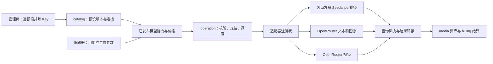
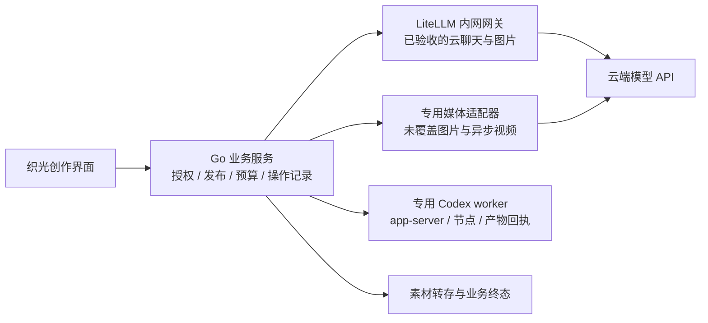
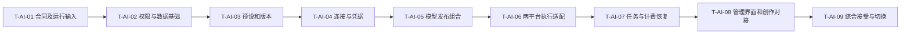

# AI平台接入市场调研与架构设计

更新：2026-10-21（结构整理）；文档确认状态沿原来源，未重新认定方案接受。

## 1. 摘要

当前已确认执行切片为管理员开发 PoC：暂不设计成本与计费，直接使用宿主 Codex CLI、不启动容器，聚焦 Seedream、视频生成和本地 Codex 聊天/生图。较广云端扩展、通用聊天和网关 PoC 沿 BACKLOG 的暂缓边界；旧任务定义不扩大当前范围。

按既有来源及当前管理员 PoC 范围维护预设、连接、模型和执行恢复。

本文按设计、用户故事与测试场景结构整理。原需求、确认结论和历史验证沿来源记录保留；当前实施进度、剩余工作及阻塞项统一见 [BACKLOG](../../BACKLOG.md)。

### 1.1 产品定义：摘要

来源：原PRD《03-AI平台接入与预设管理》第1节。

当前交付为平台管理员开发 PoC，聚焦 Seedream、视频生成和本地 Codex 聊天/生图，暂不设计成本和计费，直接使用本机 CLI。创作者使用与正式发布按后续独立接受推进。此前提出的 OpenRouter、DeepSeek 等广泛供应商接入与云端通用聊天保留为扩展来源，暂不作为当前必交付范围。

以“平台预设＋模型候选＋完整模型模板”减少重复录入：候选提供端点关联、模型ID和能力资料；完整模板另包含管理员审核的计价与限制。只填Key的快捷路径要求模板与账号条件齐备；本地Codex走运行节点选择与登录／能力检查。

## 2. 参与者

使用者与参与职责：平台管理员及使用已发布模型的创作者。维护职责及确认人沿下方原来源记录；未给出姓名的，不补造人员或排期。

### 2.1 需求原文与规则：对象与职责

来源：原需求《04-AI平台接入与预设管理需求》第2节。

| 对象         | 用户理解                                  | 关键边界                                                 |
| ------------ | ----------------------------------------- | -------------------------------------------------------- |
| 平台预设     | 火山方舟、OpenRouter 等可复用配置模板     | 不含 Key；包含协议、地址、区域、凭据字段和模型模板引用   |
| 平台连接     | 如“火山方舟生产账号”“OpenRouter 测试账号” | 一个预设可建立多个连接；有独立凭据、额度、健康和启用状态 |
| 模型配置     | 某连接上的某个模型及其版本                | 包含输入/输出、模式、限制、参数、价格与验证状态          |
| 通用模型候选 | 随项目提供的常用模型资料                  | 可缺账号与价格，只用于预填；不直接成为可执行发布         |
| 本地运行节点 | 安装并运行 Codex 的受管宿主               | 登录、在线状态、能力和隔离独立于云 API Key               |
| 聊天会话     | 同一授权范围内连续的消息与产物            | 归属、上下文、每轮身份和模型绑定可恢复                   |
| 生成参数预设 | 如“竖屏短片”                              | 只引用模型及合法参数；本轮不扩展为提示词市场             |

## 3. 背景

需求来源：[04-AI平台接入与预设管理需求](07-AI平台接入市场调研与架构设计.md#312-需求原文与规则文首来源与范围)。产品范围来源：[03-AI平台接入与预设管理](07-AI平台接入市场调研与架构设计.md#310-产品定义文首来源与范围)。

下方保留来源的日期、适用范围与确认状态。早期盘点和历史结果只支持其原时点；整理文档不重新执行实现、测试、迁移或发布。

### 3.1 文首来源与范围

来源：原设计《07-AI平台接入市场调研与架构设计》文首。

需求来源：[需求04](07-AI平台接入市场调研与架构设计.md#312-需求原文与规则文首来源与范围)。原有两平台实现与运行限制见[设计07](#1-摘要)。原市场调研、已有云端协议合同与历史验证保留；现行扩展按第7.10节阅读，不能把既有实现状态套用到新增平台。

实施进度及调度字段见 [BACKLOG 第4.8节](../../BACKLOG.md#48-07-ai平台接入市场调研与架构设计文首来源与范围)。

### 3.2 已确认方向与现行基线

来源：原设计《07-AI平台接入市场调研与架构设计》第1节。

沿用“版本化平台预设 → 连接 → 模型发布组合 → 任务编排 → 协议适配器”。平台管理员统一管理云 Key 与本地运行节点；普通创作者使用授权范围内的已发布能力。复用 catalog、operation、billing、media，不增加独立网关服务。

原有基线是火山方舟 Seedance 视频及 OpenRouter 文本／图片／视频。此次扩展纳入 BytePlus、DeepSeek、本地 Codex，并补火山聊天／图片、多轮聊天及通用模型候选目录。具体范围与非目标以设计07第3.15节为准；BytePlus 视频仍为候选，个人／团队 BYOK、自动跨平台路由、独立音频和任意 Agent 工具执行未新增。

Seedance／Seedream 是模型系列。BytePlus 与火山方舟分别建预设、凭据和区域边界，协议可复用已验证部分，模型 ID、价格和权限不能推定互通。CC Switch 只提供预设接入参考；通用候选不自动变成真实账号可用模型。

### 3.3 原市场调研与备选（不作为现行交付名单）

来源：原设计《07-AI平台接入市场调研与架构设计》第2节。

目标用户是个人创作者、小型内容团队及维护生成服务的管理员。接入层成功标准：首次配置容易、能力不缩水、收费可解释、任务可恢复、模型升级不破坏已有项目。以下平台是采购/技术替代关系，也可能是合作供应商；CC Switch 为相邻工具。未获取可靠且可比的市场份额、融资、留存或市场规模数据，故不提供数字排名。

| 备选              | 定位、客户与获客方式                                       | 公开能力与优势                                | 对织光的局限/切换成本判断                                                | 商业模式与建议                                                                                        |
| ----------------- | ---------------------------------------------------------- | --------------------------------------------- | ------------------------------------------------------------------------ | ----------------------------------------------------------------------------------------------------- |
| BytePlus ModelArk | 模型原厂平台，开发者文档/控制台及企业销售                  | Seedance 原生任务接口，适合追踪原生能力       | 需逐账号核对开通；区域、模型参数和媒体获取约束必须显式处理               | 按模型用量/资源包；已纳入本次扩展，合同见第7.10节 [SRC-AI-01～SRC-AI-03]                              |
| OpenRouter        | 多模型聚合平台，以统一 API、模型目录和开发者生态吸引客户   | 模型发现与多供应商路由；已有独立视频任务 API  | 文本、图像、视频的协议能力不同；增加平台和上游两层故障定位               | 按用量；当前标准方案平台费标示 5.5%，具体收费基数/付款方式以账单为准；优先接入 [SRC-AI-04～SRC-AI-06] |
| fal               | 多媒体模型 API 与推理平台，模型页/SDK/开发者生态及企业销售 | 队列、查询、取消、回调；模型结果结构明确      | 每个模型的输入输出仍不同；运行中取消不保证立即停止                       | 按用量，具体模型价单独核对；作为第二阶段候选 [SRC-AI-07～SRC-AI-08]                                   |
| Replicate         | 托管模型平台，面向试验和部署模型的开发者                   | prediction 生命周期统一，覆盖公开与自部署模型 | 模型版本和输入结构需分别管理；专用部署增加运维/空闲成本                  | 多数公开模型按运行时间，部分按输入输出；私有专用实例可能计算空闲时间 [SRC-AI-09～SRC-AI-10]           |
| LiteLLM           | 自托管 AI 网关，面向多供应商治理团队，开源社区与企业支持   | 统一入口及路由、重试、限流等治理能力          | 额外服务运维；不能替代织光的素材、任务和计费语义；具体视频适配覆盖未实测 | 开源网关可免费自托管，企业能力付费；首轮借鉴机制，不直接引入 [SRC-AI-11～SRC-AI-12]                   |

表中的“局限”是针对织光适配成本的分析，不是客户满意度结论。上述五种方案覆盖原厂、聚合、多媒体托管、模型托管与自托管治理，没有虚构五个同质的直接竞品。

### 3.4 CC Switch 可以借鉴什么

来源：原设计《07-AI平台接入市场调研与架构设计》第2.1节。

官方添加指南描述了“选预设 → 填表”，预填名称/端点、输入 Key，以及自定义配置；模型发现依赖平台提供相应端点。指南也明确现有连接保存创建时的预设快照，不自动跟随预设更新。[CC Switch 添加指南](https://github.com/farion1231/cc-switch/blob/main/docs/user-manual/en/2-providers/2.1-add.md)

织光建议复用这种低配置负担的体验，再增加预设版本差异、任务引用保护、能力校验和计费约束。以下版本发布、派生副本、作用域与升级机制是织光建议，不声称 CC Switch 已完整实现。它主要管理本地 AI 工具配置；织光要处理多用户与长期生成任务，因此不照搬本地配置文件切换。

OpenRouter 自己也有保存模型、路由与生成参数的 Presets，但这是平台内推理配置，不应成为织光跨平台连接配置的唯一事实来源，也未据此确认它适用于视频端点。[OpenRouter Presets](https://openrouter.ai/docs/guides/features/presets)

### 3.5 差异化机会与经济性

来源：原设计《07-AI平台接入市场调研与架构设计》第2.2节。

建议织光强调“模型能力与创作素材一致、配置一次持续可用、费用和历史可追溯”。基础设施越来越容易聚合，长期价值应来自编辑器、多参考资产、项目上下文和可靠生成流程，而非平台数量。

成本比较使用同一模型版本、模式、分辨率、时长、音频及参考输入；记录供应商成本、平台费用、存储流量和人工恢复成本。建议指标为“总实际成本 / 被创作者接受的结果数”，并同时记录失败率和等待时间。没有统一样本和真实账单，不能认定直连或聚合一定更便宜。

未来 12～18 个月主要风险是模型参数/价格变动、聚合平台覆盖原厂能力、原厂强化工作流产品；机会是用稳定的项目和资产体验降低更换模型成本。上述为情景判断，不是市场增长预测。此轮不购买资源包、不进行收费对比实验。

### 3.6 当前仓库事实与缺口

来源：原设计《07-AI平台接入市场调研与架构设计》第4节。

基线：`glowloom-server`、`main`。初次调研开始时工作区干净；本次细化开始时已有用户系统、编辑器及本模块文档修改，全部保留，仅编辑本任务文档。仅静态阅读代码，未连接业务数据库或核验部署。

| 当前源码                                                                             | 已有机制                                                                   | 本次需要补充的设计                                                             |
| ------------------------------------------------------------------------------------ | -------------------------------------------------------------------------- | ------------------------------------------------------------------------------ |
| [provider.go](../../backend/internal/catalog/domain/provider.go)                     | Provider、区域、启用状态、乐观版本；Credential 密文与安全摘要              | Provider 当前是平台级配置，可逐步承担连接实例，新增预设来源与配置快照          |
| [凭据注册表](../../backend/internal/catalog/adapter/credentialschema/registry.go)    | 声明 `volcengine_ark`、`minimax`、`openrouter` 字段                        | 已有两平台字段声明；新增 BytePlus/DeepSeek/Codex 注册见第7.10节                |
| [模型注册](../../backend/internal/catalog/domain/model_registry.go)                  | ModelProfile、不可变 ModelVersion、ParamSchema、Limits、查询/取消/回调标志 | 复用模型版本；增加模板来源、能力证据与连接绑定，避免另造平行模型目录           |
| [管理路由](../../backend/internal/catalog/adapter/http/admin.go)                     | providers、credentials、models、版本和价格接口                             | 扩展预设与实例化；沿用现有生成 API 合同流程                                    |
| [工作流边界](../../backend/internal/operation/adapter/workflow/provider_contract.go) | submit/query/cancel 与 accepted/completed/unknown 等结果类型               | 补全协议能力矩阵和平台映射，不用普通 HTTP 成功代替生成成功                     |
| [调用记录](../../backend/internal/operation/adapter/workflow/provider_calls.go)      | 持久调用记录，提交超时归为 unknown                                         | 继续保护不确定提交；现有异步 submit 不直接接受 completed，需要按能力走正确路径 |
| [图像调用](../../backend/internal/operation/adapter/workflow/image_calls.go)         | 同步图像回执身份校验                                                       | 同步图像与异步视频分别验证，不强行用同一结果流程                               |
| [冻结配置](../../backend/internal/operation/application/workflow.go)                 | 工作流保存非秘密供应商事实                                                 | 补齐连接配置版本及凭据引用生命周期                                             |

调研时仅确认 `provider.submit/query/cancel` 骨架。2026-10-15 已在本仓库实现 `providerhttp`、`managed` 和 provider 队列的 `provider.managed` 活动，media 队列注册 `media.IngestManaged`。上述已有云端链路仍缺真实部署及账号接受；新增来源、聊天和 Codex 的代码缺口见第7.11节，不能将 fixture 当作平台已经可用的证据。

### 3.7 本次细化发现的必要改造

来源：原设计《07-AI平台接入市场调研与架构设计》第4.1节。

- [现有 Provider 存储](../../backend/internal/catalog/adapter/postgres/store.go)只接受 active 初始连接；ReplaceCredential 会立即禁用旧凭据，FindActiveCredential 还要求连接 active。必须支持停用状态下的配置测试，以及任务绑定的旧凭据恢复查询，不能直接复用新提交的查询方法。
- [现有管理员校验](../../backend/internal/catalog/adapter/postgres/set_credential.go)按旧 org 与 RoleAdmin 判断；目标改为用户系统的平台管理员能力检查，保持事务内当前权限复核。不能只改前端菜单权限。
- [版本发布命令](../../backend/internal/catalog/application/publish_model_version.go)同时推进当前模型版本；新增上线发布组合后，创作者目录和报价必须读明确 release，不把保存版本自动变成生产切换。
- [供应商页](../../frontend/src/app/providers/page.tsx)和[模型页](../../frontend/src/app/models/page.tsx)已实现预设、连接、网页 Key、模型版本、试运行及发布管理。浏览器检查使用模拟 API，不代表生产服务接受。
- [当前 Schema](../../backend/db/schema.sql)的 ParamSchema 是数组，价格有单位/货币约束。模型表单要显式转换到现有校验器，不直接塞入第三方 JSON Schema；价格需要按上游单位规范化，不能把视频 token 成本当秒价。

### 3.8 文首来源与范围

来源：原任务文档《10-AI平台接入与预设管理实施计划》文首。

更新：2026-10-20。原有两平台实施基线：用户已授权实现；T-AI-02～T-AI-08 主要代码已落地并完成分层本地验证，T-AI-01 的账号/模型/预算及 T-AI-09 的真实供应商接受和发布仍未完成。供应商 Key 只由用户在网页配置。证据、部署步骤和限制见[实施验证与上线手册](#1-摘要)。

上游：[需求04](07-AI平台接入市场调研与架构设计.md#312-需求原文与规则文首来源与范围) → [设计07](#1-摘要) → [PRD03](07-AI平台接入市场调研与架构设计.md#310-产品定义文首来源与范围)。用户已确认首轮平台管理员统一配置 Key，接入火山引擎及 OpenRouter。2026-10-20新增BytePlus、DeepSeek、本地Codex及通用模型预设需求，扩展由第7.26节T-AI-10～16承接；BYOK仍在范围外。

实施进度及调度字段见 [BACKLOG 第4.80节](../../BACKLOG.md#480-10-ai平台接入与预设管理实施计划文首来源与范围)。

### 3.9 文首来源与范围

来源：原任务文档《11-AI平台接入实施验证与上线手册》文首。

更新：2026-10-18。对应[需求04](07-AI平台接入市场调研与架构设计.md#312-需求原文与规则文首来源与范围)、[设计07](#1-摘要)、[PRD03](07-AI平台接入市场调研与架构设计.md#310-产品定义文首来源与范围)、[设计07](#1-摘要)。本文记录实现与证据，不是生产上线或真实供应商接受证明。

实施进度及调度字段见 [BACKLOG 第4.90节](../../BACKLOG.md#490-11-ai平台接入实施验证与上线手册文首来源与范围)。

### 3.10 产品定义：文首来源与范围

来源：原PRD《03-AI平台接入与预设管理》文首。

| 项目       | 内容                                                                                              |
| ---------- | ------------------------------------------------------------------------------------------------- |
| 版本与更新 | 开发 PoC v0.3；2026-10-21                                                                         |
| 状态       | 当前交付为管理员开发 PoC；本机 CLI 聊天／生图已实测，云端真实账号及媒体存储联合接受待完成         |
| 维护与决策 | 维护人未指定；需求方向、设计建议、运行输入和产品接受分别记录                                      |
| 上游       | [需求04](07-AI平台接入市场调研与架构设计.md#312-需求原文与规则文首来源与范围) → [设计07](#1-摘要) |
| 下游       | [设计07](#1-摘要)、[设计07](#1-摘要)                                                              |

本文汇总用户价值与交付范围。FR／BR／DR／NFR／AC以需求04为唯一来源，模型候选名单与接口机制以设计07第7.10节为准。

### 3.11 产品定义：背景与需求来源

来源：原PRD《03-AI平台接入与预设管理》第2节。

原需求已确认平台管理员统一配置Key、预设管理、模型发布和可恢复执行；火山视频与OpenRouter单轮文本／图片／视频已有代码及分层验证，真实供应商与上线尚未接受。

2026-10-20用户要求加入BytePlus、DeepSeek、本地Codex聊天／生图，并整理原始需求、参考CC Switch接入通用模型。现有注册仅两平台，单轮文本不是聊天，Codex尚无生产worker与成功交付闭环，因此新增范围需明确实现和验收任务，不能仅扩充下拉框。

CC Switch的参考限于预设填表、模型发现／映射和快照；织光继续承担项目授权、媒体入库、费用和长期任务恢复。来源与取舍见设计07第7.12节。

### 3.12 需求原文与规则：文首来源与范围

来源：原需求《04-AI平台接入与预设管理需求》文首。

| 文档管理项 | 内容                                                                                                                     |
| ---------- | ------------------------------------------------------------------------------------------------------------------------ |
| 版本与更新 | 范围整理 v0.2；2026-10-20                                                                                                |
| 文档状态   | 用户已提出五类接入与通用模型预设需求；本次细化方案待评审、扩展待实现。原有两平台实现与验证证据保留，不等于真实供应商接受 |
| 维护与评审 | 平台接入产品、工程与运行职责；具体人员未指定                                                                             |
| 来源与性质 | 第3.13节区分原始需求、此次新增要求和设计建议；公开模型目录不是账号授权或上线证据                                         |
| 适用范围   | 火山方舟、OpenRouter、BytePlus、DeepSeek、本地 Codex；平台预设、通用模型候选、连接、聊天及生成发布                       |

文档链路：**需求04** → [设计07](#1-摘要) → [PRD03](07-AI平台接入市场调研与架构设计.md#310-产品定义文首来源与范围) → [设计07](#1-摘要)。既有实现证据见[设计07](#1-摘要)。本文是现行需求来源，旧“两平台首轮”只描述已实施基线，不再限制此次扩展。

### 3.13 需求原文与规则：来源整理

来源：原需求《04-AI平台接入与预设管理需求》第1.1节。

| 来源                    | 原始意图与性质                                                                                                      | 本文承接                                                                                   |
| ----------------------- | ------------------------------------------------------------------------------------------------------------------- | ------------------------------------------------------------------------------------------ |
| 原有已确认需求          | 平台管理员统一通过网页配置 Key；先接火山方舟和 OpenRouter；参考 CC Switch，选择预设后尽量只填 Key；管理员可维护预设 | 保留 FR-AI-01～20、AC-AI-01～21，以及凭据、发布、预算和恢复规则                            |
| 2026-10-20 用户新增要求 | 基本提供商包括火山引擎、OpenRouter、BytePlus、DeepSeek；接入本地 Codex 提供聊天和生图                               | 纳入现行目标范围，FR-AI-21/24/25；不是将新增平台记为已实现                                 |
| 2026-10-20 用户补充要求 | 整理 AI 服务原始需求；参考 CC Switch，把一些通用模型作为项目预设                                                    | FR-AI-22/23/27；内置候选目录与可复用完整模板分开                                           |
| 本次方案建议            | 多轮流式聊天、通用模型候选首批名单、分批落地顺序、本地运行节点及费用处理方式                                        | 设计07第7.10节与设计07第7.26节；细节待评审，不推定用户已接受具体型号、价格、预算或部署方式 |

### 3.14 需求原文与规则：用户目标

来源：原需求《04-AI平台接入与预设管理需求》第1.2节。

管理员从预设快速接入服务，常用模型无需逐个查找端点和手写请求参数；创作者在授权项目中选择已发布模型，进行聊天、图片或视频创作。对应 CAP-GL-03～05、08～10、18、24～25、30～31；通用 Agent 多步自主执行仍不是此次完整交付目标。

平台、模型、连接和场景分开：Seedance／Seedream 是模型系列，火山方舟与 BytePlus 是不同平台，OpenRouter 是聚合平台，Codex 是本地运行时接入。平台预设不等于提示词模板；同一模型通过不同平台提供时，保留各自连接、协议、用量与验证。

### 3.15 需求原文与规则：现行能力范围

来源：原需求《04-AI平台接入与预设管理需求》第1.3节。

2026-10-21 用户进一步明确，实际需要的是 **Seedream、视频生成和本地 Codex**，当前不需要广泛接入其他模型服务。此项澄清收敛当前交付优先级；此前提出的云端通用聊天与其他供应商预设保留为扩展来源，不作为当前必交付项，不为它们新增独立网关。

| 当前能力   | 交付重点                                                        |
| ---------- | --------------------------------------------------------------- |
| Seedream   | 账号/模型及模式验证、产图、实际张数、素材转存与结算             |
| 视频生成   | 现有目标平台/模型的提交、任务查询、结果转存、未知状态与费用恢复 |
| 本地 Codex | 专用运行节点、聊天与单图生成、授权/隔离、回执和业务终态         |

以下为此前的扩展来源清单，用于追溯已有要求与代码基础；当前优先级以上表为准：

| 来源       | 聊天目标                               | 图片目标                              | 视频边界                                   | 已有基础                                                    |
| ---------- | -------------------------------------- | ------------------------------------- | ------------------------------------------ | ----------------------------------------------------------- |
| 火山方舟   | 文本聊天                               | Seedream 文生图／参考生图，按模式验证 | 保留 Seedance 文生视频／图生视频等既有范围 | 当前执行器仅视频                                            |
| OpenRouter | 多轮文本聊天                           | 专用图片 API，按端点选择模型          | 保留既有视频链路                           | 已有单轮非流式文本、图片、视频适配                          |
| BytePlus   | 文本聊天                               | Seedream，独立账号与区域验证          | 视频列为扩展候选，未确认模式不开放         | 尚无独立执行适配                                            |
| DeepSeek   | 文本聊天；图像理解如需开放另验输入合同 | 不声明生图                            | 不声明视频                                 | 尚无独立执行适配                                            |
| 本地 Codex | 文本聊天                               | 首期单图文生图；参考编辑后续独立验证  | 不声明视频                                 | 有单图适配和回执基础，未装配正式 worker，未完成业务成功终态 |

“填 Key 即可使用”的前提是已部署适配器、账号开通且有额度、模型配置和计价完整、验证及发布完成。云端正常接入只需选预设并填 Key；本地 Codex 选择已登记运行节点并检查登录／能力，不要求伪造 API Key。缺条件时给出明确修复入口。

平台管理员管理共用云凭据、模型和本地运行节点；普通创作者及团队管理员不获得平台配置权限。个人／团队 BYOK、任意第三方中转、自动跨平台路由、独立音频生成、提示词市场和任意 shell／MCP 工具执行不在本轮扩展中。新增服务应通过注册协议和受信任端点扩展，不能用任意请求 JSON 代替适配器。

### 3.16 调研证据：文首来源与范围

来源：原调研《01-AI网关市场调研与LiteLLM选型分析》文首。

| 项目       | 内容                                                                                                                                                                                                   |
| ---------- | ------------------------------------------------------------------------------------------------------------------------------------------------------------------------------------------------------ |
| 版本与更新 | 范围修正 v0.2；2026-10-21                                                                                                                                                                              |
| 文档状态   | 完成公开文档、GitHub 源码和本仓库静态核对；依据用户明确的 Seedream、视频生成和本地 Codex 范围，当前不引入 LiteLLM；未运行 PoC 或部署                                                                   |
| 维护与评审 | 产品战略、AI 接入工程与运行职责；具体评审人未指定                                                                                                                                                      |
| 适用范围   | 多供应商 AI 网关的自研/采购取舍；云端聊天、图片、视频与本地 Codex 的分工                                                                                                                               |
| 上游基线   | [需求04](07-AI平台接入市场调研与架构设计.md#312-需求原文与规则文首来源与范围) 的 FR-AI-21～28、BR-AI-10～13；[设计07](#1-摘要)；[PRD03](07-AI平台接入市场调研与架构设计.md#310-产品定义文首来源与范围) |
| 下游关联   | [设计07](#1-摘要) 网关评估任务；现有供应商接受仍见[设计07](#1-摘要)                                                                                                                                    |

### 3.17 调研证据：研究问题、现状与约束

来源：原调研《01-AI网关市场调研与LiteLLM选型分析》第1节。

**当前不建议接入 LiteLLM，网关 PoC 暂缓。用户进一步明确实际所需只有 Seedream、视频生成和本地 Codex，多家通用云端聊天并非当前目标。** 在这一范围内，专用媒体和本地运行适配仍需保留，引入网关却增加服务运行、版本升级、凭据投影和故障恢复验证；尚无证据说明其维护节省能覆盖新增成本。此前“云端聊天优先引入”的建议依赖一个不成立的范围假设，现予以修正。

本文属于 research，记录研究证据、候选比较与建议；其中架构和验证内容是待证假设，不是已接受的 design。用户本轮要求评估成熟网关，未要求立即安装、改造生产流量或购买企业版。

### 3.18 调研证据：产品问题和当前源码事实

来源：原调研《01-AI网关市场调研与LiteLLM选型分析》第1.1节。

| 现状或约束                                                  | 本轮依据                                                                       | 对选型的影响                                                                      |
| ----------------------------------------------------------- | ------------------------------------------------------------------------------ | --------------------------------------------------------------------------------- |
| 当前聚焦 Seedream、视频生成和本地 Codex；原多云聊天扩展暂缓 | 需求04 FR-AI-21～27                                                            | 按端点、模式、账号验证，不能用供应商总数代替覆盖率                                |
| 平台接入管理仅向平台管理员开放                              | 需求04 页面调整、PRD03；providers 页面边界                                     | 网关控制台留在内部运行面，创作者沿用织光界面                                      |
| Go 后端已有预设、发布组合、凭据与收费任务合同               | `catalog/domain/provider_preset.go`、`operation/adapter/managed/activities.go` | 接入 HTTP Proxy 即可，不必在 Go 进程嵌入 Python SDK；不得平行建设第二套业务控制面 |
| 现有云端提交一次收费 POST，传输异常返回 unknown             | `operation/adapter/providerhttp/client.go` 的 Submit                           | 默认重试、跨模型回退和多部署随机选择必须显式约束                                  |
| ProviderConfig 固定供应商域名、区域和参数白名单             | `catalog/domain/provider_preset.go` 的 Validate                                | 不能仅把现有 BaseURL 换成内网网关地址；供应商身份与网关执行路径需分别建模         |
| Codex 使用 app-server RPC、能力探测和产物回执               | `operation/adapter/codex/chat.go`、`app/codexruntime/worker.go`                | 需要保留节点、运行身份、thread/turn、产物转存与费用终态合同                       |

以上为工作区源码事实，不证明真实供应商、生产迁移或用户接受。此前页面测试和协议夹具也不能证明 LiteLLM 的运行效果。

### 3.19 调研证据：调研口径

来源：原调研《01-AI网关市场调研与LiteLLM选型分析》第1.2节。

使用 `pm-product-strategy:product-strategy` 组织战略取舍，使用 `pm-market-research:competitor-analysis` 比较五个替代产品；通过 GitHub 插件读取仓库/发布/源码、Context7 定位文档，再与官方网页和固定版本源码交叉核对。

- 发布基线：GitHub `releases/latest` 返回 **v1.106.1**，发布时间 **2026-10-20 18:58:28 UTC**，tag 指向 commit `978b4d1e4e91cdaaab2e16fbd02d855439e143c1`。[发布记录](https://github.com/BerriAI/litellm/releases/tag/v1.106.1)、[tag 引用](https://api.github.com/repos/BerriAI/litellm/git/ref/tags/v1.106.1)支持这一快照，不表示已完成供应链验收。
- 主分支对照：`8d9b9926d1658df27fd560264f017a1497b81e7a`。主分支、在线文档、Context7 索引与发布镜像可能不同步；GitHub 代码搜索返回的其他 commit 仅作线索。
- “支持”分三层：文档声明、固定版本实现、织光账号/场景实测。本轮达到前两层的部分核对，**未运行网关、未发收费推理、未做性能测试**。
- 未找到可比的付费客户数、市场份额和独立性能测量，不引用星标、供应商宣传延迟或总模型数来推断质量与市场领先程度。

## 4. 目标

按既有来源及当前管理员 PoC 范围维护预设、连接、模型和执行恢复。目标的规则、量化条件与非目标沿需求原文及下方已确认设计，不增加未经确认的指标。

### 4.1 产品定义：目标与衡量

来源：原PRD《03-AI平台接入与预设管理》第4节。

| 目标              | 接受条件                                                                     | 证据                                                          |
| ----------------- | ---------------------------------------------------------------------------- | ------------------------------------------------------------- |
| KR-AI-01 配置可用 | 五类来源有真实适配状态；常用候选可选择；完整云模板只需填Key；本地无需伪Key   | AC-AI-01～07/13～15/21～24/26，记录输入字段和保存读回         |
| KR-AI-02 变更可靠 | 更新目录／模板、轮换凭据、取消和断线均不静默换模型或重复派发                 | AC-AI-05/08～11/17～19/24～27，故障脚本、原请求回执与费用记录 |
| KR-AI-03 使用真实 | 每条开放链路有对应真实结果；聊天可连续恢复；生图进入素材和业务终态；越权拒绝 | AC-AI-12/16/20/22～28及NFR-AI-06/07，真实账号／节点与角色矩阵 |

首次接入耗时、首次成功率、完成延迟和每个采用结果的成本先建立基线，不设未经测量的提升目标或发布日期。各目标在对应能力开放前判断；工程测试不替代产品接受。

## 5. 使用场景

参与者为平台管理员及使用已发布模型的创作者；在下方定义的输入、对象状态、权限和环境条件具备时执行相应操作。各故事按其独立前置条件核对，不能把测试夹具当成真实业务条件。

### 5.1 管理交互与接口建议

来源：原设计《07-AI平台接入市场调研与架构设计》第7节。

管理页设“平台连接”“预设库”“模型配置”三个入口。连接列表展示名称、平台、区域、Key 末四位、启用状态、最近测试、可用能力和用量。详情可以更新 Key、验证、选择模型、设置默认及停用；不显示可复制的明文 Key。

添加流程：选预设 → 填 Key（名称自动生成）→ 保存并验证 → 查看开通模型/缺失条件 → 启用推荐配置。凭据可先保存为未验证，发现失败允许重试；配置/发现操作不得伪装收费生成。没有安全鉴权探测接口时显示“无法通过免费检查确认”，允许管理员在产品中明确确认的受预算约束试运行；没有账号与预算授权时不执行。

首轮固定每能力默认项；创建页仍显示实际模型、平台和估算费用。高级连接参数默认收起。手机抽屉转为全屏；未保存切换、重复提交、版本冲突、鉴权失败、额度不足、模型未开通各有独立状态。

| API 建议                                                     | 语义                                       |
| ------------------------------------------------------------ | ------------------------------------------ |
| `/api/admin/provider-presets` 列表/新建及详情编辑            | 管理草稿与非秘密元数据                     |
| `/api/admin/provider-presets/{id}/versions`                  | 发布不可变版本，校验 revision              |
| `/api/admin/provider-presets/{id}/archive`                   | 归档并保留引用                             |
| `/api/admin/provider-presets/import-preview`、`/{id}/export` | 校验导入和无秘密导出；预览不写入           |
| `/api/admin/providers`                                       | 扩展创建参数，原子实例化预设版本并记录快照 |
| `/api/admin/providers/{id}/credentials` 与测试接口           | Key 只写入；测试返回请求 ID，结果异步查询  |
| `/api/admin/providers/{id}/discover-models`                  | 发现候选模型，禁止自动发布                 |
| `/api/admin/providers/{id}/upgrade-preview`、`/apply-preset` | 差异预览与显式升级/回退                    |
| `/api/admin/models` 及版本/价格/状态接口                     | 确认模型能力与定价，再启用                 |

新建与发布使用幂等键；修改携带 expectedRevision，冲突返回 409；详细敏感信息不出现在错误体。所有授权在服务端执行。下方补充首轮请求/响应和事务边界；这些是目标合同，不能将候选路径写成现有可用 API。

实施进度及调度字段见 [BACKLOG 第4.9节](../../BACKLOG.md#49-07-ai平台接入市场调研与架构设计管理交互与接口建议)。

### 5.2 页面与操作明细

来源：原设计《07-AI平台接入市场调研与架构设计》第7.1节。

复用 `/providers` 作为“AI 平台”管理页，内含“连接”“预设”两个页签；模型配置沿用 `/models`。新详情可用 `/providers/{id}`、`/providers/presets/{id}`、`/models/{id}`；它们是拟新增路由。页面独有实现置于各自 `_components/`，共享表单和状态组件按实际消费者复用，复用 ProductShell、shadcn 和当前同站代理。

| 页面          | 内容与主要操作                                                                     | 关键状态                                                                           |
| ------------- | ---------------------------------------------------------------------------------- | ---------------------------------------------------------------------------------- |
| 连接列表      | 名称/平台/区域/启用、分项健康、Key 摘要、模型数；添加、编辑、测试、停用            | 空列表给已注册来源入口；网络失败显示重试，不伪装空；无权限不发管理查询             |
| 添加/连接详情 | 基础、Key、模型、验证记录、历史；步骤进度由服务端数据派生                          | 未保存提示；刷新从连接 ID 恢复；重复点击使用同一请求 ID；Key 输入成功后清空        |
| 预设库/详情   | 内置/自定义、搜索/筛选、版本、派生来源；复制、保存、发布、归档、导入导出、紧急停用 | 内置编辑入口为“复制并编辑”；发布 diff；引用占用时禁硬删；升级冲突逐字段选择        |
| 模型列表/详情 | 连接、能力、上游 ID、公开状态；基础/输入/参数/价格/验证/版本                       | 发现候选与已上线分开；变更先保存草稿；发布组合前列出阻断原因                       |
| 试运行        | 模型和模式、受授权素材、参数、估算/费用上限、提交按钮                              | 明确标注会产生费用；默认不自动执行；未知结果恢复原任务；管理日志不显示私有素材地址 |
| 默认配置      | 按文本/图像/视频选择有效 release；显示影响范围                                     | 停用默认项先替换或清空；清空后该能力明确不可用，不自动 fallback                    |

连接表单字段：名称（自动建议、可改）、平台（创建后不跨平台修改）、预设版本、区域、端点（高级）、并发/速率（高级）、Key（只写）、备注（非秘密）。更换平台创建新连接；避免把原凭据送到新供应商。自定义端点仅平台管理员能改，必须经过网络地址校验；从官方端点改成其他域名需要重新录入 Key 并新建凭据版本，不自动沿用旧秘密。

预设字段：名称、slug、平台 adapter key、能力协议集合、base URL、地区/处理地域、凭据字段固定声明、文档/控制台地址、模型模板、来源与说明。自定义只允许当前已部署注册的协议；新增平台须完成第7.10节适配后才能启用。连接配置不含 Key；可选模型模板包含管理员审核的模型 ID、能力配置、平台价格及上游成本来源，不含凭据、账号账单、私有素材或验证证据。含账号专属模型 ID 的模板仅能在管理员确认兼容的账号间使用；缺少权限时显示真实失败，不替换模型。

### 5.3 接入向导及中断恢复

来源：原设计《07-AI平台接入市场调研与架构设计》第7.2节。

1. **选预设**：火山方舟/OpenRouter；展示可提供能力和账号开通说明。后台模板若缺 model ID，只能说明还需模型配置，不把“只填 Key”变为无条件承诺。
2. **创建连接**：保存 disabled Provider 与配置快照；返回 ID/revision。连接创建与 Key 写入分步提交，失败可以留在原对象补 Key，不重复创建。客户端只在 URL/内存中保留 ID，Key 不写浏览器持久存储。
3. **保存 Key**：接收后加密；响应只返回 credential ID、last4 和安全结果。网络未知先用原 request ID 查写入回执；确认未接受才重新填写，不能凭空重试一个空 Key 或重复轮换。
4. **验证/发现**：分项展示 schema_valid、adapter_available、auth、discovery。probe=unsupported 不等于 Key 错；目录为空不等于鉴权失败。查不到账号目录时从内置模型模板/手动 ID 建候选。
5. **配置与试运行**：选择模型、确认模式/限制、保存版本、填写平台价规则；形成候选发布组合后，管理员明确确认试运行。试运行走 operation/billing，但用途固定 admin_validation，仅管理员可访问；不加入公开模型目录。
6. **启用**：查看验证证据、模式清单、价格版本与影响。原子启用所选组合和连接，可选设默认。未通过项目保持 disabled；多个模型允许逐项启用，不能显示整个连接“全部模型可用”。

向导刷新后的步骤来自 `GET provider detail` 和检查/发布记录；浏览器不保存待录入 Key。测试、发现、试运行各自有 ID、进度和终态，不用一条通用成功消息替代。创建/Key 写入跨刷新未知结果通过请求回执解决，界面不能只依赖 React 的 pending 状态。

### 5.4 模型配置合同

来源：原设计《07-AI平台接入市场调研与架构设计》第7.3节。

| 分组         | 必填/条件字段                                                               | 校验与显示                                                                 |
| ------------ | --------------------------------------------------------------------------- | -------------------------------------------------------------------------- |
| 身份         | connection ID、显示名、上游 model ID、capability、protocol                  | capability 为 text/image/video；不能仅凭名字推断；同连接按上游 ID+能力去重 |
| 输入模式     | modes、有序角色 definitions、媒体类型、每角色数量、总数/大小/时长、组合约束 | 未声明的角色不可传；按模式绑定限制；必需首帧不可被普通参考替代             |
| 参数         | 名称、类型、默认值、枚举或范围、required、单位、条件依赖                    | 显示 schema 转换为现有 ParamSchema 数组；默认必须合法；不透传未知键        |
| 输出/任务    | 输出类型/数量/格式、同步或异步、query/cancel/callback 支持、超时和轮询策略  | 取消需有合同；不能把支持查询当支持按客户端幂等键查回执                     |
| 上游端点策略 | 固定 provider/endpoint（若协议支持）、参数白名单、地域约束                  | 使用端点能力，不取并集；无法固定时只开放所有允许端点能力的交集             |
| 价格         | unit、currency、rule、外币汇率及来源日期、生效时间；成本来源                | 平台价格规则和上游成本分别展示；有效范围覆盖所有开放参数组合               |
| 验证/发布    | 模型/配置版本、模式覆盖、样本摘要、adapter 版本、价格版本                   | 显示哪些模式已验证；未覆盖模式不纳入该 release；保存不自动启用             |

模式间的参数/参考变化采用编辑器需求03的事务与确认规则，本模块只提供版本化能力合同。能力刷新不能直接改写草稿；报价冻结 release ID，确认再次检查有效性。当前 OpenRouter 图像文档的模型级支持参数是并集，必须将端点范围收窄或取交集，并验证实际投递策略；不能用 `require_parameters` 聊天字段猜测图像/视频路由行为。

后台默认推荐值优先使用审核过的模板；参数不适用时显示原因而不是偷偷补值。单纯发现新模型只形成候选；上游删除/变更模型给出差异告警，管理员确认新 release 或下架，历史任务仍保留原引用。

### 5.5 写入合同与结果恢复

来源：原设计《07-AI平台接入市场调研与架构设计》第7.4节。

下表为原云端接口目标合同；已有实现按设计07与生成合同核对，不能仅凭此表标为未实现。新增接口沿用 Handler 注解和生成调用流程，不手改生成文件。分页使用有界 cursor，limit 默认 20、最大 100；输入上限由统一校验常量覆盖并测试。

| 动作/路径                                                               | 请求关键字段                                                                                                                                  | 响应及规则                                                                                    |
| ----------------------------------------------------------------------- | --------------------------------------------------------------------------------------------------------------------------------------------- | --------------------------------------------------------------------------------------------- |
| POST `/api/admin/provider-presets`                                      | name、slug、parent_id?、draft_payload                                                                                                         | 201 id/revision；复制内置产生 custom，不复制凭据                                              |
| PATCH `/api/admin/provider-presets/{id}`                                | expected_revision、draft_payload/name                                                                                                         | 200 revision；仅草稿字段可改；发布版本不修改                                                  |
| POST `/api/admin/provider-presets/{id}/versions`                        | expected_revision、draft_hash                                                                                                                 | 201 version ID/hash；同事务校验与审计；草稿变化拒绝旧预览                                     |
| POST `/api/admin/provider-presets/import-preview` 与 `/imports`         | schema_version、payload；提交携带 preview_id/hash                                                                                             | 预览无业务写入；提交重新校验内容/目标版本；同 slug 冲突不静默覆盖                             |
| POST `/api/admin/providers`                                             | preset_version_id、name、allowed overrides                                                                                                    | 201 id/config_version_id/revision/status=disabled；不接受客户端 active                        |
| PUT `/api/admin/providers/{id}/credentials`                             | expected_revision、secret.api_key、rotation_mode                                                                                              | 200 credential ID/last4/revision；旧版按 normal→draining、emergency→disabled；密文不返回      |
| POST `/api/admin/providers/{id}/credentials/{cid}/test`                 | config_version_id、expected_revision                                                                                                          | 202 check_id；原有 test_id 可保留兼容投影；GET `/api/admin/provider-checks/{id}` 查询分项结果 |
| POST `/api/admin/providers/{id}/discover-models`                        | config_version_id、credential_id、capabilities                                                                                                | 202 check_id；返回候选批次与来源；不改变上线模型                                              |
| POST `/api/admin/providers/{id}/upgrade-preview` 与 `/apply-preset`     | target_version_id；应用时 preview_hash、expected_revision、字段选择                                                                           | 前者只读；后者创建新配置版本；不自动迁移已有模型 release                                      |
| POST `/api/admin/models/{id}/versions`、`/prices`                       | 既有字段及 expected_revision；版本 DTO 对齐现有 schema                                                                                        | 保存不可变内容，保持当前 active_release 不变                                                  |
| POST `/api/admin/models/{id}/releases`                                  | config_version_id、model_version_id、price_version_id                                                                                         | 201 候选 release；校验三者同属连接/模型；未验证不得 active                                    |
| POST `/api/admin/model-releases/{id}/validation-quotes`                 | mode、受授权输入、params、budget_cap                                                                                                          | 返回 quote/摘要/确认标识；确认复用受控任务入口，不能自动发起收费                              |
| POST `/api/admin/model-releases/{id}/activate`                          | expected_revision、expected_provider_revision、validation_ids、defaults_to_replace（含每项 capability/expected_revision/expected_release_id） | 原子启用组合/必要的连接状态/显式默认变更；需权限、证据及配置当前有效                          |
| PATCH `/api/admin/capability-defaults/{capability}`                     | release_id 或 null、expected_revision                                                                                                         | 200 revision；不接受无能力匹配的 release；引用状态在事务中复核                                |
| POST `/api/admin/provider-presets/{id}/archive` 或 `/emergency-disable` | expected_revision、reason                                                                                                                     | 归档停止采用；紧急停用阻止新派发；恢复是显式操作并复核资格                                    |

另保留详情/列表、未引用草稿 DELETE、连接 PATCH 停用/归档、release 停用/回退接口。回退通过激活已存在且仍有效的 release，不改旧版本内容；默认替换使用同样并发控制。首轮 UI 不暴露第三方私有端点/Key 的导入快捷路径。

所有改变状态的请求有客户端 UUID 请求标识；服务器按 actor+操作类型+目标+请求 ID 保存安全回执。原标识相同内容返回原结果，不同内容返回 409。含 Key 的请求摘要使用服务端带密钥摘要而不是将明文/裸 hash 写入回执。回执读取 `/api/admin/config-requests/{request_id}?action=...&target_id=...` 同样检查平台管理员及原操作者；不返回 secret。

客户端在首次请求前持久化非秘密请求标识及目标；恢复会话并核权后查询回执。Key 本身仅在内存，不随草稿保存。写入事务成功与回执提交同事务；没有回执且仍无法排除在途请求时保持待核实，可用原键查询/重放而不生成新键。目标保留创建 request ID/credential write request ID，普通缓存回执过期仍能定位最终结果。

错误分类：401 未登录、403 非平台管理员、404 对象不可见/不存在、409 版本或幂等冲突、422 字段/能力/上线前置条件不满足、429 本地限流、503 执行端不可用。上游错误映射成 `auth_failed`、`permission_denied`、`quota_exceeded`、`rate_limited`、`unsupported`、`unreachable`、`unknown_submission` 等安全码；HTTP 200 的失败检查仍显示真实分项失败。

### 5.6 AI 服务接入页面与组件设计

来源：原设计《07-AI平台接入市场调研与架构设计》第12节。

本节为 2026-10-18 的页面设计补充；依据现有 PRD03、API 合同、共享顶栏设计09及 shadcn/Radix Nova。`providers` 保留既有连接、预设与 Key 接口，根据本轮用户反馈改为服务卡片、折叠预设维护、接入 Dialog、详情与预设编辑 Sheet，加载和空态复用官方组件。设计、前端工程验证、真实管理接口读取与真实供应商接受分别记录；页面实现不代表已配置可用模型或通过供应商验收。

Figma：[页面与交互](https://www.figma.com/design/uLqmeRWuQuzfrp9xOYg6FT/Glowloom?node-id=687-26546)、[组件与状态](https://www.figma.com/design/uLqmeRWuQuzfrp9xOYg6FT/Glowloom?node-id=686-25530)。包含连接列表、接入弹窗、预设管理、详情抽屉、状态恢复、三种手机视图及结构化预设编辑；连接/预设切换、打开与关闭入口可在原型中查看。组件使用可编辑文本、矢量图标和实例，不包含整页贴图。

### 5.7 页面框架与信息层级

来源：原设计《07-AI平台接入市场调研与架构设计》第12.1节。

- 对应 `/providers`，产品显示名“AI 服务接入”，仅平台管理员可见；普通创作者及团队管理员不开放配置权限。沿用 BasicLayout、纯导航 Sidebar、无底边框 ProductHeader、全局 Command 搜索、主题与账号入口。默认深色，复用 Neutral token、Geist 与中文系统字形，不加入品牌渐变、营销配色、积分、会员或概览统计卡。
- 2026-10-21 按用户反馈重新收敛页面：标题“AI 服务接入”配“仅管理员”标记，主操作为“接入服务”，保留模型管理链接；默认只呈现服务卡片。预设管理折叠为次级维护入口，不再占据一级 Tabs。既有 Figma 为历史参考，本轮实现以本节更新为准，尚未回写 Figma。
- 服务卡片展示名称、区域、连接检查状态、Key 安全摘要与模型数量。停用及保存待确认优先显示；模型数量不代表已发布。协议标识、配置版本、文件格式及解释正文不放在默认列表。
- 预设管理展开后提供名称、区域、使用入口；复制、编辑、导出等操作进一步折叠到每项“维护预设”中。预设版本与端点在编辑及配置详情中按需查看。四个内置云平台以服务端返回为准，不硬编码可用性。
- 全局搜索负责导航及当前页已加载连接/预设检索；未接入全量搜索时提示检索范围，不把前端筛选冒充服务端全量搜索。列表与预设分页继续保留现有合同。

### 5.8 新建与详情

来源：原设计《07-AI平台接入市场调研与架构设计》第12.2节。

“接入服务”打开 Dialog：标题、平台预设选择、API Key、可选设置与固定操作区。预设选择为受控单选项，展示平台名称和区域；不可用/归档/紧急停用预设不进入可选列表。先选预设再填 Key。默认自动命名，“连接名称”放入 Collapsible 可选设置；普通路径不要求 URL、协议、slug 或 JSON。Key 采用 Field + InputGroup/密码输入，显示切换按钮有可访问名称，不自动填入已有 Key；Key 旁仅提示“加密保存”。候选模型使用可展开选择区并显示选中数量，简短标记“草稿，需验证后启用”，不展开模型接入文档。底部仅提示“保存不会产生生成费用”。。

主要按钮为“保存连接”，提交中使用 Spinner 并阻止重复提交。连接创建成功后再写入 Key；创建请求未确认时不得继续写 Key或新建另一连接。Key 写入结果未确认时保留非秘密连接标识与查询恢复入口，不持久化密钥，不用新幂等键盲目重发。只有确定尚未写入时要求重新输入 Key 并补齐同一连接。保存成功读回后关闭弹窗、选中该连接并显示一次 Sonner；连接仍待检查和发布，保存不触发收费测试或自动启用。

点击连接打开右侧 Sheet，桌面宽约 520px、窄屏占可用宽度。标题区展示连接名称和区域；概览、API Key、高级配置使用 Tabs。概览优先提供 Key 与最近检查两项摘要，检查发生后再提供真实分项结果；“检查连接”明确为非生成检查，不把不支持的检测写成成功；“模型管理”前往该连接模型。Key 仅展示安全摘要及状态，替换使用新输入并遵循旧凭据 draining/撤销合同。配置显示绑定预设版本与端点；升级先显示差异，应用不静默修改已发布模型或在途任务。

行菜单使用 DropdownMenu：查看详情、模型管理、可用的重命名/停用操作。停用与紧急撤销使用 AlertDialog，说明停止新任务和历史任务恢复的实际影响；不将普通停用等同于立即销毁旧 Key。已停用连接不出现误导性的再次停用操作。

预设编辑使用 Sheet 与 FieldGroup/Field，基础名称、已支持协议、区域和端点为结构化控件；模型模板从现有发布复制或在专门区域编辑，JSON 仅置于高级导入/预览。内置预设只读，主要操作是复制为自定义预设；升级/归档和紧急停用沿用既有预览、版本和授权边界。

### 5.9 状态与恢复

来源：原设计《07-AI平台接入市场调研与架构设计》第12.3节。

| 状态                 | 页面表达与操作                                      | 官方组件               |
| -------------------- | --------------------------------------------------- | ---------------------- |
| 首次加载             | 保留 BasicLayout，正文相同结构骨架，无虚假连接数量  | Skeleton、Card         |
| 空连接               | 简短“还没有连接”，一个“接入服务”按钮                | Empty、Button          |
| 加载失败             | 一次 Sonner；正文仅保留恢复入口，不挤出红色横幅     | Sonner、Empty、Button  |
| 保存中               | 字段和提交受控禁用，按钮“正在保存…”                 | Field、Spinner、Button |
| 连接已建、Key 未写入 | 持久显示“Key 未配置”，继续同一连接                  | Badge、Field、Button   |
| 保存结果未确认       | 持久状态“保存待确认”，查询原回执；不直接声称失败    | Badge、Button、Sonner  |
| 检查进行中           | 单一 Spinner 和“正在检查”，保留已有列表             | Spinner、Badge         |
| 检查失败/不支持      | 列表留真实状态，详情显示分项原因，操作错误用 Sonner | Badge、Item、Sonner    |
| 无权限               | 不渲染配置或安全摘要，可返回创作                    | Empty、Button          |
| 版本冲突             | 保留输入、重新读取并复核差异，拒绝自动覆盖          | Dialog/Sheet、Sonner   |

### 5.10 响应式与组件落点

来源：原设计《07-AI平台接入市场调研与架构设计》第12.4节。

桌面继承现有 240px 侧栏和 64px 顶栏，不另起管理后台。正文最大宽度 1024px，桌面边距 32px、手机 16px；服务卡片两列，名称允许换行。小于 640px 改为一列连接卡片，每行仍能读到名称、状态及操作；Sidebar 使用原抽屉，不叠加第二套导航。320/390px 下弹窗保留两侧约 16px，表单单列，视口矮时内部滚动，操作按钮可见；手机交互目标至少 44px。弹层使用组件定位，不手动计算 top/left 或修改 body 滚动锁。

| 设计组件                          | 前端对应                                    | 责任                             |
| --------------------------------- | ------------------------------------------- | -------------------------------- |
| AIService/PageHeader 与预设折叠区 | `providers-page.tsx`，共享 BasicLayout      | 标题、视图与主要操作             |
| AIService/ConnectionCard          | connection-list.tsx，article、Button、Badge | 真实连接摘要与菜单               |
| AIService/PresetCard              | providers 页面私有组件，Card                | 平台摘要、使用入口与折叠维护     |
| AIService/ConnectDialog           | 重组 `preset-connect.tsx`，Dialog/Field     | 两阶段保存、Key 内存和原请求恢复 |
| AIService/ConnectionSheet         | 重组 `connection-detail.tsx`，Sheet/Tabs    | 检查、Key 生命周期与配置版本     |
| AIService/PresetEditor            | `preset-editor.tsx` 与 `preset-models.tsx`  | 结构化预设和模型模板             |
| AIService/Status                  | 现有 Badge/Spinner 和安全状态映射           | 文本与图标共同表达状态           |

设计稿中的连接名与检查结果仅为状态示例，不代表真实账号、已验证模型、费用或供应商接受。所有图标使用现有 Lucide 矢量，平台名称保持文字，不使用截图或图片拼装控件。焦点、键盘、关闭返回触发器和读屏名称使用官方原语。正式实现前应以本节与 Figma 确定的组件/状态逐项对照；不得仅为通过测试放宽权限、回执或发布门禁。

### 5.11 2026-10-21 页面精简与管理员边界

来源：原任务文档《10-AI平台接入与预设管理实施计划》第10节。

- 默认页面改为服务卡片，收起预设维护；接入表单仅突出平台和 Key，通用模型及连接名称按需展开。详情优先展示 Key 与检查摘要，高级配置按需查看。
- 页面在管理员边界内才挂载管理组件；撤权即卸载，切换账号重建查询状态。继续沿用账号菜单、SessionGate、后端管理接口和应用查询的管理员校验。
- 验收覆盖普通账号与团队管理员直接访问、撤权、预设维护展开、候选切换、停用凭据状态、两阶段保存与未知回执恢复。浏览器使用受控模拟 API，覆盖桌面与 390px；不证明真实供应商可用。
- 本轮未修改 Codex 的开放对象、费用和部署决定；管理员要求应用于服务接入管理。真实 Codex 聊天与生图验收仍按第9节未完成边界跟踪。

### 5.12 AI 服务接入页面落地

来源：原任务文档《11-AI平台接入实施验证与上线手册》第8节。

2026-10-18：按设计07 §12 与 Figma R9 实现连接/预设 Tabs、桌面 Table 和手机 Item、接入 Dialog、详情与预设编辑 Sheet，继续使用官方 shadcn/Radix Nova、Lucide 与共享 BasicLayout。搜索接入顶栏 Command 快捷键；弹窗、抽屉关闭恢复入口焦点，320px 短屏保留底部操作区。

真实本地浏览器读取：热更新后管理接口首次读取偶发返回 `503 dependency_unavailable`，点击重新加载后 `/api/admin/providers?limit=200` 与 `/api/admin/provider-presets` 均返回 200；连接列表为空，展示 OpenRouter 和火山方舟内置预设。验证搜索筛选、选择预设、打开/关闭编辑和接入界面；未在真实环境填写或保存 Key、创建连接、发布预设或执行生成。

受控浏览器使用既有模拟 API：正常两阶段保存、创建回执丢失、关闭后继续原流程、查询原回执并补齐同一连接均走通；只有读回连接及有效凭据后关闭接入弹窗。未知请求标识继续按原作用域恢复，Key 仅留在当前输入/提交内存。该验证不代表真实供应商、鉴权或账单接受。

工程、浏览器、迁移及真实供应商证据保持独立；本轮未执行业务库迁移、容器重启、Git 提交推送或生产发布。

工程检查：本轮相关测试 31 项通过。ESLint、Prettier、路由类型、TypeScript 与生产构建通过。共享工作区全量回归曾全部通过；最后一次全量运行 552/553 通过，失败为并行画布的 `canvas-node-panel.test.tsx` 定位断言，本轮未修改或放宽该测试。接口偶发依赖异常与并行画布回归不作为本轮 UI 完成后已解决的问题。

### 5.13 产品定义：用户流程

来源：原PRD《03-AI平台接入与预设管理》第5节。

**云端接入：** 选平台 → 勾选常用模型候选 → 填Key → 保存停用连接与候选 → 分项检查／补计价 → 受控试运行 → 明确发布 → 按能力设置默认。平台已有完整模板时自动实例化待验证模型和价格；候选缺价时允许保存并引导管理员补齐。

**本地接入：** 选Codex → 选已登记节点 → 检查版本、登录、在线及能力 → 选精确模型 → 分别验证聊天／单图 → 按明确费用政策发布。节点离线、能力不支持、未验证分别显示；能力标志为true不等于真实生成成功。

**创作者聊天／生成：** 选择已发布模型 → 提交授权上下文／素材 → 核对费用 → 持久记录轮次或任务 → 查看流式文本或生成进度 → 保存／采用产物 → 刷新继续。取消和结果未知有独立状态，不能靠重发来恢复。

管理界面延用/providers和/models、既有组件与响应式要求；不另造独立后台。普通用户仅见已发布安全投影。完整状态与布局见设计07第12/14节。

## 6. 价值

明确模型、凭据、运行端与真实接受边界，避免重复派发和虚假可用状态。

### 6.1 产品定义：用户与价值

来源：原PRD《03-AI平台接入与预设管理》第3节。

| 用户             | 要完成的工作                                             | 产品价值与边界                                                                 |
| ---------------- | -------------------------------------------------------- | ------------------------------------------------------------------------------ |
| 平台管理员       | 选择平台与常用模型、接入账号／节点、维护计价、验证和发布 | 已知信息预填；缺失条件可定位；凭据只写不回显，管理服务不自动获得私有作品访问权 |
| 个人／团队创作者 | 在授权会话或项目中聊天、引用素材、生成并保存结果         | 看到实际模型与费用，刷新可续；不接触平台Key或宿主文件                          |
| 运行维护职责     | 管理Codex节点版本、登录、在线与隔离，处理异常任务        | 运行节点与模型账号分开诊断，停用后不丢已派发任务                               |

当前替代方式是逐供应商查ID、维护参数并手动转存结果；本方案以预填、明确发布与统一素材关系减少这些步骤。尚无访谈或量化基线，不宣称节省比例或性能排名。

| 六要素                   | 平台管理员                             | 个人/团队创作者                      | 运行维护职责                                   |
| ------------------------ | -------------------------------------- | ------------------------------------ | ---------------------------------------------- |
| Who：谁                  | 负责平台模型配置的人                   | 使用已发布模型创作的人               | 负责本地节点及异常任务的人                     |
| Why：为什么              | 减少重复填表并判断能否发布             | 连续聊天、生图并保留成果             | 区分节点、账号、能力与任务故障                 |
| What before：现在怎么做  | 手工查询各家端点、模型和价格           | 各供应商调用与产物转存割裂           | 依赖进程和分散日志判断状态                     |
| How：如何改善            | 候选预填、完整模板、分项检查和明确发布 | 授权上下文、会话恢复、素材及费用闭环 | 节点登记、健康/能力检查及原请求查证            |
| What after：之后得到什么 | 看清缺失项，升级不静默改已有连接       | 刷新可继续、产物可追溯、费用可解释   | 停用不丢任务，未知结果可查证                   |
| Alternatives：替代方式   | 逐平台手动维护配置                     | 外部聊天/生成工具加手工归档          | 人工检查节点与供应商回执；统一状态减少反复核对 |

上述当前方式和改善是产品分析，实际接入耗时与收益仍须按第4.1节测量。

### 6.2 调研证据：用户价值与场景影响

来源：原调研《01-AI网关市场调研与LiteLLM选型分析》第3节。

当前用户结果是 Seedream 产图、视频生成及本地 Codex 聊天/生图的真实交付；优先完成现有适配、素材转存、费用和任务恢复，不为通用云端聊天增加网关。下表仅记录未来采用网关时需保留的交互合同。

管理员继续在 `/providers` 选平台、配置凭据和模型，再完成真实验证和发布；网关部署由内部工程/运行职责管理。页面沿用设计07第5.6节的精简管理员界面，本轮无新增界面或原型。

| 场景                   | 调用方行为                                             | 可见反馈与恢复                           | 追踪           |
| ---------------------- | ------------------------------------------------------ | ---------------------------------------- | -------------- |
| 尚未部署对应网关能力   | 不发布执行组合，保留候选/草稿                          | 待配置或不可用                           | FR-AI-22/23/28 |
| 经过验收的网关聊天     | 服务端绑定项目权限、模型发布与执行配置，再调用内网网关 | 正常文本/流式状态与真实来源              | FR-AI-24/27    |
| 网关超时或流式断开     | 保存同一操作与不确定状态                               | 结果待确认；恢复同一轮，不能重新收费生成 | FR-AI-26       |
| 供应商鉴权失败         | 拒绝并给管理员可处理的安全错误                         | 修复对应连接的凭据                       | BR-AI-11/12    |
| 非平台管理员打开管理页 | 不加载管理数据，后端拒绝管理请求                       | 无权访问；创作仅使用已发布安全投影       | 原权限合同     |

## 7. 方案

### 7.1 平台协议核验与设计影响

来源：原设计《07-AI平台接入市场调研与架构设计》第3节。

| 关注点              | 已核验公开事实                                                                                                          | 织光设计影响                                                 |
| ------------------- | ----------------------------------------------------------------------------------------------------------------------- | ------------------------------------------------------------ |
| BytePlus 地址/鉴权  | ModelArk 文档给出 `https://ark.ap-southeast.bytepluses.com/api/v3`，使用 API Key [SRC-AI-01]                            | 作为该预设默认地址；区域独立存储，不能用火山 Key 直接替代    |
| Seedance 提交       | `POST /contents/generations/tasks`，内容与参数按具体模型定义 [SRC-AI-02]                                                | 使用 Ark 视频适配器；按模型核对参考角色/数量/时长            |
| BytePlus 恢复/媒体  | 查询 `/contents/generations/tasks/{id}`；文档标注查询近 7 天任务、视频 URL 有效期 24 小时，取消仅限排队任务 [SRC-AI-03] | 结果及时转存；过期和取消失败单独处理；不把删除记录当停止运行 |
| OpenRouter 视频     | 独立 `/api/v1/videos` 异步提交，视频模型目录、查询及 content 下载接口 [SRC-AI-04]                                       | 与聊天接口拆开；下载凭据仅发往核验过的 OpenRouter 原站       |
| OpenRouter 文本路由 | Chat Completions 文档提供供应商排序、fallback 与参数支持约束 [SRC-AI-05]                                                | 只在相应适配器采用；不默认套给视频                           |
| fal 队列            | 排队与运行中取消语义不同，媒体响应结构按模型变化 [SRC-AI-07]                                                            | `Cancel` 返回结果而非布尔成功；每模型解析输出                |

OpenRouter 视频文档区分首尾帧与参考图，且说明视频不适用 ZDR；因此“支持视频输入”不代表“支持视频生成”，聊天隐私设置也不能直接复制到视频。其取消接口和其他扩展能力，在未完成专项核验前按不支持处理。[OpenRouter 视频文档](https://openrouter.ai/docs/guides/overview/multimodal/video-generation)

BytePlus 英文页面部分正文依赖 JavaScript，此轮结合官方搜索索引、API Explorer 和查询任务文档交叉核对；对未取得完整正文的字段不写死。此次没有账号验证、生成质量或延迟实测。最新型号不作为硬编码默认值；首批确切模型 ID 在接入时从已开通目录核验并冻结。

### 7.2 已有火山方舟与 OpenRouter 执行合同

来源：原设计《07-AI平台接入市场调研与架构设计》第3.1节。

已有云端预设固定火山方舟北京区 `https://ark.cn-beijing.volces.com/api/v3` 和 OpenRouter `https://openrouter.ai/api/v1`。前者的地区字段为 `cn-beijing`，现有 `region=domestic` 继续表示处理区域类别；两字段不得混用。OpenRouter 的入口不代表全部上游有相同处理地域，目录显示海外/依上游策略，不能承诺数据本地化。

| 执行能力           | 协议边界                                                                    | 首轮接受范围                                                                    |
| ------------------ | --------------------------------------------------------------------------- | ------------------------------------------------------------------------------- |
| 火山 Seedance 视频 | `POST /contents/generations/tasks`；GET 同路径 `/{id}` 查询；Bearer API Key | 至少一款开通型号的文生视频、首帧图生视频；首尾帧/多参考按声明支持的模式逐项验证 |
| OpenRouter 文本    | Chat Completions；与视频分开的请求、用量和响应处理                          | 至少一款已开通模型的非流式文本生成；不因此新增完整聊天产品或 Agent 工具执行     |
| OpenRouter 图像    | 独立 `POST /images`；图像目录及端点能力；响应图片解码/转存                  | 至少一款型号的文生图；声明支持参考图时另测角色与数量                            |
| OpenRouter 视频    | `/videos` 异步任务及 content 结果获取                                       | 至少一款型号的文生视频；取消能力没有完整合同证据时关闭                          |

火山提交/查询路径及 API Key 来自[创建任务](https://docs.volcengine.com/docs/ark/create-video-generation-task-api?lang=zh)和[查询任务](https://docs.volcengine.com/docs/ark/get-video-generation-task-api?lang=zh)。火山查询文档说明任务查询窗口与媒体地址有效期，适配器应及时转存，并区分排队取消和运行中任务。本轮不将 BytePlus 字段直接视为火山合同。

OpenRouter 图像官方文档现有专用 Image API；模型层能力可能是多个端点的并集，具体端点能力才是有效约束。不能把图像全部按聊天响应解析。[OpenRouter 图像生成](https://openrouter.ai/docs/guides/overview/multimodal/image-generation)

本基线是本次细化的交付定义；具体 model ID/模式、协议响应及价格通过计划 T-AI-01 固定。上游尚未核验的附加模式保持关闭，不能因模板中列出了能力就全部放行。接口兼容性由适配器测试证明；未来新增型号的普通配置变更不要求新增一套平台。

非生成检查：OpenRouter 可用 `GET /key` 核对当前 Key 元数据，再独立获取模型目录；目录成功不等于 Key 有权限。火山免费鉴权/账号可用目录的确切协议尚未核实，T-AI-01 需要确认；没有可证明无生成成本的接口时返回 unsupported，采用内置模板或手动模型 ID，再通过管理员明确确认的试运行证明能力。不索取云账号 AK/SK 以绕过该限制。[OpenRouter 当前 Key](https://openrouter.ai/docs/api/api-reference/api-keys/get-current-api-key)

### 7.3 推荐设计模式与模块边界

来源：原设计《07-AI平台接入市场调研与架构设计》第5节。



| 模式                | 解决的问题                     | 建议落点与边界                                                                                     |
| ------------------- | ------------------------------ | -------------------------------------------------------------------------------------------------- |
| Adapter + 防腐层    | 上游参数/状态/错误不一致       | 平台 DTO 在 adapter 内转换；业务层只使用明确的输入、结果与错误类型                                 |
| Registry + 简单工厂 | 避免业务代码散布平台名称分支   | 通过已注册的协议键和能力找执行器；无需抽象工厂类层级或动态插件加载                                 |
| Strategy            | 不同能力的连接选择             | 首轮固定选择；有真实需求再引入优先级、预算和健康筛选                                               |
| 组合与小接口        | 同步、异步、查询、取消能力各异 | 消费方定义 `Submit`、`Query`、`Cancel`、`DiscoverModels`、`Probe` 小接口；不要求所有平台实现伪方法 |
| 版本快照            | 管理员修改配置不改变运行任务   | catalog 发布不可变配置版本，operation 保存引用和必要快照                                           |
| 状态机 + Outbox     | 提交不确定、刷新恢复、回调重复 | 复用现有工作流与事务事件；以任务尝试和回执身份去重                                                 |

不推荐首轮为每个平台建立微服务，也不引入“万能 JSON 请求模板执行器”。模板只描述允许的数据；协议转换、鉴权和计费语义必须由可测试代码负责。共享重试、限流、观测可用组合包装，不建立继承式 BaseProvider。

应用层选中执行器后先校验完整参数和参考，再生成上游 DTO；`context.Context` 沿调用传递。公共重试包装器默认只重试安全查询，提交是否可重试由适配器返回的确定性证据决定。

### 7.4 数据对象与配置合并

来源：原设计《07-AI平台接入市场调研与架构设计》第6节。

以下是逻辑字段建议，不是已执行的数据库 Schema。既有数据必须用单独审阅的增量迁移，不重放初始化 SQL。

| 对象                                   | 主要字段                                                                                                                  | 生命周期                                                          |
| -------------------------------------- | ------------------------------------------------------------------------------------------------------------------------- | ----------------------------------------------------------------- |
| ProviderPreset / PresetVersion（新增） | 稳定 ID、名称、来源、版本、adapter/protocol、base URL、区域、credential schema、model templates、更新时间、最小适配器版本 | 草稿 → 发布 → 停用/归档；已发布版本不可变                         |
| Provider 连接（扩展现有）              | preset/version 引用、名称、非秘密 config snapshot、显式 overrides、状态、revision、配额                                   | 同一预设可实例化多个 Provider；初始停用；不另建同义 Connection 表 |
| Credential（复用）                     | 连接 ID、密文、key ID、末四位、版本/状态、测试摘要                                                                        | 轮换后旧版 draining；撤销不可恢复；仅执行端解密                   |
| ModelProfile/Version（复用）           | ProviderID、上游 model ID、模式、限制、参数 schema、输出、能力证据、版本                                                  | 从模板实例化到连接；已发布不可变；目录同步先产生差异              |
| 默认配置（最小新增）                   | 能力、release ID、revision（连接/模型由 release 关联）                                                                    | 首轮每能力一个默认项，无复杂路由 DSL                              |

有效配置规则：`预设指定版本的默认值 + 显式连接覆盖 + 请求中允许的参数`。不是任意深层 JSON merge：请求不能覆盖地址、鉴权头、区域、归属、价格或权限；数组整体替换并重新验证；`null` 与未提供必须分开定义。不支持字段直接报错，不静默丢弃。

当前代码内置预设：`volcengine-ark` 与 `openrouter`，分别映射现有 adapter key `volcengine_ark`、`openrouter`；执行协议由能力再细分。BytePlus 不自动导入或替换现有连接。OpenRouter 连接引用同一账号凭据，按能力选择不同协议执行器，避免让用户重复添加相同 Key。

模型模板保留配置来源和人工审核时间；真实验证证据绑定连接、凭据及发布组合，不随模板复制；模型公开可发现、账号有权使用、织光已适配、近期试运行成功是四件事。精确支持范围由“平台 + 模型版本 + 能力/模式 + 区域”共同决定。

### 7.5 预设管理与升级

来源：原设计《07-AI平台接入市场调研与架构设计》第6.1节。

内置预设随应用发布，后台可归档/隐藏或另行紧急停用；修改时复制为自定义派生预设。自定义预设只能引用已经安装的协议。发布前静态校验结构、域名、凭据字段、参数 schema 和适配器兼容性；新配置保持未验证状态。

升级页面对比旧预设、新预设、连接覆盖值：无冲突字段可预选，有冲突字段逐项决定；改变地址或协议必须重新测试。应用升级创建连接配置新版本，不修改运行任务。回退选择可用旧版本，重新验证；不能回退到已撤销密钥或不可用模型。安全紧急停用另有明确操作，不借普通升级偷偷切换。

JSON 导入导出携带 schemaVersion、来源与版本，仅含可移植非秘密字段；拒绝脚本、未知协议和危险地址。重复导入不覆盖同名对象，需显示新增/冲突预览。引用中的预设只能归档；未引用草稿可删除。

### 7.6 持久化与上线发布组合

来源：原设计《07-AI平台接入市场调研与架构设计》第6.2节。

下表保留已有云连接的目标数据合同，后续实现状态以源码和设计07为准；本次不执行迁移或修改 schema.sql。第7.10节新增候选／运行时字段尚待实施，不引入新的配置服务。

| 对象                            | 最小字段及约束                                                                                           | 写入/引用规则                                                                                     |
| ------------------------------- | -------------------------------------------------------------------------------------------------------- | ------------------------------------------------------------------------------------------------- |
| `provider_preset`               | UUID、唯一 slug、name、origin=builtin/custom、parent_id、lifecycle、revision                             | 内置来源不可伪造；草稿更新 CAS；发布、归档、紧急停用有独立审计动作                                |
| `provider_preset_version`       | UUID、preset_id、version_no、schema_version、非秘密 payload、content_hash、created_by/at                 | 唯一 `(preset_id, version_no)`；payload 通过白名单结构校验；已发布只读                            |
| `provider_config_version`       | UUID、provider_id、preset_version_id（旧配置可空）、version_no、effective_config、overrides、config_hash | 唯一 `(provider_id, version_no)`；引用的预设保留；端点/协议配置不可原地修改                       |
| 现有 `provider` 扩展            | current_config_version_id、lifecycle（可归档）、revision；现有 status 保留 active/disabled               | 初始 disabled；激活不等于所有模型自动上线；同平台多连接 key 唯一                                  |
| 现有 `provider_credential` 调整 | 状态 active/draining/disabled；凭据 UUID 即版本身份                                                      | 每连接最多一个 active；draining 只能供绑定的历史任务恢复；disabled 不能使用；末四位仅供管理员识别 |
| `provider_check`                | UUID、provider/config/credential 引用、kind、状态、分项结果、时间、expires_at、safe_error                | 返回 operation-independent 测试 ID；仅保存诊断元数据，不存请求密钥或完整外部响应                  |
| 模型候选                        | source、upstream_model_id、capability、raw_catalog_hash、normalized fields、发现时间                     | 有界候选批次；不自动创建 active 模型；重复发现按连接+能力+上游 ID 去重                            |
| `model_validation`              | UUID、config/model/credential/adapter version、mode、input_digest、operation_id、result、validated_at    | 验证覆盖精确模式；真实样本在有权限资产中保存，不写进公开目录                                      |
| `model_release`                 | UUID、model_id、model_version_id、price_version_id、config_version_id、validation_ids、revision/status   | 一个上线组合引用同一模型/连接；价格生效期满足；历史组合不可改内容，状态可停用                     |
| `capability_default`            | capability、release_id、revision                                                                         | 首轮平台级唯一 capability；不按团队覆盖；只指向可用组合                                           |

`model_profile.current_version_id` 作为最近保存的版本，目标新增 `active_release_id` 供创作者目录使用。默认项固定 release_id；新组合启用时，界面列出哪些默认项仍指向旧组合，管理员明确选择替换，事务同时更新组合状态及所选默认项。未替换的旧默认只要仍可用就保留；若显式停用旧组合，必须清空或替换引用，不能隐式路由到另一平台。

价格仍用现有 price_rule_version；上游成本信息与平台售价分别展示。实际成本不直接等于用户扣费。外币价必须具备带日期/版本的汇率和既有价格单位映射；无法报价的模式不能启用。模型定义、价格、连接配置都冻结在 release 中，quote/confirm 使用同一组合；价格更新形成新组合并要求重新报价。

新提交准备时绑定当时 active credential ID；轮换不改已有绑定。已派发恢复使用 `ResolveCredentialForOperation(operation_id, credential_id, action)` 的消费方接口：核实任务与连接绑定，只允许 query/cancel/download，确认未撤销；不提供任意凭据读取 API。旧凭据引用清零且无不确定任务后才可清理。诊断测试走管理员授权的独立入口，可对 disabled 连接测试，不借此打开普通提交。

事务锁序由 T-AI-02 固定为权限快照 → preset 紧急状态 → provider → 相关凭据 → model/default → operation/预算；仅锁实际涉及对象，同类对象按 UUID 排序。停用与 BeginProviderDispatch 必须竞争相同资格锁。审核/下载等慢网络操作在事务外进行，通过短事务记录意图和结果；不得持有数据库锁等待上游。

配置版本的 current 指针是新候选的编辑基线，不让旧 release 自动改用新配置。应用预设升级后，界面标记“尚未应用到已上线模型”，管理员为需要迁移的模型生成新组合、验证后启用；未迁移组合仍使用旧配置，除非被明确停用。不能把 current 指针变化作为旧 release 自动作废的依据，也不能把旧 Key 发到升级后的新域名。

管理员试运行的准入仅放宽“候选未公开/连接未启用”两项，仍强制平台管理权限、素材授权、有效凭据、执行器/网络地址限制、预算和幂等。预设紧急停用、连接归档、Key 撤销等明确阻断状态不能被 admin_validation 绕过。新 Key 未经鉴权验证且免费探测 unsupported 时，试运行本身可验证身份；一旦获得明确 auth_failed，就应先修复 Key，不能自动反复收费尝试。

### 7.7 旧数据与回退

来源：原设计《07-AI平台接入市场调研与架构设计》第6.3节。

旧 Provider 保留 ID、凭据和历史模型引用，转换成来源 legacy 的配置版本，不凭名称猜测它属于哪个内置预设；不能更换成首批平台或复制为新账号。原 active 状态仅作为迁移记录，新增准入先在影子检查中列出缺少的配置/版本/证据，原执行链路在切换评审前保持原策略；逐连接完成核对才切到新 release。新建连接始终使用新规则，未核对旧连接不自动加入新预设目录或成为默认项。

迁移先加可空字段和新表，回填只处理可证明的关联；模型仍有不明字段时保持 legacy，不伪造 verified。切换前用隔离库验证当前 worker 与在途任务的读取兼容。回退应用与指针时保留新增引用/历史/账单，不删表；旧程序不能正确处理 draining 或新工作流版本时，不允许直接退回，应先停新提交、保留兼容 worker 恢复旧任务。

### 7.8 任务、重试、凭据与成本

来源：原设计《07-AI平台接入市场调研与架构设计》第8节。

1. operation 校验用户/项目权限、连接状态、素材授权和模型能力；固定连接配置、模型/价格版本，形成报价与预算预留。
2. 工作流仅携带非秘密配置及凭据引用；短时 activity 在调用前取凭据。现有合同允许携带加密凭据，实施时需核验实际 payload 路径与 Temporal 历史保留，不能仅凭类型注释宣称完全隔离。
3. 持久记录请求标识后提交。服务端幂等键只能防本地重复，不能推断上游支持幂等；需要协议证据后才能原键重投。
4. 获得任务 ID 后查询原平台；提交结果未知时先查证。如果平台不能按客户端标识查询且任务 ID 丢失，进入人工/对账恢复，不自动重投或跨平台 fallback。
5. 回调验签与重放保护、任务绑定检查、重复事件去重后唤醒查询。未核实签名方案的平台，回调只作提示，主动查询确认，不凭裸回调结算。
6. 上游生成成功后转存到受控资产库；转存失败可重试下载，不重新生成。持久保存后完成用户可见结果；上游已产生的成本独立记录，不能因下载失败假定免费。
7. 取消分为“请求取消”“确认取消”“未取消”“未知”，按上游最终事实结算。停用连接阻止新提交，保留恢复旧任务能力；紧急撤销 Key 导致不可恢复时需明确提示。

推荐状态扩展说明：`prepared → submitting → accepted/running → succeeded → ingesting → completed`；`submitting → unknown → reconciliation`。这是设计状态图，不是现有枚举变更。失败、取消和过期按适配器映射，unknown 不能当作失败退款并自动再生成。

Key 轮换默认保留旧凭据供已有任务恢复，到所有引用结束再停用；紧急泄露撤销优先，不能为恢复任务继续使用已撤销 Key。新 Key 是否可查旧任务须确认同一账号权限，禁止任意换账号查询。

成本记录建议包含币种、计费单位、预估来源/时间、上游原始 usage 的安全规范化结果、实际成本及平台结算版本。平台展示余额仅在官方接口支持时提供；不支持显示未知。自动 fallback 如后续引入，必须同时满足能力等价、数据地域、预算和未产生不可确定收费的条件。

### 7.9 2026-10-18 复核：预设驱动接入

来源：原设计《07-AI平台接入市场调研与架构设计》第11节。

本次重新核对 [CC Switch 添加手册](https://github.com/farion1231/cc-switch/blob/main/docs/user-manual/en/2-providers/2.1-add.md) 和 [OpenRouter Quickstart](https://openrouter.ai/docs/quickstart)。CC Switch 的预设自动填充连接配置，用户填写密钥；OpenRouter 用统一入口与 Key、显式模型标识发请求。借鉴的是预设与凭据解耦、复用配置和统一调用边界，不据此推断任意中转站具备相同多媒体协议。以下是织光设计决定。

`PresetDocument` 新增可选 `model_templates`（最多16个）。每个模板是无身份、无凭据的值对象：模板 key/name、capability、provider_model_id、modes、limits、param_schema、expected_max_ms、price（unit/rule/currency/fx_rate_to_cny）、upstream_cost（currency/max_micros/source/reviewed_at）。沿用版本1的可选字段扩展；旧预设省略此字段仍有效，空模型模板不作可生成承诺。

预览、保存预设及实例化时复用模型参数和价格校验。预设文档总大小最多256 KiB，未知/重复字段及秘密字段拒绝导入。模板参数与实际执行共用协议参数白名单，避免模板接受 `api_key`、鉴权头或执行器不支持的字段。连接创建在原有幂等事务内保存 provider/config、停用模型、不可变模型版本/价格版本和 draft release；release 绑定新 config，没有验证记录，没有默认切换。模板只支持该协议已实现的能力/模式/价格单位；异常时整笔回滚。连接摘要与回执仅含新对象ID。Key 使用既有凭据接口加密写入，沿用带密钥请求摘要，不并入预设JSON或连接创建的普通指纹。

前端添加连接的基础输入为预设和 API Key，名称折叠到可选设置。创建和保存 Key 的请求标识分别恢复；未知创建不继续写 Key，未知写 Key 不重复新建连接。刷新可用 URL 中非秘密连接ID回到原详情补齐，Key 必须重新输入。预设编辑使用结构化连接表单及“从现有发布复制模型模板”；高级JSON继续走严格预览，修改后使旧预览失效。模型配置/价格模板修改只生成预设新版本，不回写已有实例；当前升级页只处理连接配置，界面明确说明。

审查确认的差异：原表单必填名称和slug而没有API Key、预设编辑仅JSON、模型模板数据缺失、导航入口缺失及部分“本轮仅文档/任务待执行”状态过时。本轮修复范围按设计07补充记录；真实供应商与部署接受仍单独记录。

### 7.10 五类来源与通用模型预设设计（2026-10-20）

来源：原设计《07-AI平台接入市场调研与架构设计》第14节。

本节承接需求04第7.9节；具体字段与交互为方案，尚未编码。已有模板及运行绑定继续兼容，不为填充候选目录伪造价格、权限或生成结果。

### 7.11 现状与改造边界

来源：原设计《07-AI平台接入市场调研与架构设计》第14.1节。

| 层次     | 本次源码核对                                                                        | 改造目标                                                                       |
| -------- | ----------------------------------------------------------------------------------- | ------------------------------------------------------------------------------ |
| 平台注册 | `ProviderConfig.Validate`及`BuiltinPresets`仅支持火山视频、OpenRouter文本/图片/视频 | 独立注册BytePlus、DeepSeek及本地运行时，按能力分派协议                         |
| 模型模板 | `PresetModelTemplate`要求完整平台价格和上游成本；Version固定provider队列            | 保留完整模板合同；公共候选允许资料不完整，补齐后才转换；队列由已注册执行器决定 |
| 文本执行 | `providerhttp/submission.go`仅单条user消息且stream=false                            | 增加会话输入和流式合同；不把普通text.generate冒充多轮聊天                      |
| Codex    | 有app-server单图适配；生产worker未注册agent.codex；成功产图仍转manual               | 正式装配、聊天映射、隔离、素材处理和可结束的费用合同                           |
| 图片结果 | OpenRouter解码要求返回数量等于请求数                                                | 接受官方合同允许的少图结果，同时明确实际张数与收费差额                         |

本机审查证据：CLI 0.159.2 的非推理握手通过，imageGeneration=true；相关Race测试38个结果通过（含子用例）、1个数据库用例跳过。仅证明本机协议与替身行为，不证明特定账号／模型真实产图。完整运行接受仍由计划执行。

### 7.12 CC Switch 参考与项目取舍

来源：原设计《07-AI平台接入市场调研与架构设计》第14.2节。

2026-10-20 核对[官方添加指南](https://github.com/farion1231/cc-switch/blob/main/docs/user-manual/en/2-providers/2.1-add.md)：其预设填充端点和模型映射，支持模型发现，连接保留创建时快照。以下右列是织光设计决定。

| 可借鉴机制           | 织光中的应用                                                          |
| -------------------- | --------------------------------------------------------------------- |
| 选预设后填表         | 先选平台，再选常用模型；云端填Key，本地选运行节点；协议、ID和端点预填 |
| 按名称／别名查找     | 供应商与模型分别搜索，聊天／图片／视频及用途标签筛选                  |
| 显示名与请求模型映射 | 分别保存display_name与provider_model_id；同名跨平台仍是不同执行配置   |
| 发现与手动配置互补   | 按平台注册的目录端点发现；不支持时选内置候选或手填，不硬套/v1/models  |
| 预设版本快照         | 目录更新显示差异；已有连接、发布和任务不自动升级                      |

不照搬其个人工具全局切换、角色模型别名或本地反向代理；织光按能力默认和明确发布组合执行。CC Switch资料可帮助发现候选，但模型ID／协议／价格事实以供应商官方资料为准。此次未复制其代码或配置数据。

### 7.13 首批通用模型候选清单

来源：原设计《07-AI平台接入市场调研与架构设计》第14.3节。

目标是覆盖常用创作任务，以下为建议初始目录，不是性能排名或“最新型号”承诺。2026-10-20 已读取 OpenRouter 公共 `/api/v1/models` 与 `/api/v1/images/models`，下列明确ID在对应目录出现；DeepSeek ID由官方模型目录核验。目录公开不证明本平台账号开通。

| 模板键（建议）                   | 来源／显示名称                      | 请求模型ID或选择方式                    | 用途与发布边界                                             |
| -------------------------------- | ----------------------------------- | --------------------------------------- | ---------------------------------------------------------- |
| ds-flash                         | DeepSeek / Flash                    | `deepseek-flash`                        | 通用文本聊天；浮动别名；图像理解不自动开放                 |
| ds-pro                           | DeepSeek / V4 Pro                   | `deepseek-v4-pro`                       | 推理文本聊天；以运行时目录和官方更新核验有效性             |
| or-gpt-chat                      | OpenRouter / GPT-5.4                | `openai/gpt-5.4`                        | 通用聊天；首期只开放已适配文本输入                         |
| or-claude-chat                   | OpenRouter / Claude Sonnet 4.6      | `anthropic/claude-sonnet-4.6`           | 通用聊天；不混同Anthropic直连账号                          |
| or-gemini-chat                   | OpenRouter / Gemini 3.1 Pro Preview | `google/gemini-3.1-pro-preview`         | 聊天候选，标记preview，默认不作为正式默认模型              |
| or-gpt-image                     | OpenRouter / GPT Image 2            | `openai/gpt-image-2`                    | 文生图／参考生图；走专用图片API                            |
| or-gemini-image                  | OpenRouter / Nano Banana 2          | `google/gemini-3.1-flash-image`         | 文生图／参考生图；图片目录当前n上限为1，不套用通用多图上限 |
| or-seedream                      | OpenRouter / Seedream 4.5           | `bytedance-seed/seedream-4.5`           | 图片候选；与火山／BytePlus同系列分开发布                   |
| ark-chat / ark-image / ark-video | 火山方舟 / 豆包、Seedream、Seedance | 从账号开通目录选择精确模型或Endpoint ID | 平台及用途槽位已明确；未核验的ID不填写，不产出可提交模板   |
| bp-chat / bp-image               | BytePlus / 文本、Seedream           | 从BytePlus账号目录选择精确ID            | 海外账号、地区及参数独立核验；不复制火山ID                 |
| codex-chat / codex-image         | 本地 Codex / 聊天、图片             | 从已登记节点模型目录选择明确模型        | 目录与能力探测独立；需要该身份的真实聊天／单图验证         |

前三组槽位型条目仅展示“待选择型号”，不发送占位字符串。每个候选单独记录source_url、reviewed_at、请求ID、平台、协议、输入输出模态、已核验限制及生命周期；上下文窗口、参考数和参数未知时保留未知，不能推测常见默认值。首批不预填固定售价或自动免费标签。

来源：[DeepSeek模型目录](https://api-docs.deepseek.com/api/list-models/)、[官方更新](https://api-docs.deepseek.com/updates/)、[OpenRouter公共模型目录](https://openrouter.ai/api/v1/models)、[图片目录](https://openrouter.ai/api/v1/images/models)、[模型与端点能力说明](https://openrouter.ai/docs/guides/overview/multimodal/image-generation)。DeepSeek较早发布说明与后续更新对Pro退役计划出现不同表述，本次采用当前模型目录与后续更新作为候选依据，部署前再核验，不复制旧迁移推断。

### 7.14 候选、完整模板与配置更新

来源：原设计《07-AI平台接入市场调研与架构设计》第14.4节。

采用两层资料，复用现有catalog：

1. **公共候选资料**：随应用提供受版本控制的非秘密目录，支持展示和预填；可缺价格、账号ID与部分限制。初期无须另建目录服务；连接下的选取结果复用现有候选机制，持久化缺口在实施时补最小字段。
2. **完整模型模板**：继续使用当前PresetModelTemplate合同，包含审核过的参数、平台价与上游成本来源；只能从资料完整的候选或现有明确发布组合生成。创建连接时仍原子实例化，状态为停用／待验证。

公共目录不能直接导入为schemaVersion=1的model_templates；如需便携候选格式，应独立版本化并显式转换，旧解析器拒绝未知格式，不放宽原有价格与秘密校验。计价资料缺失时保存候选和来源，UI显示“待配置价格”，不创建虚假price_rule_version。

推荐交互：选择平台预设 → 默认展示该平台常用模型供勾选 → 填Key或选本地节点 → 保存连接和候选 → 分项检测 → 管理员一次补齐价格与限制 → 受控验证 → 明确发布及设置能力默认。若平台管理员已维护完整模板，后续账号可继续只填Key；实例不继承原账号验证。创建回执绑定所选模板键及目录版本，重复点击恢复原结果，部分失败不重复创建连接。

云端连接保持受信任HTTPS及加密Key。本地连接以transport=local_codex和runtime引用区分；可执行路径、工作根和登录由节点运维配置，不接受浏览器任意地址或脚本。平台连接配置、候选目录更新与模型发布分别维护。

更新预览至少区分名称变化、请求ID／浮动别名变化、协议／参数变化、上游退役、计价变化。仅新增候选不改变已用模型；不自动覆盖管理员修改。请求身份固定无法阻止供应商浮动别名在服务端变化，因此另记返回model标识和核验时间，不能承诺字节级模型版本冻结。

### 7.15 聊天服务合同

来源：原设计《07-AI平台接入市场调研与架构设计》第14.5节。

复用现有后端权限、预算与执行身份，增加conversation/message/turn职责；不要求另起聊天微服务。会话属于明确用户／空间／项目，转移范围必须重新授权；每轮固定release、输入上下文摘要与幂等键，同会话首期串行一轮。

云端Chat Completions由适配器转换历史消息，流式事件规范化为started、text.delta、artifact、usage、completed／failed／cancelled／unknown，附turn ID和顺序号。应用保存最终消息及必要的恢复事件，不逐token写Temporal历史。断线只恢复同一turn，实际取消与供应商确认分开；截断和未知用量独立表达。

上下文截断／压缩保留来源范围，授权素材只发送必要内容。用户显式切换模型从下一轮生效，不自动发送未知中的原请求到另一平台。图片生成作为独立任务返回素材引用，聊天文本不能伪装图片完成。首期不开放任意命令与通用工具自动执行。

### 7.16 Codex、本地身份和结果闭环

来源：原设计《07-AI平台接入市场调研与架构设计》第14.6节。

Codex聊天：initialize → thread/start或thread/resume → turn/start → agentMessage增量与终态；服务器维护会话到runtime/thread的映射。生图保留独立能力探测、单次派发、同thread/turn完成项验证、文件边界校验和持久回执。依据：[官方App Server接口](https://learn.chatgpt.com/docs/app-server)。本机生成schema与握手仅作为0.159.2协议证据，未来升级须重验。

节点建议以专用运行身份、固定程序版本、隔离目录、明确读取／工具／网络权限运行worker。后端容器内localhost不是用户电脑；通过登记runtime与队列绑定路由，记录心跳和超时。登录撤销、节点停用和进程退出均阻止新派发且保留已开始请求的未知状态。方案不读取或复制个人auth文件，也不修改用户现有Codex配置。

正常产图必须从回执走到私有存储、媒体校验／审核和业务终态，禁止永久停留manual。费用按需求BR-AI-13选择明确政策后实现；不能用token usage推定单图账单，不能因“本地”而记零成本。OpenRouter少图返回也必须保存实际张数及用量，按明确规则处理差额；不能只放宽数组检查。

### 7.17 实施与接受入口

来源：原设计《07-AI平台接入市场调研与架构设计》第14.7节。

设计07第7.26节拆解T-AI-10～16：合同与目录、候选实例化、云适配、聊天、Codex、管理交互、联合接受。源码检查／公开目录／握手／fixture／真实模型／产品接受分别留证；具体账号、价格政策和试运行预算未确定不妨碍文档与非收费实现，但阻断对应真实开放。

### 7.18 2026-10-21 实现对照

来源：原设计《07-AI平台接入市场调研与架构设计》第14.8节。

四家云端连接预设、按能力过滤的版本化候选目录、缺价模型草稿与快照已进入代码；候选不属于可直接发布的 v1 `model_templates`。新增连接请求字段为 `catalog_version`、`candidate_keys`，详情返回 `candidate` 供配置预填。火山/BytePlus 单图暂固定单次1张并关闭组图，四家文本暂为非流式。

Codex 已有固定原生版本和专用环境的启动器、可显式装配的单图 worker，以及同线程多轮聊天传输。内部聊天 session 未持久化，也未暴露业务 API；runtime 管理、授权映射、平台价和结果终态仍未闭合。实现细节、测试与剩余范围以[BACKLOG第4.87节](../../BACKLOG.md#487-10-ai平台接入与预设管理实施计划2026-10-21-实现进度与未完成边界)为准，不将本节记为真实节点上线。

### 7.19 成熟网关复用评估

来源：原设计《07-AI平台接入市场调研与架构设计》第15节。

2026-10-21 用户要求评估 LiteLLM，减少大量供应商和策略的重复自研。完整版本化调研、五个替代产品、逐端点覆盖及 PoC 门槛见[调研01](07-AI平台接入市场调研与架构设计.md#316-调研证据文首来源与范围)。用户随后明确实际所需为 Seedream、视频生成和本地 Codex，因此当前不引入 LiteLLM，广泛云端聊天与网关 PoC 暂缓；继续完成专用媒体适配和本地 Codex 的原执行合同。后续出现真实扩展瓶颈时再评估网关，不修改本设计已有发布、权限、计费和未知操作恢复边界。

### 7.20 管理员开发试验落地

来源：原设计《07-AI平台接入市场调研与架构设计》第16节。

依据需求04第8.3节，首期使用管理员独立 PoC 流程，不接 LiteLLM，不增加计费系统。`/providers` 保留精简管理页，“开发试验”按需打开对话框。云端使用现有连接和 worker 持有的加密 Key；图片支持火山／BytePlus，视频仅火山。Codex 直接在用户宿主启动现有 CLI，通过 app-server stdio 运行；程序、工作根由服务端配置，登录由 CLI 自己读取，不让后端读取登录文件。

### 7.21 接口、授权与状态

来源：原设计《07-AI平台接入市场调研与架构设计》第16.1节。

`POST /api/admin/ai-trials` 开始 probe/chat/image/video；`GET /:id` 读取；`POST /:id/turns` 继续同一聊天；`POST /:id/cancel` 停止；`POST /:id/recover` 查证未知媒体结果；`GET /:id/artifacts/1` 预览／下载。输入严格解码；不接受运行路径或上游 thread/task 标识。所有请求重查当前平台管理员授权，身份撤销后任务执行也被拒绝。

Temporal workflow ID 固定为 `ai-trial/<org>/<actor>/<request UUID>`，输入 fingerprint 处理幂等冲突；状态为 running、pending、succeeded、failed、unknown、closed。聊天关联真实 thread，仅服务端可见，后续 turn 通过同工作流串行处理；轮次与响应大小有界。初次请求与后续信号保持原身份。状态查询和产物访问均以当前本人身份重新导出 workflow ID，不能跨账号读取。

### 7.22 派发与恢复

来源：原设计《07-AI平台接入市场调研与架构设计》第16.2节。

flow 编排调用 provider 或 agent.codex 队列的 `trial.Run`；提交 Activity 不重试，超时／断线／崩溃为 unknown。视频仅持已有 task ID 和配置／凭据版本轮询，查询失败可以再次查询，绝不重新 POST 生成。紧急停用及密钥撤销拒绝后续调用。草稿连接允许管理员显式试验，与发布给创作者的 enabled 状态分开。

媒体以确定对象键、MIME、大小、SHA256 和存储目标指纹保存；对象不覆盖。恢复仅读取已保存对象，或查询已知视频任务；没有持久结果的图片未知仍保留 unknown。客户端关闭不取消原任务，重开恢复原 ID；停止不承诺远端取消。该 PoC 复用现有 Temporal、DB 和对象存储，不自动启动容器、不改 schema、不发布模型。

### 7.23 本机运行

来源：原设计《07-AI平台接入市场调研与架构设计》第16.3节。

在宿主选择 `agent.codex` worker 队列；local 环境不配置专用 CodexHome 时沿用当前 CLI 身份，程序默认从 PATH 找 `codex`，工作根默认用户 cache/glowloom/codex-trials，权限 0700。固定 CLI 0.159.2；版本不兼容明确失败。CLI home 与任务目录不能重叠。关闭 shell、MCP 和无关工具，生图从同 thread/turn 的权威完成项取有界 Base64 数据并完整解码，不读取 CLI 缓存的外部 savedPath；异常或缺失结果保持 unknown。原生产隔离启动合同保留，PoC 不开放普通用户调用。

### 7.24 迭代规划与交付基线（2026-10-20）

来源：原任务文档《10-AI平台接入与预设管理实施计划》第1节。

| 规划项   | 本文结论                                                                                             |
| -------- | ---------------------------------------------------------------------------------------------------- |
| 目标     | 平台管理员从预设配置连接、模型与发布，创作者只使用经过验证且可恢复结算的真实能力。                   |
| 适用范围 | 五类来源与通用模型预设；T-AI-01～09保留原基线及未接受项，新增T-AI-10～16待实现；不能复用旧通过状态。 |

实施进度及调度字段见 [BACKLOG 第4.81节](../../BACKLOG.md#481-10-ai平台接入与预设管理实施计划迭代规划与交付基线2026-10-20)。

### 7.25 故事、范围与任务承接

来源：原任务文档《10-AI平台接入与预设管理实施计划》第1.1节。

用户故事按本节下方的统一字段展开；原优先级、估算、候选/承诺及就绪记录已迁入 BACKLOG。

故事优先级沿来源需求和原任务依赖，不因本次排列重新定级。接受条件沿原任务引用的 AC／QA；现有工程实现不因容量数据缺失被回退为未实现，但缺估算、责任或外部条件的剩余范围不自动列入新承诺。实际选入时先核对就绪条件，再从高优先级故事选择，达到容量停止；未选范围留待办，不重复计入跨计划的同一工作。

实施进度及调度字段见 [BACKLOG 第4.82节](../../BACKLOG.md#482-10-ai平台接入与预设管理实施计划故事范围与任务承接)。

### 7.26 五类接入与通用模型预设扩展（2026-10-20）

来源：原任务文档《10-AI平台接入与预设管理实施计划》第8节。

实施进度及调度字段见 [BACKLOG 第4.85节](../../BACKLOG.md#485-10-ai平台接入与预设管理实施计划五类接入与通用模型预设扩展2026-10-20)。

### 7.27 任务、依赖与完成标准

来源：原任务文档《10-AI平台接入与预设管理实施计划》第8.1节。

| 任务                    | 范围及落点                                                                                                                                    | 依赖                                        | 退出证据／需求                                                               |
| ----------------------- | --------------------------------------------------------------------------------------------------------------------------------------------- | ------------------------------------------- | ---------------------------------------------------------------------------- |
| T-AI-10 合同与候选目录  | catalog维护五类来源、候选模型ID／来源／版本／用途／生命周期；固定官方端点和运行参数                                                           | 需求04、设计07第7.13节                      | 公共目录与部署能力分开；槽位无假ID；AC-AI-22/23/24/28                        |
| T-AI-11 候选转完整模板  | 复用候选与PresetModelTemplate，缺价可保存候选；补齐后生成独立停用模型／价格／draft release；升级差异与幂等                                    | T-AI-10、已有catalog                        | 缺价不放行；重复选择／刷新不重复建模；旧v1模板不回归；AC-AI-21/23/24         |
| T-AI-12 云端协议扩展    | credentialschema、provider config/参数白名单、providerhttp与managed；火山聊天/图片、BytePlus聊天/图片、DeepSeek聊天；OpenRouter合法少图与流式 | T-AI-10/11；真实验证另需账号/预算           | 参数不兼容拒绝；独立密钥与区域；少图实际数及费用一致；AC-AI-22/25/27         |
| T-AI-13 会话与流式      | 持久会话/消息/turn，授权、上下文、模型绑定、事件与取消；复用执行及预算身份                                                                    | T-AI-11；云端联调依赖T-AI-12                | 三轮聊天、双击、断线、跨范围、截断、未知用量；AC-AI-25                       |
| T-AI-14 Codex运行与闭环 | runtime登记、生产worker装配、固定版本/身份/目录隔离；聊天映射；单图回执、媒体和费用终态                                                       | T-AI-10/11/13、已确认费用政策与节点部署方案 | 真聊天与真单图分验；离线/崩溃/越权；未知不二次派发；AC-AI-26/27              |
| T-AI-15 接入与创作界面  | /providers选择来源/模型、缺价/未适配/离线状态；/models发布；用途筛选与实际模型显示；聊天消费者                                                | T-AI-11～14、现有组件/权限合同              | 只填Key或选节点；无Key浏览器持久化；移动端、恢复、普通用户目录；AC-AI-22～28 |
| T-AI-16 联合接受与切换  | 新范围逐来源/模型/模式验收，旧四条链路回归，迁移/回退、真实费用与结果                                                                         | T-AI-10～15、原T-AI-09、真实模型/素材/预算  | AC-AI-22～28、NFR-AI-06/07及旧合同回归；未验证模式保持关闭                   |

先固定合同和候选，再完成一条聊天／图片纵向闭环；云端和本地适配共享业务合同，分别验收。此依赖关系不要求多代理或独立工作线程，不给出未经估算的工期。

实施进度及调度字段见 [BACKLOG 第4.86节](../../BACKLOG.md#486-10-ai平台接入与预设管理实施计划任务依赖与完成标准)。

### 7.28 实施前失败用例

来源：原任务文档《10-AI平台接入与预设管理实施计划》第8.2节。

- T-AI-10/11：目录含旧ID／浮动别名／缺价候选；误当完整v1模板导入；重复提交、部分失败、覆盖管理员修改；跨平台同名模型不得合并验证。
- T-AI-12：不同平台的同名参数含义、错误区域／凭据、图片理解误当生图；请求4张合法返回3张；stream中断、最终usage缺失，均不虚报成功或免费。
- T-AI-13：相同请求二次发送、会话并发、越权历史、断线重连、取消与终态竞争；缺失或裁剪上下文有明确行为。
- T-AI-14：无worker／离线／未登录／版本不兼容；非授权文件及工具；其他用户thread ID；产图成功但转存失败；回执丢失不重开turn；已知用户计费政策下预留必须有明确终态。
- T-AI-15/16：候选可见但未发布、价格待配置、节点不可用均不显示假可用；普通账号不发管理查询；老连接、任务和默认在目录更新后不漂移。

核心业务逻辑按Red → Green → Refactor；真实收费验证必须用明确样本和预算，fixture先行不代表收费授权。文档改动本身不新增实现镜像测试。

### 7.29 运行输入与发布记录

来源：原任务文档《10-AI平台接入与预设管理实施计划》第8.3节。

每个开放组合记录：来源、连接／runtime、精确模型及别名性质、协议／worker版本、模式和参数、区域、样本及授权、平台价／上游成本来源、预算、验证环境、实际结果／用量、接受状态。不得保存Key、token或签名URL。

候选目录无需账号即可随项目提供；候选转完整模板必须补计价；真实试运行还须账号／节点和预算；发布必须有该组合证据。四个门槛分开，避免用前一个成功推导后一个成功。部署回退保留新旧任务兼容，不改原历史绑定。

### 7.30 本次文档交付与后续验证

来源：原任务文档《10-AI平台接入与预设管理实施计划》第8.4节。

本次完成原需求来源整理、现行范围、CC Switch机制核验、公开模型候选清单、FR-AI-21～27／AC-AI-22～28及T-AI-10～16追踪。候选与完整模板的价格差异依据当前源码确认。模型公开目录查询未使用账号Key，未提交推理。

本次适用检查：Markdown格式、相对链接与锚点、需求／验收／任务对应关系、过时范围语句及精确diff。实现后再按第8.18节运行对应代码门禁、隔离库和浏览器检查，并逐链路做真实模型验证；本次不重复宣称上一轮测试通过即覆盖新范围。

### 7.31 迭代规划与交付基线（2026-10-20）

来源：原任务文档《11-AI平台接入实施验证与上线手册》第1节。

| 规划项   | 本文结论                                                                                       |
| -------- | ---------------------------------------------------------------------------------------------- |
| 目标     | 让平台运营和接受人员按具体发布版本核对真实供应商链路、迁移及恢复条件，避免把本地实现当作上线。 |
| 适用范围 | 运行/验证手册，不重复建立独立开发迭代；容量和故事选择归设计07，本文承接T-AI-09的操作与证据。   |

实施进度及调度字段见 [BACKLOG 第4.91节](../../BACKLOG.md#491-11-ai平台接入实施验证与上线手册迭代规划与交付基线2026-10-20)。

### 7.32 故事、范围与任务承接

来源：原任务文档《11-AI平台接入实施验证与上线手册》第1.1节。

用户故事按本节下方的统一字段展开；原优先级、估算、候选/承诺及就绪记录已迁入 BACKLOG。

故事优先级沿来源需求和原任务依赖，不因本次排列重新定级。接受条件沿原任务引用的 AC／QA；现有工程实现不因容量数据缺失被回退为未实现，但缺估算、责任或外部条件的剩余范围不自动列入新承诺。实际选入时先核对就绪条件，再从高优先级故事选择，达到容量停止；未选范围留待办，不重复计入跨计划的同一工作。

实施进度及调度字段见 [BACKLOG 第4.92节](../../BACKLOG.md#492-11-ai平台接入实施验证与上线手册故事范围与任务承接)。

### 7.33 已实现的流程

来源：原任务文档《11-AI平台接入实施验证与上线手册》第2节。

1. 平台管理员进入 `/providers`，选择火山方舟或 OpenRouter 内置预设，创建停用连接。自定义预设可复制、编辑、发布版本、导入导出、归档和紧急停用；端点白名单限定在已实现的平台，不能导入任意主机或请求脚本。
2. 在连接详情网页填写真实 API Key。后端封装加密后持久化，只返回安全摘要；Key 不进入环境配置、浏览器持久存储、回执或工作流参数。轮换后旧 Key 进入 draining，仅供原绑定任务恢复；撤销后不再调用。
3. 发起不生成内容的检查，分别查看认证、适配器、模型发现结果。候选目录不等于账号一定可生成；发现失败可手动配置账号已开通的模型 ID。
4. 在 `/models` 创建草稿，填写模式、模型 ID、输入限制、参数及平台价格。基础表单覆盖数量、时长、分辨率、比例、参考图数量与文本 Token 上限；复杂规则可完整编辑。已有版本默认保留原完整规则。
5. 创建发布组合，冻结模型版本、价格版本、连接配置版本和人工核对的上游成本记录。保存草稿不切换线上模型。
6. 展开“试运行此发布”，选择有权访问且余额足够的项目，填写提示词、参数/素材、本次平台报价上限及供应商预算。先准备免费报价，再明确确认收费执行；页面恢复仅查回执，不自动确认或重新生成。
7. 任务通过既有 operation、预算预留、provider worker、media worker 和结算流程执行。在试运行详情直接查看结果与记录。每种声明模式完成后写入绑定具体发布、凭据、任务的验证证据；界面和服务端激活使用同一组证据。
8. 激活经过验证的发布，可同时启用连接和设置该能力的默认项。项目显式模型选择优先；只有项目没有该能力默认项时才读取平台默认，不将不可用显式选择悄悄替换。历史发布可在当前凭据证据仍有效时恢复；换 Key 后需重新验证，不复活已撤销凭据。

“仅填 Key”现在指选定预设后的接入配置输入。完整预设可复用管理员审核的模型、参数、价格和成本，自动实例化待验证模型；内置预设默认只有连接配置，明确提示管理员补齐模型模板。新账号仍须验证权限与模式，保存 Key 不自动发布或发起收费调用。系统没有预填未经审核的付费模型。试运行的高级素材输入当前为已有素材 UUID 与角色，不提供另一套素材上传器。

### 7.34 实现位置与设计边界

来源：原任务文档《11-AI平台接入实施验证与上线手册》第3节。

| 领域       | 实现                                                                            | 保证                                                                    |
| ---------- | ------------------------------------------------------------------------------- | ----------------------------------------------------------------------- |
| 管理合同   | `backend/internal/catalog/{application,adapter/http,adapter/postgres}`          | live 平台管理员权限、CAS 修订号、请求回执、审计                         |
| 预设与连接 | `provider_presets`、`provider_config`、`credential_history`                     | 不可变版本、升级差异、网页 Key、轮换与撤销                              |
| 发布       | `model_releases.go`、`provider_trial.go`                                        | 参数/价格/配置绑定；未验证不进入公开目录                                |
| 协议适配   | `backend/internal/operation/adapter/providerhttp`                               | Ark 视频、OpenRouter 文本/图像/视频分别处理，禁用鉴权跳转和收费提交重试 |
| 执行       | `adapter/managed`、`adapter/workflow/managed.go`                                | 一次派发许可、原账号查询、只在 worker 解密                              |
| 持久恢复   | `application/managed_result.go`、`adapter/postgres/managed_result.go`           | 私有对象中先保存产物再保存清单；恢复不重复 POST                         |
| 报价与结算 | 原有 quote/confirm/billing + `provider_binding`                                 | 发布进入复用指纹；默认参数冻结；只按原价格及可信用量结算                |
| 管理 UI    | `frontend/src/app/providers/_components`、`frontend/src/app/models/_components` | 非秘密请求标识恢复；试运行收费确认；基本表单及高级规则                  |
| API 合同   | `frontend/src/api`                                                              | 从 Go Swagger 与固定 Umi 工具生成，不手改生成文件                       |

OpenRouter 文本/图片可在模型限制中设置 `provider_endpoint`，基础表单对应 `provider_tag`。留空时由 OpenRouter 选择首次服务端点；请求设置 `allow_fallbacks=false`、`require_parameters=true`。视频不支持此配置。模型级能力并集不能替代具体端点检查。[官方图像端点与能力说明](https://openrouter.ai/docs/guides/overview/multimodal/image-generation)

视频内部 `duration_ms` 转换为整数秒 `duration`；Ark 的 `aspect_ratio` 映射到 `ratio`，冲突字段拒绝提交。文本 Token 报价使用 UTF-8 字节数作为粗略输入估计，并要求输出 Token 上限；此估计不包含供应商协议开销，也不是硬消费上限。实际结算读取供应商用量，报价不是实际账单。

未知提交不会自动再次派发。同步成功结果在数据库回执失败时从私有清单恢复；异步任务只查原任务 ID。未取得可信用量、找不到提交证据或供应商失败费用不明确时保留预留额度进入核对，不凭超时退款。人工信号不能提供任意任务 ID 或伪造结果。当前未提供人工修改已冻结 usage 的后台工具；缺用量需要运维核对原始供应商事实并采用审核后的修复流程。

### 7.35 ST-AI-01：管理员安全维护预设和连接，网页Key可轮换且不泄漏

**故事 ID 与标题：** ST-AI-01；管理员安全维护预设和连接，网页Key可轮换且不泄漏

**描述：** 作为平台管理员，希望管理员安全维护预设和连接，网页Key可轮换且不泄漏，以便明确模型、凭据、运行端与真实接受边界，避免重复派发和虚假可用状态。

**来源与设计：** [10-AI平台接入与预设管理实施计划的原故事及承接关系](07-AI平台接入市场调研与架构设计.md#725-故事范围与任务承接)；需求来源见第3节。

**讨论：** 原任务或证据落点：T-AI-02～T-AI-04。候选、估算和就绪情况只在 BACKLOG 维护。

**确认条件：** 沿用原故事对应任务的退出条件及来源 AC／QA；正常结果、边界、失败和权限场景逐项核对，不将本次描述整理升级为新确认。

**追踪：** [CASE-AI-01](#836-case-ai-01管理员安全维护预设和连接网页key可轮换且不泄漏)；实施状态见 [BACKLOG](../../BACKLOG.md)。

### 7.36 ST-AI-02：真实模型、价格与发布组合经逐模式验证后启用

**故事 ID 与标题：** ST-AI-02；真实模型、价格与发布组合经逐模式验证后启用

**描述：** 作为平台管理员，希望真实模型、价格与发布组合经逐模式验证后启用，以便明确模型、凭据、运行端与真实接受边界，避免重复派发和虚假可用状态。

**来源与设计：** [10-AI平台接入与预设管理实施计划的原故事及承接关系](07-AI平台接入市场调研与架构设计.md#725-故事范围与任务承接)；需求来源见第3节。

**讨论：** 原任务或证据落点：T-AI-05、T-AI-06。候选、估算和就绪情况只在 BACKLOG 维护。

**确认条件：** 沿用原故事对应任务的退出条件及来源 AC／QA；正常结果、边界、失败和权限场景逐项核对，不将本次描述整理升级为新确认。

**追踪：** [CASE-AI-02](#837-case-ai-02真实模型价格与发布组合经逐模式验证后启用)；实施状态见 [BACKLOG](../../BACKLOG.md)。

### 7.37 ST-AI-03：创作者执行和恢复使用原绑定，结果转存与账单可追踪

**故事 ID 与标题：** ST-AI-03；创作者执行和恢复使用原绑定，结果转存与账单可追踪

**描述：** 作为平台管理员，希望创作者执行和恢复使用原绑定，结果转存与账单可追踪，以便明确模型、凭据、运行端与真实接受边界，避免重复派发和虚假可用状态。

**来源与设计：** [10-AI平台接入与预设管理实施计划的原故事及承接关系](07-AI平台接入市场调研与架构设计.md#725-故事范围与任务承接)；需求来源见第3节。

**讨论：** 原任务或证据落点：T-AI-07、T-AI-08。候选、估算和就绪情况只在 BACKLOG 维护。

**确认条件：** 沿用原故事对应任务的退出条件及来源 AC／QA；正常结果、边界、失败和权限场景逐项核对，不将本次描述整理升级为新确认。

**追踪：** [CASE-AI-03](#838-case-ai-03创作者执行和恢复使用原绑定结果转存与账单可追踪)；实施状态见 [BACKLOG](../../BACKLOG.md)。

### 7.38 ST-AI-04：真实供应商及业务历史完成接受，切换可回退

**故事 ID 与标题：** ST-AI-04；真实供应商及业务历史完成接受，切换可回退

**描述：** 作为平台管理员，希望真实供应商及业务历史完成接受，切换可回退，以便明确模型、凭据、运行端与真实接受边界，避免重复派发和虚假可用状态。

**来源与设计：** [10-AI平台接入与预设管理实施计划的原故事及承接关系](07-AI平台接入市场调研与架构设计.md#725-故事范围与任务承接)；需求来源见第3节。

**讨论：** 原任务或证据落点：T-AI-01运行输入、T-AI-09。候选、估算和就绪情况只在 BACKLOG 维护。

**确认条件：** 沿用原故事对应任务的退出条件及来源 AC／QA；正常结果、边界、失败和权限场景逐项核对，不将本次描述整理升级为新确认。

**追踪：** [CASE-AI-04](#839-case-ai-04真实供应商及业务历史完成接受切换可回退)；实施状态见 [BACKLOG](../../BACKLOG.md)。

### 7.39 ST-AI-RUN-01：核对真实开通模型及模式，取得输出和账单证据

**故事 ID 与标题：** ST-AI-RUN-01；核对真实开通模型及模式，取得输出和账单证据

**描述：** 作为平台管理员，希望核对真实开通模型及模式，取得输出和账单证据，以便明确模型、凭据、运行端与真实接受边界，避免重复派发和虚假可用状态。

**来源与设计：** [11-AI平台接入实施验证与上线手册的原故事及承接关系](07-AI平台接入市场调研与架构设计.md#732-故事范围与任务承接)；需求来源见第3节。

**讨论：** 原任务或证据落点：设计07 T-AI-01/T-AI-09；本文第6节。候选、估算和就绪情况只在 BACKLOG 维护。

**确认条件：** 沿用原故事对应任务的退出条件及来源 AC／QA；正常结果、边界、失败和权限场景逐项核对，不将本次描述整理升级为新确认。

**追踪：** [CASE-AI-RUN-01](#840-case-ai-run-01核对真实开通模型及模式取得输出和账单证据)；实施状态见 [BACKLOG](../../BACKLOG.md)。

### 7.40 ST-AI-RUN-02：确认实际provider/media/存储/结算链的故障恢复

**故事 ID 与标题：** ST-AI-RUN-02；确认实际provider/media/存储/结算链的故障恢复

**描述：** 作为平台管理员，希望确认实际provider/media/存储/结算链的故障恢复，以便明确模型、凭据、运行端与真实接受边界，避免重复派发和虚假可用状态。

**来源与设计：** [11-AI平台接入实施验证与上线手册的原故事及承接关系](07-AI平台接入市场调研与架构设计.md#732-故事范围与任务承接)；需求来源见第3节。

**讨论：** 原任务或证据落点：设计07 T-AI-07/T-AI-09；本文第4～6节。候选、估算和就绪情况只在 BACKLOG 维护。

**确认条件：** 沿用原故事对应任务的退出条件及来源 AC／QA；正常结果、边界、失败和权限场景逐项核对，不将本次描述整理升级为新确认。

**追踪：** [CASE-AI-RUN-02](#841-case-ai-run-02确认实际providermedia存储结算链的故障恢复)；实施状态见 [BACKLOG](../../BACKLOG.md)。

### 7.41 ST-AI-RUN-03：业务旧连接、在途任务与默认模型可安全切换回退

**故事 ID 与标题：** ST-AI-RUN-03；业务旧连接、在途任务与默认模型可安全切换回退

**描述：** 作为平台管理员，希望业务旧连接、在途任务与默认模型可安全切换回退，以便明确模型、凭据、运行端与真实接受边界，避免重复派发和虚假可用状态。

**来源与设计：** [11-AI平台接入实施验证与上线手册的原故事及承接关系](07-AI平台接入市场调研与架构设计.md#732-故事范围与任务承接)；需求来源见第3节。

**讨论：** 原任务或证据落点：设计07 T-AI-02/T-AI-09；本文第8.25节。候选、估算和就绪情况只在 BACKLOG 维护。

**确认条件：** 沿用原故事对应任务的退出条件及来源 AC／QA；正常结果、边界、失败和权限场景逐项核对，不将本次描述整理升级为新确认。

**追踪：** [CASE-AI-RUN-03](#842-case-ai-run-03业务旧连接在途任务与默认模型可安全切换回退)；实施状态见 [BACKLOG](../../BACKLOG.md)。

### 7.42 产品定义：交付范围

来源：原PRD《03-AI平台接入与预设管理》第6节。

| 工作包         | 用户结果                                                                 | 需求／任务                              |
| -------------- | ------------------------------------------------------------------------ | --------------------------------------- |
| 既有管理与执行 | 预设版本、连接／Key、发布组合、默认、原请求恢复及原四条链路保留          | FR-AI-01～20、AC-AI-01～21；T-AI-01～09 |
| 常用模型目录   | 明确候选ID、来源、用途、核验日期；可勾选和预填，缺价不伪装可运行         | FR-AI-21～23/27；T-AI-10/11/15          |
| 云端扩展       | 火山文本／图片、BytePlus文本／图片、DeepSeek文本，以及OpenRouter流式聊天 | FR-AI-21/24/26；T-AI-12/13              |
| 本地Codex      | 正式worker、会话映射、文本聊天、单图生成、素材与结算终态、节点隔离       | FR-AI-25/26；T-AI-14                    |
| 联合接受       | 按来源／模型／模式证明真实结果、预算、恢复和权限；原视频不回归           | AC-AI-22～28；T-AI-16                   |

首批候选覆盖DeepSeek Flash／Pro、OpenRouter上的GPT／Claude／Gemini聊天与GPT Image／Nano Banana／Seedream图片；精确ID及preview标记统一见设计07第7.13节。火山、BytePlus和Codex槽位需选择实际账号／节点型号。目录是版本化候选，未自动写入生产配置。

BytePlus视频作为后续模式候选；个人／团队BYOK、任意中转、自动跨平台路由、独立音频、提示词市场、任意shell／MCP和完整多步Agent产品仍在范围外。DeepSeek不因支持图片理解而显示为生图模型。

### 7.43 产品定义：AI 网关复用与技术选型

来源：原PRD《03-AI平台接入与预设管理》第8节。

来源为需求04 FR-AI-28／AC-AI-29，方案见[调研01](07-AI平台接入市场调研与架构设计.md#316-调研证据文首来源与范围)。用户价值是缩短经过真实验收的模型接入时间，减少协议维护，让创作者继续使用织光统一体验。

按用户最新范围，当前不引入 LiteLLM，暂缓网关 PoC；优先完成 Seedream、视频生成及本地 Codex 的专用适配和真实业务闭环。原先“云端聊天先接网关”的建议不再适用于当前范围。管理员管理入口、模型候选与发布、项目授权、预算与用户结算、操作恢复和素材归档由织光持有。网关成本统计不是用户账本，供应商能力表不是发布目录。

接受条件是固定发行版本、逐端点兼容和故障注入通过，确认凭据承接、无重复收费提交、恢复边界、可维护成本和回退路径。当前调研已完成并修正为暂不引入；运行 PoC、性能和成本收益未验证，未来出现明确扩展需求时再评估。由设计07 T-AI-17跟踪，不用该建议替代现有云端和 Codex 的真实接受。

### 7.44 需求原文与规则：功能与业务规则

来源：原需求《04-AI平台接入与预设管理需求》第3节。

下列涉及API Key的行为适用于云连接；本地登录与节点生命周期由FR-AI-25、BR-AI-12补充，不套用伪凭据。

| 编号     | 需求与规则                                                                                                     | 验收     |
| -------- | -------------------------------------------------------------------------------------------------------------- | -------- |
| FR-AI-01 | 预设列表按平台名称/别名搜索，按图像/视频/文本/音频、区域筛选；显示维护来源、版本和适配状态                     | AC-AI-01 |
| FR-AI-02 | 选择预设自动填写地址、协议、区域和推荐模型；云连接基础表单仅暴露必填凭据，本地连接选择运行节点；高级配置可展开 | AC-AI-02 |
| FR-AI-03 | 同平台创建多个命名连接，分别测试、启用、停用、更新 Key、查看使用情况                                           | AC-AI-03 |
| FR-AI-04 | 支持自定义预设的新建、复制、编辑、发布、停用、归档、导入与导出；内置预设通过派生副本修改                       | AC-AI-04 |
| FR-AI-05 | 已发布预设版本不可原地修改；升级前展示差异和影响，逐连接应用；可回退兼容版本                                   | AC-AI-05 |
| FR-AI-06 | 凭据测试分别报告配置合法性、鉴权、模型发现；免费检查不支持时如实提示；收费试运行单独发起并展示预算             | AC-AI-06 |
| FR-AI-07 | 模型发现仅生成候选目录；管理员确认能力、价格和验证状态后发布，支持手动补充模型 ID                              | AC-AI-07 |
| FR-AI-08 | 创作参数由已发布模型能力驱动；切换时显示失效引用/参数及新报价，禁止静默丢引用或降级                            | AC-AI-08 |
| FR-AI-09 | 支持按能力指定默认连接/模型；多连接共存；明确提交目标。首轮固定选择，自动路由为后续建议                        | AC-AI-09 |
| FR-AI-10 | 任务保存提交时配置与计费版本；连接停用或预设紧急停用阻止新提交，已派发任务保留查询、转存及结算路径             | AC-AI-10 |
| FR-AI-11 | 超时或回执不明展示“状态待核实”；先恢复查询，无法查证时保留待核实，不自动再次提交或换供应商                     | AC-AI-11 |
| FR-AI-12 | 管理员查看测试时间、失败分类、任务成功率、延迟、用量和成本来源；不暴露原始 Key 或完整敏感请求                  | AC-AI-12 |

BR-AI-01：启用开关、鉴权健康、模型可用性、适配器运行状态独立，不能压缩成一个绿色状态点。

BR-AI-02：预设发布和连接写入须服务端授权、版本冲突检查及审计；团队成员不得读取或修改平台共用凭据。BYOK 若进入后续范围，每次操作必须检查连接归属和当前成员权限。

BR-AI-03：Key 只写入不回显；复制连接时不复制 Key；导出不含 Key、密文、凭据引用、签名 URL、私有素材或账号账单。导入后默认未启用，预览差异后保存。

BR-AI-04：自定义预设只能选择已部署的受支持协议，不能执行脚本或通过 JSON 发明新协议。改变地址、区域、协议或关键模型配置后必须重新验证。

BR-AI-05：默认连接按能力设置。不存在一个同时适合聊天、图片和视频的全局“当前平台”；设置默认项不修改正在运行的任务。

BR-AI-06：价格未知、货币不明或无法形成预算上限时，不能展示虚构报价或自动放行收费任务。上游成本、平台收费、额度预留和最终结算分别记账。

### 7.45 需求原文与规则：数据与质量要求

来源：原需求《04-AI平台接入与预设管理需求》第4节。

- DR-AI-01：保存预设来源、版本、更新时间、连接快照及覆盖字段；模型配置保存上游 ID、能力版本、价格版本与最近核验时间。
- DR-AI-02：任务绑定连接、模型版本、价格版本、云凭据版本（本地为运行身份引用）及请求标识；密钥明文只存在于必要的短时服务端调用内，不进入浏览器返回、日志或工作流历史。
- DR-AI-03：有关联任务/连接的对象归档而不硬删除；未发布且未被引用的草稿可删除。回退不恢复已撤销凭据或已下架模型。
- NFR-AI-01：同一操作幂等重放不产生额外连接、模型发布或收费提交；并发修改冲突必须显式返回。
- NFR-AI-02：模型发现和测试有超时、并发和频率限制；上游故障不阻塞其他连接管理。
- NFR-AI-03：自定义地址和媒体下载校验协议、域名、解析地址及重定向，阻断内网探测；鉴权头不跨域转发。
- NFR-AI-04：管理页具备空状态、加载、无权限、冲突、过期、部分失败与未保存状态；支持键盘及明暗主题，手机可完成添加 Key。

### 7.46 需求原文与规则：已确认范围与剩余运行参数

来源：原需求《04-AI平台接入与预设管理需求》第6节。

已确认的原有方向：平台管理员统一配置云 Key、预设与适配器方案；既有两平台代码与分层验证保留。此次明确新增五类来源覆盖及通用模型预设需求，具体型号、实现方案和运行参数按第3.13节区分，不重开已有方向。

运行前需固定：实际账号可用模型 ID、地区、上游价单/平台售价、预算上限、真实测试素材、本地节点运行身份和活动执行端部署信息。它们是计划 T-AI-01/T-AI-10/T-AI-14 的输入，不阻止非收费的实现与复核；不编造默认生产模型或试运行预算。平台管理员权限依赖用户系统实现，缺失时不得开放管理入口。

### 7.47 需求原文与规则：管理动作权限与生命周期

来源：原需求《04-AI平台接入与预设管理需求》第8节。

| 动作                                    | 平台管理员                                                   | 团队管理员/个人与团队创作者      |
| --------------------------------------- | ------------------------------------------------------------ | -------------------------------- |
| 维护预设、连接、Key、价格、模型、默认项 | 允许，服务端复核当前权限                                     | 禁止，包括只读管理接口           |
| 测试连接、发现模型、运行收费验证        | 允许；收费验证另行明确确认并受预算约束                       | 禁止                             |
| 查看已启用模型/参数与创作报价           | 允许；创作仍按项目权限                                       | 允许读取安全投影并按项目权限创作 |
| 查看任务、结果和费用                    | 按既有任务/治理权限，不因管理 Key 自动获得全部私有素材访问权 | 仅获授权对象                     |

预设：草稿可编辑/删除，发布版本不可变，归档保留引用，紧急停用单独记录。连接：停用、启用和归档独立于探测健康；引用历史的连接不能硬删。模型：候选、已验证、已启用、下架分开；验证是证据状态，启用是产品决策。创建、复制和导入均默认不对创作者开放。

### 7.48 需求原文与规则：五类接入与通用模型预设的增量需求

来源：原需求《04-AI平台接入与预设管理需求》第11节。

以下为本次新增需求及细化接受条件；AC-AI-21继续对应已有模板实例化合同，不重编号旧证据。

| 编号     | 用户可观察的行为                                                                                                                        | 验收     |
| -------- | --------------------------------------------------------------------------------------------------------------------------------------- | -------- |
| FR-AI-21 | 五类服务均有独立来源标识和适配状态；云端选择账号连接，本地选择运行节点，按第3.15节开放能力                                              | AC-AI-22 |
| FR-AI-22 | 项目内置常用模型候选，按平台、名称、用途搜索和勾选，自动填入已核验模型 ID、协议和能力资料；缺价格／账号授权时仍可保存候选并说明阻断原因 | AC-AI-23 |
| FR-AI-23 | 候选记录来源、核验日期、上游别名性质和版本；发现、更新、下架以差异预览处理，不自动改写现有发布或切换模型                                | AC-AI-24 |
| FR-AI-24 | 创作者在同一授权会话中连续聊天；保存消息和产物，支持流式显示、取消、刷新与断线读取同一轮结果；每轮固定模型并可解释上下文范围            | AC-AI-25 |
| FR-AI-25 | 管理员登记本地 Codex 节点并检查版本、登录、在线及聊天／生图能力；未满足条件不能发布，离线和进程退出有明确状态                           | AC-AI-26 |
| FR-AI-26 | 图片结果按实际数量、媒体处理与收费分别记录；Codex 正常产图有可结束的业务状态，成本未确认不伪造零费用，未知请求不重复派发                | AC-AI-27 |
| FR-AI-27 | 常用模型可按通用聊天、推理、图片创作等用途筛选；默认项必须指向明确发布组合，展示实际模型和来源，不把用途标签当隐藏路由                  | AC-AI-28 |

BR-AI-10：平台预设、通用模型候选、完整模型模板、账号连接、上线组合分别管理。公共模型资料可无价格；进入收费试运行／上线前须具备明确计价及预算规则。现有必填价格模板合同不能用空字符串、假零价或旧账号成本绕过。

BR-AI-11：同名模型跨平台不合并验证证据。供应商使用浮动别名时保存请求 ID／返回模型标识并显示别名性质，不承诺无法证明的底层版本不变；发现替换或退役必须重新核验。

BR-AI-12：本地 Codex 登录由运行节点管理；云 Key 的轮换／撤销合同不能直接替代本地身份生命周期。普通用户不能提交可执行路径、任意本地地址、宿主文件路径或他人的 thread ID。停用节点阻止新派发，已执行任务按原回执恢复。

BR-AI-13：用户收费与供应商成本分开。平台补贴／内部额度须有明确版本化规则；仅在该政策已接受时允许供应商成本未分摊但用户费用已确定。成本转售价模式仍阻断未知费用；两种模式均须明确预留释放、扣减及人工处理终态，不在本次选定默认政策。

DR-AI-05：候选保存来源平台／目录版本／精确请求模型 ID／能力及支持参数来源／核验时间／生命周期；候选不携带凭据、账号验证、默认项或任务资产。

DR-AI-06：会话／消息／轮次绑定当前授权范围、选定发布版本、请求幂等键及终态；本地轮次另绑定 runtime/thread/turn。持久事件可恢复，不把凭据或宿主路径送给浏览器。

NFR-AI-06：本地节点须验证最小权限、文件读取边界、环境与工具隔离、用户间会话隔离；提示词约束不能替代执行权限。模型列表或 imageGeneration 标志不是实际账号生成能力证明。

NFR-AI-07：流式传输有有界缓冲、顺序标识和终态；断线重连不重新提交，取消后用量未知不报零成本；单个离线节点不能无限阻塞其他来源。

| 编号     | 可观察接受条件                                                                                                                                   |
| -------- | ------------------------------------------------------------------------------------------------------------------------------------------------ |
| AC-AI-22 | 五类预设均可定位并显示真实适配状态；仅部署且验证的能力可发布；BytePlus 与火山连接、密钥和模型身份独立；Codex不出现API Key必填项                  |
| AC-AI-23 | 新安装可看到设计07第7.13节的常用候选；选模型无需手填已有ID／端点；缺价候选保存但不能生成；已有完整模板仍按AC-AI-21原子实例化；重复导入不重复建模 |
| AC-AI-24 | 更新目录、上游退役、别名漂移及新能力只产生差异；旧发布／默认／运行任务保持原绑定；新连接不继承验证证据                                           |
| AC-AI-25 | 至少连续三轮可引用先前消息；刷新重连得到同一轮结果；双击发送不重复推理；跨用户／项目读取拒绝；取消、截断、失败和未知分别呈现                     |
| AC-AI-26 | Codex正式worker可执行；版本不兼容、未登录、节点离线、工具／读取越权均有反例；聊天与生图分别取得真实结果；握手成功不替代推理接受                  |
| AC-AI-27 | 合法少图返回记录实际张数及差额；Codex产图转存并按已确认政策到达终态，预留不永久占用；进程／网络中断后不创建第二次未知收费调用                    |
| AC-AI-28 | 用途标签与模型选择可核对；已选模型不会静默切换；聊天／图片／视频默认分别维护；无已发布模型时展示不可用而非示例结果                               |

增量追踪：FR-AI-21/22/23/27 → 设计07第14.1～14.4节 → 设计07第7.42节 → T-AI-10/11/15；FR-AI-24 → 设计第14.5节 → T-AI-12/13；FR-AI-25/26 → 设计第14.6节 → T-AI-12/14；全部AC-AI-22～28与NFR-AI-06/07由T-AI-16联合接受。具体候选名单、价格政策与本地部署细节属于方案，真实模型、预算及上线仍按逐项证据执行。

### 7.49 需求原文与规则：页面精简与管理员范围（2026-10-21）

来源：原需求《04-AI平台接入与预设管理需求》文首。

用户要求重新设计整个 AI 服务接入页，保持精简，减少文件、协议及配置说明。此能力仅属于平台管理员；普通创作者和团队管理员不能配置平台服务或凭据。默认页面突出服务和连接状态，维护信息按需展开。

### 7.50 需求原文与规则：成熟 AI 网关复用评估（2026-10-21）

来源：原需求《04-AI平台接入与预设管理需求》第12节。

用户提出：自行持续维护大量 AI 提供商的接入与路由策略会增加成本，并可能考虑不周；要求结合市场调研、GitHub 和 Context7，评估是否采用 LiteLLM 实现网关与服务接入。这是对技术选型的评估要求，尚不是接受某个网关版本或立即部署的决定。用户随后明确当前仅聚焦 Seedream、视频生成和本地 Codex；因此网关结论修正为当前暂不引入，广泛云端聊天与网关 PoC 暂缓。

FR-AI-28：在扩大自研供应商协议和路由策略前，评估可维护的成熟 AI 网关，重点核对 LiteLLM；比较需求覆盖、产品边界、许可、运行成本和退出路径。按聊天、图片、视频与本地 Codex 分别识别已发布实现与待验证部分。

AC-AI-29：调研给出有来源和版本的覆盖矩阵、替代方案、与现有业务模块的责任边界及 PoC 通过条件；文档声明和源码存在不能替代账号实测。采用前须证明收费请求不会因隐式重试、回退或健康检查重复产生副作用；模型发布、权限、业务预算、未知结果恢复和素材终态仍有唯一事实来源。

承接：[调研01](07-AI平台接入市场调研与架构设计.md#316-调研证据文首来源与范围) → [设计07第7.43节](07-AI平台接入市场调研与架构设计.md#743-产品定义ai-网关复用与技术选型) → [设计07第8.21节](07-AI平台接入市场调研与架构设计.md#821-ai-网关选型与验证)。原 FR-AI-21～27、AC-AI-22～28继续有效，不能因网关未覆盖而删减原需求。

### 7.51 需求原文与规则：开发 PoC 的已确认范围（2026-10-21）

来源：原需求《04-AI平台接入与预设管理需求》第13节。

用户明确“暂时不设计成本和计费，开发阶段 PoC 验证计费没有必要”，并选择“直接使用我们的 Codex CLI，不启动容器”。本节是当前交付边界，优先于前文把价格政策与专用节点作为首期前置条件的描述；面向创作者的正式发布及收费任务仍按原合同后续接受。

FR-AI-29：平台管理员在 AI 服务页打开“开发试验”，使用现有火山方舟／BytePlus 连接测试单图 Seedream，或使用火山方舟测试视频；选择实际可用模型 ID、提示词和支持参数。草稿连接允许显式试验，不必先发布模型、设置价格或创建项目。预设紧急停用、密钥撤销、连接删除及管理员权限撤销仍阻止调用；不把试验结果自动发布给普通用户。

FR-AI-30：本机 worker 直接运行已安装 Codex CLI，沿用该 CLI 当前登录，不读取、复制或展示登录文件，不要求容器或额外服务账号。版本、登录、模型目录与图片能力分别检查；工作目录独立且仅当前用户可读写。浏览器不能指定程序路径、CLI home、thread ID 或任意工具。支持同会话串行聊天和单图生成。

FR-AI-31：PoC 不创建报价、预算预留、价格版本和用户账单，也不宣称上游免费。请求按管理员、组织及 UUID 隔离并持久化状态，刷新只查询原请求；重复请求不创建第二次推理。返回未知后，不自动重试生成；媒体恢复只查询原视频任务或读取已保存结果。停止仅停止本地等待／进程，不谎称供应商已取消。

FR-AI-32：图片／视频保存至私有对象存储，管理员可预览、下载；当前不自动纳入项目素材库。聊天最终文本及会话关联保存在现有 Temporal 执行记录，浏览器仅保存本人最近试验 ID 和待确认轮次 UUID。聊天首期最多 32 轮，空闲 24 小时结束，保存期限遵循部署的 Temporal retention，不作为长期聊天档案。

| 接受条件 | 可执行验证                                                                                                    |
| -------- | ------------------------------------------------------------------------------------------------------------- |
| AC-AI-30 | 普通用户与失效管理员被拒绝；其他管理员无法凭请求 ID 读取本人试验、聊天或产物；请求不接受路径和 thread ID      |
| AC-AI-31 | 无模型价、无报价、无项目时可显式开始 PoC；原正式发布及报价门禁不变；重复／断线／未知不重复推理                |
| AC-AI-32 | 本机 CLI 真聊天、进程重启后同会话续聊与真生图分别验证；握手或夹具不代替真实推理                               |
| AC-AI-33 | Seedream 与视频协议夹具覆盖提交、查询、失败、转存；真实账号实测单独标注；私有结果可预览下载且存储变更不会误读 |

### 7.52 调研证据：产品战略：按实际能力范围控制接入成本

来源：原调研《01-AI网关市场调研与LiteLLM选型分析》第2.1节。

| 战略要素   | 本产品的判断与取舍                                                                                                                           |
| ---------- | -------------------------------------------------------------------------------------------------------------------------------------------- |
| 愿景       | 创作者在同一项目中得到可继续编辑、保存和采用的 AI 结果；接入基础设施服务这一目标                                                             |
| 用户细分   | 管理员需要快速接入和排错；创作者需要稳定结果、明确模型和费用；运行人员需要控制凭据、故障和成本                                               |
| 相对成本   | 减少重复编写协议转换，但承担网关运行、升级和剩余适配成本；当前没有工时/流量基线，不能承诺节省比例                                            |
| 价值主张   | 管理员从逐平台研发变为配置与验证；创作者保留统一流程；替代方案是继续逐平台自研、使用供应商聚合服务或采购托管网关                             |
| 取舍       | 当前专注 Seedream、视频生成与本地 Codex，复用已有适配和业务合同；云端通用聊天和独立网关暂缓，避免为假设的供应商规模扩展基础设施              |
| 指标       | 产品指标建议关注可保存并被采用的有效结果；本专项首要指标建议为“通过验收的新增模型接入时间”，同时看失败恢复、维护工时与费用差异；均待建立基线 |
| 增长       | 根据真实需求扩展提供商，验证后复用配置；支持一百家供应商不是本阶段业务目标                                                                   |
| 能力配置   | 内部保留项目授权、素材、模型发布和交易一致性；复用外部网关的协议、流式事件、错误转换与基础观测                                               |
| 可持续优势 | 业务工作流、素材与结果一致性及创作体验更接近产品差异；通用 HTTP 适配不是明显壁垒。这是战略判断，需用交付速度和用户采用验证                   |

### 7.53 调研证据：市场范围与五个替代产品

来源：原调研《01-AI网关市场调研与LiteLLM选型分析》第2.2节。

比较的是可自托管的多模型网关及相邻 LLMOps 产品，不是基础模型厂商。OpenRouter 同时是本项目要接入的聚合供应商，保留在需求覆盖表；它不能直接替代国内直连和本地 Codex 的全部需求。

| 候选                                    | 已核验的定位与优势                                                                             | 成本、局限与项目匹配                                                                                                                                | 本轮判断与来源                                                                                                                                                                |
| --------------------------------------- | ---------------------------------------------------------------------------------------------- | --------------------------------------------------------------------------------------------------------------------------------------------------- | ----------------------------------------------------------------------------------------------------------------------------------------------------------------------------- |
| **LiteLLM Proxy**                       | HTTP 统一接入；多供应商转换、流式接口、虚拟 Key、基础预算与观测                                | 运营和版本验证仍需承担；媒体端点不齐；部分治理能力属企业版；与现有业务策略重叠                                                                      | **当前不引入**；广泛云端聊天成为真实需求后再评估。[README](https://github.com/BerriAI/litellm/blob/v1.106.1/README.md)、[企业版边界](https://docs.litellm.ai/docs/enterprise) |
| **Bifrost**                             | Go 网关/SDK；官方逐提供商列出聊天、Responses、图片等接口，支持 DeepSeek/OpenRouter；Apache-2.0 | 官方表未直接列出本项目火山/BytePlus；自定义提供商仍需验证；集群和部分治理为企业功能。Go 技术栈便利不能替代覆盖验证                                  | 后续备选；触发重新评估时再比较维护与运行开销。[仓库](https://github.com/maximhq/bifrost)、[覆盖表](https://docs.getbifrost.ai/providers/supported-providers/overview)         |
| **Portkey Gateway**                     | MIT 开源网关，路由、重试与多模态；托管产品提供运行与观测能力                                   | 托管和 OSS/企业私有部署范围不同；README 标记 2.0 分支为预发布。官方定价页列托管 Production $49/月及额外日志费用，不等于本项目私有部署报价或模型费用 | 可作为**采购方案**对照；先核对发行与治理边界。[仓库](https://github.com/Portkey-AI/gateway)、[定价](https://portkey.ai/pricing)                                               |
| **Agent Router（原 Envoy AI Gateway）** | Apache-2.0；基于 Envoy 的流量控制、模型与工具接入，项目已更名/迁移                             | 更贴近已有 Envoy/Kubernetes 平台团队；织光当前 Compose 与业务应用需要额外基础设施集成；媒体与 Codex 覆盖未验证                                      | 后续平台规模化候选，非首轮优先。[官方更名及架构](https://theagentrouter.ai/)、[新仓库](https://github.com/theagentrouter/agent-router)                                        |
| **New API**                             | Go 多模型聚合与分发，管理界面、渠道、计价和异步任务扩展；国内服务管理值得对照                  | 账号、渠道、价格与账务会与织光现有控制面大面积重叠；AGPL-3.0，网络服务/修改与分发的适用义务需按部署方案评估，不能假定拆成服务就免除义务             | 若做独立 API 分发平台更相关；本产品不优先整体引入。[仓库与许可](https://github.com/QuantumNous/new-api)                                                                       |
| **TensorZero**                          | Apache-2.0；网关、观测、评估、优化与实验；Rust                                                 | GitHub API 在本轮返回 `archived: true`，需先查清后续维护主体；图像/文件输入不等于生图；评估系统并非当前接入瓶颈                                     | 暂停进入正式候选，维护状态先过门槛。[仓库元数据](https://api.github.com/repos/tensorzero/tensorzero)、[官方范围](https://www.tensorzero.com/docs/)                            |

开源版本没有供应商授权费用不等于零总成本；企业报价未取得，统一标为待询价。不据归档或近期提交次数推断项目质量或商业失败。

### 7.54 调研证据：按织光真实需求核验 LiteLLM

来源：原调研《01-AI网关市场调研与LiteLLM选型分析》第2.3节。

| 需求                     | v1.106.1 固定版本证据                                                                                                              | 建议接入方式与限制                                                                                                                      |
| ------------------------ | ---------------------------------------------------------------------------------------------------------------------------------- | --------------------------------------------------------------------------------------------------------------------------------------- |
| DeepSeek 文本聊天/流式   | 能力表列 `deepseek`；标准聊天实现存在，文档说明支持                                                                                | 原广泛接入场景的候选，当前暂缓。具体账号模型、推理字段和流式用量另验；不增加生图能力                                                    |
| OpenRouter 文本聊天      | 能力表列 `openrouter`，原生适配目录存在                                                                                            | 原广泛接入场景的候选，当前暂缓；保留显式供应商和模型选择，约束聚合供应商内部路由                                                        |
| 火山方舟文本聊天         | `VolcEngineChatConfig` 实现和 `volcengine/` 前缀；固定官方端点与参数转换                                                           | 原广泛接入场景的候选，当前暂缓；模型/endpoint ID 按账号核验，不照搬 OpenRouter ID                                                       |
| BytePlus 文本聊天        | 本轮核验的提供商能力表没有独立 `byteplus` 条目；有 OpenAI 兼容通道可供评估                                                         | **待兼容 PoC**。单独固定海外 base URL、凭据与区域，不能因协议相近声明已支持                                                             |
| OpenRouter 生图/参考编辑 | 固定版本含 `image_generation`、`image_edit` 转换及调度入口；但 `provider_endpoints_support.json` 的 `image_generations` 仍为 false | **实现与登记不一致**。已有代码将图片请求转为 chat completions，不等于织光现行专用图片链路。每个型号、输入、输出、参数和计价验收后再迁移 |
| 火山/BytePlus Seedream   | 固定版本的火山目录未见专用图片适配，能力表也未声明生图；BytePlus 无独立条目                                                        | 当前保留直连适配；可评估通用 OpenAI 图片透传或贡献上游，但这部分工程成本仍存在                                                          |
| 火山/BytePlus 视频       | 固定版本火山目录没有 `videos`；核验主分支已出现该目录，在线文档也给出 Seedance/BytePlus 用法                                       | **区分已发布和主分支**。本轮不把新视频代码当发布版本能力；异步任务、下载、参数映射和计费逐项验证                                        |
| OpenRouter 视频          | 固定版本 OpenRouter 目录未见专用视频适配，登记表未声明                                                                             | 现有异步直连保留。普通透传不能自动补齐任务恢复合同                                                                                      |
| 本地 Codex 聊天与生图    | 已有 Codex harness，但其源码为 `codex exec --json`、每轮进程及定制模型提供商；不是织光的 app-server 协议                           | 保留专用节点与 app-server。没有证据证明 harness 可直接满足当前 imageGeneration、持久回执和素材结算要求                                  |

关键固定来源：[能力登记表](https://github.com/BerriAI/litellm/blob/978b4d1e4e91cdaaab2e16fbd02d855439e143c1/provider_endpoints_support.json)、[火山目录](https://github.com/BerriAI/litellm/tree/978b4d1e4e91cdaaab2e16fbd02d855439e143c1/litellm/llms/volcengine)、[OpenRouter 图片实现](https://github.com/BerriAI/litellm/blob/978b4d1e4e91cdaaab2e16fbd02d855439e143c1/litellm/llms/openrouter/image_generation/transformation.py)、[图片调度入口](https://github.com/BerriAI/litellm/blob/978b4d1e4e91cdaaab2e16fbd02d855439e143c1/litellm/utils.py)、[Codex harness](https://github.com/BerriAI/litellm/blob/978b4d1e4e91cdaaab2e16fbd02d855439e143c1/litellm/llms/codex/harness/transformation.py)。主分支新视频代码见[固定对照](https://github.com/BerriAI/litellm/tree/8d9b9926d1658df27fd560264f017a1497b81e7a/litellm/llms/volcengine/videos)。

### 7.55 调研证据：三种“Codex 支持”必须区分

来源：原调研《01-AI网关市场调研与LiteLLM选型分析》第2.4节。

1. **Codex CLI/Desktop → LiteLLM → 模型 API**：把 LiteLLM 配成 Codex 的模型提供商，调用方向是 Codex 消费网关；不能据此证明网关能复用本地登录的聊天和生图。
2. **`chatgpt/` OAuth → ChatGPT backend**：LiteLLM 已提供订阅账号接入，文档声明 Responses 和桥接 Chat Completions。其账号共享、token 刷新、成本和授权模型不同；文档明确同一代理使用同一账号，不能把虚拟 Key 当多账号隔离。能力表未声明图片端点。
3. **`litellm.agent(Harness.CODEX)`**：beta Agent harness 驱动 CLI，固定版本源码使用 `exec --json` 并把模型调用导向定制提供商。不是现有 app-server 的无缝替代，也不是已验收的图片服务。

依据：[Codex 客户端配置](https://docs.litellm.ai/docs/proxy/client_setup/codex_cli)、[ChatGPT 订阅接入](https://docs.litellm.ai/docs/providers/chatgpt)、[Agent harness beta](https://docs.litellm.ai/docs/harness)。ChatGPT 订阅文档还说明成本表缺价时记录 spend 为零；这不能用来确认织光用户费用或绕过预算。本轮不导入个人登录文件，不采用这一链路替换本地运行节点。

### 7.56 调研证据：总成本与决策门槛

来源：原调研《01-AI网关市场调研与LiteLLM选型分析》第2.5节。

按同一评估周期比较：**引入收益 = 避免的适配/回归工时与故障损失 − 网关迁移、运行、升级、剩余桥接、许可和退出成本**。这些量当前未测得；模型调用费用另算，不能算成网关开源带来的节省。

单实例静态配置 PoC 可先不引入完整虚拟 Key/账务数据库。正式使用这些功能时核对 Postgres、密钥加密、备份和迁移；多实例的共享限流/路由状态按官方要求评估 Redis，使用独立逻辑库/权限，不能把网关表并入业务唯一 schema。当前基础设施已有 Postgres/Redis也不代表新增运行成本为零。[生产部署依据](https://docs.litellm.ai/docs/proxy/prod)

通过条件是覆盖计划中的高频链路、重试与恢复合同可控、升级成本低于继续自研，并具备明确维护人和回退路径。若业务主要负载是当前未覆盖的 Seedream/视频/Codex，引入收益可能较小；应只采用聊天子集，或延期全面引入。

### 7.57 调研证据：扩展场景的候选架构与职责

来源：原调研《01-AI网关市场调研与LiteLLM选型分析》第4.1节。

以下网关架构只供未来广泛接入场景复用，当前不实施。当前设计继续使用 Go 业务服务、现有媒体适配与专用 Codex worker。



这是目标分工图，当前代码尚无 LiteLLM 执行路径。云端结果实际须经现有业务接收与转存合同；箭头不代表供应商能直接写入织光素材库。

| 能力                                                  | 权威归属/建议实现                                        |
| ----------------------------------------------------- | -------------------------------------------------------- |
| 项目、账号权限、平台管理员能力                        | 织光，前后端统一校验                                     |
| 候选目录、预设、模型模式、价格、验证和发布组合        | 织光；LiteLLM 模型目录只作为资料来源，不能自动发布       |
| 供应商协议、标准流式转换与传输错误                    | 已覆盖链路交给 LiteLLM；未覆盖链路仍用专用适配器         |
| 任务受理、unknown、取消、预算预留/扣减/释放、结果采用 | 织光；网关用量/成本仅作运营与对账输入                    |
| 素材持久化、下载重试与输出数量                        | 织光；不能由网关请求成功直接判定业务完成                 |
| 自动路由、fallback、缓存、健康探测                    | 首期关闭或限制；功能配置必须通过合同测试，不继承默认策略 |
| 网关管理 UI、MCP/Agent 管理能力                       | 内部维护，不向创作者开放，也不因安装网关扩展当前产品范围 |

### 7.58 调研证据：接入合同建议

来源：原调研《01-AI网关市场调研与LiteLLM选型分析》第4.2节。

采用独立 HTTP Proxy，Go 通过现有消费方接口接入，不嵌入 Python SDK。供应商配置与执行路径分离：保留真实 supplier、区域、release/config/credential 版本；内部另绑定固定网关部署、映射版本和镜像摘要。**不是把当前供应商 BaseURL 直接替换成网关地址。**

每个已发布执行组合映射到唯一受控 deployment/别名，别名发布后不改写；只有一个后端供应商配置，不使用同名随机多部署。请求记录模型、网关映射版本、operation/attempt 身份及安全的上游回执，响应再次核对实际部署。不要让浏览器提交 api_base、api_key、retry/fallback 或部署覆盖字段。

OpenRouter 自身仍可能具有供应商路由策略；网关只有一个 OpenRouter deployment 并不冻结其内部路由。项目要求保留/固定的上游来源、数据处理条件和 fallback 参数须另行核验。

### 7.59 调研证据：数据与一致性影响

来源：原调研《01-AI网关市场调研与LiteLLM选型分析》第5节。

| 对象                       | 唯一事实来源               | 网关侧如何使用                                            |
| -------------------------- | -------------------------- | --------------------------------------------------------- |
| 平台连接及凭据版本         | 织光当前加密与生命周期合同 | 生成受限执行投影；网关副本不是第二个编辑入口              |
| 模型发布、配置、价格、验证 | 织光不可变发布组合         | 创建版本化部署映射，发布前后不静默修改                    |
| 操作/轮次和供应商任务 ID   | 织光操作记录与回执         | 关联网关请求 ID/实际部署与上游回执；未知状态查询原请求    |
| 用户应付、预留和结算       | 织光版本化规则与业务账本   | 网关成本字段是证据，不充当用户交易账本；缺用量/缺价不填零 |
| 网关运行配置/缓存/日志     | 派生配置和运行面           | 独立命名空间、最小权限和保留期，不直接修改业务 schema     |

凭据承接还需选定实现：保持织光唯一写入入口，向网关投影经版本绑定的最小配置，或在所选版本证明支持后使用逐请求上游凭据传递。两种方式都要验证敏感字段不入日志、旧凭据 draining 可恢复及撤销生效；本轮未声称任意供应商都支持动态传 Key。不要同时允许两套控制台独立轮换同一连接。

本轮仅调研，不新增数据库字段或迁移。正式接口与表结构在 PoC 结果基础上细化，沿用现有存量迁移规则。

### 7.60 调研证据：结论适用范围与待决事项

来源：原调研《01-AI网关市场调研与LiteLLM选型分析》第8节。

当前保持专用接入，优先完成 Seedream、视频与本地 Codex 的真实接受。只有第8.53节重评条件成立，才考虑网关 PoC 和新发布组合灰度。现有模型、在途任务、历史配置/凭据和 Codex 继续按原冻结身份恢复。

回退应是停止新流量进入问题映射，再为新操作显式选择经过验证的旧执行路径；**对正在执行或结果未知的请求不能自动改走直连**。原适配器至少保留到历史回执和任务生命周期结束。

| 待决事项                           | 建议与责任职责                                               | 关闭条件                                         |
| ---------------------------------- | ------------------------------------------------------------ | ------------------------------------------------ |
| 是否采用 LiteLLM、首期覆盖哪些链路 | 产品+AI 工程；当前暂不引入；优先完成三个核心能力             | P1/P2满足硬门槛，P3/P5证明覆盖及维护收益后接受   |
| 凭据在网关的承接与历史恢复         | AI 工程+运行；织光唯一写入源，版本化投影或经过证明的动态传递 | 固定版本端到端证明轮换、撤销、draining与日志边界 |
| OSS/企业版和基础设施投入           | 运行+采购职责；不预设需要企业版                              | 确定使用功能、部署成本、维护人和必要报价         |
| BytePlus/Seedream/视频缺口         | AI 工程；优先复用现有适配，评估通用协议或上游贡献            | 对每条模式有真实接受与剩余维护成本估算           |
| Codex 正式开放、费用与部署         | 原 PRD03 的产品/运行决定继续单独跟踪                         | 本轮网关建议不替代已有未决项                     |

评审状态：2026-10-21 范围修正 v0.2，按用户最新范围修正为当前不引入，未来重评仍需单独决定；未运行 PoC，未改变业务代码、数据库、Compose 或部署。

## 8. 实施与验收

### 8.1 实施顺序与验证建议

来源：原设计《07-AI平台接入市场调研与架构设计》第9节。

本节保留实施前评审用顺序建议，不替代PRD/实施计划；“尚未开始执行”是原稿时点，后续实现状态见第4、11～12节及实施设计07。

| 阶段            | 可审阅产物/代码落点                                                                | 退出条件与需求映射                                                                   |
| --------------- | ---------------------------------------------------------------------------------- | ------------------------------------------------------------------------------------ |
| A：确认接入合同 | 查明 provider 活动执行端；核对两平台账号/模型/免费探测；对接已确认的平台管理员权限 | 公开协议、账号开通与待验证差异清楚；FR-AI-02/06/07                                   |
| B：配置闭环     | catalog 预设版本、Provider 快照、管理页与原有凭据/模型接口                         | 两平台从预设填 Key、管理多个连接、发布/升级/回退和无秘密导入导出；AC-AI-01～AC-AI-07 |
| C：执行闭环     | 执行端的火山 Seedance 视频、OpenRouter 首批能力适配；复用 operation/media/billing  | 提交、恢复、转存、结算完整；AC-AI-08～AC-AI-12；同步/异步分测                        |
| D：真实接受     | 限定模型、输入、预算的实际账号试运行，记录输入/输出、账单和故障恢复                | 火山 Seedance 视频与 OpenRouter 文本/图像/视频分别通过；失败不得称已接入             |

必要故障用例：上游已接收但丢响应；轮询超时；重复/乱序回调；429 与 Retry-After；401 失效；403 未开通；无效模型参数；停用运行中连接；凭据轮换；下载链接过期；下载重定向带走鉴权头；转存失败；预设升级冲突。契约 fixture 和 UI 通过仅证明受控行为，不能证明真实生成或账单正确。

建议产品指标：首次成功接入时间、仅填 Key 完成比例、首次真实生成成功率、可解释失败比例、状态未知任务数、单位被采用结果成本、预设升级失败率。当前没有基线数据，不编造达标结果或 SLA。

已补齐 [PRD03](07-AI平台接入市场调研与架构设计.md#310-产品定义文首来源与范围) 与 [设计07](#1-摘要)。本节仅作顺序概览，任务、依赖及验收追踪以设计07为准；执行状态以设计07及实施设计07为准，不承诺排期。

### 8.2 来源与证据边界

来源：原设计《07-AI平台接入市场调研与架构设计》第10节。

以下均为 2026-10-14 查阅的一手公开资料。官方文档会更新，实施前复核具体端点及模型版本；没有读取用户 Key、CC Switch 本地数据库或私有配置。

| 来源      | 链接与支撑范围                                                                                                                                                                                                                                                          |
| --------- | ----------------------------------------------------------------------------------------------------------------------------------------------------------------------------------------------------------------------------------------------------------------------- |
| SRC-AI-01 | [BytePlus 区域](https://docs.byteplus.com/en/docs/modelark/region-availability?redirect=1)：默认地址/鉴权，正文部分依赖索引                                                                                                                                             |
| SRC-AI-02 | [BytePlus 创建视频任务](https://docs.byteplus.com/en/docs/modelark/create-video-generation-task-api)、[官方 API Explorer](https://api.byteplus.com/api-explorer/?action=CreateContentsGenerationsTasks&groupName=Chat+API&serviceCode=ark&version=2024-01-01)：提交协议 |
| SRC-AI-03 | [BytePlus 查询视频任务](https://docs.byteplus.com/en/docs/modelark/get-video-generation-task-api?redirect=1)：查询、状态、有效期；[ModelArk 定价](https://www.byteplus.com/en/product/modelark/pricing)：计费按模型区分                                                 |
| SRC-AI-04 | [OpenRouter 视频生成](https://openrouter.ai/docs/guides/overview/multimodal/video-generation)：视频目录、异步 API、下载及隐私限制                                                                                                                                       |
| SRC-AI-05 | [OpenRouter 供应商路由](https://openrouter.ai/docs/guides/routing/provider-selection)：Chat Completions 路由合同                                                                                                                                                        |
| SRC-AI-06 | [OpenRouter 定价](https://openrouter.ai/pricing)：平台商业模式及费用                                                                                                                                                                                                    |
| SRC-AI-07 | [fal 异步队列](https://fal.ai/docs/documentation/model-apis/inference/queue)：查询、取消、结果及回调语义                                                                                                                                                                |
| SRC-AI-08 | [fal 定价](https://fal.ai/pricing)：按用量与企业服务                                                                                                                                                                                                                    |
| SRC-AI-09 | [Replicate prediction 生命周期](https://replicate.com/docs/topics/predictions/lifecycle)：任务状态模型                                                                                                                                                                  |
| SRC-AI-10 | [Replicate 定价](https://replicate.com/pricing)：运行时长/输出计费和专用实例成本                                                                                                                                                                                        |
| SRC-AI-11 | [LiteLLM Router](https://docs.litellm.ai/docs/routing)：路由/治理参考                                                                                                                                                                                                   |
| SRC-AI-12 | [LiteLLM 定价](https://www.litellm.ai/pricing)：自托管与企业方案                                                                                                                                                                                                        |
| SRC-AI-13 | [CC Switch 官方项目](https://github.com/farion1231/cc-switch)、[添加指南](https://github.com/farion1231/cc-switch/blob/main/docs/user-manual/en/2-providers/2.1-add.md)：预设添加与快照机制                                                                             |

证据限制：CC Switch 已读取官方手册，本轮尝试 GitHub 树 API 遇公共访问限流，未完成源码级预设实现审计；因此不声称已核验其内部类结构或完整版本迁移行为。所有织光设计模式、数据对象、UI 和实现排序均为基于上述事实及本地源码的建议。

### 8.3 架构评审、状态来源与发布交接（2026-10-20整理）

来源：原设计《07-AI平台接入市场调研与架构设计》第13节。

| 评审主题                   | 精确阅读位置                                                                                           |
| -------------------------- | ------------------------------------------------------------------------------------------------------ |
| 目标、公开事实、现状与取舍 | 第1～4、10～11节；来源限原查阅日期，首轮平台名单不由市场比较表扩展                                     |
| 管理用户流程及页面状态     | 第7.1～7.4、12节；保存连接、写Key、探测、模型验证与发布是不同状态                                      |
| 模块与接口职责             | 第5、6.2、7.4、8节；catalog拥有版本/release，operation拥有冻结任务，media拥有受控结果，billing记录结算 |
| 数据一致性、权限与未知结果 | 第6.1～6.3、7.4、8节；配置指针不改在途绑定，原请求ID恢复，draining仅恢复旧任务                         |
| 质量、旧数据和回退         | 第6.3、9节及设计07/设计07；fixture/UI、部署与真实模型账单分开接受                                      |

配置成功只承诺其事务已提交；探测/发现成功只覆盖对应分项。开启能力必须使用绑定配置、模型与价格的release及精确模式证据；不可用时创作者看到真实不可用状态。普通停用、紧急停用、Key撤销各有影响，不能用切换默认平台或自动fallback来掩盖unknown提交。

发布交接沿第7.7节先扩展和核对legacy，再部署兼容worker及管理合同，验证组合后由明确激活切换新提交；历史配置、凭据引用和账单继续保留。回退先止新提交、保留旧任务查询/下载恢复，不删除版本表或恢复已撤销凭据。实际环境操作与试运行预算、样本和结果由计划记录，本次不启动部署或付费验证。

| 待核对/待验证                                  | 影响及关闭条件                                                                                                                 | 责任职责/阻断                            |
| ---------------------------------------------- | ------------------------------------------------------------------------------------------------------------------------------ | ---------------------------------------- |
| 第6.2/7.4“待实现”与第4/11/12节后续实现描述并存 | 标明原目标合同时点，按明确源码/生成合同/运行版本形成交接清单；不能仅凭早期标签宣称仍未实现，亦不直接宣称全部上线               | catalog/接口职责；阻断运行接口发布基线   |
| 火山免费探测与两平台精确模型/端点能力          | 第7.2节unsupported保持真实；依据开通目录/协议及授权试运行冻结具体ID、模式和地域，不从模板推断权限                              | 平台适配职责；阻断相关能力开放           |
| 原始usage、价格/汇率与结算一致性               | 用同模式真实输出及账单对照冻结release、结算记录；现有fixture不证明真实收费正确                                                 | billing/平台职责；阻断真实收费接受       |
| Figma状态示例与真实管理数据的区分              | 按第5.6节核对空、失败、Key未配置、保存待确认及无权限状态；连接名、余额、模型数和验证结果使用服务端事实，示例稿不作账户可用证据 | 产品/前端/测试职责；阻断页面状态完整接受 |
| 真部署、账号/Key、转存和任务恢复               | 按设计07与设计07提供逐平台/模式证据和限预算授权，未验证的模式关闭                                                              | 运行/测试/平台职责；阻断整体接入接受     |

本节保留原交接口径；2026-10-20 新增范围与公开来源核验见第7.10节。未读取 Key 或私有配置，新增方案不构成运行接受。

### 8.4 顺序、关键依赖与风险

来源：原任务文档《10-AI平台接入与预设管理实施计划》第1.2节。

沿原T-AI-01 → T-AI-02 → T-AI-03 → T-AI-04 → T-AI-05 → T-AI-06 → T-AI-07 → T-AI-08 → T-AI-09；协议开发可用fixture，但T-AI-09真实接受的路径不能被fixture跳过。

上述为依赖链与候选关键路径；缺少工时和资源日历，不能据此计算最长工期。外部依赖负责人和关键知识备份未在原记录明确的，纳入迭代前落实，不臆造人员。

| 风险与触发条件             | 对用户或交付的影响 | 应对及承接位置                                                 |
| -------------------------- | ------------------ | -------------------------------------------------------------- |
| 账号模型、价单或预算未具备 | 真实执行故事未就绪 | T-AI-01明确实际输入与授权样本；不为测Key发收费生成             |
| 结果未知、缺用量或Key撤销  | 重复派发或错误结算 | T-AI-07使用原绑定恢复，未知保留核对；T-AI-09验证实际依赖与账单 |

### 8.5 完成标准、证据与待决

来源：原任务文档《10-AI平台接入与预设管理实施计划》第1.3节。

完成标准仍是对应故事的 AC／QA 和原任务退出条件。工程、模拟、真实数据库、浏览器、真实第三方、产品接受及发布逐层记录；本次只整理文档，没有重新执行历史验证、迁移或真实调用。

证据入口：本文件任务状态表、第8.19节与设计07实施手册；模拟浏览器、协议契约及真实供应商接受不相互替代。

实施进度及调度字段见 [BACKLOG 第4.83节](../../BACKLOG.md#483-10-ai平台接入与预设管理实施计划完成标准证据与待决)。

### 8.6 原有两平台任务的依赖与状态

来源：原任务文档《10-AI平台接入与预设管理实施计划》第2节。



可先用明确标识的 fixture 开发管理界面，但必须等真实合同就绪后联调；fixture 不作为 T-AI-06/T-AI-09 完成证据。不要求创建独立工作线程或使用多代理。本模块依赖用户系统的平台管理员能力、既有素材授权/转存和预算事务；与编辑器共享模型能力及报价合同，禁止重建第二套引用/提交协议。

| 任务    | 交付结果                             | 依赖                         |
| ------- | ------------------------------------ | ---------------------------- |
| T-AI-01 | 精确协议/模型/价格/执行端输入清单    | 已确认产品范围               |
| T-AI-02 | 平台权限、增量数据和迁移兼容         | T-AI-01、用户系统权限合同    |
| T-AI-03 | 内置/自定义预设版本管理              | T-AI-02                      |
| T-AI-04 | 可恢复连接、Key 与分项检查           | T-AI-03                      |
| T-AI-05 | 模型/价格/验证/上线发布组合          | T-AI-04                      |
| T-AI-06 | 火山视频与 OpenRouter 三类协议执行   | T-AI-05、确认的活动执行端    |
| T-AI-07 | 冻结、派发、未知恢复、转存与结算     | T-AI-06                      |
| T-AI-08 | 完整管理 UI、默认模型及创作安全目录  | T-AI-03～T-AI-07、编辑器合同 |
| T-AI-09 | 隔离库/浏览器/真实链路接受和切换回退 | T-AI-02～T-AI-08             |

实施进度及调度字段见 [BACKLOG 第4.84节](../../BACKLOG.md#484-10-ai平台接入与预设管理实施计划原有两平台任务的依赖与状态)。

### 8.7 原有任务定义与退出条件

来源：原任务文档《10-AI平台接入与预设管理实施计划》第3节。

以下保留原任务与退出条件，不将代码完成改写成产品接受。原设计中标“拟新增”的路径，以本轮手册列出的实际实现为准。

### 8.8 T-AI-01：固定协议与运行输入

来源：原任务文档《10-AI平台接入与预设管理实施计划》第3.1节。

目标：把平台名称转换为可执行、可验收的合同，不凭预设展示就宣称接入。

- 阅读/复核：设计07第3、4节；[活动合同](../../backend/internal/operation/adapter/workflow/provider_contract.go)、[凭据注册表](../../backend/internal/catalog/adapter/credentialschema/registry.go)、[worker](../../backend/internal/app/worker.go)、[Wire 入口](../../backend/internal/app/wire.go)。核实实际 provider 活动由哪个仓库/进程注册、队列、构建版本和网络环境；本仓库未发现完整实现不能推定不存在外部 worker。
- 明确四条基线：火山 Seedance 视频、OpenRouter 文本/图像/视频。每条填写实际 model ID、模式、端点、鉴权、请求/响应/状态/错误、取消/回调/幂等证据、媒体结果处理及计费单位；模型 ID 是实际运行输入，不能在模板用占位值伪装可用。
- 固定真实接受样本与预算上限、上游价单/平台价规则、账号区域；Key 通过平台安全界面录入，不写进文档或 fixture。免费探测合同不明确就用 unsupported；不为检查 Key 发收费生成。
- 补充受控合同样本（拟新增测试 fixture，不含秘密）：同步文本、同步图片、异步视频 accepted/query、取消不生效、超时未知、认证/额度/频率错误；公开能力目录不作为账号权限证据。

验证/退出：逐条对照官方一手文档和账号开通信息，未知项目有明确关闭策略；执行端归属和新增代码落点已固定。若某能力不可开通，记录阻断并保持该项未完成，不修改首轮目标假装已完成。对应 FR-AI-02/06/07/15/16。

### 8.9 T-AI-02：平台权限、版本数据与迁移基础

来源：原任务文档《10-AI平台接入与预设管理实施计划》第3.2节。

落点：[catalog domain](../../backend/internal/catalog/domain/provider.go)、[model registry](../../backend/internal/catalog/domain/model_registry.go)、[存储](../../backend/internal/catalog/adapter/postgres/store.go)、[管理员校验](../../backend/internal/catalog/adapter/postgres/set_credential.go)、[schema.sql](../../backend/db/schema.sql)；拟新增 catalog 内预设/配置版本/release/检查记录存储及独立审阅增量 SQL。与正在进行的身份迁移协调编号，不覆盖其他迁移。

先写失败用例：团队管理员调用平台管理被拒；事务前管理员撤权后写入被拒；初始 disabled 连接可保存；跨连接版本引用被拒；并发回填/重跑不重复建版本；历史任务外键保持。

实施步骤：

1. 接入用户系统的平台管理权限，在 application 与事务内复核；审计采用新的平台作用域合同，不伪造用户 org。
2. 按设计07第7.6节建立预设版本、连接配置版本、检查/候选/验证、release/default；保留既有 Provider/Model/Price ID，补唯一键、外键、状态与 revision 约束。
3. 明确锁序、幂等回执和安全错误合同；Key 写入回执不含秘密。后续各任务沿用同一机制。
4. 隔离库演练增量与 legacy 回填、重复运行、回退读取；不将历史连接自动命名成火山/OpenRouter 或伪造验证状态。

退出：权限矩阵与数据约束测试通过，迁移报告证明关联/历史未丢失；现有程序与新 worker 的兼容边界写明。对应 AC-AI-12/14/20，DR-AI-01～DR-AI-04。

### 8.10 T-AI-03：预设库与版本管理

来源：原任务文档《10-AI平台接入与预设管理实施计划》第3.3节。

落点：catalog 内拟新增 `domain/provider_preset.go`、application 预设命令/查询、postgres 存储；扩展 [admin Handler](../../backend/internal/catalog/adapter/http/admin.go)，新增两份经过审核的内置非秘密预设。测试进入 [tests/catalog](../../backend/tests/catalog)。

先写失败用例：内置原件修改、重复 slug、未知协议/脚本、恶意 URL、含秘密导出、发布旧草稿 hash、并发升级覆盖、引用对象硬删、导入旧预览均被拒。

实施步骤：

1. CRUD 草稿、派生复制、不可变版本发布；官方火山/OpenRouter 模板只含已支持协议。
2. 三方差异计算（旧预设/新预设/本地覆盖），preview 哈希绑定目标与 revision；应用重新校验并创建新配置版本。
3. 归档、紧急停用与恢复分别处理；归档只阻止新采用，紧急停用由 T-AI-07 在派发边界执行。
4. 导入预览、提交与无秘密导出；schema version、大小/数量限制、重复键和未知字段校验；单次导入事务原子完成，不留下半份预设。

退出：保存读回与版本差异可核对；已有连接不被模板更新改写，导出内容审计通过。对应 AC-AI-01/04/05/18。

### 8.11 T-AI-04：连接、Key 轮换与非生成检查

来源：原任务文档《10-AI平台接入与预设管理实施计划》第3.4节。

落点：现有 create/update_provider、set/disable_credential、[credential schema](../../backend/internal/catalog/adapter/credentialschema/registry.go)、[credential workflow](../../backend/internal/catalog/adapter/workflow/workflow.go)、[credential seal](../../backend/internal/catalog/adapter/credentialseal/sealer.go)及 postgres/HTTP；拟新增配置请求回执、检查结果及发现候选查询。

先写失败用例：丢创建回执再试产生第二连接、丢 Key 回执再次轮换、disabled 连接无法测试、旧检查覆盖新 Key 健康、Key 跨新域名自动发送、只有目录成功便认定鉴权成功、非平台管理员发现模型。

实施步骤：

1. 连接创建保持 disabled，保存精确配置快照；只读详情返回可恢复的向导进度和安全 Key 摘要。
2. 正常轮换旧版变 draining，新版 active；撤销旧版 disabled。现有唯一 active 索引保留语义，补 draining 与绑定恢复入口。
3. 免费检查分项返回 adapter/auth/discovery 结果；OpenRouter 当前 Key 与目录分开调用；火山采用 T-AI-01 确认的安全探测或 unsupported。
4. 结果绑定配置/credential ID，旧结果保留记录但不覆盖新配置状态；测试/发现支持 GET 进度与超时，限并发，遵守 Retry-After。
5. 非秘密请求回执支撑刷新/响应未知恢复；创建与 Key 写入分步。跨端点变更重新录 Key，拒绝复用旧秘密。

退出：从内置预设到未启用连接/模型候选可完成并恢复；日志、缓存、回执、导出、浏览器本地存储无 Key。对应 AC-AI-02/03/06/07/13/17。

### 8.12 T-AI-05：模型配置、价格与上线发布组合

来源：原任务文档《10-AI平台接入与预设管理实施计划》第3.5节。

落点：现有 create_model、publish_model_version、publish_price_rule、set_model_status、[参数校验](../../backend/internal/catalog/adapter/paramvalidation/validator.go)、[价格校验](../../backend/internal/catalog/adapter/pricevalidation/validator.go)、目录查询；拟新增 model_release、validation 与 capability_default 消费方命令。

先写失败用例：保存 v2 影响 active v1；不同连接的 model/config 拼成 release；默认值超限、未声明参数、端点能力并集误用；价格币种/单位不匹配；缺验证激活；已停用模型仍成为默认；同时激活两个版本覆盖。

实施步骤：

1. 候选模型人工确认后建立 disabled ModelProfile；映射现有 ParamSchema 数组及 Limits，显式声明角色、媒体种类、数量/组合/尺寸/时长。
2. 模型/价格版本保存与上线解耦；release 原子绑定 model/config/price 及验证模式，公开目录只读 active release。
3. 试运行报价针对未上线候选，限定平台管理员、合法素材与预算；确认进入既有 operation，不暴露普通用户绕过发布的入口。
4. 激活检查执行器、凭据状态、价格和验证覆盖；当前默认项变化显式提交，不自动取“最新模型+最新价格”。
5. 新参数或协议版本使对应验证失效，价格变动重新报价；名称改动不强制重新付费试运行。

退出：完整候选→验证→启用→下架/回退可核对；无“保存即切换”；默认项和公开目录不泄露连接秘密。对应 AC-AI-07/08/09/14/15/16/19/20。

### 8.13 T-AI-06：两平台适配器与协议契约

来源：原任务文档《10-AI平台接入与预设管理实施计划》第3.6节。

落点：T-AI-01 确定的实际执行端。若本仓库承担执行，在 `backend/internal/operation/adapter/` 下按已存在模块边界新增火山和 OpenRouter 协议实现并显式注入；若已有外部 worker，则修改其真实拥有者并在本仓库维护合同。不要在两端各写一份转换器；T-AI-01 未确定前不预建目录。消费方接口与注册表遵循设计第8.18节。

先写失败用例：把视频响应当文本；将 OpenRouter 图片 base64 当 URL；错误使用目录并集；不支持的取消返回成功；POST 超时自动重试；上游 200 内含失败；下载重定向泄露鉴权头；异常图片类型/体积绕过检查。

实施步骤：

1. 火山视频：校验引用与参数→提交→任务 ID→查询/状态映射→结果获取；按 T-AI-01 合同实现有限取消；模型/模式约束不写死在 UI。
2. OpenRouter 文本：实现已核验 Chat Completions 非流式合同、错误与 token/费用记录；不引入新聊天页面或工具调用执行系统。
3. OpenRouter 图像：按专用 Image API 转换和解码，校验媒体格式/大小，形成受控结果/回执；复核既有 image_calls.go 的回执语义，不伪装为 Codex 图片收费。
4. OpenRouter 视频：独立提交/查询/content 下载；凭据只发合法原站，结果跨域下载不携带该 Key；未证实取消能力关闭。
5. 注册 adapter+capability 协议，运行时报告可执行版本。健康检查不可单凭配置注册表存在而成功。

退出：四套脱敏协议 fixture、错误矩阵与安全网络用例通过；证据只能称契约适配，真实账号接受在 T-AI-09。对应 AC-AI-02/06/08/11/15/16。

### 8.14 T-AI-07：派发、恢复、转存与结算

来源：原任务文档《10-AI平台接入与预设管理实施计划》第3.7节。

落点：[provider calls](../../backend/internal/operation/adapter/workflow/provider_calls.go)、[image calls](../../backend/internal/operation/adapter/workflow/image_calls.go)、[dispatch](../../backend/internal/operation/adapter/postgres/provider_dispatch.go)、quote_catalog/工作流加载、既有 media 转存与 billing 预留/结算；与编辑器计划 T-REF-05 的报价/确认合同协调。

先写失败用例：停用与确认竞态；上游已接收但丢回执被再次提交；两个回调重复扣费；轮换后历史任务失去查询；draining Key 被新任务使用；未知任务因自动超时退款后重新生成；转存失败再次收费。

实施步骤：

1. quote/confirm 冻结 release/config/model/price；提交准备绑定 active credential。资格检查与派发许可在短事务内一致，停用先完成则不派发。
2. provider.submit 返回确定的 accepted/completed/rejected/not_submitted/unknown，按同步/异步分别处理；未知响应不自动重试或换平台。
3. 任务绑定恢复可以使用 draining 凭据，撤销则停止所有调用；查询依据原任务 ID/账号配置，不根据当前默认连接重建目标。
4. 回调验签、时效/任务绑定、幂等；未核实签名的回调仅触发主动查询。首轮可先用轮询完成可靠接受，不把无验证的回调当终态。
5. 成功结果转存失败只重试转存；记录已产生的上游成本，产品结果完成与供应商成功分开。取消未知/失败按最终事实结算。
6. 非流式文本与同步图片补齐 durable receipt；数据库记录失败后保持不确定，不能仅因内存里有成功结果就再次提交。

退出：隔离依赖故障注入证明同一意图不多派发/多结算，历史任务配置不漂移，禁用/撤销权限有效。对应 AC-AI-03/05/10/11/14/16～19。

### 8.15 T-AI-08：后台管理 UI 与创作接入

来源：原任务文档《10-AI平台接入与预设管理实施计划》第3.8节。

落点：[providers 页面](../../frontend/src/app/providers/page.tsx)、[models 页面](../../frontend/src/app/models/page.tsx)、对应拟新增 `_components/` 与详情路由；[创作生成合同目录](../../frontend/src/api)、现有模型选择/报价消费者。遵循 frontend/AGENTS，生成调用不手改。

先写失败用例：无权限页面仍请求秘密摘要；向导刷新重复创建；Key 被自动保存；旧检查回执把新配置显示为通过；切模型丢参考；停用默认项后静默换模型；冲突覆盖编辑内容。

实施步骤：

1. 实现连接/预设页签与模型页的列表、详情、向导、差异预览、导入/导出和错误状态；取数、草稿和 Key 输入状态分开。
2. 模型表单按设计07第5.4节展示输入模式、约束、价格、验证覆盖和上线差异；不要求基础接入用户手写 JSON。
3. 明确“验证连接”不收费与“试运行”会收费；展示预算、未知回执、结果与安全账单摘要，不自动触发试运行。
4. 服务端授权后恢复向导，保留非秘密请求 ID；禁用/轮换/下架/升级展示受影响对象和原子操作结果。
5. 创作者目录只显示可用组合，切换按编辑器既有事务确认；显示不能报价/不可用原因。四类执行可通过现有入口或管理员试运行接受，不为文本接入增设聊天产品。

退出：浏览器验证 390/768/1440 像素宽及 1024×600 短屏，明暗主题、键盘/焦点、刷新、网络延迟、无权限与冲突；没有假数据冒充已接入。对应 AC-AI-01～AC-AI-09、12～16、18～20。

### 8.16 T-AI-09：综合接受、灰度与回退

来源：原任务文档《10-AI平台接入与预设管理实施计划》第3.9节。

准备：T-AI-01 模型/模式、合法样本、平台账号、预算与环境已落实，平台管理员身份可用。文档编写结束不代表获得本次收费或发布执行指令。

1. 先在隔离库演练 legacy 回填、部分失败、重复执行和旧任务恢复；核对配置/凭据/模型/默认/任务/账单的引用及数量，不触碰业务数据库。
2. 按第8.17节逐项执行 AC-AI-01～AC-AI-20，记录版本、输入摘要、预期/实际和未决项；必须使用真实浏览器读回及服务端证据，不能只截图。
3. 四条真实链路各跑一个开通型号的基线模式；声明开放的额外模式另测。核对实际请求/结果类型、媒体转存、账单与平台扣费，收集未知/取消/轮换的可复现证据。
4. 逐连接和 release 灰度启用，先管理员验证，再开放模型目录及默认；错误/费用异常则停新提交，保持任务恢复。监控未知提交、转存失败、权限错误和成本差异。
5. 回退恢复可用旧 release/default；保留数据及兼容 worker。新增状态不兼容旧程序时不得直接回滚进程。恢复不复活撤销 Key，不删账单或正在恢复的任务。

退出：原有AC-AI-01～21有证据，四条链路实际通过；新增AC-AI-22～28另由T-AI-16接受；缺失任何一项明确标未完成。执行人员与用户记录产品接受后方能称完成，不以 CI 绿灯替代。

### 8.17 需求到任务与证据追踪

来源：原任务文档《10-AI平台接入与预设管理实施计划》第4节。

| 需求/接受条件       | 任务                                        | 必要证据                                |
| ------------------- | ------------------------------------------- | --------------------------------------- |
| FR-AI-01 / AC-AI-01 | T-AI-03、T-AI-08                            | 搜索/筛选/未部署状态与权限              |
| FR-AI-02 / AC-AI-02 | T-AI-01、T-AI-04、T-AI-06、T-AI-08、T-AI-09 | 两平台仅填 Key 的正常配置路径及真实能力 |
| FR-AI-03 / AC-AI-03 | T-AI-04、T-AI-07、T-AI-08                   | 同平台多连接隔离、原账号恢复            |
| FR-AI-04 / AC-AI-04 | T-AI-03、T-AI-08                            | CRUD、派生、无秘密导入导出              |
| FR-AI-05 / AC-AI-05 | T-AI-03、T-AI-07、T-AI-08                   | 差异升级/回退/冲突、运行快照不变        |
| FR-AI-06 / AC-AI-06 | T-AI-01、T-AI-04、T-AI-06、T-AI-08          | 分项诊断、普通检查无生成调用            |
| FR-AI-07 / AC-AI-07 | T-AI-04、T-AI-05、T-AI-08                   | 发现候选、手动 ID、未验证不开放         |
| FR-AI-08 / AC-AI-08 | T-AI-05、T-AI-06、T-AI-08                   | 切模型引用/参数检查、准确映射           |
| FR-AI-09 / AC-AI-09 | T-AI-05、T-AI-08                            | 能力默认与固定选择，无静默替换          |
| FR-AI-10 / AC-AI-10 | T-AI-07、T-AI-09                            | 停用/升级/轮换后的原任务恢复            |
| FR-AI-11 / AC-AI-11 | T-AI-06、T-AI-07、T-AI-09                   | 上游已收但响应丢失，不重复派发/结算     |
| FR-AI-12 / AC-AI-12 | T-AI-02、T-AI-04、T-AI-08、T-AI-09          | 越权拒绝、日志/导出安全、指标区分       |
| FR-AI-13 / AC-AI-13 | T-AI-04、T-AI-08                            | 创建与 Key 写入响应丢失后的刷新恢复     |
| FR-AI-14 / AC-AI-14 | T-AI-02、T-AI-05、T-AI-07                   | 保存与启用分离、组合一致与并发控制      |
| FR-AI-15 / AC-AI-15 | T-AI-01、T-AI-05、T-AI-06、T-AI-08          | 参数/引用/端点约束及前置拒绝            |
| FR-AI-16 / AC-AI-16 | T-AI-01、T-AI-05、T-AI-06、T-AI-07、T-AI-09 | 显式确认、预算、候选测试权限、真实费用  |
| FR-AI-17 / AC-AI-17 | T-AI-04、T-AI-07                            | draining/撤销、新旧任务区分             |
| FR-AI-18 / AC-AI-18 | T-AI-03、T-AI-07、T-AI-08                   | 归档与紧急停用的不同后果                |
| FR-AI-19 / AC-AI-19 | T-AI-05、T-AI-07、T-AI-08                   | 默认变更、旧报价确认竞态和费用重新确认  |
| FR-AI-20 / AC-AI-20 | T-AI-02、T-AI-05、T-AI-08、T-AI-09          | 平台/团队管理隔离、公开安全目录         |

BR-AI-01～BR-AI-09分别在状态矩阵、发布与恢复用例中覆盖；DR-AI-01～DR-AI-04在T-AI-02/T-AI-05/T-AI-07核对引用和版本；NFR-AI-01～NFR-AI-05在T-AI-02～T-AI-09验证幂等、限流、网络边界、UI与安全回执。不得通过缩减测试数据将未支持模式标为已接受。

### 8.18 检查命令与证据层级

来源：原任务文档《10-AI平台接入与预设管理实施计划》第5节。

实现与后续变更时：在 `backend/` 对受影响模块运行针对性测试，再执行项目要求的 `go test -race ./...`、`go vet ./...`、`golangci-lint run`、`govulncheck ./...`，并检查 gofmt/goimports。隔离数据库/Temporal等集成测试必须真实配置并确认未跳过；缺依赖时报告未执行。

在 `frontend/` 运行 `pnpm exec eslint .`、`pnpm exec prettier --check .`、`pnpm exec next typegen`、`pnpm exec tsc --noEmit`、`pnpm exec vitest run`、`pnpm exec next build`；按仓库固定 swag/@umijs/openapi 入口重新生成合同并检查路由一致。具体生成命令实施前读取当前工具入口，不新增替代脚本。UI 检查另按 T-AI-08 做真实浏览器验证。

原有执行结果见实施验证与上线手册；本次文档整理的检查见第7.30节；缺依赖跳过的集成测试不能算作通过，模拟供应商不作为真实平台证据。

证据层级：文档核验 → 单元/契约 fixture → 隔离存储及工作流 → 浏览器 → 真实供应商与账单 → 产品接受。每层分别记录状态与限制，不能相互替代。

### 8.19 2026-10-18 文档与实现复核

来源：原任务文档《10-AI平台接入与预设管理实施计划》第6节。

修正任务：预设结构化编辑与搜索；可选模型/价格模板的严格校验、原子实例化与幂等；只选预设填Key的分步恢复；平台管理员导航；无权限不发管理请求；文档过时状态。复用现有catalog/operation权限、版本、价格、试运行与回执合同，不新建网关或第二套凭据持久化。

针对性验证覆盖：模板导入拒绝秘密/错误协议或价格；同一请求不生成重复模型；失败事务无残留；新连接不继承验证/启用/默认；连接保存部分失败与未知回执恢复；基础表单不要求URL/slug/JSON；管理员编辑模板及普通账号不可见入口。浏览器使用明确标识的fixture验证，无真实Key、不做收费调用。完成情况与限制追加到设计07。

### 8.20 2026-10-18 页面实现补充

来源：原任务文档《10-AI平台接入与预设管理实施计划》第7节。

按设计07 §12 与 Figma R9 将 `/providers` 重组为连接/预设 Tabs、接入 Dialog、连接详情和预设编辑 Sheet；复用共享 BasicLayout 与顶栏 Command 搜索。桌面使用 Table，手机使用 Item；空态、加载、确认操作与 Key 显隐使用官方 shadcn 原语。连接创建、Key 加密写入、原请求回执、检查轮询、版本预览和权限沿用既有 API，不引入供应商 Key 的浏览器持久化。连接模型入口在模型页标明当前连接的已加载范围，保留现有分页合同。

验收范围为页面交互和原请求恢复回归；真实供应商费用、模型权限、业务库迁移和生产发布仍按设计07分别接受，不因 UI 完成改写其状态。

### 8.21 AI 网关选型与验证

来源：原任务文档《10-AI平台接入与预设管理实施计划》第11节。

来源：[需求04](07-AI平台接入市场调研与架构设计.md#750-需求原文与规则成熟-ai-网关复用评估2026-10-21) FR-AI-28／AC-AI-29 → [调研01](07-AI平台接入市场调研与架构设计.md#316-调研证据文首来源与范围) → [PRD03第7.43节](07-AI平台接入市场调研与架构设计.md#743-产品定义ai-网关复用与技术选型)。

| 任务    | 用户结果与实施范围                                                                                                      | 依赖与退出条件                                                                                                               |
| ------- | ----------------------------------------------------------------------------------------------------------------------- | ---------------------------------------------------------------------------------------------------------------------------- |
| T-AI-17 | 对 LiteLLM 与五个替代产品形成有版本的选型结论；隔离 PoC 核对云端标准聊天，图片逐模式评估，明确专用视频和 Codex 保留边界 | 调研01 P0～P5；真实步骤需账号/模型/预算，故障注入需统计上游 POST；凭据、模型绑定、业务计费和恢复不回归，维护收益有基线后接受 |

本轮只完成调研文档。正式采用前据 PoC 选择范围和版本，再细化必要的接口、映射与迁移；不因文档变更启动服务、双跑生产请求、改变旧任务执行端或收费重试策略。

实施进度及调度字段见 [BACKLOG 第4.88节](../../BACKLOG.md#488-10-ai平台接入与预设管理实施计划ai-网关选型与验证)。

### 8.22 管理员开发 PoC 实施

来源：原任务文档《10-AI平台接入与预设管理实施计划》第12节。

| 任务    | 实现与验证                                                                       |
| ------- | -------------------------------------------------------------------------------- |
| T-AI-18 | 当前管理员授权、本人工作流映射、严格输入、请求幂等、未知不重派；独立于报价与计费 |
| T-AI-19 | 宿主 CLI 检查、真实聊天及重启恢复、单图、私有对象保存与下载；不启动容器          |
| T-AI-20 | 复用 Seedream 单图和火山视频适配、固定版本及 Key、查询恢复与转存；精简管理对话框 |

不以真实握手代替推理，不以 CLI 单测代替 API→Temporal→worker→对象存储全链路，不以协议夹具代替真实云账号。结果更新于设计07；本期不修改业务库结构，不提交或部署，原正式报价与发布门禁不变。

实施进度及调度字段见 [BACKLOG 第4.89节](../../BACKLOG.md#489-10-ai平台接入与预设管理实施计划管理员开发-poc-实施)。

### 8.23 顺序、关键依赖与风险

来源：原任务文档《11-AI平台接入实施验证与上线手册》第1.2节。

先关闭设计07 T-AI-01的运行输入缺口，再依第8.25节部署条件核对 → 第8.26节分层验证 → 第6节实际接受。本文故事属于设计07，不在容量中重复计数。

上述为依赖链与候选关键路径；缺少工时和资源日历，不能据此计算最长工期。外部依赖负责人和关键知识备份未在原记录明确的，纳入迭代前落实，不臆造人员。

| 风险与触发条件                  | 对用户或交付的影响             | 应对及承接位置                                    |
| ------------------------------- | ------------------------------ | ------------------------------------------------- |
| 环境密钥和供应商Key混淆         | 凭据泄漏或运行配置错误         | 沿第8.25节区分平台封装密钥与网页Key，日志不含秘密 |
| local真实存储测试被当作部署接受 | 外网、集群和历史绑定缺口被掩盖 | 按第6节分别取实际网络、在途任务和账单证据         |

### 8.24 完成标准、证据与待决

来源：原任务文档《11-AI平台接入实施验证与上线手册》第1.3节。

完成标准仍是对应故事的 AC／QA 和原任务退出条件。工程、模拟、真实数据库、浏览器、真实第三方、产品接受及发布逐层记录；本次只整理文档，没有重新执行历史验证、迁移或真实调用。

证据入口：本文第5～8节记录；部署目标、发布版本及真实接受结论尚需按具体执行补齐。

实施进度及调度字段见 [BACKLOG 第4.93节](../../BACKLOG.md#493-11-ai平台接入实施验证与上线手册完成标准证据与待决)。

### 8.25 部署与数据库

来源：原任务文档《11-AI平台接入实施验证与上线手册》第4节。

供应商 Key **只在网页填写**。部署配置中的 `LV_CREDENTIAL_PUBLIC_KEY_FILE`、`LV_CREDENTIAL_PRIVATE_KEY_FILE`、`LV_CREDENTIAL_KEY_ID` 是平台封装凭据的基础设施密钥文件及标识，不是火山或 OpenRouter Key。API 仅需封装公钥；provider worker 使用受限私钥文件解密。不得把 supplier Key 放进任何 `.env`。

运行依赖为现有 PostgreSQL、Temporal、消息 relay、私有对象存储，以及 media/provider 进程可用的 ffmpeg/ffprobe。API、flow、provider、media 必须来自兼容版本；provider 现在也需要对象存储用于持久清单与视频检查。媒体提供给供应商的签名地址必须是外部可读取的 HTTPS，不能使用仅容器可见的地址。

- 空库使用 `backend/db/schema.sql`，必须在单一事务内执行（例如 psql `--single-transaction -v ON_ERROR_STOP=1`），勿对已有库重复执行完整 schema。
- 已有库需评审 `002_ai_catalog_expand.sql` 和 `003_ai_operation_binding.sql`，并满足 `001` 的平台权限基础。两份迁移自带事务；与提示词编辑器的 `004` 迁移独立核对顺序。
- `002` 只扩展数据结构和种子能力；能力模式及输入角色做并集合并，不覆盖已有能力。新建连接显式 disabled，保留旧 provider 的原默认行为。
- `003` 新建原发布、原凭据、私有结果与试运行绑定。不根据当前可变配置猜测历史执行绑定。上线前必须盘点旧 Ark/OpenRouter 在途任务，先完成/核对或进行经过审核的精确回填；没有绑定的任务拒绝新派发。
- 迁移不自动启用连接/发布，不标记已验证，不删除旧凭据或账单。切换窗口需有实际备份与可恢复的兼容 worker；本轮没有操作业务库或生产进程。

### 8.26 验证证据

来源：原任务文档《11-AI平台接入实施验证与上线手册》第5节。

| 层级            | 实际执行                                                                                               | 结果与限制                                                                                                                              |
| --------------- | ------------------------------------------------------------------------------------------------------ | --------------------------------------------------------------------------------------------------------------------------------------- |
| 后端通用        | `go test -race ./...`、`go vet ./...`                                                                  | 通过；未设置外部依赖的集成测试会跳过，不能代替真实服务                                                                                  |
| 隔离 PostgreSQL | `tests/catalog` 全套及 `tests/operation` 全套，Race Detector                                           | 通过；独立测试数据库，无业务数据；不同包分库运行避免全局故障触发器互相干扰                                                              |
| 新执行核心      | `TestManaged*`、`TestProviderTrial*`                                                                   | 通过；含单次派发/结算、原 Key 恢复/撤销、停用阻断、发布/默认隔离、文本持久结果、试运行权限/预算、历史发布恢复；供应商 HTTP 使用 fixture |
| 工作流          | Temporal 测试环境                                                                                      | 同步、异步、丢失回执恢复、用量未知转人工；不是真实 Temporal 集群负载接受                                                                |
| SQL             | 空库完整 schema；基础 schema 后依次 002、003                                                           | 隔离 PostgreSQL 执行成功；没有验证真实业务历史回填或业务备份恢复                                                                        |
| 前端            | 全量 Vitest                                                                                            | 140 tests / 34 files 通过；AI 管理专项及 API 合同另通过                                                                                 |
| 合同/构建       | `pnpm api:generate`、`tsc --noEmit`、`next build`                                                      | 通过；共享工作区生成中短暂缺文件曾造成 tsc 失败，生成稳定后重跑通过                                                                     |
| 格式/lint       | AI 页面 ESLint、catalog/operation scoped golangci                                                      | 本模块检查通过；全仓 Go lint 仍有并行用户系统代码报告，未擅自修改无关内容                                                               |
| 漏洞            | `govulncheck ./...`                                                                                    | 可达漏洞 0；另有 1 个仅依赖模块中且本代码未调用的报告                                                                                   |
| 浏览器          | `/providers` 连接详情、`/models` 配置与展开试运行；390×844 / 768×1024 / 1024×600 / 1440×900 × 明暗主题 | 16 个组合无横向溢出；使用模拟 API。主体 axe 无 violation/incomplete；整页公共侧栏存在 landmark 报告，未算整页通过                       |

补充媒体验证：`TestManagedMediaRealStorageAndProbeAreIdempotent` 使用隔离 PostgreSQL、本地 MinIO、真实 ffmpeg/ffprobe 分别处理合成 PNG 与 MP4，验证私有清单读取、实际媒体检查/缩略图/入库、moderation 状态和重复执行只保留一个候选，已通过 Race Detector。此测试没有使用真实供应商或业务素材，也没有覆盖部署环境中的真实网络和 Temporal 集群。

测试用例中的 `real_provider` 字段是在隔离库验证生产者/消费者绑定，不代表真实供应商运行。Key 未配置，未消耗真实账号费用。

### 8.27 2026-10-18 预设体验复核

来源：原任务文档《11-AI平台接入实施验证与上线手册》第7节。

本次按 [CC Switch 添加手册](https://github.com/farion1231/cc-switch/blob/main/docs/user-manual/en/2-providers/2.1-add.md) 的预设填充，以及 [OpenRouter Quickstart](https://openrouter.ai/docs/quickstart) 的统一入口、Key 与显式模型标识重新核查。采用“管理员维护完整预设、接入操作者选择预设并填写 Key、普通创作者使用已发布能力”的既定权限范围。个人/团队 BYOK、任意第三方中转站仍未进入首轮。

| 确认差异                                 | 修正位置与行为                                                                                                                                                                                                                 |
| ---------------------------------------- | ------------------------------------------------------------------------------------------------------------------------------------------------------------------------------------------------------------------------------ |
| 接入表单必填名称/slug，Key 藏在详情      | `preset-connect.tsx` 基础表单仅选预设和 Key，名称可选；服务端生成稳定请求标识对应的连接 key/name。分步调用既有加密凭据接口，部分成功继续原连接，未知结果先查回执。                                                             |
| 文档承诺推荐模型，预设没有模型模板数据   | `domain/preset_model.go`、`postgres/preset_models.go` 新增值对象；预设版本JSON包含可选模型模板。创建连接时在原事务内生成停用模型/版本/价格/draft release，返回新ID；失败全回滚、同请求读原结果，不继承凭据、验证、默认或启用。 |
| 预设管理只有 JSON                        | `preset-editor.tsx` 提供名称、协议、能力、并发/速率/超时表单，`preset-models.tsx` 从明确发布组合复制参数和价格，JSON 保留为高级导入；修改使预览失效。                                                                          |
| 表单参数可被通用Schema接受但执行器不支持 | 预览/保存/实例化复用 `presetvalidation`；模板参数与 `providerhttp` 共用 `ProviderConfig.ParameterFields`，不接收密钥或鉴权字段。256 KiB / 最多16模型限制，未知字段及重复键拒绝。                                               |
| 菜单没有入口，普通账号仍先发管理查询     | 平台管理员账号菜单新增“AI 平台接入”“模型管理”；连接和模型列表在发请求前检查角色，后端仍逐请求校验 live 权限。                                                                                                                  |
| 设计状态过时                             | requirement/design/PRD/plan 同步既定范围与本次修正，移除“本轮仅文档/任务全部待执行”的表述；连接配置升级不隐式升级已有模型模板。                                                                                                |

验证：新增核心用例先观察编译失败，再实现。隔离 PostgreSQL 的 catalog 包 Race 测试通过，新用例实际验证模板实例化、原请求重放、缺省名称/标识、独立 draft release，以及第二个模型插入失败后整笔回滚。Go 全量 Race 测试通过；外部依赖未配置的测试仍可能跳过。参数白名单最后调整后另通过 catalog 全套（隔离库）、operation 包 Race 测试、相关模块 vet/lint。模板导入拒绝秘密与错误参数、价格规则的测试通过。

前端全量以 `vitest run --maxWorkers=2` 验证：70 文件、312 tests 通过，含 API 再生成一致性。首次默认并发运行有2个无关画布用例超时/失败，画布单独14项及后续全量重跑均通过；不将首次失败抹为通过。TypeScript、相关页面 ESLint、Prettier 与 `next build --webpack` 通过。catalog 漏洞扫描可达漏洞0、导入包漏洞0，另有1项仅存在于未调用依赖模块；没有将其说成全依赖无漏洞。本次未重做默认 Turbopack 构建接受。

浏览器：使用维护于 `frontend/tests/browser/ai-presets*` 的模拟API，走通复制预设、选择已有发布、添加模型模板、保存新预设、仅填Key添加连接；确认输入清空、localStorage无Key、管理员入口可见且普通账号无入口/显示无权限。390×844和1440×900下检查无横向溢出，包含浅/深色样式检查。弹窗 axe 报告 violations=0、incomplete=2（焦点隐藏/对比度），后两项仍需人工复核，不能称整页可访问性接受。模拟API没有验证真实供应商。

复现浏览器夹具：在 `frontend/` 执行 `node tests/browser/serve-ai-presets.mjs`，打开 `http://127.0.0.1:5197/tests/browser/ai-presets.html`；加 `?creator` 验证普通账号。别名配置只由该独立Vite入口加载，不进入Next产品路由或生产认证。fixture 中只能输入合成Key。

上线边界：本次预设扩展复用既有JSON版本数据，不新增数据库表或迁移，不改写历史预设；更新API和前端后才生效，混合旧版API时不可发布含新字段的预设。内置原件保持连接配置基线，管理员需维护已开通模型的完整派生预设。新连接的收费试运行、真实账单、账号权限、发布以及部署验收仍未完成；本轮没有配置真实Key、调用真实供应商、修改业务库、更新现有运行容器或新增Git提交。

最终复核补充：共享工作区后续并行画布改动使 `tsc --noEmit` 报 `canvas-toolbar.tsx` 引用的 `DropdownMenuShortcut` 不存在。本次未修改该并行文件；从当时 HEAD 提取前端并仅覆盖本任务文件的独立快照，重新生成 Next 路由类型后，TypeScript 检查通过。前述312项测试和构建结果属于各自执行时刻的快照，不代表之后新增的并行修改也已通过。

恢复流程最终修正：重试未确认的创建/Key请求时先查原回执，未找到才使用原请求身份重放；刷新后从非秘密待确认身份恢复原连接，不重建账号。详情在向导Key写入未知时阻止独立保存/轮换，避免绕过原请求。新增对应交互用例，最终独立快照专项（含Swagger/Umi一致性）为7文件、23项通过；同一快照的TypeScript及Webpack完整构建通过。

共享工作区最新一次全量为334项中的330通过、4失败：3个画布用例及身份模块 `identity.ts` 生成漂移，均在本轮AI范围之外。独立快照的全量尝试另有画布异步保存用例失败；初次快照缺少法律源文档也使法律包检查失败，补齐基线文档后该法律包用例单独核验通过。不能将这些结果合称全仓通过。各自的日志和测试范围按交付说明保留；本轮只确认上述AI专项、后端隔离验证和构建，不替并行模块做接受。

浏览器补充：`?lost-create` 模拟服务端创建成功但响应丢失，查询回执后补Key，最终仍只有一个新连接，输入清空且localStorage无Key。该夹具与 `?creator` 都使用模拟身份/API；不代表真实服务接受。

### 8.28 2026-10-21 云端候选与 Codex 运行基础

来源：原任务文档《11-AI平台接入实施验证与上线手册》第9节。

本节对应BACKLOG第4.87节；未开启真实供应商调用、未应用业务库 SQL、未启动正式 Codex worker、未提交/推送或发布。

### 8.29 数据库和回退

来源：原任务文档《11-AI平台接入实施验证与上线手册》第9.1节。

`schema.sql` 继续仅用于空库。存量库增量为：给 `catalog.model_profile` 增加可空 `candidate_snapshot jsonb` 及对象/8192 字节约束；给火山预设追加 v2；追加 BytePlus、DeepSeek 预设及 v1。旧预设版本、已保存连接、模型版本和 active release 均不回写。

交付的独立 `20261021-ai-cloud-incremental.sql` 包含事务和 5 秒锁等待限制，冲突时失败，不覆盖既有同名预设。已在隔离 PostgreSQL 依次执行旧结构和增量 SQL；候选选择、快照、无价草稿、重放等测试通过。生产应用前仍须核对目标结构与备份。应用回退保留新增字段、预设和历史，不删除已产生的连接/模型；停用新连接后再切换兼容版本。

### 8.30 Codex 专用 worker 配置

来源：原任务文档《11-AI平台接入实施验证与上线手册》第9.2节。

仅显式 `--role=worker --queues=agent.codex` 装配该 worker。设置 `LV_CODEX_BINARY` 为原生可执行文件绝对路径，`LV_CODEX_HOME` 为专用服务账号目录，`LV_CODEX_WORK_ROOT` 为独立任务目录；后两者必须存在、0700、互不包含，不能把桌面用户 HOME 当作服务目录。npm 的 JS shim 在收窄后的 PATH 下不保证可执行，应使用包内原生 CLI。另需既有数据库、Temporal 和私有对象存储依赖。

固定版本为 `0.159.2`；不兼容版本、专用身份未登录或未声明图片能力时拒绝轮询。专用身份由运维独立登录，不复制桌面 auth 文件或导入个人插件配置。CLI 在专用目录的握手可运行：

```sh
LV_TEST_CODEX_BINARY=/absolute/path/to/native/codex go test ./tests/operation -run TestIsolatedInstalledCodexHandshake -v -count=1
```

此测试自行创建空服务目录，断言 `authenticated=false`，仅调用 initialize、account/read、capabilities/read 和 model/list，不提交推理。本机原生 0.159.2 已通过，发现8个目录模型并不意味着已获得调用权限。聊天三轮、外来事件隔离、断流不重发和单图协议当前以 fixture 验证；真实聊天/图片、持久会话、节点路由及结算终态仍未接受。

### 8.31 验证范围

来源：原任务文档《11-AI平台接入实施验证与上线手册》第9.3节。

- Go：catalog、operation、app、config 的 Race Detector；catalog 隔离库测试及增量后候选测试；go vet、golangci-lint、govulncheck 分开记录。
- 前端：接入与模型组件37项通过；桌面浏览器使用明确标识的模拟 API 验证四家预设、候选切换、正常保存与回执。未使用真实 Key。发现并修正 RadioGroup 未指定共同 name 导致多选项必填校验拦截的问题。
- 不将本节证据用于移动端、真实 API、真实供应商、真实费用或生产接受；全量前端回归和构建结果见本轮外部检查清单，保留偶发失败记录。

### 8.32 管理员开发 PoC 运行与证据（2026-10-21）

来源：原任务文档《11-AI平台接入实施验证与上线手册》第10节。

当前需求与接受以设计07第7.51节、设计07第7.20节、PRD03第8.28节为准。用户已确认：首期不设计成本和计费，直接使用宿主 Codex CLI，不启动 Codex 容器。第8.30节描述的是保留的专用生产身份路径，不能作为管理员本机 PoC 的前置条件。

### 8.33 使用与启动

来源：原任务文档《11-AI平台接入实施验证与上线手册》第10.1节。

页面位于 `/providers`，仅平台管理员可见并可请求。选择“开发试验”：本机先“检查 Codex”，再选择真实返回的模型进行聊天／生图；云端选择已配置 Key 的火山／BytePlus 连接和精确 Seedream 模型，视频仅选择火山连接。模型和账号额度以实际返回为准；草稿可试验，不要求价格、发布组合或项目。媒体保存为私有试验产物，可预览下载，暂不自动进入项目素材库。

沿用已有数据库、Temporal namespace、对象存储及 provider 密钥配置，在 `backend/` 用当前进程入口运行所需角色：

```sh
go run ./cmd/glowloom --role=api
go run ./cmd/glowloom --role=worker --queues=flow,provider
go run ./cmd/glowloom --role=worker --queues=agent.codex
```

本机 Codex worker 必须在已安装并登录 CLI 的宿主运行。`LV_ENV=local` 且 `LV_CODEX_HOME` 留空时，默认从 PATH 找 `codex`，沿用 CLI 自己的登录；`LV_CODEX_BINARY` 可指定程序绝对路径，`LV_CODEX_WORK_ROOT` 可指定独立 0700 目录，默认用户 cache/glowloom/codex-trials。不要把工作根指向 CLI home。CLI 固定 `0.159.2`；非本版本需先重新验证适配。命令示例不是自动部署记录；本轮没有启动或更新应用容器。

### 8.34 恢复与限制

来源：原任务文档《11-AI平台接入实施验证与上线手册》第10.2节。

关闭窗口不停止任务，重开只查询最近本人试验；浏览器只存试验 UUID 和待确认轮次 UUID。聊天最多32轮、空闲24小时结束，Temporal retention 到期后需新会话，不作为长期聊天档案。停止请求会取消本地等待／CLI；远端是否取消仍可能未知。图片／视频未知时可“查证结果”，只读取已保存对象或查询原视频 task；没有保存结果的图片保持未知，不自动再次生成。对象存储目标发生变化时拒绝从新桶误读历史产物。

原正式发布、项目报价和费用合同保持独立。本期 PoC 不创建价格、账单或预算预留，也不声称供应商免费。普通账号、失效管理员及跨账号请求 ID 均无法读取试验。

### 8.35 本轮事实

来源：原任务文档《11-AI平台接入实施验证与上线手册》第10.3节。

| 证据层        | 已验证结果                                                                                                                                                                      | 边界                                                           |
| ------------- | ------------------------------------------------------------------------------------------------------------------------------------------------------------------------------- | -------------------------------------------------------------- |
| 真实本机 CLI  | 0.159.2，已登录，7个模型目录；gpt-6.1-sol 两轮聊天跨进程恢复通过；真实单图 PNG 981638 字节                                                                                      | 目录不等于所有型号授权；只实测所列型号与模式                   |
| 生图修复      | 首次推理实际完成但 CLI 把图片保存到自身缓存，任务目录路径校验拒绝；通过读取原线程完成记录定位，不重复原请求。改为验证完成项中的有界 Base64 图片，完整解码后交付，独立新样本通过 | 不放宽任意宿主文件读取；正式旧图像回执路径仍保留原约束         |
| 真实 DB       | 新建空隔离数据库应用 schema；无项目／发布／价格的草稿绑定、固定配置和 draining Key、紧急停用、管理员撤权通过                                                                    | 未对业务库重放 schema，未迁移业务库                            |
| 真实 Temporal | 隔离 namespace 中 HTTP → 当前 DB 管理员 → Temporal → 宿主 CLI 探测 → 持久状态读回及重复开始通过                                                                                 | 该联合验证只探测、不推理；不代表真实供应商或产物存储全链路接受 |
| 自动化夹具    | 单次派发、未知不重试、私有会话、重复轮次、视频原 task/config/key 查询、查询崩溃保留身份、媒体保存及丢失上传回执查证、截断图片拒绝、HTTP越权通过                                 | 对象存储与云供应商使用受控测试替身，不能作为真实账号结果       |
| 浏览器        | 明确标识 Mock API：检查能力、聊天／续聊、未知图片查证、预览、刷新读取通过                                                                                                       | 不替代真实登录及真实媒体转存／云账号实测                       |

工程检查、工作区清单与截图存于本轮外部 `ai-poc-closure` 证据目录。真实云端 Seedream／视频与真实对象存储联合接受仍未执行；用户可在已配置连接后从管理员开发试验继续验证。未提交、推送、发布或自动开启创作者调用。

### 8.36 CASE-AI-01：管理员安全维护预设和连接，网页Key可轮换且不泄漏

**场景 ID 与名称：** CASE-AI-01；核对原故事 ST-AI-01 的结果。本场景按下列来源 AC／QA 组织，具体测试与故障注入定义仍保留在本节。

**目标：** 管理员安全维护预设和连接，网页Key可轮换且不泄漏

**前置条件：** 原任务或证据落点：T-AI-02～T-AI-04

**角色：** 平台管理员及使用已发布模型的创作者，仅使用来源规则允许的操作。

**步骤与结果：** 逐项执行以下关联的原验收定义；每项沿用其角色、前置、动作、结果与边界。原文标为建议、草案或待确认的，继续保持原状态。

| 原验收 ID                                                                               | 原定义中的前置、操作、结果及证据要求                                                                                           |
| --------------------------------------------------------------------------------------- | ------------------------------------------------------------------------------------------------------------------------------ |
| [AC-AI-01](07-AI平台接入市场调研与架构设计.md#846-需求原文与规则接受条件)               | 可观察证据：搜索火山/方舟/Volcengine/OpenRouter/BytePlus/DeepSeek/Codex 可定位预设，未部署适配器的预设明确显示不可启用         |
| [AC-AI-02](07-AI平台接入市场调研与架构设计.md#846-需求原文与规则接受条件)               | 可观察证据：已具备开通和额度的测试账号按预设只填 Key，完成验证与启用；无须编辑 URL/JSON                                        |
| [AC-AI-03](07-AI平台接入市场调研与架构设计.md#846-需求原文与规则接受条件)               | 可观察证据：同平台两个连接可独立停用、轮换 Key；查询历史任务仍定位原账号                                                       |
| [AC-AI-04](07-AI平台接入市场调研与架构设计.md#846-需求原文与规则接受条件)               | 可观察证据：自定义预设 CRUD、复制和导入导出可读回；内置原件不被覆盖；导出无秘密                                                |
| [AC-AI-05](07-AI平台接入市场调研与架构设计.md#846-需求原文与规则接受条件)               | 可观察证据：预设 v2 发布后旧连接与运行任务保持 v1；显式升级和回退有差异、冲突与审计证据                                        |
| [AC-AI-06](07-AI平台接入市场调研与架构设计.md#846-需求原文与规则接受条件)               | 可观察证据：错 Key、超时、不支持免费检查分别展示；点击普通测试未产生生成调用或收费                                             |
| [AC-AI-07](07-AI平台接入市场调研与架构设计.md#846-需求原文与规则接受条件)               | 可观察证据：模型列表发现成功不自动全量上架；无权限模型不能冒充可生成；手工配置仍须验证                                         |
| [AC-AI-12](07-AI平台接入市场调研与架构设计.md#846-需求原文与规则接受条件)               | 可观察证据：普通成员越权被拒；日志、接口与导出未泄密；管理指标区分供应商成功与结果已转存                                       |
| [AC-AI-13](07-AI平台接入市场调研与架构设计.md#847-需求原文与规则细化需求与额外接受条件) | 接受条件：创建或保存 Key 的响应丢失后，使用原请求标识找回原连接和写入结果；刷新从服务端恢复步骤，无重复连接、无 Key 本地持久化 |
| [AC-AI-14](07-AI平台接入市场调研与架构设计.md#847-需求原文与规则细化需求与额外接受条件) | 接受条件：已上线 v1 时保存 v2 不影响创作者；启用时模型/价格/连接配置/证据必须一致；并发启用冲突且默认项不悬空                  |
| [AC-AI-17](07-AI平台接入市场调研与架构设计.md#847-需求原文与规则细化需求与额外接受条件) | 接受条件：轮换后新任务用新 Key，旧任务只凭既有任务绑定使用旧 Key；紧急撤销后恢复调用也被拒绝，不能通过回退配置复活             |
| [AC-AI-18](07-AI平台接入市场调研与架构设计.md#847-需求原文与规则细化需求与额外接受条件) | 接受条件：归档预设不会关闭已有模型；紧急停用阻止尚未派发的调用，但保留已派发任务恢复；两操作的提示与审计不同                   |
| [AC-AI-20](07-AI平台接入市场调研与架构设计.md#847-需求原文与规则细化需求与额外接受条件) | 接受条件：团队管理员访问预设/连接/测试/发现/模型发布接口全部被拒；普通创作者仅拿到公开安全投影，跨项目引用仍被拒               |

**例外：** 沿原任务和 AC 的非法输入、边界、权限、并发及恢复路径；只选原规则适用项，不新增未经确认的条件。

**证据：** 历史命令、样例、结果及未覆盖边界见本节原验证记录；仅有计划而无执行记录的场景仍是“未执行”。本次整理未重跑验证，不改写原通过、失败、跳过或未执行结论。

### 8.37 CASE-AI-02：真实模型、价格与发布组合经逐模式验证后启用

**场景 ID 与名称：** CASE-AI-02；核对原故事 ST-AI-02 的结果。本场景按下列来源 AC／QA 组织，具体测试与故障注入定义仍保留在本节。

**目标：** 真实模型、价格与发布组合经逐模式验证后启用

**前置条件：** 原任务或证据落点：T-AI-05、T-AI-06

**角色：** 平台管理员及使用已发布模型的创作者，仅使用来源规则允许的操作。

**步骤与结果：** 逐项执行以下关联的原验收定义；每项沿用其角色、前置、动作、结果与边界。原文标为建议、草案或待确认的，继续保持原状态。

| 原验收 ID                                                                               | 原定义中的前置、操作、结果及证据要求                                                                                    |
| --------------------------------------------------------------------------------------- | ----------------------------------------------------------------------------------------------------------------------- |
| [AC-AI-02](07-AI平台接入市场调研与架构设计.md#846-需求原文与规则接受条件)               | 可观察证据：已具备开通和额度的测试账号按预设只填 Key，完成验证与启用；无须编辑 URL/JSON                                 |
| [AC-AI-06](07-AI平台接入市场调研与架构设计.md#846-需求原文与规则接受条件)               | 可观察证据：错 Key、超时、不支持免费检查分别展示；点击普通测试未产生生成调用或收费                                      |
| [AC-AI-07](07-AI平台接入市场调研与架构设计.md#846-需求原文与规则接受条件)               | 可观察证据：模型列表发现成功不自动全量上架；无权限模型不能冒充可生成；手工配置仍须验证                                  |
| [AC-AI-08](07-AI平台接入市场调研与架构设计.md#846-需求原文与规则接受条件)               | 可观察证据：多参考编辑器切模型时准确指出不支持的引用角色/数量；确认前不提交新请求                                       |
| [AC-AI-09](07-AI平台接入市场调研与架构设计.md#846-需求原文与规则接受条件)               | 可观察证据：文本与视频分别使用各自默认连接；用户选择固定模型后不会后台更换                                              |
| [AC-AI-11](07-AI平台接入市场调研与架构设计.md#846-需求原文与规则接受条件)               | 可观察证据：模拟“上游已接收、响应丢失”后，无第二次收费提交；迟到回调和查询仅结算一次                                    |
| [AC-AI-14](07-AI平台接入市场调研与架构设计.md#847-需求原文与规则细化需求与额外接受条件) | 接受条件：已上线 v1 时保存 v2 不影响创作者；启用时模型/价格/连接配置/证据必须一致；并发启用冲突且默认项不悬空           |
| [AC-AI-15](07-AI平台接入市场调研与架构设计.md#847-需求原文与规则细化需求与额外接受条件) | 接受条件：缺少必填、默认值越界、不支持引用、不同端点能力并集误用及未知参数都在收费提交前被拒绝，返回可定位字段          |
| [AC-AI-16](07-AI平台接入市场调研与架构设计.md#847-需求原文与规则细化需求与额外接受条件) | 接受条件：只有明确确认的试运行产生一次任务；未上线候选可以由管理员测试但不能被普通用户调用；预算超限不派发              |
| [AC-AI-19](07-AI平台接入市场调研与架构设计.md#847-需求原文与规则细化需求与额外接受条件) | 接受条件：默认版本替换/停用后，旧报价确认与停用并发具有确定结果；过期报价要求重新核对成本，不静默换模型；运行任务不改写 |
| [AC-AI-20](07-AI平台接入市场调研与架构设计.md#847-需求原文与规则细化需求与额外接受条件) | 接受条件：团队管理员访问预设/连接/测试/发现/模型发布接口全部被拒；普通创作者仅拿到公开安全投影，跨项目引用仍被拒        |

**例外：** 沿原任务和 AC 的非法输入、边界、权限、并发及恢复路径；只选原规则适用项，不新增未经确认的条件。

**证据：** 历史命令、样例、结果及未覆盖边界见本节原验证记录；仅有计划而无执行记录的场景仍是“未执行”。本次整理未重跑验证，不改写原通过、失败、跳过或未执行结论。

### 8.38 CASE-AI-03：创作者执行和恢复使用原绑定，结果转存与账单可追踪

**场景 ID 与名称：** CASE-AI-03；核对原故事 ST-AI-03 的结果。本场景按下列来源 AC／QA 组织，具体测试与故障注入定义仍保留在本节。

**目标：** 创作者执行和恢复使用原绑定，结果转存与账单可追踪

**前置条件：** 原任务或证据落点：T-AI-07、T-AI-08

**角色：** 平台管理员及使用已发布模型的创作者，仅使用来源规则允许的操作。

**步骤与结果：** 逐项执行以下关联的原验收定义；每项沿用其角色、前置、动作、结果与边界。原文标为建议、草案或待确认的，继续保持原状态。

| 原验收 ID                                                                               | 原定义中的前置、操作、结果及证据要求                                                                                           |
| --------------------------------------------------------------------------------------- | ------------------------------------------------------------------------------------------------------------------------------ |
| [AC-AI-01](07-AI平台接入市场调研与架构设计.md#846-需求原文与规则接受条件)               | 可观察证据：搜索火山/方舟/Volcengine/OpenRouter/BytePlus/DeepSeek/Codex 可定位预设，未部署适配器的预设明确显示不可启用         |
| [AC-AI-02](07-AI平台接入市场调研与架构设计.md#846-需求原文与规则接受条件)               | 可观察证据：已具备开通和额度的测试账号按预设只填 Key，完成验证与启用；无须编辑 URL/JSON                                        |
| [AC-AI-03](07-AI平台接入市场调研与架构设计.md#846-需求原文与规则接受条件)               | 可观察证据：同平台两个连接可独立停用、轮换 Key；查询历史任务仍定位原账号                                                       |
| [AC-AI-04](07-AI平台接入市场调研与架构设计.md#846-需求原文与规则接受条件)               | 可观察证据：自定义预设 CRUD、复制和导入导出可读回；内置原件不被覆盖；导出无秘密                                                |
| [AC-AI-05](07-AI平台接入市场调研与架构设计.md#846-需求原文与规则接受条件)               | 可观察证据：预设 v2 发布后旧连接与运行任务保持 v1；显式升级和回退有差异、冲突与审计证据                                        |
| [AC-AI-06](07-AI平台接入市场调研与架构设计.md#846-需求原文与规则接受条件)               | 可观察证据：错 Key、超时、不支持免费检查分别展示；点击普通测试未产生生成调用或收费                                             |
| [AC-AI-07](07-AI平台接入市场调研与架构设计.md#846-需求原文与规则接受条件)               | 可观察证据：模型列表发现成功不自动全量上架；无权限模型不能冒充可生成；手工配置仍须验证                                         |
| [AC-AI-08](07-AI平台接入市场调研与架构设计.md#846-需求原文与规则接受条件)               | 可观察证据：多参考编辑器切模型时准确指出不支持的引用角色/数量；确认前不提交新请求                                              |
| [AC-AI-09](07-AI平台接入市场调研与架构设计.md#846-需求原文与规则接受条件)               | 可观察证据：文本与视频分别使用各自默认连接；用户选择固定模型后不会后台更换                                                     |
| [AC-AI-10](07-AI平台接入市场调研与架构设计.md#846-需求原文与规则接受条件)               | 可观察证据：运行中修改/停用连接、轮换密钥、停用预设均不改写已提交任务参数；不可恢复时有明确原因                                |
| [AC-AI-11](07-AI平台接入市场调研与架构设计.md#846-需求原文与规则接受条件)               | 可观察证据：模拟“上游已接收、响应丢失”后，无第二次收费提交；迟到回调和查询仅结算一次                                           |
| [AC-AI-12](07-AI平台接入市场调研与架构设计.md#846-需求原文与规则接受条件)               | 可观察证据：普通成员越权被拒；日志、接口与导出未泄密；管理指标区分供应商成功与结果已转存                                       |
| [AC-AI-13](07-AI平台接入市场调研与架构设计.md#847-需求原文与规则细化需求与额外接受条件) | 接受条件：创建或保存 Key 的响应丢失后，使用原请求标识找回原连接和写入结果；刷新从服务端恢复步骤，无重复连接、无 Key 本地持久化 |
| [AC-AI-14](07-AI平台接入市场调研与架构设计.md#847-需求原文与规则细化需求与额外接受条件) | 接受条件：已上线 v1 时保存 v2 不影响创作者；启用时模型/价格/连接配置/证据必须一致；并发启用冲突且默认项不悬空                  |
| [AC-AI-15](07-AI平台接入市场调研与架构设计.md#847-需求原文与规则细化需求与额外接受条件) | 接受条件：缺少必填、默认值越界、不支持引用、不同端点能力并集误用及未知参数都在收费提交前被拒绝，返回可定位字段                 |
| [AC-AI-16](07-AI平台接入市场调研与架构设计.md#847-需求原文与规则细化需求与额外接受条件) | 接受条件：只有明确确认的试运行产生一次任务；未上线候选可以由管理员测试但不能被普通用户调用；预算超限不派发                     |
| [AC-AI-17](07-AI平台接入市场调研与架构设计.md#847-需求原文与规则细化需求与额外接受条件) | 接受条件：轮换后新任务用新 Key，旧任务只凭既有任务绑定使用旧 Key；紧急撤销后恢复调用也被拒绝，不能通过回退配置复活             |
| [AC-AI-18](07-AI平台接入市场调研与架构设计.md#847-需求原文与规则细化需求与额外接受条件) | 接受条件：归档预设不会关闭已有模型；紧急停用阻止尚未派发的调用，但保留已派发任务恢复；两操作的提示与审计不同                   |
| [AC-AI-19](07-AI平台接入市场调研与架构设计.md#847-需求原文与规则细化需求与额外接受条件) | 接受条件：默认版本替换/停用后，旧报价确认与停用并发具有确定结果；过期报价要求重新核对成本，不静默换模型；运行任务不改写        |
| [AC-AI-20](07-AI平台接入市场调研与架构设计.md#847-需求原文与规则细化需求与额外接受条件) | 接受条件：团队管理员访问预设/连接/测试/发现/模型发布接口全部被拒；普通创作者仅拿到公开安全投影，跨项目引用仍被拒               |

**例外：** 沿原任务和 AC 的非法输入、边界、权限、并发及恢复路径；只选原规则适用项，不新增未经确认的条件。

**证据：** 历史命令、样例、结果及未覆盖边界见本节原验证记录；仅有计划而无执行记录的场景仍是“未执行”。本次整理未重跑验证，不改写原通过、失败、跳过或未执行结论。

### 8.39 CASE-AI-04：真实供应商及业务历史完成接受，切换可回退

**场景 ID 与名称：** CASE-AI-04；核对原故事 ST-AI-04 的结果。本场景按下列来源 AC／QA 组织，具体测试与故障注入定义仍保留在本节。

**目标：** 真实供应商及业务历史完成接受，切换可回退

**前置条件：** 原任务或证据落点：T-AI-01运行输入、T-AI-09

**角色：** 平台管理员及使用已发布模型的创作者，仅使用来源规则允许的操作。

**步骤与结果：** 逐项执行以下关联的原验收定义；每项沿用其角色、前置、动作、结果与边界。原文标为建议、草案或待确认的，继续保持原状态。

| 原验收 ID                                                                               | 原定义中的前置、操作、结果及证据要求                                                                                           |
| --------------------------------------------------------------------------------------- | ------------------------------------------------------------------------------------------------------------------------------ |
| [AC-AI-01](07-AI平台接入市场调研与架构设计.md#846-需求原文与规则接受条件)               | 可观察证据：搜索火山/方舟/Volcengine/OpenRouter/BytePlus/DeepSeek/Codex 可定位预设，未部署适配器的预设明确显示不可启用         |
| [AC-AI-02](07-AI平台接入市场调研与架构设计.md#846-需求原文与规则接受条件)               | 可观察证据：已具备开通和额度的测试账号按预设只填 Key，完成验证与启用；无须编辑 URL/JSON                                        |
| [AC-AI-03](07-AI平台接入市场调研与架构设计.md#846-需求原文与规则接受条件)               | 可观察证据：同平台两个连接可独立停用、轮换 Key；查询历史任务仍定位原账号                                                       |
| [AC-AI-04](07-AI平台接入市场调研与架构设计.md#846-需求原文与规则接受条件)               | 可观察证据：自定义预设 CRUD、复制和导入导出可读回；内置原件不被覆盖；导出无秘密                                                |
| [AC-AI-05](07-AI平台接入市场调研与架构设计.md#846-需求原文与规则接受条件)               | 可观察证据：预设 v2 发布后旧连接与运行任务保持 v1；显式升级和回退有差异、冲突与审计证据                                        |
| [AC-AI-06](07-AI平台接入市场调研与架构设计.md#846-需求原文与规则接受条件)               | 可观察证据：错 Key、超时、不支持免费检查分别展示；点击普通测试未产生生成调用或收费                                             |
| [AC-AI-07](07-AI平台接入市场调研与架构设计.md#846-需求原文与规则接受条件)               | 可观察证据：模型列表发现成功不自动全量上架；无权限模型不能冒充可生成；手工配置仍须验证                                         |
| [AC-AI-08](07-AI平台接入市场调研与架构设计.md#846-需求原文与规则接受条件)               | 可观察证据：多参考编辑器切模型时准确指出不支持的引用角色/数量；确认前不提交新请求                                              |
| [AC-AI-09](07-AI平台接入市场调研与架构设计.md#846-需求原文与规则接受条件)               | 可观察证据：文本与视频分别使用各自默认连接；用户选择固定模型后不会后台更换                                                     |
| [AC-AI-10](07-AI平台接入市场调研与架构设计.md#846-需求原文与规则接受条件)               | 可观察证据：运行中修改/停用连接、轮换密钥、停用预设均不改写已提交任务参数；不可恢复时有明确原因                                |
| [AC-AI-11](07-AI平台接入市场调研与架构设计.md#846-需求原文与规则接受条件)               | 可观察证据：模拟“上游已接收、响应丢失”后，无第二次收费提交；迟到回调和查询仅结算一次                                           |
| [AC-AI-12](07-AI平台接入市场调研与架构设计.md#846-需求原文与规则接受条件)               | 可观察证据：普通成员越权被拒；日志、接口与导出未泄密；管理指标区分供应商成功与结果已转存                                       |
| [AC-AI-13](07-AI平台接入市场调研与架构设计.md#847-需求原文与规则细化需求与额外接受条件) | 接受条件：创建或保存 Key 的响应丢失后，使用原请求标识找回原连接和写入结果；刷新从服务端恢复步骤，无重复连接、无 Key 本地持久化 |
| [AC-AI-14](07-AI平台接入市场调研与架构设计.md#847-需求原文与规则细化需求与额外接受条件) | 接受条件：已上线 v1 时保存 v2 不影响创作者；启用时模型/价格/连接配置/证据必须一致；并发启用冲突且默认项不悬空                  |
| [AC-AI-15](07-AI平台接入市场调研与架构设计.md#847-需求原文与规则细化需求与额外接受条件) | 接受条件：缺少必填、默认值越界、不支持引用、不同端点能力并集误用及未知参数都在收费提交前被拒绝，返回可定位字段                 |
| [AC-AI-16](07-AI平台接入市场调研与架构设计.md#847-需求原文与规则细化需求与额外接受条件) | 接受条件：只有明确确认的试运行产生一次任务；未上线候选可以由管理员测试但不能被普通用户调用；预算超限不派发                     |
| [AC-AI-17](07-AI平台接入市场调研与架构设计.md#847-需求原文与规则细化需求与额外接受条件) | 接受条件：轮换后新任务用新 Key，旧任务只凭既有任务绑定使用旧 Key；紧急撤销后恢复调用也被拒绝，不能通过回退配置复活             |
| [AC-AI-18](07-AI平台接入市场调研与架构设计.md#847-需求原文与规则细化需求与额外接受条件) | 接受条件：归档预设不会关闭已有模型；紧急停用阻止尚未派发的调用，但保留已派发任务恢复；两操作的提示与审计不同                   |
| [AC-AI-19](07-AI平台接入市场调研与架构设计.md#847-需求原文与规则细化需求与额外接受条件) | 接受条件：默认版本替换/停用后，旧报价确认与停用并发具有确定结果；过期报价要求重新核对成本，不静默换模型；运行任务不改写        |
| [AC-AI-20](07-AI平台接入市场调研与架构设计.md#847-需求原文与规则细化需求与额外接受条件) | 接受条件：团队管理员访问预设/连接/测试/发现/模型发布接口全部被拒；普通创作者仅拿到公开安全投影，跨项目引用仍被拒               |

**例外：** 沿原任务和 AC 的非法输入、边界、权限、并发及恢复路径；只选原规则适用项，不新增未经确认的条件。

**证据：** 历史命令、样例、结果及未覆盖边界见本节原验证记录；仅有计划而无执行记录的场景仍是“未执行”。本次整理未重跑验证，不改写原通过、失败、跳过或未执行结论。

### 8.40 CASE-AI-RUN-01：核对真实开通模型及模式，取得输出和账单证据

**场景 ID 与名称：** CASE-AI-RUN-01；核对原故事 ST-AI-RUN-01 的结果。本条是场景索引，具体步骤与预期沿本节保留的原 AC 和测试定义。

**目标：** 核对真实开通模型及模式，取得输出和账单证据

**前置条件：** 原任务或证据落点：设计07 T-AI-01/T-AI-09；本文第6节

**角色：** 平台管理员及使用已发布模型的创作者，仅使用来源规则允许的操作。

**步骤与结果：** 按 [ST-AI-RUN-01](#739-st-ai-run-01核对真实开通模型及模式取得输出和账单证据) 对应原任务及 AC／QA 的步骤执行，逐步核对可观察结果；相关原任务、断言、故障注入及验证矩阵在本节保留，不用接口成功替代持久化或用户结果。

**例外：** 沿原任务和 AC 的非法输入、边界、权限、并发及恢复路径；只选原规则适用项，不新增未经确认的条件。

**证据：** 历史命令、样例、结果及未覆盖边界见本节原验证记录；仅有计划而无执行记录的场景仍是“未执行”。本次整理未重跑验证，不改写原通过、失败、跳过或未执行结论。

### 8.41 CASE-AI-RUN-02：确认实际provider/media/存储/结算链的故障恢复

**场景 ID 与名称：** CASE-AI-RUN-02；核对原故事 ST-AI-RUN-02 的结果。本条是场景索引，具体步骤与预期沿本节保留的原 AC 和测试定义。

**目标：** 确认实际provider/media/存储/结算链的故障恢复

**前置条件：** 原任务或证据落点：设计07 T-AI-07/T-AI-09；本文第4～6节

**角色：** 平台管理员及使用已发布模型的创作者，仅使用来源规则允许的操作。

**步骤与结果：** 按 [ST-AI-RUN-02](#740-st-ai-run-02确认实际providermedia存储结算链的故障恢复) 对应原任务及 AC／QA 的步骤执行，逐步核对可观察结果；相关原任务、断言、故障注入及验证矩阵在本节保留，不用接口成功替代持久化或用户结果。

**例外：** 沿原任务和 AC 的非法输入、边界、权限、并发及恢复路径；只选原规则适用项，不新增未经确认的条件。

**证据：** 历史命令、样例、结果及未覆盖边界见本节原验证记录；仅有计划而无执行记录的场景仍是“未执行”。本次整理未重跑验证，不改写原通过、失败、跳过或未执行结论。

### 8.42 CASE-AI-RUN-03：业务旧连接、在途任务与默认模型可安全切换回退

**场景 ID 与名称：** CASE-AI-RUN-03；核对原故事 ST-AI-RUN-03 的结果。本条是场景索引，具体步骤与预期沿本节保留的原 AC 和测试定义。

**目标：** 业务旧连接、在途任务与默认模型可安全切换回退

**前置条件：** 原任务或证据落点：设计07 T-AI-02/T-AI-09；本文第8.25节

**角色：** 平台管理员及使用已发布模型的创作者，仅使用来源规则允许的操作。

**步骤与结果：** 按 [ST-AI-RUN-03](#741-st-ai-run-03业务旧连接在途任务与默认模型可安全切换回退) 对应原任务及 AC／QA 的步骤执行，逐步核对可观察结果；相关原任务、断言、故障注入及验证矩阵在本节保留，不用接口成功替代持久化或用户结果。

**例外：** 沿原任务和 AC 的非法输入、边界、权限、并发及恢复路径；只选原规则适用项，不新增未经确认的条件。

**证据：** 历史命令、样例、结果及未覆盖边界见本节原验证记录；仅有计划而无执行记录的场景仍是“未执行”。本次整理未重跑验证，不改写原通过、失败、跳过或未执行结论。

### 8.43 产品定义：交付、依赖与接受

来源：原PRD《03-AI平台接入与预设管理》第7节。

建议顺序：公开合同及候选目录 → 候选／完整模板转换 → 云端与会话闭环 → Codex闭环 → 联合接受。对应T-AI-10～16；可按独立能力灰度，未通过的模式继续关闭，不为宣布完成而从范围中删除。

| 依赖或待定方案           | 影响与关闭条件                                                                              |
| ------------------------ | ------------------------------------------------------------------------------------------- |
| 精确模型、区域与账号权限 | 运行时核验官方合同和账号；公开目录成功不替代权限或真实请求                                  |
| 平台价格、上游成本与预算 | 当前开发 PoC 不设计、不依赖计费；正式收费／发布流程另行接受，候选仍不填假零价               |
| Codex节点部署与运行身份  | 用户已选择宿主现有 CLI，沿用 CLI 登录、不启动容器；服务端工作目录独立，不读取或复制登录文件 |
| 旧数据、在途任务和版本   | 增量迁移及兼容worker在隔离环境演练；旧发布不跟随候选自动升级                                |
| 工期、负责人和容量       | 尚未指定；不据任务排序推定日期或工作量承诺                                                  |

接受覆盖需求04全部适用AC-AI-01～28；以配置读回、fixture、隔离库、浏览器、真实供应商／节点、账单和产品接受分别留证。上线时停止不合格的新请求，保留历史任务、回执和费用；回退不删除引用或恢复已撤销凭据。

| 决策来源           | 已明确方向                                              | 尚未接受                                         |
| ------------------ | ------------------------------------------------------- | ------------------------------------------------ |
| 既有用户授权       | 网页统一Key、两平台基础与发布／恢复机制                 | 真实供应商、业务库切换与生产接受                 |
| 2026-10-18修正     | 预设＋Key主路径、完整模型模板、分项状态                 | 模板复制不代表新账号已验证                       |
| 2026-10-20新增要求 | 五类来源、本地Codex聊天／生图、通用模型预设及原需求整理 | 具体候选名单和细化方案、价格政策、实现与真实开放 |

此次修改是需求与方案整理，不发起收费请求，不修改业务库或部署服务，也不将保存文档视为产品接受。

### 8.44 产品定义：页面调整验收（2026-10-21）

来源：原PRD《03-AI平台接入与预设管理》文首。

AI 服务接入仅向平台管理员开放：导航和搜索不展示普通账号入口，直接访问不请求管理数据，后端拒绝非平台管理员管理请求。主页面只保留服务卡片与接入主操作；预设维护、高级配置和文件导出按需展开。精简文案不得移除失败恢复、凭据保密、费用提示和明确发布门禁。

### 8.45 产品定义：当前 PoC 交付与接受

来源：原PRD《03-AI平台接入与预设管理》第9节。

以需求04 FR-AI-29～32／AC-AI-30～33 和设计07第7.20节为当前首期范围。用户已确认开发阶段暂不设计成本和计费，直接使用本机 Codex CLI；这些决定替代前文首期价格政策、专用身份及容器部署的待选项。管理员可在精简服务页试验 Seedream、火山视频、本机 Codex 连续聊天和单图，结果可恢复、预览与下载，不依赖项目、模型发布、报价或价格录入。

云端流程：保存平台连接与 Key → 开发试验 → 选择连接与精确模型 → 输入提示词／可选参考图 → 提交 → 查询与预览／下载。本机流程：检查 Codex → 选择返回模型 → 聊天或生图 → 同会话续聊／下载。浏览器刷新只恢复原试验，未知媒体仅查证原结果；停止与供应商实际取消分开。

首期不包含创作者聊天产品、长期聊天归档、项目素材自动入库、供应商费用核算、平台补贴、账单和收费政策。正式发布与已有项目生成仍使用原授权及价格合同；管理员 PoC 完成不能作为生产开放或结算验收。真实 CLI、真实供应商、工作流／存储集成与浏览器夹具分别留证，未验证的链路照实保留。

### 8.46 需求原文与规则：接受条件

来源：原需求《04-AI平台接入与预设管理需求》第5节。

| 编号     | 可观察证据                                                                                                 |
| -------- | ---------------------------------------------------------------------------------------------------------- |
| AC-AI-01 | 搜索火山/方舟/Volcengine/OpenRouter/BytePlus/DeepSeek/Codex 可定位预设，未部署适配器的预设明确显示不可启用 |
| AC-AI-02 | 已具备开通和额度的测试账号按预设只填 Key，完成验证与启用；无须编辑 URL/JSON                                |
| AC-AI-03 | 同平台两个连接可独立停用、轮换 Key；查询历史任务仍定位原账号                                               |
| AC-AI-04 | 自定义预设 CRUD、复制和导入导出可读回；内置原件不被覆盖；导出无秘密                                        |
| AC-AI-05 | 预设 v2 发布后旧连接与运行任务保持 v1；显式升级和回退有差异、冲突与审计证据                                |
| AC-AI-06 | 错 Key、超时、不支持免费检查分别展示；点击普通测试未产生生成调用或收费                                     |
| AC-AI-07 | 模型列表发现成功不自动全量上架；无权限模型不能冒充可生成；手工配置仍须验证                                 |
| AC-AI-08 | 多参考编辑器切模型时准确指出不支持的引用角色/数量；确认前不提交新请求                                      |
| AC-AI-09 | 文本与视频分别使用各自默认连接；用户选择固定模型后不会后台更换                                             |
| AC-AI-10 | 运行中修改/停用连接、轮换密钥、停用预设均不改写已提交任务参数；不可恢复时有明确原因                        |
| AC-AI-11 | 模拟“上游已接收、响应丢失”后，无第二次收费提交；迟到回调和查询仅结算一次                                   |
| AC-AI-12 | 普通成员越权被拒；日志、接口与导出未泄密；管理指标区分供应商成功与结果已转存                               |

原有接受基线为火山视频与 OpenRouter 文本/图像/视频四条链路；现行扩展还须覆盖第3.15节的聊天、图片目标。原链路输入由 T-AI-01 固定，扩展由 T-AI-10～T-AI-16 承接；未通过的链路保持关闭，不因某一家模型通过而宣称整体完成。检查证据分为文档核验、契约 fixture、隔离库、浏览器、真实付费任务及产品接受，互不替代。此次设计与计划编写不授权真实收费调用。

### 8.47 需求原文与规则：细化需求与额外接受条件

来源：原需求《04-AI平台接入与预设管理需求》第7节。

| 编号     | 需求与业务行为                                                                                                                    | 验收     |
| -------- | --------------------------------------------------------------------------------------------------------------------------------- | -------- |
| FR-AI-13 | 添加连接是可恢复的分步流程：创建停用连接、保存 Key、测试/发现、配置模型、验证并启用；刷新不重复创建，不将 Key 写入本地恢复数据    | AC-AI-13 |
| FR-AI-14 | 模型版本保存、价格发布、验证与对创作者启用分开；上线发布组合固定连接配置/模型/价格版本，不从多个“最新版本”临时拼装                | AC-AI-14 |
| FR-AI-15 | 模型编辑器维护能力、模式、引用角色、组合约束、合法参数和缺省值；静态校验与试运行按实际上游端点逐项验证                            | AC-AI-15 |
| FR-AI-16 | 试运行只能由平台管理员明确确认，在既有任务与预算机制内执行；显示模型、测试素材、预计成本/上限、结果与账单，普通测试不得触发试运行 | AC-AI-16 |
| FR-AI-17 | 轮换与撤销分开：旧凭据可进入仅恢复已有任务的 draining 状态；撤销立即禁止所有调用，显示受影响任务                                  | AC-AI-17 |
| FR-AI-18 | 预设归档仅停止新建/升级采用，已有连接保持冻结版本；紧急停用另行阻断相关连接的新提交，恢复查询继续                                 | AC-AI-18 |
| FR-AI-19 | 默认配置绑定明确的上线版本；替换默认、停用连接及模型下架都预览影响，不自动切到别的平台；旧报价确认时重新校验                      | AC-AI-19 |
| FR-AI-20 | 创作者只读取已启用模型及必要能力/费用信息，不能读取管理连接、Key 摘要或上游原始错误；管理与任务权限分别校验                       | AC-AI-20 |

| 编号     | 接受条件                                                                                                             |
| -------- | -------------------------------------------------------------------------------------------------------------------- |
| AC-AI-13 | 创建或保存 Key 的响应丢失后，使用原请求标识找回原连接和写入结果；刷新从服务端恢复步骤，无重复连接、无 Key 本地持久化 |
| AC-AI-14 | 已上线 v1 时保存 v2 不影响创作者；启用时模型/价格/连接配置/证据必须一致；并发启用冲突且默认项不悬空                  |
| AC-AI-15 | 缺少必填、默认值越界、不支持引用、不同端点能力并集误用及未知参数都在收费提交前被拒绝，返回可定位字段                 |
| AC-AI-16 | 只有明确确认的试运行产生一次任务；未上线候选可以由管理员测试但不能被普通用户调用；预算超限不派发                     |
| AC-AI-17 | 轮换后新任务用新 Key，旧任务只凭既有任务绑定使用旧 Key；紧急撤销后恢复调用也被拒绝，不能通过回退配置复活             |
| AC-AI-18 | 归档预设不会关闭已有模型；紧急停用阻止尚未派发的调用，但保留已派发任务恢复；两操作的提示与审计不同                   |
| AC-AI-19 | 默认版本替换/停用后，旧报价确认与停用并发具有确定结果；过期报价要求重新核对成本，不静默换模型；运行任务不改写        |
| AC-AI-20 | 团队管理员访问预设/连接/测试/发现/模型发布接口全部被拒；普通创作者仅拿到公开安全投影，跨项目引用仍被拒               |

BR-AI-07：保存连接的默认状态为 disabled；模型发布组合未验证时仅允许管理员受预算控制的试运行。启用条件为目标配置合法、执行器可用、凭据未撤销、价格有效、该组合的验证覆盖目标模式；免费探测 unsupported 不伪装鉴权成功，但成功的受控试运行可补足该组合的验证证据。

BR-AI-08：新任务的提交资格检查与派发许可记录须具有确定事务顺序。停用先完成则未派发任务停止并释放未消耗预留；派发许可先取得则按可能已提交处理并继续恢复。不能承诺停用瞬间撤回已经在网络中的请求。

BR-AI-09：候选版本验证成功后仍须管理员启用。修改上游模型 ID、端点、参数约束或转换协议使旧验证证据不适用于新组合；仅改显示名称不要求重新付费验证。Key 轮换需要新凭据鉴权/权限验证，不要求无条件重新跑所有收费样本。

DR-AI-04：验证证据绑定连接配置版本、模型版本、模式/样本摘要、执行器版本和测试凭据 ID（本地绑定runtime与运行身份）；上线组合绑定模型/价格/配置版本。价格变更重新报价，不自动复用旧报价授权。

NFR-AI-05：管理写入成功须可从服务端读回；重放响应不含 Key；审计记录操作者、动作、对象和版本差异的安全摘要，不复制完整请求体。

### 8.48 需求原文与规则：已有预设接入合同（2026-10-18实现基线）

来源：原需求《04-AI平台接入与预设管理需求》第9节。

“用户只选预设、填写 API Key”中的接入操作者沿用首轮平台管理员权限；管理员维护预设，普通创作者直接使用已发布能力。个人/团队 BYOK 仍为后续范围。

- 连接表单只要求选择预设与 API Key；连接名称可选，技术标识由服务端按请求身份生成。保存调用先创建连接再写凭据，任一结果未知只查询原回执；Key 不进入持久草稿，部分成功保留原连接继续，不重新建号。
- 预设分为“连接配置”与“包含模型模板”两种完备程度。连接预设冻结官方地址、协议、区域及限流；模型模板另含管理员审核的模型 ID、能力、模式、限制、参数、平台价格和上游成本来源。只具备连接配置时明确显示“模型待配置”，不能承诺保存 Key 即可生成。
- 管理员可从现有模型的明确发布组合复制非秘密模板到预设版本；不得复制凭据、认证健康、真实验证证据、启用状态、默认项、任务、素材和账单。模板实例化产生独立停用模型及待验证发布，不重用原连接的验证证据。
- 模型模板随预设不可变版本冻结；创建连接时一次事务实例化该版本的全部模型模板，失败全部回滚；重试返回原模型身份。后续预设更新不静默改写已有模型、价格或任务；连接配置升级也不隐式升级模型模板。
- 预设编辑提供名称、协议选择及超时/并发/速率的结构化表单；JSON 仅作高级导入导出。内置原件通过复制派生。管理员入口统一放入账号菜单，管理页提供预设、连接、模型间导航。
- 已有执行器限定火山方舟和 OpenRouter 官方端点；本次扩展按第7.48节增加已注册平台。OpenRouter 等聚合站的统一鉴权和模型目录是参考；任意第三方中转站不能仅因声称 OpenAI 兼容而自动开放视频、图片、计费或转存。新增平台必须部署协议适配、受信任地址规则并验证能力；不能把官方地址替换为任意域名。

新增接受：只填 API Key 可保存已选预设的连接和凭据；自动名称/标识及刷新恢复可靠；有模型模板时自动出现独立待验证模型和冻结价格，无模板时清楚提示管理员补齐；普通成员不发起管理查询；复制预设与新连接均不继承真实验证状态。收费试运行与启用确认仍由管理员明确操作。

### 8.49 需求原文与规则：用户旅程、质量验收与运行交接

来源：原需求《04-AI平台接入与预设管理需求》第10节。

| 用户与任务             | 前置及当前问题                                                | 预期流程与结束状态                                                                             |
| ---------------------- | ------------------------------------------------------------- | ---------------------------------------------------------------------------------------------- |
| 平台管理员开通连接     | 已有平台权限、已部署协议与真实账号条件；填Key不等于模型已发布 | 选预设→保存停用连接与Key→测试/发现→补模型价格→受控验证→明确启用；第7/9节中断恢复后仍是同一连接 |
| 平台管理员维护服务     | 多连接、版本、默认项和在途任务彼此独立                        | 预览升级/停用/轮换影响后执行；新提交受当前许可控制，旧任务沿冻结版本恢复，不自动切供应商       |
| 有项目权限的创作者生成 | 只看到已启用安全投影，不承担Key配置                           | 选模型→引用与参数校验→核对报价→明确确认→查原任务和结果；未知回执不产生替代收费提交             |

现行范围按第1.3/11节；管理授权、秘密保护、发布组合、报价防重和恢复仍是开放必要条件。音频独立生成、BYOK和自动路由仍在范围外；新增五类接入不等于全部型号或协议已接受，本文不承诺上线日期。

### 8.50 需求原文与规则：质量验证定义

来源：原需求《04-AI平台接入与预设管理需求》第10.1节。

以下QA-AI仅细化第7.45节NFR-AI-01～NFR-AI-04及第8.47节NFR-AI-05，逐项追踪原AC；AC-AI-21仅定位原第8.48节“新增接受”。这些编号是定义补齐，不代表新增范围、数值承诺或执行通过。

| 验证编号与覆盖         | Given / When                                                                   | Then与证据                                                                                                      |
| ---------------------- | ------------------------------------------------------------------------------ | --------------------------------------------------------------------------------------------------------------- |
| QA-AI-01；NFR-AI-01/05 | 同一管理员写入丢回执并重放，另一个管理员并发修改；从管理页重开                 | 一个持久结果、明确版本冲突；原请求回放不含Key；核对服务端读回与审计，覆盖AC-AI-03/05/13/14                      |
| QA-AI-02；NFR-AI-02    | 对一条连接注入超时、限流、发现失败，同时管理另一条连接                         | 失败受配置的超时/并发/频率预算约束，不阻塞其他连接；具体预算须由部署输入冻结，不虚构已确认数值；覆盖AC-AI-06/12 |
| QA-AI-03；NFR-AI-03    | 输入禁止地址、重定向至非受信目标，模拟媒体拉取与鉴权转发                       | 内网探测及不受信目的地被拒，鉴权不跨域；输出和日志无秘密；隔离网络证据覆盖AC-AI-12/20                           |
| QA-AI-04；NFR-AI-04    | 平台管理员在手机/短屏、深浅主题，以键盘添加Key并制造空、无权、冲突和未保存状态 | 必需控件/提示可达、失败保留安全输入、无假启用；浏览器证据覆盖AC-AI-02/13；未指定尺寸不冒充已有兼容矩阵          |

### 8.51 需求原文与规则：补充接受编号与下游追踪

来源：原需求《04-AI平台接入与预设管理需求》第10.2节。

AC-AI-21：承接第8.48节的“新增接受”，保留原接受语义：Given 选择有/无模型模板的预设版本、合法平台管理员与普通成员；When 只填Key保存、模拟回执丢失并刷新、复制预设及新建连接；Then 找回同一连接及步骤，模板产生独立待验证模型和冻结价格，无模板提示补齐，复制不带真实验证状态，普通成员无管理查询；试运行和启用仍须明确操作。需要管理API/持久数据读回和浏览器证据，不以fixture替代真实账号可生成条件。

| 需求/规则                                        | 验收                                          | 设计07 / PRD03 / 设计07                                      |
| ------------------------------------------------ | --------------------------------------------- | ------------------------------------------------------------ |
| FR-AI-01～FR-AI-07、13与BR-AI-01～BR-AI-04/07    | AC-AI-01～AC-AI-07/13/21、QA-AI-01/02         | 设计第6～7/11～12节；预设/连接管理；T-AI-02～T-AI-04/T-AI-08 |
| FR-AI-08～FR-AI-09、14～16/19～20与发布/价格规则 | AC-AI-08～AC-AI-09/14～16/19～20              | 设计第6.2/7.3/8节；发布与创作接入；T-AI-05/T-AI-06/T-AI-08   |
| FR-AI-10～FR-AI-12/17～18、任务与凭据数据规则    | AC-AI-10～AC-AI-12/17～18、QA-AI-01～QA-AI-03 | 设计第7.47节；恢复与结算；T-AI-07/T-AI-09                    |
| NFR-AI-01～NFR-AI-05                             | QA-AI-01～QA-AI-04及各AC                      | 设计第8.48节；完整接受；T-AI-09及设计07                      |

| 待决或依赖                          | 关闭条件与责任职责                                                                     | 阻断阶段                         |
| ----------------------------------- | -------------------------------------------------------------------------------------- | -------------------------------- |
| 实际模型/地区/价单/预算/样本/执行端 | 平台运行与产品职责按T-AI-01/T-AI-10固定对应链路输入及价格来源，不在正文填写Key         | 真实试运行、链路开放             |
| 权限与启用组合                      | 身份及AI工程职责验证平台管理员服务端合同、发布组合和撤权反例，普通角色管理接口全部拒绝 | 管理入口及模型启用               |
| 管理质量测量条件                    | 工程/运行职责记录测试超时、并发/频率及手机环境，补QA-AI逐项证据                        | 对应质量接受                     |
| 原分层验证与业务库/供应商状态       | 设计07及设计07逐链路给版本、环境、结果与接受人；无实际结果继续未接受                   | 业务库切换、真实供应商及发布接受 |

原有统一管理方向保留；此次范围扩展以第1.1/11节为准，需求整理不触发收费试运行。

### 8.52 调研证据：风险与待证假设

来源：原调研《01-AI网关市场调研与LiteLLM选型分析》第6节。

| 风险                               | 对项目的影响                                      | 采用前必须满足的合同                                                                                                                                                   |
| ---------------------------------- | ------------------------------------------------- | ---------------------------------------------------------------------------------------------------------------------------------------------------------------------- |
| 隐式重试与多级 fallback            | 一个操作可能产生多次上游请求或切换已确认模型      | 所有收费 POST 默认一次；核对 router、SDK、HTTP client、请求头/请求体覆盖、deployment 和 retry_policy；禁用 hedging/自动跨部署、模型 fallback；故障注入统计真实请求次数 |
| 只配置 `num_retries: 0` 就认为安全 | header/body、策略或上游 SDK 仍可能改变行为        | 配置只是起点；Go 只发允许字段、边界过滤策略覆盖；固定版本逐端点证明，不复制通用示例作为验收                                                                            |
| 健康检查触发推理                   | 后台探测可能持续产生费用和数据                    | 默认关闭模型生成型健康检查；只测网关 liveness/readiness 与经过审阅的只读接口；收费验证由管理员明确发起并记录                                                           |
| 成本登记为零或估算与账单不同       | 预算失效、用户错误扣费                            | 费用状态区分未知/估计/实际；沿用织光预算与人工终态；核对供应商账单                                                                                                     |
| Prompt、参考图片或响应进入网关日志 | 新增数据副本与访问范围                            | 核验日志/回调默认值，最小化正文保留，配置脱敏与访问权限；数据发往供应商仍须遵守原区域合同                                                                              |
| 请求被接收但响应丢失               | 重试可能重复生成、重复付费                        | 保存 unknown，不将 5xx/超时一律当作未提交；仅对可查询原任务进行协调，无法确认时人工处理                                                                                |
| SSE 部分输出或取消                 | 用户已有片段，供应商仍可能计费                    | 区分临时增量与完成；取消意图和上游取消结果分开，不能收到客户端断开就退款                                                                                               |
| 网关停机、升级或 DB 故障           | 新依赖成为故障点；错误的 fail-open 配置可绕过限制 | 按单条执行链路失败处理；不自动直连补发；评审升级、备份、就绪和 fail-closed 边界                                                                                        |

源码和官方文档明确提供多级重试及 fallback：[固定 Router](https://github.com/BerriAI/litellm/blob/978b4d1e4e91cdaaab2e16fbd02d855439e143c1/litellm/router.py)、[路由重试优先级](https://docs.litellm.ai/docs/routing)、[fallback](https://docs.litellm.ai/docs/proxy/reliability)。在线火山视频文档还明确提示模型健康检查会创建收费视频；这是后续视频迁移的直接风险依据，不能因当前发布版本未含该代码而忽略升级后的行为。[官方说明](https://docs.litellm.ai/docs/providers/volcano)

许可按固定版本[LICENSE](https://github.com/BerriAI/litellm/blob/978b4d1e4e91cdaaab2e16fbd02d855439e143c1/LICENSE)区分：声明非 enterprise 限制范围的内容为 MIT；企业功能不能据此认定全部免费。官方企业页将 SSO/SCIM、审计、部分组织治理、Secret Manager、支持等列入付费范围。织光已有业务授权和审计仍由自身负责；需要付费功能时先确认报价、部署包与适用许可，不通过复制相关实现规避许可。

### 8.53 调研证据：未来触发后的验证方案

来源：原调研《01-AI网关市场调研与LiteLLM选型分析》第7节。

本节保留研究结果，当前不安排网关 PoC。仅当出现多个有明确需求的云端聊天提供商、持续适配工时成为已测量瓶颈，或现有结构无法经济地满足治理要求时，重新评估收益并决定是否执行。供应商数量本身不是触发条件。

### 8.54 调研证据：最小 PoC 与采用门槛

来源：原调研《01-AI网关市场调研与LiteLLM选型分析》第7.1节。

| 验证包                | 方法与范围                                                                                                                                | 通过证据与失败时的决定                                                                 |
| --------------------- | ----------------------------------------------------------------------------------------------------------------------------------------- | -------------------------------------------------------------------------------------- |
| P0 固定发行和配置     | v1.106.1 仅是调研基线；PoC 前重新核对正式版本、源代码与镜像 digest/签名，做依赖与公告检查                                                 | 产物、配置、范围和许可可复现；有阻断项即换版本或暂停                                   |
| P1 无费用合同         | 隔离网关+受控假上游；四家聊天请求映射、非法参数、401/429/5xx/断流/接受后断连/重启等                                                       | 每个收费请求最多一次上游 POST；部署和凭据身份不变，unknown 不补发；不满足则阻断该链路  |
| P2 已有管理与账务边界 | 用隔离数据验证无权限、撤权、发布草稿、价格缺失、旧 Key 恢复、网关日志与用量缺失                                                           | 绕不过织光业务校验；无错计费、无明文泄露；网关统计不覆盖业务账本                       |
| P3 真实聊天接受       | 有授权账号及预算后，对 DeepSeek/OpenRouter/火山各一条文本和流式链路；BytePlus 单列兼容验证                                                | 保存请求/完成/用量/错误及账单证据，账号/模型/区域逐项通过，不以一个模型通过覆盖全部    |
| P4 图片模式           | 固定模型验证 OpenRouter 文生图/参考图、实际张数、参数、内容类型与转存；Seedream 另立兼容测试                                              | 与当前业务合同等价才迁移；不通过继续专用适配，禁止隐藏降级到其他协议/模型              |
| P5 运行与经济性       | 在同一网络/模型/请求条件下比较直连、LiteLLM；如有必要加 Bifrost。测请求成功率、TTFT、P50/P95额外延迟、资源、取消/重启恢复、接入与升级工时 | 先建立需求基线再定阈值；未测不引用供应商自报 benchmark。维护收益不足则只采用子集或延期 |

建议给 PoC 设置容量上限和一次评审点，按可用工程人数与真实账号安排；当前没有团队容量、调用量或工时数据，不承诺具体工期。禁止将生产请求镜像到真实收费生成接口做“双跑”对照；对照须用假上游或独立明确预算的测试。

### 8.55 调研证据：需求与验收追踪

来源：原调研《01-AI网关市场调研与LiteLLM选型分析》第7.2节。

| 上游要求                   | 本文承接                                       | 下游接受                                |
| -------------------------- | ---------------------------------------------- | --------------------------------------- |
| FR-AI-21/24 多云聊天与图片 | 第2.3、4节的端点覆盖及执行分工                 | 原 AC-AI-22/25，新增 AC-AI-29；P1/P3/P4 |
| FR-AI-22/23/27 候选与发布  | 第4～5节，目录不能自动上线、别名不能隐藏路由   | AC-AI-23/24/28；P2                      |
| FR-AI-25/26 本地与收费恢复 | 第2.4、5～6节，专用节点和未知操作不重复        | AC-AI-26/27；网关不能替代原 Codex 接受  |
| FR-AI-28 成熟网关选型      | 第3节替代品/经济性、第8.53节门槛与第7.60节发布 | AC-AI-29；设计07 T-AI-17                |

本轮实际完成：公开来源读取、源码/目录/版本比对、现有合同盘点与建议文档。上述 P0～P5 **均未作为运行 PoC 执行**；未取得延迟、成功率、成本节省或真实账号覆盖率。

[返回设计导航](00-设计导航.md)
