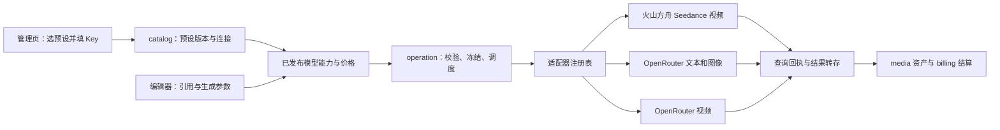

# AI平台接入市场调研与架构设计

## 1. 摘要

当前已确认执行切片为管理员开发 PoC：暂不设计成本与计费，直接使用宿主 Codex CLI、不启动容器，聚焦 Seedream、视频生成和本地 Codex 聊天/生图。较广云端扩展、通用聊天和网关 PoC 沿 BACKLOG 的暂缓边界；旧任务定义不扩大当前范围。

按既有来源及当前管理员 PoC 范围维护预设、连接、模型和执行恢复。

## 2. 参与者

使用者与参与职责：平台管理员及使用已发布模型的创作者。维护职责及确认人沿下方原来源记录；未给出姓名的，不补造人员或排期。

## 3. 背景

原始需求：[04-AI平台接入与预设管理需求](../requirement/04-AI平台接入与预设管理需求.md)。关联需求与验收：[03-AI平台接入与预设管理](../prd/03-AI平台接入与预设管理.md)。本文维护技术合同；相关实施步骤与证据见 Plan，状态与调度见 [BACKLOG](../../BACKLOG.md)。

### 3.1 文首来源与范围

需求来源：[需求04](../requirement/04-AI平台接入与预设管理需求.md)。原有两平台实现与运行限制见[设计07](#1-摘要)。原市场调研、已有云端协议合同与历史验证保留；现行扩展按第710节阅读，不能把既有实现状态套用到新增平台。

实施进度及调度字段见 [BACKLOG 第4.8节](../../BACKLOG.md#48-07-ai平台接入市场调研与架构设计文首来源与范围)。

### 3.2 已确认方向与现行基线

沿用“版本化平台预设 → 连接 → 模型发布组合 → 任务编排 → 协议适配器”。平台管理员统一管理云 Key 与本地运行节点；普通创作者使用授权范围内的已发布能力。复用 catalog、operation、billing、media，不增加独立网关服务。

原有基线是火山方舟 Seedance 视频及 OpenRouter 文本／图片／视频。此次扩展纳入 BytePlus、DeepSeek、本地 Codex，并补火山聊天／图片、多轮聊天及通用模型候选目录。具体范围与非目标以需求04第13节为准；BytePlus 视频仍为候选，个人／团队 BYOK、自动跨平台路由、独立音频和任意 Agent 工具执行未新增。

Seedance／Seedream 是模型系列。BytePlus 与火山方舟分别建预设、凭据和区域边界，协议可复用已验证部分，模型 ID、价格和权限不能推定互通。CC Switch 只提供预设接入参考；通用候选不自动变成真实账号可用模型。

### 3.3 原市场调研与备选（不作为现行交付名单）

目标用户是个人创作者、小型内容团队及维护生成服务的管理员。接入层成功标准：首次配置容易、能力不缩水、收费可解释、任务可恢复、模型升级不破坏已有项目。以下平台是采购/技术替代关系，也可能是合作供应商；CC Switch 为相邻工具。未获取可靠且可比的市场份额、融资、留存或市场规模数据，故不提供数字排名。

| 备选              | 定位、客户与获客方式                                       | 公开能力与优势                                | 对织光的局限/切换成本判断                                                | 商业模式与建议                                                                                        |
| ----------------- | ---------------------------------------------------------- | --------------------------------------------- | ------------------------------------------------------------------------ | ----------------------------------------------------------------------------------------------------- |
| BytePlus ModelArk | 模型原厂平台，开发者文档/控制台及企业销售                  | Seedance 原生任务接口，适合追踪原生能力       | 需逐账号核对开通；区域、模型参数和媒体获取约束必须显式处理               | 按模型用量/资源包；已纳入本次扩展，合同见第710节 [SRC-AI-01～SRC-AI-03]                               |
| OpenRouter        | 多模型聚合平台，以统一 API、模型目录和开发者生态吸引客户   | 模型发现与多供应商路由；已有独立视频任务 API  | 文本、图像、视频的协议能力不同；增加平台和上游两层故障定位               | 按用量；当前标准方案平台费标示 5.5%，具体收费基数/付款方式以账单为准；优先接入 [SRC-AI-04～SRC-AI-06] |
| fal               | 多媒体模型 API 与推理平台，模型页/SDK/开发者生态及企业销售 | 队列、查询、取消、回调；模型结果结构明确      | 每个模型的输入输出仍不同；运行中取消不保证立即停止                       | 按用量，具体模型价单独核对；作为第二阶段候选 [SRC-AI-07～SRC-AI-08]                                   |
| Replicate         | 托管模型平台，面向试验和部署模型的开发者                   | prediction 生命周期统一，覆盖公开与自部署模型 | 模型版本和输入结构需分别管理；专用部署增加运维/空闲成本                  | 多数公开模型按运行时间，部分按输入输出；私有专用实例可能计算空闲时间 [SRC-AI-09～SRC-AI-10]           |
| LiteLLM           | 自托管 AI 网关，面向多供应商治理团队，开源社区与企业支持   | 统一入口及路由、重试、限流等治理能力          | 额外服务运维；不能替代织光的素材、任务和计费语义；具体视频适配覆盖未实测 | 开源网关可免费自托管，企业能力付费；首轮借鉴机制，不直接引入 [SRC-AI-11～SRC-AI-12]                   |

表中的“局限”是针对织光适配成本的分析，不是客户满意度结论。上述五种方案覆盖原厂、聚合、多媒体托管、模型托管与自托管治理，没有虚构五个同质的直接竞品。

### 3.4 CC Switch 可以借鉴什么

官方添加指南描述了“选预设 → 填表”，预填名称/端点、输入 Key，以及自定义配置；模型发现依赖平台提供相应端点。指南也明确现有连接保存创建时的预设快照，不自动跟随预设更新。[CC Switch 添加指南](https://github.com/farion1231/cc-switch/blob/main/docs/user-manual/en/2-providers/2.1-add.md)

织光建议复用这种低配置负担的体验，再增加预设版本差异、任务引用保护、能力校验和计费约束。以下版本发布、派生副本、作用域与升级机制是织光建议，不声称 CC Switch 已完整实现。它主要管理本地 AI 工具配置；织光要处理多用户与长期生成任务，因此不照搬本地配置文件切换。

OpenRouter 自己也有保存模型、路由与生成参数的 Presets，但这是平台内推理配置，不应成为织光跨平台连接配置的唯一事实来源，也未据此确认它适用于视频端点。[OpenRouter Presets](https://openrouter.ai/docs/guides/features/presets)

### 3.5 差异化机会与经济性

建议织光强调“模型能力与创作素材一致、配置一次持续可用、费用和历史可追溯”。基础设施越来越容易聚合，长期价值应来自编辑器、多参考资产、项目上下文和可靠生成流程，而非平台数量。

成本比较使用同一模型版本、模式、分辨率、时长、音频及参考输入；记录供应商成本、平台费用、存储流量和人工恢复成本。建议指标为“总实际成本 / 被创作者接受的结果数”，并同时记录失败率和等待时间。没有统一样本和真实账单，不能认定直连或聚合一定更便宜。

未来 12～18 个月主要风险是模型参数/价格变动、聚合平台覆盖原厂能力、原厂强化工作流产品；机会是用稳定的项目和资产体验降低更换模型成本。上述为情景判断，不是市场增长预测。此轮不购买资源包、不进行收费对比实验。

### 3.7 接入边界

连接停用时仍可配置测试，旧任务按冻结凭据恢复；新提交不得使用已撤销凭据。后台逐请求及事务内复核当前平台管理员权限。保存模型版本不自动切换线上版本，目录和报价读取明确 release。参数与价格沿现有校验器和上游单位规范化，不能直接导入任意第三方 schema 或把 token 成本当秒价。

## 4. 目标

按既有来源及当前管理员 PoC 范围维护预设、连接、模型和执行恢复。目标的规则、量化条件与非目标沿需求原文及下方已确认设计，不增加未经确认的指标。

## 5. 使用场景

参与者为平台管理员及使用已发布模型的创作者；在下方定义的输入、对象状态、权限和环境条件具备时执行相应操作。各故事按其独立前置条件核对，不能把测试夹具当成真实业务条件。

### 5.1 管理交互与接口建议

管理页设“平台连接”“预设库”“模型配置”三个入口。连接列表展示名称、平台、区域、Key 末四位、启用状态、最近测试、可用能力和用量。详情可以更新 Key、验证、选择模型、设置默认及停用；不显示可复制的明文 Key。

添加流程：选预设 → 填 Key（名称自动生成）→ 保存并验证 → 查看开通模型/缺失条件 → 启用推荐配置。凭据可先保存为未验证，发现失败允许重试；配置/发现操作不得伪装收费生成。没有安全鉴权探测接口时显示“无法通过免费检查确认”，允许管理员在产品中明确确认的受预算约束试运行；没有账号与预算授权时不执行。

首轮固定每能力默认项；创建页仍显示实际模型、平台和估算费用。高级连接参数默认收起。手机抽屉转为全屏；未保存切换、重复提交、版本冲突、鉴权失败、额度不足、模型未开通各有独立状态。

| API 建议                                                     | 语义                                       |
| ------------------------------------------------------------ | ------------------------------------------ |
| `/api/admin/provider-presets` 列表/新建及详情编辑            | 管理草稿与非秘密元数据                     |
| `/api/admin/provider-presets/{id}/versions`                  | 发布不可变版本，校验 revision              |
| `/api/admin/provider-presets/{id}/archive`                   | 归档并保留引用                             |
| `/api/admin/provider-presets/import-preview`、`/{id}/export` | 校验导入和无秘密导出；预览不写入           |
| `/api/admin/providers`                                       | 扩展创建参数，原子实例化预设版本并记录快照 |
| `/api/admin/providers/{id}/credentials` 与测试接口           | Key 只写入；测试返回请求 ID，结果异步查询  |
| `/api/admin/providers/{id}/discover-models`                  | 发现候选模型，禁止自动发布                 |
| `/api/admin/providers/{id}/upgrade-preview`、`/apply-preset` | 差异预览与显式升级/回退                    |
| `/api/admin/models` 及版本/价格/状态接口                     | 确认模型能力与定价，再启用                 |

新建与发布使用幂等键；修改携带 expectedRevision，冲突返回 409；详细敏感信息不出现在错误体。所有授权在服务端执行。下方补充首轮请求/响应和事务边界；这些是目标合同，不能将候选路径写成现有可用 API。

实施进度及调度字段见 [BACKLOG 第4.9节](../../BACKLOG.md#49-07-ai平台接入市场调研与架构设计管理交互与接口建议)。

### 5.2 页面与操作明细

复用 `/providers` 作为“AI 平台”管理页，内含“连接”“预设”两个页签；模型配置沿用 `/models`。新详情可用 `/providers/{id}`、`/providers/presets/{id}`、`/models/{id}`；它们是拟新增路由。页面独有实现置于各自 `_components/`，共享表单和状态组件按实际消费者复用，复用 ProductShell、shadcn 和当前同站代理。

| 页面          | 内容与主要操作                                                                     | 关键状态                                                                           |
| ------------- | ---------------------------------------------------------------------------------- | ---------------------------------------------------------------------------------- |
| 连接列表      | 名称/平台/区域/启用、分项健康、Key 摘要、模型数；添加、编辑、测试、停用            | 空列表给已注册来源入口；网络失败显示重试，不伪装空；无权限不发管理查询             |
| 添加/连接详情 | 基础、Key、模型、验证记录、历史；步骤进度由服务端数据派生                          | 未保存提示；刷新从连接 ID 恢复；重复点击使用同一请求 ID；Key 输入成功后清空        |
| 预设库/详情   | 内置/自定义、搜索/筛选、版本、派生来源；复制、保存、发布、归档、导入导出、紧急停用 | 内置编辑入口为“复制并编辑”；发布 diff；引用占用时禁硬删；升级冲突逐字段选择        |
| 模型列表/详情 | 连接、能力、上游 ID、公开状态；基础/输入/参数/价格/验证/版本                       | 发现候选与已上线分开；变更先保存草稿；发布组合前列出阻断原因                       |
| 试运行        | 模型和模式、受授权素材、参数、估算/费用上限、提交按钮                              | 明确标注会产生费用；默认不自动执行；未知结果恢复原任务；管理日志不显示私有素材地址 |
| 默认配置      | 按文本/图像/视频选择有效 release；显示影响范围                                     | 停用默认项先替换或清空；清空后该能力明确不可用，不自动 fallback                    |

连接表单字段：名称（自动建议、可改）、平台（创建后不跨平台修改）、预设版本、区域、端点（高级）、并发/速率（高级）、Key（只写）、备注（非秘密）。更换平台创建新连接；避免把原凭据送到新供应商。自定义端点仅平台管理员能改，必须经过网络地址校验；从官方端点改成其他域名需要重新录入 Key 并新建凭据版本，不自动沿用旧秘密。

预设字段：名称、slug、平台 adapter key、能力协议集合、base URL、地区/处理地域、凭据字段固定声明、文档/控制台地址、模型模板、来源与说明。自定义只允许当前已部署注册的协议；新增平台须完成第710节适配后才能启用。连接配置不含 Key；可选模型模板包含管理员审核的模型 ID、能力配置、平台价格及上游成本来源，不含凭据、账号账单、私有素材或验证证据。含账号专属模型 ID 的模板仅能在管理员确认兼容的账号间使用；缺少权限时显示真实失败，不替换模型。

### 5.3 接入向导及中断恢复

1. **选预设**：火山方舟/OpenRouter；展示可提供能力和账号开通说明。后台模板若缺 model ID，只能说明还需模型配置，不把“只填 Key”变为无条件承诺。
2. **创建连接**：保存 disabled Provider 与配置快照；返回 ID/revision。连接创建与 Key 写入分步提交，失败可以留在原对象补 Key，不重复创建。客户端只在 URL/内存中保留 ID，Key 不写浏览器持久存储。
3. **保存 Key**：接收后加密；响应只返回 credential ID、last4 和安全结果。网络未知先用原 request ID 查写入回执；确认未接受才重新填写，不能凭空重试一个空 Key 或重复轮换。
4. **验证/发现**：分项展示 schema_valid、adapter_available、auth、discovery。probe=unsupported 不等于 Key 错；目录为空不等于鉴权失败。查不到账号目录时从内置模型模板/手动 ID 建候选。
5. **配置与试运行**：选择模型、确认模式/限制、保存版本、填写平台价规则；形成候选发布组合后，管理员明确确认试运行。试运行走 operation/billing，但用途固定 admin_validation，仅管理员可访问；不加入公开模型目录。
6. **启用**：查看验证证据、模式清单、价格版本与影响。原子启用所选组合和连接，可选设默认。未通过项目保持 disabled；多个模型允许逐项启用，不能显示整个连接“全部模型可用”。

向导刷新后的步骤来自 `GET provider detail` 和检查/发布记录；浏览器不保存待录入 Key。测试、发现、试运行各自有 ID、进度和终态，不用一条通用成功消息替代。创建/Key 写入跨刷新未知结果通过请求回执解决，界面不能只依赖 React 的 pending 状态。

### 5.4 模型配置合同

| 分组         | 必填/条件字段                                                               | 校验与显示                                                                 |
| ------------ | --------------------------------------------------------------------------- | -------------------------------------------------------------------------- |
| 身份         | connection ID、显示名、上游 model ID、capability、protocol                  | capability 为 text/image/video；不能仅凭名字推断；同连接按上游 ID+能力去重 |
| 输入模式     | modes、有序角色 definitions、媒体类型、每角色数量、总数/大小/时长、组合约束 | 未声明的角色不可传；按模式绑定限制；必需首帧不可被普通参考替代             |
| 参数         | 名称、类型、默认值、枚举或范围、required、单位、条件依赖                    | 显示 schema 转换为现有 ParamSchema 数组；默认必须合法；不透传未知键        |
| 输出/任务    | 输出类型/数量/格式、同步或异步、query/cancel/callback 支持、超时和轮询策略  | 取消需有合同；不能把支持查询当支持按客户端幂等键查回执                     |
| 上游端点策略 | 固定 provider/endpoint（若协议支持）、参数白名单、地域约束                  | 使用端点能力，不取并集；无法固定时只开放所有允许端点能力的交集             |
| 价格         | unit、currency、rule、外币汇率及来源日期、生效时间；成本来源                | 平台价格规则和上游成本分别展示；有效范围覆盖所有开放参数组合               |
| 验证/发布    | 模型/配置版本、模式覆盖、样本摘要、adapter 版本、价格版本                   | 显示哪些模式已验证；未覆盖模式不纳入该 release；保存不自动启用             |

模式间的参数/参考变化采用编辑器需求03的事务与确认规则，本模块只提供版本化能力合同。能力刷新不能直接改写草稿；报价冻结 release ID，确认再次检查有效性。当前 OpenRouter 图像文档的模型级支持参数是并集，必须将端点范围收窄或取交集，并验证实际投递策略；不能用 `require_parameters` 聊天字段猜测图像/视频路由行为。

后台默认推荐值优先使用审核过的模板；参数不适用时显示原因而不是偷偷补值。单纯发现新模型只形成候选；上游删除/变更模型给出差异告警，管理员确认新 release 或下架，历史任务仍保留原引用。

### 5.5 写入合同与结果恢复

下表为原云端接口目标合同；已有实现按设计07与生成合同核对，不能仅凭此表标为未实现。新增接口沿用 Handler 注解和生成调用流程，不手改生成文件。分页使用有界 cursor，limit 默认 20、最大 100；输入上限由统一校验常量覆盖并测试。

| 动作/路径                                                               | 请求关键字段                                                                                                                                  | 响应及规则                                                                                    |
| ----------------------------------------------------------------------- | --------------------------------------------------------------------------------------------------------------------------------------------- | --------------------------------------------------------------------------------------------- |
| POST `/api/admin/provider-presets`                                      | name、slug、parent_id?、draft_payload                                                                                                         | 201 id/revision；复制内置产生 custom，不复制凭据                                              |
| PATCH `/api/admin/provider-presets/{id}`                                | expected_revision、draft_payload/name                                                                                                         | 200 revision；仅草稿字段可改；发布版本不修改                                                  |
| POST `/api/admin/provider-presets/{id}/versions`                        | expected_revision、draft_hash                                                                                                                 | 201 version ID/hash；同事务校验与审计；草稿变化拒绝旧预览                                     |
| POST `/api/admin/provider-presets/import-preview` 与 `/imports`         | schema_version、payload；提交携带 preview_id/hash                                                                                             | 预览无业务写入；提交重新校验内容/目标版本；同 slug 冲突不静默覆盖                             |
| POST `/api/admin/providers`                                             | preset_version_id、name、allowed overrides                                                                                                    | 201 id/config_version_id/revision/status=disabled；不接受客户端 active                        |
| PUT `/api/admin/providers/{id}/credentials`                             | expected_revision、secret.api_key、rotation_mode                                                                                              | 200 credential ID/last4/revision；旧版按 normal→draining、emergency→disabled；密文不返回      |
| POST `/api/admin/providers/{id}/credentials/{cid}/test`                 | config_version_id、expected_revision                                                                                                          | 202 check_id；原有 test_id 可保留兼容投影；GET `/api/admin/provider-checks/{id}` 查询分项结果 |
| POST `/api/admin/providers/{id}/discover-models`                        | config_version_id、credential_id、capabilities                                                                                                | 202 check_id；返回候选批次与来源；不改变上线模型                                              |
| POST `/api/admin/providers/{id}/upgrade-preview` 与 `/apply-preset`     | target_version_id；应用时 preview_hash、expected_revision、字段选择                                                                           | 前者只读；后者创建新配置版本；不自动迁移已有模型 release                                      |
| POST `/api/admin/models/{id}/versions`、`/prices`                       | 既有字段及 expected_revision；版本 DTO 对齐现有 schema                                                                                        | 保存不可变内容，保持当前 active_release 不变                                                  |
| POST `/api/admin/models/{id}/releases`                                  | config_version_id、model_version_id、price_version_id                                                                                         | 201 候选 release；校验三者同属连接/模型；未验证不得 active                                    |
| POST `/api/admin/model-releases/{id}/validation-quotes`                 | mode、受授权输入、params、budget_cap                                                                                                          | 返回 quote/摘要/确认标识；确认复用受控任务入口，不能自动发起收费                              |
| POST `/api/admin/model-releases/{id}/activate`                          | expected_revision、expected_provider_revision、validation_ids、defaults_to_replace（含每项 capability/expected_revision/expected_release_id） | 原子启用组合/必要的连接状态/显式默认变更；需权限、证据及配置当前有效                          |
| PATCH `/api/admin/capability-defaults/{capability}`                     | release_id 或 null、expected_revision                                                                                                         | 200 revision；不接受无能力匹配的 release；引用状态在事务中复核                                |
| POST `/api/admin/provider-presets/{id}/archive` 或 `/emergency-disable` | expected_revision、reason                                                                                                                     | 归档停止采用；紧急停用阻止新派发；恢复是显式操作并复核资格                                    |

另保留详情/列表、未引用草稿 DELETE、连接 PATCH 停用/归档、release 停用/回退接口。回退通过激活已存在且仍有效的 release，不改旧版本内容；默认替换使用同样并发控制。首轮 UI 不暴露第三方私有端点/Key 的导入快捷路径。

所有改变状态的请求有客户端 UUID 请求标识；服务器按 actor+操作类型+目标+请求 ID 保存安全回执。原标识相同内容返回原结果，不同内容返回 409。含 Key 的请求摘要使用服务端带密钥摘要而不是将明文/裸 hash 写入回执。回执读取 `/api/admin/config-requests/{request_id}?action=...&target_id=...` 同样检查平台管理员及原操作者；不返回 secret。

客户端在首次请求前持久化非秘密请求标识及目标；恢复会话并核权后查询回执。Key 本身仅在内存，不随草稿保存。写入事务成功与回执提交同事务；没有回执且仍无法排除在途请求时保持待核实，可用原键查询/重放而不生成新键。目标保留创建 request ID/credential write request ID，普通缓存回执过期仍能定位最终结果。

错误分类：401 未登录、403 非平台管理员、404 对象不可见/不存在、409 版本或幂等冲突、422 字段/能力/上线前置条件不满足、429 本地限流、503 执行端不可用。上游错误映射成 `auth_failed`、`permission_denied`、`quota_exceeded`、`rate_limited`、`unsupported`、`unreachable`、`unknown_submission` 等安全码；HTTP 200 的失败检查仍显示真实分项失败。

### 5.6 AI 服务接入页面与组件设计

本节为 2026-10-18 的页面设计补充；依据现有 PRD03、API 合同、共享顶栏设计09及 shadcn/Radix Nova。`providers` 保留既有连接、预设与 Key 接口，根据本轮用户反馈改为服务卡片、折叠预设维护、接入 Dialog、详情与预设编辑 Sheet，加载和空态复用官方组件。设计、前端工程验证、真实管理接口读取与真实供应商接受分别记录；页面实现不代表已配置可用模型或通过供应商验收。

Figma：[页面与交互](https://www.figma.com/design/uLqmeRWuQuzfrp9xOYg6FT/Glowloom?node-id=687-26546)、[组件与状态](https://www.figma.com/design/uLqmeRWuQuzfrp9xOYg6FT/Glowloom?node-id=686-25530)。包含连接列表、接入弹窗、预设管理、详情抽屉、状态恢复、三种手机视图及结构化预设编辑；连接/预设切换、打开与关闭入口可在原型中查看。组件使用可编辑文本、矢量图标和实例，不包含整页贴图。

### 5.7 页面框架与信息层级

- 对应 `/providers`，产品显示名“AI 服务接入”，仅平台管理员可见；普通创作者及团队管理员不开放配置权限。沿用 BasicLayout、纯导航 Sidebar、无底边框 ProductHeader、全局 Command 搜索、主题与账号入口。默认深色，复用 Neutral token、Geist 与中文系统字形，不加入品牌渐变、营销配色、积分、会员或概览统计卡。
- 2026-10-21 按用户反馈重新收敛页面：标题“AI 服务接入”配“仅管理员”标记，主操作为“接入服务”，保留模型管理链接；默认只呈现服务卡片。预设管理折叠为次级维护入口，不再占据一级 Tabs。既有 Figma 为历史参考，本轮实现以本节更新为准，尚未回写 Figma。
- 服务卡片展示名称、区域、连接检查状态、Key 安全摘要与模型数量。停用及保存待确认优先显示；模型数量不代表已发布。协议标识、配置版本、文件格式及解释正文不放在默认列表。
- 预设管理展开后提供名称、区域、使用入口；复制、编辑、导出等操作进一步折叠到每项“维护预设”中。预设版本与端点在编辑及配置详情中按需查看。四个内置云平台以服务端返回为准，不硬编码可用性。
- 全局搜索负责导航及当前页已加载连接/预设检索；未接入全量搜索时提示检索范围，不把前端筛选冒充服务端全量搜索。列表与预设分页继续保留现有合同。

### 5.8 新建与详情

“接入服务”打开 Dialog：标题、平台预设选择、API Key、可选设置与固定操作区。预设选择为受控单选项，展示平台名称和区域；不可用/归档/紧急停用预设不进入可选列表。先选预设再填 Key。默认自动命名，“连接名称”放入 Collapsible 可选设置；普通路径不要求 URL、协议、slug 或 JSON。Key 采用 Field + InputGroup/密码输入，显示切换按钮有可访问名称，不自动填入已有 Key；Key 旁仅提示“加密保存”。候选模型使用可展开选择区并显示选中数量，简短标记“草稿，需验证后启用”，不展开模型接入文档。底部仅提示“保存不会产生生成费用”。。

主要按钮为“保存连接”，提交中使用 Spinner 并阻止重复提交。连接创建成功后再写入 Key；创建请求未确认时不得继续写 Key或新建另一连接。Key 写入结果未确认时保留非秘密连接标识与查询恢复入口，不持久化密钥，不用新幂等键盲目重发。只有确定尚未写入时要求重新输入 Key 并补齐同一连接。保存成功读回后关闭弹窗、选中该连接并显示一次 Sonner；连接仍待检查和发布，保存不触发收费测试或自动启用。

点击连接打开右侧 Sheet，桌面宽约 520px、窄屏占可用宽度。标题区展示连接名称和区域；概览、API Key、高级配置使用 Tabs。概览优先提供 Key 与最近检查两项摘要，检查发生后再提供真实分项结果；“检查连接”明确为非生成检查，不把不支持的检测写成成功；“模型管理”前往该连接模型。Key 仅展示安全摘要及状态，替换使用新输入并遵循旧凭据 draining/撤销合同。配置显示绑定预设版本与端点；升级先显示差异，应用不静默修改已发布模型或在途任务。

行菜单使用 DropdownMenu：查看详情、模型管理、可用的重命名/停用操作。停用与紧急撤销使用 AlertDialog，说明停止新任务和历史任务恢复的实际影响；不将普通停用等同于立即销毁旧 Key。已停用连接不出现误导性的再次停用操作。

预设编辑使用 Sheet 与 FieldGroup/Field，基础名称、已支持协议、区域和端点为结构化控件；模型模板从现有发布复制或在专门区域编辑，JSON 仅置于高级导入/预览。内置预设只读，主要操作是复制为自定义预设；升级/归档和紧急停用沿用既有预览、版本和授权边界。

### 5.9 状态与恢复

| 状态                 | 页面表达与操作                                      | 官方组件               |
| -------------------- | --------------------------------------------------- | ---------------------- |
| 首次加载             | 保留 BasicLayout，正文相同结构骨架，无虚假连接数量  | Skeleton、Card         |
| 空连接               | 简短“还没有连接”，一个“接入服务”按钮                | Empty、Button          |
| 加载失败             | 一次 Sonner；正文仅保留恢复入口，不挤出红色横幅     | Sonner、Empty、Button  |
| 保存中               | 字段和提交受控禁用，按钮“正在保存…”                 | Field、Spinner、Button |
| 连接已建、Key 未写入 | 持久显示“Key 未配置”，继续同一连接                  | Badge、Field、Button   |
| 保存结果未确认       | 持久状态“保存待确认”，查询原回执；不直接声称失败    | Badge、Button、Sonner  |
| 检查进行中           | 单一 Spinner 和“正在检查”，保留已有列表             | Spinner、Badge         |
| 检查失败/不支持      | 列表留真实状态，详情显示分项原因，操作错误用 Sonner | Badge、Item、Sonner    |
| 无权限               | 不渲染配置或安全摘要，可返回创作                    | Empty、Button          |
| 版本冲突             | 保留输入、重新读取并复核差异，拒绝自动覆盖          | Dialog/Sheet、Sonner   |

### 5.10 响应式与组件落点

桌面继承现有 240px 侧栏和 64px 顶栏，不另起管理后台。正文最大宽度 1024px，桌面边距 32px、手机 16px；服务卡片两列，名称允许换行。小于 640px 改为一列连接卡片，每行仍能读到名称、状态及操作；Sidebar 使用原抽屉，不叠加第二套导航。320/390px 下弹窗保留两侧约 16px，表单单列，视口矮时内部滚动，操作按钮可见；手机交互目标至少 44px。弹层使用组件定位，不手动计算 top/left 或修改 body 滚动锁。

| 设计组件                          | 前端对应                                    | 责任                             |
| --------------------------------- | ------------------------------------------- | -------------------------------- |
| AIService/PageHeader 与预设折叠区 | `providers-page.tsx`，共享 BasicLayout      | 标题、视图与主要操作             |
| AIService/ConnectionCard          | connection-list.tsx，article、Button、Badge | 真实连接摘要与菜单               |
| AIService/PresetCard              | providers 页面私有组件，Card                | 平台摘要、使用入口与折叠维护     |
| AIService/ConnectDialog           | 重组 `preset-connect.tsx`，Dialog/Field     | 两阶段保存、Key 内存和原请求恢复 |
| AIService/ConnectionSheet         | 重组 `connection-detail.tsx`，Sheet/Tabs    | 检查、Key 生命周期与配置版本     |
| AIService/PresetEditor            | `preset-editor.tsx` 与 `preset-models.tsx`  | 结构化预设和模型模板             |
| AIService/Status                  | 现有 Badge/Spinner 和安全状态映射           | 文本与图标共同表达状态           |

设计稿中的连接名与检查结果仅为状态示例，不代表真实账号、已验证模型、费用或供应商接受。操作图标使用现有 Lucide 矢量；依据需求04 SRC-AI-29，接入预设名称前展示本地供应商品牌标识，保留名称文字，不使用截图或图片拼装控件。Logo按适配器标识匹配，不依据可编辑名称猜测品牌；未知适配器使用通用图标。标识保留等大空间、按原比例显示，并适配明暗主题；不改变平台单选与跨分类模型多选。焦点、键盘、关闭返回触发器和读屏名称使用官方原语。正式实现前应以本节与 Figma 确定的组件/状态逐项对照；不得仅为通过测试放宽权限、回执或发布门禁。

## 6. 价值

明确模型、凭据、运行端与真实接受边界，避免重复派发和虚假可用状态。

## 7. 方案

### 7.1 平台协议核验与设计影响

| 关注点              | 已核验公开事实                                                                                                          | 织光设计影响                                                 |
| ------------------- | ----------------------------------------------------------------------------------------------------------------------- | ------------------------------------------------------------ |
| BytePlus 地址/鉴权  | ModelArk 文档给出 `https://ark.ap-southeast.bytepluses.com/api/v3`，使用 API Key [SRC-AI-01]                            | 作为该预设默认地址；区域独立存储，不能用火山 Key 直接替代    |
| Seedance 提交       | `POST /contents/generations/tasks`，内容与参数按具体模型定义 [SRC-AI-02]                                                | 使用 Ark 视频适配器；按模型核对参考角色/数量/时长            |
| BytePlus 恢复/媒体  | 查询 `/contents/generations/tasks/{id}`；文档标注查询近 7 天任务、视频 URL 有效期 24 小时，取消仅限排队任务 [SRC-AI-03] | 结果及时转存；过期和取消失败单独处理；不把删除记录当停止运行 |
| OpenRouter 视频     | 独立 `/api/v1/videos` 异步提交，视频模型目录、查询及 content 下载接口 [SRC-AI-04]                                       | 与聊天接口拆开；下载凭据仅发往核验过的 OpenRouter 原站       |
| OpenRouter 文本路由 | Chat Completions 文档提供供应商排序、fallback 与参数支持约束 [SRC-AI-05]                                                | 只在相应适配器采用；不默认套给视频                           |
| fal 队列            | 排队与运行中取消语义不同，媒体响应结构按模型变化 [SRC-AI-07]                                                            | `Cancel` 返回结果而非布尔成功；每模型解析输出                |

OpenRouter 视频文档区分首尾帧与参考图，且说明视频不适用 ZDR；因此“支持视频输入”不代表“支持视频生成”，聊天隐私设置也不能直接复制到视频。其取消接口和其他扩展能力，在未完成专项核验前按不支持处理。[OpenRouter 视频文档](https://openrouter.ai/docs/guides/overview/multimodal/video-generation)

BytePlus 英文页面部分正文依赖 JavaScript，此轮结合官方搜索索引、API Explorer 和查询任务文档交叉核对；对未取得完整正文的字段不写死。此次没有账号验证、生成质量或延迟实测。最新型号不作为硬编码默认值；首批确切模型 ID 在接入时从已开通目录核验并冻结。

### 7.2 已有火山方舟与 OpenRouter 执行合同

已有云端预设固定火山方舟北京区 `https://ark.cn-beijing.volces.com/api/v3` 和 OpenRouter `https://openrouter.ai/api/v1`。前者的地区字段为 `cn-beijing`，现有 `region=domestic` 继续表示处理区域类别；两字段不得混用。OpenRouter 的入口不代表全部上游有相同处理地域，目录显示海外/依上游策略，不能承诺数据本地化。

| 执行能力           | 协议边界                                                                    | 首轮接受范围                                                                    |
| ------------------ | --------------------------------------------------------------------------- | ------------------------------------------------------------------------------- |
| 火山 Seedance 视频 | `POST /contents/generations/tasks`；GET 同路径 `/{id}` 查询；Bearer API Key | 至少一款开通型号的文生视频、首帧图生视频；首尾帧/多参考按声明支持的模式逐项验证 |
| OpenRouter 文本    | Chat Completions；与视频分开的请求、用量和响应处理                          | 至少一款已开通模型的非流式文本生成；不因此新增完整聊天产品或 Agent 工具执行     |
| OpenRouter 图像    | 独立 `POST /images`；图像目录及端点能力；响应图片解码/转存                  | 至少一款型号的文生图；声明支持参考图时另测角色与数量                            |
| OpenRouter 视频    | `/videos` 异步任务及 content 结果获取                                       | 至少一款型号的文生视频；取消能力没有完整合同证据时关闭                          |

火山提交/查询路径及 API Key 来自[创建任务](https://docs.volcengine.com/docs/ark/create-video-generation-task-api?lang=zh)和[查询任务](https://docs.volcengine.com/docs/ark/get-video-generation-task-api?lang=zh)。火山查询文档说明任务查询窗口与媒体地址有效期，适配器应及时转存，并区分排队取消和运行中任务。本轮不将 BytePlus 字段直接视为火山合同。

OpenRouter 图像官方文档现有专用 Image API；模型层能力可能是多个端点的并集，具体端点能力才是有效约束。不能把图像全部按聊天响应解析。[OpenRouter 图像生成](https://openrouter.ai/docs/guides/overview/multimodal/image-generation)

本基线是本次细化的交付定义；具体 model ID/模式、协议响应及价格通过计划 T-AI-01 固定。上游尚未核验的附加模式保持关闭，不能因模板中列出了能力就全部放行。接口兼容性由适配器测试证明；未来新增型号的普通配置变更不要求新增一套平台。

非生成检查：OpenRouter 可用 `GET /key` 核对当前 Key 元数据，再独立获取模型目录；目录成功不等于 Key 有权限。火山免费鉴权/账号可用目录的确切协议尚未核实，T-AI-01 需要确认；没有可证明无生成成本的接口时返回 unsupported，采用内置模板或手动模型 ID，再通过管理员明确确认的试运行证明能力。不索取云账号 AK/SK 以绕过该限制。[OpenRouter 当前 Key](https://openrouter.ai/docs/api/api-reference/api-keys/get-current-api-key)

### 7.3 推荐设计模式与模块边界

| 模式                | 解决的问题                     | 建议落点与边界                                                                                     |
| ------------------- | ------------------------------ | -------------------------------------------------------------------------------------------------- |
| Adapter + 防腐层    | 上游参数/状态/错误不一致       | 平台 DTO 在 adapter 内转换；业务层只使用明确的输入、结果与错误类型                                 |
| Registry + 简单工厂 | 避免业务代码散布平台名称分支   | 通过已注册的协议键和能力找执行器；无需抽象工厂类层级或动态插件加载                                 |
| Strategy            | 不同能力的连接选择             | 首轮固定选择；有真实需求再引入优先级、预算和健康筛选                                               |
| 组合与小接口        | 同步、异步、查询、取消能力各异 | 消费方定义 `Submit`、`Query`、`Cancel`、`DiscoverModels`、`Probe` 小接口；不要求所有平台实现伪方法 |
| 版本快照            | 管理员修改配置不改变运行任务   | catalog 发布不可变配置版本，operation 保存引用和必要快照                                           |
| 状态机 + Outbox     | 提交不确定、刷新恢复、回调重复 | 复用现有工作流与事务事件；以任务尝试和回执身份去重                                                 |

不推荐首轮为每个平台建立微服务，也不引入“万能 JSON 请求模板执行器”。模板只描述允许的数据；协议转换、鉴权和计费语义必须由可测试代码负责。共享重试、限流、观测可用组合包装，不建立继承式 BaseProvider。

应用层选中执行器后先校验完整参数和参考，再生成上游 DTO；`context.Context` 沿调用传递。公共重试包装器默认只重试安全查询，提交是否可重试由适配器返回的确定性证据决定。

### 7.4 数据对象与配置合并

以下是逻辑字段建议，不是已执行的数据库 Schema。既有数据必须用单独审阅的增量迁移，不重放初始化 SQL。

| 对象                                   | 主要字段                                                                                                                  | 生命周期                                                          |
| -------------------------------------- | ------------------------------------------------------------------------------------------------------------------------- | ----------------------------------------------------------------- |
| ProviderPreset / PresetVersion（新增） | 稳定 ID、名称、来源、版本、adapter/protocol、base URL、区域、credential schema、model templates、更新时间、最小适配器版本 | 草稿 → 发布 → 停用/归档；已发布版本不可变                         |
| Provider 连接（扩展现有）              | preset/version 引用、名称、非秘密 config snapshot、显式 overrides、状态、revision、配额                                   | 同一预设可实例化多个 Provider；初始停用；不另建同义 Connection 表 |
| Credential（复用）                     | 连接 ID、密文、key ID、末四位、版本/状态、测试摘要                                                                        | 轮换后旧版 draining；撤销不可恢复；仅执行端解密                   |
| ModelProfile/Version（复用）           | ProviderID、上游 model ID、模式、限制、参数 schema、输出、能力证据、版本                                                  | 从模板实例化到连接；已发布不可变；目录同步先产生差异              |
| 默认配置（最小新增）                   | 能力、release ID、revision（连接/模型由 release 关联）                                                                    | 首轮每能力一个默认项，无复杂路由 DSL                              |

有效配置规则：`预设指定版本的默认值 + 显式连接覆盖 + 请求中允许的参数`。不是任意深层 JSON merge：请求不能覆盖地址、鉴权头、区域、归属、价格或权限；数组整体替换并重新验证；`null` 与未提供必须分开定义。不支持字段直接报错，不静默丢弃。

当前代码内置预设：`volcengine-ark` 与 `openrouter`，分别映射现有 adapter key `volcengine_ark`、`openrouter`；执行协议由能力再细分。BytePlus 不自动导入或替换现有连接。OpenRouter 连接引用同一账号凭据，按能力选择不同协议执行器，避免让用户重复添加相同 Key。

模型模板保留配置来源和人工审核时间；真实验证证据绑定连接、凭据及发布组合，不随模板复制；模型公开可发现、账号有权使用、织光已适配、近期试运行成功是四件事。精确支持范围由“平台 + 模型版本 + 能力/模式 + 区域”共同决定。

### 7.5 预设管理与升级

内置预设随应用发布，后台可归档/隐藏或另行紧急停用；修改时复制为自定义派生预设。自定义预设只能引用已经安装的协议。发布前静态校验结构、域名、凭据字段、参数 schema 和适配器兼容性；新配置保持未验证状态。

升级页面对比旧预设、新预设、连接覆盖值：无冲突字段可预选，有冲突字段逐项决定；改变地址或协议必须重新测试。应用升级创建连接配置新版本，不修改运行任务。回退选择可用旧版本，重新验证；不能回退到已撤销密钥或不可用模型。安全紧急停用另有明确操作，不借普通升级偷偷切换。

JSON 导入导出携带 schemaVersion、来源与版本，仅含可移植非秘密字段；拒绝脚本、未知协议和危险地址。重复导入不覆盖同名对象，需显示新增/冲突预览。引用中的预设只能归档；未引用草稿可删除。

### 7.6 持久化与上线发布组合

下表保留已有云连接的目标数据合同，后续实现状态以源码和设计07为准；本次不执行迁移或修改 schema.sql。第710节新增候选／运行时字段尚待实施，不引入新的配置服务。

| 对象                            | 最小字段及约束                                                                                           | 写入/引用规则                                                                                     |
| ------------------------------- | -------------------------------------------------------------------------------------------------------- | ------------------------------------------------------------------------------------------------- |
| `provider_preset`               | UUID、唯一 slug、name、origin=builtin/custom、parent_id、lifecycle、revision                             | 内置来源不可伪造；草稿更新 CAS；发布、归档、紧急停用有独立审计动作                                |
| `provider_preset_version`       | UUID、preset_id、version_no、schema_version、非秘密 payload、content_hash、created_by/at                 | 唯一 `(preset_id, version_no)`；payload 通过白名单结构校验；已发布只读                            |
| `provider_config_version`       | UUID、provider_id、preset_version_id（旧配置可空）、version_no、effective_config、overrides、config_hash | 唯一 `(provider_id, version_no)`；引用的预设保留；端点/协议配置不可原地修改                       |
| 现有 `provider` 扩展            | current_config_version_id、lifecycle（可归档）、revision；现有 status 保留 active/disabled               | 初始 disabled；激活不等于所有模型自动上线；同平台多连接 key 唯一                                  |
| 现有 `provider_credential` 调整 | 状态 active/draining/disabled；凭据 UUID 即版本身份                                                      | 每连接最多一个 active；draining 只能供绑定的历史任务恢复；disabled 不能使用；末四位仅供管理员识别 |
| `provider_check`                | UUID、provider/config/credential 引用、kind、状态、分项结果、时间、expires_at、safe_error                | 返回 operation-independent 测试 ID；仅保存诊断元数据，不存请求密钥或完整外部响应                  |
| 模型候选                        | source、upstream_model_id、capability、raw_catalog_hash、normalized fields、发现时间                     | 有界候选批次；不自动创建 active 模型；重复发现按连接+能力+上游 ID 去重                            |
| `model_validation`              | UUID、config/model/credential/adapter version、mode、input_digest、operation_id、result、validated_at    | 验证覆盖精确模式；真实样本在有权限资产中保存，不写进公开目录                                      |
| `model_release`                 | UUID、model_id、model_version_id、price_version_id、config_version_id、validation_ids、revision/status   | 一个上线组合引用同一模型/连接；价格生效期满足；历史组合不可改内容，状态可停用                     |
| `capability_default`            | capability、release_id、revision                                                                         | 首轮平台级唯一 capability；不按团队覆盖；只指向可用组合                                           |

`model_profile.current_version_id` 作为最近保存的版本，目标新增 `active_release_id` 供创作者目录使用。默认项固定 release_id；新组合启用时，界面列出哪些默认项仍指向旧组合，管理员明确选择替换，事务同时更新组合状态及所选默认项。未替换的旧默认只要仍可用就保留；若显式停用旧组合，必须清空或替换引用，不能隐式路由到另一平台。

价格仍用现有 price_rule_version；上游成本信息与平台售价分别展示。实际成本不直接等于用户扣费。外币价必须具备带日期/版本的汇率和既有价格单位映射；无法报价的模式不能启用。模型定义、价格、连接配置都冻结在 release 中，quote/confirm 使用同一组合；价格更新形成新组合并要求重新报价。

新提交准备时绑定当时 active credential ID；轮换不改已有绑定。已派发恢复使用 `ResolveCredentialForOperation(operation_id, credential_id, action)` 的消费方接口：核实任务与连接绑定，只允许 query/cancel/download，确认未撤销；不提供任意凭据读取 API。旧凭据引用清零且无不确定任务后才可清理。诊断测试走管理员授权的独立入口，可对 disabled 连接测试，不借此打开普通提交。

事务锁序由 T-AI-02 固定为权限快照 → preset 紧急状态 → provider → 相关凭据 → model/default → operation/预算；仅锁实际涉及对象，同类对象按 UUID 排序。停用与 BeginProviderDispatch 必须竞争相同资格锁。审核/下载等慢网络操作在事务外进行，通过短事务记录意图和结果；不得持有数据库锁等待上游。

配置版本的 current 指针是新候选的编辑基线，不让旧 release 自动改用新配置。应用预设升级后，界面标记“尚未应用到已上线模型”，管理员为需要迁移的模型生成新组合、验证后启用；未迁移组合仍使用旧配置，除非被明确停用。不能把 current 指针变化作为旧 release 自动作废的依据，也不能把旧 Key 发到升级后的新域名。

管理员试运行的准入仅放宽“候选未公开/连接未启用”两项，仍强制平台管理权限、素材授权、有效凭据、执行器/网络地址限制、预算和幂等。预设紧急停用、连接归档、Key 撤销等明确阻断状态不能被 admin_validation 绕过。新 Key 未经鉴权验证且免费探测 unsupported 时，试运行本身可验证身份；一旦获得明确 auth_failed，就应先修复 Key，不能自动反复收费尝试。

### 7.7 旧数据与回退

旧 Provider 保留 ID、凭据和历史模型引用，转换成来源 legacy 的配置版本，不凭名称猜测它属于哪个内置预设；不能更换成首批平台或复制为新账号。原 active 状态仅作为迁移记录，新增准入先在影子检查中列出缺少的配置/版本/证据，原执行链路在切换评审前保持原策略；逐连接完成核对才切到新 release。新建连接始终使用新规则，未核对旧连接不自动加入新预设目录或成为默认项。

迁移先加可空字段和新表，回填只处理可证明的关联；模型仍有不明字段时保持 legacy，不伪造 verified。切换前用隔离库验证当前 worker 与在途任务的读取兼容。回退应用与指针时保留新增引用/历史/账单，不删表；旧程序不能正确处理 draining 或新工作流版本时，不允许直接退回，应先停新提交、保留兼容 worker 恢复旧任务。

### 7.8 任务、重试、凭据与成本

1. operation 校验用户/项目权限、连接状态、素材授权和模型能力；固定连接配置、模型/价格版本，形成报价与预算预留。
2. 工作流仅携带非秘密配置及凭据引用；短时 activity 在调用前取凭据。现有合同允许携带加密凭据，实施时需核验实际 payload 路径与 Temporal 历史保留，不能仅凭类型注释宣称完全隔离。
3. 持久记录请求标识后提交。服务端幂等键只能防本地重复，不能推断上游支持幂等；需要协议证据后才能原键重投。
4. 获得任务 ID 后查询原平台；提交结果未知时先查证。如果平台不能按客户端标识查询且任务 ID 丢失，进入人工/对账恢复，不自动重投或跨平台 fallback。
5. 回调验签与重放保护、任务绑定检查、重复事件去重后唤醒查询。未核实签名方案的平台，回调只作提示，主动查询确认，不凭裸回调结算。
6. 上游生成成功后转存到受控资产库；转存失败可重试下载，不重新生成。持久保存后完成用户可见结果；上游已产生的成本独立记录，不能因下载失败假定免费。
7. 取消分为“请求取消”“确认取消”“未取消”“未知”，按上游最终事实结算。停用连接阻止新提交，保留恢复旧任务能力；紧急撤销 Key 导致不可恢复时需明确提示。

推荐状态扩展说明：`prepared → submitting → accepted/running → succeeded → ingesting → completed`；`submitting → unknown → reconciliation`。这是设计状态图，不是现有枚举变更。失败、取消和过期按适配器映射，unknown 不能当作失败退款并自动再生成。

Key 轮换默认保留旧凭据供已有任务恢复，到所有引用结束再停用；紧急泄露撤销优先，不能为恢复任务继续使用已撤销 Key。新 Key 是否可查旧任务须确认同一账号权限，禁止任意换账号查询。

成本记录建议包含币种、计费单位、预估来源/时间、上游原始 usage 的安全规范化结果、实际成本及平台结算版本。平台展示余额仅在官方接口支持时提供；不支持显示未知。自动 fallback 如后续引入，必须同时满足能力等价、数据地域、预算和未产生不可确定收费的条件。

### 7.9 预设驱动接入

本次重新核对 [CC Switch 添加手册](https://github.com/farion1231/cc-switch/blob/main/docs/user-manual/en/2-providers/2.1-add.md) 和 [OpenRouter Quickstart](https://openrouter.ai/docs/quickstart)。CC Switch 的预设自动填充连接配置，用户填写密钥；OpenRouter 用统一入口与 Key、显式模型标识发请求。借鉴的是预设与凭据解耦、复用配置和统一调用边界，不据此推断任意中转站具备相同多媒体协议。以下是织光设计决定。

`PresetDocument` 新增可选 `model_templates`（最多16个）。每个模板是无身份、无凭据的值对象：模板 key/name、capability、provider_model_id、modes、limits、param_schema、expected_max_ms、price（unit/rule/currency/fx_rate_to_cny）、upstream_cost（currency/max_micros/source/reviewed_at）。沿用版本1的可选字段扩展；旧预设省略此字段仍有效，空模型模板不作可生成承诺。

预览、保存预设及实例化时复用模型参数和价格校验。预设文档总大小最多256 KiB，未知/重复字段及秘密字段拒绝导入。模板参数与实际执行共用协议参数白名单，避免模板接受 `api_key`、鉴权头或执行器不支持的字段。连接创建在原有幂等事务内保存 provider/config、停用模型、不可变模型版本/价格版本和 draft release；release 绑定新 config，没有验证记录，没有默认切换。模板只支持该协议已实现的能力/模式/价格单位；异常时整笔回滚。连接摘要与回执仅含新对象ID。Key 使用既有凭据接口加密写入，沿用带密钥请求摘要，不并入预设JSON或连接创建的普通指纹。

前端添加连接的基础输入为预设和 API Key，名称折叠到可选设置。创建和保存 Key 的请求标识分别恢复；未知创建不继续写 Key，未知写 Key 不重复新建连接。刷新可用 URL 中非秘密连接ID回到原详情补齐，Key 必须重新输入。预设编辑使用结构化连接表单及“从现有发布复制模型模板”；高级JSON继续走严格预览，修改后使旧预览失效。模型配置/价格模板修改只生成预设新版本，不回写已有实例；当前升级页只处理连接配置，界面明确说明。

### 7.10 五类来源与通用模型预设设计（2026-10-20）

本节承接需求04第7.9节；具体字段与交互为方案，尚未编码。已有模板及运行绑定继续兼容，不为填充候选目录伪造价格、权限或生成结果。

### 7.12 CC Switch 参考与项目取舍

2026-10-20 核对[官方添加指南](https://github.com/farion1231/cc-switch/blob/main/docs/user-manual/en/2-providers/2.1-add.md)：其预设填充端点和模型映射，支持模型发现，连接保留创建时快照。以下右列是织光设计决定。

| 可借鉴机制           | 织光中的应用                                                          |
| -------------------- | --------------------------------------------------------------------- |
| 选预设后填表         | 先选平台，再选常用模型；云端填Key，本地选运行节点；协议、ID和端点预填 |
| 按名称／别名查找     | 供应商与模型分别搜索，聊天／图片／视频及用途标签筛选                  |
| 显示名与请求模型映射 | 分别保存display_name与provider_model_id；同名跨平台仍是不同执行配置   |
| 发现与手动配置互补   | 按平台注册的目录端点发现；不支持时选内置候选或手填，不硬套/v1/models  |
| 预设版本快照         | 目录更新显示差异；已有连接、发布和任务不自动升级                      |

不照搬其个人工具全局切换、角色模型别名或本地反向代理；织光按能力默认和明确发布组合执行。CC Switch资料可帮助发现候选，但模型ID／协议／价格事实以供应商官方资料为准。此次未复制其代码或配置数据。

### 7.13 首批通用模型候选清单

目标是覆盖常用创作任务，以下为建议初始目录，不是性能排名或“最新型号”承诺。2026-10-20 已读取 OpenRouter 公共 `/api/v1/models` 与 `/api/v1/images/models`，下列明确ID在对应目录出现；DeepSeek ID由官方模型目录核验。目录公开不证明本平台账号开通。

| 模板键（建议）                   | 来源／显示名称                      | 请求模型ID或选择方式                    | 用途与发布边界                                             |
| -------------------------------- | ----------------------------------- | --------------------------------------- | ---------------------------------------------------------- |
| ds-flash                         | DeepSeek / Flash                    | `deepseek-flash`                        | 通用文本聊天；浮动别名；图像理解不自动开放                 |
| ds-pro                           | DeepSeek / V4 Pro                   | `deepseek-v4-pro`                       | 推理文本聊天；以运行时目录和官方更新核验有效性             |
| or-gpt-chat                      | OpenRouter / GPT-5.4                | `openai/gpt-5.4`                        | 通用聊天；首期只开放已适配文本输入                         |
| or-claude-chat                   | OpenRouter / Claude Sonnet 4.6      | `anthropic/claude-sonnet-4.6`           | 通用聊天；不混同Anthropic直连账号                          |
| or-gemini-chat                   | OpenRouter / Gemini 3.1 Pro Preview | `google/gemini-3.1-pro-preview`         | 聊天候选，标记preview，默认不作为正式默认模型              |
| or-gpt-image                     | OpenRouter / GPT Image 2            | `openai/gpt-image-2`                    | 文生图／参考生图；走专用图片API                            |
| or-gemini-image                  | OpenRouter / Nano Banana 2          | `google/gemini-3.1-flash-image`         | 文生图／参考生图；图片目录当前n上限为1，不套用通用多图上限 |
| or-seedream                      | OpenRouter / Seedream 4.5           | `bytedance-seed/seedream-4.5`           | 图片候选；与火山／BytePlus同系列分开发布                   |
| ark-chat / ark-image / ark-video | 火山方舟 / 豆包、Seedream、Seedance | 从账号开通目录选择精确模型或Endpoint ID | 平台及用途槽位已明确；未核验的ID不填写，不产出可提交模板   |
| bp-chat / bp-image               | BytePlus / 文本、Seedream           | 从BytePlus账号目录选择精确ID            | 海外账号、地区及参数独立核验；不复制火山ID                 |
| codex-chat / codex-image         | 本地 Codex / 聊天、图片             | 从已登记节点模型目录选择明确模型        | 目录与能力探测独立；需要该身份的真实聊天／单图验证         |

前三组槽位型条目仅展示“待选择型号”，不发送占位字符串。每个候选单独记录source_url、reviewed_at、请求ID、平台、协议、输入输出模态、已核验限制及生命周期；上下文窗口、参考数和参数未知时保留未知，不能推测常见默认值。首批不预填固定售价或自动免费标签。

来源：[DeepSeek模型目录](https://api-docs.deepseek.com/api/list-models/)、[官方更新](https://api-docs.deepseek.com/updates/)、[OpenRouter公共模型目录](https://openrouter.ai/api/v1/models)、[图片目录](https://openrouter.ai/api/v1/images/models)、[模型与端点能力说明](https://openrouter.ai/docs/guides/overview/multimodal/image-generation)。DeepSeek较早发布说明与后续更新对Pro退役计划出现不同表述，本次采用当前模型目录与后续更新作为候选依据，部署前再核验，不复制旧迁移推断。

### 7.14 候选、完整模板与配置更新

采用两层资料，复用现有catalog：

1. **公共候选资料**：随应用提供受版本控制的非秘密目录，支持展示和预填；可缺价格、账号ID与部分限制。初期无须另建目录服务；连接下的选取结果复用现有候选机制，持久化缺口在实施时补最小字段。
2. **完整模型模板**：继续使用当前PresetModelTemplate合同，包含审核过的参数、平台价与上游成本来源；只能从资料完整的候选或现有明确发布组合生成。创建连接时仍原子实例化，状态为停用／待验证。

公共目录不能直接导入为schemaVersion=1的model_templates；如需便携候选格式，应独立版本化并显式转换，旧解析器拒绝未知格式，不放宽原有价格与秘密校验。计价资料缺失时保存候选和来源，UI显示“待配置价格”，不创建虚假price_rule_version。

推荐交互：选择平台预设 → 默认展示该平台常用模型供勾选 → 填Key或选本地节点 → 保存连接和候选 → 分项检测 → 管理员一次补齐价格与限制 → 受控验证 → 明确发布及设置能力默认。若平台管理员已维护完整模板，后续账号可继续只填Key；实例不继承原账号验证。创建回执绑定所选模板键及目录版本，重复点击恢复原结果，部分失败不重复创建连接。

云端连接保持受信任HTTPS及加密Key。本地连接以transport=local_codex和runtime引用区分；可执行路径、工作根和登录由节点运维配置，不接受浏览器任意地址或脚本。平台连接配置、候选目录更新与模型发布分别维护。

更新预览至少区分名称变化、请求ID／浮动别名变化、协议／参数变化、上游退役、计价变化。仅新增候选不改变已用模型；不自动覆盖管理员修改。请求身份固定无法阻止供应商浮动别名在服务端变化，因此另记返回model标识和核验时间，不能承诺字节级模型版本冻结。

### 7.15 聊天服务合同

复用现有后端权限、预算与执行身份，增加conversation/message/turn职责；不要求另起聊天微服务。会话属于明确用户／空间／项目，转移范围必须重新授权；每轮固定release、输入上下文摘要与幂等键，同会话首期串行一轮。

云端Chat Completions由适配器转换历史消息，流式事件规范化为started、text.delta、artifact、usage、completed／failed／cancelled／unknown，附turn ID和顺序号。应用保存最终消息及必要的恢复事件，不逐token写Temporal历史。断线只恢复同一turn，实际取消与供应商确认分开；截断和未知用量独立表达。

上下文截断／压缩保留来源范围，授权素材只发送必要内容。用户显式切换模型从下一轮生效，不自动发送未知中的原请求到另一平台。图片生成作为独立任务返回素材引用，聊天文本不能伪装图片完成。首期不开放任意命令与通用工具自动执行。

### 7.16 Codex、本地身份和结果闭环

Codex聊天：initialize → thread/start或thread/resume → turn/start → agentMessage增量与终态；服务器维护会话到runtime/thread的映射。生图保留独立能力探测、单次派发、同thread/turn完成项验证、文件边界校验和持久回执。依据：[官方App Server接口](https://learn.chatgpt.com/docs/app-server)。本机生成schema与握手仅作为0.159.2协议证据，未来升级须重验。

节点建议以专用运行身份、固定程序版本、隔离目录、明确读取／工具／网络权限运行worker。后端容器内localhost不是用户电脑；通过登记runtime与队列绑定路由，记录心跳和超时。登录撤销、节点停用和进程退出均阻止新派发且保留已开始请求的未知状态。方案不读取或复制个人auth文件，也不修改用户现有Codex配置。

正常产图必须从回执走到私有存储、媒体校验／审核和业务终态，禁止永久停留manual。费用按需求BR-AI-13选择明确政策后实现；不能用token usage推定单图账单，不能因“本地”而记零成本。OpenRouter少图返回也必须保存实际张数及用量，按明确规则处理差额；不能只放宽数组检查。

### 7.17 实施与接受入口

计划10第8节拆解T-AI-10～16：合同与目录、候选实例化、云适配、聊天、Codex、管理交互、联合接受。源码检查／公开目录／握手／fixture／真实模型／产品接受分别留证；具体账号、价格政策和试运行预算未确定不妨碍文档与非收费实现，但阻断对应真实开放。

### 7.19 成熟网关复用评估

2026-10-21 用户要求评估 LiteLLM，减少大量供应商和策略的重复自研。完整版本化调研、五个替代产品、逐端点覆盖及 PoC 门槛见[调研01](../research/01-AI网关市场调研与LiteLLM选型分析.md)。用户随后明确实际所需为 Seedream、视频生成和本地 Codex，因此当前不引入 LiteLLM，广泛云端聊天与网关 PoC 暂缓；继续完成专用媒体适配和本地 Codex 的原执行合同。后续出现真实扩展瓶颈时再评估网关，不修改本设计已有发布、权限、计费和未知操作恢复边界。

### 7.20 管理员开发试验

依据需求04第8.3节，首期使用管理员独立 PoC 流程，不接 LiteLLM，不增加计费系统。`/providers` 保留精简管理页，“开发试验”按需打开对话框。云端使用现有连接和 worker 持有的加密 Key；图片支持火山／BytePlus，视频仅火山。Codex 直接在用户宿主启动现有 CLI，通过 app-server stdio 运行；程序、工作根由服务端配置，登录由 CLI 自己读取，不让后端读取登录文件。

### 7.21 接口、授权与状态

`POST /api/admin/ai-trials` 开始 probe/chat/image/video；`GET /:id` 读取；`POST /:id/turns` 继续同一聊天；`POST /:id/cancel` 停止；`POST /:id/recover` 查证未知媒体结果；`GET /:id/artifacts/1` 预览／下载。输入严格解码；不接受运行路径或上游 thread/task 标识。所有请求重查当前平台管理员授权，身份撤销后任务执行也被拒绝。

Temporal workflow ID 固定为 `ai-trial/<org>/<actor>/<request UUID>`，输入 fingerprint 处理幂等冲突；状态为 running、pending、succeeded、failed、unknown、closed。聊天关联真实 thread，仅服务端可见，后续 turn 通过同工作流串行处理；轮次与响应大小有界。初次请求与后续信号保持原身份。状态查询和产物访问均以当前本人身份重新导出 workflow ID，不能跨账号读取。

### 7.22 派发与恢复

flow 编排调用 provider 或 agent.codex 队列的 `trial.Run`；提交 Activity 不重试，超时／断线／崩溃为 unknown。视频仅持已有 task ID 和配置／凭据版本轮询，查询失败可以再次查询，绝不重新 POST 生成。紧急停用及密钥撤销拒绝后续调用。草稿连接允许管理员显式试验，与发布给创作者的 enabled 状态分开。

媒体以确定对象键、MIME、大小、SHA256 和存储目标指纹保存；对象不覆盖。恢复仅读取已保存对象，或查询已知视频任务；没有持久结果的图片未知仍保留 unknown。关闭试验弹窗不取消原任务，同一页面重开用内存中的原 ID 查证；完整刷新/关闭页面后不从浏览器存储找回请求身份或未确认内容。服务器已接受的任务不因此取消，不能把重开空表单解释为原任务不存在。停止不承诺远端取消。该 PoC 复用现有 Temporal、DB 和对象存储，不改 schema、不发布模型。

聊天恢复后沿用服务端绑定的模型，不要求重新选择仅用于新建的模型。续聊 POST 丢回执时保留原 request ID 并查询原会话；只有返回的本轮 request ID 与期待身份相同且已成功，才清除仍与已提交正文相同的输入。用户后来修改的正文不得被迟到回执清除。查询失败保留既有对话和原命令，界面提供再次查证，不能新建替代轮次。试验 ID、草稿及命令只在页面内存按账号/空间隔离；旧业务 Storage/IDB 不读回、不上传。

### 7.23 本机运行

在宿主选择 `agent.codex` worker 队列；local 环境不配置专用 CodexHome 时沿用当前 CLI 身份，程序默认从 PATH 找 `codex`，工作根默认用户 cache/glowloom/codex-trials，权限 0700。固定 CLI 0.159.2；版本不兼容明确失败。CLI home 与任务目录不能重叠。关闭 shell、MCP 和无关工具，生图从同 thread/turn 的权威完成项取有界 Base64 数据并完整解码，不读取 CLI 缓存的外部 savedPath；异常或缺失结果保持 unknown。原生产隔离启动合同保留，PoC 不开放普通用户调用。

### 7.24 ST-AI-01：管理员安全维护预设和连接，网页Key可轮换且不泄漏

**故事 ID 与标题：** ST-AI-01；管理员安全维护预设和连接，网页Key可轮换且不泄漏

**描述：** 作为平台管理员，希望管理员安全维护预设和连接，网页Key可轮换且不泄漏，以便明确模型、凭据、运行端与真实接受边界，避免重复派发和虚假可用状态。

**来源与设计：** [10-AI平台接入与预设管理实施计划的原故事及承接关系](../plan/10-AI平台接入与预设管理实施计划.md#11-故事范围与任务承接)；需求来源见第3节。

**讨论：** 原任务或证据落点：T-AI-02～T-AI-04。候选、估算和就绪情况只在 BACKLOG 维护。

**确认条件：** 沿用原故事对应任务的退出条件及来源 AC／QA；正常结果、边界、失败和权限场景逐项核对，不将场景描述当作执行证明。

**追踪：** [CASE-AI-01](#84-case-ai-01管理员安全维护预设和连接网页key可轮换且不泄漏)；实施状态见 [BACKLOG](../../BACKLOG.md)。

### 7.25 ST-AI-02：真实模型、价格与发布组合经逐模式验证后启用

**故事 ID 与标题：** ST-AI-02；真实模型、价格与发布组合经逐模式验证后启用

**描述：** 作为平台管理员，希望真实模型、价格与发布组合经逐模式验证后启用，以便明确模型、凭据、运行端与真实接受边界，避免重复派发和虚假可用状态。

**来源与设计：** [10-AI平台接入与预设管理实施计划的原故事及承接关系](../plan/10-AI平台接入与预设管理实施计划.md#11-故事范围与任务承接)；需求来源见第3节。

**讨论：** 原任务或证据落点：T-AI-05、T-AI-06。候选、估算和就绪情况只在 BACKLOG 维护。

**确认条件：** 沿用原故事对应任务的退出条件及来源 AC／QA；正常结果、边界、失败和权限场景逐项核对，不将场景描述当作执行证明。

**追踪：** [CASE-AI-02](#85-case-ai-02真实模型价格与发布组合经逐模式验证后启用)；实施状态见 [BACKLOG](../../BACKLOG.md)。

### 7.26 ST-AI-03：创作者执行和恢复使用原绑定，结果转存与账单可追踪

**故事 ID 与标题：** ST-AI-03；创作者执行和恢复使用原绑定，结果转存与账单可追踪

**描述：** 作为平台管理员，希望创作者执行和恢复使用原绑定，结果转存与账单可追踪，以便明确模型、凭据、运行端与真实接受边界，避免重复派发和虚假可用状态。

**来源与设计：** [10-AI平台接入与预设管理实施计划的原故事及承接关系](../plan/10-AI平台接入与预设管理实施计划.md#11-故事范围与任务承接)；需求来源见第3节。

**讨论：** 原任务或证据落点：T-AI-07、T-AI-08。候选、估算和就绪情况只在 BACKLOG 维护。

**确认条件：** 沿用原故事对应任务的退出条件及来源 AC／QA；正常结果、边界、失败和权限场景逐项核对，不将场景描述当作执行证明。

**追踪：** [CASE-AI-03](#86-case-ai-03创作者执行和恢复使用原绑定结果转存与账单可追踪)；实施状态见 [BACKLOG](../../BACKLOG.md)。

### 7.27 ST-AI-04：真实供应商及业务历史完成接受，切换可回退

**故事 ID 与标题：** ST-AI-04；真实供应商及业务历史完成接受，切换可回退

**描述：** 作为平台管理员，希望真实供应商及业务历史完成接受，切换可回退，以便明确模型、凭据、运行端与真实接受边界，避免重复派发和虚假可用状态。

**来源与设计：** [10-AI平台接入与预设管理实施计划的原故事及承接关系](../plan/10-AI平台接入与预设管理实施计划.md#11-故事范围与任务承接)；需求来源见第3节。

**讨论：** 原任务或证据落点：T-AI-01运行输入、T-AI-09。候选、估算和就绪情况只在 BACKLOG 维护。

**确认条件：** 沿用原故事对应任务的退出条件及来源 AC／QA；正常结果、边界、失败和权限场景逐项核对，不将场景描述当作执行证明。

**追踪：** [CASE-AI-04](#87-case-ai-04真实供应商及业务历史完成接受切换可回退)；实施状态见 [BACKLOG](../../BACKLOG.md)。

### 7.28 ST-AI-RUN-01：核对真实开通模型及模式，取得输出和账单证据

**故事 ID 与标题：** ST-AI-RUN-01；核对真实开通模型及模式，取得输出和账单证据

**描述：** 作为平台管理员，希望核对真实开通模型及模式，取得输出和账单证据，以便明确模型、凭据、运行端与真实接受边界，避免重复派发和虚假可用状态。

**来源与设计：** [11-AI平台接入实施验证与上线手册的原故事及承接关系](../plan/11-AI平台接入实施验证与上线手册.md#11-故事范围与任务承接)；需求来源见第3节。

**讨论：** 原任务或证据落点：设计07 T-AI-01/T-AI-09；本文第6节。候选、估算和就绪情况只在 BACKLOG 维护。

**确认条件：** 沿用原故事对应任务的退出条件及来源 AC／QA；正常结果、边界、失败和权限场景逐项核对，不将场景描述当作执行证明。

**追踪：** [CASE-AI-RUN-01](#88-case-ai-run-01核对真实开通模型及模式取得输出和账单证据)；实施状态见 [BACKLOG](../../BACKLOG.md)。

### 7.29 ST-AI-RUN-02：确认实际provider/media/存储/结算链的故障恢复

**故事 ID 与标题：** ST-AI-RUN-02；确认实际provider/media/存储/结算链的故障恢复

**描述：** 作为平台管理员，希望确认实际provider/media/存储/结算链的故障恢复，以便明确模型、凭据、运行端与真实接受边界，避免重复派发和虚假可用状态。

**来源与设计：** [11-AI平台接入实施验证与上线手册的原故事及承接关系](../plan/11-AI平台接入实施验证与上线手册.md#11-故事范围与任务承接)；需求来源见第3节。

**讨论：** 原任务或证据落点：设计07 T-AI-07/T-AI-09；本文第4～6节。候选、估算和就绪情况只在 BACKLOG 维护。

**确认条件：** 沿用原故事对应任务的退出条件及来源 AC／QA；正常结果、边界、失败和权限场景逐项核对，不将场景描述当作执行证明。

**追踪：** [CASE-AI-RUN-02](#89-case-ai-run-02确认实际providermedia存储结算链的故障恢复)；实施状态见 [BACKLOG](../../BACKLOG.md)。

### 7.30 ST-AI-RUN-03：业务旧连接、在途任务与默认模型可安全切换回退

**故事 ID 与标题：** ST-AI-RUN-03；业务旧连接、在途任务与默认模型可安全切换回退

**描述：** 作为平台管理员，希望业务旧连接、在途任务与默认模型可安全切换回退，以便明确模型、凭据、运行端与真实接受边界，避免重复派发和虚假可用状态。

**来源与设计：** [11-AI平台接入实施验证与上线手册的原故事及承接关系](../plan/11-AI平台接入实施验证与上线手册.md#11-故事范围与任务承接)；需求来源见第3节。

**讨论：** 原任务或证据落点：设计07 T-AI-02/T-AI-09；本文计划11第4节。候选、估算和就绪情况只在 BACKLOG 维护。

**确认条件：** 沿用原故事对应任务的退出条件及来源 AC／QA；正常结果、边界、失败和权限场景逐项核对，不将场景描述当作执行证明。

**追踪：** [CASE-AI-RUN-03](#810-case-ai-run-03业务旧连接在途任务与默认模型可安全切换回退)；实施状态见 [BACKLOG](../../BACKLOG.md)。

## 8. 实施与验收

以下定义验收条件；执行步骤与版本化结果见[对应实施计划](../plan/10-AI平台接入与预设管理实施计划.md)。未执行或未覆盖的场景不能视为通过。

### 8.1 实施顺序与验证建议

实施任务与顺序由[Plan10](../plan/10-AI平台接入与预设管理实施计划.md)维护。

| 阶段            | 可审阅产物/代码落点                                                                | 退出条件与需求映射                                                                   |
| --------------- | ---------------------------------------------------------------------------------- | ------------------------------------------------------------------------------------ |
| A：确认接入合同 | 查明 provider 活动执行端；核对两平台账号/模型/免费探测；对接已确认的平台管理员权限 | 公开协议、账号开通与待验证差异清楚；FR-AI-02/06/07                                   |
| B：配置闭环     | catalog 预设版本、Provider 快照、管理页与原有凭据/模型接口                         | 两平台从预设填 Key、管理多个连接、发布/升级/回退和无秘密导入导出；AC-AI-01～AC-AI-07 |
| C：执行闭环     | 执行端的火山 Seedance 视频、OpenRouter 首批能力适配；复用 operation/media/billing  | 提交、恢复、转存、结算完整；AC-AI-08～AC-AI-12；同步/异步分测                        |
| D：真实接受     | 限定模型、输入、预算的实际账号试运行，记录输入/输出、账单和故障恢复                | 火山 Seedance 视频与 OpenRouter 文本/图像/视频分别通过；失败不得称已接入             |

必要故障用例：上游已接收但丢响应；轮询超时；重复/乱序回调；429 与 Retry-After；401 失效；403 未开通；无效模型参数；停用运行中连接；凭据轮换；下载链接过期；下载重定向带走鉴权头；转存失败；预设升级冲突。契约 fixture 和 UI 通过仅证明受控行为，不能证明真实生成或账单正确。

建议产品指标：首次成功接入时间、仅填 Key 完成比例、首次真实生成成功率、可解释失败比例、状态未知任务数、单位被采用结果成本、预设升级失败率。当前没有基线数据，不编造达标结果或 SLA。

已补齐 [PRD03](../prd/03-AI平台接入与预设管理.md) 与 [设计07](#1-摘要)。本节仅作顺序概览，任务、依赖及验收追踪以设计07为准；执行状态以设计07及实施设计07为准，不承诺排期。

### 8.2 来源与证据边界

以下均为 2026-10-14 查阅的一手公开资料。官方文档会更新，实施前复核具体端点及模型版本；没有读取用户 Key、CC Switch 本地数据库或私有配置。

| 来源      | 链接与支撑范围                                                                                                                                                                                                                                                          |
| --------- | ----------------------------------------------------------------------------------------------------------------------------------------------------------------------------------------------------------------------------------------------------------------------- |
| SRC-AI-01 | [BytePlus 区域](https://docs.byteplus.com/en/docs/modelark/region-availability?redirect=1)：默认地址/鉴权，正文部分依赖索引                                                                                                                                             |
| SRC-AI-02 | [BytePlus 创建视频任务](https://docs.byteplus.com/en/docs/modelark/create-video-generation-task-api)、[官方 API Explorer](https://api.byteplus.com/api-explorer/?action=CreateContentsGenerationsTasks&groupName=Chat+API&serviceCode=ark&version=2024-01-01)：提交协议 |
| SRC-AI-03 | [BytePlus 查询视频任务](https://docs.byteplus.com/en/docs/modelark/get-video-generation-task-api?redirect=1)：查询、状态、有效期；[ModelArk 定价](https://www.byteplus.com/en/product/modelark/pricing)：计费按模型区分                                                 |
| SRC-AI-04 | [OpenRouter 视频生成](https://openrouter.ai/docs/guides/overview/multimodal/video-generation)：视频目录、异步 API、下载及隐私限制                                                                                                                                       |
| SRC-AI-05 | [OpenRouter 供应商路由](https://openrouter.ai/docs/guides/routing/provider-selection)：Chat Completions 路由合同                                                                                                                                                        |
| SRC-AI-06 | [OpenRouter 定价](https://openrouter.ai/pricing)：平台商业模式及费用                                                                                                                                                                                                    |
| SRC-AI-07 | [fal 异步队列](https://fal.ai/docs/documentation/model-apis/inference/queue)：查询、取消、结果及回调语义                                                                                                                                                                |
| SRC-AI-08 | [fal 定价](https://fal.ai/pricing)：按用量与企业服务                                                                                                                                                                                                                    |
| SRC-AI-09 | [Replicate prediction 生命周期](https://replicate.com/docs/topics/predictions/lifecycle)：任务状态模型                                                                                                                                                                  |
| SRC-AI-10 | [Replicate 定价](https://replicate.com/pricing)：运行时长/输出计费和专用实例成本                                                                                                                                                                                        |
| SRC-AI-11 | [LiteLLM Router](https://docs.litellm.ai/docs/routing)：路由/治理参考                                                                                                                                                                                                   |
| SRC-AI-12 | [LiteLLM 定价](https://www.litellm.ai/pricing)：自托管与企业方案                                                                                                                                                                                                        |
| SRC-AI-13 | [CC Switch 官方项目](https://github.com/farion1231/cc-switch)、[添加指南](https://github.com/farion1231/cc-switch/blob/main/docs/user-manual/en/2-providers/2.1-add.md)：预设添加与快照机制                                                                             |

证据限制：CC Switch 已读取官方手册，本轮尝试 GitHub 树 API 遇公共访问限流，未完成源码级预设实现审计；因此不声称已核验其内部类结构或完整版本迁移行为。所有织光设计模式、数据对象、UI 和实现排序均为基于上述事实及本地源码的建议。

### 8.3 发布与验收条件

配置成功只表示事务提交，探测和发现仅证明对应分项。开放能力须有绑定配置、模型和价格的 release 及精确模式证据；普通停用、紧急停用与 Key 撤销分别验证，不能以切换默认平台或自动 fallback 掩盖 unknown 提交。

先扩展并核对存量数据，再部署兼容 worker 和管理合同，验证后显式激活新提交。历史配置、凭据引用及账单保留。回退先停止新提交，保留旧任务查询与下载恢复，不删除版本表或恢复已撤销凭据。

实际授权、转存、供应商结果和账单分别验收；界面使用服务端事实，验证空、失败、Key 未配置、保存待确认及无权限状态。首期管理员 PoC 按第7.20节独立范围验收。步骤与实际结果见[Plan10](../plan/10-AI平台接入与预设管理实施计划.md)和[运行手册](../plan/11-AI平台接入实施验证与上线手册.md)。

### 8.4 CASE-AI-01：管理员安全维护预设和连接，网页Key可轮换且不泄漏

**场景 ID 与名称：** CASE-AI-01；核对原故事 ST-AI-01 的结果。本场景按下列来源 AC／QA 组织，具体测试与故障注入定义仍保留在本节。

**目标：** 管理员安全维护预设和连接，网页Key可轮换且不泄漏

**前置条件：** 原任务或证据落点：T-AI-02～T-AI-04

**角色：** 平台管理员及使用已发布模型的创作者，仅使用来源规则允许的操作。

**步骤与结果：** 逐项执行以下关联的原验收定义；每项沿用其角色、前置、动作、结果与边界。原文标为建议、草案或待确认的，继续保持原状态。

| 原验收 ID                                                                          | 原定义中的前置、操作、结果及证据要求                                                                                           |
| ---------------------------------------------------------------------------------- | ------------------------------------------------------------------------------------------------------------------------------ |
| [AC-AI-01](../requirement/04-AI平台接入与预设管理需求.md#5-接受条件)               | 可观察证据：搜索火山/方舟/Volcengine/OpenRouter/BytePlus/DeepSeek/Codex 可定位预设，未部署适配器的预设明确显示不可启用         |
| [AC-AI-02](../requirement/04-AI平台接入与预设管理需求.md#5-接受条件)               | 可观察证据：已具备开通和额度的测试账号按预设只填 Key，完成验证与启用；无须编辑 URL/JSON                                        |
| [AC-AI-03](../requirement/04-AI平台接入与预设管理需求.md#5-接受条件)               | 可观察证据：同平台两个连接可独立停用、轮换 Key；查询历史任务仍定位原账号                                                       |
| [AC-AI-04](../requirement/04-AI平台接入与预设管理需求.md#5-接受条件)               | 可观察证据：自定义预设 CRUD、复制和导入导出可读回；内置原件不被覆盖；导出无秘密                                                |
| [AC-AI-05](../requirement/04-AI平台接入与预设管理需求.md#5-接受条件)               | 可观察证据：预设 v2 发布后旧连接与运行任务保持 v1；显式升级和回退有差异、冲突与审计证据                                        |
| [AC-AI-06](../requirement/04-AI平台接入与预设管理需求.md#5-接受条件)               | 可观察证据：错 Key、超时、不支持免费检查分别展示；点击普通测试未产生生成调用或收费                                             |
| [AC-AI-07](../requirement/04-AI平台接入与预设管理需求.md#5-接受条件)               | 可观察证据：模型列表发现成功不自动全量上架；无权限模型不能冒充可生成；手工配置仍须验证                                         |
| [AC-AI-12](../requirement/04-AI平台接入与预设管理需求.md#5-接受条件)               | 可观察证据：普通成员越权被拒；日志、接口与导出未泄密；管理指标区分供应商成功与结果已转存                                       |
| [AC-AI-13](../requirement/04-AI平台接入与预设管理需求.md#7-细化需求与额外接受条件) | 接受条件：创建或保存 Key 的响应丢失后，使用原请求标识找回原连接和写入结果；刷新从服务端恢复步骤，无重复连接、无 Key 本地持久化 |
| [AC-AI-14](../requirement/04-AI平台接入与预设管理需求.md#7-细化需求与额外接受条件) | 接受条件：已上线 v1 时保存 v2 不影响创作者；启用时模型/价格/连接配置/证据必须一致；并发启用冲突且默认项不悬空                  |
| [AC-AI-17](../requirement/04-AI平台接入与预设管理需求.md#7-细化需求与额外接受条件) | 接受条件：轮换后新任务用新 Key，旧任务只凭既有任务绑定使用旧 Key；紧急撤销后恢复调用也被拒绝，不能通过回退配置复活             |
| [AC-AI-18](../requirement/04-AI平台接入与预设管理需求.md#7-细化需求与额外接受条件) | 接受条件：归档预设不会关闭已有模型；紧急停用阻止尚未派发的调用，但保留已派发任务恢复；两操作的提示与审计不同                   |
| [AC-AI-20](../requirement/04-AI平台接入与预设管理需求.md#7-细化需求与额外接受条件) | 接受条件：团队管理员访问预设/连接/测试/发现/模型发布接口全部被拒；普通创作者仅拿到公开安全投影，跨项目引用仍被拒               |

**例外：** 沿原任务和 AC 的非法输入、边界、权限、并发及恢复路径；只选原规则适用项，不新增未经确认的条件。

### 8.5 CASE-AI-02：真实模型、价格与发布组合经逐模式验证后启用

**场景 ID 与名称：** CASE-AI-02；核对原故事 ST-AI-02 的结果。本场景按下列来源 AC／QA 组织，具体测试与故障注入定义仍保留在本节。

**目标：** 真实模型、价格与发布组合经逐模式验证后启用

**前置条件：** 原任务或证据落点：T-AI-05、T-AI-06

**角色：** 平台管理员及使用已发布模型的创作者，仅使用来源规则允许的操作。

**步骤与结果：** 逐项执行以下关联的原验收定义；每项沿用其角色、前置、动作、结果与边界。原文标为建议、草案或待确认的，继续保持原状态。

| 原验收 ID                                                                          | 原定义中的前置、操作、结果及证据要求                                                                                    |
| ---------------------------------------------------------------------------------- | ----------------------------------------------------------------------------------------------------------------------- |
| [AC-AI-02](../requirement/04-AI平台接入与预设管理需求.md#5-接受条件)               | 可观察证据：已具备开通和额度的测试账号按预设只填 Key，完成验证与启用；无须编辑 URL/JSON                                 |
| [AC-AI-06](../requirement/04-AI平台接入与预设管理需求.md#5-接受条件)               | 可观察证据：错 Key、超时、不支持免费检查分别展示；点击普通测试未产生生成调用或收费                                      |
| [AC-AI-07](../requirement/04-AI平台接入与预设管理需求.md#5-接受条件)               | 可观察证据：模型列表发现成功不自动全量上架；无权限模型不能冒充可生成；手工配置仍须验证                                  |
| [AC-AI-08](../requirement/04-AI平台接入与预设管理需求.md#5-接受条件)               | 可观察证据：多参考编辑器切模型时准确指出不支持的引用角色/数量；确认前不提交新请求                                       |
| [AC-AI-09](../requirement/04-AI平台接入与预设管理需求.md#5-接受条件)               | 可观察证据：文本与视频分别使用各自默认连接；用户选择固定模型后不会后台更换                                              |
| [AC-AI-11](../requirement/04-AI平台接入与预设管理需求.md#5-接受条件)               | 可观察证据：模拟“上游已接收、响应丢失”后，无第二次收费提交；迟到回调和查询仅结算一次                                    |
| [AC-AI-14](../requirement/04-AI平台接入与预设管理需求.md#7-细化需求与额外接受条件) | 接受条件：已上线 v1 时保存 v2 不影响创作者；启用时模型/价格/连接配置/证据必须一致；并发启用冲突且默认项不悬空           |
| [AC-AI-15](../requirement/04-AI平台接入与预设管理需求.md#7-细化需求与额外接受条件) | 接受条件：缺少必填、默认值越界、不支持引用、不同端点能力并集误用及未知参数都在收费提交前被拒绝，返回可定位字段          |
| [AC-AI-16](../requirement/04-AI平台接入与预设管理需求.md#7-细化需求与额外接受条件) | 接受条件：只有明确确认的试运行产生一次任务；未上线候选可以由管理员测试但不能被普通用户调用；预算超限不派发              |
| [AC-AI-19](../requirement/04-AI平台接入与预设管理需求.md#7-细化需求与额外接受条件) | 接受条件：默认版本替换/停用后，旧报价确认与停用并发具有确定结果；过期报价要求重新核对成本，不静默换模型；运行任务不改写 |
| [AC-AI-20](../requirement/04-AI平台接入与预设管理需求.md#7-细化需求与额外接受条件) | 接受条件：团队管理员访问预设/连接/测试/发现/模型发布接口全部被拒；普通创作者仅拿到公开安全投影，跨项目引用仍被拒        |

**例外：** 沿原任务和 AC 的非法输入、边界、权限、并发及恢复路径；只选原规则适用项，不新增未经确认的条件。

### 8.6 CASE-AI-03：创作者执行和恢复使用原绑定，结果转存与账单可追踪

**场景 ID 与名称：** CASE-AI-03；核对原故事 ST-AI-03 的结果。本场景按下列来源 AC／QA 组织，具体测试与故障注入定义仍保留在本节。

**目标：** 创作者执行和恢复使用原绑定，结果转存与账单可追踪

**前置条件：** 原任务或证据落点：T-AI-07、T-AI-08

**角色：** 平台管理员及使用已发布模型的创作者，仅使用来源规则允许的操作。

**步骤与结果：** 逐项执行以下关联的原验收定义；每项沿用其角色、前置、动作、结果与边界。原文标为建议、草案或待确认的，继续保持原状态。

| 原验收 ID                                                                          | 原定义中的前置、操作、结果及证据要求                                                                                           |
| ---------------------------------------------------------------------------------- | ------------------------------------------------------------------------------------------------------------------------------ |
| [AC-AI-01](../requirement/04-AI平台接入与预设管理需求.md#5-接受条件)               | 可观察证据：搜索火山/方舟/Volcengine/OpenRouter/BytePlus/DeepSeek/Codex 可定位预设，未部署适配器的预设明确显示不可启用         |
| [AC-AI-02](../requirement/04-AI平台接入与预设管理需求.md#5-接受条件)               | 可观察证据：已具备开通和额度的测试账号按预设只填 Key，完成验证与启用；无须编辑 URL/JSON                                        |
| [AC-AI-03](../requirement/04-AI平台接入与预设管理需求.md#5-接受条件)               | 可观察证据：同平台两个连接可独立停用、轮换 Key；查询历史任务仍定位原账号                                                       |
| [AC-AI-04](../requirement/04-AI平台接入与预设管理需求.md#5-接受条件)               | 可观察证据：自定义预设 CRUD、复制和导入导出可读回；内置原件不被覆盖；导出无秘密                                                |
| [AC-AI-05](../requirement/04-AI平台接入与预设管理需求.md#5-接受条件)               | 可观察证据：预设 v2 发布后旧连接与运行任务保持 v1；显式升级和回退有差异、冲突与审计证据                                        |
| [AC-AI-06](../requirement/04-AI平台接入与预设管理需求.md#5-接受条件)               | 可观察证据：错 Key、超时、不支持免费检查分别展示；点击普通测试未产生生成调用或收费                                             |
| [AC-AI-07](../requirement/04-AI平台接入与预设管理需求.md#5-接受条件)               | 可观察证据：模型列表发现成功不自动全量上架；无权限模型不能冒充可生成；手工配置仍须验证                                         |
| [AC-AI-08](../requirement/04-AI平台接入与预设管理需求.md#5-接受条件)               | 可观察证据：多参考编辑器切模型时准确指出不支持的引用角色/数量；确认前不提交新请求                                              |
| [AC-AI-09](../requirement/04-AI平台接入与预设管理需求.md#5-接受条件)               | 可观察证据：文本与视频分别使用各自默认连接；用户选择固定模型后不会后台更换                                                     |
| [AC-AI-10](../requirement/04-AI平台接入与预设管理需求.md#5-接受条件)               | 可观察证据：运行中修改/停用连接、轮换密钥、停用预设均不改写已提交任务参数；不可恢复时有明确原因                                |
| [AC-AI-11](../requirement/04-AI平台接入与预设管理需求.md#5-接受条件)               | 可观察证据：模拟“上游已接收、响应丢失”后，无第二次收费提交；迟到回调和查询仅结算一次                                           |
| [AC-AI-12](../requirement/04-AI平台接入与预设管理需求.md#5-接受条件)               | 可观察证据：普通成员越权被拒；日志、接口与导出未泄密；管理指标区分供应商成功与结果已转存                                       |
| [AC-AI-13](../requirement/04-AI平台接入与预设管理需求.md#7-细化需求与额外接受条件) | 接受条件：创建或保存 Key 的响应丢失后，使用原请求标识找回原连接和写入结果；刷新从服务端恢复步骤，无重复连接、无 Key 本地持久化 |
| [AC-AI-14](../requirement/04-AI平台接入与预设管理需求.md#7-细化需求与额外接受条件) | 接受条件：已上线 v1 时保存 v2 不影响创作者；启用时模型/价格/连接配置/证据必须一致；并发启用冲突且默认项不悬空                  |
| [AC-AI-15](../requirement/04-AI平台接入与预设管理需求.md#7-细化需求与额外接受条件) | 接受条件：缺少必填、默认值越界、不支持引用、不同端点能力并集误用及未知参数都在收费提交前被拒绝，返回可定位字段                 |
| [AC-AI-16](../requirement/04-AI平台接入与预设管理需求.md#7-细化需求与额外接受条件) | 接受条件：只有明确确认的试运行产生一次任务；未上线候选可以由管理员测试但不能被普通用户调用；预算超限不派发                     |
| [AC-AI-17](../requirement/04-AI平台接入与预设管理需求.md#7-细化需求与额外接受条件) | 接受条件：轮换后新任务用新 Key，旧任务只凭既有任务绑定使用旧 Key；紧急撤销后恢复调用也被拒绝，不能通过回退配置复活             |
| [AC-AI-18](../requirement/04-AI平台接入与预设管理需求.md#7-细化需求与额外接受条件) | 接受条件：归档预设不会关闭已有模型；紧急停用阻止尚未派发的调用，但保留已派发任务恢复；两操作的提示与审计不同                   |
| [AC-AI-19](../requirement/04-AI平台接入与预设管理需求.md#7-细化需求与额外接受条件) | 接受条件：默认版本替换/停用后，旧报价确认与停用并发具有确定结果；过期报价要求重新核对成本，不静默换模型；运行任务不改写        |
| [AC-AI-20](../requirement/04-AI平台接入与预设管理需求.md#7-细化需求与额外接受条件) | 接受条件：团队管理员访问预设/连接/测试/发现/模型发布接口全部被拒；普通创作者仅拿到公开安全投影，跨项目引用仍被拒               |

**例外：** 沿原任务和 AC 的非法输入、边界、权限、并发及恢复路径；只选原规则适用项，不新增未经确认的条件。

### 8.7 CASE-AI-04：真实供应商及业务历史完成接受，切换可回退

**场景 ID 与名称：** CASE-AI-04；核对原故事 ST-AI-04 的结果。本场景按下列来源 AC／QA 组织，具体测试与故障注入定义仍保留在本节。

**目标：** 真实供应商及业务历史完成接受，切换可回退

**前置条件：** 原任务或证据落点：T-AI-01运行输入、T-AI-09

**角色：** 平台管理员及使用已发布模型的创作者，仅使用来源规则允许的操作。

**步骤与结果：** 逐项执行以下关联的原验收定义；每项沿用其角色、前置、动作、结果与边界。原文标为建议、草案或待确认的，继续保持原状态。

| 原验收 ID                                                                          | 原定义中的前置、操作、结果及证据要求                                                                                           |
| ---------------------------------------------------------------------------------- | ------------------------------------------------------------------------------------------------------------------------------ |
| [AC-AI-01](../requirement/04-AI平台接入与预设管理需求.md#5-接受条件)               | 可观察证据：搜索火山/方舟/Volcengine/OpenRouter/BytePlus/DeepSeek/Codex 可定位预设，未部署适配器的预设明确显示不可启用         |
| [AC-AI-02](../requirement/04-AI平台接入与预设管理需求.md#5-接受条件)               | 可观察证据：已具备开通和额度的测试账号按预设只填 Key，完成验证与启用；无须编辑 URL/JSON                                        |
| [AC-AI-03](../requirement/04-AI平台接入与预设管理需求.md#5-接受条件)               | 可观察证据：同平台两个连接可独立停用、轮换 Key；查询历史任务仍定位原账号                                                       |
| [AC-AI-04](../requirement/04-AI平台接入与预设管理需求.md#5-接受条件)               | 可观察证据：自定义预设 CRUD、复制和导入导出可读回；内置原件不被覆盖；导出无秘密                                                |
| [AC-AI-05](../requirement/04-AI平台接入与预设管理需求.md#5-接受条件)               | 可观察证据：预设 v2 发布后旧连接与运行任务保持 v1；显式升级和回退有差异、冲突与审计证据                                        |
| [AC-AI-06](../requirement/04-AI平台接入与预设管理需求.md#5-接受条件)               | 可观察证据：错 Key、超时、不支持免费检查分别展示；点击普通测试未产生生成调用或收费                                             |
| [AC-AI-07](../requirement/04-AI平台接入与预设管理需求.md#5-接受条件)               | 可观察证据：模型列表发现成功不自动全量上架；无权限模型不能冒充可生成；手工配置仍须验证                                         |
| [AC-AI-08](../requirement/04-AI平台接入与预设管理需求.md#5-接受条件)               | 可观察证据：多参考编辑器切模型时准确指出不支持的引用角色/数量；确认前不提交新请求                                              |
| [AC-AI-09](../requirement/04-AI平台接入与预设管理需求.md#5-接受条件)               | 可观察证据：文本与视频分别使用各自默认连接；用户选择固定模型后不会后台更换                                                     |
| [AC-AI-10](../requirement/04-AI平台接入与预设管理需求.md#5-接受条件)               | 可观察证据：运行中修改/停用连接、轮换密钥、停用预设均不改写已提交任务参数；不可恢复时有明确原因                                |
| [AC-AI-11](../requirement/04-AI平台接入与预设管理需求.md#5-接受条件)               | 可观察证据：模拟“上游已接收、响应丢失”后，无第二次收费提交；迟到回调和查询仅结算一次                                           |
| [AC-AI-12](../requirement/04-AI平台接入与预设管理需求.md#5-接受条件)               | 可观察证据：普通成员越权被拒；日志、接口与导出未泄密；管理指标区分供应商成功与结果已转存                                       |
| [AC-AI-13](../requirement/04-AI平台接入与预设管理需求.md#7-细化需求与额外接受条件) | 接受条件：创建或保存 Key 的响应丢失后，使用原请求标识找回原连接和写入结果；刷新从服务端恢复步骤，无重复连接、无 Key 本地持久化 |
| [AC-AI-14](../requirement/04-AI平台接入与预设管理需求.md#7-细化需求与额外接受条件) | 接受条件：已上线 v1 时保存 v2 不影响创作者；启用时模型/价格/连接配置/证据必须一致；并发启用冲突且默认项不悬空                  |
| [AC-AI-15](../requirement/04-AI平台接入与预设管理需求.md#7-细化需求与额外接受条件) | 接受条件：缺少必填、默认值越界、不支持引用、不同端点能力并集误用及未知参数都在收费提交前被拒绝，返回可定位字段                 |
| [AC-AI-16](../requirement/04-AI平台接入与预设管理需求.md#7-细化需求与额外接受条件) | 接受条件：只有明确确认的试运行产生一次任务；未上线候选可以由管理员测试但不能被普通用户调用；预算超限不派发                     |
| [AC-AI-17](../requirement/04-AI平台接入与预设管理需求.md#7-细化需求与额外接受条件) | 接受条件：轮换后新任务用新 Key，旧任务只凭既有任务绑定使用旧 Key；紧急撤销后恢复调用也被拒绝，不能通过回退配置复活             |
| [AC-AI-18](../requirement/04-AI平台接入与预设管理需求.md#7-细化需求与额外接受条件) | 接受条件：归档预设不会关闭已有模型；紧急停用阻止尚未派发的调用，但保留已派发任务恢复；两操作的提示与审计不同                   |
| [AC-AI-19](../requirement/04-AI平台接入与预设管理需求.md#7-细化需求与额外接受条件) | 接受条件：默认版本替换/停用后，旧报价确认与停用并发具有确定结果；过期报价要求重新核对成本，不静默换模型；运行任务不改写        |
| [AC-AI-20](../requirement/04-AI平台接入与预设管理需求.md#7-细化需求与额外接受条件) | 接受条件：团队管理员访问预设/连接/测试/发现/模型发布接口全部被拒；普通创作者仅拿到公开安全投影，跨项目引用仍被拒               |

**例外：** 沿原任务和 AC 的非法输入、边界、权限、并发及恢复路径；只选原规则适用项，不新增未经确认的条件。

### 8.8 CASE-AI-RUN-01：核对真实开通模型及模式，取得输出和账单证据

**场景 ID 与名称：** CASE-AI-RUN-01；核对原故事 ST-AI-RUN-01 的结果。本条是场景索引，具体步骤与预期沿本节保留的原 AC 和测试定义。

**目标：** 核对真实开通模型及模式，取得输出和账单证据

**前置条件：** 原任务或证据落点：设计07 T-AI-01/T-AI-09；本文第6节

**角色：** 平台管理员及使用已发布模型的创作者，仅使用来源规则允许的操作。

**步骤与结果：** 按 [ST-AI-RUN-01](#728-st-ai-run-01核对真实开通模型及模式取得输出和账单证据) 对应原任务及 AC／QA 的步骤执行，逐步核对可观察结果；相关原任务、断言、故障注入及验证矩阵在本节保留，不用接口成功替代持久化或用户结果。

**例外：** 沿原任务和 AC 的非法输入、边界、权限、并发及恢复路径；只选原规则适用项，不新增未经确认的条件。

### 8.9 CASE-AI-RUN-02：确认实际provider/media/存储/结算链的故障恢复

**场景 ID 与名称：** CASE-AI-RUN-02；核对原故事 ST-AI-RUN-02 的结果。本条是场景索引，具体步骤与预期沿本节保留的原 AC 和测试定义。

**目标：** 确认实际provider/media/存储/结算链的故障恢复

**前置条件：** 原任务或证据落点：设计07 T-AI-07/T-AI-09；本文第4～6节

**角色：** 平台管理员及使用已发布模型的创作者，仅使用来源规则允许的操作。

**步骤与结果：** 按 [ST-AI-RUN-02](#729-st-ai-run-02确认实际providermedia存储结算链的故障恢复) 对应原任务及 AC／QA 的步骤执行，逐步核对可观察结果；相关原任务、断言、故障注入及验证矩阵在本节保留，不用接口成功替代持久化或用户结果。

**例外：** 沿原任务和 AC 的非法输入、边界、权限、并发及恢复路径；只选原规则适用项，不新增未经确认的条件。

### 8.10 CASE-AI-RUN-03：业务旧连接、在途任务与默认模型可安全切换回退

**场景 ID 与名称：** CASE-AI-RUN-03；核对原故事 ST-AI-RUN-03 的结果。本条是场景索引，具体步骤与预期沿本节保留的原 AC 和测试定义。

**目标：** 业务旧连接、在途任务与默认模型可安全切换回退

**前置条件：** 原任务或证据落点：设计07 T-AI-02/T-AI-09；本文计划11第4节

**角色：** 平台管理员及使用已发布模型的创作者，仅使用来源规则允许的操作。

**步骤与结果：** 按 [ST-AI-RUN-03](#730-st-ai-run-03业务旧连接在途任务与默认模型可安全切换回退) 对应原任务及 AC／QA 的步骤执行，逐步核对可观察结果；相关原任务、断言、故障注入及验证矩阵在本节保留，不用接口成功替代持久化或用户结果。

**例外：** 沿原任务和 AC 的非法输入、边界、权限、并发及恢复路径；只选原规则适用项，不新增未经确认的条件。

### 管理界面草案（2026-10-25，待评审）

依据用户本轮要求，按现有风格使用官方 shadcn 组件和 Vercel Web Interface Guidelines 整理页面。与[用户管理](20-平台用户管理设计.md#75-管理页面组合2026-10-25)共用导航和内容宽度；连接目录改用现有 DataTable，显示选择列、区域、能力、状态、凭据摘要与最近检查。最近检查不等于当前可用性或正式发布，未知信息不补造。

接入路径保留“选择预设 → 填写连接与 Key → 保存读回 → 连接详情”；Dialog 承载创建，Sheet 承载详情，Collapsible 承载预设维护。开发试验保持独立且需显式提交，浏览页面不触发推理。本轮不新增供应商、网关或计费合同。本轮仅 Figma 设计，不是实施证据。

设计稿：[AI 服务接入](https://www.figma.com/design/uLqmeRWuQuzfrp9xOYg6FT?node-id=2381-30750)、[新建连接](https://www.figma.com/design/uLqmeRWuQuzfrp9xOYg6FT?node-id=2384-31380)。设计仍待评审，示例连接与状态不代表真实服务验证。

批量管理补充（待评审）：连接提供批量检查与停用，模型提供批量停用；开发试验、Key 更换、模型验证/发布保持独立。检查不发起生成；停用阻止新任务，已有任务按绑定配置处理。确认前逐项核对权限、版本、状态及影响，草稿或不适用项展示不执行原因；逐项结果和恢复规则复用[设计20第7.6节](20-平台用户管理设计.md#76-datatable-批量管理草案2026-10-25待评审)。

设计入口：[连接批量选择](https://www.figma.com/design/uLqmeRWuQuzfrp9xOYg6FT?node-id=2396-32627)、[停用确认](https://www.figma.com/design/uLqmeRWuQuzfrp9xOYg6FT?node-id=2398-32864)、[批量检查结果](https://www.figma.com/design/uLqmeRWuQuzfrp9xOYg6FT?node-id=2399-33934)、[模型批量停用](https://www.figma.com/design/uLqmeRWuQuzfrp9xOYg6FT?node-id=2398-33561)。本轮没有实现批量 API 或调用真实服务。

[返回设计导航](00-设计导航.md)

### 2026-10-25 用户授权实施后的批量回执合同

用户最新要求“开始落实我们的代码实现”覆盖上述管理页面及 DataTable 批量方案，替代本轮此前仅设计的边界。连接检查、连接配置更新和模型状态更新分别使用 credential.test、provider.update、model.status 回执；读取回执必须重新核验当前平台权限并限定原操作者和目标。连接配置更新与模型状态更新的回执与原审计/版本变更原子提交，复用同一请求但更改参数须拒绝。检查显示“已提交”，只有实际检查结果可以表示通过，批量检查不触发生成。既有发布、Key 更换和生成试验仍逐项处理。

服务和模型目录维持后端游标分页；已有搜索/连接限定针对当前加载页明确提示，不能把当前页匹配条数冒充全局总量。完整页面刷新不恢复组件内存批次，不自动重发。

## 2026-10-26 接入流程修订（SRC-AI-26）

本节优先于此前开发试验、逐模式验证与手工补价的首次接入设计。复用 shadcn Dialog、Field、Checkbox、RadioGroup、InputGroup，模型列表直接展开并按文本、图像、视频分组，展示完整请求 ID。参考 CC Switch 的平台 URL 与模型 ID 预填方式，不复制其第三方代理地址。

火山官方：[鉴权](https://console.volcengine.com/ark/region:cn-beijing/docs/base-url-and-authentication)、[模型列表](https://console.volcengine.com/ark/region:cn-beijing/docs/model-list)；一手参考：[CC Switch 预设](https://github.com/farion1231/cc-switch/blob/main/src/config/codexProviderPresets.ts)。2026-10-26 核对：数据平面 API Key 和控制平面 AK/SK 分开；静态模型目录不是账号授权发现。使用官方完整日期版本，保留来源与核对日期，当前快照不随目录更新漂移。

连接先保存停用实例与密封 Key；所选可执行预设生成固定模型版本、平台零附加收费价格及草稿发布。供应商成本未核价，以空成本对象记录，不能冒充供应商免费。管理员显式验证一次所选模型，复用持久凭据检查工作流及仅一次派发保护。文本/图像完整响应成功或视频创建任务受理可证明接入可调用；视频受理不表述为生成已完成。记录精确配置、Key、模型版本及验证结果；Key/配置更换后旧证据不能激活。

显式“启用所选模型”事务只激活本连接原始候选对应的草稿，校验当前管理员、Key、配置、预设紧急开关、成功模型检查与修订号。发布通过独立 onboarding_check_id 记录接入依据，不伪造逐模式 model_validation。正式创作沿用既有冻结发布、参数校验、预算、派发和结果入库链路；平台零附加收费不代表供应商不计费。未知提交不得自动重发，先查原检查。

## 2026-10-27 接入与管理验证分离

来源：需求04 SRC-AI-27。接入 Dialog 仅保存平台、凭据和所选模型；四类 Tabs 保留跨分类多选，全选排除需要补充账号配置的候选。保存成功提供管理入口，不自动发起验证或激活。管理详情从既有 onboarding 查询读取模型和当前凭据的验证记录，显式调用一个模型后可按原合同启用所选模型。已启用模型允许重新验证，退休 release 和失效凭据仍拒绝；结果只归属于所选模型。真实调用费用说明只出现在管理验证区。使用项目 RadioGroup、Field、InputGroup、Tabs、Checkbox、Dialog 和语义 token，内容自然撑高并受动态视口约束。

## 2026-10-28 四类创作生成预设修订

来源SRC-AI-28。方舟内置候选目录以官方当前文本、图像、视频列表为快照，保留既有候选键，并显式标记即将下线版本；新建连接钉住目录版本，不能悄悄改写已有模型版本。当前方舟目录超过16项，接入选择、读取和整组启用须使用一致的有界上限，避免全选后拒绝或读回截断。

豆包语音作为独立内置服务，固定`openspeech.bytedance.com`，使用官方`X-Api-Key`/`X-Api-Resource-Id`协议及语音Key；API Key仍只在worker解密。TTS按音频能力提供音色、语速和音量参数，管理验证发送一次有限合成，流异常或结果未确认不自动重试，结果作为音频私有制品沿现有转存与权限链路入库。Seedance2.5使用已核对模型ID、最长30秒与各输入模式的真实比例限制。

本次协议依据：官方[模型目录](https://docs.volcengine.com/docs/ark/model-list?lang=zh)、[Seedance2.5](https://docs.volcengine.com/docs/ark/seedance-2-5?lang=zh)、[豆包TTS HTTP](https://docs.volcengine.com/docs/doubao-voice/unidirectional-streaming-text-to-speech-http?lang=zh)。测试transport和浏览器合成数据不能证明真实账号授权、额度或音频质量。
