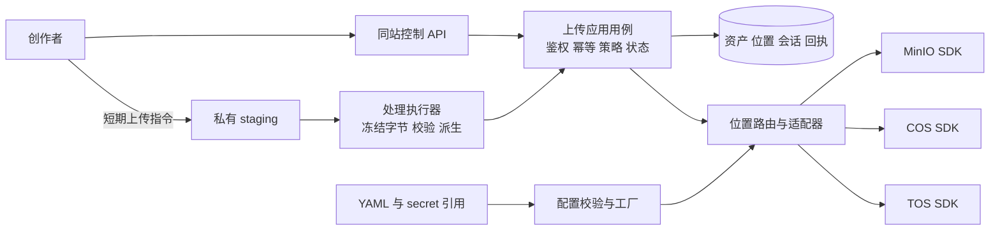
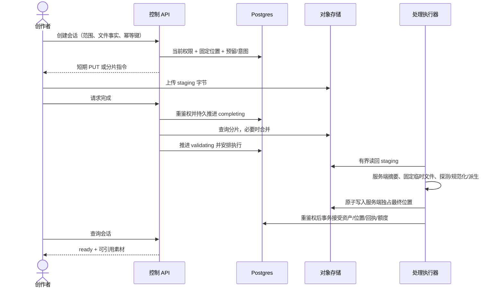

# 文件上传服务调研与架构设计

适用范围：MinIO/COS/TOS统一位置合同、接单、激活及上传恢复。文档版本：2026-10-20整理版；第1节已接受约束保留，代码进展与真实切换另列，本次补充待评审。维护职责：media/对象存储适配及部署职责；评审人未指定。

更新：2026-10-15。以下开头状态保留方案接受时点，代码阶段增补见文末“实现阶段补充”；各处“未实现”不能外推为2026-10-20源码盘点。状态：第1节具体设计已获用户确认，官方 SDK、默认 MinIO、历史位置和在途目标固定为已接受约束；[PRD04](../prd/04-文件上传与对象存储接入.md)和[计划12](../plan/12-文件上传与对象存储接入实施计划.md)已形成，实施计划已接受，待开始编码，代码尚未实现。关联[原始需求05](../requirement/05-文件上传与对象存储接入需求.md)。初次调研采用 `pm-market-research:competitor-analysis` 的能力对比、成本结构和方案取舍方法，按用户指定的三家存储服务开展接入研究。

官方事实、当前源码事实、已明确约束、设计建议和待验证项分别标明。本文没有交付适配器代码，没有读取部署凭据、连接业务数据库或真实存储，没有执行发布和数据迁移。

## 1. 本次先明确的具体设计

### 1.1 已明确的约束和方案选择

用户已明确：三平台均采用官方 Go SDK，默认 MinIO，通过配置切换，沿现有上传链路实现，历史文件和在途上传保留正确位置。本轮选择“三套官方 SDK + 统一业务接口”；全用 minio-go 或 AWS S3 SDK 的比较保留作调研依据，不作为本轮实施选项。

| 决策     | 本次设计                                                                                                                                                                                      |
| -------- | --------------------------------------------------------------------------------------------------------------------------------------------------------------------------------------------- |
| SDK      | MinIO 使用现有 `github.com/minio/minio-go/v7`；COS 使用 `github.com/tencentyun/cos-go-sdk-v5`；TOS 使用 `github.com/volcengine/ve-tos-golang-sdk/v2`。新增版本在实施前固定，不使用浮动 latest |
| 默认平台 | MinIO；初始规范 profile ID 为 `minio-main`。省略 default_write_profile 时只有存在有效 minio-main 才采用默认值；明确选择 COS/TOS 后配置无效就失败，不静默退回 MinIO                            |
| 业务路径 | 先接通现有个人/项目代理上传、内容探测、规范化、派生、回执及精确清理。直传、分片和容量限制保留在完整需求，单独验证后开放，不随 SDK 装配自动启用                                                |
| 配置     | 同一 YAML 声明多个 profile，MinIO 单平台部署只需准备 MinIO；未启用且没有历史引用的 COS/TOS 可不声明。凭据仅引用 env/secret 文件                                                               |
| 历史定位 | 持久位置为不可变的 profile_id + bucket + object_key；资产、派生和快照引用独立位置，查询/下载/删除不使用当前默认桶                                                                             |
| 在途定位 | 上传接单时持久固定 profile、配置 revision 和策略；输出转存、复制/转移和导出在创建意图时固定。后续步骤不能重新选择默认平台                                                                     |
| 生效方式 | 配置发布、角色加载及诊断完成后，由部署命令 CAS 激活全局路由；不做进程内热更新，各角色启动不自行改默认                                                                                         |
| 回退     | 激活失败保留原路由；回退只改变未来操作，保留理解多位置的程序和所有历史 profile                                                                                                                |

只替换全局 Client 会把旧键投向新桶，也可能让主文件和缩略图漂移，因此不采用。多云双写增加副本一致性、费用和补偿，本需求不要求该能力。

### 1.2 实际模块和接口变化

保留 platform/objectstorage 作为 SDK 构造和传输基础，各平台负责签名、metadata、分页和错误；media/adapter/objectstorage 将其映射成消费方小接口并按位置路由，app 为 API、media/provider worker 和其他消费者统一装配。应用用例负责权限、内容处理和事务接受。

ObjectRef 是不含 SDK 的定位值，包含 ProfileID、Bucket、Key；location ID 用于数据库关联。PutIfAbsent、Stat、Get、PresignGet、Remove 和清单逐步采用显式位置合同，不能用 Context 隐藏目标或从键字符串猜平台。消费者只获得所需的小接口。

现有 [operation staging adapter](../../backend/internal/operation/adapter/staging/objects.go) 直接依赖 minio.ErrorResponse，必须转为统一可判定错误；不能上传已支持 COS/TOS，却让生成结果恢复仍按 MinIO 错误判断。复制、转移、模型/剧本读取、导出、容量和账号注销撤权均纳入位置改造。

### 1.3 在读取文件前绑定上传目标

当前 Handler 先认证/范围授权，再读取 multipart，应用服务随后写对象。新增接单步骤放在授权成功、并发槽位和幂等键检查通过之后、readMultipartUpload 之前：短事务读取并锁定已激活路由，为 actor/个人或项目范围/request_key 创建或复用上传意图，保存 profile/revision/策略。读取、探测、原件/派生写入、回执和补偿全部使用该意图。

旧客户端继续传 multipart，不新增云平台或哈希字段要求。代理输入的文件名、实际大小和 SHA 在现有有界读取后补充并校验；已有回执继续验证内容冲突，不能仅凭同一接单键把不同字节认作重放。直传会话另要求声明摘要，仍由服务端校验。

第一次多平台发布先保留原 MinIO 默认：部署支持位置的新程序、迁移明确的原对象和任务，再排空不支持固定位置的旧 API 请求/活动实例。旧任务只能按已证明的原 MinIO 绑定处理，未知来源阻止切换。旧二进制仍接单时不能激活 COS/TOS 并承诺旧请求安全。

### 1.4 持久化与唯一性

新增 storage_profile、storage_route、object_location 和必要上传意图/会话；现有 upload_request 保留成功回执职责。media_asset/rendition 和需要稳定定位的源/目标快照引用位置。只登记位置却不修改旧读写路径不满足接受条件。

profile ID 与资源身份不可改义；同一物理资源/桶禁止注册两个 profile 别名，以免重复统计。同资源地址或凭据轮换保持身份，换实例、账号资源或桶创建新 profile。旧 MinIO 单桶兼容模式首次登记为 minio-main，与初始 YAML 使用同一身份，不重复建立 legacy/minio 别名。

增量迁移单独审阅和演练，不重放 schema 清库。原件、派生、回收站、生成暂存、复制/转移、导出和清理历史位置全部明确后，才允许新默认激活。

### 1.5 配置激活的操作合同

现有 [glowloom 命令入口](../../backend/cmd/glowloom/main.go) 的 `storage` 子命令已提供 validate（离线严格校验）、probe（显式隔离写探针）、activate（expected revision CAS）及回填/清理命令。activate 还检查最终数据库约束、历史绑定、完整引用、桶状态证明、探针和全角色就绪；当前消费者装配和最终约束未完成，不能开放生产切换。命令只在隔离 fixture 中验证，没有执行生产迁移或激活。

先分发含旧新 profile 的同一 YAML，确认必要 API/worker 已加载该配置 revision，再执行一次 activate。接单和激活事务锁定同一 storage_route 行，以串行顺序确定切换时刻：先接单的请求固定旧目标，后接单的请求固定新目标。所有云网络操作在事务外执行。

两侧 SDK/凭据和位置保留到引用和在途任务收敛。旧 profile 不再接新写入后，必要清理角色仍有精确删除能力；历史引用和清理债务清空才允许禁用。配置切换不搬迁历史字节。

### 1.6 设计接受与后续顺序

审阅重点为全部消费者是否采用位置合同、目标是否在 multipart 读取前固定、历史位置是否可证明、全局激活及旧程序排空是否可执行。用户已确认上述具体设计；[PRD04](../prd/04-文件上传与对象存储接入.md)和[计划12](../plan/12-文件上传与对象存储接入实施计划.md)现已补齐，映射原需求 FR-UP/AC-UP，按已接受计划以失败测试→实现→验证推进。编号在实际写入前再次检查，保留并行文档和迁移。

官方 SDK、默认 MinIO 已明确，不再作为待选项；这一版接口/数据/激活方案已由用户确认，尚未实现。真实 COS/TOS、普通/分片条件写、业务库迁移和产品接受继续分别保留门禁。

## 2. 建议方案

在现有后端 media 模块内统一上传业务，使用 **MinIO / COS / TOS 官方 SDK 薄适配器 + 消费方小接口 + 配置工厂 + 显式依赖注入**，默认 MinIO。YAML 定义多个稳定 profile，默认目标只决定新任务；已保存对象、上传会话、工作流和清理任务按其持久位置访问。前端只接收标准上传指令与素材状态。

先让三平台在现有代理链路满足同一合同，再启用已经通过专项验证的直传和分片能力。直传原件进入 staging，服务端对读回的固定字节执行现有校验、规范化、派生和资产接受流程。必须证明最终对象不可覆盖、历史定位正确、未知结果可对账，才能接受接入。



这里的工厂解决“选哪个实现”，策略解决“按哪个位置执行”，适配器解决“厂商协议如何映射”。不增加独立存储微服务、动态加载插件、全局单例或 Java 式 Controller/Service/DAO 层。

## 3. 官方接入调研

### 3.1 三平台比较

调研时间：2026-10-15。以下仅依据官方文档和厂商维护的 SDK；产品页面可说明能力存在，不能证明实际账号、区域、服务版本和权限可用。

| 维度                   | MinIO                                                 | 腾讯云 COS                                                              | 火山引擎 TOS                                               |
| ---------------------- | ----------------------------------------------------- | ----------------------------------------------------------------------- | ---------------------------------------------------------- |
| 主要接入路径           | minio-go/v7，S3 协议                                  | cos-go-sdk-v5 原生 XML API，也有 S3 兼容入口                            | ve-tos-golang-sdk/v2 原生 API，也有 S3 兼容入口            |
| 推荐场景，属于设计判断 | 现有自建环境、本地和私有部署，便于延续当前验证        | 已使用腾讯云资源、需要托管对象存储的部署                                | 已使用火山引擎资源、需要托管对象存储的部署                 |
| 基础能力               | 对象存取、查询、删除、清单、签名、分片                | 同类基础能力，签名及元数据按 COS 原生合同                               | 同类基础能力，签名及元数据按 TOS 原生合同                  |
| 地址与身份             | 自建 endpoint，按实际 DNS/TLS 决定 path/virtual style | 原生 SDK 使用桶域名，桶名称包含 APPID；官方 S3 Go 示例使用 virtual host | 原生客户端配置 endpoint 与 region；S3 文档另有协议配置要求 |
| 主要接入风险           | 部署版本、签名网络地址、条件写实现与自建运维责任      | 签名、禁止覆盖及版本控制、分片错误/CORS/权限组合                        | 原生与 S3 签名边界、扁平/分层桶、禁止覆盖及分片专项语义    |
| 本项目接入前提         | 实际服务版本及桶策略可核验                            | 已创建符合基线的私有桶，最小权限账号与区域匹配                          | 已创建符合基线的私有扁平桶，最小权限账号与区域匹配         |

MinIO 官方 Go SDK 定义了通用 S3 客户端，并列出 Put/Get/Stat/Remove、清单及预签名能力，SDK 仓库标注 Apache-2.0。项目安装版本为 `v7.0.98`；SDK 许可不等于自建服务端的许可或支持承诺，具体服务产品、版本和部署条件须另行核对。[MinIO Go SDK](https://github.com/minio/minio-go)

腾讯云维护 `cos-go-sdk-v5`，其仓库标注 MIT，定位为 COS XML API 原生 Go SDK。腾讯云另提供 AWS S3 接入指南，Go v2 示例需要配置 COS endpoint、签名区域、virtual-host 寻址等，不能视为任意 S3 默认参数均可使用。[COS Go SDK](https://github.com/tencentyun/cos-go-sdk-v5)、[使用 AWS S3 SDK 访问 COS](https://intl.cloud.tencent.com/zh/document/product/436/32537)

火山引擎维护 Go v2 TOS SDK，初始化使用 endpoint、region 和 credentials，仓库标注 Apache-2.0。官方 S3 接入指南以扁平桶为前提，要求使用 SigV4。原生 TOS SDK 配置不能直接当成 S3 客户端配置；分层桶的第三方兼容性需要另行确认。[TOS Go SDK](https://github.com/volcengine/ve-tos-golang-sdk)、[使用 AWS S3 SDK 访问 TOS](https://docs.volcengine.com/docs/TorchObjectStorage/AccessingTOSUsingAWSS3SDK?lang=zh)、[分层桶工具说明](https://docs.volcengine.com/docs/TorchObjectStorage/SupportedtoolsHNSbuckets?lang=zh)

### 3.2 对设计有影响的事实

| 公开事实与证据                                                                                                                                                                                                                                                                                                             | 本项目的处理                                                                                                                          |
| -------------------------------------------------------------------------------------------------------------------------------------------------------------------------------------------------------------------------------------------------------------------------------------------------------------------------- | ------------------------------------------------------------------------------------------------------------------------------------- |
| COS 支持预签名上传/下载；TOS Go 文档支持普通预签名和 POST 表单预签名。[COS 预签名](https://www-sg.tencentcloud.com/document/product/436/45243)、[TOS 预签名概述](https://www.volcengine.com/docs/6349/173412?lang=zh)                                                                                                      | 基线用标准 HTTP PUT/GET 和分片 PUT 指令；不向浏览器发永久 Key，不强迫前端引入三套 SDK                                                 |
| COS 分片一般为 1 MB～5 GB、最多 10,000 片，末片可小于下限；TOS 官方大文件实践说明分片可单独重传和恢复。[COS 分片说明](https://intl.cloud.tencent.com/zh/document/product/436/14112)、[TOS Go 分片实践](https://docs.volcengine.com/docs/VolcanoEngineBeginnersExperiment/UseGoSDKtomultipartuploadlargefilestoTOS?lang=zh) | 产品先保留最大 500 MiB 视频，建议 8 MiB 分片；TOS 与实际 MinIO 的最小片、最大片、数量及分页逐一验证，取三个已验证能力与业务预算的交集 |
| COS 分片初始化的 `x-cos-forbid-overwrite` 在已启用版本控制时无效；官方其他资料也记录暂停版本控制的限制。[COS 初始化 API](https://cloud.tencent.com/document/product/436/7746)、[COS SDK 文档](https://staticintl.cloudcachetci.com/doc/pdf/product/pdf/436_6276_zh.pdf)                                                    | 基线限制为从未开启版本控制的专用桶，分别验证普通/分片最终写入，不允许通过条件写配置绕过检查                                           |
| TOS CopyObject 文档说明禁止覆盖参数在已启用或暂停版本控制时无效。[TOS CopyObject](https://www.volcengine.com/docs/6349/74859?lang=en)                                                                                                                                                                                      | 这是复制操作证据，不直接推导为 PUT/分片已经验收；TOS 普通和分片原子创建的参数、错误及边界列为实施前门禁                               |
| minio-go 条件写选项设置 `If-None-Match`；AIStor 兼容性页列出条件请求支持。[SDK 条件写源码](https://github.com/minio/minio-go/blob/master/api-put-object.go)、[AIStor S3 兼容性](https://docs.min.io/aistor/developers/s3-api-compatibility/)                                                                               | 继续保护已有不可变对象；实际自建 MinIO 的普通/分片行为要单独测试，不把 AIStor 当前文档当成部署证据                                    |
| COS 浏览器分片需要通过 CORS expose headers 读取 ETag，使用 CDN 时其 CORS 是另一层配置。[COS 跨域访问](https://cloud.tencent.com/document/product/436/56652)                                                                                                                                                                | 直传配置显式放行业务 Origin、必要方法和签名头，暴露 ETag；生产桶不设置通配公开权限，CDN 不进入首轮签名合同                            |

2026-10-15 进一步核对固定版本官方 SDK：COS v0.7.75 的 ObjectPutHeaderOptions.XOptionHeader 可传禁止覆盖头；TOS v2.9.10 的 PutObjectBasicInput、CreateMultipartUploadV2Input 和 CompleteMultipartUploadV2Input 提供 ForbidOverwrite。字段与方法入口已获得源码证据，实际服务的原子性、错误和版本控制边界仍由独立真实测试证明。[COS 固定版源码](https://github.com/tencentyun/cos-go-sdk-v5/blob/v0.7.75/object.go)、[TOS 固定版源码](https://github.com/volcengine/ve-tos-golang-sdk/blob/v2.9.10/tos/type.go)

### 3.3 SDK 方案选择

| 方案                                    | 收益                                                                  | 代价与风险                                                                                              | 建议                             |
| --------------------------------------- | --------------------------------------------------------------------- | ------------------------------------------------------------------------------------------------------- | -------------------------------- |
| 三平台都使用当前 minio-go               | 依赖少，现有代码改动较小                                              | 需证明 COS/TOS 的寻址、签名、条件写、metadata、分页、分片和错误都符合当前 SDK；厂商原生头不一定自动映射 | 已调研备选；没有合同证据时不承诺 |
| 三平台都使用 AWS S3 Go v2               | 云厂商提供相关兼容说明，生态统一                                      | 替换已有依赖；仍需厂商兼容设置及同等验证，不能解决所有扩展语义                                          | 不作为本次默认技术迁移           |
| MinIO SDK + COS 原生 SDK + TOS 原生 SDK | 延续已有 MinIO 接入，每个厂商的签名、临时凭据、元数据及扩展有明确归属 | 维护三套薄适配器及差异用例，需要统一错误与能力合同                                                      | **推荐**；业务状态与 API 共用    |

不为了减少三条必要 SDK 依赖而把协议分支散入业务，也不设计额外的“通用 S3 第四平台”。新增 SDK 的确切版本须在实现前固定、记录许可并完成漏洞/兼容检查，当前未安装 COS/TOS SDK。

### 3.4 成本与选择条件

COS 官方计费覆盖存储、请求、取回、流量和管理功能，上传流量不收费也不表示写请求和存储免费；TOS 官方请求费用按存储类型和请求次数计量。[COS 计费问题](https://intl.cloud.tencent.com/zh/document/product/436/10373?lang=zh)、[TOS 请求次数费用](https://docs.volcengine.com/docs/TorchObjectStorage/Requests?lang=zh)

本项目成本模型是设计建议：`总成本 = 存储 + API/分片请求 + 出口/跨区域流量 + 取回/处理 + 自建资源与运维`。需按实际地区和合同填入单价，不引用历史价格。MinIO 的自建机器、磁盘、备份和运维由部署方计入；不宣称免费或一定更便宜。

建议先按已有基础设施和真实测量选择默认目标。与生成服务同平台可能减少链路复杂度，但“同厂商即免流量”没有本轮证据。直传减少 API 服务传输压力；当前媒体处理仍需执行器读回文件，不能宣称后端完全不再传输字节。

## 4. 当前仓库事实与缺口

基线为 `glowloom-server` / `main`；开始时已有身份、编辑器、前端及文档修改，本轮保留。以下是静态源码证据，未报告现有测试运行通过。

| 源码位置                                                                                                                                                                                                                                    | 当前行为                                                                                           | 设计缺口                                                                              |
| ------------------------------------------------------------------------------------------------------------------------------------------------------------------------------------------------------------------------------------------- | -------------------------------------------------------------------------------------------------- | ------------------------------------------------------------------------------------- |
| [config.go](../../backend/internal/platform/config/config.go)                                                                                                                                                                               | Viper 加载 LV_*，可由 LV_ENV_FILE 读 env 格式文件；单 endpoint/bucket/Key/region                   | 尚无多 profile YAML、默认激活版本及分平台凭据来源；不能把现有 env 文件称作已支持 YAML |
| [objectstorage.go](../../backend/internal/platform/objectstorage/objectstorage.go)                                                                                                                                                          | 单 bucket 的 minio.Client，静态 SigV4 无 session token；Put/PutIfAbsent/Stat/Get/Remove/PresignGet | 缺原生 COS/TOS、多位置、动态临时凭据和上传签名；客户端对象永久固定一个桶              |
| [inventory.go](../../backend/internal/platform/objectstorage/inventory.go)、[project_copy.go](../../backend/internal/platform/objectstorage/project_copy.go)                                                                                | 有界清单、精确 Exists、区分不存在与其他错误                                                        | 多平台仍需分页/错误映射及 profile 维度，不能对当前桶查询所有历史键                    |
| [upload_file.go](../../backend/internal/media/application/upload_file.go)                                                                                                                                                                   | magic/MIME、文件名、输入上限、有界临时文件、服务端 SHA-256                                         | 直传须把外部字节重新引入同等受控校验                                                  |
| [upload.go](../../backend/internal/media/application/upload.go)、[upload_personal.go](../../backend/internal/media/application/upload_personal.go)                                                                                          | 共用探测、规范化、派生、不可覆盖写、Stat 校验、永久幂等回执；提交未知时先查资产，避免误删          | 原流程值得保留；增加固定位置、持久会话和可恢复补偿，不用云回调置 ready                |
| [workflow/upload.go](../../backend/internal/media/adapter/workflow/upload.go)                                                                                                                                                               | 音视频/GIF、文档与模型专用探测及派生                                                               | COS/TOS 与直传都必须复用，不能只做 SDK 上传测试                                       |
| [upload HTTP](../../backend/internal/media/adapter/http/upload.go)                                                                                                                                                                          | 相对业务 group 下 `/projects/:pid/media/uploads`、`/media/library/uploads`                         | 保留现有入口，新增会话控制合同和生成客户端                                            |
| [storage_usage.go](../../backend/internal/media/application/storage_usage.go)                                                                                                                                                               | 实际对象占用查询，含有界清单，明确不是预留或账单                                                   | 没有已证明的容量预留合同；新限制须新增账本与并发验收                                  |
| [schema.sql](../../backend/db/schema.sql)                                                                                                                                                                                                   | media_asset/rendition 及复制、转移、清理等保存裸 object_key；media.upload_request 保存业务回执     | 缺 profile/bucket 定位；media_asset.provider_key 是 AI 来源字段，不能借用作存储平台   |
| [app wiring](../../backend/internal/app/wiring.go)、[provider wiring](../../backend/internal/app/provider_wiring.go)、[roles wiring](../../backend/internal/app/roles_wiring.go)、[public_api.go](../../backend/internal/app/public_api.go) | API 与不同后端角色分别装配单桶客户端                                                               | 所有写入、读取和执行角色都要理解旧新位置，不能只替换 HTTP 上传角色                    |

现有 PutIfAbsent 的 SHA metadata 来自服务端已计算摘要，Stat 核对大小/类型/metadata；它不证明浏览器直传的 metadata 可信。设计新增直传时必须验证实际字节，不能沿用 metadata 相等就接受的捷径。

## 5. 分层、接口与设计模式

### 5.1 职责分配

| 层                          | 负责内容                                                              | 不承担内容                                   |
| --------------------------- | --------------------------------------------------------------------- | -------------------------------------------- |
| media/domain                | 对象定位值、素材事实、文件策略和合法状态/不变量                       | SDK 类型、HTTP 签名、部署配置读取            |
| media/application           | 当前权限、会话/回执幂等、固定位置、处理协调、业务接受、预留和补偿判定 | COS/TOS/MinIO 条件分支、云 API JSON/XML 解析 |
| media/adapter/http          | DTO、状态码、请求取消、生成合同                                       | 把云上传成功直接变成 ready                   |
| media/adapter/objectstorage | 路由固定位置、转换小接口、SDK 错误及 metadata、能力实现               | 决定用户/团队权限和业务接受                  |
| platform/objectstorage      | 复用现有 MinIO 传输基础，容纳必要的 SDK 构造和传输配置                | 反向依赖 media/application，维护租户权限     |
| app composition             | 解析配置、创建连接、选择适配器、装配各角色                            | 无处不在的可变全局默认客户端                 |
| Postgres / workflow adapter | 持久事务、会话状态、执行租约、对账与清理                              | 用 SDK 重试替代永久幂等证据                  |

保持 `adapter → application → domain`。接口由实际消费者定义；现有 UploadObjects、ObjectStore、ObjectSigner、StorageUsageObjects 等按需要增加位置参数，不用一个几十方法的全局 StorageService。

### 5.2 小接口草案

以下是目标合同示意，不是已实现 Go 文件；类型按最终边界保持显式转换，不把 SDK 类型带进内层。

```go
type ObjectRef struct {
    ProfileID string
    Bucket    string
    Key       string
}

type ObjectFacts struct {
    Size        int64
    ContentType string
    SHA256      string
    ETag        string
}

type ObjectReader interface {
    Get(context.Context, ObjectRef) (io.ReadCloser, error)
    Stat(context.Context, ObjectRef) (ObjectFacts, error)
}

type ImmutableWriter interface {
    PutIfAbsent(context.Context, ObjectRef, io.Reader, ObjectFacts) error
}

type ObjectRemover interface {
    Remove(context.Context, ObjectRef) error
}

type ObjectSigner interface {
    PresignGet(context.Context, ObjectRef, time.Duration) (AccessGrant, error)
}
```

分片另设消费方接口，覆盖 Initiate、PresignPart、ListParts、Complete、Abort；清单另设分页接口。ObjectRef 从已经授权的资产/快照/会话产生，不能直接由 HTTP 请求绑定。Reader 的调用方负责关闭；Get 延迟错误必须在读取时处理。重试前将文件 seek 至起点或重新打开受控文件，不重放已消费的一次性流。

### 5.3 模式的必要性

| 模式           | 本设计用法                                                                     | 最小实现边界                                                               |
| -------------- | ------------------------------------------------------------------------------ | -------------------------------------------------------------------------- |
| 工厂 Factory   | 在装配时按 provider=minio/cos/tos 创建已校验的具体连接                         | 显式 switch 与构造函数即可；未知 provider 返回配置错误，不做运行时反射注册 |
| 策略 Strategy  | 路由器按 ObjectRef.ProfileID 选择适配器；默认 profile 只在创建新操作时读取一次 | 历史读取不能调用 DefaultClient，所有外部副作用都有固定 Ref                 |
| 适配器 Adapter | 原生 SDK 的签名、元数据、条件写、分页与错误转换成消费者合同                    | 不在 application 散落云平台判断，不手写各云签名算法                        |
| 显式依赖注入   | app 向上传、读取、转存、清理角色注入所需能力                                   | 不新增全局单例，不让领域读 YAML                                            |
| 状态机与补偿   | 持久记录外部意图、未知结果、接受和清理                                         | 复用现有事务/执行机制，不引入通用 Saga 框架或空模板方法层                  |

SDK 原有重试、业务对账、指标包装各有明确所有者。没有实际需求的装饰器、责任链和抽象工厂不预建。

## 6. 配置文件与一键切换

### 6.1 YAML 草案

拟新增 `LV_OBJECT_STORAGE_CONFIG` 指向存储 YAML；这是目标设计，当前 Load 尚未支持。下面的域名、桶名和 env 名都是示例，不是已部署资源。没有准备好的 profile 可以不声明；默认或被历史对象/任务引用的 profile 不得省略。

```yaml
object_storage:
  schema_version: 1
  revision: storage-20261015-01
  default_write_profile: minio-main
  upload:
    mode: relay
    signed_url_ttl: 10m
    session_ttl: 24h
    multipart_threshold_bytes: 33554432
    part_size_bytes: 8388608
    part_concurrency: 3
    staging_retention: 48h
  access:
    preview_ttl: 5m
    max_signed_url_ttl: 15m
  limits:
    max_image_bytes: 20971520
    max_video_bytes: 524288000
    max_audio_bytes: 104857600
    max_model_bytes: 67108864
    max_document_bytes: 20971520
    per_scope_capacity_bytes: null
  profiles:
    minio-main:
      provider: minio
      mode: read_write
      endpoint: https://minio.storage.example
      signing_endpoint: https://minio.storage.example
      bucket: glowloom-assets
      region: us-east-1
      addressing_style: path
      credentials:
        source: env
        access_key_env: GLOWLOOM_MINIO_ACCESS_KEY
        secret_key_env: GLOWLOOM_MINIO_SECRET_KEY
    cos-main:
      provider: cos
      mode: read_write
      endpoint: https://glowloom-1250000000.cos.ap-shanghai.myqcloud.com
      bucket: glowloom-1250000000
      region: ap-shanghai
      credentials:
        source: env
        access_key_env: GLOWLOOM_COS_SECRET_ID
        secret_key_env: GLOWLOOM_COS_SECRET_KEY
    tos-main:
      provider: tos
      mode: read_write
      endpoint: https://tos-cn-shanghai.volces.com
      bucket: glowloom-assets
      region: cn-shanghai
      credentials:
        source: env
        access_key_env: GLOWLOOM_TOS_ACCESS_KEY
        secret_key_env: GLOWLOOM_TOS_SECRET_KEY
```

`mode: relay` 保留代理；`direct` 只有平台直传与业务验收通过后可激活。模式在会话创建时冻结，不在一次上传中悄悄改协议。客户端可以在 direct 不可用时，经服务端明确返回指令创建新的 relay 会话；未知结果不自动重复提交。

COS 原生 SDK 的 endpoint 是桶域名；TOS 原生 SDK 的 endpoint 是服务地址，桶在操作参数中传入；MinIO 的 path/virtual 选项由配置明确选择。原生 COS/TOS 不接受无效的 MinIO 专用 addressing_style 字段，严格校验未知字段。

signing_endpoint 可与服务端访问地址不同，但必须指向同一个已绑定存储资源，且按对外 Host 签名后能真实访问。不允许生成 URL 后替换 Host/Scheme/Path；签名不覆盖错误地址的“修正”。COS/TOS 自定义域名或内外网差异要专项验证，未经验证只用官方可访问地址。TLS CA 与 transport 可按部署需要注入，生产不能关闭证书校验。

### 6.2 配置优先级与凭据

1. 存储 YAML 是新模式下的唯一非秘密期望配置；配置文件路径由 `LV_OBJECT_STORAGE_CONFIG` 指定。其他非存储 LV_* 沿原合同加载。
2. YAML 模式与旧的单桶 `LV_OBJECT_STORAGE_ENDPOINT/BUCKET/ACCESS_KEY/SECRET_KEY/REGION` 同时生效时返回来源冲突，要求部署清除旧存储字段，不逐字段混合覆盖。
3. 无 YAML 时可在兼容阶段维持旧 MinIO 单桶模式，首次显式登记 `minio-main` 身份，初始 YAML 沿用该 ID 和同一核验资源，不另造同桶别名。兼容模式不具备三平台切换承诺，存量绑定迁移完成前不得激活新默认。
4. credentials.source 首个实现支持 `env` 或 `file`：文件只保存 secret 挂载路径，按 schema 加载 AK/SK 及可选 token/到期时间，文件权限和最大长度受控；禁止 YAML 内联 Key。
5. 临时凭据不能作为永久静态 token 使用。通过 SDK credential provider 或受控 secret 更新读取当前值，在续签/长传输时处理过期；签名有效期不得超过凭据剩余寿命减时钟余量。首个可验收部署可使用最小权限静态服务账号，启用临时来源前补各云刷新测试，不自动访问实例 metadata 获取身份。
6. 非秘密连接身份、策略及配置 revision 可持久化；秘密、token 和完整签名 URL 不进入业务表、会话回执、审计或配置 checksum。

### 6.3 校验和诊断

离线校验包括 schema/未知字段、provider、ID/桶/区域、HTTP(S) origin、禁止 userinfo/query/fragment、厂商地址语义、时间单位、文件和处理预算、分片范围、唯一默认目标、凭据来源冲突。生产必须 HTTPS；HTTP 仅允许显式 local 测试配置。YAML 不进行任意 shell/env 表达式求值，只解析声明的 secret 引用。

在线诊断分两类：只读诊断确认桶身份、访问和所需桶状态；专项写探针在独立保留前缀生成小对象，验证条件写、Stat、实际读回和删除，并留下自身未清理目标。写探针只由显式部署诊断执行，普通 readiness 不持续写测试文件；检查成功不得自动修改策略或建桶。

必须核验桶私有、扁平、从未开启版本控制，以及所选操作的最小权限。桶状态读取权限和诊断权限单列，不能为方便而让普通上传角色获得整个账号管理员权限。诊断无法证明状态时报告缺失条件，不读取失败后假定默认值。

### 6.4 激活、在途会话与回退

YAML 的 default_write_profile 是期望状态；数据库一条 `media.storage_route` 记录全局已激活的 profile 和 revision，属于部署配置的激活快照，不是第二个用户可编辑配置源。各 API/worker 装载快照时需校验自己的配置包含并支持此目标，版本不匹配的实例拒绝新写入接单。

| 步骤           | 可观察结果                                                                                                                |
| -------------- | ------------------------------------------------------------------------------------------------------------------------- |
| 准备新 profile | 旧 profile 保留；新桶、凭据及能力完成诊断，默认写入尚未改变                                                               |
| 分发同一 YAML  | 各写入/读取/处理/清理角色加载旧新 profile；先保证消费者能力，再改变默认                                                   |
| 激活部署版本   | 部署流程等待必要角色就绪，使用 expected revision 做一次 CAS，切换全局默认；失败不改变原路由                               |
| 新建操作       | 创建会话或生成输出意图时，在事务中保存当前已激活 profile 与策略；路由激活与创建按同一行锁/CAS 串行判定                    |
| 在途操作       | 从会话/工作流自己的位置执行，不重新读取 default；原 profile 继续保留 write 权限直到在途写入/重试/补偿全部收敛             |
| 降为只读       | 确认无在途写任务后才将旧 profile 改成 read_only；仍有精确清理任务时保留专门删除权限，不能把运维“只读”解释为可丢弃清理债务 |
| 回退           | 将期望 default 改回旧 profile 并激活新 revision，只影响未来操作；两边现有资产位置不变                                     |

profile.mode 描述接单策略；旧位置的必要删除能力由清理角色单独控制。`disabled` 表示不能访问，只有资产、快照、会话、迁移与清理引用均已清空才可使用；不得把有历史对象的旧 profile 禁用来代替迁移。

“一键”由部署流程封装配置校验、角色就绪、原子激活与结果检查；不需要逐个业务改代码。本段“尚无诊断/激活命令”为方案初稿时点，第1.5节已记录后续命令实现和隔离fixture证据；未执行生产迁移或激活的边界不变。首个实现不做进程内热更新或自动多云故障转移。滚动部署时绝不允许每个实例启动自行覆盖 storage_route。

## 7. 持久化与位置模型

### 7.1 核心表草案

| 表                    | 关键字段                                                                                                                                                                                                                               | 约束                                                                                                                                       |
| --------------------- | -------------------------------------------------------------------------------------------------------------------------------------------------------------------------------------------------------------------------------------- | ------------------------------------------------------------------------------------------------------------------------------------------ |
| media.storage_profile | id text PK、provider、resource_identity、bucket、region、create_time                                                                                                                                                                   | 只存非秘密资源身份；ID 的含义不可改，凭据轮换或同资源网络地址调整不改变身份                                                                |
| media.storage_route   | 固定 id、profile_id FK、revision、activated_at                                                                                                                                                                                         | 只有一条默认写入路由，修改要求 expected revision；不保存 Key                                                                               |
| media.object_location | id uuid PK、profile_id FK、bucket、object_key、byte_size、content_type、sha256、etag、state、revision、timestamps                                                                                                                      | unique(profile_id,bucket,object_key)；身份元组不可改；verified 时 size>=0、摘要为 64 位十六进制；用户媒体资产仍要求 size>0；客户端不能修改 |
| media.upload_session  | id、actor_id、scope_kind、scope_id、request_key、request_fingerprint、declared_size/sha256/name、profile_id、policy_snapshot、staging_location_id、provider_upload_id、status、revision、lease/fence、expires_at、asset_id、error_code | unique(actor_id,scope_kind,scope_id,request_key)；个人/项目二选一；平台 upload ID 只由适配器记录；状态与 asset_id 对应                     |
| media.upload_part     | session_id、part_number、observed_size、etag、verified_at                                                                                                                                                                              | unique(session_id,part_number)，编号和大小受策略限制；平台查询是确认事实，客户端 ETag 仅提示                                               |
| 容量预留记录          | scope、session/job、reserved_bytes、accepted_bytes、cleanup_debt、status、revision                                                                                                                                                     | 仅在容量限制能力实施时增加；沿现有范围锁序，扣计和释放均幂等，不混入生成积分结算                                                           |
| 现有业务回执/清理意图 | media.upload_request 等现有合同扩充位置引用和必要指纹；已有清理任务扩充 profile/位置                                                                                                                                                   | 成功回执保持永久幂等语义；未知提交不删除已接受资产                                                                                         |

object_location 的 state 为 reserved、verified、removal_pending、removed；其内容事实验证后不可改。staging 与最终位置是不同对象，ready 资产不引用可被浏览器重写的 staging。临时会话有效期只限制继续上传，不等于数据库记录或成功回执的保留期；终态会话/幂等墓碑按审阅后的保留合同清理。

### 7.2 与现有对象的关系

media_asset 增加主文件 object_location_id，rendition 增加自己的 object_location_id；主文件与派生文件可以处于不同历史 profile，不根据主文件推导所有派生位置。相同键在不同平台不冲突。

复制、转移、打包、生成输出、深度/音频处理、剧本读取和清理意图保存完整位置快照或 location ID。对事务/重试需要固定源内容的流程，保存被接受时的位置及 SHA，不在执行时重新解析“最新位置”。资产的可变当前指针与历史快照分开，跨云迁移不能静默改变已提交生成的输入。

存量 object_key 字段可在迁移阶段双写，最终由 object_location/ObjectRef 合同取代其隐含桶语义。不得把 profile 拼入 object_key 伪装成原字段，也不得借用 AI provider_key。既有 schema.sql 维护最终态，业务库使用单独审阅的增量 SQL；本轮不修改任何 SQL。

### 7.3 对象键

新键建议由服务端随机 ID 和已验证的归属创建，例如：

```text
staging/<scope-kind>/<scope-id>/<session-id>/<attempt-id>/source
assets/<scope-kind>/<scope-id>/<asset-id>/<content-id>.<extension>
renditions/<scope-kind>/<scope-id>/<asset-id>/<rendition-id>.<extension>
```

这些是目标命名示例，存量键原样保留；现有 key 校验及范围清单逻辑要同步适配。禁止邮箱、原始文件名、路径穿越、任意 URL 或客户端指定键。随机键避免正常操作冲突，但不能代替不可覆盖原子写的合同。

### 7.4 容量与占用

当前容量页面仅统计实际对象，未证明并发配额功能；默认 `per_scope_capacity_bytes: null` 保持未设套餐。限制启用时，范围事务内校验 `已接受及保留占用 + 清理债务 + 未消费预留 + 本次预留 <= 限额`，并先预留原件、staging 和必要派生的可接受上界。预算不足时拒绝，不先上传再侥幸补扣。

接受事务将预留转换为实际归属占用并释放余额。失败释放未使用预留；已经写出的孤儿/暂存对象转换成 cleanup debt，物理占用不凭业务失败归零，清理确认后才消除债务。直传权限不能在所有平台严格保证用户声明长度，因此另设单会话、单范围暂存/未完成分片预算和桶端限额/生命周期，不把创建时声明的大小视为防刷证明。

物理用量按 profile/bucket/key 去重，跨平台副本分别计数；回收站和不确定输出仍占空间。清单分页必须完整完成，超预算/权限/网络失败返回 unavailable；结果标注 calculated_at，不能宣称并发写入下的瞬时账单一致性。quota 账本提供并发准入，周期对象核对修正偏差；未完成存量核对时不启用硬限制。

## 8. 上传流程与状态机

### 8.1 代理上传

保留当前入口：先认证并校验范围，ReadUpload 将实际内容有界读入受控文件并计算 SHA；按现有合同探测、处理、派生、原子写入、Stat 核对、业务事务接受和返回素材。新增步骤是：在第一次外部写入前持久保存 profile 和精确对象意图，处理产物沿同一已固定策略选择位置。

请求取消沿 Context 传递；必要补偿使用有所有者、期限和预算的独立执行上下文，不能让浏览器断开取消持久对账。当前请求内 best-effort 删除升级为可恢复清理意图；不清理未知提交可能已经接受的对象。

### 8.2 直传和冻结字节



直传创建时客户端提供声明长度、显示名、SHA-256 和审查声明；浏览器可用可取消的分块哈希工作任务准备摘要，不能为了 500 MiB 文件调用整文件 ArrayBuffer 再占用同等内存。客户端摘要用于会话指纹和传输比对，不代替服务端事实。先核对 staging 的大小，再用 limit+1 有界读回；原始字节计算的 SHA 必须与声明匹配。

处理执行器只验证并处理自己已经读入的固定文件；最终 PUT 也使用这份文件，不在验证后重新读取可被客户端覆盖的 staging。WebM 原始摘要与规范化产物摘要分别记录，不拿原始声明与 MP4 哈希直接比较。不会因为 HEAD metadata 相同而跳过字节校验。

浏览器上传指令只允许 staging PUT 或指定 upload ID/part number 的 PUT，不允许浏览器 Complete/Abort 最终对象，也不授权最终 assets/renditions 前缀。客户端完成后再次覆盖 staging 不能改变已冻结的资产内容；晚到 staging 写由清理债务/生命周期复查处理。

### 8.3 状态与并发

| 会话状态                     | 含义                                             | 下一步/恢复                                                    |
| ---------------------------- | ------------------------------------------------ | -------------------------------------------------------------- |
| created                      | 固定身份、目标和策略，尚未确认外部初始化         | 完成初始化或开始普通传输；初始化响应丢失先对账                 |
| uploading                    | 允许续签和传片                                   | 暂停时保留该状态；完成或取消/过期                              |
| completing                   | 服务端核对/合并，已持久记录意图                  | 结果明确后进入 validating；回执未知进入 needs_reconciliation   |
| validating                   | 固定字节、探测、规范化与必要派生                 | 成功 publishing；输入不合法 failed；取消进入 cancel_requested  |
| publishing                   | 写最终对象并准备资产接受事务                     | 接受后 ready；外部/数据库结果未知进入 needs_reconciliation     |
| needs_reconciliation         | 某个外部/数据库操作结果不确定，保留 resume_stage | 先查平台和永久回执，恢复原阶段或进入确定终态；不重复创造新资产 |
| cancel_requested             | 已收到取消，禁止续签/新片，执行器需收敛          | 若接受事务已赢得并发锁，返回既有 ready；否则取消及安排精确清理 |
| ready                        | 永久回执和可引用资产已接受                       | 终态；重复完成返回同一资产，取消上传不能删除已接受资产         |
| failed / cancelled / expired | 操作确定不再接受                                 | 无可引用资产；独立 cleanup_pending/finished 状态继续清理和复查 |

状态修改有 revision CAS、执行租约和 fence。网络调用不持有长数据库事务；调用前持久化 intent，回写要求当前 lease/fence。完成、取消和接受在同一会话行锁下串行决定赢家；取消不能在 ready 后以补偿方式物理删除。

若创建分片任务的响应丢失，不盲目再创建。按固定 staging key 查询未完成上传并记录结果；存在歧义时保留对账或取消整个尝试并记录所有可归属任务，新的尝试使用新 key。`NoSuchUpload` 不能单独证明已经失败，要同时检查最终 staging 对象和会话 intent，区分已经合并、已经取消和真实不存在。

### 8.4 分片与恢复

- 以 32 MiB 阈值、8 MiB 分片、并发 3 片作为待接受建议值；策略在创建时冻结，并验证各平台限制，不使用厂商最大对象上限扩大业务文件上限。
- 创建任务、complete 和 abort 由服务端执行；浏览器只取一批具体片号的短期 URL，控制返回数量，不能一次长期授权所有任意片段。
- 片号从 1 开始，长度依据声明文件大小/分片大小计算，末片允许例外。查询所有平台分页并验证编号、大小、数量和顺序；客户端 ETag 列表不作为合并事实来源。
- 恢复时查会话和平台 ListParts，重新授权只缺失或待确认片段。前端保存会话 ID 与非秘密文件匹配信息，不持久保存 URL；刷新后重新选同文件，声明摘要不一致则禁止续传。
- 同号重传按厂商合同处理；完成前再取权威片段列表。合并回执超时持久保留 unknown，通过查询 staging 和会话事实确认，不新发另一个业务上传。
- SDK 分片写最终对象也必须通过不可覆盖专项测试；浏览器 staging 分片和服务端最终原子写是两个不同能力，不能用前者成功证明后者。

### 8.5 补偿与清理

创建对象前记录位置和所有权，已接受/共享引用对象不能由失败会话清理。事务提交未知先查现有永久回执和目标资产，沿当前逻辑保留可能成功的对象；清理前再次核对归属、引用、状态、版本及执行 fence。

取消/过期分片执行精确 Abort，普通 staging 执行精确 Remove；不把 `403`、超时或桶不可用当成对象不存在。清理失败保存重试，容量债务不归零。签名失效并不保证已经开始的上传立即停止，清理需在签名窗口后复查晚到对象，并以专用 staging 生命周期兜底；成功发出 Delete 不能一次性宣称不会再出现晚到写入。

暂存建议保留 48 小时，签名/会话过期、处理执行和晚到请求需要更细的清理调度。只为 staging/未完成分片设置生命周期；资产回收站和账号删除的保留期沿既有合同，不为省存储更改生产资产生命周期。

## 9. HTTP 与前端合同

以下为目标相对路由，沿项目既有业务 group 前缀，不新建另一套 API 版本。现有代理入口继续返回其既有资产合同；新增异步会话独立返回 session，不静默改变旧客户端的成功语义。

| 方法与相对路由                                      | 输入/响应要点                                                                                                                                 | 权限与幂等                                                       |
| --------------------------------------------------- | --------------------------------------------------------------------------------------------------------------------------------------------- | ---------------------------------------------------------------- |
| POST `/media/upload-sessions`                       | scope=personal/project、project_id（仅项目）、file_name、declared_size、declared_sha256、审查声明；返回 session_id/status/mode/期限和传输指令 | 当前范围授权，Idempotency-Key；客户端无 provider/bucket/key 字段 |
| GET `/media/upload-sessions/:sid`                   | 状态、期限、处理阶段、错误/可重试信息；ready 才返回原入口对应素材摘要                                                                         | 当前本人及范围授权；不返回内部平台 upload ID                     |
| POST `/media/upload-sessions/:sid/upload-signature` | 普通 staging PUT 的续签指令                                                                                                                   | 重新授权，仅 created/uploading，期限受会话和凭据限制             |
| POST `/media/upload-sessions/:sid/parts/signatures` | 服务端验证的片号数组，返回 method/url/required_headers/expires_at                                                                             | 限片数/频率，绑定该会话固定 upload ID                            |
| GET `/media/upload-sessions/:sid/parts`             | 平台已确认片号、长度和 ETag，必要时业务分页游标                                                                                               | 当前授权；平台游标不允许客户端改成任意对象查询                   |
| POST `/media/upload-sessions/:sid/complete`         | expected_revision，可带客户端片段提示；返回 ready 或 202 处理/对账状态                                                                        | 重鉴权、持久意图、重复调用返回同状态/回执                        |
| POST `/media/upload-sessions/:sid/cancel`           | expected_revision；返回终态或 cancel_requested                                                                                                | 行锁/CAS 决定与完成的并发；不能通过取消上传删除 ready 资产       |
| 现有素材查询/预览/下载                              | 按资产权限解析 location 并生成临时访问；下载支持文件名和 Range                                                                                | 不以 session 权限替代资产当前权限；对每份 rendition 独立定位     |

上传指令统一为 `method`、`url`、`required_headers`、`expires_at`、可选 `part_number`；平台需签名的 Content-Type/校验等头必须原样发送。指令 URL 是敏感短期访问能力，只存在于当前操作内存，不出现在埋点、错误截图或持久日志中。

控制 API 继续通过项目同站代理、生成 API 客户端和统一请求层。对象 PUT 使用独立的受限 HTTP 传输，不经过会附加织光 Cookie/Authorization 的业务拦截器；使用 `credentials: omit`，支持进度和 Abort。后端 DTO/路由按 PROJECT 的 swag → @umijs/openapi 合同生成流程维护，不能在前端组件手写另一套业务 API。

前端状态建议：准备文件摘要 → 上传中/可暂停 → 服务端处理中 → 已可用；把重试当前传输、查询未知结果和创建新尝试分开。处理失败保留服务端状态与可操作提示，刷新按 session ID 恢复，ready 后才允许在编辑器/画布引用。

### 9.1 读取、签名与撤销

素材查询先检查身份、资产/项目及当前可引用状态，再按持久位置生成 GET 权限。预览默认 5 分钟且不超过 15 分钟，TTL 还受凭据寿命约束；URL 到期时重新鉴权。签名绑定最终域名和响应头，下载文件名经安全 Content-Disposition 编码，主动内容按既有策略下载而不任意内联执行。

视频 Range、MIME、缓存及跨域必须真实验证。资产 ID 和位置持久化，签名 URL 不作为数据库引用或内容身份。账号禁用、撤权或删除立即停止新签名；已发签名可继续工作到到期或对象不可读，不能承诺逐个即时撤销。确需立即控制的敏感内容走带当前权限校验的服务端读取代理。

生成提供方拉取私有输入沿已有输入授权合同，按任务实际拉取窗口单独限制凭据期限与内容；不能为方便无限延长所有创作者预览 URL。短签名不足以满足某个模型协议时须单独验收服务端转送方案，不公开整个桶。

## 10. 厂商映射与错误处理

| 能力      | MinIO 适配                                           | COS 适配                                                          | TOS 适配                                                   |
| --------- | ---------------------------------------------------- | ----------------------------------------------------------------- | ---------------------------------------------------------- |
| 写入      | 复用当前 SDK，准确设置类型/大小和服务端 SHA metadata | 原生对象上传，转换 Content-Type/自定义 metadata，必要时 SDK 分片  | 原生 v2 对象上传，转换相同事实，必要时 SDK 分片            |
| 不可覆盖  | 条件写头及实际部署版本，普通/分片分别验收            | 正确传播原生 forbid-overwrite 并验证桶版本条件，普通/分片分别验收 | 原生条件创建参数、版本条件及错误待专项确认，不先查后写模拟 |
| 查询/读取 | Stat/Get，注意 Get 的延迟读取错误                    | Head/Get，按原生 metadata 头规范转换                              | Head/Get，按原生 metadata 头规范转换                       |
| 分页清单  | 保留当前有界逻辑，向外映射统一游标                   | SDK continuation/marker 转换，完整遍历                            | SDK continuation/marker 转换，完整遍历                     |
| 签名      | 服务端访问与公网签名可能使用分别装配的客户端         | 原生签名及桶地址，required_headers 与 token 一致                  | 原生 v2 签名、region/endpoint 及 token 一致                |
| 精确删除  | 仅本业务授权 Ref                                     | 删除不存在映射为幂等，权限失败不能吞掉                            | 同等合同；不支持桶型或归档状态明确拒绝                     |

每个 adapter 返回统一 ObjectFacts，metadata key 大小写及平台前缀显式转换。SHA 是服务端验证事实；ETag 保持不透明，合并时保留 SDK 所需格式，不全局删引号或当成 MD5。请求 HTTP 成功还需确认 SDK 业务结果和对象事实，不能只看 200。

| 统一错误                                         | 业务/API 行为                                                       | 重试原则                                                       |
| ------------------------------------------------ | ------------------------------------------------------------------- | -------------------------------------------------------------- |
| invalid_config / unsupported_capability          | 激活失败；运行时接单 unavailable                                    | 不自动重试/降级到其他 profile                                  |
| access_denied / credential_expired               | 管理端可诊断，创作者看到服务不可用；业务越权沿既有 401/403/404 合同 | 配置/权限拒绝不指数重试；凭据到期按受控刷新再判定              |
| signature_expired                                | 权限仍有效且会话合法时续签                                          | 不复用原 URL；签名不匹配先检查地址/头/时钟，不循环续签掩盖错误 |
| object_not_found                                 | 已授权读取报告缺失；删除已证明不存在可幂等成功                      | 404 对象不存在与 404 桶不存在分开；403 不等于 missing          |
| object_exists / state_conflict                   | 内容核对或会话 revision 冲突，通常 409                              | 不覆盖原对象；只有同一意图且大小/服务端摘要一致才允许重放接受  |
| content_mismatch / too_large / unsupported_media | 拒绝发布，稳定输入错误                                              | 不对同字节盲重试，安排本尝试对象清理                           |
| rate_limited / transient_unavailable             | 明确可重试及服务端状态，通常 429/503                                | 按平台 Retry-After、有界退避和总 deadline，取消及时退出        |
| outcome_unknown                                  | 202 + needs_reconciliation 或既有查询合同                           | 先查询平台/回执；不能把有副作用的操作视作普通无状态失败重试    |

外部错误保留可判定错误链和排障 request ID，用户错误不泄漏桶策略、Key、URL 或内部对象键。Go 使用 errors.Is/As 区分稳定类型，沿调用链传递 Context。

建议只读操作最多 3 次总尝试；写、初始化、complete、删除按幂等语义与已记录意图判定。SDK、HTTP client 和业务调度不叠乘重试。日志/指标记录 SDK 实际尝试次数及总 deadline；最终参数由真实故障演练确认。

## 11. 存量迁移与发布顺序

### 11.1 开启切换前的必须步骤

1. 清点实际原桶身份与 object_key 来源；不能因为现在配置是某桶就断定全部历史文件在其中。出现多代部署或未知来源时建立待确认清单。
2. 只新增位置模型，注册明确的 legacy profile，将存量资产、派生、复制/转移/清理快照及所有其他对象意图绑定原资源；未知位置不能按新默认回填。
3. 更新 API、worker、生成结果转存、素材/主体/画布/剧本/模型读取、项目复制与转移、打包下载、容量清单及账号/素材清理的全部调用点。逐项盘点 schema 的 object_key 和源/目标 key 字段，不能只改 media_asset。
4. 部署仍使用原默认，验证混合新旧位置读取及事务/幂等。迁移阶段的裸 key 兼容回退只允许明确 legacy profile；完成切换后禁止隐式回退。
5. 在三个真实隔离桶验证普通/分片条件写及统一合同；再允许配置激活新默认，最后按专项证据启用 direct。

每个步骤使用业务库副本演练，增量 SQL 与业务发布独立审阅。移除 location 字段或只恢复旧代码不是安全回退：旧程序可能读取错误桶，必须保留理解多位置的应用版本，回退只改变激活路由。

### 11.2 跨云文件迁移合同

迁移与默认切换是两个操作。迁移创建持久的源 Ref/目标 Ref/期望 SHA/版本意图，先服务端复制或有界流转送，验证目标实际内容与大小，再事务更新当前资产指针。跨厂商 CopyObject 不承诺可直接使用，使用应用流传输；同平台复制也先确认条件写与元数据语义。

源文件先保留供快照和回退使用；在所有引用、在途任务、保留期与回退窗口满足后，持久清理任务删除源。任一步骤未知均先对账，不能复制成功就先删源。原 profile 凭据和身份直到所有历史引用、未完成上传、迁移与清理债务收敛才可移除。

## 12. 运行、验证与接受门禁

### 12.1 运行预算与监控

进程内传输内存预算按 `并发文件 × 每文件分片并发 × 分片缓冲` 加 SDK/探测开销估算；代理与执行器使用受控临时文件，另设总磁盘、媒体进程时间/数量、产物大小、网络 deadline 和每用户签名请求限额。不能把上传并发限制等同于 FFmpeg 并发限制。

沿现有结构化日志与遥测记录 provider/profile、operation、stage、稳定结果码、duration/bytes 和低基数状态。会话/资产 ID 可作日志关联字段，不能作指标标签；URL、Key、token、原始文件名和用户隐私不记录。记录上传耗时、处理耗时、冲突率、限流、续签、unknown、清理债务/最老年龄、会话过期和临时磁盘。

常规 readiness 只检查已装配配置、必要依赖及受控读可用性；激活诊断和完整能力验证分别保存证据。默认 profile 故障阻止新写入；某旧 profile 故障只影响其历史对象并明确报错，不把该云的 403/5xx 隐式替换为另一桶的数据。

### 12.2 分层验证

| 验证层           | 需要证明的行为                                                             | 对应需求验收                               |
| ---------------- | -------------------------------------------------------------------------- | ------------------------------------------ |
| 静态设计/合同    | 当前事实与目标区分、所有对象路径定位、接口无 SDK 泄漏、配置和状态闭环      | AC-UP-03、20、26 的设计部分                |
| 单元及状态机     | 工厂错误、配置冲突、幂等、状态 CAS、取消/接受竞态、权限与预算、错误映射    | AC-UP-03～AC-UP-08、12～16、24～25         |
| 协议 fixture     | 三 SDK metadata/错误/分页/签名头与未知回执恢复                             | AC-UP-02、09～14、24；不能代替真实云       |
| 隔离库与 MinIO   | 回执、位置、旧新混合、容量预留、提交未知、迁移/回退、租约和清理            | AC-UP-13、15～17、20～23、26               |
| 三平台真实隔离桶 | 实际服务/SDK 版本、私有与条件写、分片、签名/Range、删除与故障              | AC-UP-01～AC-UP-02、05、09～14、18、21～23 |
| 实际浏览器       | 预检、签名头/ETag、进度、断网/刷新/续签、取消、权限变化、主题/断点         | AC-UP-06～AC-UP-12、18～19、27             |
| 全业务与产品接受 | 生成输入/转存、历史资产、编辑器/画布引用、复制转移、下载和账号注销撤权闭环 | AC-UP-06、18～23、26～27                   |

已有 [objectstorage tests](../../backend/tests/objectstorage/objectstorage_test.go)、[objectstorage integration](../../backend/tests/objectstorage/objectstorage_integration_test.go)、[upload tests](../../backend/tests/media/upload_test.go)、[personal upload fault tests](../../backend/tests/media/upload_personal_fault_integration_test.go)、[normalization tests](../../backend/tests/media/upload_normalize_test.go)作为回归起点；本轮没有运行它们，不报告其当前通过状态。

实现时按 AGENTS 执行适用 Go/前端质量门禁、API 生成一致性和有价值的状态/跨边界测试；本轮只检查文档格式、链接、编号追踪和源码陈述，不为文档修改运行无关业务测试。

### 12.3 接受状态与剩余决策

| 项目                                           | 本轮状态                                          |
| ---------------------------------------------- | ------------------------------------------------- |
| 用户指定三平台、统一接入、配置切换             | 已记录；官方 SDK、默认 MinIO 已明确               |
| 官方资料与当前仓库盘点                         | 已完成只读调研；TOS 部分页面/原子写细节有明确缺口 |
| SDK/模式、YAML、位置/状态/接口与切换方案       | 第1节具体方案已确认；扩展参数待接受，代码未实现   |
| SDK 精确版本及三平台普通/分片条件写            | 待专项验证，阻止未验证平台开放写入                |
| 地域/桶身份、公网签名地址、最小权限与凭据来源  | 待真实部署确认，文档不保存秘密                    |
| 硬容量限制、处理/暂存预算、签名/保留参数和 SLA | 待评审/实测；当前容量统计不等于预留实现           |
| 存量对象定位、增量数据库迁移与发布             | 未执行；增量先隔离演练，生产库尚未切换            |
| 真实云、浏览器及业务产品接受                   | 未执行                                            |

完整接受条件唯一来源为[原始需求05验收矩阵](../requirement/05-文件上传与对象存储接入需求.md#7-验收矩阵)。后续进入实现时据本需求与设计补齐 PRD 和实施计划，不能把本轮调研结论当作可直接上线的证据。

## 13. 实现阶段补充（2026-10-15）

代理接入先使用三家官方 SDK 的单次条件 PUT，传输层上限 5 GiB，覆盖当前 500 MiB 上传和 2 GiB 导出边界。自动 multipart 仍关闭，其初始化/合并禁止覆盖及恢复合同须独立接受后启用；配置中的分片参数目前只校验并保留，不改变 relay 传输。旧单 MinIO 构造保留到所有历史位置和消费者迁移完成，新 Routed 上传构造尚未接入公共 API/worker；配置加载不改变数据库活动路由。真实进度与证据见计划12第8节。

COS 身份校验补充：SDK 的 BucketURL 必须与声明的 bucket/region 相符；当前支持匹配的标准 `myqcloud.com`、`tencentcos.cn` 与其原生内网桶域名，已知域名别名按同一资源去重。自定义/加速域名须另行证明资源身份后开放；仅 local 回环 fixture 例外。MinIO/TOS 同 endpoint/bucket 不能靠改变签名 region 注册为另一物理资源。依据：[COS 地域与访问域名](https://cloud.tencent.com/document/product/436/6224)、[新域名与内网域名说明](https://cloud.tencent.com/document/product/436/67768)。独立审查已复现 COS 声明身份与寻址不一致及路由测试顺序依赖，两项均已补失败回归后修复。

## 14. 上传设计的合同评审与交接（2026-10-20整理）

| 最低设计内容               | 本文精确定位                                                                         |
| -------------------------- | ------------------------------------------------------------------------------------ |
| 目标、现状、来源与方案选择 | 第1～4节；官方SDK、默认MinIO及历史/在途定位已接受，不重新选型                        |
| 用户/调用方流程与状态      | 第1.3、8、9节；代理入口不改变原成功语义，直传会话另显处理中/未知/ready               |
| 模块职责和接口             | 第1.2、5、9～10节；SDK只映射传输/签名，应用用例拥有授权与业务接受，app显式装配各角色 |
| 数据与并发不变量           | 第6.4、7、8.3～8.5节；storage_route决定未来接单，ObjectRef与会话固定已接单目标       |
| 异常、安全与质量           | 第8.5、9.1、10、12节；ready以冻结字节验证及持久回执为准，清理债务与未知结果保留      |
| 兼容、切换与回退           | 第1.5、6.4、11节及文末实现增补；具体命令与已执行证据引用计划12                       |

第1.3节已明确multipart读取前绑定目标；第8.1节概览“第一次外部写入前”只是较宽概述，不能被用于推迟接单事务。读取文件前的授权、槽位、幂等及持久固定目标是本设计的评审约束。原件/派生、复制转移和生成输出各自位置独立，任何消费者仍以全局默认寻址都会阻断切换。

| 风险/文内差异                                               | 关闭条件及恢复边界                                                                                              | 责任职责/阻断                         |
| ----------------------------------------------------------- | --------------------------------------------------------------------------------------------------------------- | ------------------------------------- |
| 开头/第0.6/11.3“未实现”与第1.5及文末实现补充并存            | 保留方案接受和后续局部实现各自时点；按计划12核对消费者、约束和装配，未形成统一证据前不宣称已完成或完全未开始    | media/存储职责；阻断整体实现状态声明  |
| 第1.4明确minio-main不建别名，而第11.1使用legacy profile措辞 | 核对legacy指历史身份类别还是新增ID；不据该词创建同桶别名，迁移清单须明确唯一物理资源身份                        | 存储/迁移职责；阻断位置回填和激活     |
| 普通条件写与分片条件写不能互证                              | 文末单次条件PUT上限及自动multipart关闭保留；三平台真实桶分别验证原子禁止覆盖/错误/分页/版本状态后再开放相应能力 | SDK适配/测试职责；阻断未验证写入/分片 |
| 全角色就绪、历史位置、桶状态与清理引用                      | 激活前逐项证明；失败保持原路由，在途按固定Ref恢复，引用未清空不禁用profile                                      | 部署/迁移职责；阻断新默认激活         |
| 容量、暂存/处理预算、签名期限及真实浏览器                   | 建议值与既有上限不改；依据需求接受预算并取得对应云/浏览器/业务闭环证据                                          | 产品/运行/测试职责；阻断相应功能接受  |

第1节具体选择已获确认；整理没有重开已确认方案，也没有执行存量迁移、真实云验证或激活。新增差异及交接说明待评审，真实COS/TOS与产品接受继续受原门禁约束。
