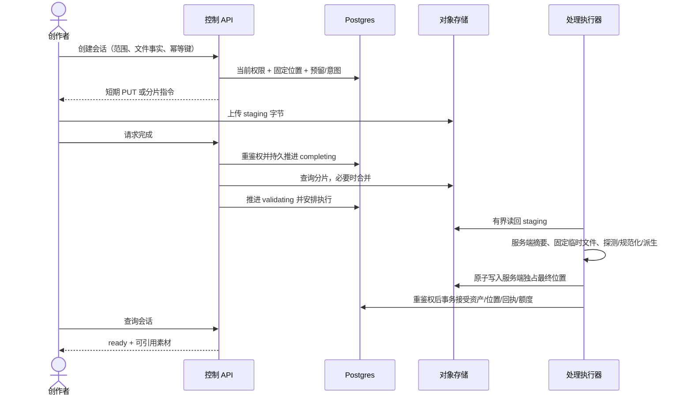
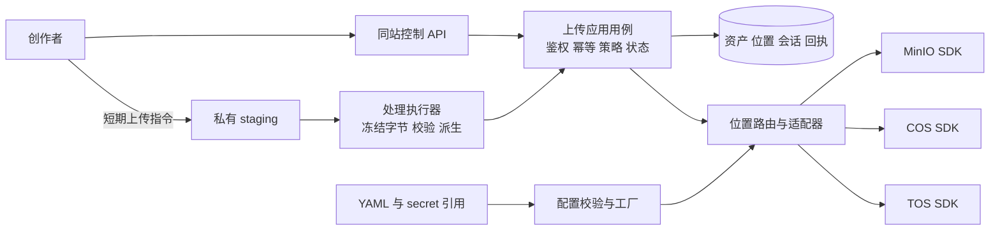

# 文件上传服务调研与架构设计

更新：2026-10-21（结构整理）；文档确认状态沿原来源，未重新认定方案接受。

## 1. 摘要

使用 MinIO、COS、TOS 的统一位置合同处理上传、读取、激活与恢复。

本文按设计、用户故事与测试场景结构整理。原需求、确认结论和历史验证沿来源记录保留；当前实施进度、剩余工作及阻塞项统一见 [BACKLOG](../../BACKLOG.md)。

### 1.1 产品定义：摘要

来源：原PRD《04-文件上传与对象存储接入》第1节。

织光需要把三家对象存储作为部署选择。创作者继续在相同素材库、编辑器和画布上传和引用；运维准备账号、私有桶、网络与凭据引用后，通过一份配置切换未来写入，同时保留旧资产和任务的准确定位。

## 2. 参与者

使用者与参与职责：上传素材的创作者及对象存储、部署职责。维护职责及确认人沿下方原来源记录；未给出姓名的，不补造人员或排期。

### 2.1 产品定义：目标用户

来源：原PRD《04-文件上传与对象存储接入》第4节。

| 用户细分         | 任务与约束                                                                                               | 首轮聚焦原因                                                     |
| ---------------- | -------------------------------------------------------------------------------------------------------- | ---------------------------------------------------------------- |
| 个人与团队创作者 | 在原个人/授权项目中上传、预览、引用、复制/转移、导出与下载，无须选桶或学习云协议                         | 切换部署资源时仍能使用旧素材与在途文件，是统一存储的直接用户结果 |
| 平台运维人员     | 准备资源、配置、诊断、激活和回退；不自动建桶或取得生产操作授权                                           | 决定未来写入何时安全切换                                         |
| 后端维护者       | 维护处理、生成与清理闭环，以小接口隔离厂商协议、统一业务接受和错误，避免重复上传实现，沿原权限与任务合同 | 确保各调用方持续按准确位置工作                                   |

人群和价值基于用户要求与源码盘点，未进行用户访谈；BYOS人群与自行管理云密钥的创作者不在本次范围。

### 2.2 需求原文与规则：角色、对象与约束

来源：原需求《05-文件上传与对象存储接入需求》第2节。

| 对象或角色         | 职责与边界                                                                                                          |
| ------------------ | ------------------------------------------------------------------------------------------------------------------- |
| 个人创作者         | 上传、查看、引用和删除自己有权使用的素材；不能选择任意桶、对象键或平台凭据                                          |
| 团队创作者         | 按当前项目权限操作团队素材；加入团队不自动获得其他人的个人素材权限                                                  |
| 平台运维人员       | 在部署配置中管理存储连接、默认写入目标、网络和凭据引用，执行接入诊断与切换                                          |
| 文件               | 用户输入的字节、显示文件名、声明类型；客户端声明不作为已验证事实                                                    |
| 素材资产           | 已完成权限、内容、处理和持久化检查的可引用业务对象；上传成功前不进入可用资产列表                                    |
| 存储配置项 profile | 一个稳定的存储实例与桶绑定，包含平台、区域、地址、访问方式和凭据引用；profile ID 不得被重用来指向另一个桶或账号资源 |
| 对象位置           | profile ID、桶、对象键组成的持久定位，原件和每份派生文件分别记录；不存永久签名 URL                                  |
| 上传会话           | 绑定本人、个人/项目范围、存储位置、文件策略、分片任务、期限和状态的可恢复操作                                       |
| 上传回执           | 已接受的业务结果和幂等证据；复用现有上传回执合同，不用临时会话取代永久回执                                          |

业务权限判断属于 identity/workspace/media，SDK 只执行服务端已经选定的对象操作。首个可验收配置使用私有、标准、扁平且从未开启版本控制的专用桶；已开启或已暂停版本控制、对象锁、归档、TOS 分层桶等不按默认兼容性放行。扩展这些能力须单独补设计与证据。

## 3. 背景

需求来源：[05-文件上传与对象存储接入需求](08-文件上传服务调研与架构设计.md#311-需求原文与规则文首来源与范围)。产品范围来源：[04-文件上传与对象存储接入](08-文件上传服务调研与架构设计.md#39-产品定义文首来源与范围)。

下方保留来源的日期、适用范围与确认状态。早期盘点和历史结果只支持其原时点；整理文档不重新执行实现、测试、迁移或发布。

### 3.1 文首来源与范围

来源：原设计《08-文件上传服务调研与架构设计》文首。

适用范围：MinIO/COS/TOS统一位置合同、接单、激活及上传恢复。文档版本：2026-10-20整理版；第7.1节已接受约束保留，代码进展与真实切换另列，本次补充待评审。维护职责：media/对象存储适配及部署职责；评审人未指定。

官方事实、当前源码事实、已明确约束、设计建议和待验证项分别标明。本文没有交付适配器代码，没有读取部署凭据、连接业务数据库或真实存储，没有执行发布和数据迁移。

实施进度及调度字段见 [BACKLOG 第4.10节](../../BACKLOG.md#410-08-文件上传服务调研与架构设计文首来源与范围)。

### 3.2 官方接入调研

来源：原设计《08-文件上传服务调研与架构设计》第3节。

原条目的当前实施进度和剩余工作已迁入 BACKLOG；其确认范围及历史证据仍按原来源使用。

### 3.3 三平台比较

来源：原设计《08-文件上传服务调研与架构设计》第3.1节。

调研时间：2026-10-15。以下仅依据官方文档和厂商维护的 SDK；产品页面可说明能力存在，不能证明实际账号、区域、服务版本和权限可用。

| 维度                   | MinIO                                                 | 腾讯云 COS                                                              | 火山引擎 TOS                                               |
| ---------------------- | ----------------------------------------------------- | ----------------------------------------------------------------------- | ---------------------------------------------------------- |
| 主要接入路径           | minio-go/v7，S3 协议                                  | cos-go-sdk-v5 原生 XML API，也有 S3 兼容入口                            | ve-tos-golang-sdk/v2 原生 API，也有 S3 兼容入口            |
| 推荐场景，属于设计判断 | 现有自建环境、本地和私有部署，便于延续当前验证        | 已使用腾讯云资源、需要托管对象存储的部署                                | 已使用火山引擎资源、需要托管对象存储的部署                 |
| 基础能力               | 对象存取、查询、删除、清单、签名、分片                | 同类基础能力，签名及元数据按 COS 原生合同                               | 同类基础能力，签名及元数据按 TOS 原生合同                  |
| 地址与身份             | 自建 endpoint，按实际 DNS/TLS 决定 path/virtual style | 原生 SDK 使用桶域名，桶名称包含 APPID；官方 S3 Go 示例使用 virtual host | 原生客户端配置 endpoint 与 region；S3 文档另有协议配置要求 |
| 主要接入风险           | 部署版本、签名网络地址、条件写实现与自建运维责任      | 签名、禁止覆盖及版本控制、分片错误/CORS/权限组合                        | 原生与 S3 签名边界、扁平/分层桶、禁止覆盖及分片专项语义    |
| 本项目接入前提         | 实际服务版本及桶策略可核验                            | 已创建符合基线的私有桶，最小权限账号与区域匹配                          | 已创建符合基线的私有扁平桶，最小权限账号与区域匹配         |

MinIO 官方 Go SDK 定义了通用 S3 客户端，并列出 Put/Get/Stat/Remove、清单及预签名能力，SDK 仓库标注 Apache-2.0。项目安装版本为 `v7.0.98`；SDK 许可不等于自建服务端的许可或支持承诺，具体服务产品、版本和部署条件须另行核对。[MinIO Go SDK](https://github.com/minio/minio-go)

腾讯云维护 `cos-go-sdk-v5`，其仓库标注 MIT，定位为 COS XML API 原生 Go SDK。腾讯云另提供 AWS S3 接入指南，Go v2 示例需要配置 COS endpoint、签名区域、virtual-host 寻址等，不能视为任意 S3 默认参数均可使用。[COS Go SDK](https://github.com/tencentyun/cos-go-sdk-v5)、[使用 AWS S3 SDK 访问 COS](https://intl.cloud.tencent.com/zh/document/product/436/32537)

火山引擎维护 Go v2 TOS SDK，初始化使用 endpoint、region 和 credentials，仓库标注 Apache-2.0。官方 S3 接入指南以扁平桶为前提，要求使用 SigV4。原生 TOS SDK 配置不能直接当成 S3 客户端配置；分层桶的第三方兼容性需要另行确认。[TOS Go SDK](https://github.com/volcengine/ve-tos-golang-sdk)、[使用 AWS S3 SDK 访问 TOS](https://docs.volcengine.com/docs/TorchObjectStorage/AccessingTOSUsingAWSS3SDK?lang=zh)、[分层桶工具说明](https://docs.volcengine.com/docs/TorchObjectStorage/SupportedtoolsHNSbuckets?lang=zh)

### 3.4 对设计有影响的事实

来源：原设计《08-文件上传服务调研与架构设计》第3.2节。

| 公开事实与证据                                                                                                                                                                                                                                                                                                             | 本项目的处理                                                                                                                          |
| -------------------------------------------------------------------------------------------------------------------------------------------------------------------------------------------------------------------------------------------------------------------------------------------------------------------------- | ------------------------------------------------------------------------------------------------------------------------------------- |
| COS 支持预签名上传/下载；TOS Go 文档支持普通预签名和 POST 表单预签名。[COS 预签名](https://www-sg.tencentcloud.com/document/product/436/45243)、[TOS 预签名概述](https://www.volcengine.com/docs/6349/173412?lang=zh)                                                                                                      | 基线用标准 HTTP PUT/GET 和分片 PUT 指令；不向浏览器发永久 Key，不强迫前端引入三套 SDK                                                 |
| COS 分片一般为 1 MB～5 GB、最多 10,000 片，末片可小于下限；TOS 官方大文件实践说明分片可单独重传和恢复。[COS 分片说明](https://intl.cloud.tencent.com/zh/document/product/436/14112)、[TOS Go 分片实践](https://docs.volcengine.com/docs/VolcanoEngineBeginnersExperiment/UseGoSDKtomultipartuploadlargefilestoTOS?lang=zh) | 产品先保留最大 500 MiB 视频，建议 8 MiB 分片；TOS 与实际 MinIO 的最小片、最大片、数量及分页逐一验证，取三个已验证能力与业务预算的交集 |
| COS 分片初始化的 `x-cos-forbid-overwrite` 在已启用版本控制时无效；官方其他资料也记录暂停版本控制的限制。[COS 初始化 API](https://cloud.tencent.com/document/product/436/7746)、[COS SDK 文档](https://staticintl.cloudcachetci.com/doc/pdf/product/pdf/436_6276_zh.pdf)                                                    | 基线限制为从未开启版本控制的专用桶，分别验证普通/分片最终写入，不允许通过条件写配置绕过检查                                           |
| TOS CopyObject 文档说明禁止覆盖参数在已启用或暂停版本控制时无效。[TOS CopyObject](https://www.volcengine.com/docs/6349/74859?lang=en)                                                                                                                                                                                      | 这是复制操作证据，不直接推导为 PUT/分片已经验收；TOS 普通和分片原子创建的参数、错误及边界列为实施前门禁                               |
| minio-go 条件写选项设置 `If-None-Match`；AIStor 兼容性页列出条件请求支持。[SDK 条件写源码](https://github.com/minio/minio-go/blob/master/api-put-object.go)、[AIStor S3 兼容性](https://docs.min.io/aistor/developers/s3-api-compatibility/)                                                                               | 继续保护已有不可变对象；实际自建 MinIO 的普通/分片行为要单独测试，不把 AIStor 当前文档当成部署证据                                    |
| COS 浏览器分片需要通过 CORS expose headers 读取 ETag，使用 CDN 时其 CORS 是另一层配置。[COS 跨域访问](https://cloud.tencent.com/document/product/436/56652)                                                                                                                                                                | 直传配置显式放行业务 Origin、必要方法和签名头，暴露 ETag；生产桶不设置通配公开权限，CDN 不进入首轮签名合同                            |

2026-10-15 进一步核对固定版本官方 SDK：COS v0.7.75 的 ObjectPutHeaderOptions.XOptionHeader 可传禁止覆盖头；TOS v2.9.10 的 PutObjectBasicInput、CreateMultipartUploadV2Input 和 CompleteMultipartUploadV2Input 提供 ForbidOverwrite。字段与方法入口已获得源码证据，实际服务的原子性、错误和版本控制边界仍由独立真实测试证明。[COS 固定版源码](https://github.com/tencentyun/cos-go-sdk-v5/blob/v0.7.75/object.go)、[TOS 固定版源码](https://github.com/volcengine/ve-tos-golang-sdk/blob/v2.9.10/tos/type.go)

### 3.5 SDK 方案选择

来源：原设计《08-文件上传服务调研与架构设计》第3.3节。

| 方案                                    | 收益                                                                  | 代价与风险                                                                                              | 建议                             |
| --------------------------------------- | --------------------------------------------------------------------- | ------------------------------------------------------------------------------------------------------- | -------------------------------- |
| 三平台都使用当前 minio-go               | 依赖少，现有代码改动较小                                              | 需证明 COS/TOS 的寻址、签名、条件写、metadata、分页、分片和错误都符合当前 SDK；厂商原生头不一定自动映射 | 已调研备选；没有合同证据时不承诺 |
| 三平台都使用 AWS S3 Go v2               | 云厂商提供相关兼容说明，生态统一                                      | 替换已有依赖；仍需厂商兼容设置及同等验证，不能解决所有扩展语义                                          | 不作为本次默认技术迁移           |
| MinIO SDK + COS 原生 SDK + TOS 原生 SDK | 延续已有 MinIO 接入，每个厂商的签名、临时凭据、元数据及扩展有明确归属 | 维护三套薄适配器及差异用例，需要统一错误与能力合同                                                      | **推荐**；业务状态与 API 共用    |

不为了减少三条必要 SDK 依赖而把协议分支散入业务，也不设计额外的“通用 S3 第四平台”。新增 SDK 的确切版本须在实现前固定、记录许可并完成漏洞/兼容检查，当前未安装 COS/TOS SDK。

### 3.6 成本与选择条件

来源：原设计《08-文件上传服务调研与架构设计》第3.4节。

COS 官方计费覆盖存储、请求、取回、流量和管理功能，上传流量不收费也不表示写请求和存储免费；TOS 官方请求费用按存储类型和请求次数计量。[COS 计费问题](https://intl.cloud.tencent.com/zh/document/product/436/10373?lang=zh)、[TOS 请求次数费用](https://docs.volcengine.com/docs/TorchObjectStorage/Requests?lang=zh)

本项目成本模型是设计建议：`总成本 = 存储 + API/分片请求 + 出口/跨区域流量 + 取回/处理 + 自建资源与运维`。需按实际地区和合同填入单价，不引用历史价格。MinIO 的自建机器、磁盘、备份和运维由部署方计入；不宣称免费或一定更便宜。

建议先按已有基础设施和真实测量选择默认目标。与生成服务同平台可能减少链路复杂度，但“同厂商即免流量”没有本轮证据。直传减少 API 服务传输压力；当前媒体处理仍需执行器读回文件，不能宣称后端完全不再传输字节。

### 3.7 当前仓库事实与缺口

来源：原设计《08-文件上传服务调研与架构设计》第4节。

基线为 `glowloom-server` / `main`；开始时已有身份、编辑器、前端及文档修改，本轮保留。以下是静态源码证据，未报告现有测试运行通过。

| 源码位置                                                                                                                                                                                                                                            | 当前行为                                                                                           | 设计缺口                                                                              |
| --------------------------------------------------------------------------------------------------------------------------------------------------------------------------------------------------------------------------------------------------- | -------------------------------------------------------------------------------------------------- | ------------------------------------------------------------------------------------- |
| [config.go](../../backend/internal/platform/config/config.go)                                                                                                                                                                                       | Viper 加载 LV_*，可由 LV_ENV_FILE 读 env 格式文件；单 endpoint/bucket/Key/region                   | 尚无多 profile YAML、默认激活版本及分平台凭据来源；不能把现有 env 文件称作已支持 YAML |
| [objectstorage.go](../../backend/internal/platform/objectstorage/objectstorage.go)                                                                                                                                                                  | 单 bucket 的 minio.Client，静态 SigV4 无 session token；Put/PutIfAbsent/Stat/Get/Remove/PresignGet | 缺原生 COS/TOS、多位置、动态临时凭据和上传签名；客户端对象永久固定一个桶              |
| [inventory.go](../../backend/internal/platform/objectstorage/inventory.go)、[project_copy.go](../../backend/internal/platform/objectstorage/project_copy.go)                                                                                        | 有界清单、精确 Exists、区分不存在与其他错误                                                        | 多平台仍需分页/错误映射及 profile 维度，不能对当前桶查询所有历史键                    |
| [upload_file.go](../../backend/internal/media/application/upload_file.go)                                                                                                                                                                           | magic/MIME、文件名、输入上限、有界临时文件、服务端 SHA-256                                         | 直传须把外部字节重新引入同等受控校验                                                  |
| [upload.go](../../backend/internal/media/application/upload.go)、[upload_personal.go](../../backend/internal/media/application/upload_personal.go)                                                                                                  | 共用探测、规范化、派生、不可覆盖写、Stat 校验、永久幂等回执；提交未知时先查资产，避免误删          | 原流程值得保留；增加固定位置、持久会话和可恢复补偿，不用云回调置 ready                |
| [workflow/upload.go](../../backend/internal/media/adapter/workflow/upload.go)                                                                                                                                                                       | 音视频/GIF、文档与模型专用探测及派生                                                               | COS/TOS 与直传都必须复用，不能只做 SDK 上传测试                                       |
| [upload HTTP](../../backend/internal/media/adapter/http/upload.go)                                                                                                                                                                                  | 相对业务 group 下 `/projects/:pid/media/uploads`、`/media/library/uploads`                         | 保留现有入口，新增会话控制合同和生成客户端                                            |
| [storage_usage.go](../../backend/internal/media/application/storage_usage.go)                                                                                                                                                                       | 实际对象占用查询，含有界清单，明确不是预留或账单                                                   | 没有已证明的容量预留合同；新限制须新增账本与并发验收                                  |
| [schema.sql](../../backend/db/schema.sql)                                                                                                                                                                                                           | media_asset/rendition 及复制、转移、清理等保存裸 object_key；media.upload_request 保存业务回执     | 缺 profile/bucket 定位；media_asset.provider_key 是 AI 来源字段，不能借用作存储平台   |
| [app wiring](../../backend/internal/app/wiring.go)、[provider wiring](../../backend/internal/app/catalog/provider_wiring.go)、[roles wiring](../../backend/internal/app/roles_wiring.go)、[public_api.go](../../backend/internal/app/public_api.go) | API 与不同后端角色分别装配单桶客户端                                                               | 所有写入、读取和执行角色都要理解旧新位置，不能只替换 HTTP 上传角色                    |

现有 PutIfAbsent 的 SHA metadata 来自服务端已计算摘要，Stat 核对大小/类型/metadata；它不证明浏览器直传的 metadata 可信。设计新增直传时必须验证实际字节，不能沿用 metadata 相等就接受的捷径。

### 3.8 文首来源与范围

来源：原任务文档《12-文件上传与对象存储接入实施计划》文首。

> 执行说明：保留原技术任务与验证步骤；本次按模板补齐规划内容，不要求调用特定技能或改变已约定的执行方式。

**Goal:** 使用三平台官方 SDK、默认 MinIO，沿现有代理上传实现配置切换，保持历史对象与在途任务位置正确。

**Architecture:** 工厂装配薄 SDK 适配器，消费方以小接口和显式 ObjectRef 操作。Postgres 持久保存资源身份、对象位置、接单目标和已激活路由，上传在读 multipart 前固定位置。所有旧读/写/清理路径迁移完成、旧程序排空后才能切换默认。

**Tech Stack:** 现有 Go 1.26.0 / toolchain 1.26.9、Gin、GORM/pgx、Viper、Wire、Temporal；MinIO SDK v7.0.98、COS SDK v0.7.75、TOS SDK v2.9.10；项目现有 OpenAPI/前端工具链仅在接口/交互变化时使用。

实施进度及调度字段见 [BACKLOG 第4.95节](../../BACKLOG.md#495-12-文件上传与对象存储接入实施计划文首来源与范围)。

### 3.9 产品定义：文首来源与范围

来源：原PRD《04-文件上传与对象存储接入》文首。

| 项目       | 内容                                                                                           |
| ---------- | ---------------------------------------------------------------------------------------------- |
| 版本与更新 | 2026-10-20 整理版；沿用原业务版本与下述盘点日期                                                |
| 文档状态   | 本次为结构整理；既有确认、实施与接受状态如下，不新增产品接受结论                               |
| 维护与决策 | 维护人未指定；范围与接受以已记录的用户确认及上游依据为准                                       |
| 交付范围   | MinIO/COS/TOS现有代理链路统一接入；直传/分片/硬容量另批接受                                    |
| 上游依据   | [需求05](08-文件上传服务调研与架构设计.md#311-需求原文与规则文首来源与范围)、[设计08](#1-摘要) |
| 迭代与证据 | [设计08](#1-摘要)；各证据层次及未执行项分别记录                                                |

更新：2026-10-15。用户已确认[设计08第7.1节](08-文件上传服务调研与架构设计.md#71-本次先明确的具体设计)，要求补齐 PRD、实施计划并基于现有链路实现。官方 SDK、默认 MinIO、历史位置和在途目标固定是确定约束。本 PRD 已形成，代码实现、真实平台和生产接受尚未完成。

上游：[原始需求05](08-文件上传服务调研与架构设计.md#311-需求原文与规则文首来源与范围) → [调研设计08](#1-摘要) → 本 PRD → [实施设计08](#1-摘要)。功能规则与 AC-UP 的唯一来源保持在 requirement，技术机制维护在 design。

### 3.10 产品定义：背景

来源：原PRD《04-文件上传与对象存储接入》第2节。

2026-10-15方案盘点时，个人/项目上传、生成结果、派生文件、复制和下载依赖一个 MinIO 客户端及隐含的当前桶。直接替换默认桶会让历史 object_key 指向错误位置，也可能让在途上传的原件、缩略图和清理目标分散到不同平台。

上述为改造前的问题基线，不代表整理日仍存在全部缺口；实施证据与剩余出口见第8.34节和设计08。

### 3.11 需求原文与规则：文首来源与范围

来源：原需求《05-文件上传与对象存储接入需求》文首。

| 文档管理项 | 内容                                                                                                                                |
| ---------- | ----------------------------------------------------------------------------------------------------------------------------------- |
| 版本与更新 | 结构整理 v0.1；2026-10-20；UP追踪标识已统一；原业务阈值保留                                                                         |
| 文档状态   | 三平台、官方SDK、默认MinIO及位置固定方案已确认；具体设计和计划接受按原文保留，本次结构补充待评审；当前运行/迁移结果不由本文重新认定 |
| 维护与评审 | 素材产品、存储工程与运维职责；具体人员未指定                                                                                        |
| 来源与性质 | 下文用户要求为原有确认记录；第3.12节为2026-10-15公开调研，第7.36节为当时源码盘点，第7.39节时间/分片参数为待评审建议                 |
| 适用范围   | 三平台统一文件链路及历史位置兼容；设计08、PRD04与设计08按原链路承接                                                                 |

原设计接受记录（2026-10-15）：具体设计已由用户确认，[PRD04](08-文件上传服务调研与架构设计.md#39-产品定义文首来源与范围)和[设计08](#1-摘要)已补齐，实施计划已接受，待开始编码。官方 SDK、默认 MinIO、历史位置和在途目标固定为已明确约束。此处“待开始编码”描述设计接受时阶段；后续部分实现与隔离验证已记录在设计08第8.28节，完整多平台切换、业务库迁移、真实存储及发布接受仍未完成。

用户明确要求：详细设计文件上传服务，接入 MinIO、腾讯云 COS、火山引擎对象存储 TOS，采用各平台官方 SDK，默认 MinIO，使用必要设计模式统一接入，通过配置切换并保证历史文件和在途上传保留正确位置。三平台、官方 SDK、默认 MinIO 和配置切换是已明确约束；接口、数据、参数和激活机制见[设计08本次具体方案](08-文件上传服务调研与架构设计.md#71-本次先明确的具体设计)，保存文档不等于接受或实现。

本需求深化[产品范围](24-产品总览与交付边界设计.md#33-需求原文与规则文首来源与范围)的 CAP-GL-21、CAP-GL-26、CAP-GL-31，并支撑多参考输入、生成结果转存和项目复制。requirement 定义行为与验收，design 维护证据、选择、接口、数据和运行机制；按先明确设计、再补 PRD/实施计划、再实现的顺序推进，不建立独立存储微服务。

### 3.12 需求原文与规则：接入调研形成的原始约束

来源：原需求《05-文件上传与对象存储接入需求》第3节。

以下为公开事实，详细来源及选择比较见[设计08调研](08-文件上传服务调研与架构设计.md#32-官方接入调研)。调研日期为 2026-10-15，未验证用户真实账号或部署。

| 平台   | 已核验的接入事实                                                                | 转化为本项目需求                                                                                                                                                                                                                                                                           |
| ------ | ------------------------------------------------------------------------------- | ------------------------------------------------------------------------------------------------------------------------------------------------------------------------------------------------------------------------------------------------------------------------------------------ |
| MinIO  | Go SDK 提供 S3 存取、预签名和分片相关能力；仓库已使用 minio-go/v7               | 复用已有接入，核对实际服务版本、签名地址、条件写和分片行为，不假定商业 AIStor 文档覆盖所有自建版本。[官方 SDK](https://github.com/minio/minio-go)                                                                                                                                          |
| COS    | 提供原生 Go SDK 和 S3 兼容接入；官方 S3 Go 示例采用虚拟主机寻址，桶名包含 APPID | 统一合同覆盖原生 COS 接入，不复用 MinIO 地址拼接；保持平台签名、错误、元数据和临时凭据的正确映射。[原生 SDK](https://github.com/tencentyun/cos-go-sdk-v5)、[S3 接入](https://intl.cloud.tencent.com/zh/document/product/436/32537)                                                         |
| TOS    | 提供原生 Go v2 SDK 和 S3 兼容接口，S3 接入文档要求 SigV4，并以扁平桶为前提      | 统一合同覆盖原生 TOS 接入，校验 endpoint、region、桶类型和签名；不能混用原生与 S3 的配置语义。[原生 SDK](https://github.com/volcengine/ve-tos-golang-sdk)、[S3 接入](https://docs.volcengine.com/docs/TorchObjectStorage/AccessingTOSUsingAWSS3SDK?lang=zh)                                |
| 跨平台 | COS 禁止覆盖头在版本控制条件下无效；TOS 的复制 API 也明确记录相关限制           | “不可覆盖写入”是强制合同，需分别验证普通及分片写入。TOS PUT/分片的 SDK 字段已进一步核对，错误及原子性仍需专项验证；不得用先查询再上传假装原子条件写。[COS 分片初始化](https://cloud.tencent.com/document/product/436/7746)、[TOS 复制](https://www.volcengine.com/docs/6349/74859?lang=en) |

用户已明确采用各平台官方 SDK 的薄适配器，共享业务状态和验收合同，默认 MinIO。全用 S3 SDK 保留为调研比较，不进入本轮实施选择。定价按部署地域、存储类型、请求与出口流量核算，本需求不固定单价或宣称某平台最便宜。

## 4. 目标

使用 MinIO、COS、TOS 的统一位置合同处理上传、读取、激活与恢复。目标的规则、量化条件与非目标沿需求原文及下方已确认设计，不增加未经确认的指标。

### 4.1 产品定义：目标

来源：原PRD《04-文件上传与对象存储接入》第3节。

让创作者在部署切换后仍能上传、找回和使用原素材，让运维能够解释写入目标并安全回退。以下三项在对应批次接受前判断，不将开发完成当作用户结果。

| 关键结果                        | 指标口径与适用人群                                   | 基线及目标                                                                    | 测量方式                                               |
| ------------------------------- | ---------------------------------------------------- | ----------------------------------------------------------------------------- | ------------------------------------------------------ |
| KR-UP-01 三平台统一存取         | 运维准备的MinIO/COS/TOS资源，各自履行同一官方SDK合同 | 2026-10-15部分本地/fixture/隔离库证据；T-UP-01～T-UP-08全部通过才接受代理接入 | AC-UP对应源码、SDK fixture、隔离库及三家真实桶分别记录 |
| KR-UP-02 切换不丢定位和权限     | 创作者历史资产、派生与在途任务                       | 每份对象有持久位置；不按新默认猜旧桶，不跨云自动重试或误删已接受对象          | 切换/回退、未知提交、读回、撤权与精确清理证据          |
| KR-UP-03 体验及后续范围如实接受 | 个人/项目上传、预览、引用、下载与后续直传能力        | 现有语义兼容；直传/分片/容量各自通过后开放；完整服务满足AC-UP-01～AC-UP-27    | 浏览器及产品接受；未通过不标完成                       |

发布后用户指标、性能实测基线和观察周期未形成，不能据此承诺增长、云费用或完成日期，见第7.34节。

### 4.2 需求原文与规则：目标与完整范围

来源：原需求《05-文件上传与对象存储接入需求》第1节。

创作者在个人素材库、团队项目、编辑器和画布上传文件，看到一致的校验、进度、失败原因和处理结果。部署人员准备好平台账号、私有桶、网络和凭据引用后，修改同一份存储配置并完成受控部署，即可切换后续上传的默认存储；前端和业务代码无须改成对应厂商协议。

“一键接入”指平台适配器已经随程序交付后，填写配置即可接入；“一键切换”指配置驱动的统一激活和回退，不包含自动开户、建桶、授予权限或搬迁历史文件。修改一个 SDK 的 endpoint 不能代替三平台接入验收。

完整范围包含：三平台统一存取、现有服务端代理上传、受控浏览器直传、分片与恢复、上传后校验和素材处理、私有读取与下载、历史位置路由、在途切换、占用统计、可配置容量限制、补偿清理、可观测性和迁移合同。直传必须通过各平台专项验收后启用；未启用时保留代理入口，其可用性另行验证，不能显示虚假的直传或恢复能力。

用户已要求后续实现业务代码；当前先提供具体设计，真实平台配置、生产迁移和发布尚未执行，需具备部署资料和相应接受条件。目标设计不包含个人/团队自带存储账号、网页密钥管理、多云双写、自动跨云故障转移、全球存储网关、CDN 私有鉴权或通用插件市场。对象存储凭据由部署配置引用管理，与 AI 平台管理员网页配置 API Key 是两条独立合同。

## 5. 使用场景

参与者为上传素材的创作者及对象存储、部署职责；在下方定义的输入、对象状态、权限和环境条件具备时执行相应操作。各故事按其独立前置条件核对，不能把测试夹具当成真实业务条件。

### 5.1 上传流程与状态机

来源：原设计《08-文件上传服务调研与架构设计》第8节。

原条目的当前实施进度和剩余工作已迁入 BACKLOG；其确认范围及历史证据仍按原来源使用。

### 5.2 代理上传

来源：原设计《08-文件上传服务调研与架构设计》第8.1节。

保留当前入口：先认证并校验范围，ReadUpload 将实际内容有界读入受控文件并计算 SHA；按现有合同探测、处理、派生、原子写入、Stat 核对、业务事务接受和返回素材。新增步骤是：在第一次外部写入前持久保存 profile 和精确对象意图，处理产物沿同一已固定策略选择位置。

请求取消沿 Context 传递；必要补偿使用有所有者、期限和预算的独立执行上下文，不能让浏览器断开取消持久对账。当前请求内 best-effort 删除升级为可恢复清理意图；不清理未知提交可能已经接受的对象。

### 5.3 直传和冻结字节

来源：原设计《08-文件上传服务调研与架构设计》第8.2节。



直传创建时客户端提供声明长度、显示名、SHA-256 和审查声明；浏览器可用可取消的分块哈希工作任务准备摘要，不能为了 500 MiB 文件调用整文件 ArrayBuffer 再占用同等内存。客户端摘要用于会话指纹和传输比对，不代替服务端事实。先核对 staging 的大小，再用 limit+1 有界读回；原始字节计算的 SHA 必须与声明匹配。

处理执行器只验证并处理自己已经读入的固定文件；最终 PUT 也使用这份文件，不在验证后重新读取可被客户端覆盖的 staging。WebM 原始摘要与规范化产物摘要分别记录，不拿原始声明与 MP4 哈希直接比较。不会因为 HEAD metadata 相同而跳过字节校验。

浏览器上传指令只允许 staging PUT 或指定 upload ID/part number 的 PUT，不允许浏览器 Complete/Abort 最终对象，也不授权最终 assets/renditions 前缀。客户端完成后再次覆盖 staging 不能改变已冻结的资产内容；晚到 staging 写由清理债务/生命周期复查处理。

### 5.4 状态与并发

来源：原设计《08-文件上传服务调研与架构设计》第8.3节。

| 会话状态                     | 含义                                             | 下一步/恢复                                                    |
| ---------------------------- | ------------------------------------------------ | -------------------------------------------------------------- |
| created                      | 固定身份、目标和策略，尚未确认外部初始化         | 完成初始化或开始普通传输；初始化响应丢失先对账                 |
| uploading                    | 允许续签和传片                                   | 暂停时保留该状态；完成或取消/过期                              |
| completing                   | 服务端核对/合并，已持久记录意图                  | 结果明确后进入 validating；回执未知进入 needs_reconciliation   |
| validating                   | 固定字节、探测、规范化与必要派生                 | 成功 publishing；输入不合法 failed；取消进入 cancel_requested  |
| publishing                   | 写最终对象并准备资产接受事务                     | 接受后 ready；外部/数据库结果未知进入 needs_reconciliation     |
| needs_reconciliation         | 某个外部/数据库操作结果不确定，保留 resume_stage | 先查平台和永久回执，恢复原阶段或进入确定终态；不重复创造新资产 |
| cancel_requested             | 已收到取消，禁止续签/新片，执行器需收敛          | 若接受事务已赢得并发锁，返回既有 ready；否则取消及安排精确清理 |
| ready                        | 永久回执和可引用资产已接受                       | 终态；重复完成返回同一资产，取消上传不能删除已接受资产         |
| failed / cancelled / expired | 操作确定不再接受                                 | 无可引用资产；独立 cleanup_pending/finished 状态继续清理和复查 |

状态修改有 revision CAS、执行租约和 fence。网络调用不持有长数据库事务；调用前持久化 intent，回写要求当前 lease/fence。完成、取消和接受在同一会话行锁下串行决定赢家；取消不能在 ready 后以补偿方式物理删除。

若创建分片任务的响应丢失，不盲目再创建。按固定 staging key 查询未完成上传并记录结果；存在歧义时保留对账或取消整个尝试并记录所有可归属任务，新的尝试使用新 key。`NoSuchUpload` 不能单独证明已经失败，要同时检查最终 staging 对象和会话 intent，区分已经合并、已经取消和真实不存在。

### 5.5 分片与恢复

来源：原设计《08-文件上传服务调研与架构设计》第8.4节。

- 以 32 MiB 阈值、8 MiB 分片、并发 3 片作为待接受建议值；策略在创建时冻结，并验证各平台限制，不使用厂商最大对象上限扩大业务文件上限。
- 创建任务、complete 和 abort 由服务端执行；浏览器只取一批具体片号的短期 URL，控制返回数量，不能一次长期授权所有任意片段。
- 片号从 1 开始，长度依据声明文件大小/分片大小计算，末片允许例外。查询所有平台分页并验证编号、大小、数量和顺序；客户端 ETag 列表不作为合并事实来源。
- 恢复时查会话和平台 ListParts，重新授权只缺失或待确认片段。前端保存会话 ID 与非秘密文件匹配信息，不持久保存 URL；刷新后重新选同文件，声明摘要不一致则禁止续传。
- 同号重传按厂商合同处理；完成前再取权威片段列表。合并回执超时持久保留 unknown，通过查询 staging 和会话事实确认，不新发另一个业务上传。
- SDK 分片写最终对象也必须通过不可覆盖专项测试；浏览器 staging 分片和服务端最终原子写是两个不同能力，不能用前者成功证明后者。

### 5.6 补偿与清理

来源：原设计《08-文件上传服务调研与架构设计》第8.5节。

创建对象前记录位置和所有权，已接受/共享引用对象不能由失败会话清理。事务提交未知先查现有永久回执和目标资产，沿当前逻辑保留可能成功的对象；清理前再次核对归属、引用、状态、版本及执行 fence。

取消/过期分片执行精确 Abort，普通 staging 执行精确 Remove；不把 `403`、超时或桶不可用当成对象不存在。清理失败保存重试，容量债务不归零。签名失效并不保证已经开始的上传立即停止，清理需在签名窗口后复查晚到对象，并以专用 staging 生命周期兜底；成功发出 Delete 不能一次性宣称不会再出现晚到写入。

暂存建议保留 48 小时，签名/会话过期、处理执行和晚到请求需要更细的清理调度。只为 staging/未完成分片设置生命周期；资产回收站和账号删除的保留期沿既有合同，不为省存储更改生产资产生命周期。

### 5.7 产品定义：体验与失败恢复

来源：原PRD《04-文件上传与对象存储接入》第6.1节。

创作者：选择文件 → 当前身份/范围授权并固定上传目标 → 有界读取/内容校验 → 处理和派生 → 同一固定配置写入/校验 → 事务接受资产和回执 → 从素材库读回和引用。切换发生在旅程中途时，本次继续原目标；下一次新请求选择新目标。

运维：准备新私有桶和凭据引用 → validate → 独立 probe → 分发含旧新 profile 的 YAML → 确认角色版本及历史定位完整 → activate expected revision → 核对新写/旧读/在途任务 → 必要时回退未来写入。任一必要条件失败不激活。

| 情况                                   | 产品行为                                                   |
| -------------------------------------- | ---------------------------------------------------------- |
| 无效配置、缺桶、缺权限、原子写能力不足 | 拒绝激活，明确缺失条件；不建桶、不自动换云                 |
| 读取文件时默认目标切换                 | 已接单请求继续原目标，原件和派生不会漂移                   |
| 旧文件缺少明确位置                     | 不按当前桶猜测；报告待定位，阻止不安全切换                 |
| 相同请求重复或换内容                   | 同内容复用永久回执；变更内容按现有冲突合同拒绝             |
| 云写入/数据库提交结果未知              | 保留对象和证据，先查平台及回执，不误删、不创建第二资产     |
| 某历史平台不可用                       | 只影响其对象并明确报错，不查询另一桶的同名文件当作成功     |
| 权限撤销、账号禁用或删除               | 停止新授权；已发签名有效窗口沿需求合同，敏感即时控制走代理 |
| 旧 profile 仍有引用或清理债务          | 拒绝禁用/删除连接，保留必要读取和精确清理                  |

### 5.8 产品定义：本次先交付：现有链路三平台统一接入

来源：原PRD《04-文件上传与对象存储接入》第6.2.1节。

| 必须交付       | 具体边界                                                                             | 需求/接受                                  |
| -------------- | ------------------------------------------------------------------------------------ | ------------------------------------------ |
| SDK 与统一接口 | 官方 SDK；原子不可覆盖写、Stat/Get、签名、清单和精确删除；平台错误统一               | FR-UP-01/02/10/18/19；AC-UP-01/02/14/24/25 |
| 配置和运维     | 严格 YAML、secret 引用、默认 MinIO、兼容旧单桶配置、validate/probe/activate          | FR-UP-02/03/17/19；AC-UP-03/04/05/22/23    |
| 历史位置和迁移 | 主文件、派生、回收站、生成暂存、源/目标快照、脚本对象与清理全部定位；先隔离增量演练  | FR-UP-13/15/20；AC-UP-17/18/20/26          |
| 代理上传与接单 | 现有个人/项目入口；读取前固定目标，内容与回执合同保持，完成时复核权限                | FR-UP-04/05/06/09/11；AC-UP-06/07/08/13/15 |
| 其他在途任务   | 生成转存、复制/转移、剧本/模型读取、导出、派生和账号注销撤权按持久位置；旧工作流兼容 | FR-UP-15/16/17；AC-UP-20/21/22/23          |
| 私有访问与占用 | 当前资产权限、短期签名及 Range、历史 profile 查询、真实占用完整性                    | FR-UP-13/14；AC-UP-17/18/19                |
| 恢复与验证     | 未知提交保留、精确对账/补偿、稳定错误与预算；各平台真实隔离桶证据                    | FR-UP-16/18/21；AC-UP-13/21/24             |

表内 FR/AC 均指需求05的 FR-UP/AC-UP。本阶段不更改上传界面或直接开放新浏览器协议；现有界面的个人/项目上传、预览、引用和下载需要回归。新增内部位置和运维命令不向创作者暴露云参数。

## 6. 价值

切换默认存储时不误读历史对象，不改变在途上传的接单位置。

### 6.1 产品定义：价值主张

来源：原PRD《04-文件上传与对象存储接入》第5节。

| 六要素                   | 个人与团队创作者                                           | 平台运维人员                                            | 后端维护者                                                |
| ------------------------ | ---------------------------------------------------------- | ------------------------------------------------------- | --------------------------------------------------------- |
| Who：谁                  | 使用个人或授权项目素材的创作者                             | 选择与维护部署资源的人                                  | 维护媒体、生成及清理的人                                  |
| Why：为什么              | 切换后仍要找到旧素材与正在上传文件                         | 要控制新写入、保留旧读并可回退                          | 要避免各模块重复实现并误定位/误清理                       |
| What before：现在怎么做  | 原入口依赖隐含当前桶，切换风险对用户不可见；这是改造前盘点 | 依赖单一MinIO配置，直接替换不能解释历史对象位置         | 调用单一客户端及隐含桶；逐处接入容易漏掉在途目标          |
| How：如何改善            | 沿同一素材库/编辑器/画布，失败状态明确                     | 配置声明资源，validate/probe后受控activate              | 薄适配器与持久位置/目标，沿统一接受和恢复合同             |
| What after：之后得到什么 | 旧素材、派生和当前请求仍可准确读回与使用                   | 可解释每次写入目标并回退未来写入                        | 按精确位置读写和清理，错误和证据可追查                    |
| Alternatives：替代方式   | 手动下载重传或另存本地；本方案保留原素材关系与权限         | 继续单MinIO或人工搬迁；本方案支持部署选择且保留历史定位 | 分模块接SDK或通用网关；本方案复用业务接受合同而不新建服务 |

价值表述：部署资源可选择，创作者仍沿原工作流使用准确的素材，维护者能核对每份对象与任务的真实位置。替代流程是方案比较，未被用户研究验证。

## 7. 方案

### 7.1 本次先明确的具体设计

来源：原设计《08-文件上传服务调研与架构设计》第1节。

原条目的当前实施进度和剩余工作已迁入 BACKLOG；其确认范围及历史证据仍按原来源使用。

### 7.2 已明确的约束和方案选择

来源：原设计《08-文件上传服务调研与架构设计》第1.1节。

用户已明确：三平台均采用官方 Go SDK，默认 MinIO，通过配置切换，沿现有上传链路实现，历史文件和在途上传保留正确位置。本轮选择“三套官方 SDK + 统一业务接口”；全用 minio-go 或 AWS S3 SDK 的比较保留作调研依据，不作为本轮实施选项。

| 决策     | 本次设计                                                                                                                                                                                      |
| -------- | --------------------------------------------------------------------------------------------------------------------------------------------------------------------------------------------- |
| SDK      | MinIO 使用现有 `github.com/minio/minio-go/v7`；COS 使用 `github.com/tencentyun/cos-go-sdk-v5`；TOS 使用 `github.com/volcengine/ve-tos-golang-sdk/v2`。新增版本在实施前固定，不使用浮动 latest |
| 默认平台 | MinIO；初始规范 profile ID 为 `minio-main`。省略 default_write_profile 时只有存在有效 minio-main 才采用默认值；明确选择 COS/TOS 后配置无效就失败，不静默退回 MinIO                            |
| 业务路径 | 先接通现有个人/项目代理上传、内容探测、规范化、派生、回执及精确清理。直传、分片和容量限制保留在完整需求，单独验证后开放，不随 SDK 装配自动启用                                                |
| 配置     | 同一 YAML 声明多个 profile，MinIO 单平台部署只需准备 MinIO；未启用且没有历史引用的 COS/TOS 可不声明。凭据仅引用 env/secret 文件                                                               |
| 历史定位 | 持久位置为不可变的 profile_id + bucket + object_key；资产、派生和快照引用独立位置，查询/下载/删除不使用当前默认桶                                                                             |
| 在途定位 | 上传接单时持久固定 profile、配置 revision 和策略；输出转存、复制/转移和导出在创建意图时固定。后续步骤不能重新选择默认平台                                                                     |
| 生效方式 | 配置发布、角色加载及诊断完成后，由部署命令 CAS 激活全局路由；不做进程内热更新，各角色启动不自行改默认                                                                                         |
| 回退     | 激活失败保留原路由；回退只改变未来操作，保留理解多位置的程序和所有历史 profile                                                                                                                |

只替换全局 Client 会把旧键投向新桶，也可能让主文件和缩略图漂移，因此不采用。多云双写增加副本一致性、费用和补偿，本需求不要求该能力。

### 7.3 实际模块和接口变化

来源：原设计《08-文件上传服务调研与架构设计》第1.2节。

保留 platform/objectstorage 作为 SDK 构造和传输基础，各平台负责签名、metadata、分页和错误；media/adapter/objectstorage 将其映射成消费方小接口并按位置路由，app 为 API、media/provider worker 和其他消费者统一装配。应用用例负责权限、内容处理和事务接受。

ObjectRef 是不含 SDK 的定位值，包含 ProfileID、Bucket、Key；location ID 用于数据库关联。PutIfAbsent、Stat、Get、PresignGet、Remove 和清单逐步采用显式位置合同，不能用 Context 隐藏目标或从键字符串猜平台。消费者只获得所需的小接口。

现有 [operation staging adapter](../../backend/internal/operation/adapter/staging/objects.go) 直接依赖 minio.ErrorResponse，必须转为统一可判定错误；不能上传已支持 COS/TOS，却让生成结果恢复仍按 MinIO 错误判断。复制、转移、模型/剧本读取、导出、容量和账号注销撤权均纳入位置改造。

### 7.4 在读取文件前绑定上传目标

来源：原设计《08-文件上传服务调研与架构设计》第1.3节。

当前 Handler 先认证/范围授权，再读取 multipart，应用服务随后写对象。新增接单步骤放在授权成功、并发槽位和幂等键检查通过之后、readMultipartUpload 之前：短事务读取并锁定已激活路由，为 actor/个人或项目范围/request_key 创建或复用上传意图，保存 profile/revision/策略。读取、探测、原件/派生写入、回执和补偿全部使用该意图。

旧客户端继续传 multipart，不新增云平台或哈希字段要求。代理输入的文件名、实际大小和 SHA 在现有有界读取后补充并校验；已有回执继续验证内容冲突，不能仅凭同一接单键把不同字节认作重放。直传会话另要求声明摘要，仍由服务端校验。

第一次多平台发布先保留原 MinIO 默认：部署支持位置的新程序、迁移明确的原对象和任务，再排空不支持固定位置的旧 API 请求/活动实例。旧任务只能按已证明的原 MinIO 绑定处理，未知来源阻止切换。旧二进制仍接单时不能激活 COS/TOS 并承诺旧请求安全。

### 7.5 持久化与唯一性

来源：原设计《08-文件上传服务调研与架构设计》第1.4节。

新增 storage_profile、storage_route、object_location 和必要上传意图/会话；现有 upload_request 保留成功回执职责。media_asset/rendition 和需要稳定定位的源/目标快照引用位置。只登记位置却不修改旧读写路径不满足接受条件。

profile ID 与资源身份不可改义；同一物理资源/桶禁止注册两个 profile 别名，以免重复统计。同资源地址或凭据轮换保持身份，换实例、账号资源或桶创建新 profile。旧 MinIO 单桶兼容模式首次登记为 minio-main，与初始 YAML 使用同一身份，不重复建立 legacy/minio 别名。

增量迁移单独审阅和演练，不重放 schema 清库。原件、派生、回收站、生成暂存、复制/转移、导出和清理历史位置全部明确后，才允许新默认激活。

### 7.6 配置激活的操作合同

来源：原设计《08-文件上传服务调研与架构设计》第1.5节。

现有 [glowloom 命令入口](../../backend/cmd/glowloom/main.go) 的 `storage` 子命令已提供 validate（离线严格校验）、probe（显式隔离写探针）、activate（expected revision CAS）及回填/清理命令。activate 还检查最终数据库约束、历史绑定、完整引用、桶状态证明、探针和全角色就绪；当前消费者装配和最终约束未完成，不能开放生产切换。命令只在隔离 fixture 中验证，没有执行生产迁移或激活。

先分发含旧新 profile 的同一 YAML，确认必要 API/worker 已加载该配置 revision，再执行一次 activate。接单和激活事务锁定同一 storage_route 行，以串行顺序确定切换时刻：先接单的请求固定旧目标，后接单的请求固定新目标。所有云网络操作在事务外执行。

两侧 SDK/凭据和位置保留到引用和在途任务收敛。旧 profile 不再接新写入后，必要清理角色仍有精确删除能力；历史引用和清理债务清空才允许禁用。配置切换不搬迁历史字节。

### 7.7 设计接受与后续顺序

来源：原设计《08-文件上传服务调研与架构设计》第1.6节。

审阅重点为全部消费者是否采用位置合同、目标是否在 multipart 读取前固定、历史位置是否可证明、全局激活及旧程序排空是否可执行。用户已确认上述具体设计；[PRD04](08-文件上传服务调研与架构设计.md#39-产品定义文首来源与范围)和[设计08](#1-摘要)现已补齐，映射原需求 FR-UP/AC-UP，按已接受计划以失败测试→实现→验证推进。编号在实际写入前再次检查，保留并行文档和迁移。

官方 SDK、默认 MinIO 已明确，不再作为待选项；这一版接口/数据/激活方案已由用户确认，尚未实现。真实 COS/TOS、普通/分片条件写、业务库迁移和产品接受继续分别保留门禁。

### 7.8 建议方案

来源：原设计《08-文件上传服务调研与架构设计》第2节。

在现有后端 media 模块内统一上传业务，使用 **MinIO / COS / TOS 官方 SDK 薄适配器 + 消费方小接口 + 配置工厂 + 显式依赖注入**，默认 MinIO。YAML 定义多个稳定 profile，默认目标只决定新任务；已保存对象、上传会话、工作流和清理任务按其持久位置访问。前端只接收标准上传指令与素材状态。

先让三平台在现有代理链路满足同一合同，再启用已经通过专项验证的直传和分片能力。直传原件进入 staging，服务端对读回的固定字节执行现有校验、规范化、派生和资产接受流程。必须证明最终对象不可覆盖、历史定位正确、未知结果可对账，才能接受接入。



这里的工厂解决“选哪个实现”，策略解决“按哪个位置执行”，适配器解决“厂商协议如何映射”。不增加独立存储微服务、动态加载插件、全局单例或 Java 式 Controller/Service/DAO 层。

### 7.9 分层、接口与设计模式

来源：原设计《08-文件上传服务调研与架构设计》第5节。

原条目的当前实施进度和剩余工作已迁入 BACKLOG；其确认范围及历史证据仍按原来源使用。

### 7.10 职责分配

来源：原设计《08-文件上传服务调研与架构设计》第5.1节。

| 层                          | 负责内容                                                              | 不承担内容                                   |
| --------------------------- | --------------------------------------------------------------------- | -------------------------------------------- |
| media/domain                | 对象定位值、素材事实、文件策略和合法状态/不变量                       | SDK 类型、HTTP 签名、部署配置读取            |
| media/application           | 当前权限、会话/回执幂等、固定位置、处理协调、业务接受、预留和补偿判定 | COS/TOS/MinIO 条件分支、云 API JSON/XML 解析 |
| media/adapter/http          | DTO、状态码、请求取消、生成合同                                       | 把云上传成功直接变成 ready                   |
| media/adapter/objectstorage | 路由固定位置、转换小接口、SDK 错误及 metadata、能力实现               | 决定用户/团队权限和业务接受                  |
| platform/objectstorage      | 复用现有 MinIO 传输基础，容纳必要的 SDK 构造和传输配置                | 反向依赖 media/application，维护租户权限     |
| app composition             | 解析配置、创建连接、选择适配器、装配各角色                            | 无处不在的可变全局默认客户端                 |
| Postgres / workflow adapter | 持久事务、会话状态、执行租约、对账与清理                              | 用 SDK 重试替代永久幂等证据                  |

保持 `adapter → application → domain`。接口由实际消费者定义；现有 UploadObjects、ObjectStore、ObjectSigner、StorageUsageObjects 等按需要增加位置参数，不用一个几十方法的全局 StorageService。

### 7.11 小接口草案

来源：原设计《08-文件上传服务调研与架构设计》第5.2节。

以下是目标合同示意，不是已实现 Go 文件；类型按最终边界保持显式转换，不把 SDK 类型带进内层。

```go
type ObjectRef struct {
    ProfileID string
    Bucket    string
    Key       string
}

type ObjectFacts struct {
    Size        int64
    ContentType string
    SHA256      string
    ETag        string
}

type ObjectReader interface {
    Get(context.Context, ObjectRef) (io.ReadCloser, error)
    Stat(context.Context, ObjectRef) (ObjectFacts, error)
}

type ImmutableWriter interface {
    PutIfAbsent(context.Context, ObjectRef, io.Reader, ObjectFacts) error
}

type ObjectRemover interface {
    Remove(context.Context, ObjectRef) error
}

type ObjectSigner interface {
    PresignGet(context.Context, ObjectRef, time.Duration) (AccessGrant, error)
}
```

分片另设消费方接口，覆盖 Initiate、PresignPart、ListParts、Complete、Abort；清单另设分页接口。ObjectRef 从已经授权的资产/快照/会话产生，不能直接由 HTTP 请求绑定。Reader 的调用方负责关闭；Get 延迟错误必须在读取时处理。重试前将文件 seek 至起点或重新打开受控文件，不重放已消费的一次性流。

### 7.12 模式的必要性

来源：原设计《08-文件上传服务调研与架构设计》第5.3节。

| 模式           | 本设计用法                                                                     | 最小实现边界                                                               |
| -------------- | ------------------------------------------------------------------------------ | -------------------------------------------------------------------------- |
| 工厂 Factory   | 在装配时按 provider=minio/cos/tos 创建已校验的具体连接                         | 显式 switch 与构造函数即可；未知 provider 返回配置错误，不做运行时反射注册 |
| 策略 Strategy  | 路由器按 ObjectRef.ProfileID 选择适配器；默认 profile 只在创建新操作时读取一次 | 历史读取不能调用 DefaultClient，所有外部副作用都有固定 Ref                 |
| 适配器 Adapter | 原生 SDK 的签名、元数据、条件写、分页与错误转换成消费者合同                    | 不在 application 散落云平台判断，不手写各云签名算法                        |
| 显式依赖注入   | app 向上传、读取、转存、清理角色注入所需能力                                   | 不新增全局单例，不让领域读 YAML                                            |
| 状态机与补偿   | 持久记录外部意图、未知结果、接受和清理                                         | 复用现有事务/执行机制，不引入通用 Saga 框架或空模板方法层                  |

SDK 原有重试、业务对账、指标包装各有明确所有者。没有实际需求的装饰器、责任链和抽象工厂不预建。

### 7.13 配置文件与一键切换

来源：原设计《08-文件上传服务调研与架构设计》第6节。

原条目的当前实施进度和剩余工作已迁入 BACKLOG；其确认范围及历史证据仍按原来源使用。

### 7.14 YAML 草案

来源：原设计《08-文件上传服务调研与架构设计》第6.1节。

拟新增 `LV_OBJECT_STORAGE_CONFIG` 指向存储 YAML；这是目标设计，当前 Load 尚未支持。下面的域名、桶名和 env 名都是示例，不是已部署资源。没有准备好的 profile 可以不声明；默认或被历史对象/任务引用的 profile 不得省略。

```yaml
object_storage:
  schema_version: 1
  revision: storage-20261015-01
  default_write_profile: minio-main
  upload:
    mode: relay
    signed_url_ttl: 10m
    session_ttl: 24h
    multipart_threshold_bytes: 33554432
    part_size_bytes: 8388608
    part_concurrency: 3
    staging_retention: 48h
  access:
    preview_ttl: 5m
    max_signed_url_ttl: 15m
  limits:
    max_image_bytes: 20971520
    max_video_bytes: 524288000
    max_audio_bytes: 104857600
    max_model_bytes: 67108864
    max_document_bytes: 20971520
    per_scope_capacity_bytes: null
  profiles:
    minio-main:
      provider: minio
      mode: read_write
      endpoint: https://minio.storage.example
      signing_endpoint: https://minio.storage.example
      bucket: glowloom-assets
      region: us-east-1
      addressing_style: path
      credentials:
        source: env
        access_key_env: GLOWLOOM_MINIO_ACCESS_KEY
        secret_key_env: GLOWLOOM_MINIO_SECRET_KEY
    cos-main:
      provider: cos
      mode: read_write
      endpoint: https://glowloom-1250000000.cos.ap-shanghai.myqcloud.com
      bucket: glowloom-1250000000
      region: ap-shanghai
      credentials:
        source: env
        access_key_env: GLOWLOOM_COS_SECRET_ID
        secret_key_env: GLOWLOOM_COS_SECRET_KEY
    tos-main:
      provider: tos
      mode: read_write
      endpoint: https://tos-cn-shanghai.volces.com
      bucket: glowloom-assets
      region: cn-shanghai
      credentials:
        source: env
        access_key_env: GLOWLOOM_TOS_ACCESS_KEY
        secret_key_env: GLOWLOOM_TOS_SECRET_KEY
```

`mode: relay` 保留代理；`direct` 只有平台直传与业务验收通过后可激活。模式在会话创建时冻结，不在一次上传中悄悄改协议。客户端可以在 direct 不可用时，经服务端明确返回指令创建新的 relay 会话；未知结果不自动重复提交。

COS 原生 SDK 的 endpoint 是桶域名；TOS 原生 SDK 的 endpoint 是服务地址，桶在操作参数中传入；MinIO 的 path/virtual 选项由配置明确选择。原生 COS/TOS 不接受无效的 MinIO 专用 addressing_style 字段，严格校验未知字段。

signing_endpoint 可与服务端访问地址不同，但必须指向同一个已绑定存储资源，且按对外 Host 签名后能真实访问。不允许生成 URL 后替换 Host/Scheme/Path；签名不覆盖错误地址的“修正”。COS/TOS 自定义域名或内外网差异要专项验证，未经验证只用官方可访问地址。TLS CA 与 transport 可按部署需要注入，生产不能关闭证书校验。

### 7.15 配置优先级与凭据

来源：原设计《08-文件上传服务调研与架构设计》第6.2节。

1. 存储 YAML 是新模式下的唯一非秘密期望配置；配置文件路径由 `LV_OBJECT_STORAGE_CONFIG` 指定。其他非存储 LV_* 沿原合同加载。
2. YAML 模式与旧的单桶 `LV_OBJECT_STORAGE_ENDPOINT/BUCKET/ACCESS_KEY/SECRET_KEY/REGION` 同时生效时返回来源冲突，要求部署清除旧存储字段，不逐字段混合覆盖。
3. 无 YAML 时可在兼容阶段维持旧 MinIO 单桶模式，首次显式登记 `minio-main` 身份，初始 YAML 沿用该 ID 和同一核验资源，不另造同桶别名。兼容模式不具备三平台切换承诺，存量绑定迁移完成前不得激活新默认。
4. credentials.source 首个实现支持 `env` 或 `file`：文件只保存 secret 挂载路径，按 schema 加载 AK/SK 及可选 token/到期时间，文件权限和最大长度受控；禁止 YAML 内联 Key。
5. 临时凭据不能作为永久静态 token 使用。通过 SDK credential provider 或受控 secret 更新读取当前值，在续签/长传输时处理过期；签名有效期不得超过凭据剩余寿命减时钟余量。首个可验收部署可使用最小权限静态服务账号，启用临时来源前补各云刷新测试，不自动访问实例 metadata 获取身份。
6. 非秘密连接身份、策略及配置 revision 可持久化；秘密、token 和完整签名 URL 不进入业务表、会话回执、审计或配置 checksum。

### 7.16 校验和诊断

来源：原设计《08-文件上传服务调研与架构设计》第6.3节。

离线校验包括 schema/未知字段、provider、ID/桶/区域、HTTP(S) origin、禁止 userinfo/query/fragment、厂商地址语义、时间单位、文件和处理预算、分片范围、唯一默认目标、凭据来源冲突。生产必须 HTTPS；HTTP 仅允许显式 local 测试配置。YAML 不进行任意 shell/env 表达式求值，只解析声明的 secret 引用。

在线诊断分两类：只读诊断确认桶身份、访问和所需桶状态；专项写探针在独立保留前缀生成小对象，验证条件写、Stat、实际读回和删除，并留下自身未清理目标。写探针只由显式部署诊断执行，普通 readiness 不持续写测试文件；检查成功不得自动修改策略或建桶。

必须核验桶私有、扁平、从未开启版本控制，以及所选操作的最小权限。桶状态读取权限和诊断权限单列，不能为方便而让普通上传角色获得整个账号管理员权限。诊断无法证明状态时报告缺失条件，不读取失败后假定默认值。

### 7.17 激活、在途会话与回退

来源：原设计《08-文件上传服务调研与架构设计》第6.4节。

YAML 的 default_write_profile 是期望状态；数据库一条 `media.storage_route` 记录全局已激活的 profile 和 revision，属于部署配置的激活快照，不是第二个用户可编辑配置源。各 API/worker 装载快照时需校验自己的配置包含并支持此目标，版本不匹配的实例拒绝新写入接单。

| 步骤           | 可观察结果                                                                                                                |
| -------------- | ------------------------------------------------------------------------------------------------------------------------- |
| 准备新 profile | 旧 profile 保留；新桶、凭据及能力完成诊断，默认写入尚未改变                                                               |
| 分发同一 YAML  | 各写入/读取/处理/清理角色加载旧新 profile；先保证消费者能力，再改变默认                                                   |
| 激活部署版本   | 部署流程等待必要角色就绪，使用 expected revision 做一次 CAS，切换全局默认；失败不改变原路由                               |
| 新建操作       | 创建会话或生成输出意图时，在事务中保存当前已激活 profile 与策略；路由激活与创建按同一行锁/CAS 串行判定                    |
| 在途操作       | 从会话/工作流自己的位置执行，不重新读取 default；原 profile 继续保留 write 权限直到在途写入/重试/补偿全部收敛             |
| 降为只读       | 确认无在途写任务后才将旧 profile 改成 read_only；仍有精确清理任务时保留专门删除权限，不能把运维“只读”解释为可丢弃清理债务 |
| 回退           | 将期望 default 改回旧 profile 并激活新 revision，只影响未来操作；两边现有资产位置不变                                     |

profile.mode 描述接单策略；旧位置的必要删除能力由清理角色单独控制。`disabled` 表示不能访问，只有资产、快照、会话、迁移与清理引用均已清空才可使用；不得把有历史对象的旧 profile 禁用来代替迁移。

“一键”由部署流程封装配置校验、角色就绪、原子激活与结果检查；不需要逐个业务改代码。本段“尚无诊断/激活命令”为方案初稿时点，第7.6节已记录后续命令实现和隔离fixture证据；未执行生产迁移或激活的边界不变。首个实现不做进程内热更新或自动多云故障转移。滚动部署时绝不允许每个实例启动自行覆盖 storage_route。

### 7.18 持久化与位置模型

来源：原设计《08-文件上传服务调研与架构设计》第7节。

原条目的当前实施进度和剩余工作已迁入 BACKLOG；其确认范围及历史证据仍按原来源使用。

### 7.19 核心表草案

来源：原设计《08-文件上传服务调研与架构设计》第7.1节。

| 表                    | 关键字段                                                                                                                                                                                                                               | 约束                                                                                                                                       |
| --------------------- | -------------------------------------------------------------------------------------------------------------------------------------------------------------------------------------------------------------------------------------- | ------------------------------------------------------------------------------------------------------------------------------------------ |
| media.storage_profile | id text PK、provider、resource_identity、bucket、region、create_time                                                                                                                                                                   | 只存非秘密资源身份；ID 的含义不可改，凭据轮换或同资源网络地址调整不改变身份                                                                |
| media.storage_route   | 固定 id、profile_id FK、revision、activated_at                                                                                                                                                                                         | 只有一条默认写入路由，修改要求 expected revision；不保存 Key                                                                               |
| media.object_location | id uuid PK、profile_id FK、bucket、object_key、byte_size、content_type、sha256、etag、state、revision、timestamps                                                                                                                      | unique(profile_id,bucket,object_key)；身份元组不可改；verified 时 size>=0、摘要为 64 位十六进制；用户媒体资产仍要求 size>0；客户端不能修改 |
| media.upload_session  | id、actor_id、scope_kind、scope_id、request_key、request_fingerprint、declared_size/sha256/name、profile_id、policy_snapshot、staging_location_id、provider_upload_id、status、revision、lease/fence、expires_at、asset_id、error_code | unique(actor_id,scope_kind,scope_id,request_key)；个人/项目二选一；平台 upload ID 只由适配器记录；状态与 asset_id 对应                     |
| media.upload_part     | session_id、part_number、observed_size、etag、verified_at                                                                                                                                                                              | unique(session_id,part_number)，编号和大小受策略限制；平台查询是确认事实，客户端 ETag 仅提示                                               |
| 容量预留记录          | scope、session/job、reserved_bytes、accepted_bytes、cleanup_debt、status、revision                                                                                                                                                     | 仅在容量限制能力实施时增加；沿现有范围锁序，扣计和释放均幂等，不混入生成积分结算                                                           |
| 现有业务回执/清理意图 | media.upload_request 等现有合同扩充位置引用和必要指纹；已有清理任务扩充 profile/位置                                                                                                                                                   | 成功回执保持永久幂等语义；未知提交不删除已接受资产                                                                                         |

object_location 的 state 为 reserved、verified、removal_pending、removed；其内容事实验证后不可改。staging 与最终位置是不同对象，ready 资产不引用可被浏览器重写的 staging。临时会话有效期只限制继续上传，不等于数据库记录或成功回执的保留期；终态会话/幂等墓碑按审阅后的保留合同清理。

### 7.20 与现有对象的关系

来源：原设计《08-文件上传服务调研与架构设计》第7.2节。

media_asset 增加主文件 object_location_id，rendition 增加自己的 object_location_id；主文件与派生文件可以处于不同历史 profile，不根据主文件推导所有派生位置。相同键在不同平台不冲突。

复制、转移、打包、生成输出、深度/音频处理、剧本读取和清理意图保存完整位置快照或 location ID。对事务/重试需要固定源内容的流程，保存被接受时的位置及 SHA，不在执行时重新解析“最新位置”。资产的可变当前指针与历史快照分开，跨云迁移不能静默改变已提交生成的输入。

存量 object_key 字段可在迁移阶段双写，最终由 object_location/ObjectRef 合同取代其隐含桶语义。不得把 profile 拼入 object_key 伪装成原字段，也不得借用 AI provider_key。既有 schema.sql 维护最终态，业务库使用单独审阅的增量 SQL；本轮不修改任何 SQL。

### 7.21 对象键

来源：原设计《08-文件上传服务调研与架构设计》第7.3节。

新键建议由服务端随机 ID 和已验证的归属创建，例如：

```text
staging/<scope-kind>/<scope-id>/<session-id>/<attempt-id>/source
assets/<scope-kind>/<scope-id>/<asset-id>/<content-id>.<extension>
renditions/<scope-kind>/<scope-id>/<asset-id>/<rendition-id>.<extension>
```

这些是目标命名示例，存量键原样保留；现有 key 校验及范围清单逻辑要同步适配。禁止邮箱、原始文件名、路径穿越、任意 URL 或客户端指定键。随机键避免正常操作冲突，但不能代替不可覆盖原子写的合同。

### 7.22 容量与占用

来源：原设计《08-文件上传服务调研与架构设计》第7.4节。

当前容量页面仅统计实际对象，未证明并发配额功能；默认 `per_scope_capacity_bytes: null` 保持未设套餐。限制启用时，范围事务内校验 `已接受及保留占用 + 清理债务 + 未消费预留 + 本次预留 <= 限额`，并先预留原件、staging 和必要派生的可接受上界。预算不足时拒绝，不先上传再侥幸补扣。

接受事务将预留转换为实际归属占用并释放余额。失败释放未使用预留；已经写出的孤儿/暂存对象转换成 cleanup debt，物理占用不凭业务失败归零，清理确认后才消除债务。直传权限不能在所有平台严格保证用户声明长度，因此另设单会话、单范围暂存/未完成分片预算和桶端限额/生命周期，不把创建时声明的大小视为防刷证明。

物理用量按 profile/bucket/key 去重，跨平台副本分别计数；回收站和不确定输出仍占空间。清单分页必须完整完成，超预算/权限/网络失败返回 unavailable；结果标注 calculated_at，不能宣称并发写入下的瞬时账单一致性。quota 账本提供并发准入，周期对象核对修正偏差；未完成存量核对时不启用硬限制。

### 7.23 HTTP 与前端合同

来源：原设计《08-文件上传服务调研与架构设计》第9节。

以下为目标相对路由，沿项目既有业务 group 前缀，不新建另一套 API 版本。现有代理入口继续返回其既有资产合同；新增异步会话独立返回 session，不静默改变旧客户端的成功语义。

| 方法与相对路由                                      | 输入/响应要点                                                                                                                                 | 权限与幂等                                                       |
| --------------------------------------------------- | --------------------------------------------------------------------------------------------------------------------------------------------- | ---------------------------------------------------------------- |
| POST `/media/upload-sessions`                       | scope=personal/project、project_id（仅项目）、file_name、declared_size、declared_sha256、审查声明；返回 session_id/status/mode/期限和传输指令 | 当前范围授权，Idempotency-Key；客户端无 provider/bucket/key 字段 |
| GET `/media/upload-sessions/:sid`                   | 状态、期限、处理阶段、错误/可重试信息；ready 才返回原入口对应素材摘要                                                                         | 当前本人及范围授权；不返回内部平台 upload ID                     |
| POST `/media/upload-sessions/:sid/upload-signature` | 普通 staging PUT 的续签指令                                                                                                                   | 重新授权，仅 created/uploading，期限受会话和凭据限制             |
| POST `/media/upload-sessions/:sid/parts/signatures` | 服务端验证的片号数组，返回 method/url/required_headers/expires_at                                                                             | 限片数/频率，绑定该会话固定 upload ID                            |
| GET `/media/upload-sessions/:sid/parts`             | 平台已确认片号、长度和 ETag，必要时业务分页游标                                                                                               | 当前授权；平台游标不允许客户端改成任意对象查询                   |
| POST `/media/upload-sessions/:sid/complete`         | expected_revision，可带客户端片段提示；返回 ready 或 202 处理/对账状态                                                                        | 重鉴权、持久意图、重复调用返回同状态/回执                        |
| POST `/media/upload-sessions/:sid/cancel`           | expected_revision；返回终态或 cancel_requested                                                                                                | 行锁/CAS 决定与完成的并发；不能通过取消上传删除 ready 资产       |
| 现有素材查询/预览/下载                              | 按资产权限解析 location 并生成临时访问；下载支持文件名和 Range                                                                                | 不以 session 权限替代资产当前权限；对每份 rendition 独立定位     |

上传指令统一为 `method`、`url`、`required_headers`、`expires_at`、可选 `part_number`；平台需签名的 Content-Type/校验等头必须原样发送。指令 URL 是敏感短期访问能力，只存在于当前操作内存，不出现在埋点、错误截图或持久日志中。

控制 API 继续通过项目同站代理、生成 API 客户端和统一请求层。对象 PUT 使用独立的受限 HTTP 传输，不经过会附加织光 Cookie/Authorization 的业务拦截器；使用 `credentials: omit`，支持进度和 Abort。后端 DTO/路由按 PROJECT 的 swag → @umijs/openapi 合同生成流程维护，不能在前端组件手写另一套业务 API。

前端状态建议：准备文件摘要 → 上传中/可暂停 → 服务端处理中 → 已可用；把重试当前传输、查询未知结果和创建新尝试分开。处理失败保留服务端状态与可操作提示，刷新按 session ID 恢复，ready 后才允许在编辑器/画布引用。

### 7.24 读取、签名与撤销

来源：原设计《08-文件上传服务调研与架构设计》第9.1节。

素材查询先检查身份、资产/项目及当前可引用状态，再按持久位置生成 GET 权限。预览默认 5 分钟且不超过 15 分钟，TTL 还受凭据寿命约束；URL 到期时重新鉴权。签名绑定最终域名和响应头，下载文件名经安全 Content-Disposition 编码，主动内容按既有策略下载而不任意内联执行。

视频 Range、MIME、缓存及跨域必须真实验证。资产 ID 和位置持久化，签名 URL 不作为数据库引用或内容身份。账号禁用、撤权或删除立即停止新签名；已发签名可继续工作到到期或对象不可读，不能承诺逐个即时撤销。确需立即控制的敏感内容走带当前权限校验的服务端读取代理。

生成提供方拉取私有输入沿已有输入授权合同，按任务实际拉取窗口单独限制凭据期限与内容；不能为方便无限延长所有创作者预览 URL。短签名不足以满足某个模型协议时须单独验收服务端转送方案，不公开整个桶。

### 7.25 厂商映射与错误处理

来源：原设计《08-文件上传服务调研与架构设计》第10节。

| 能力      | MinIO 适配                                           | COS 适配                                                          | TOS 适配                                                   |
| --------- | ---------------------------------------------------- | ----------------------------------------------------------------- | ---------------------------------------------------------- |
| 写入      | 复用当前 SDK，准确设置类型/大小和服务端 SHA metadata | 原生对象上传，转换 Content-Type/自定义 metadata，必要时 SDK 分片  | 原生 v2 对象上传，转换相同事实，必要时 SDK 分片            |
| 不可覆盖  | 条件写头及实际部署版本，普通/分片分别验收            | 正确传播原生 forbid-overwrite 并验证桶版本条件，普通/分片分别验收 | 原生条件创建参数、版本条件及错误待专项确认，不先查后写模拟 |
| 查询/读取 | Stat/Get，注意 Get 的延迟读取错误                    | Head/Get，按原生 metadata 头规范转换                              | Head/Get，按原生 metadata 头规范转换                       |
| 分页清单  | 保留当前有界逻辑，向外映射统一游标                   | SDK continuation/marker 转换，完整遍历                            | SDK continuation/marker 转换，完整遍历                     |
| 签名      | 服务端访问与公网签名可能使用分别装配的客户端         | 原生签名及桶地址，required_headers 与 token 一致                  | 原生 v2 签名、region/endpoint 及 token 一致                |
| 精确删除  | 仅本业务授权 Ref                                     | 删除不存在映射为幂等，权限失败不能吞掉                            | 同等合同；不支持桶型或归档状态明确拒绝                     |

每个 adapter 返回统一 ObjectFacts，metadata key 大小写及平台前缀显式转换。SHA 是服务端验证事实；ETag 保持不透明，合并时保留 SDK 所需格式，不全局删引号或当成 MD5。请求 HTTP 成功还需确认 SDK 业务结果和对象事实，不能只看 200。

| 统一错误                                         | 业务/API 行为                                                       | 重试原则                                                       |
| ------------------------------------------------ | ------------------------------------------------------------------- | -------------------------------------------------------------- |
| invalid_config / unsupported_capability          | 激活失败；运行时接单 unavailable                                    | 不自动重试/降级到其他 profile                                  |
| access_denied / credential_expired               | 管理端可诊断，创作者看到服务不可用；业务越权沿既有 401/403/404 合同 | 配置/权限拒绝不指数重试；凭据到期按受控刷新再判定              |
| signature_expired                                | 权限仍有效且会话合法时续签                                          | 不复用原 URL；签名不匹配先检查地址/头/时钟，不循环续签掩盖错误 |
| object_not_found                                 | 已授权读取报告缺失；删除已证明不存在可幂等成功                      | 404 对象不存在与 404 桶不存在分开；403 不等于 missing          |
| object_exists / state_conflict                   | 内容核对或会话 revision 冲突，通常 409                              | 不覆盖原对象；只有同一意图且大小/服务端摘要一致才允许重放接受  |
| content_mismatch / too_large / unsupported_media | 拒绝发布，稳定输入错误                                              | 不对同字节盲重试，安排本尝试对象清理                           |
| rate_limited / transient_unavailable             | 明确可重试及服务端状态，通常 429/503                                | 按平台 Retry-After、有界退避和总 deadline，取消及时退出        |
| outcome_unknown                                  | 202 + needs_reconciliation 或既有查询合同                           | 先查询平台/回执；不能把有副作用的操作视作普通无状态失败重试    |

外部错误保留可判定错误链和排障 request ID，用户错误不泄漏桶策略、Key、URL 或内部对象键。Go 使用 errors.Is/As 区分稳定类型，沿调用链传递 Context。

建议只读操作最多 3 次总尝试；写、初始化、complete、删除按幂等语义与已记录意图判定。SDK、HTTP client 和业务调度不叠乘重试。日志/指标记录 SDK 实际尝试次数及总 deadline；最终参数由真实故障演练确认。

### 7.26 迭代规划与交付基线（2026-10-20）

来源：原任务文档《12-文件上传与对象存储接入实施计划》第1节。

| 规划项   | 本文结论                                                                                           |
| -------- | -------------------------------------------------------------------------------------------------- |
| 目标     | 创作者沿现有代理链路跨MinIO/COS/TOS上传和读取文件，切换配置不改变历史对象或在途任务的位置。        |
| 适用范围 | 首轮T-UP-01～T-UP-08；T-UP-09～T-UP-11直传、容量与上传会话属于后续候选，保持原接受边界和关闭状态。 |

实施进度及调度字段见 [BACKLOG 第4.96节](../../BACKLOG.md#496-12-文件上传与对象存储接入实施计划迭代规划与交付基线2026-10-20)。

### 7.27 故事、范围与任务承接

来源：原任务文档《12-文件上传与对象存储接入实施计划》第1.1节。

用户故事按本节下方的统一字段展开；原优先级、估算、候选/承诺及就绪记录已迁入 BACKLOG。

故事优先级沿来源需求和原任务依赖，不因本次排列重新定级。接受条件沿原任务引用的 AC／QA；现有工程实现不因容量数据缺失被回退为未实现，但缺估算、责任或外部条件的剩余范围不自动列入新承诺。实际选入时先核对就绪条件，再从高优先级故事选择，达到容量停止；未选范围留待办，不重复计入跨计划的同一工作。

实施进度及调度字段见 [BACKLOG 第4.97节](../../BACKLOG.md#497-12-文件上传与对象存储接入实施计划故事范围与任务承接)。

### 7.28 Global Constraints

来源：原任务文档《12-文件上传与对象存储接入实施计划》第2节。

- 三平台均使用官方 SDK，初始默认为 `minio-main`；配置选择无效时失败，不静默回落 MinIO 或其他云。
- 沿现有模块和 `adapter → application → domain`；构造函数注入、小接口，不建立独立服务、全局可变 Client 或 Context 内隐藏路由。
- 保留个人/项目代理入口、现有大小/内容/规范化/声明及永久幂等合同。
- 每个对象固定 profile/bucket/key；原件、派生、历史快照和清理各自定位；profile 不可改义，同物理桶不重复起别名。
- 上传在读 multipart 前固定目标；其他输出任务在意图创建时固定。网络调用在事务外执行。
- YAML schema_version=1；默认配置 `mode=relay`。新增配置拒绝未知字段/来源冲突，Key 仅 secret 引用。
- 图像/文档 20 MiB、视频 500 MiB、音频 100 MiB、模型 64 MiB；现有结构、媒体时长和处理限制保持。
- 短签名最大 15 分钟；preview 建议 5 分钟，上传建议 10 分钟；会话 24 小时、分片阈值 32 MiB、分片 8 MiB/并发 3、暂存 48 小时为后续待接受参数，不自动启用。
- 基线私有、扁平、标准且从未开启版本控制的桶；原子写与分片差异分别验证，禁止先 HEAD 后 PUT 模拟原子性。
- 不读取/打印无关凭据，不连接或修改生产资源，不自动提交/推送。每项以 diff 审查代替 skill 默认的自动 commit 步骤，遵循 AGENTS。
- 迁移计划暂用 `008_object_storage_profiles.sql`；执行前重新核对编号，遇并行占用则顺延并同步本计划，不覆盖文件。

### 7.29 ST-UP-01：上传开始就固定目标，三平台使用同一可靠定位与错误语义

**故事 ID 与标题：** ST-UP-01；上传开始就固定目标，三平台使用同一可靠定位与错误语义

**描述：** 作为上传素材的创作者，希望上传开始就固定目标，三平台使用同一可靠定位与错误语义，以便切换默认存储时不误读历史对象，不改变在途上传的接单位置。

**来源与设计：** [12-文件上传与对象存储接入实施计划的原故事及承接关系](08-文件上传服务调研与架构设计.md#727-故事范围与任务承接)；需求来源见第3节。

**讨论：** 原任务或证据落点：T-UP-01～T-UP-04。候选、估算和就绪情况只在 BACKLOG 维护。

**确认条件：** 沿用原故事对应任务的退出条件及来源 AC／QA；正常结果、边界、失败和权限场景逐项核对，不将本次描述整理升级为新确认。

**追踪：** [CASE-UP-01](#830-case-up-01上传开始就固定目标三平台使用同一可靠定位与错误语义)；实施状态见 [BACKLOG](../../BACKLOG.md)。

### 7.30 ST-UP-02：历史下载、快照、输出、复制与补偿仍找到原对象

**故事 ID 与标题：** ST-UP-02；历史下载、快照、输出、复制与补偿仍找到原对象

**描述：** 作为上传素材的创作者，希望历史下载、快照、输出、复制与补偿仍找到原对象，以便切换默认存储时不误读历史对象，不改变在途上传的接单位置。

**来源与设计：** [12-文件上传与对象存储接入实施计划的原故事及承接关系](08-文件上传服务调研与架构设计.md#727-故事范围与任务承接)；需求来源见第3节。

**讨论：** 原任务或证据落点：T-UP-05、T-UP-06。候选、估算和就绪情况只在 BACKLOG 维护。

**确认条件：** 沿用原故事对应任务的退出条件及来源 AC／QA；正常结果、边界、失败和权限场景逐项核对，不将本次描述整理升级为新确认。

**追踪：** [CASE-UP-02](#831-case-up-02历史下载快照输出复制与补偿仍找到原对象)；实施状态见 [BACKLOG](../../BACKLOG.md)。

### 7.31 ST-UP-03：路由只在就绪时激活，真实云和历史数据能切换回退

**故事 ID 与标题：** ST-UP-03；路由只在就绪时激活，真实云和历史数据能切换回退

**描述：** 作为上传素材的创作者，希望路由只在就绪时激活，真实云和历史数据能切换回退，以便切换默认存储时不误读历史对象，不改变在途上传的接单位置。

**来源与设计：** [12-文件上传与对象存储接入实施计划的原故事及承接关系](08-文件上传服务调研与架构设计.md#727-故事范围与任务承接)；需求来源见第3节。

**讨论：** 原任务或证据落点：T-UP-07、T-UP-08。候选、估算和就绪情况只在 BACKLOG 维护。

**确认条件：** 沿用原故事对应任务的退出条件及来源 AC／QA；正常结果、边界、失败和权限场景逐项核对，不将本次描述整理升级为新确认。

**追踪：** [CASE-UP-03](#832-case-up-03路由只在就绪时激活真实云和历史数据能切换回退)；实施状态见 [BACKLOG](../../BACKLOG.md)。

### 7.32 ST-UP-04：后续受控直传、分片、容量与会话UI可单独接受

**故事 ID 与标题：** ST-UP-04；后续受控直传、分片、容量与会话UI可单独接受

**描述：** 作为上传素材的创作者，希望后续受控直传、分片、容量与会话UI可单独接受，以便切换默认存储时不误读历史对象，不改变在途上传的接单位置。

**来源与设计：** [12-文件上传与对象存储接入实施计划的原故事及承接关系](08-文件上传服务调研与架构设计.md#727-故事范围与任务承接)；需求来源见第3节。

**讨论：** 原任务或证据落点：T-UP-09～T-UP-11。候选、估算和就绪情况只在 BACKLOG 维护。

**确认条件：** 沿用原故事对应任务的退出条件及来源 AC／QA；正常结果、边界、失败和权限场景逐项核对，不将本次描述整理升级为新确认。

**追踪：** [CASE-UP-04](#833-case-up-04后续受控直传分片容量与会话ui可单独接受)；实施状态见 [BACKLOG](../../BACKLOG.md)。

### 7.33 产品定义：技术与运营边界

来源：原PRD《04-文件上传与对象存储接入》第6.3节。

原有存取与恢复约束：

1. 三平台全部通过同一存取合同，分别采用官方 SDK；MinIO 是初始默认。
2. 创作者的个人/项目代理上传请求和素材结果语义保持兼容，现有内容限制及审查声明不改变。
3. 切换前后历史资产、每份派生和在途任务都有持久位置；不存在按新默认猜测旧桶的路径。
4. 运维可校验、受控探测、激活和回退；失败保留原路由，不自动跨云重试。
5. 重复请求、未知提交、权限变化和清理故障可恢复，不重复接受、不误删已接受文件。

证据按源码/单元、SDK 协议 fixture、隔离数据库、真实桶、浏览器与产品接受分别记录。工厂可创建、签名可生成、HTTP 200 或单平台测试通过，不能代替三平台接入接受。

- MinIO：沿用 minio-go/v7；COS：cos-go-sdk-v5；TOS：ve-tos-golang-sdk/v2；固定版本后用薄适配器映射签名、条件写、metadata、分页和错误。
- 单一 YAML 声明 profile 和默认目标，secret 用 env/文件引用；默认 MinIO，不要求先准备未声明的 COS/TOS。
- 位置由 profile/bucket/key 组成，通过数据库 location 与资产、派生和快照关联；profile 身份不可改义，同一物理桶不能登记重复别名。
- 上传在授权接单、读取 multipart 前固定目标；生成暂存/输出、复制/转移和导出在创建意图时固定目标。
- 各角色加载同一配置并就绪后，部署命令 CAS 激活全局默认；激活只影响新任务，旧 profile 的读取及必要清理保留。
- 延续现有鉴权、探测、规范化、派生、回执和接受事务，增加精确位置和持久恢复，不另建微服务或网页存储密钥管理。

依赖当前身份与个人/项目权限、业务库增量、所有角色装配和现有媒体工具。共享工作区已有身份/前端改动必须保留，不能为上传改造回滚、覆盖或顺手修复。

2026-10-15 SDK初始选型记录：固定版本建议为 MinIO v7.0.98、COS v0.7.75、TOS v2.9.10；新增两版本在 2026-10-15 通过 Go 模块发布元数据和对应源码核对，当时尚未安装或验收；该句为历史选型状态，后续安装与接受以设计08实际记录为准。[COS 发布元数据](https://proxy.golang.org/github.com/tencentyun/cos-go-sdk-v5/@v/v0.7.75.info)、[TOS 发布元数据](https://proxy.golang.org/github.com/volcengine/ve-tos-golang-sdk/v2/@v/v2.9.10.info)。未来版本变动按实际风险再验证，不使用 latest。

不自行配置真实账号、生产资源或迁移业务库；真实验收需提供合法样本、隔离桶、最小权限和网络。SDK 原子写头存在只是协议证据，原子性和版本控制限制仍需真实桶验证。性能、容量套餐和云费用不得用建议参数伪装已实现承诺。

本次代理接入的退出条件为 T-UP-01～T-UP-08 全部通过，位置、在途、回退、权限和三平台实际隔离服务证据完整；缺少真实环境时允许报告本地代码/fixture/隔离库完成，必须将真实接受列为未完成。后续 T-UP-09～T-UP-11 分别接受，不以配置保存或文档完成代替能力完成。

不在本次产品范围：BYOS、多云双写/自动跨云故障转移、通用网关、网页存储 Key 管理、自动开户/建桶、CDN 私有鉴权和任意协议插件。生产发布、真实数据搬迁与 Git 提交/推送不因用户授权编码而自动发生。

### 7.34 产品定义：假设与未决问题

来源：原PRD《04-文件上传与对象存储接入》第6.4节。

| 假设、依赖或问题                                                        | 决策影响                                | 验证或关闭条件                                              | 责任职责与阻断阶段                                         |
| ----------------------------------------------------------------------- | --------------------------------------- | ----------------------------------------------------------- | ---------------------------------------------------------- |
| 全模块任务/JSON/Temporal接入、最终约束及生产全角色装配/调度仍缺完整接受 | 不能宣布主交付完整或激活生产资源        | 按设计08完成剩余出口，activate须通过最终约束                | 研发与运维职责；阻断完整代理接入接受/激活                  |
| 三家真实隔离桶、合法样本、最小权限及网络条件未齐备                      | SDK协议证据不能替代真实原子性及资源政策 | 审阅私有/扁平/从未版本控制/标准存储，并取得真实读写隔离证据 | 运维与验收职责；阻断相应平台启用                           |
| 性能、容量、云费用及发布后观察周期无已接受实测基线                      | 不能作容量套餐、费用或工期承诺          | 在目标资源测量并形成接受口径                                | 产品与验收职责；阻断相应承诺，后续T-UP-09～T-UP-11独立接受 |

### 7.35 需求原文与规则：功能需求与业务规则

来源：原需求《05-文件上传与对象存储接入需求》第4节。

| 编号     | 需求与规则                                                                                                                                                                  | 验收         |
| -------- | --------------------------------------------------------------------------------------------------------------------------------------------------------------------------- | ------------ |
| FR-UP-01 | MinIO、COS、TOS 实现相同的不可覆盖写入、元数据查询、私有读取、精确删除、分页清单和签名下载合同；厂商差异封装在适配器                                                        | AC-UP-01、02 |
| FR-UP-02 | 使用一份有版本的 YAML 文件声明多个 profile 和唯一默认写入目标。业务消费小接口，由工厂选择适配器，通过构造函数注入；新接一个适配器不要求修改上传业务分支                     | AC-UP-03     |
| FR-UP-03 | 启动及激活前校验 profile、桶、区域、协议、凭据引用、访问方式和必需能力。无效或能力不足时拒绝激活，不自动建桶、改变桶策略或回落到其他云                                      | AC-UP-04、05 |
| FR-UP-04 | 保留个人素材库和项目上传的业务语义、现有声明及返回素材结构。调用方采用同一上传入口和元数据，不承担云厂商字段                                                                | AC-UP-06     |
| FR-UP-05 | 创建、续签、状态查询、完成、取消、读取和删除逐项验证当前身份及范围权限；完成时重新鉴权。前端不得指定 profile、桶、任意对象键或外部上传地址                                  | AC-UP-07     |
| FR-UP-06 | 服务端验证实际文件长度、类型、文件名、内容和媒体结构；当前大小上限保持不变，生成缩略图、波形和规范化文件沿现有合同                                                          | AC-UP-08     |
| FR-UP-07 | 浏览器直传只获得具体 staging 对象或具体分片的短期权限。上传完成后由服务端读回、计算哈希、冻结受检字节并处理，只有服务端能写最终资产位置；客户端“上传完成”不能直接置为 ready | AC-UP-09、10 |
| FR-UP-08 | 分片上传支持初始化、签名、查询已上传片段、续签、暂停后恢复、服务端合并和取消；片段列表以平台查询为准，分片和完成请求有幂等及并发保护                                        | AC-UP-11、12 |
| FR-UP-09 | 原件/规范化主文件与必要派生文件持久化并校验后，资产、位置、回执、引用和容量变化在业务事务内接受。数据库与对象存储不伪装成一个原子事务                                       | AC-UP-13     |
| FR-UP-10 | 内容 SHA-256 由服务端对字节计算；ETag 为平台返回的不透明标识。不能把用户声明哈希或可伪造的对象 metadata 当成直传内容的证明                                                  | AC-UP-10、14 |
| FR-UP-11 | 同一身份、范围和幂等键的相同请求复用同一回执，内容或策略冲突返回明确错误。去重只在已授权范围内进行，不透露其他用户或团队是否存在同一文件                                    | AC-UP-15     |
| FR-UP-12 | 支持可配置范围容量限制；默认不臆造用户套餐。限制启用时并发预留原文件、处理预算和暂存预算，完成只计一次，失败/取消释放额度；容量不确定时不放行超额上传                       | AC-UP-16     |
| FR-UP-13 | 占用统计跨历史 profile 定位，同一物理位置去重，包含保留回收站和未清理对象；暂存/预留与已接受素材分开显示。任一必需清单查询失败时不能显示为零或完整值                        | AC-UP-17     |
| FR-UP-14 | 私有预览和下载先授权再发短期签名，支持媒体 Range 和下载文件名；业务引用持久保存资产 ID，运行时生成 URL。账号注销、权限撤销和删除后停止新授权，说明已发签名的剩余有效窗口    | AC-UP-18、19 |
| FR-UP-15 | 生成结果转存、缩略图、项目复制、素材转移、剧本/模型读取、打包导出和永久清理全部使用已记录的位置；不允许上传已切换而其他路径仍只读“当前桶”                                   | AC-UP-20     |
| FR-UP-16 | 外部写入或数据库提交结果未知时进入对账，不随意删掉可能已被接受的对象。清理任务有持久目标、归属、期限和重试状态，只删除确认属于该操作且不被引用的对象                        | AC-UP-13、21 |
| FR-UP-17 | 切换只影响激活后新创建的上传会话和新输出写入任务；在途会话、工作流及清理继续绑定原 profile。回退只改变未来写入，历史读取和删除继续按位置执行                                | AC-UP-22、23 |
| FR-UP-18 | 统一区分配置、鉴权、签名失效、限流、不存在、内容不符、版本/覆盖冲突及结果未知；重试与可操作提示一致。支持按平台、操作、状态观测请求和清理积压                               | AC-UP-24     |
| FR-UP-19 | YAML 只保存环境变量名或 secret 文件路径，不内联 AK/SK。生产 HTTPS，凭据及完整签名 URL 不进入日志、数据库业务记录、前端持久存储或代码仓库                                    | AC-UP-04、25 |
| FR-UP-20 | 存量对象必须明确绑定原 profile，先完成全路径定位及兼容迁移再切换。跨云文件迁移独立记录复制、校验、位置切换与保留，不因默认配置变化自行执行                                  | AC-UP-20、26 |
| FR-UP-21 | 对暂存、分片、预览、转存和迁移设置时间/请求/并发预算；出账以厂商账单为准，不把容量页面或预留当作费用结算                                                                    | AC-UP-16、24 |
| FR-UP-22 | 上传界面区分传输与处理，显示重试、恢复、取消、不可用和完成；刷新读回服务端状态，只有 ready 才能引用。明暗主题、移动与短屏、键盘操作遵循共享设计                             | AC-UP-06、27 |

### 7.36 需求原文与规则：文件策略基线

来源：原需求《05-文件上传与对象存储接入需求》第4.1节。

下表来自当前 [ReadUpload](../../backend/internal/media/application/upload_file.go)、[媒体领域限制](../../backend/internal/media/domain/asset.go)和[内容探测](../../backend/internal/media/adapter/workflow/upload.go)，属于源码盘点，不是本轮运行验证。大小单位 MiB = 1,048,576 字节。

| 类别 | 当前输入范围               | 每文件上限 | 必须保留的验证                                                     |
| ---- | -------------------------- | ---------- | ------------------------------------------------------------------ |
| 图像 | JPEG、PNG、WebP、GIF       | 20 MiB     | magic/MIME、扩展名、真实解码、尺寸和像素预算；GIF 沿专用验证链路   |
| 视频 | MP4、MOV、WebM             | 500 MiB    | 真实流、编码、尺寸和时长；WebM 沿现有规范化及来源事实合同          |
| 音频 | MP3、WAV、M4A              | 100 MiB    | 实际音频流和编码，生成波形                                         |
| 模型 | 自包含 GLB 2.0 / glTF 输入 | 64 MiB     | 离线结构验证、受控解码和资源限制；不允许拉取模型引用的任意外部 URL |
| 文档 | TXT、DOCX                  | 20 MiB     | 编码/结构、正文及解压预算，保留原文件语义                          |

扩展类型、提高上限或自动把超限原件压缩后接收须先修改需求。直传与代理共用服务端策略；请求 envelope、staging、解压、转码时长、磁盘和产物总量另有预算，不能只限制输入字节。

### 7.37 需求原文与规则：不变量

来源：原需求《05-文件上传与对象存储接入需求》第4.2节。

1. BR-UP-01：业务范围由当前授权决定；对象键前缀不能代替鉴权，也不暴露用户邮箱或原文件名。
2. BR-UP-02：profile ID 一旦绑定资源不可改义。存量位置没有 profile 时阻止切换，不从当前默认目标猜测。
3. BR-UP-03：每个上传尝试和输出任务固定写入位置；默认目标不可用于重解释历史任务。
4. BR-UP-04：最终对象不可被浏览器覆盖；条件写须证明原子性，先 HEAD 再 PUT 存在竞态，不可作为实现。
5. BR-UP-05：ready 同时表示资产元数据、必要对象、处理结果、审查声明和权限合同成立；字节传输 100% 不表示素材已可用。
6. BR-UP-06：数据库提交未知时保留对象并查询回执/归属；未证明未接受，不能补偿删除。
7. BR-UP-07：签名续发时重新鉴权；已发签名不能承诺即时单独撤销。要求即时撤销的敏感读取走服务端代理。
8. BR-UP-08：回收站、共享引用、账号清理和物理删除沿既有归属与保留规则；配置切换不缩短保留期。
9. BR-UP-09：容量预留、真实占用、厂商收费分开；对账和去重不能跨越租户权限。
10. BR-UP-10：未知结果先查询；无效配置或上游故障不自动触发跨云写入，避免身份、位置和成本变成隐式状态。

### 7.38 需求原文与规则：数据与接口需求

来源：原需求《05-文件上传与对象存储接入需求》第5节。

| 编号     | 数据或接口约束                                                                                                                                              |
| -------- | ----------------------------------------------------------------------------------------------------------------------------------------------------------- |
| DR-UP-01 | profile 保留不可变资源身份和非秘密配置版本；凭据只在部署 secret 引用中，轮换凭据不改变对象归属                                                              |
| DR-UP-02 | 主文件、派生文件、复制/转移快照、生成输出、导出包和清理目标各自携带完整对象位置；同名键可在不同 profile 中存在                                              |
| DR-UP-03 | 原件/派生内容的大小、类型、SHA-256 和验收事实可追溯；ETag 不作为跨平台内容标识                                                                              |
| DR-UP-04 | 会话记录本人、范围、请求指纹、固定 profile、策略版本、状态版本、平台 upload ID、过期与清理状态；平台 upload ID 不接受客户端任意替换                         |
| DR-UP-05 | 永久回执继续承载幂等接受结果；短期会话到期不会取消已接受资产，不能删除仍需重放的回执                                                                        |
| DR-UP-06 | 激活默认写入配置有全局单一已接受版本，记录旧目标、新目标和激活结果；滚动发布不得让各实例自行竞争覆盖路由                                                    |
| DR-UP-07 | 清理和迁移保留持久目标及事务证据；仅处理有精确归属的对象，不通过字符串替换批量重写历史位置                                                                  |
| DR-UP-08 | 范围额度启用后采用可并发保护的预留账本；已用查询不能代替事务内配额预留                                                                                      |
| IR-UP-01 | 保留现有 `/projects/:pid/media/uploads`、`/media/library/uploads` 的业务合同；新增会话路由按项目 OpenAPI 生成链路维护，具体路由及兼容策略见设计             |
| IR-UP-02 | 直传返回标准 method、URL、required_headers、expires_at 和片段描述；前端无需 SDK。控制 API 使用项目同站请求层，对象直传不得携带织光会话 Cookie/Authorization |
| IR-UP-03 | 所有状态响应包含会话 ID、明确状态、时间和可重试信息；只在 ready 返回可引用资产，其他状态不提供假资产 ID                                                     |

### 7.39 需求原文与规则：非功能需求及待评审参数

来源：原需求《05-文件上传与对象存储接入需求》第6节。

| 编号      | 质量要求                                                                                     | 验证方式                                                                    |
| --------- | -------------------------------------------------------------------------------------------- | --------------------------------------------------------------------------- |
| NFR-UP-01 | 字节处理使用有界流或受控临时文件，不整文件装入内存；分片、媒体处理、网络、临时磁盘有独立预算 | 最大视频、并发上传、取消和磁盘不足场景下测量内存/磁盘，并验证工作完成后回收 |
| NFR-UP-02 | 三平台具备同一合同套件与各自差异用例；一个平台通过不能替代另外两个                           | 隔离真实桶分别留下 SDK/服务版本、配置身份、请求和清理证据                   |
| NFR-UP-03 | 支持断网、重复完成、平台回执丢失、进程重启及权限变化恢复，资产接受和配额扣计最多一次         | 状态机与故障注入，核对持久回执和对象清单                                    |
| NFR-UP-04 | 配置校验快速失败，外部探测有超时；运行健康检查不持续创建测试对象或把签名生成成功当作读写成功 | 无效配置、桶缺失、只读账号、错误区域和签名地址测试                          |
| NFR-UP-05 | 最小权限、私有桶、HTTPS、secret 脱敏、受控来源；客户端声明与外部 metadata 不可信             | 越权、对象替换、重放、日志扫描、真实浏览器 CORS 验证                        |
| NFR-UP-06 | 指标区分传输、校验、处理、发布、SDK 重试、未知结果和清理；日志保留请求关联而不泄漏访问能力   | 故障演练可定位到平台操作和会话，指标标签不含用户/对象等高基数字段           |
| NFR-UP-07 | 普通上传界面不暴露存储运维字段；主题、移动端、短屏和键盘可操作                               | 浏览器验证传输/处理/错误/恢复/取消状态                                      |
| NFR-UP-08 | 存量迁移增量进行，现有库使用独立审阅的增量 SQL；不得重放 schema.sql 清库                     | 隔离副本迁移、回退和全路径读取/删除验证                                     |

以下为初始建议值，均须通过实际媒体处理和三平台试验后接受，不是已经达到的 SLA：上传签名默认 10 分钟、最大 15 分钟；预览默认 5 分钟、最大 15 分钟；会话有效期 24 小时；32 MiB 起使用分片、分片建议 8 MiB、浏览器同时 3 片；暂存生命周期建议 48 小时，主动清理仍需保留晚到写入复查。具体上限取业务策略、平台能力与服务器预算中更严格者。性能目标、容量套餐、地域、加密与真实运维成本待评审。

## 8. 实施与验收

### 8.1 存量迁移与发布顺序

来源：原设计《08-文件上传服务调研与架构设计》第11节。

原条目的当前实施进度和剩余工作已迁入 BACKLOG；其确认范围及历史证据仍按原来源使用。

### 8.2 开启切换前的必须步骤

来源：原设计《08-文件上传服务调研与架构设计》第11.1节。

1. 清点实际原桶身份与 object_key 来源；不能因为现在配置是某桶就断定全部历史文件在其中。出现多代部署或未知来源时建立待确认清单。
2. 只新增位置模型，注册明确的 legacy profile，将存量资产、派生、复制/转移/清理快照及所有其他对象意图绑定原资源；未知位置不能按新默认回填。
3. 更新 API、worker、生成结果转存、素材/主体/画布/剧本/模型读取、项目复制与转移、打包下载、容量清单及账号/素材清理的全部调用点。逐项盘点 schema 的 object_key 和源/目标 key 字段，不能只改 media_asset。
4. 部署仍使用原默认，验证混合新旧位置读取及事务/幂等。迁移阶段的裸 key 兼容回退只允许明确 legacy profile；完成切换后禁止隐式回退。
5. 在三个真实隔离桶验证普通/分片条件写及统一合同；再允许配置激活新默认，最后按专项证据启用 direct。

每个步骤使用业务库副本演练，增量 SQL 与业务发布独立审阅。移除 location 字段或只恢复旧代码不是安全回退：旧程序可能读取错误桶，必须保留理解多位置的应用版本，回退只改变激活路由。

### 8.3 跨云文件迁移合同

来源：原设计《08-文件上传服务调研与架构设计》第11.2节。

迁移与默认切换是两个操作。迁移创建持久的源 Ref/目标 Ref/期望 SHA/版本意图，先服务端复制或有界流转送，验证目标实际内容与大小，再事务更新当前资产指针。跨厂商 CopyObject 不承诺可直接使用，使用应用流传输；同平台复制也先确认条件写与元数据语义。

源文件先保留供快照和回退使用；在所有引用、在途任务、保留期与回退窗口满足后，持久清理任务删除源。任一步骤未知均先对账，不能复制成功就先删源。原 profile 凭据和身份直到所有历史引用、未完成上传、迁移与清理债务收敛才可移除。

### 8.4 运行、验证与接受门禁

来源：原设计《08-文件上传服务调研与架构设计》第12节。

原条目的当前实施进度和剩余工作已迁入 BACKLOG；其确认范围及历史证据仍按原来源使用。

### 8.5 运行预算与监控

来源：原设计《08-文件上传服务调研与架构设计》第12.1节。

进程内传输内存预算按 `并发文件 × 每文件分片并发 × 分片缓冲` 加 SDK/探测开销估算；代理与执行器使用受控临时文件，另设总磁盘、媒体进程时间/数量、产物大小、网络 deadline 和每用户签名请求限额。不能把上传并发限制等同于 FFmpeg 并发限制。

沿现有结构化日志与遥测记录 provider/profile、operation、stage、稳定结果码、duration/bytes 和低基数状态。会话/资产 ID 可作日志关联字段，不能作指标标签；URL、Key、token、原始文件名和用户隐私不记录。记录上传耗时、处理耗时、冲突率、限流、续签、unknown、清理债务/最老年龄、会话过期和临时磁盘。

常规 readiness 只检查已装配配置、必要依赖及受控读可用性；激活诊断和完整能力验证分别保存证据。默认 profile 故障阻止新写入；某旧 profile 故障只影响其历史对象并明确报错，不把该云的 403/5xx 隐式替换为另一桶的数据。

### 8.6 分层验证

来源：原设计《08-文件上传服务调研与架构设计》第12.2节。

| 验证层           | 需要证明的行为                                                             | 对应需求验收                               |
| ---------------- | -------------------------------------------------------------------------- | ------------------------------------------ |
| 静态设计/合同    | 当前事实与目标区分、所有对象路径定位、接口无 SDK 泄漏、配置和状态闭环      | AC-UP-03、20、26 的设计部分                |
| 单元及状态机     | 工厂错误、配置冲突、幂等、状态 CAS、取消/接受竞态、权限与预算、错误映射    | AC-UP-03～AC-UP-08、12～16、24～25         |
| 协议 fixture     | 三 SDK metadata/错误/分页/签名头与未知回执恢复                             | AC-UP-02、09～14、24；不能代替真实云       |
| 隔离库与 MinIO   | 回执、位置、旧新混合、容量预留、提交未知、迁移/回退、租约和清理            | AC-UP-13、15～17、20～23、26               |
| 三平台真实隔离桶 | 实际服务/SDK 版本、私有与条件写、分片、签名/Range、删除与故障              | AC-UP-01～AC-UP-02、05、09～14、18、21～23 |
| 实际浏览器       | 预检、签名头/ETag、进度、断网/刷新/续签、取消、权限变化、主题/断点         | AC-UP-06～AC-UP-12、18～19、27             |
| 全业务与产品接受 | 生成输入/转存、历史资产、编辑器/画布引用、复制转移、下载和账号注销撤权闭环 | AC-UP-06、18～23、26～27                   |

已有 [objectstorage tests](../../backend/tests/objectstorage/objectstorage_test.go)、[objectstorage integration](../../backend/tests/objectstorage/objectstorage_integration_test.go)、[upload tests](../../backend/tests/media/upload_test.go)、[personal upload fault tests](../../backend/tests/media/upload_personal_fault_integration_test.go)、[normalization tests](../../backend/tests/media/upload_normalize_test.go)作为回归起点；本轮没有运行它们，不报告其当前通过状态。

实现时按 AGENTS 执行适用 Go/前端质量门禁、API 生成一致性和有价值的状态/跨边界测试；本轮只检查文档格式、链接、编号追踪和源码陈述，不为文档修改运行无关业务测试。

### 8.7 接受状态与剩余决策

来源：原设计《08-文件上传服务调研与架构设计》第12.3节。

| 项目                                          | 本轮状态                                          |
| --------------------------------------------- | ------------------------------------------------- |
| 用户指定三平台、统一接入、配置切换            | 已记录；官方 SDK、默认 MinIO 已明确               |
| 官方资料与当前仓库盘点                        | 已完成只读调研；TOS 部分页面/原子写细节有明确缺口 |
| SDK/模式、YAML、位置/状态/接口与切换方案      | 第7.1节具体方案已确认；扩展参数待接受，代码未实现 |
| SDK 精确版本及三平台普通/分片条件写           | 待专项验证，阻止未验证平台开放写入                |
| 地域/桶身份、公网签名地址、最小权限与凭据来源 | 待真实部署确认，文档不保存秘密                    |
| 存量对象定位、增量数据库迁移与发布            | 未执行；增量先隔离演练，生产库尚未切换            |
| 真实云、浏览器及业务产品接受                  | 未执行                                            |

完整接受条件唯一来源为[原始需求05验收矩阵](08-文件上传服务调研与架构设计.md#837-需求原文与规则验收矩阵)。后续进入实现时据本需求与设计补齐 PRD 和实施计划，不能把本轮调研结论当作可直接上线的证据。

实施进度及调度字段见 [BACKLOG 第4.11节](../../BACKLOG.md#411-08-文件上传服务调研与架构设计接受状态与剩余决策)。

### 8.8 实现阶段补充（2026-10-15）

来源：原设计《08-文件上传服务调研与架构设计》第13节。

代理接入先使用三家官方 SDK 的单次条件 PUT，传输层上限 5 GiB，覆盖当前 500 MiB 上传和 2 GiB 导出边界。自动 multipart 仍关闭，其初始化/合并禁止覆盖及恢复合同须独立接受后启用；配置中的分片参数目前只校验并保留，不改变 relay 传输。旧单 MinIO 构造保留到所有历史位置和消费者迁移完成，新 Routed 上传构造尚未接入公共 API/worker；配置加载不改变数据库活动路由。真实进度与证据见设计08第8.28节。

COS 身份校验补充：SDK 的 BucketURL 必须与声明的 bucket/region 相符；当前支持匹配的标准 `myqcloud.com`、`tencentcos.cn` 与其原生内网桶域名，已知域名别名按同一资源去重。自定义/加速域名须另行证明资源身份后开放；仅 local 回环 fixture 例外。MinIO/TOS 同 endpoint/bucket 不能靠改变签名 region 注册为另一物理资源。依据：[COS 地域与访问域名](https://cloud.tencent.com/document/product/436/6224)、[新域名与内网域名说明](https://cloud.tencent.com/document/product/436/67768)。独立审查已复现 COS 声明身份与寻址不一致及路由测试顺序依赖，两项均已补失败回归后修复。

### 8.9 上传设计的合同评审与交接（2026-10-20整理）

来源：原设计《08-文件上传服务调研与架构设计》第14节。

| 最低设计内容               | 本文精确定位                                                                         |
| -------------------------- | ------------------------------------------------------------------------------------ |
| 目标、现状、来源与方案选择 | 第1～4节；官方SDK、默认MinIO及历史/在途定位已接受，不重新选型                        |
| 用户/调用方流程与状态      | 第1.3、8、9节；代理入口不改变原成功语义，直传会话另显处理中/未知/ready               |
| 模块职责和接口             | 第1.2、5、9～10节；SDK只映射传输/签名，应用用例拥有授权与业务接受，app显式装配各角色 |
| 数据与并发不变量           | 第6.4、7、8.3～8.5节；storage_route决定未来接单，ObjectRef与会话固定已接单目标       |
| 异常、安全与质量           | 第8.5、9.1、10、12节；ready以冻结字节验证及持久回执为准，清理债务与未知结果保留      |
| 兼容、切换与回退           | 第1.5、6.4、11节及文末实现增补；具体命令与已执行证据引用设计08                       |

第7.4节已明确multipart读取前绑定目标；第5.2节概览“第一次外部写入前”只是较宽概述，不能被用于推迟接单事务。读取文件前的授权、槽位、幂等及持久固定目标是本设计的评审约束。原件/派生、复制转移和生成输出各自位置独立，任何消费者仍以全局默认寻址都会阻断切换。

| 风险/文内差异                                               | 关闭条件及恢复边界                                                                                              | 责任职责/阻断                         |
| ----------------------------------------------------------- | --------------------------------------------------------------------------------------------------------------- | ------------------------------------- |
| 开头/第0.6/11.3“未实现”与第1.5及文末实现补充并存            | 保留方案接受和后续局部实现各自时点；按设计08核对消费者、约束和装配，未形成统一证据前不宣称已完成或完全未开始    | media/存储职责；阻断整体实现状态声明  |
| 第1.4明确minio-main不建别名，而第11.1使用legacy profile措辞 | 核对legacy指历史身份类别还是新增ID；不据该词创建同桶别名，迁移清单须明确唯一物理资源身份                        | 存储/迁移职责；阻断位置回填和激活     |
| 普通条件写与分片条件写不能互证                              | 文末单次条件PUT上限及自动multipart关闭保留；三平台真实桶分别验证原子禁止覆盖/错误/分页/版本状态后再开放相应能力 | SDK适配/测试职责；阻断未验证写入/分片 |
| 全角色就绪、历史位置、桶状态与清理引用                      | 激活前逐项证明；失败保持原路由，在途按固定Ref恢复，引用未清空不禁用profile                                      | 部署/迁移职责；阻断新默认激活         |
| 容量、暂存/处理预算、签名期限及真实浏览器                   | 建议值与既有上限不改；依据需求接受预算并取得对应云/浏览器/业务闭环证据                                          | 产品/运行/测试职责；阻断相应功能接受  |

第7.1节具体选择已获确认；整理没有重开已确认方案，也没有执行存量迁移、真实云验证或激活。新增差异及交接说明待评审，真实COS/TOS与产品接受继续受原门禁约束。

### 8.10 顺序、关键依赖与风险

来源：原任务文档《12-文件上传与对象存储接入实施计划》第1.2节。

沿原T-UP-01 → T-UP-02 → T-UP-03 → T-UP-04 → T-UP-05 → T-UP-06 → T-UP-07 → T-UP-08；T-UP-09 → T-UP-10 → T-UP-11仅后续候选。T-UP-07生产激活必须等待T-UP-08要求的对应就绪/迁移证据，开发任务完成不等于已激活。

上述为依赖链与候选关键路径；缺少工时和资源日历，不能据此计算最长工期。外部依赖负责人和关键知识备份未在原记录明确的，纳入迭代前落实，不臆造人员。

| 风险与触发条件                           | 对用户或交付的影响      | 应对及承接位置                                          |
| ---------------------------------------- | ----------------------- | ------------------------------------------------------- |
| 剩余对象消费者、最终约束或历史回填未覆盖 | 切换后读错位置或误清理  | 按T-UP-05～T-UP-08逐模块盘点，激活继续fail-closed       |
| 真实云/身份上传与并发回退未执行          | SDK与隔离测试被错算上线 | T-UP-08分别关闭真实接受缺口；不自动启用T-UP-09～T-UP-11 |

### 8.11 完成标准、证据与待决

来源：原任务文档《12-文件上传与对象存储接入实施计划》第1.3节。

完成标准仍是对应故事的 AC／QA 和原任务退出条件。工程、模拟、真实数据库、浏览器、真实第三方、产品接受及发布逐层记录；本次只整理文档，没有重新执行历史验证、迁移或真实调用。

证据入口：第8.28节2026-10-15连续实施记录及T-UP-08退出条件；原CI失败、业务库/激活未执行限制保留。

实施进度及调度字段见 [BACKLOG 第4.98节](../../BACKLOG.md#498-12-文件上传与对象存储接入实施计划完成标准证据与待决)。

### 8.12 Review Focus

来源：原任务文档《12-文件上传与对象存储接入实施计划》第3节。

1. 上传正在读取 500 MiB 文件时激活新配置：接单先固定旧 profile，原件/派生/补偿不漂移；由 T-UP-04/T-UP-07 验证。
2. schema 裸 object_key 之外的 Temporal/JSON receipt：旧 payload 正确指向已证明原资源；由 T-UP-03/T-UP-06/T-UP-08 验证，未知不能按默认猜。
3. 相同 object_key 在两个平台：引用、唯一性及物理用量按完整位置区分；由 T-UP-03/T-UP-05 验证，不能保留隐含全局 key 唯一性。
4. Delete 或数据库提交响应丢失后重试：已接受对象不被误删，403 不伪装 missing；由 T-UP-02/T-UP-04/T-UP-06 验证。
5. 旧 profile 被禁用、secret 轮换或滚动部署不齐：有引用/在途/债务时阻止危险激活，不重新绑定当前桶；由 T-UP-01/T-UP-07/T-UP-08 验证。

---

### 8.13 依赖与任务边界

来源：原任务文档《12-文件上传与对象存储接入实施计划》第4节。


T-UP-01～T-UP-08 交付本次现有代理链路三平台接入；T-UP-09～T-UP-11 保留完整需求扩展的独立任务与接受，未完成前 direct/硬容量限制保持关闭。本计划不把全部 AC-UP 归到一个不具体的“最后验收”。

| 文件组                                            | 责任与改动                                                           |
| ------------------------------------------------- | -------------------------------------------------------------------- |
| platform/config、platform/objectstorage           | YAML/secret 配置、官方 SDK 构造、传输/元数据/错误；不持有租户权限    |
| media/domain、media/application                   | ObjectRef/上传目标、消费方小接口、接单和接受/补偿协调                |
| media/adapter/postgres 与 db 增量                 | 资源/路由/位置、权限事务内接单、回执、历史绑定和约束                 |
| media/adapter/http、workflow、objectstorage       | 保持代理 API，定位映射、媒体执行与业务错误                           |
| operation/script/mediatool/workspace 的对象消费者 | 输出、暂存、复制/转移、脚本、模型、导出、快照和清理固定位置          |
| app 与 cmd/glowloom                               | 各角色装配及受控运维命令，统一激活版本                               |
| backend/tests 与后续 frontend                     | 合同、状态、隔离迁移、切换与真实接受；后续会话和 UI 才触及新前端流程 |

### 8.14 主交付任务

来源：原任务文档《12-文件上传与对象存储接入实施计划》第5节。

原条目的当前实施进度和剩余工作已迁入 BACKLOG；其确认范围及历史证据仍按原来源使用。

### 8.15 T-UP-01：固定 SDK 协议与严格配置

来源：原任务文档《12-文件上传与对象存储接入实施计划》第5.1节。

**Files:** 修改 `backend/internal/platform/config/config.go`；新增 `backend/internal/platform/config/object_storage.go`、`backend/tests/config/object_storage_test.go`；修改 `backend/tests/config/config_test.go`、`backend/go.mod`/`go.sum`（依赖安装在计划接受后才执行）；新增无 secret 的 `backend/config/object-storage.example.yaml`。

**Interfaces:** 新增 `config.ObjectStorageConfig`（SchemaVersion/Revision/DefaultWriteProfile/Profiles/Upload/Access/Limits）、`config.StorageProfile` 与 `config.StorageCredentialsRef`；`LoadObjectStorage(path string, env string) (ObjectStorageConfig, error)`；Config 增加 ObjectStorage 字段。SDK 工厂消费该结构，secret 的实际值不进入其可日志化表示。

- 写失败测试 `TestObjectStorageDefaultsToMinIO`：有效 minio-main 且省略默认值时选择它；显式不存在的 COS 默认目标必须失败。
- 写 `TestObjectStorageRejectsUnknownFieldsAndMixedSources`、`TestObjectStorageRejectsDuplicateResourceAlias`、`TestObjectStorageRedactsSecretErrors`：未知字段、YAML 与旧字段同时生效、同桶别名、非法 URI 和错误消息秘密均拒绝；仅声明 MinIO 不要求 COS/TOS Key。
- 运行 `go test ./tests/config -run ObjectStorage -count=1`，确认失败来自未实现的配置行为。
- 实现严格 YAML 和指定 env/file secret 引用，兼容无 YAML 的旧 MinIO 单桶资源身份；固定 COS v0.7.75/TOS v2.9.10，保留 MinIO v7.0.98。明确版本、region、桶域名、token/expiry、HTTPS 和分片预算校验，不求值任意表达式。
- 运行上述测试及 `go test ./tests/config -count=1`；审查 diff，不提交。退出条件：配置错误可定位且不泄密，示例不是已部署资源。

实施进度及调度字段见 [BACKLOG 第4.99节](../../BACKLOG.md#499-12-文件上传与对象存储接入实施计划t-up-01固定-sdk-协议与严格配置)。

### 8.16 T-UP-02：三套 SDK 与统一定位/错误合同

来源：原任务文档《12-文件上传与对象存储接入实施计划》第5.2节。

**Files:** 保留/扩展 `backend/internal/platform/objectstorage/objectstorage.go`、`inventory.go`、`project_copy.go`；新增 `ref.go`、`registry.go`、`minio.go`、`cos.go`、`tos.go`、`errors.go`；新增 `backend/tests/objectstorage/providers_test.go`、`provider_contract_test.go`；修改现有 objectstorage tests 适应显式位置。

**Interfaces:** 传输层新增 `objectstorage.Ref{ProfileID, Bucket, Key}`；`OpenProfiles(config.ObjectStorageConfig) (*Registry, error)`。Registry 提供 `PutIfAbsent(context.Context, Ref, io.Reader, int64, string, string) error`、`Stat(context.Context, Ref) (ObjectInfo,error)`、`Get(context.Context, Ref) (io.ReadCloser,error)`、`Remove(context.Context, Ref) error`、`PresignGet(context.Context, Ref, time.Duration) (AccessGrant,error)`、`ListMetadata(ctx context.Context, profileID, bucket, prefix string, maxItems int) ([]ObjectMetadata,error)`。AccessGrant 为 URL string / ExpiresAt time.Time，消费方显式转换成应用访问授权结构。ObjectMetadata 含完整 Ref；统一 ErrObjectMissing/ErrObjectExists/ErrAccessDenied/ErrUnsupportedCapability/ErrOutcomeUnknown，保留错误链。

迁移期间现有 Open/Client 仅服务明确原 MinIO 的单桶模式，不允许其通过新默认解释裸 key；新多平台流用 Registry/Ref。后续 T-UP-05～T-UP-07 完成所有生产消费者迁移后，启动检查阻止遗漏的裸 key 多平台路径。

- 写 fixture 合同测试：每个平台 SDK 发出正确 method、Host、region/签名头、实际长度、Content-Type、服务端 sha metadata、禁止覆盖；大小写映射一致，ETag 不当摘要。
- 写 `TestProvidersRejectWrongProfileBucket`、`TestProviderErrorMappingDoesNotTreat403AsMissing`、`TestProviderGetMapsDeferredReadErrors`、`TestProviderInventoryRejectsPartialListing`：错误 profile/桶拒绝；403/超时不作 404；Read 时错误可判定；分页或上限失败不返回假完整清单。
- 运行 `go test ./tests/objectstorage -run 'Providers|Provider' -count=1`，确认行为失败；传输层另以 TestProviderZeroLengthControlObject 保留现有脚本控制对象的零长度合同，用户上传空文件仍由 T-UP-04 拒绝。
- MinIO 沿 SDK 条件写；COS 使用原生 Object.Put/Head/Get/Delete/GetPresignedURL，通过 ObjectPutHeaderOptions.XOptionHeader 设置 x-cos-forbid-overwrite；TOS 使用 PutObjectV2/HeadObjectV2/GetObjectV2/DeleteObjectV2/PreSignedURL，将 ForbidOverwrite 与 metadata 正确映射。SDK 分片使用显式初始化/完成并测试禁止覆盖传播，不手写签名。
- 运行 `go test ./tests/objectstorage -count=1`，检查取消、reader 关闭和可重放流；真实原子性由 T-UP-08 证明，fixture 不代表实际桶。退出：三 SDK 合同一致，未验证能力不能被诊断报告为生产可用。

实施进度及调度字段见 [BACKLOG 第4.100节](../../BACKLOG.md#4100-12-文件上传与对象存储接入实施计划t-up-02三套-sdk-与统一定位错误合同)。

### 8.17 T-UP-03：持久位置、约束与隔离增量迁移

来源：原任务文档《12-文件上传与对象存储接入实施计划》第5.3节。

**Files:** 新增 `backend/internal/media/domain/object_ref.go`、`backend/internal/media/application/storage_route.go`、`backend/internal/media/adapter/postgres/storage_route.go`、`object_locations.go`、`storage_inventory.go`、`backend/db/migrations/008_object_storage_profiles.sql`（重查编号）；增量更新 `backend/db/schema.sql`，保留其并行编辑。新增 `backend/tests/media/storage_route_integration_test.go`、`storage_migration_integration_test.go`。

**Interfaces:** domain.ObjectRef.Validate() error；应用 `StorageRoute{ProfileID,Revision}`、`ObjectLocation{ID,Ref,Facts,State}`；路由仓库 `ReadActive(ctx context.Context) (StorageRoute,error)`、`Activate(ctx context.Context, expectedRevision, newRevision, profileID string) (StorageRoute,error)`；位置仓库 `ReserveLocation(ctx context.Context, ref domain.ObjectRef) (ObjectLocation,error)`、`ReadLocation(ctx context.Context, id uuid.UUID) (ObjectLocation,error)`。CAS 必须在数据库事务完成，不靠进程 mutex。

- 写迁移用例：增量重复运行不重复注册；原 profile 不可改义，同资源/桶不同别名拒绝；同 key/不同 profile 允许独立位置；未知历史来源使切换预检失败。
- 核对全部对象列：media.media_asset/rendition/package_object/project_copy_object/purge_object/transfer_object、mediatool.depth_object、script.object_intent/object_state；源/目标各自定位，并清点 Temporal/JSON receipt 的非列对象引用。
- 在测试隔离库先跑失败用例 `go test ./tests/media -run 'StorageRoute|StorageMigration' -count=1`；没有隔离条件就保留未验证，不连业务库替代。
- 创建 storage_profile（唯一资源/桶）、storage_route、object_location 及关联字段；迁移阶段允许未回填，未知位置明确不可用。把依赖裸 key 的唯一键/外键迁到位置合同，保留业务幂等关系；不猜旧资源或批量改键字符串。
- 对已证明的原 MinIO 注册 minio-main 并逐对象回填，核对数量、引用、摘要/大小与未知列表；完全迁移后才收紧非空/外键及最终态 schema。测试隔离升级/重复运行/回退读取，禁止生产执行。

实施进度及调度字段见 [BACKLOG 第4.101节](../../BACKLOG.md#4101-12-文件上传与对象存储接入实施计划t-up-03持久位置约束与隔离增量迁移)。

### 8.18 T-UP-04：multipart 读取前接单固定与代理接受

来源：原任务文档《12-文件上传与对象存储接入实施计划》第5.4节。

**Files:** 修改 `media/application/upload.go`、`upload_personal.go`、`media/adapter/http/upload.go`、`media/adapter/postgres/upload.go`、`upload_personal.go`、`media/domain/asset.go`；新增 `media/application/upload_admission.go`、`media/adapter/postgres/upload_admission.go`；扩充 `media/adapter/objectstorage` 上传映射。修改 `tests/media/upload_http_test.go`、`upload_personal_http_integration_test.go`、`upload_personal_fault_integration_test.go`；新增 `upload_switch_integration_test.go`，同步构造器调用和相关 fixture。

**Interfaces:** `UploadTarget{SessionID uuid.UUID, ProfileID string, Bucket string, ConfigRevision string}`；`UploadAdmission.PinUpload(ctx context.Context, actor identityapp.Principal, scope domain.LibraryScope, requestKey uuid.UUID) (UploadTarget,error)`；`UploadService.BeginUpload(ctx context.Context, actor identityapp.Principal, scope domain.LibraryScope, requestKey uuid.UUID) (UploadTarget,error)`。UploadInput 增加内部 Target（json:"-"）；UploadService 构造函数显式注入 admission，个人/项目共用现有 upload。消费 ObjectStore 改为 domain.ObjectRef 参数，adapter 显式转换为传输 Ref；原件和 Rendition 保存位置 ID/Ref。

- 写 `TestUploadPinsBeforeReadingBody`：阻塞 multipart reader，在请求接单后切路由，解除阻塞，原件/所有派生/补偿仍到旧目标，下一请求到新目标。
- 写 `TestUploadReplayKeepsOriginalLocation`、`TestUploadCommitUnknownDoesNotDeleteAcceptedObject`、`TestUploadRevokedBeforeCommitIsRejected`：不同字节同键冲突；回执重放不改位置；未知提交保留且可查回执；完成时当前权限复核。
- 运行 `go test ./tests/media -run 'UploadPins|UploadSwitch|UploadReplay|UploadCommitUnknown' -count=1` 证明失败。
- 在当前身份/范围权限、槽位、幂等键通过后且 readMultipartUpload 前持久 PinUpload；锁序沿当前 actor/scope，再 route/session，短事务结束后才读文件。原长度/MIME/SHA 校验后绑定同意图，必要对象和回执在接受事务关联位置。
- 扩充持久清理意图和提交对账，取消 context 不误删未知接受；运行所有 Upload/Normalize/PersonalUpload 回归及跨模块调用编译。代理响应继续原 DTO，不要求旧客户端传云参数或摘要。

实施进度及调度字段见 [BACKLOG 第4.102节](../../BACKLOG.md#4102-12-文件上传与对象存储接入实施计划t-up-04multipart-读取前接单固定与代理接受)。

### 8.19 T-UP-05：历史读取、下载、快照及多位置占用

来源：原任务文档《12-文件上传与对象存储接入实施计划》第5.5节。

**Files:** 修改 `media/application/query.go`、`library_media.go`、`storage_usage.go`、`media/adapter/postgres` 的查询/派生/来源/容量文件、`media/adapter/objectstorage/storage_usage.go`，以及 `script/adapter/objects/objects.go`、`mediatool/adapter/workflow/objects.go`、`depth_objects.go`、`media/adapter/staged/reader.go`；修改相应 media/script/mediatool tests；新增 `tests/media/multi_profile_read_integration_test.go`。

**Interfaces:** `ObjectSigner.PresignGet(context.Context, domain.ObjectRef, time.Duration) (AccessGrant,error)`（应用 AccessGrant 与 T-UP-02 的传输结构显式转换）；StorageUsageInventory/StorageUsageObject 携带 Ref，去重按完整物理位置。资产/派生/冻结快照查询返回其位置，不读取默认路由决定历史位置；Reader.Get/Stat/Remove 均消费对应 Ref。内层无 minio.ErrorResponse，adapter 统一 missing/conflict 链。

- 写同 key/不同 profile 的图片及派生读取用例；一个平台缺对象或 403 不读取另一平台同名内容。
- 写历史签名/Range/下载名、撤权后停止新签名、旧签名最大 15 分钟测试；实际 URL/Range 由 T-UP-08 补真实服务。
- 写占用用例：两平台物理副本独立计数；保留回收站/未清理对象；任一必需分页失败/超过 50,000 项返回 unavailable，不显示零或部分完整值。
- 更新所有来源和引用 DAL 携带 location；按明确历史 profile 列表有界读取，保留 snapshot 的固定位置。消除脚本/媒体工具在 Read 阶段的 MinIO 专有错误依赖。
- 运行 `go test ./tests/media ./tests/script ./tests/mediatool -count=1` 中适用用例、编译全部包；原“只统计占用”语义保持，不提前实现硬预留。

实施进度及调度字段见 [BACKLOG 第4.103节](../../BACKLOG.md#4103-12-文件上传与对象存储接入实施计划t-up-05历史读取下载快照及多位置占用)。

### 8.20 T-UP-06：在途输出、复制/转移/导出与补偿

来源：原任务文档《12-文件上传与对象存储接入实施计划》第5.6节。

**Files:** 修改 `operation/application/provider_stage.go`、`workflow.go` 和 receipt/dispatch 定义、`operation/adapter/staging/objects.go`、`operation/adapter/managed/ingest.go`、相关 postgres 快照/任务写入；修改 `media/application/ingest.go`、`private_transfer.go`、`project_copy_transfer.go`、`package_import.go` 和导出/清理用例；修改 `script`、`mediatool` 与 `workspace` 的实际对象意图/执行及相关测试。

**Interfaces:** 持久操作/输出意图新增 WriteProfileID/ConfigRevision，对象结果和 ProviderReceipt/StagedSource 返回完整 Ref；旧 Temporal payload 通过已证明 legacy 绑定解析，未知拒绝执行。PrivateTransfer 使用 SourceRef/TargetRef，不重新选择默认；清理意图有精确 Ref、归属、租约/fence 和未知状态。

- 写生成在切换前提交、切换后返回并重启 worker 的测试：暂存/最终/派生仍到固定目标，重放不改变位置。
- 写复制/转移源旧云、目标新云、其中一步失败/取消/提交未知的用例：只清理本任务未接受目标，源和已引用对象保留。
- 写旧 receipt/Temporal payload、导出包、脚本导入、深度/音频工具恢复及账号清理的固定位置测试；未携位置且无法证明旧身份时拒绝。
- 在创建业务意图时持久保存目标，把 ObjectRef 贯穿源/目标快照和回执；旧活动协议采用版本兼容路径，不把未迁移旧任务写向新默认。外部写前有 intent，网络后 CAS 回写。
- 运行 operation/media/workspace/script/mediatool/bible 相关集成与故障回归；核对所有 minio 错误依赖和裸 key 调用点，记录遗漏为切换阻断。

实施进度及调度字段见 [BACKLOG 第4.104节](../../BACKLOG.md#4104-12-文件上传与对象存储接入实施计划t-up-06在途输出复制转移导出与补偿)。

### 8.21 T-UP-07：统一装配与 validate/probe/activate

来源：原任务文档《12-文件上传与对象存储接入实施计划》第5.7节。

**Files:** 修改 `app/wiring.go`、`provider_wiring.go`、`roles_wiring.go`、`public_api.go`、所有对象服务 wiring、`wire.go` 并生成 `wire_gen.go`；修改 `cmd/glowloom/main.go`；新增 `app/storageoperator/operator.go`、`operator_test.go`、`tests/app/storage_wiring_test.go`。共享文件只编辑本任务必要片段，生成前核对并行 wiring 修改。

**Interfaces:** `storageoperator.Run(args []string) error`；目标命令 `glowloom storage validate --config <path>`、`storage probe --config <path> --profile <id>`、`storage activate --config <path> --expected-revision <rev>`。activate 消费 T-UP-03 的 CAS，目标来自已校验 YAML，不能逐字段临时改默认。

- 写旧/新 revision 两实例、缺旧 profile、同资源改义、引用未清/旧程序未排空/未证实能力、CAS 冲突和启动自动改路由的拒绝测试。
- 写激活与接单并发用例，判定切换线性化；新增 TestStorageActivateUnknownReplayRetainsRoute，激活回执丢失且当前 revision/目标已等于本次期望时返回幂等成功，其他 CAS 不匹配明确冲突。回退只改未来操作，不改历史位置。阻止有在途写入时撤掉所需写权限，有引用/债务时禁用。
- 实现全角色显式 Registry/位置仓库/admission 注入，不因只加载新平台而丢旧平台；validate 只读，probe 精确拥有测试键并记录清理，readiness 不持续写对象。
- 实现角色 revision/必需能力就绪检查与激活门禁；先配置分发后单次 CAS，不让各实例启动竞争激活。配置与日志不序列化 secret。
- 运行 `go test ./internal/app/storageoperator ./tests/app ./tests/config -count=1` 和 Wire/全包编译；命令和启动错误稳定，禁止执行真实生产 activate。

实施进度及调度字段见 [BACKLOG 第4.105节](../../BACKLOG.md#4105-12-文件上传与对象存储接入实施计划t-up-07统一装配与-validateprobeactivate)。

### 8.22 T-UP-08：三平台综合接受、迁移和回退证据

来源：原任务文档《12-文件上传与对象存储接入实施计划》第5.8节。

**Files:** 扩充 `tests/objectstorage/objectstorage_integration_test.go` 或新增 `provider_integration_test.go`；新增 `tests/media/storage_cutover_integration_test.go`；本计划和设计中更新真实结果/未执行项，不另造重复交付日志。

- 在隔离数据库和 MinIO/COS/TOS 独立桶运行同一合同：条件并发写、实际内容 hash、Stat、Get、签名/Range、分页、删除、期限、token/凭据更新及错误。参数只通过测试环境注入，不打印凭据和签名 URL。
- 演练 MinIO→COS→TOS→MinIO，保留历史对象及主文件/派生、在途读取/上传/生成/复制、回执、导出和清理；包含切换响应丢失、旧 worker 和回退。
- 在隔离业务库副本核对增量、旧任务、对象列/JSON、唯一键/外键与未知清单；没有真实副本不能报告迁移接受。
- 运行适用 gofmt、goimports、go vet、golangci-lint、go test -race、govulncheck、API 生成一致性；有接口变化按 PROJECT 执行 api:check，真实浏览器回归现有上传/引用/下载。
- 对 PRD 主阶段逐项签署接受证据；真实桶/浏览器/业务副本不可用则明确保留 T-UP-08 未完成，未接受的平台不得开放生产写入；未发布、未自动 Git 提交。

实施进度及调度字段见 [BACKLOG 第4.106节](../../BACKLOG.md#4106-12-文件上传与对象存储接入实施计划t-up-08三平台综合接受迁移和回退证据)。

### 8.23 完整需求扩展任务

来源：原任务文档《12-文件上传与对象存储接入实施计划》第6节。

原条目的当前实施进度和剩余工作已迁入 BACKLOG；其确认范围及历史证据仍按原来源使用。

### 8.24 T-UP-09：受控直传、分片与恢复

来源：原任务文档《12-文件上传与对象存储接入实施计划》第6.1节。

**Files:** 扩充 T-UP-03 的 upload_session/part 持久状态，新增 `media/application/upload_session.go`、`media/adapter/http/upload_session.go`、`media/adapter/postgres/upload_session.go`、相应 tests；在平台 Registry 增加实际消费者需要的 multipart/signer 小接口。

**Interfaces:** `UploadSessions.Create/Get/SignUpload/SignParts/ListParts/Complete/Cancel` 以应用输入/输出 DTO 为边界；按设计第9节相对路由生成 API。multipart 的 Initiate/Complete/Abort 仅服务端执行，签名指令包含 method/url/required_headers/expires_at/part_number。

- 写 staging 重写、metadata/摘要伪造、续签撤权、片号/长度/乱序/缺片、complete/abort 竞态、初始化/合并回执丢失及进程恢复的失败测试。
- 实现签名期限与凭据/会话寿命取最小值、精确 staging 授权、平台权威 ListParts，完成后读回固定文件并复用 T-UP-04 接受；最终对象不直接对浏览器开放写入。
- 三平台真实浏览器验证 CORS/ETag/签名头，500 MiB 断网刷新恢复，取消/过期/晚到写复查；按 AC-UP-09～AC-UP-12/21/25 出证后才开放 direct。

实施进度及调度字段见 [BACKLOG 第4.107节](../../BACKLOG.md#4107-12-文件上传与对象存储接入实施计划t-up-09受控直传分片与恢复)。

### 8.25 T-UP-10：容量预留与暂存预算

来源：原任务文档《12-文件上传与对象存储接入实施计划》第6.2节。

**Files:** 新增 `media/application/storage_reservation.go`、`media/adapter/postgres/storage_reservation.go`、增量（执行时确定未占用编号）、`tests/media/storage_reservation_integration_test.go`；更新 storage_usage 和会话/写任务接受。

**Interfaces:** `Reserve/Accept/Release/Reconcile` 输入范围与 session/job ID，返回幂等状态；事务内比较已接受/保留占用、清理债务、未用预留和本次预算。

- 写并发超卖、派生产物超预算、未知提交保留预留、失败但对象未清理、去重重放及多平台复制占用的失败测试。
- 在明确额度启用时实施预算与账本，默认 null 不臆造套餐；未确认物理清理转 cleanup debt，不凭失败归零。暂存权限可能不能硬限制声明长度，补平台侧与应用侧实际可证明预算。
- 故障及隔离并发验收 AC-UP-16/17/24；现有占用页面不是费用账单，未验收保持硬限制关闭。

实施进度及调度字段见 [BACKLOG 第4.108节](../../BACKLOG.md#4108-12-文件上传与对象存储接入实施计划t-up-10容量预留与暂存预算)。

### 8.26 T-UP-11：上传会话 UI 与完整产品接受

来源：原任务文档《12-文件上传与对象存储接入实施计划》第6.3节。

**Files:** 按 PROJECT 生成 `frontend/src/api`；修改现有 `frontend/src/components/media/upload-dialog.tsx` 及素材/引用接点；新增相应 UI tests，具体页面文件按当前实现盘点，不预建新路由。

- 写准备摘要/传输/处理/可用、签名续发、刷新重选同文件、暂停恢复、取消、权限变化和错误状态的交互测试。
- 控制 API 用生成客户端和同站请求层；对象 PUT 独立传输、credentials omit，不带织光 Cookie/Authorization，不持久缓存 URL；分块摘要避免整文件内存。
- 执行适用前端门禁及明暗主题、手机/短屏、键盘和三平台实际浏览器验证，逐项接受 AC-UP-06/27，再核对完整 AC-UP-01～AC-UP-27 未完成项。

实施进度及调度字段见 [BACKLOG 第4.109节](../../BACKLOG.md#4109-12-文件上传与对象存储接入实施计划t-up-11上传会话-ui-与完整产品接受)。

### 8.27 FR → 任务 → AC 追踪

来源：原任务文档《12-文件上传与对象存储接入实施计划》第7节。

| 需求           | 任务                                                  | 接受条件           |
| -------------- | ----------------------------------------------------- | ------------------ |
| FR-UP-01/02/03 | T-UP-01/T-UP-02/T-UP-07/T-UP-08                       | AC-UP-01～AC-UP-05 |
| FR-UP-04/05/06 | T-UP-04/T-UP-08，T-UP-09/T-UP-11 扩展                 | AC-UP-06～AC-UP-08 |
| FR-UP-07/08    | T-UP-09                                               | AC-UP-09～AC-UP-12 |
| FR-UP-09/10/11 | T-UP-02/T-UP-04/T-UP-06/T-UP-08，T-UP-09 扩展         | AC-UP-10/13/14/15  |
| FR-UP-12       | T-UP-10                                               | AC-UP-16           |
| FR-UP-13       | T-UP-03/T-UP-05/T-UP-08/T-UP-10                       | AC-UP-17           |
| FR-UP-14       | T-UP-05/T-UP-08                                       | AC-UP-18/19        |
| FR-UP-15/20    | T-UP-03/T-UP-05/T-UP-06/T-UP-08                       | AC-UP-20/26        |
| FR-UP-16/17    | T-UP-04/T-UP-06/T-UP-07/T-UP-08，T-UP-09 扩展         | AC-UP-13/21/22/23  |
| FR-UP-18/19/21 | T-UP-01/T-UP-02/T-UP-07/T-UP-08，T-UP-09/T-UP-10 扩展 | AC-UP-04/16/24/25  |
| FR-UP-22       | T-UP-08 保持既有 UI，T-UP-11 扩展                     | AC-UP-06/27        |

### 8.28 计划自审与执行交接

来源：原任务文档《12-文件上传与对象存储接入实施计划》第8节。

已自审设计覆盖、类型/字段命名、五类 Review Focus 和 FR/AC 追踪：主交付 T-UP-01～T-UP-08 不提前宣称直传/配额完成，扩展 T-UP-09～T-UP-11 保留明确任务；所有关键副作用都有持久位置和未知结果处理。固定 SDK 源码确认了 COS 自定义禁止覆盖头入口、TOS 普通/分片参数字段，但实际原子性仍以 T-UP-08 真实服务为门禁。

用户已确认具体设计，并在计划形成后明确要求先提交推送本任务文档、随后展开实现。按此指令采用当前会话主代理逐项执行，使用 executing-plans 和 TDD；不再重复请求实现授权。位置、SDK、存量引用和任务协议相互依赖，共享工作区已有其他修改，须连续维护合同并保留并行工作。

执行记录（2026-10-15）：六份上传文档已单独提交并推送 `fe83ed51`，T-UP-01/T-UP-02/T-UP-04 与 T-UP-03 扩展基础已按用户后续授权单独提交推送 `418838a7` 至 `origin/main`；其他并行修改保留。检查点以独立干净目录验证，未包含共享文件中的权限重构。此后新增的 T-UP-05 读取改动尚未提交。

- T-UP-01 已实现严格 YAML、默认 MinIO、指定 env/file 凭据引用、源冲突与脱敏；三家官方 SDK 版本已固定。配置测试与 Race 已通过。
- T-UP-02 已实现显式 Ref 的 Registry 和 MinIO/COS/TOS 官方 SDK 适配、单次条件 PUT、元数据/读取/删除/完整分页及有界访问授权。fixture 验证了禁止覆盖头、零长度控制对象、403、延迟读取错误、分页中断、凭据轮换和 STS token/期限。代理阶段采用单次 PUT（最多 5 GiB），现有上传及导出上限均在此范围；multipart 初始化/完成禁止覆盖的独立验收仍未完成，不能启用 SDK 自动分片。
- T-UP-03 已有物理身份、路由 CAS/激活回执、对象位置与 11 组关联列的扩展迁移 `008`。独立 PostgreSQL 18 验证重复执行、不可变身份/归属、同 key 跨 profile、CAS 冲突和响应丢失重试。`007_media_scope.sql` 属于并行任务，保留其编号与内容。旧全局 key 约束暂保留；历史来源证明、回填、JSON/Temporal 审计及最终约束收紧仍未完成。
- T-UP-04 已在现有代理管线增加显式 Routed 构造和读 multipart 前持久接单；原件/派生/策略保存固定目标，接受事务关联位置并核对用户/范围/幂等键。提交未知保留对象；写入未知保留待核对债务。阻塞请求体并切路由、重放、补偿保护等已有 fixture/隔离库验证。权限测试使用显式 scope stub，仅证明路由事务；不作为真实身份/团队验收。
- 公共 API/worker 仍沿原 MinIO 装配，尚未开放新配置的生产切换。T-UP-05/T-UP-06/T-UP-07 的历史读取、生成/复制/转移/导出、完整清理恢复与全角色装配/激活门禁必须继续完成；不得将以上基础实现解释为三云上线完成。
- T-UP-08 真实三平台桶、业务副本迁移、浏览器及云服务切换验收尚未执行；没有读取生产凭据、修改业务数据库、激活路由或发布服务。T-UP-09～T-UP-11 扩展继续保留。

独立审查补充：COS 桶域名必须匹配 bucket/region，已知原生别名统一资源身份；对应配置与隔离库失败测试已先复现。路由测试的顺序依赖按验证可靠性提升为必须修复，改为每项显式初始化所需路由，单项/打乱顺序均单独验证。后续范围仍是 T-UP-03 存量与 T-UP-05～T-UP-08，不以此次检查点替代完整接受。

本次检查点验证：新建隔离 PostgreSQL 18 的 schema 初始化及 008 重复迁移通过；单项路由测试及乱序两次通过；`go test -race ./tests/config ./tests/objectstorage ./tests/media -shuffle=on -count=1` 三包通过（未配置的真实外部集成项仍跳过）。本任务 Go 文件 goimports 通过，相关七个实现包的 golangci-lint 为 0 问题、go vet 通过；govulncheck 未发现调用或导入包漏洞，报告 1 项未涉及调用/导入包的依赖模块公告。全仓 compile/vet/lint 在稍后的共享树检查中被并行 catalog/operation 接口改动阻塞，未报告为当前全仓通过。

T-UP-05 后续执行（`418838a7` 之后，尚未提交）：

- 增加应用 ObjectSigner/ObjectReader、AccessGrant 及显式 Routed 读取构造；资产/素材库的原件和派生保留各自 SDK 实际到期时间，拒绝无效/超长授权。旧构造遇到已经持久定位的对象即失败，不回到原 MinIO。
- 查询在原权限事务内解析位置 FK，资产、派生、素材库、新/冻结引用和文档来源保留保存的位置；未解析的 FK 显式保留为不完整位置，使遗漏迁移的读取失败。素材目录 DTO 仍只含安全元数据。
- 新容量来源按已保存位置与显式可读历史桶建立清单，区分同 key 的两份物理副本，保留回收站/已授权输出意图；任一必需桶失败、位置未证明或超过全局 50,000 项上限不返回部分数字。其他模块意图通过明确的 Ref 接口接入，尚未启用配额。
- 隔离库 RED 复现资产查询丢失位置，修复后原件/两缩略图/素材库/冻结引用、路由切换后历史读取通过。应用用例覆盖三 profile、missing/403 无回退、签名实际期限、撤权拒发和冻结文档/图片引用校验。
- 这批仅为 T-UP-05 读取基础；复制/转移/导出、脚本/媒体工具全部结果意图及旧快照兼容仍由 T-UP-03/T-UP-06 连续完成。尚无新配置的生产装配或可执行 activate，仍不能按上线完成接受。
- 验证：当前共享树 `go test ./...`、`go vet ./...` 通过，相关七个实现包 lint 0 问题；隔离 PostgreSQL + config/objectstorage/media/script 的乱序 Race 通过（media 32.062s）。真实云、浏览器、业务库副本依赖仍未提供；fixture 和隔离 SQL 证据不替代 T-UP-08。

T-UP-05 审查修复：补充签名网络等待期间撤权的两条 RED→GREEN 用例，Routed 预览在返回前再次核对权限、版本和位置；旧容量来源丢弃位置 ID 的问题经隔离库 RED 复现，现保留位置并对旧路径失败关闭，避免静默查询原桶。跨平台清单 25,000+25,001 项超过总上限的用例验证在 Stat 前拒绝。

T-UP-05 独立审查：Critical/Important 无未解决项；短租约在最终权限复核期间到期的 Minor 已 RED 复现，返回前重新检查原件和所有派生期限。审查未接受 T-UP-03/T-UP-06/T-UP-07/T-UP-08 的未完成项，也未将外部权限 stub 视为身份接受。

Git/CI 补充：`76ab4b7d` 单独修正旧 CI 的“只允许 schema.sql”规则，允许已编号的增量 SQL，继续拒绝其他完整结构副本；5 个可执行目录 fixture 通过。`418838a7` 的远端 CI 被已有前端两处 Prettier 和身份模块测试目录门禁阻断，三处文件不在上传提交内；没有将 CI 报告为通过。

最终审查后回归：共享树 `go test ./...` 通过（31 个测试包），`go vet ./...` 通过；相关七包 lint 为 0 问题；隔离库的 config/objectstorage/media/script 乱序 Race 全部通过（media 42.175s）。本批 goimports 和 diff 检查通过。主分支及远端已核对到 `76ab4b7d`，T-UP-05 后续 26 项文件改动保持未暂存；其他并行修改保留，未执行服务发布或业务库迁移。

验证时序补充：上述全仓测试/vet 通过后，共享 app 的 `project_copy_bible_media.go` 与 `project_copy_bible_scopes.go` 出现并行未使用 pgworkspace 导入，全仓 govulncheck 因加载失败未完成；未修改这些无关文件，也不将稍后的共享树描述为全仓门禁已通过。`76ab4b7d` 的远端 CI 仍失败，见 run 38676203997；T-UP-05 后续尚未推送。

### 8.29 2026-10-15：推送 T-UP-05 后的 T-UP-03/T-UP-06/T-UP-07 连续实施

来源：原任务文档《12-文件上传与对象存储接入实施计划》第8.1节。

用户要求先提交推送再继续：T-UP-05 独立检查点 `2801caa72e820f3085ec4c5e2452a1b514055e32` 已推送到 main，只包含本批 26 个上传文件，其他并行修改未纳入该提交。此后共享目录被并行任务提交为 `3d45d1f4`，其中已包含部分继续实现的基础文件；没有重置其提交、索引或工作树。以下新增实现不代表完整交付。

| 范围                   | 尚未完成的出口                                                                                                                                                    |
| ---------------------- | ----------------------------------------------------------------------------------------------------------------------------------------------------------------- |
| T-UP-03 历史来源与回填 | 全部 JSON/Temporal 和新增并行模块物理对象清单、业务副本演练、最终 NOT NULL/位置唯一约束迁移仍未接受。                                                             |
| T-UP-06 已接单任务     | 复制/转移目前仅完成应用层完整 Ref 和回读/目标清理合同；其仓库接单、输出注册及脚本、导出、媒体工具、最终入库的全路径和生产装配仍未完成。                           |
| T-UP-06 清理           | 全角色生产调度、其他模块各自的业务 fence、已接受输出与所有旧债务接入仍待完成；不能据此发布多平台 worker。                                                         |
| T-UP-07 配置和门禁     | 目前没有真实角色上报这些完整能力，不能用测试报告替代实际装配。`activate` 还在同一事务持表锁检查最终约束，当前扩展 schema 必须拒绝，禁止为了过门禁提前收紧业务库。 |
| T-UP-07 探针           | 对象功能探针不能证明私有/扁平/从未版本控制/标准存储；`accept-bucket` 单独登记绑定实际资源和配置的审阅证明。真实桶审阅及三云实际专项验收仍属于 T-UP-08。           |

独立审查发现并修复：门禁检查与接单竞态；暂停 worker 在清理后才开始 SDK 超时；全局 50000 引用上限导致无法开始回填；旧 operation 未保存新 intent 时不能恢复；功能探针误当桶准入；失败探针丢失精确对象归属。另有 routed transfer worker 在进入持久 admission 前误拒绝 physical port，回归 RED 后修复。所有修复只在隔离资源验证。

运维命令通过 `glowloom storage <command> --config <path> [--env local|staging|prod]` 调用。`production` 与 `prod` 相同。`validate` 不读凭据、不连数据库、不访问云。其他命令要求单独明确设置 `LV_STORAGE_MAINTENANCE_DSN`，不会自动使用普通业务 DSN，不打印 DSN/凭据/签名 URL，不自动跑 SQL、不建桶、不改桶策略或 YAML。

- `register`：登记不可变公共资源身份；不激活。
- `bind-legacy --profile minio-main --evidence-sha256 <reviewed-sha256>`：明确证明原 MinIO，不按当前默认猜测。
- `record-deployment --evidence-sha256 <reviewed-drain-sha256>`：记录外部审阅的旧程序排空证明，心跳不能替代。
- `backfill --batch 100`：实际字节校验后逐对象 CAS；失败时输出已完成/剩余进度并保留先前回执，可重试。
- `backfill-work --batch 100`：首次 guarded activation 前回填原有 operation 接单目标；普通 worker 不执行迟到 pin。
- `probe --profile <id> [--read-key <retained-sentinel>]`：显式功能写探针或只读 sentinel 验证；成功输出公共回执，失败仍保存 ProbeID/精确键。
- `accept-bucket --profile <id> --evidence-sha256 <reviewed-bucket-sha256>`：独立审阅实际桶的私有、扁平、从未版本控制、标准存储及最小权限基线；不是探针自动批准。
- `probe-cleanup --probe-id <id>`、`reconcile-work --batch 100`：按持久归属清理，不能清理成功保留的探针 sentinel 或已接受资产。
- `activate --expected-revision <current-revision>`：在最终约束和全部迁移/就绪/资源门禁满足后单次 CAS，只影响未来接单。首次初始化必须显式传空 expected revision；目前不具备生产开放条件。

T-UP-08 真实云、真实身份/浏览器上传、业务副本迁移、全模块并发切换与回退验收均未执行；T-UP-09～T-UP-11 仍保持关闭。本机没有读取生产凭据、修改业务数据库、激活路由或发布服务。

本次验证记录：共享树全仓 `go test ./...`、`go vet ./...` 通过；相关模块 lint 为 0 问题；配置/SDK/media/operation/script 五组打乱顺序 race 通过，最新资源身份和最终约束修复另跑了相关 race。当前 canonical schema 可在全新隔离 PostgreSQL 初始化，`013/014` 重复执行通过；原 MinIO→新目标并发接单门禁另用空库、跨连接 race 验证。最终 schema 锁由 ACCESS SHARE 升为 SHARE UPDATE EXCLUSIVE，跨连接并发建唯一索引先 RED 后 GREEN。govulncheck 未发现调用或导入包漏洞，保留一个未调用的依赖模块提示。独立审查范围内 Critical/Important 无未解决项，已知全模块实施出口仍未接受。上传检查点的远端 CI run `38676757863` 仍失败在已有 backend 测试目录与 frontend Prettier 门禁，不能描述为 CI 已通过。

实施进度及调度字段见 [BACKLOG 第4.110节](../../BACKLOG.md#4110-12-文件上传与对象存储接入实施计划2026-10-15推送-t-up-05-后的-t-up-03t-up-06t-up-07-连续实施)。

### 8.30 CASE-UP-01：上传开始就固定目标，三平台使用同一可靠定位与错误语义

**场景 ID 与名称：** CASE-UP-01；核对原故事 ST-UP-01 的结果。本场景按下列来源 AC／QA 组织，具体测试与故障注入定义仍保留在本节。

**目标：** 上传开始就固定目标，三平台使用同一可靠定位与错误语义

**前置条件：** 原任务或证据落点：T-UP-01～T-UP-04

**角色：** 上传素材的创作者及对象存储、部署职责，仅使用来源规则允许的操作。

**步骤与结果：** 逐项执行以下关联的原验收定义；每项沿用其角色、前置、动作、结果与边界。原文标为建议、草案或待确认的，继续保持原状态。

| 原验收 ID                                                               | 原定义中的前置、操作、结果及证据要求                                                                                                      |
| ----------------------------------------------------------------------- | ----------------------------------------------------------------------------------------------------------------------------------------- |
| [AC-UP-01](08-文件上传服务调研与架构设计.md#837-需求原文与规则验收矩阵) | 可执行接受条件：在 MinIO、COS、TOS 分别完成图片及视频上传、元数据校验、读取、签名预览、Range 下载、分页清单和精确删除；内容哈希与输入一致 |
| [AC-UP-02](08-文件上传服务调研与架构设计.md#837-需求原文与规则验收矩阵) | 可执行接受条件：普通和 SDK 分片写入分别并发抢占同一最终键，只能接受一个内容，另一个返回稳定冲突；不满足条件写的桶配置被拒绝               |
| [AC-UP-03](08-文件上传服务调研与架构设计.md#837-需求原文与规则验收矩阵) | 可执行接受条件：仅调整 YAML 默认 profile 并走同一激活流程，前端/API 请求不变，新文件写到指定平台；业务上传用例不出现 provider 分支        |
| [AC-UP-04](08-文件上传服务调研与架构设计.md#837-需求原文与规则验收矩阵) | 可执行接受条件：未知字段/平台、错误 endpoint、缺凭据、相互冲突的来源和非法过期时间均报明确配置错误；错误内容不含秘密                      |
| [AC-UP-05](08-文件上传服务调研与架构设计.md#837-需求原文与规则验收矩阵) | 可执行接受条件：缺桶、只读或能力不足时激活失败，不自动建桶、修改策略或写到另一个平台；签名生成成功但真实读取失败不会被报告为可用          |
| [AC-UP-06](08-文件上传服务调研与架构设计.md#837-需求原文与规则验收矩阵) | 可执行接受条件：个人和项目上传保持当前声明、范围和素材返回语义，上传界面区分传输/处理/可用，完成后可在资产库和引用入口读回                |
| [AC-UP-07](08-文件上传服务调研与架构设计.md#837-需求原文与规则验收矩阵) | 可执行接受条件：换用户/项目、禁用账号或撤销成员权限后不能查询、续签、完成或引用该会话；既有会话不绕过当前授权                             |
| [AC-UP-08](08-文件上传服务调研与架构设计.md#837-需求原文与规则验收矩阵) | 可执行接受条件：空文件、假扩展名、伪造 MIME、超限输入、异常媒体、外部模型引用、DOCX 解压炸弹均在有界预算内拒绝且不发布                    |
| [AC-UP-10](08-文件上传服务调研与架构设计.md#837-需求原文与规则验收矩阵) | 可执行接受条件：客户端谎报哈希/大小、篡改 metadata 或完成后重写 staging 时，发布的资产仍严格等于服务端已冻结和验证的字节或被拒绝          |
| [AC-UP-13](08-文件上传服务调研与架构设计.md#837-需求原文与规则验收矩阵) | 可执行接受条件：对象写成功但数据库失败、提交结果未知和进程崩溃均能恢复；未知提交保留对象，最终只有一个回执和一组必要资产对象              |
| [AC-UP-14](08-文件上传服务调研与架构设计.md#837-需求原文与规则验收矩阵) | 可执行接受条件：自定义 SHA metadata 的大小写和头格式正确映射；上传/下载实际 SHA-256 一致；分片 ETag 从未被当作全文件 MD5/SHA              |
| [AC-UP-15](08-文件上传服务调研与架构设计.md#837-需求原文与规则验收矩阵) | 可执行接受条件：同请求键重放返回原资产，换内容或范围冲突；同文件只在授权范围去重，不暴露跨用户命中，也不按当前桶重解释原回执              |
| [AC-UP-16](08-文件上传服务调研与架构设计.md#837-需求原文与规则验收矩阵) | 可执行接受条件：容量限制启用后并发会话不能超卖；最终必要派生超出预算时不接受；未知接受保留预留，对账后只扣一次，取消释放且清理债务可追踪  |
| [AC-UP-17](08-文件上传服务调研与架构设计.md#837-需求原文与规则验收矩阵) | 可执行接受条件：切换前后的原件、派生、回收站和未清理对象按位置统计；同键跨桶分别计数；查询失败/超预算明确 unavailable，不伪装零占用       |
| [AC-UP-20](08-文件上传服务调研与架构设计.md#837-需求原文与规则验收矩阵) | 可执行接受条件：新旧 profile 混合时生成转存、复制、转移、模型/剧本读取、导出、预览、删除和账号清理全部按持久位置工作，无“当前桶”遗漏      |
| [AC-UP-21](08-文件上传服务调研与架构设计.md#837-需求原文与规则验收矩阵) | 可执行接受条件：取消/过期、晚到片段、清理失败和重复清理均可对账；只删除操作拥有且未被接受/引用的精确对象，不扫描删除未知归属文件          |
| [AC-UP-22](08-文件上传服务调研与架构设计.md#837-需求原文与规则验收矩阵) | 可执行接受条件：MinIO→COS→TOS→MinIO 切换中历史文件始终按原位置读/删；旧会话及输出任务在原目标完成，新会话在激活后的目标创建               |
| [AC-UP-23](08-文件上传服务调研与架构设计.md#837-需求原文与规则验收矩阵) | 可执行接受条件：滚动部署版本不一致、激活失败和回退场景不会形成隐式跨云重试；旧 profile 在有任务或对象引用时不能移除或禁用                 |
| [AC-UP-24](08-文件上传服务调研与架构设计.md#837-需求原文与规则验收矩阵) | 可执行接受条件：限流、网络超时、权限拒绝、签名失效和未知回执产生正确错误与指标；重试有上限，不嵌套放大费用                                |
| [AC-UP-25](08-文件上传服务调研与架构设计.md#837-需求原文与规则验收矩阵) | 可执行接受条件：配置、日志、数据库记录、前端包和持久缓存无 AK/SK、token 或完整签名 URL；对象直传不附带织光登录凭据                        |
| [AC-UP-26](08-文件上传服务调研与架构设计.md#837-需求原文与规则验收矩阵) | 可执行接受条件：存量键完成原 profile 映射并核对全路径；跨云复制逐对象校验后才事务切换位置，失败可恢复且不会先删除源文件                   |

**例外：** 沿原任务和 AC 的非法输入、边界、权限、并发及恢复路径；只选原规则适用项，不新增未经确认的条件。

**证据：** 历史命令、样例、结果及未覆盖边界见本节原验证记录；仅有计划而无执行记录的场景仍是“未执行”。本次整理未重跑验证，不改写原通过、失败、跳过或未执行结论。

### 8.31 CASE-UP-02：历史下载、快照、输出、复制与补偿仍找到原对象

**场景 ID 与名称：** CASE-UP-02；核对原故事 ST-UP-02 的结果。本场景按下列来源 AC／QA 组织，具体测试与故障注入定义仍保留在本节。

**目标：** 历史下载、快照、输出、复制与补偿仍找到原对象

**前置条件：** 原任务或证据落点：T-UP-05、T-UP-06

**角色：** 上传素材的创作者及对象存储、部署职责，仅使用来源规则允许的操作。

**步骤与结果：** 逐项执行以下关联的原验收定义；每项沿用其角色、前置、动作、结果与边界。原文标为建议、草案或待确认的，继续保持原状态。

| 原验收 ID                                                               | 原定义中的前置、操作、结果及证据要求                                                                                                 |
| ----------------------------------------------------------------------- | ------------------------------------------------------------------------------------------------------------------------------------ |
| [AC-UP-10](08-文件上传服务调研与架构设计.md#837-需求原文与规则验收矩阵) | 可执行接受条件：客户端谎报哈希/大小、篡改 metadata 或完成后重写 staging 时，发布的资产仍严格等于服务端已冻结和验证的字节或被拒绝     |
| [AC-UP-13](08-文件上传服务调研与架构设计.md#837-需求原文与规则验收矩阵) | 可执行接受条件：对象写成功但数据库失败、提交结果未知和进程崩溃均能恢复；未知提交保留对象，最终只有一个回执和一组必要资产对象         |
| [AC-UP-14](08-文件上传服务调研与架构设计.md#837-需求原文与规则验收矩阵) | 可执行接受条件：自定义 SHA metadata 的大小写和头格式正确映射；上传/下载实际 SHA-256 一致；分片 ETag 从未被当作全文件 MD5/SHA         |
| [AC-UP-15](08-文件上传服务调研与架构设计.md#837-需求原文与规则验收矩阵) | 可执行接受条件：同请求键重放返回原资产，换内容或范围冲突；同文件只在授权范围去重，不暴露跨用户命中，也不按当前桶重解释原回执         |
| [AC-UP-17](08-文件上传服务调研与架构设计.md#837-需求原文与规则验收矩阵) | 可执行接受条件：切换前后的原件、派生、回收站和未清理对象按位置统计；同键跨桶分别计数；查询失败/超预算明确 unavailable，不伪装零占用  |
| [AC-UP-18](08-文件上传服务调研与架构设计.md#837-需求原文与规则验收矩阵) | 可执行接受条件：历史私有文件预览/下载可用，签名过期可在权限仍有效时刷新；Range、Content-Disposition 和 MIME 经过验证                 |
| [AC-UP-19](08-文件上传服务调研与架构设计.md#837-需求原文与规则验收矩阵) | 可执行接受条件：撤权或删除后不能获取新签名；旧签名的最长有效窗口可证实，要求即时撤销的代理读取拒绝后续请求                           |
| [AC-UP-20](08-文件上传服务调研与架构设计.md#837-需求原文与规则验收矩阵) | 可执行接受条件：新旧 profile 混合时生成转存、复制、转移、模型/剧本读取、导出、预览、删除和账号清理全部按持久位置工作，无“当前桶”遗漏 |
| [AC-UP-21](08-文件上传服务调研与架构设计.md#837-需求原文与规则验收矩阵) | 可执行接受条件：取消/过期、晚到片段、清理失败和重复清理均可对账；只删除操作拥有且未被接受/引用的精确对象，不扫描删除未知归属文件     |
| [AC-UP-22](08-文件上传服务调研与架构设计.md#837-需求原文与规则验收矩阵) | 可执行接受条件：MinIO→COS→TOS→MinIO 切换中历史文件始终按原位置读/删；旧会话及输出任务在原目标完成，新会话在激活后的目标创建          |
| [AC-UP-23](08-文件上传服务调研与架构设计.md#837-需求原文与规则验收矩阵) | 可执行接受条件：滚动部署版本不一致、激活失败和回退场景不会形成隐式跨云重试；旧 profile 在有任务或对象引用时不能移除或禁用            |
| [AC-UP-26](08-文件上传服务调研与架构设计.md#837-需求原文与规则验收矩阵) | 可执行接受条件：存量键完成原 profile 映射并核对全路径；跨云复制逐对象校验后才事务切换位置，失败可恢复且不会先删除源文件              |

**例外：** 沿原任务和 AC 的非法输入、边界、权限、并发及恢复路径；只选原规则适用项，不新增未经确认的条件。

**证据：** 历史命令、样例、结果及未覆盖边界见本节原验证记录；仅有计划而无执行记录的场景仍是“未执行”。本次整理未重跑验证，不改写原通过、失败、跳过或未执行结论。

### 8.32 CASE-UP-03：路由只在就绪时激活，真实云和历史数据能切换回退

**场景 ID 与名称：** CASE-UP-03；核对原故事 ST-UP-03 的结果。本场景按下列来源 AC／QA 组织，具体测试与故障注入定义仍保留在本节。

**目标：** 路由只在就绪时激活，真实云和历史数据能切换回退

**前置条件：** 原任务或证据落点：T-UP-07、T-UP-08

**角色：** 上传素材的创作者及对象存储、部署职责，仅使用来源规则允许的操作。

**步骤与结果：** 逐项执行以下关联的原验收定义；每项沿用其角色、前置、动作、结果与边界。原文标为建议、草案或待确认的，继续保持原状态。

| 原验收 ID                                                               | 原定义中的前置、操作、结果及证据要求                                                                                                      |
| ----------------------------------------------------------------------- | ----------------------------------------------------------------------------------------------------------------------------------------- |
| [AC-UP-01](08-文件上传服务调研与架构设计.md#837-需求原文与规则验收矩阵) | 可执行接受条件：在 MinIO、COS、TOS 分别完成图片及视频上传、元数据校验、读取、签名预览、Range 下载、分页清单和精确删除；内容哈希与输入一致 |
| [AC-UP-02](08-文件上传服务调研与架构设计.md#837-需求原文与规则验收矩阵) | 可执行接受条件：普通和 SDK 分片写入分别并发抢占同一最终键，只能接受一个内容，另一个返回稳定冲突；不满足条件写的桶配置被拒绝               |
| [AC-UP-03](08-文件上传服务调研与架构设计.md#837-需求原文与规则验收矩阵) | 可执行接受条件：仅调整 YAML 默认 profile 并走同一激活流程，前端/API 请求不变，新文件写到指定平台；业务上传用例不出现 provider 分支        |
| [AC-UP-04](08-文件上传服务调研与架构设计.md#837-需求原文与规则验收矩阵) | 可执行接受条件：未知字段/平台、错误 endpoint、缺凭据、相互冲突的来源和非法过期时间均报明确配置错误；错误内容不含秘密                      |
| [AC-UP-05](08-文件上传服务调研与架构设计.md#837-需求原文与规则验收矩阵) | 可执行接受条件：缺桶、只读或能力不足时激活失败，不自动建桶、修改策略或写到另一个平台；签名生成成功但真实读取失败不会被报告为可用          |
| [AC-UP-06](08-文件上传服务调研与架构设计.md#837-需求原文与规则验收矩阵) | 可执行接受条件：个人和项目上传保持当前声明、范围和素材返回语义，上传界面区分传输/处理/可用，完成后可在资产库和引用入口读回                |
| [AC-UP-07](08-文件上传服务调研与架构设计.md#837-需求原文与规则验收矩阵) | 可执行接受条件：换用户/项目、禁用账号或撤销成员权限后不能查询、续签、完成或引用该会话；既有会话不绕过当前授权                             |
| [AC-UP-08](08-文件上传服务调研与架构设计.md#837-需求原文与规则验收矩阵) | 可执行接受条件：空文件、假扩展名、伪造 MIME、超限输入、异常媒体、外部模型引用、DOCX 解压炸弹均在有界预算内拒绝且不发布                    |
| [AC-UP-10](08-文件上传服务调研与架构设计.md#837-需求原文与规则验收矩阵) | 可执行接受条件：客户端谎报哈希/大小、篡改 metadata 或完成后重写 staging 时，发布的资产仍严格等于服务端已冻结和验证的字节或被拒绝          |
| [AC-UP-13](08-文件上传服务调研与架构设计.md#837-需求原文与规则验收矩阵) | 可执行接受条件：对象写成功但数据库失败、提交结果未知和进程崩溃均能恢复；未知提交保留对象，最终只有一个回执和一组必要资产对象              |
| [AC-UP-14](08-文件上传服务调研与架构设计.md#837-需求原文与规则验收矩阵) | 可执行接受条件：自定义 SHA metadata 的大小写和头格式正确映射；上传/下载实际 SHA-256 一致；分片 ETag 从未被当作全文件 MD5/SHA              |
| [AC-UP-15](08-文件上传服务调研与架构设计.md#837-需求原文与规则验收矩阵) | 可执行接受条件：同请求键重放返回原资产，换内容或范围冲突；同文件只在授权范围去重，不暴露跨用户命中，也不按当前桶重解释原回执              |
| [AC-UP-16](08-文件上传服务调研与架构设计.md#837-需求原文与规则验收矩阵) | 可执行接受条件：容量限制启用后并发会话不能超卖；最终必要派生超出预算时不接受；未知接受保留预留，对账后只扣一次，取消释放且清理债务可追踪  |
| [AC-UP-17](08-文件上传服务调研与架构设计.md#837-需求原文与规则验收矩阵) | 可执行接受条件：切换前后的原件、派生、回收站和未清理对象按位置统计；同键跨桶分别计数；查询失败/超预算明确 unavailable，不伪装零占用       |
| [AC-UP-18](08-文件上传服务调研与架构设计.md#837-需求原文与规则验收矩阵) | 可执行接受条件：历史私有文件预览/下载可用，签名过期可在权限仍有效时刷新；Range、Content-Disposition 和 MIME 经过验证                      |
| [AC-UP-19](08-文件上传服务调研与架构设计.md#837-需求原文与规则验收矩阵) | 可执行接受条件：撤权或删除后不能获取新签名；旧签名的最长有效窗口可证实，要求即时撤销的代理读取拒绝后续请求                                |
| [AC-UP-20](08-文件上传服务调研与架构设计.md#837-需求原文与规则验收矩阵) | 可执行接受条件：新旧 profile 混合时生成转存、复制、转移、模型/剧本读取、导出、预览、删除和账号清理全部按持久位置工作，无“当前桶”遗漏      |
| [AC-UP-21](08-文件上传服务调研与架构设计.md#837-需求原文与规则验收矩阵) | 可执行接受条件：取消/过期、晚到片段、清理失败和重复清理均可对账；只删除操作拥有且未被接受/引用的精确对象，不扫描删除未知归属文件          |
| [AC-UP-22](08-文件上传服务调研与架构设计.md#837-需求原文与规则验收矩阵) | 可执行接受条件：MinIO→COS→TOS→MinIO 切换中历史文件始终按原位置读/删；旧会话及输出任务在原目标完成，新会话在激活后的目标创建               |
| [AC-UP-23](08-文件上传服务调研与架构设计.md#837-需求原文与规则验收矩阵) | 可执行接受条件：滚动部署版本不一致、激活失败和回退场景不会形成隐式跨云重试；旧 profile 在有任务或对象引用时不能移除或禁用                 |
| [AC-UP-24](08-文件上传服务调研与架构设计.md#837-需求原文与规则验收矩阵) | 可执行接受条件：限流、网络超时、权限拒绝、签名失效和未知回执产生正确错误与指标；重试有上限，不嵌套放大费用                                |
| [AC-UP-25](08-文件上传服务调研与架构设计.md#837-需求原文与规则验收矩阵) | 可执行接受条件：配置、日志、数据库记录、前端包和持久缓存无 AK/SK、token 或完整签名 URL；对象直传不附带织光登录凭据                        |
| [AC-UP-26](08-文件上传服务调研与架构设计.md#837-需求原文与规则验收矩阵) | 可执行接受条件：存量键完成原 profile 映射并核对全路径；跨云复制逐对象校验后才事务切换位置，失败可恢复且不会先删除源文件                   |
| [AC-UP-27](08-文件上传服务调研与架构设计.md#837-需求原文与规则验收矩阵) | 可执行接受条件：明暗主题、手机/短屏、键盘、刷新、暂停恢复、处理失败和取消都有可理解反馈；传输 100% 仍在处理中时不能引用                   |

**例外：** 沿原任务和 AC 的非法输入、边界、权限、并发及恢复路径；只选原规则适用项，不新增未经确认的条件。

**证据：** 历史命令、样例、结果及未覆盖边界见本节原验证记录；仅有计划而无执行记录的场景仍是“未执行”。本次整理未重跑验证，不改写原通过、失败、跳过或未执行结论。

### 8.33 CASE-UP-04：后续受控直传、分片、容量与会话UI可单独接受

**场景 ID 与名称：** CASE-UP-04；核对原故事 ST-UP-04 的结果。本场景按下列来源 AC／QA 组织，具体测试与故障注入定义仍保留在本节。

**目标：** 后续受控直传、分片、容量与会话UI可单独接受

**前置条件：** 原任务或证据落点：T-UP-09～T-UP-11

**角色：** 上传素材的创作者及对象存储、部署职责，仅使用来源规则允许的操作。

**步骤与结果：** 逐项执行以下关联的原验收定义；每项沿用其角色、前置、动作、结果与边界。原文标为建议、草案或待确认的，继续保持原状态。

| 原验收 ID                                                               | 原定义中的前置、操作、结果及证据要求                                                                                                      |
| ----------------------------------------------------------------------- | ----------------------------------------------------------------------------------------------------------------------------------------- |
| [AC-UP-01](08-文件上传服务调研与架构设计.md#837-需求原文与规则验收矩阵) | 可执行接受条件：在 MinIO、COS、TOS 分别完成图片及视频上传、元数据校验、读取、签名预览、Range 下载、分页清单和精确删除；内容哈希与输入一致 |
| [AC-UP-02](08-文件上传服务调研与架构设计.md#837-需求原文与规则验收矩阵) | 可执行接受条件：普通和 SDK 分片写入分别并发抢占同一最终键，只能接受一个内容，另一个返回稳定冲突；不满足条件写的桶配置被拒绝               |
| [AC-UP-03](08-文件上传服务调研与架构设计.md#837-需求原文与规则验收矩阵) | 可执行接受条件：仅调整 YAML 默认 profile 并走同一激活流程，前端/API 请求不变，新文件写到指定平台；业务上传用例不出现 provider 分支        |
| [AC-UP-04](08-文件上传服务调研与架构设计.md#837-需求原文与规则验收矩阵) | 可执行接受条件：未知字段/平台、错误 endpoint、缺凭据、相互冲突的来源和非法过期时间均报明确配置错误；错误内容不含秘密                      |
| [AC-UP-05](08-文件上传服务调研与架构设计.md#837-需求原文与规则验收矩阵) | 可执行接受条件：缺桶、只读或能力不足时激活失败，不自动建桶、修改策略或写到另一个平台；签名生成成功但真实读取失败不会被报告为可用          |
| [AC-UP-06](08-文件上传服务调研与架构设计.md#837-需求原文与规则验收矩阵) | 可执行接受条件：个人和项目上传保持当前声明、范围和素材返回语义，上传界面区分传输/处理/可用，完成后可在资产库和引用入口读回                |
| [AC-UP-07](08-文件上传服务调研与架构设计.md#837-需求原文与规则验收矩阵) | 可执行接受条件：换用户/项目、禁用账号或撤销成员权限后不能查询、续签、完成或引用该会话；既有会话不绕过当前授权                             |
| [AC-UP-08](08-文件上传服务调研与架构设计.md#837-需求原文与规则验收矩阵) | 可执行接受条件：空文件、假扩展名、伪造 MIME、超限输入、异常媒体、外部模型引用、DOCX 解压炸弹均在有界预算内拒绝且不发布                    |
| [AC-UP-09](08-文件上传服务调研与架构设计.md#837-需求原文与规则验收矩阵) | 可执行接受条件：三平台真实浏览器预检、PUT 和分片 ETag 读取成功；权限只作用于服务端给定的 staging 键/分片，最终资产键无法直接写            |
| [AC-UP-10](08-文件上传服务调研与架构设计.md#837-需求原文与规则验收矩阵) | 可执行接受条件：客户端谎报哈希/大小、篡改 metadata 或完成后重写 staging 时，发布的资产仍严格等于服务端已冻结和验证的字节或被拒绝          |
| [AC-UP-11](08-文件上传服务调研与架构设计.md#837-需求原文与规则验收矩阵) | 可执行接受条件：500 MiB 视频断网/刷新/签名过期后可按已确认分片恢复；仅重传未确认片段，同号重传与完整文件结果一致                          |
| [AC-UP-12](08-文件上传服务调研与架构设计.md#837-需求原文与规则验收矩阵) | 可执行接受条件：并发完成、重复取消、缺失/多余/乱序片段、已失效 upload ID 和合并响应丢失有稳定状态，不重复创建资产                         |
| [AC-UP-13](08-文件上传服务调研与架构设计.md#837-需求原文与规则验收矩阵) | 可执行接受条件：对象写成功但数据库失败、提交结果未知和进程崩溃均能恢复；未知提交保留对象，最终只有一个回执和一组必要资产对象              |
| [AC-UP-14](08-文件上传服务调研与架构设计.md#837-需求原文与规则验收矩阵) | 可执行接受条件：自定义 SHA metadata 的大小写和头格式正确映射；上传/下载实际 SHA-256 一致；分片 ETag 从未被当作全文件 MD5/SHA              |
| [AC-UP-15](08-文件上传服务调研与架构设计.md#837-需求原文与规则验收矩阵) | 可执行接受条件：同请求键重放返回原资产，换内容或范围冲突；同文件只在授权范围去重，不暴露跨用户命中，也不按当前桶重解释原回执              |
| [AC-UP-16](08-文件上传服务调研与架构设计.md#837-需求原文与规则验收矩阵) | 可执行接受条件：容量限制启用后并发会话不能超卖；最终必要派生超出预算时不接受；未知接受保留预留，对账后只扣一次，取消释放且清理债务可追踪  |
| [AC-UP-17](08-文件上传服务调研与架构设计.md#837-需求原文与规则验收矩阵) | 可执行接受条件：切换前后的原件、派生、回收站和未清理对象按位置统计；同键跨桶分别计数；查询失败/超预算明确 unavailable，不伪装零占用       |
| [AC-UP-18](08-文件上传服务调研与架构设计.md#837-需求原文与规则验收矩阵) | 可执行接受条件：历史私有文件预览/下载可用，签名过期可在权限仍有效时刷新；Range、Content-Disposition 和 MIME 经过验证                      |
| [AC-UP-19](08-文件上传服务调研与架构设计.md#837-需求原文与规则验收矩阵) | 可执行接受条件：撤权或删除后不能获取新签名；旧签名的最长有效窗口可证实，要求即时撤销的代理读取拒绝后续请求                                |
| [AC-UP-20](08-文件上传服务调研与架构设计.md#837-需求原文与规则验收矩阵) | 可执行接受条件：新旧 profile 混合时生成转存、复制、转移、模型/剧本读取、导出、预览、删除和账号清理全部按持久位置工作，无“当前桶”遗漏      |
| [AC-UP-21](08-文件上传服务调研与架构设计.md#837-需求原文与规则验收矩阵) | 可执行接受条件：取消/过期、晚到片段、清理失败和重复清理均可对账；只删除操作拥有且未被接受/引用的精确对象，不扫描删除未知归属文件          |
| [AC-UP-22](08-文件上传服务调研与架构设计.md#837-需求原文与规则验收矩阵) | 可执行接受条件：MinIO→COS→TOS→MinIO 切换中历史文件始终按原位置读/删；旧会话及输出任务在原目标完成，新会话在激活后的目标创建               |
| [AC-UP-23](08-文件上传服务调研与架构设计.md#837-需求原文与规则验收矩阵) | 可执行接受条件：滚动部署版本不一致、激活失败和回退场景不会形成隐式跨云重试；旧 profile 在有任务或对象引用时不能移除或禁用                 |
| [AC-UP-24](08-文件上传服务调研与架构设计.md#837-需求原文与规则验收矩阵) | 可执行接受条件：限流、网络超时、权限拒绝、签名失效和未知回执产生正确错误与指标；重试有上限，不嵌套放大费用                                |
| [AC-UP-25](08-文件上传服务调研与架构设计.md#837-需求原文与规则验收矩阵) | 可执行接受条件：配置、日志、数据库记录、前端包和持久缓存无 AK/SK、token 或完整签名 URL；对象直传不附带织光登录凭据                        |
| [AC-UP-26](08-文件上传服务调研与架构设计.md#837-需求原文与规则验收矩阵) | 可执行接受条件：存量键完成原 profile 映射并核对全路径；跨云复制逐对象校验后才事务切换位置，失败可恢复且不会先删除源文件                   |
| [AC-UP-27](08-文件上传服务调研与架构设计.md#837-需求原文与规则验收矩阵) | 可执行接受条件：明暗主题、手机/短屏、键盘、刷新、暂停恢复、处理失败和取消都有可理解反馈；传输 100% 仍在处理中时不能引用                   |

**例外：** 沿原任务和 AC 的非法输入、边界、权限、并发及恢复路径；只选原规则适用项，不新增未经确认的条件。

**证据：** 历史命令、样例、结果及未覆盖边界见本节原验证记录；仅有计划而无执行记录的场景仍是“未执行”。本次整理未重跑验证，不改写原通过、失败、跳过或未执行结论。

### 8.34 产品定义：交付与发布

来源：原PRD《04-文件上传与对象存储接入》第7节。

| 范围或批次   | 用户结果与交付决定                                                                  | 相对顺序                                                           | 接受条件与证据                                   |
| ------------ | ----------------------------------------------------------------------------------- | ------------------------------------------------------------------ | ------------------------------------------------ |
| 首轮代理接入 | T-UP-01～T-UP-08三平台统一接入；现有上传/预览/引用/下载回归                         | 先配置与位置增量/隔离演练，再任务接入与受控激活/回退；无已估算工期 | T-UP-01～T-UP-08及真实三平台证据齐备             |
| 后续独立接受 | T-UP-09～T-UP-11直传、分片、硬容量及对应上传UI                                      | 代理基础后按就绪条件深化；不等于已排期                             | 各平台对应验收通过才启用；完整AC-UP-01～AC-UP-27 |
| 明确不做     | BYOS、多云双写/自动故障转移、通用网关、网页Key、自动建桶、CDN私有鉴权及任意协议插件 | 不纳入本范围                                                       | 沿原发布/数据搬迁授权边界                        |

### 8.35 产品定义：完整需求中的后续独立接受项

来源：原PRD《04-文件上传与对象存储接入》第7.1节。

直传、分片会话恢复、硬容量预留及相应上传 UI 保留完整目标，由计划 T-UP-09～T-UP-11 拆解，不能因先完成代理接入而标记已实现。每个平台只有相应验收通过后才能启用 direct 或硬限制。

| 后续能力                                        | 需求与接受                        |
| ----------------------------------------------- | --------------------------------- |
| staging 直传、服务端固定字节与处理、签名/CORS   | FR-UP-07/10/19；AC-UP-09/10/14/25 |
| 分片初始化、续签、查询、完成、取消与刷新恢复    | FR-UP-08/16；AC-UP-11/12/21       |
| 可配置容量预留、并发准入、暂存预算与清理债务    | FR-UP-12/13/21；AC-UP-16/17/24    |
| 准备/传输/处理/可用的界面与主题、断点、键盘验收 | FR-UP-22；AC-UP-06/27             |

完整上传服务接受仍须满足 AC-UP-01～AC-UP-27；本次三平台代理接入可以独立接受，但不能宣称直传和完整上传服务已全部完成。

### 8.36 产品定义：实施接受状态（2026-10-15历史补充）

来源：原PRD《04-文件上传与对象存储接入》第7.2节。

T-UP-05 读取检查点已按用户授权独立提交推送 `2801caa7`。后续已增加原 MinIO 来源证明、实际字节校验的可恢复回填、旧 operation 接单目标回填、生成暂存固定目标、取消任务和失败探针清理，以及受控配置激活命令。隔离 PostgreSQL/SDK 协议 fixture 证明了部分接受条件；这些证据不代表真实三云或产品全链路接受。

截至2026-10-15补充记录，不能标记主交付完整：全模块任务/JSON/Temporal 位置接入、最终数据库约束、生产全角色装配/调度和真实服务验收仍未完成。可执行 activate 会检查最终约束并拒绝该记录时的扩展阶段 schema；不会通过修改 YAML 或重启自动改变默认资源。桶私有、扁平、从未版本控制及标准存储需要独立实际资源审阅证据，功能探针不能替代。详细命令、实现和未完成出口以[任务与验证](#1-摘要)为准。

| 决策日期与范围        | 已确认事项                                                     | 确认来源              | 尚未接受事项                        |
| --------------------- | -------------------------------------------------------------- | --------------------- | ----------------------------------- |
| 设计08第7.1节既有确认 | 官方SDK、默认MinIO、历史位置及在途目标固定；授权补齐文档并实现 | 设计08第7.1节及需求05 | 完整实现、真实平台和生产接受        |
| 2026-10-15检查点      | T-UP-05读取检查点2801caa7已独立提交推送，后续证据分层记录      | 设计08及本节历史记录  | 不代表三云/产品全链路接受或发布授权 |

发布前保持失败不激活、旧读与清理可用；切换/回退及暂停操作沿设计08，不因本文整理操作真实资源。

### 8.37 需求原文与规则：验收矩阵

来源：原需求《05-文件上传与对象存储接入需求》第7节。

以下均为目标接受条件，当前没有任何一项被本轮文档工作标记为实现通过。AC-UP-01/02/09～14/18/21～23 必须包含三平台各自的真实隔离环境证据。

| 编号     | 可执行接受条件                                                                                                            |
| -------- | ------------------------------------------------------------------------------------------------------------------------- |
| AC-UP-01 | 在 MinIO、COS、TOS 分别完成图片及视频上传、元数据校验、读取、签名预览、Range 下载、分页清单和精确删除；内容哈希与输入一致 |
| AC-UP-02 | 普通和 SDK 分片写入分别并发抢占同一最终键，只能接受一个内容，另一个返回稳定冲突；不满足条件写的桶配置被拒绝               |
| AC-UP-03 | 仅调整 YAML 默认 profile 并走同一激活流程，前端/API 请求不变，新文件写到指定平台；业务上传用例不出现 provider 分支        |
| AC-UP-04 | 未知字段/平台、错误 endpoint、缺凭据、相互冲突的来源和非法过期时间均报明确配置错误；错误内容不含秘密                      |
| AC-UP-05 | 缺桶、只读或能力不足时激活失败，不自动建桶、修改策略或写到另一个平台；签名生成成功但真实读取失败不会被报告为可用          |
| AC-UP-06 | 个人和项目上传保持当前声明、范围和素材返回语义，上传界面区分传输/处理/可用，完成后可在资产库和引用入口读回                |
| AC-UP-07 | 换用户/项目、禁用账号或撤销成员权限后不能查询、续签、完成或引用该会话；既有会话不绕过当前授权                             |
| AC-UP-08 | 空文件、假扩展名、伪造 MIME、超限输入、异常媒体、外部模型引用、DOCX 解压炸弹均在有界预算内拒绝且不发布                    |
| AC-UP-09 | 三平台真实浏览器预检、PUT 和分片 ETag 读取成功；权限只作用于服务端给定的 staging 键/分片，最终资产键无法直接写            |
| AC-UP-10 | 客户端谎报哈希/大小、篡改 metadata 或完成后重写 staging 时，发布的资产仍严格等于服务端已冻结和验证的字节或被拒绝          |
| AC-UP-11 | 500 MiB 视频断网/刷新/签名过期后可按已确认分片恢复；仅重传未确认片段，同号重传与完整文件结果一致                          |
| AC-UP-12 | 并发完成、重复取消、缺失/多余/乱序片段、已失效 upload ID 和合并响应丢失有稳定状态，不重复创建资产                         |
| AC-UP-13 | 对象写成功但数据库失败、提交结果未知和进程崩溃均能恢复；未知提交保留对象，最终只有一个回执和一组必要资产对象              |
| AC-UP-14 | 自定义 SHA metadata 的大小写和头格式正确映射；上传/下载实际 SHA-256 一致；分片 ETag 从未被当作全文件 MD5/SHA              |
| AC-UP-15 | 同请求键重放返回原资产，换内容或范围冲突；同文件只在授权范围去重，不暴露跨用户命中，也不按当前桶重解释原回执              |
| AC-UP-16 | 容量限制启用后并发会话不能超卖；最终必要派生超出预算时不接受；未知接受保留预留，对账后只扣一次，取消释放且清理债务可追踪  |
| AC-UP-17 | 切换前后的原件、派生、回收站和未清理对象按位置统计；同键跨桶分别计数；查询失败/超预算明确 unavailable，不伪装零占用       |
| AC-UP-18 | 历史私有文件预览/下载可用，签名过期可在权限仍有效时刷新；Range、Content-Disposition 和 MIME 经过验证                      |
| AC-UP-19 | 撤权或删除后不能获取新签名；旧签名的最长有效窗口可证实，要求即时撤销的代理读取拒绝后续请求                                |
| AC-UP-20 | 新旧 profile 混合时生成转存、复制、转移、模型/剧本读取、导出、预览、删除和账号清理全部按持久位置工作，无“当前桶”遗漏      |
| AC-UP-21 | 取消/过期、晚到片段、清理失败和重复清理均可对账；只删除操作拥有且未被接受/引用的精确对象，不扫描删除未知归属文件          |
| AC-UP-22 | MinIO→COS→TOS→MinIO 切换中历史文件始终按原位置读/删；旧会话及输出任务在原目标完成，新会话在激活后的目标创建               |
| AC-UP-23 | 滚动部署版本不一致、激活失败和回退场景不会形成隐式跨云重试；旧 profile 在有任务或对象引用时不能移除或禁用                 |
| AC-UP-24 | 限流、网络超时、权限拒绝、签名失效和未知回执产生正确错误与指标；重试有上限，不嵌套放大费用                                |
| AC-UP-25 | 配置、日志、数据库记录、前端包和持久缓存无 AK/SK、token 或完整签名 URL；对象直传不附带织光登录凭据                        |
| AC-UP-26 | 存量键完成原 profile 映射并核对全路径；跨云复制逐对象校验后才事务切换位置，失败可恢复且不会先删除源文件                   |
| AC-UP-27 | 明暗主题、手机/短屏、键盘、刷新、暂停恢复、处理失败和取消都有可理解反馈；传输 100% 仍在处理中时不能引用                   |

### 8.38 需求原文与规则：接受前需要补齐的证据

来源：原需求《05-文件上传与对象存储接入需求》第8节。

- 真实部署的 MinIO 产品/版本及 COS、TOS 账号、区域、桶状态、网络地址和最小权限；不在文档填写凭据。
- COS/TOS 普通和分片禁止覆盖语义、异常码、元数据、Range、临时凭据及续签专项验证，尤其 TOS 条件写的未核验项。
- 多平台原始内容探测、WebM 规范化、派生生成和现有永久回执的回归；本轮静态源码盘点不能替代这些测试。
- 存量业务库、生成工作流和清理快照的对象位置清单与增量迁移；当前仅保存 object_key，不能直接安全改默认桶。
- 浏览器公网签名域名/CORS、容量与处理预算、清理保留、即时撤销场景、性能和成本参数的评审。

调研和设计已可审阅；实现、真实服务、迁移、产品接受分别保留状态，不合并为“已完成接入”。

### 8.39 需求原文与规则：场景与交付边界

来源：原需求《05-文件上传与对象存储接入需求》第9.1节。

| 场景               | 前置、动作与期望终点                                                                   | 范围与优先顺序                                                             |
| ------------------ | -------------------------------------------------------------------------------------- | -------------------------------------------------------------------------- |
| 创作者上传并引用   | 本人或有权团队项目→选择文件及声明→代理上传/已开放会话→处理→ready后在素材库与编辑器读回 | 现有代理链路为设计08第5.8节主交付；直传/分片不能因界面存在就被视为开放     |
| 运维切换未来写入   | 已准备不可变profile、旧位置清单和就绪证据→校验/探针/激活→核对新旧会话及输出            | 位置、历史全路径、在途固定与失败关闭共同构成切换门禁；不能为演示先改默认桶 |
| 文件读取与失败恢复 | 有历史资产或未知上传结果→按位置授权/查询原回执→读取或精确对账                          | 历史读删和未知结果保留为首轮必要条件；直传/容量扩展仍保留完整候选范围      |

上述主交付对应设计08的T-UP-01～T-UP-08；直传/分片T-UP-09、额度预留T-UP-10、会话UI及完整接受T-UP-11为独立扩展。它们是已有交付切片的索引，不新增商业套餐、上线日期或优先级确认。非目标仍以第4.2节为准。

### 8.40 需求原文与规则：质量验证与追踪索引

来源：原需求《05-文件上传与对象存储接入需求》第9.2节。

以下QA-UP对应原第7.39节NFR-UP-01～NFR-UP-08及第8.37节AC-UP，操作和约束逐项引用原要求；它们是定义补齐，不代表新增范围、阈值或执行通过。

| 质量编号  | 验证编号、操作与通过条件                                                                                               | 功能接受关联及下游承接                                                      |
| --------- | ---------------------------------------------------------------------------------------------------------------------- | --------------------------------------------------------------------------- |
| NFR-UP-01 | QA-UP-01：最大500MiB视频、并发/取消/磁盘不足；测内存、磁盘与清理，须有界并恢复资源；具体并发及预算冻结前不声称容量达标 | AC-UP-08/11/16/21；设计08第8/12节，计划T-UP-04/T-UP-09/T-UP-10              |
| NFR-UP-02 | QA-UP-02：三平台各自隔离桶执行第8.37节指定真实场景并留SDK/服务版本；任何缺测平台保持未接受                             | AC-UP-01/02/09～14/18/21～23；设计第10/12节，T-UP-02/T-UP-08/T-UP-09        |
| NFR-UP-03 | QA-UP-03：断网、丢回执、重启、重复完成及撤权；核对持久位置、对象、回执和额度最多一次                                   | AC-UP-07/12/13/15/16/21～23；设计第8.38节，T-UP-04/T-UP-06/T-UP-08～T-UP-10 |
| NFR-UP-04 | QA-UP-04：无效配置/缺桶/只读/错误区域与签名地址；激活失败无回落，不把签名成功当可读写；记录探测超时配置                | AC-UP-04/05/23；设计第7.39节，T-UP-01/T-UP-07/T-UP-08                       |
| NFR-UP-05 | QA-UP-05：角色越权、staging替换、日志扫描及真实CORS；私有边界保持且无凭据泄露                                          | AC-UP-07/09/10/19/25；设计第9～10节，T-UP-05/T-UP-08/T-UP-09                |
| NFR-UP-06 | QA-UP-06：注入限流、失败、未知结果和清理积压；请求关联可定位，状态分类准确，日志/指标不泄露访问能力                    | AC-UP-21/24/25；设计第12节，T-UP-06/T-UP-07/T-UP-08                         |
| NFR-UP-07 | QA-UP-07：在选定手机/短屏及深浅主题用键盘完成上传、失败重试、恢复、取消；100%传输不误报ready                           | AC-UP-06/27；设计第3节，T-UP-08/T-UP-11；实际尺寸及版本须在执行记录中固定   |
| NFR-UP-08 | QA-UP-08：业务库隔离副本增量演练及回退，逐路径读取/删除；不清库、不重解释历史位置                                      | AC-UP-20/22/23/26；设计第11节，T-UP-03/T-UP-06/T-UP-08                      |

第7.35节已给出全部FR-UP→AC-UP；跨文档完整任务追踪沿[设计08第8.27节](08-文件上传服务调研与架构设计.md#827-fr--任务--ac-追踪)。验收准备时先固定角色、平台/桶条件、策略版本、故障点及请求身份，再按第8.37节操作并核对对象/数据库结果；不得只凭SDK成功响应接受资产。

### 8.41 需求原文与规则：状态核对与阻断责任

来源：原需求《05-文件上传与对象存储接入需求》第9.3节。

开头“待开始编码、当前未实现多平台切换”是2026-10-15设计接受时的阶段表述。设计08第8.28节已记录其后的SDK、代理、位置、读取及T-UP-03/T-UP-06/T-UP-07部分实现与隔离验证；本文不将它们归零，也不据此宣告完整三云切换。实际剩余门禁仍按该计划逐项核对，T-UP-08真实平台与业务副本、全路径装配，以及T-UP-09～T-UP-11扩展未获得完整接受。

| 待决/依赖                  | 所需职责                | 关闭条件                                                                   | 阻断范围                     |
| -------------------------- | ----------------------- | -------------------------------------------------------------------------- | ---------------------------- |
| 真实三平台资源与条件写差异 | 存储工程/运维           | 第8.38节账号/地域/桶/版本及最小权限明确；各平台普通/分片原子性真实证据齐备 | 相应平台/分片开放、T-UP-08   |
| 历史位置、旧任务与最终约束 | 数据/各对象消费模块工程 | 完整位置清单、业务副本演练及全路径读写/清理/回退证据，兼容方案被接受       | 配置激活及业务迁移           |
| 签名/CORS、容量与处理预算  | 工程/运维及产品职责     | 冻结真实网络条件、第7.39节建议参数和实际预算；依QA-UP执行，不以候选值当SLA | 直传/容量/性能承诺及对应接受 |
| 保留、即时撤销与成本       | 产品/安全/运行职责      | 明确保留政策、需代理即时撤销范围及厂商账单口径；与BR-UP-07～BR-UP-09一致   | 对应产品和发布接受           |

本次仅补充旅程、质量索引与状态解释；没有执行云连接、迁移、激活或运行验证，也没有改变原设计/计划的接受结论。

[返回设计导航](00-设计导航.md)
