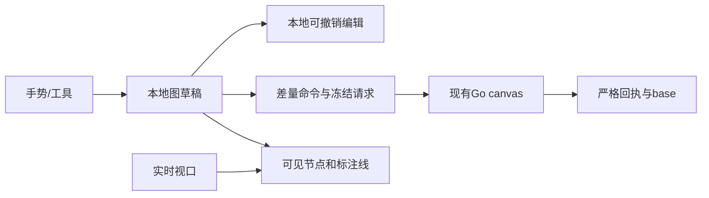

# 画布组件实现调研与迁入设计

状态：按2026-10-18用户要求开始实施。来源：[需求05](../requirement/05-画布组件迁入与定制需求.md)；范围：[PRD05](../prd/05-画布组件迁入与定制.md)；步骤：[计划11](../plan/11-画布组件迁入验证与定制实施计划.md)。功能需求及非功能需求编号只在需求05维护。

## 1. 结果与边界

按需求05 CAN-S06执行：完整迁入固定BeefTV画布源码，先复验原始功能，再接入Glowloom并统一shadcn样式。现有手写适配暂保留可运行；原件通过测试不表示宿主已完成切换。

不新增通用插件框架或第二套生产业务客户端。原件保存画布依赖事实；宿主继续持有权限、图保存、素材身份、报价与生成执行。时间线不进入产品入口。

## 2. 来源与采用依据

| 来源                                                                                                                             | 用途                                                         |
| -------------------------------------------------------------------------------------------------------------------------------- | ------------------------------------------------------------ |
| [BeefTV a2196d3](https://github.com/glanderness/BeefTV/tree/a2196d32782be6090beb003590ce11a956a423e1)                            | 当前视口、节点外壳、小地图、工具栏的已登记来源；继续复用     |
| [BeefTV v1.7.26 / ddaf5f9](https://github.com/glanderness/BeefTV/tree/ddaf5f9abc64b16567c28ea5399d8f2069c47832)                  | 当前完整画布原件迁入基线；组件、控制器和必要依赖一起核对     |
| [infinite-canvas v0.20.0 / 3a6b64b](https://github.com/basketikun/infinite-canvas/tree/3a6b64b602ad062b29fac66902ed18a7ef5fd9dc) | 基础交互、SVG连接、分组与引用对照；不采用其项目集合持久store |

BeefTV的[NOTICE](https://github.com/glanderness/BeefTV/blob/ddaf5f9abc64b16567c28ea5399d8f2069c47832/NOTICE)声明派生自infinite-canvas v0.5.0；两者不是独立稳定性证据。BeefTV固定快照的[质量检查](https://github.com/glanderness/BeefTV/actions/runs/39029862050)成功，但不代替本项目验收。两项目固定版本的根许可为MIT，保留适用许可及传递来源；新依赖和媒体资产另核对。

空间索引参考`web/src/lib/canvas/canvas-spatial-index.ts`，渲染缓冲参考`pages/canvas/use-canvas-render-model.ts`；不采用其280/420/720节点截取，避免合法节点在密集布局中无提示消失。历史参考`use-canvas-history.ts`的操作边界，改用本项目合法变更；分组参考`canvas-frame.ts`的世界坐标模型。

React Flow的[节点](https://reactflow.dev/learn/customization/custom-nodes)、[性能](https://reactflow.dev/learn/advanced-use/performance)和[可访问性](https://reactflow.dev/learn/advanced-use/accessibility)机制可作备选；当前替换已有适配收益不足。tldraw的[生产许可](https://tldraw.dev/community/license)与白板模型需要独立评估。完整应用、SDK和图形引擎不按热度排性能名次。上轮Firecrawl额度不足，事实通过GitHub与Context7/官方文档核验。

文档沿lucky的总导航、分目录00导航、相对链接和design→PRD→plan职责组织，继续保留Glowloom的requirement来源。lucky的业务决策、微服务结构和个人Obsidian配置不迁入。

## 3. 现有边界

可达入口为`src/app/canvas/page.tsx`→`canvas-page.tsx`→动态加载`canvas-editor.tsx`。现有手势包含Pointer Capture、鼠标/触控板/双指、框选、rAF预览和Radix输入区排除；现有保存包含冻结命令、原幂等键、revision、输入版本、恢复分支和冲突处理，继续复用。

服务端`backend/internal/canvas/domain/document.go`已提供文字、group、parent_id、annotation、SetViewport与布局命令，容量为2000节点/4000边。组移动不隐式移动子节点；Connect允许可编辑节点间annotation，包含未锁定生成草稿，业务关系受保护。前端本轮补接这些已有合同，不改数据库，不放开业务节点或草稿删除。

## 4. 文件目录与职责

所有页面独有实现放在`frontend/src/app/canvas/_components/`，直接导入具体文件。现有跨页媒体、提示词和业务API沿原目录复用。

| 文件                                        | 职责及实际消费者                                                                               |
| ------------------------------------------- | ---------------------------------------------------------------------------------------------- |
| `canvas-page.tsx`                           | 读取项目/画布，校验后动态进入编辑器；保持现有入口                                              |
| `canvas-editor.tsx`                         | 编排选择、工具、图草稿、冻结保存、恢复、冲突和生成；不放空间查询算法                           |
| `beeftv-canvas.tsx`、`canvas-viewport.ts` | 实时/提交视口、坐标、框选手势、事件作用域及清理；复用现有实现                                  |
| `canvas-render-model.ts`                    | 从节点几何建立索引、查询可见节点与边、组后代及定位边界；供节点层和选择使用                     |
| `canvas-node-layer.tsx`                     | 订阅实时视口，按进入/保留缓冲更新挂载窗口；保护选中/焦点/交互节点；渲染SVG连接与现有CanvasNode |
| `canvas-history.ts`                         | 有界本地编辑历史、合并连续同一字段输入、撤销重做；不发API、不持久化另一份业务图                |
| `editor-state.ts`                           | 图及回执边界校验、文字/group工厂、白名单差量命令、旧分支兼容与复制身份                         |
| `canvas-node.tsx`、`canvas-composer.tsx`    | 节点外壳、文字/group显示及现有参数/提示词；视频/音频选中激活                                   |
| `canvas-toolbar.tsx`、`canvas-mini-map.tsx` | 现有视图控制和快捷键说明；小地图基于全图，操作控件复用shadcn                                   |
| 同目录`*.test.ts(x)`                        | 领域转换、真实组件行为及边界；不增加平行业务客户端或测试脚本                                   |

`frontend/src/api/`是生成文件，本轮只消费已有合同。`components/media/`继续负责授权预览/上传，`components/generation/`负责提示词和报价/采用；页面不复制这些能力。没有跨页消费者时不抽取shared engine目录，不建barrel导出或通用utils。

## 5. 状态与数据流

编辑状态包括nodes、edges和viewport；服务端base、冻结pending与本地draft分开。选中、焦点、播放器、拖动预览属于UI状态。媒体身份为ref_type/ref_id，不将URL、Blob或运行任务塞进图配置。

### 5.1 可见渲染

空间查询使用世界坐标，节点标题和选择手柄计入边界；超大组不能遍历无界格子。进入缓冲小于保留缓冲，减少边界反复挂载；选中、焦点和拖动节点保留。没有节点数量截取，框选和小地图基于全图。连接曲线控制点包围盒与视口相交即渲染，双端离屏也不漏线。

实时视口经rAF修改合成层，并以限频更新可见窗口；手势结束立即同步。节点层独立订阅，避免拖动每一帧刷新保存/生成编排。未选中的视频/音频显示轻量占位，选中后通过原授权预览组件读取；切换/离屏/卸载释放媒体。3D仍使用现有素材预览入口，不加载新的3D引擎。

### 5.2 文字、分组和连接

文字使用`resource/text`和`config.text`；group使用`resource/group`、`config.collapsed`与parent_id。组成员保持世界坐标，移动组时显式批量移动可编辑后代，每个节点只算一次。解组清空选定组成员parent_id，保留组节点以遵守持久删除边界；收起只影响渲染，不删除子节点。

标注连接使用现有annotation，只允许恰好两个可编辑节点，包含未锁定生成草稿；明确显示为标注关系，不作为生成依赖。普通编辑不能修改protected edge。复制节点生成新UUID并清除输入/执行身份；复制组需要独立成员映射，不复制旧任务。数量或合同限制显示真实说明。

### 5.3 历史和保存

历史记录一次手势或一组编辑的前后图，连续文字字段修改合并；不记录viewport和播放/选择，不替代Tiptap正文历史。本地最多保留50次编辑，超出只移除最早历史，不影响图。保存后撤销通过新合法命令前进revision；资源删除与撤销使用现有DeleteNodes/AddNodes合同；已保存生成草稿仍禁止删除。冻结pending存在、结果未知或冲突时暂停历史跳转。

引用标签分配与高水位单独保留到本次编辑会话结束，撤销不回收已分配编号，包括尚未保存的分配；升级后的composer不撤回旧草稿格式。解组遇到只读直接成员时保持原图并反馈原因。批量标注增删按每条命令最多2000项拆分，总请求仍受100条命令限制。

pending同时冻结nodes/edges/viewport及原幂等键；响应必须逐项核对节点字段、边和相机及revision。响应期间的新编辑保留，只有对应冻结字段更新base；相机单独比较避免旧相机覆盖当前手势。恢复分支保存完整图及原pending，旧的仅nodes分支按其base.edges/base.viewport补齐；缺损或跨身份数据拒绝。

读取服务端相机并保留有效视角；用户新手势按即梦专项采用8%～800%缩放（历史5%视角保留），源坐标显式映射`k`↔`zoom`。修改相机只保存视图，不改变节点输入版本或触发生成。保留原自动保存节奏及离开保护。

### 5.4 输入与失败路径

画布快捷键仅在画布事件作用域工作，input/textarea/contenteditable和菜单/弹窗内不触发V/Space、删除、撤销重做。Ctrl/Cmd+S保留原保存；撤销支持Ctrl/Cmd+Z、Shift+Z/Y。Escape逐层退出，由Radix处理弹层焦点。

无权限、过期素材、网络错误、保存未知和冲突沿现有反馈处理。冲突保留本地图或显式载入服务端；结构编辑不能无提示合并删除/重绑业务字段。用户选择保留本地时，受保护服务端数据仍保留，不自动放宽领域校验。

## 6. 验证与交付

FR对应CAN-A01～A12；非功能项CAN-N01～N06分别覆盖容量可达、rAF/限频、保存可靠、输入可访问、媒体清理和工程维护。按计划先测试失败再实现，现有保存/生成用例继续通过。真实性分层：单测/fixture不等于浏览器、数据库、真实媒体或供应商接受。

目录、依赖、许可和实际代码消费者一起核对；前端执行ESLint、Prettier、Next typegen、TypeScript、全量Vitest与生产构建，交互补浏览器尺寸/主题与连续手势。性能记录设备、样本及测量，不用上游CI或协议容量承诺流畅帧率。真实收费生成不在默认工程检查中。

[返回设计导航](00-设计导航.md)

## 7. 即梦一致性设计（2026-10-18）

用户要求布局、功能、交互、快捷键及拖动画布方式与即梦一致，先更新Figma再实现、最后浏览器验收；随后确认字体使用Vercel。此要求替代旧画布的V/H和普通滚轮缩放约定；品牌仍为织光，模型、价格和素材只使用真实业务数据。

[Figma R10设计页](https://www.figma.com/design/uLqmeRWuQuzfrp9xOYg6FT/?node-id=675-26265)包含空画布、图片/文本节点、右键创建、缩放、400px AI侧栏和窄屏提案；图片节点主稿为[675:26529](https://www.figma.com/design/uLqmeRWuQuzfrp9xOYg6FT/?node-id=675-26529)。均为原生可编辑文字、矢量和组件实例，未把完整页面截图作为UI。字体统一Geist，中文回退；Figma状态跳转不作为连续手势证据，窄屏提案需源页面同尺寸核对。

| 区域/操作 | 即梦登录态核对值                                                                                                                   | 实现归属                                                                             |
| --------- | ---------------------------------------------------------------------------------------------------------------------------------- | ------------------------------------------------------------------------------------ |
| 顶部      | 上10px、左右12px、高40px；品牌/项目在左，搜索/历史/分享/更多/账号在右                                                              | `canvas-header.tsx`，历史按需加载`canvas-project-history.tsx`                        |
| 左工具栏  | 48×398px，按钮40×40px、图标20px；左12px、中心相对视口下移28px                                                                      | `canvas-toolbar.tsx`、`canvas.css`                                                   |
| 节点/参数 | 默认新节点320×320px；参数浮层宽680px，距节点20px；输入、菜单不缩放                                                                 | `editor-state.ts`、`canvas-node.tsx`、`canvas-node-panel.tsx`、`canvas-composer.tsx` |
| 视图控制  | 左16px、底20px，156×28px；选择/抓手切换、小地图、线可见、百分比菜单                                                                | `canvas-toolbar.tsx`、`canvas-node-layer.tsx`                                        |
| 平移/缩放 | 普通滚轮及双指滚动平移，按浏览器原始WheelEvent增量平移；Ctrl/⌘滚轮及捏合按指针锚点缩放，单事件倍率2^(-deltaY×0.01)，限制1/1.2～1.2 | `beeftv-canvas.tsx`，源页面上下界8%～800%，旧视角兼容与保存端同步调整              |
| 快捷键    | V选择，Space临时平移；⌘/Ctrl +/-缩放，Shift+1全图、Shift+2选中、⌘/Ctrl+1=100%；⌘/Ctrl+D副本、Z/Shift+Z历史                         | `canvas-editor.tsx`，输入法及输入/菜单/弹窗排除；不把H继续作为已对齐按键             |
| 创建/右键 | 双击空白创建，右键菜单按点击世界坐标放置；节点菜单与空白菜单区分                                                                   | `canvas-context-menu.tsx`，复用官方Radix/shadcn `components/ui/context-menu.tsx`     |

完全一致的退出条件是差异清单全部关闭，不能把只画出的状态算作功能已接通。当前需继续补齐：文本/音频生成、Agent执行、时间线与导演台完整编辑/执行、生成依赖连线、已保存节点删除、系统剪贴板复制粘贴、就地模型/引用/报价流程、AI侧栏可调整与避让、标签/全屏/下载及各异常状态。右键当前仍为平铺菜单，需要按新建节点级联菜单继续对齐；节点两侧创建与布局连线按第11节补齐，供应商执行依赖仍未开放。现有只读业务合同仍生效；需要变更时在领域层落实并验证，不能靠前端伪装成功。分享目前仅复制受现有权限约束的链接，不等于即梦的访问授权管理。

原始滚轮增量以浏览器事件为准。本机输入适配层会把工具传入的滚动量转换为两倍事件增量；已通过相同输入对照源页面并修正，不能再在组件中乘二。单个320px节点的适配画布终态为50%；选中适配不放大超过100%，多节点和侧栏组合仍须继续对照。

颜色值由`frontend/src/app/globals.css`的深浅主题定义统一持有（现有`background/card/border/foreground/muted-foreground`语义变量）；画布样式只消费变量。Geist沿用现有字体加载，无新增运行依赖。节点不展示输入版本等实现字段。

## 8. 现有宿主实现：shadcn与内联富文本

以需求05 CAN-S05为当前范围：时间线入口及本轮新增组件移除。复用BeefTV/infinite-canvas的节点外壳、参考架、正文及底部参数分区；不迁入其AntD组件、全局store或供应商执行器。Figma主稿[675:26529](https://www.figma.com/design/uLqmeRWuQuzfrp9xOYg6FT/?node-id=675-26529)同步移除时间线并使用本项目shadcn深色主题值。

节点仍由`canvas-node.tsx`负责世界坐标、拖动、尺寸、选中与两侧创建；`canvas-node-panel.tsx`保持输入面板屏幕尺寸及避让。两侧创建按钮调用真实新增文字/图片/视频节点，不把标注连线解释为生成依赖。

下方由`canvas-composer.tsx`组合共享`components/generation/rich-generation.tsx`的`presentation="canvas"`。后者直接复用`PromptEditor`、`ComposerSession`和`ReferenceControls compact`：参考架在上、Tiptap正文在中、真实模型/模式和schema参数及报价操作在下；引用详情、异常与费用确认使用现有shadcn弹层。所有版本、标签高水位、上传和权限规则复用原合同。没有第二份提示词、模型配置或生成请求状态。

首次打开旧草稿先升级为富文本并经canvasOwner.flush保存，再读取节点未决提交；正文变化写入节点的richCanvasDraft，报价前再次保存并核对canvas/input revision。原请求未知时复用冻结正文与幂等键；切换节点后从节点草稿及服务端未决状态恢复。模型名称、支持模式、候选数量、分辨率与费用由实际接口提供。

节点剪贴板只接受同项目、有版本且经命令验证的图；重建节点/边身份并重映射内部工具引用，外部来源保留已核对的素材身份。已保存资源沿DeleteNodes删除，保留本地冲突选择不得复活已删除资源；只读投影与生成草稿继续受领域保护。

导演台继续按需加载Three.js及开发类型，作为不新增通用画布引擎的必要例外；AI历史只读取真实任务。任务详情仅在text.generate/completed/json/passed条件暴露受限outputs[].text，未审核文本和其余provider JSON不返回，API从后端注解生成。两项能力的效果接受与本次样式/富文本验收分别记录。

## 9. 完整原件迁入与接入次序

固定上游整树曾放在`third_party/beeftv-canvas/`，用于核对迁入范围。该目录和按文件摘要锁定它的测试已经删除，不再是当前产品或工程门禁。正式画布以宿主中的实现为准；上游许可仍记录在`frontend/public/THIRD_PARTY_NOTICES.md`。

原件使用React Router、AntD、Zustand/localforage及本地工作区服务，不是可直接替换的npm组件。`project.tsx`是画布编排入口；仅该入口的静态闭包已有645文件。完整迁入包含这些依赖，不能用几个重写组件替代。

| 阶段       | 文件/职责                                                                         | 通过条件                                                                                       |
| ---------- | --------------------------------------------------------------------------------- | ---------------------------------------------------------------------------------------------- |
| 原件       | `third_party/beeftv-canvas/`；保持原目录与字节                                    | 文件摘要、四根目录完整、本地静态依赖、原画布测试与严格类型检查通过                             |
| 宿主接入   | `frontend/src/app/canvas/_components/`；Next入口和已有canvas/generation/media合同 | 创建/读取/修改/保存/重开、幂等与冲突、权限及未知结果测试通过；不能用上游本地缓存伪装服务端保存 |
| 定制       | 同目录及共享`components/generation/`                                              | 先按Figma/shadcn统一控件和语义主题，再使用既有Tiptap全能参考；手势和快捷键按即梦核对           |
| 浏览器接受 | 实际登录、真实项目及画布                                                          | 逐项记录布局、节点、选择/拖动/缩放、输入、引用、历史、保存重开与异常；收费模型效果另验         |

原件不会被App Router自动加载，也不把其API/store默认接入生产。正式入口现已使用第10节的受控接入；图文保存及引用仍走宿主权限、报价与防重合同，原`project.tsx`整应用不挂载到产品。

### 9.1 实际宿主接缝

| 接缝       | 原件与宿主的实际差异                                                                           | 必须完成的验证                                                               |
| ---------- | ---------------------------------------------------------------------------------------------- | ---------------------------------------------------------------------------- |
| 图与引用   | 上游使用字符串ID、开放metadata和多种连接锚点；宿主使用UUID、封闭NodeConfig及受保护业务边       | 按节点逐类往返，不过滤后保存；未表示的数据保留并明确限制，不能默默丢弃       |
| 保存       | 上游为整文档CAS及localforage journal；宿主为typed commands、revision、input_revision与幂等回执 | 原请求未知时保持冻结载荷，冲突及撤权保持原合同                               |
| 素材       | URL、storageKey、Blob不能作为宿主media_asset UUID                                              | 上传/快照/引用只能绑定真实授权资产回执                                       |
| 导演台     | 上游分组、锁定、角色预设、运动路径和关键帧通道超出现有DirectorConfig                           | 扩展已确认的数据合同后，再验证保存和重开；不投影丢字段                       |
| 启动与运行 | React Router、AntD/Query/theme、用户配置、本地工作区及插件节点注册依赖                         | 使用宿主身份/项目/模型与生成合同；显式执行必要画布注册；时间线编辑器壳不启用 |

`upstream.json.bootstrapImports`记录不含时间线的原内置注册入口，包含静态import闭包无法发现的AI审美批改注册。原件中的Vite glob、Worker、FFmpeg `?url`、heavy-media常量和`/canvas/models`、`/three/basis`、`/mediapipe`资源路径，需要在正式宿主逐一验证；ESM external构建通过不能替代这些运行检查。

## 10. 正式运行接入

本轮按CAN-S07直接切换正式`/canvas`的受控画布。页面继续由SessionGate和SpaceProvider授权，`canvas-page.tsx`读取真实项目与画布，再按需加载现有保存编排。`beeftv-canvas.tsx`承接BeefTV视口/Pointer Capture/双指/rAF合成，采用固定快照的提交倍率补偿；`canvas-spatial-index.ts`保留原空间索引实现，由`canvas-render-model.ts`映射宿主节点几何，查询不传数量截断。旧`infinite-canvas.tsx`删除，避免维护两个运行引擎。

宿主节点、分组、标注、工具栏、菜单、参数及面板继续用现有shadcn；共享RichGeneration/PromptEditor负责正文、@素材/主体、上传、参数、费用检查及未决恢复。原件的整应用Router、AntD/localforage及供应商调用不接入生产，避免替换宿主已实现的权限和幂等合同。没有新增API客户端、插件框架或平行文档存储。

缺表修复使用现有002/003/004迁移；备份、副本恢复和演练后单一事务执行，保留用户/项目/画布数量及归属。正式后端已切回当前源码运行，保留既有密钥、公钥校验配置及只读挂载。工程与浏览器按计划11分别记录。

节点浮层以left/top定位，避免transform将共享编辑器的fixed展开限制在节点内；展开和Escape收起保持同一Tiptap实例。模型目录为空用既有shadcn Empty说明。任务和素材分页接受服务端合法的null尾游标，仍拒绝非法游标、跨项目回执及伪任务。历史时间线仅保留数据兼容，不进入渲染索引和工具栏。

焦点与选中按CAN-S08统一：节点仅改变既有1px边框颜色，删除重复选中规则和偏移外描边；页面不再为shadcn按钮叠加独立outline。共享控件的focus-visible环统一1px，InputGroup仍由外容器显示焦点，内部控件不重复描边；全局原生控件回退焦点保留1px。错误、禁用及键盘语义不变。

## 11. 节点、全能参考与连线重设计

Figma：[节点与引用](https://www.figma.com/design/uLqmeRWuQuzfrp9xOYg6FT/?node-id=708-27224)、[参考与模式弹层](https://www.figma.com/design/uLqmeRWuQuzfrp9xOYg6FT/?node-id=708-27479)、[窄屏工具栏](https://www.figma.com/design/uLqmeRWuQuzfrp9xOYg6FT/?node-id=709-27428)。保持原生可编辑文本、矢量和组件实例。

来源：需求05 CAN-S10、F19～F22。2026-10-18浏览器观察即梦登录态：节点两侧＋打开类型菜单；从图片向右创建视频同时产生一条定向线；空图片在新视频参考架显示不可用占位。全能参考是两项模式选择（首尾帧、全能参考），添加参考是上传/资产库/画布入口，@是就近分类候选列表，空图片不作为可用候选。观察不包含真实生成、费用或供应商效果。

本项目采用同一信息层级，原生Popover/Command/Select/DropdownMenu/Tooltip/Badge/InputGroup组合，使用当前neutral token和Geist，不复制即梦配色与会员元素。模式来自模型目录，不硬编码可执行模型或模式。参考架先展示来源再展示＋；48px预览、编号和自动引用标识，详情使用就近Popover。@候选在输入区附近打开，不加遮罩、不改变画布视口；键盘焦点与输入法由既有Tiptap和Radix共同管理。

布局线继续使用annotation，允许可编辑生成草稿作为端点；role/binding与只读业务边仍禁止通过Connect写入。新建节点与线同一图编辑/命令批次；左/右方向由空间语义确定，仍使用冻结保存与严格读回。连接不触发执行。媒体→新生成草稿的引用先通过现有素材预览接口核验project/id/kind/revision，再加入原PromptDraft references，旧来源或读取失败只保留布局线与待引用状态。异步期间节点或身份变化必须拒绝套用旧结果。

已绑定参考的连线从当前PromptDraft和本画布media_asset映射投影，使用细实线；未填内容的布局线用细虚线，选中相关节点才增强可读性。引用移除后投影随之消失；用户显式创建的普通标注独立保留，不把它变成执行或引用事实。自动引用只能指向真实媒体，不将草稿ID或预览URL充当素材ID。来源版本和标签高水位沿原合同，不自动切换到新版本。

侧边创建先避让同列已有节点；同素材多个副本时，自动引用优先保留原布局线的来源节点。窄屏工具栏改为顶部横向排列，参数区预留顶栏和工具栏空间；就近Popover按可用高度限制整个容器及候选列表，不能只限制列表而把搜索框挤出屏幕。节点设置与展开操作直接组合进InputGroup操作槽位，不用绝对定位覆盖参考架。

参考交互的Portal点击在弹层边界停止向InputGroupAddon冒泡，避免官方Addon将焦点交给隐藏上传框。@保持正文焦点，关闭或恢复输入不自动滚动画布；文件输入真正隐藏，不能以互相覆盖的宽高和sr-only样式撑宽参数区。加载使用固定结构Skeleton；复杂项目检索在Dialog内，不能展开并挤动画布。
