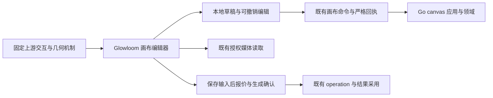

# 画布组件实现调研与迁入设计

状态：调研完成，技术路线与分期为待评审建议。调研日期：2026-10-18。来源：[需求05](../requirement/05-画布组件迁入与定制需求.md)。交付定义：[PRD05](../prd/05-画布组件迁入与定制.md)；验证与后续实施：[计划11](../plan/11-画布组件迁入验证与定制实施计划.md)。本轮只修改文档。

## 1. 摘要

建议继续沿 **BeefTV 固定版本的成套画布功能迁入 → Glowloom 宿主适配 → 项目能力定制** 的路线，infinite-canvas 作为基础交互与来源对照，React Flow 作为备选。这里的“成熟”指已有可复用机制及测试线索，是否适合 Glowloom 仍须经过功能、工程与实机接受。

Glowloom 已从 BeefTV `a2196d32782be6090beb003590ce11a956a423e1` 迁入视口、节点外壳、小地图及工具栏等内容。本次要解决的是现有迁入不完整及后续维护边界；不需要先创建另一套画布工程。BeefTV 的 NOTICE 声明派生自 infinite-canvas v0.5.0，两者不是两份独立验证过的引擎。

主要缺口是可见区域渲染、媒体加载预算、文档编辑历史、连线与分组的正式接入。优先验证这些能力包，随后再决定采用较新固定版本的哪些增量。上游原样迁入的渲染数量上限、全局存储和生成调用不符合本项目现有合同。

## 2. 参与者与文档职责

创作者负责组织素材、编辑和继续生成；产品负责人确认使用范围与接受条件；前端维护者负责功能包迁入与交互；后端维护者负责图命令、权限和执行语义。姓名、工期和负责人分配待定。

本次使用 pm-market-research 的竞品分析方法，按能力、限制、采用成本和差异化比较五条实现路线。它们包括完整应用、SDK 与图形引擎，分别标注适用层级，不虚构市场份额或将热度当稳定性证据。GitHub 用于固定源码、发布、许可、Issue 与 CI；Context7 用于 React Flow、tldraw、Leafer 文档核验。Firecrawl 实际调用返回额度不足，未获得网页内容；其余事实由 GitHub 与官方文档补足。

文档结构参照本地 lucky 的 `docs/00-文档导航.md`、`docs/design/24-文档管理与Obsidian设计.md`、`docs/templates/01-设计模板.md` 及画布专项 design13／PRD12／Plan15：总入口、各目录 00 导航、连续编号、相对 Markdown 链接、来源与接受状态、技术/产品/步骤职责分开。lucky 的固定版本、独立服务、业务范围与已确认决定只作为外部项目事实，不作为 Glowloom 需求。本项目仍保留 [PROJECT](../../PROJECT.md) 的 requirement → design → prd → plan 链路、现有文件名和已有多文档模块映射；不复制模板、历史目录、Obsidian 个人配置或整批重编号。

## 3. 背景与可核验基线

### 3.1 固定来源

| 对象               | 固定快照                                                                                                                                                                                                                                 | 用途与接受状态                                                       |
| ------------------ | ---------------------------------------------------------------------------------------------------------------------------------------------------------------------------------------------------------------------------------------- | -------------------------------------------------------------------- |
| Glowloom           | `7fa8b7f1c2f721126a8b2b352cc85a4ae36281f7`，main                                                                                                                                                                                         | 当前前端/画布源码盘点；存在并行存储修改，未改动它们                  |
| 当前迁入来源       | [BeefTV a2196d3](https://github.com/glanderness/BeefTV/tree/a2196d32782be6090beb003590ce11a956a423e1)                                                                                                                                    | 源文件头和现有许可登记共同确认；不是当前上游全部能力                 |
| 主要研究及升级候选 | [BeefTV v1.7.26](https://github.com/glanderness/BeefTV/releases/tag/v1.7.26)，[`ddaf5f9abc64b16567c28ea5399d8f2069c47832`](https://github.com/glanderness/BeefTV/tree/ddaf5f9abc64b16567c28ea5399d8f2069c47832)                          | 已核对源码及本地 checkout HEAD/tag；推荐作为验证候选，未批准整体升级 |
| 辅助对照           | [infinite-canvas v0.20.0](https://github.com/basketikun/infinite-canvas/releases/tag/v0.20.0)，[`3a6b64b602ad062b29fac66902ed18a7ef5fd9dc`](https://github.com/basketikun/infinite-canvas/tree/3a6b64b602ad062b29fac66902ed18a7ef5fd9dc) | 基础编辑、分组、引用和局部历史对照；不混用另一套持久状态             |

两份上游源码已在仓库外只读检查，未执行其安装脚本或启动供应商调用。所有下述上游路径相对于固定提交的 `web/src/`，后续 main 变化不自动改变本调研结论。

### 3.2 当前可达实现

实际入口是 [canvas/page.tsx](../../frontend/src/app/canvas/page.tsx) → [CanvasPage](../../frontend/src/app/canvas/_components/canvas-page.tsx) → 动态加载 [CanvasEditor](../../frontend/src/app/canvas/_components/canvas-editor.tsx)。许可登记中出现其他路径或历史品牌，不代表它们是当前可达画布。以下以实际入口和源码为准。

| 位置                                                                                                                                                      | 已有源码事实                                                                                      | 差距或边界                                                                                                  |
| --------------------------------------------------------------------------------------------------------------------------------------------------------- | ------------------------------------------------------------------------------------------------- | ----------------------------------------------------------------------------------------------------------- |
| [InfiniteCanvas](../../frontend/src/app/canvas/_components/infinite-canvas.tsx)、[viewport](../../frontend/src/app/canvas/_components/canvas-viewport.ts) | Pointer Capture、滚轮/触控板、双指、框选；ref + rAF 更新 DOM，闲置后同步状态；排除 Radix/输入区   | 有可复用基础；不是需要重写的空壳；缩放为 0.05～2                                                            |
| [CanvasNode](../../frontend/src/app/canvas/_components/canvas-node.tsx)、[NodePanel](../../frontend/src/app/canvas/_components/canvas-node-panel.tsx)     | 节点标题/媒体拖动、缩放预览/取消、键盘手柄、附着参数面板                                          | 需要与裁剪、历史、分组和连接协作，不只继续添加菜单                                                          |
| CanvasEditor 渲染                                                                                                                                         | 对完整 `nodes` 做 map；视口与选中状态在页面编排                                                   | 未看到可见区域裁剪或空间索引；当前参数上限不证明大画布性能                                                  |
| [editor-state](../../frontend/src/app/canvas/_components/editor-state.ts)                                                                                 | 基于生成 API 类型，严格检查回执；Add/Move/Resize/Rename/UpdateNodeConfig 命令；图保留 edges       | 未组装分组、连接、断连、持久节点删除等编辑命令；未见文档 undo/redo 栈                                       |
| CanvasEditor 保存                                                                                                                                         | 原幂等键、冻结请求、本地分支、revision 冲突及结果采用衔接                                         | 恢复分支不是撤销栈；不能用上游整图快照覆盖服务端                                                            |
| 前端相机与服务端相机                                                                                                                                      | 服务端 Document 有 Viewport/SetViewport；当前前端 Canvas 类型未保留 viewport，camera 从原点初始化 | 缺少持久相机的完整往返；需与保存语义一起补齐                                                                |
| [canvas domain](../../backend/internal/canvas/domain/document.go)                                                                                         | 2000 节点/4000 边；group、parent_id、Connect/Disconnect、SetViewport；父子关系使用世界坐标        | group 移动不隐式移动子节点；Connect 仅开放可编辑非草稿节点间 annotation，业务关系受保护；服务端 zoom 上限 4 |
| [项目媒体](../../frontend/src/components/media/project-media.tsx)                                                                                         | 真实授权媒体读取；视频/音频 `preload="metadata"`                                                  | 大量挂载时仍需测元数据请求与解码成本；按需预览应沿现有资源访问链                                            |

已保存生成草稿禁止删除；前端也拒绝持久节点移除，原因及限制见 [DESIGN](../../DESIGN.md#4-画布素材与节点交互)。存在后端命令不等于前端已经接通，更不等于允许扩大命令语义。

### 3.3 上游成熟度证据与局限

BeefTV 固定 `ddaf5f9` 的 [Quality checks](https://github.com/glanderness/BeefTV/actions/runs/39029862050)、[Director browser checks](https://github.com/glanderness/BeefTV/actions/runs/39029862049)、[容器构建](https://github.com/glanderness/BeefTV/actions/runs/39029862022)查询时均为 completed/success。infinite-canvas 固定 `3a6b64b` 的 [Docker image](https://github.com/basketikun/infinite-canvas/actions/runs/38037480596)同样成功。Director 检查不代表通用画布全覆盖；构建成功不代表交互、业务和媒体规模接受，本次未在本机运行上游全套检查。

infinite-canvas [Issue #276](https://github.com/basketikun/infinite-canvas/issues/276)报告 IndexedDB 数据增长后平移缩放卡顿；源码 store 确实将项目集合序列化并延迟写入 localForage。这支持“不迁入其整集合持久 store”的取舍，但 Issue 的设备表现不是本次复测结果。[Issue #286](https://github.com/basketikun/infinite-canvas/issues/286)反馈参考继承、批量连接和对齐需求，说明复用既有画布后仍有产品定制空间；用户报告不直接视为所有版本的确定缺陷。

## 4. 目标与实现路线比较

目标是降低基础交互的重做成本，并保留 Glowloom 的素材身份、输入版本、可靠保存与正式生成。评价维度为创作适配、可定制性、工程接入、规模机制、维护与许可。未做相同设备/数据集的性能对比，不给 FPS、包体或工期排名。

| 路线            | 层级与优势                                                                                           | 主要缺口及成本                                                                               | 本轮建议                                         |
| --------------- | ---------------------------------------------------------------------------------------------------- | -------------------------------------------------------------------------------------------- | ------------------------------------------------ |
| BeefTV          | 完整 AI 视频创作应用；React DOM 节点、SVG 连接、Leafer 辅助图形；有空间索引、历史、媒体分级及创作 UI | 与 Wails、本地 Go/SQLite、模型/素材/任务服务耦合；升级需追踪成套依赖；部分预算会截断可见节点 | 主要源码来源；固定版本，按功能包迁入             |
| infinite-canvas | AI 创作应用；DOM 节点 + SVG 边；分组、引用、菜单、基础历史与插件扩展清晰                             | 画布项目页承担大量业务；可见查询仍扫描节点；全项目持久 store 与本项目保存合同不同            | 辅助对照；不并入第二套 store/运行时              |
| React Flow      | 节点编辑 SDK；自定义 React 节点、端口、连接、缩放、小地图和键盘支持有官方机制                        | 创作面板、媒体生命周期、Tiptap、生成与保存均需接入；已有适配需迁移；不会自动获得大规模性能   | 若成套迁入验证失败，再对同一最小场景做备选 PoC   |
| tldraw          | 白板/无限画布 SDK；自定义 HTML shape、工具、历史、快照与同步能力有文档                               | 白板数据模型与当前业务图差异较大；生产使用需有效许可；仍须承接私有媒体和付费生成合同         | 自由绘图/多人白板成为核心目标时重评              |
| Leafer UI       | Canvas 图形引擎；场景树、Path/Rect、事件与分层渲染，BeefTV 已用作辅助层                              | 不是完整 AI 画布；自行重建 DOM 编辑、媒体、选择、历史和业务图会显著扩大维护面                | 有测量依据时随必要图形层迁入，不作为独立全量替换 |

React Flow 的 [自定义节点](https://reactflow.dev/learn/customization/custom-nodes)、[utility classes](https://reactflow.dev/learn/customization/utility-classes)可隔离节点输入和画布手势；[性能指南](https://reactflow.dev/learn/advanced-use/performance)明确提醒避免高频全图订阅和无意义重渲染；[可访问性指南](https://reactflow.dev/learn/advanced-use/accessibility)提供焦点、键盘和中文播报配置。故它是有效备选，不应以“换库即可解决性能”作为理由。

tldraw 的 [自定义形状](https://tldraw.dev/docs/shapes)和 [持久化](https://tldraw.dev/docs/persistence)为白板场景提供基础。其 [官方许可](https://tldraw.dev/community/license)要求生产运行有有效许可；不能把可见源码当作 MIT 使用。BeefTV 与 infinite-canvas 的固定 [LICENSE](https://github.com/glanderness/BeefTV/blob/ddaf5f9abc64b16567c28ea5399d8f2069c47832/LICENSE)、[LICENSE](https://github.com/basketikun/infinite-canvas/blob/3a6b64b602ad062b29fac66902ed18a7ef5fd9dc/LICENSE)为 MIT，复制需保留适用声明，具体依赖与媒体资源分别核对。这里比较采用成本，不采购 SDK 或虚构订阅报价。

Glowloom 的差异化应放在可解释的素材/主体引用、可恢复的编辑、生成前可确认、结果可追溯，而非重做平移缩放。持续维护风险主要是上游升级、跨层渲染同步、浏览器输入差异及模型合同变化；用固定源码、功能包清单、边界转换和行为验收控制。

## 5. 使用场景

1. 创作者打开现有画布，定位离屏素材，多选移动并编辑草稿；浮层保持可用，保存后重开内容一致。
2. 在密集媒体画布连续缩放，只有需要的媒体解码，正在输入/拖动/播放的节点不会因裁剪而失去状态。
3. 复制一组创意进行比较，保留应继承的素材引用，建立独立身份；撤销布局不撤销已发生的模型调用。
4. 引用图片或主体继续生成；先保存冻结输入，再走现有报价与确认；结果回来期间其他编辑得到保留。
5. 两个窗口并发保存或网络中断；原命令查询/重试和显式冲突选择仍有效，页面不将本地快照冒充服务端事实。

## 6. 价值与迁入原则

成套迁入的单位是“用户可以完成的一种操作及其必要依赖”：例如框选要同时包含坐标转换、拖动预览、命中、取消、浮层排除与测试。只拷贝滚轮、菜单和空间索引几个片段，会把协作机制留给项目重新发明；整套拷贝应用又会引入第二套业务系统。边界应落在宿主接缝。

既有代码能满足合同的部分继续复用；本项目对上游的修改集中在路由、控件、媒体读取、数据转换和正式命令处。上游更新逐项评估，而不是定期覆盖目录。不存在已测量的节省比例或开发天数。

## 7. 方案建议

### 7.1 成套功能与依赖闭包

| 功能包               | BeefTV 固定源码入口                                                                                                                                               | Glowloom 接缝与定制                                                                                     | 接受          |
| -------------------- | ----------------------------------------------------------------------------------------------------------------------------------------------------------------- | ------------------------------------------------------------------------------------------------------- | ------------- |
| 视口与手势           | `components/canvas/infinite-canvas.tsx`；`lib/canvas/canvas-live-viewport.ts`、`canvas-viewport-render-sync.ts`；`pages/canvas/use-canvas-viewport-controller.ts` | 复用现有视口；核对连续手势时可见窗口更新、Radix Portal、失焦/取消与清理，连接 DOM/SVG/辅助层            | A01～A04      |
| 选区、拖动、对齐     | `pages/canvas/use-canvas-selection-controller.ts`；`lib/canvas/canvas-selection.ts`、`canvas-spatial-index.ts`                                                    | 世界坐标、可编辑判定、多选预览与单次提交；不将命中查询局限于已挂载 DOM                                  | A02、A03、A05 |
| 渲染与媒体预算       | `pages/canvas/use-canvas-render-model.ts`；`lib/canvas/canvas-performance-mode.ts`、`canvas-video-hover-preview.ts`                                               | 只提取当前需要的裁剪/迟滞/媒体机制；去除导演台、Agent、资产 store 依赖；现有媒体授权与临时 URL 生命周期 | A05、A09      |
| 节点、连接与分组     | `components/canvas/canvas-node.tsx`、`canvas-connections.tsx`；`lib/canvas/canvas-frame.ts`；`pages/canvas/use-canvas-connection-controller.ts`                   | 保留外壳/几何/端点交互；配置/业务投影仍由本项目定义；父子世界坐标、批量命令和边种类显式转换             | A07、A12      |
| 历史、复制、快捷键   | `pages/canvas/use-canvas-history.ts`、`use-canvas-keyboard.ts`、`use-canvas-node-operations.ts`                                                                   | 历史条目排除执行/媒体运行字段；一次手势一条记录；输入区撤销优先 Tiptap；复制新 UUID 与合法引用映射      | A04、A06      |
| 浮层、工具栏与小地图 | `components/canvas/canvas-config-node-panel.tsx`、`canvas-toolbar.tsx`、`canvas-mini-map.tsx`                                                                     | 继续使用项目 shadcn、语义 token 和 Figma 约定；保留当前参数编辑与真实保存/生成入口                      | A01、A11      |

表中路径是入口，不是完整复制清单。实施前沿静态/动态 import、CSS、worker、资源、补丁与测试夹具递归核对，给每项记录固定源、目标、改写、依赖和对应 CAN-Axx。无法与现有合同兼容的动作保留为明确缺口，不加空处理假成功。

不采用上游 `stores/canvas/use-canvas-store.ts`、模型/凭据服务、Wails/SQLite/Agent-host、远程插件加载器或全量媒体工具包。infinite-canvas 的 `plugin-loader.ts` 会读取脚本并动态导入 Blob 模块；任意远程插件不是本次个性化定制的必要条件。按已有消费者直接扩展节点，不预建通用插件框架。

### 7.2 宿主边界与数据往返

目标目录首先沿当前 `frontend/src/app/canvas/_components/`；只有出现实际跨页消费者才提取到 `components/<feature>/`。不为了复用上游路径另建 `features/`、第二个 Router 或独立前端。业务调用继续导入生成的 `@/api/`；新字段先更新后端 DTO/OpenAPI，再生成前端客户端，禁止手改生成文件。

| 上游表示                          | Glowloom 表示与处理                                                                                        |
| --------------------------------- | ---------------------------------------------------------------------------------------------------------- |
| `id`、`position`、`width/height`  | 当前 UUID、`x/y` 和尺寸；边界检查有限数值、默认尺寸及当前范围；新复制身份不能复用旧任务                    |
| `metadata` 混合内容/任务/运行状态 | 只映射白名单业务配置；Tiptap 草稿走现有 PromptDraft，资源用 `ref_type/ref_id`；播放器状态留在 UI           |
| `parentId`、frame/group           | `parent_id` + group 配置；当前保存世界坐标，组移动需显式形成组及可编辑子节点的 MoveNodes，不二次施加父变换 |
| `connections`                     | 当前 Edge；annotation 与受保护业务关系分开；连接到生成草稿的引用不能通过 annotation 偷渡                   |
| `viewport {x,y,k}`                | 显式映射当前 camera zoom 及服务端 Viewport；当前前端缺少保存往返，补齐前不标记跨次恢复通过                 |
| 上游项目/本地存储                 | 当前项目与 canvas ID、revision、幂等键、本地恢复分支；不导入上游整项目 store                               |

保存往返必须包括原有只读/未知节点和受保护边；转换器不得通过过滤数据“兼容”。当前 `commandBatch` 只覆盖部分编辑，需要先扩展相应输入、命令生成和严格回执验证，再开放分组/连接入口。

### 7.3 实时视口、裁剪与媒体

高频指针输入 → ref 暂存 → rAF 变换 DOM/图形层 → 以独立节奏更新可见窗口 → 手势结束提交编辑状态。React 的整图渲染、媒体获取和保存不应跟随每个原始 wheel 事件；只在测量有收益时增加 memo 或收窄订阅。

BeefTV 的 uniform-grid 空间索引恢复查询源顺序，并把跨过过多格子的超大元素放在独立候选集合。渲染模型区分进入/保留缓冲，减少边界反复挂载。机制有复用价值，但需注意：

- 固定版本 `canvas-performance-mode.ts` 的节点渲染预算是 720，低缩放降到 420/280；`use-canvas-render-model.ts` 对候选做截取，forced selection 也先截取。密集合法图可能显示不全。Glowloom 应先基于自身 2000 节点协议预算测量；若需要预算，采用可见的聚合/简化表示、可定位入口与明确反馈，不能直接截掉节点。
- 空间索引、进入/保留缓冲和连接包围盒必须共用同一世界坐标；拖动预览、缩放、端点和面板不能各自读取过期坐标。双端离屏但曲线经过视口的边仍应显示。
- 聚焦/输入、拖动、播放、浮层锚定的节点应按实际交互保留；正在编辑的状态不依赖 DOM 存活，切视口不丢草稿。长时连续平移需要更新窗口，不能只等闲置后才加载新区域。
- 静态媒体先预览/封面，视频音频只激活用户当前操作的实例；复用现有授权读取，不能用过期 URL 当新任务输入。失败、撤权、卸载、切画布均有释放和恢复规则。

Leafer 在 BeefTV 中是辅助图形层，不取代 DOM 文本/媒体编辑；其场景与 DOM/SVG 共用视口同步。若首轮用现有 DOM/SVG 足够，不为“同款架构”单独引入 Leafer。确有图形层消费者时，按其 [源码 API](https://github.com/leaferjs/leafer-ui/blob/main/packages/display/src/Leafer.ts)管理创建、resize、订阅与 destroy，并验证当前安装版本；图层缩放/重栅格化需要一起验收。

### 7.4 历史、保存与失败状态

上游 BeefTV 的历史用实体变化补丁组织，infinite-canvas 在项目页维护过去/未来快照；两者均不能直接替代本项目服务端命令。建议历史只记录本地可编辑字段的 before/after 与一次操作边界，保存 revision 继续单调前进。

| 状态                    | 行为建议                                                                          |
| ----------------------- | --------------------------------------------------------------------------------- |
| 尚未保存的布局/配置编辑 | 可以恢复本地 before/after，再由现有保存生成差量；Tiptap 正文撤销仍由正文事务处理  |
| 请求已发出，结果未知    | 冻结原 pending 请求；历史不得改写其载荷或幂等键，先恢复原请求事实                 |
| 已保存后撤销布局/配置   | 作为新的合法命令保存；不能把服务器 revision 倒回历史值                            |
| 撤销已保存节点新增      | 当前生成草稿不能删除；暂不提供此逆操作，或在需求/领域合同重新接受后实施；明确反馈 |
| revision 冲突           | 保留本地分支并显式选择；不自动把上游历史快照覆盖较新服务器图                      |
| 生成执行/结果采用       | 生成不可当作可逆画布操作；复制/撤销不重复提交模型；采用仍沿原正式业务流程         |
| 切账号、撤权或卸载      | 取消迟到回调，停止私有读取；恢复记录按原身份/项目/画布隔离，遵循现有生命周期      |

文档历史、服务端输入历史、本地恢复分支是三个不同能力；分别验证，不因存在某个数组或 IndexedDB 记录就宣称可恢复。

### 7.5 视觉、依赖与维护

继续使用 Next.js App Router、React、TypeScript strict、pnpm、shadcn/Radix、Tailwind 与现有 Tiptap 最小集合。BeefTV 是 Vite/Bun/React Router 并有 Ant Design、Zustand、Leafer 和大量媒体依赖；不能将其 package.json 整体合并。节点 UI 替换 Ant 组件时保留交互状态、键盘和焦点，不只替换外观。

固定候选 `web/package.json` 声明 Vidstack 及 `patchedDependencies`。若迁入播放器，补丁、样式、锁定安装及构建输入都要核对；如果复用本项目播放器，则按功能验证等价行为，不额外复制未消费依赖。媒体工具、模型权重与第三方素材分别核对许可，不能用根 MIT 概括全部资产。

当前许可原文继续保留。实际升级/新增迁入时再更新 [THIRD_PARTY_NOTICES](../../frontend/public/THIRD_PARTY_NOTICES.md)，记录来源 SHA、源→目标、改写与传递来源；本次研究不将新版本登记为已使用。维护时围绕同一固定主来源做差异审查，必要补丁单独登记，不拼接浮动 main 的多套状态。

## 8. 实施与验收

建议顺序为：C0 固定功能包与依赖 → C1 现有交互基线和裁剪/媒体 PoC → C2 历史与保存往返 → C3 分组/连线及正式业务衔接 → C4 实机综合接受。具体步骤与前置见[计划11](../plan/11-画布组件迁入验证与定制实施计划.md)，可检查结果见需求05的 CAN-A01～A12。阶段只是依赖顺序，功能删减仍需产品评审。

本轮实际运行：在 `frontend/` 执行 `pnpm exec vitest run src/app/canvas/_components/infinite-canvas.test.tsx src/app/canvas/_components/canvas-node.test.tsx src/app/canvas/_components/canvas-node-panel.test.tsx src/app/canvas/_components/canvas-panel-position.test.ts`，4 文件、12 测试通过。覆盖现有手势、尺寸取消、面板和定位的单元行为；命令输出有 Vite 配置未来兼容性提示，不影响本次通过。未运行全量前端、上游测试、浏览器/设备性能、真实数据库、媒体规模和供应商接受，不据此宣称画布可完整迁移或已验收。

待评审事项是固定升级范围、保存后撤销语义、生成引用连线、组移动/删除边界、相机持久化、目标设备与性能接受值。选型结论可先审阅，后续 PoC 应以同一组 CAN-A 场景验证；只有主路线不能满足关键场景时，才启动 React Flow 的同场景对照，避免同时维护两套生产引擎。

[返回设计导航](00-设计导航.md)
