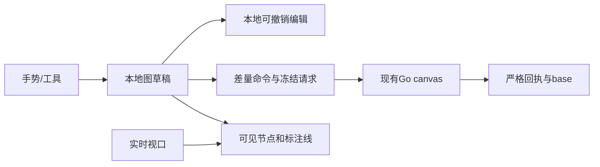

# 画布组件实现调研与迁入设计

状态：按2026-10-18用户要求开始实施。来源：[需求05](../requirement/05-画布组件迁入与定制需求.md)；范围：[PRD05](../prd/05-画布组件迁入与定制.md)；步骤：[计划11](../plan/11-画布组件迁入验证与定制实施计划.md)。功能需求及非功能需求编号只在需求05维护。

## 1. 结果与边界

沿现有BeefTV适配实现无限画布核心，补齐可见区域渲染、文字与分组、标注连线、编辑历史和相机保存。复用真实素材、保存、冲突、报价及结果采用；业务投影只读，已保存节点不删除。组、线、历史与布局操作不发起模型调用。

采用一套React DOM节点、SVG标注线和现有视口机制。不加React Flow、Leafer、Zustand、第二套API或通用插件层。需要图形引擎或多人同步时，以实际需求和测量另评；本轮不预建目录或空接口。

## 2. 来源与采用依据

| 来源                                                                                                                             | 用途                                                                |
| -------------------------------------------------------------------------------------------------------------------------------- | ------------------------------------------------------------------- |
| [BeefTV a2196d3](https://github.com/glanderness/BeefTV/tree/a2196d32782be6090beb003590ce11a956a423e1)                            | 当前视口、节点外壳、小地图、工具栏的已登记来源；继续复用            |
| [BeefTV v1.7.26 / ddaf5f9](https://github.com/glanderness/BeefTV/tree/ddaf5f9abc64b16567c28ea5399d8f2069c47832)                  | 空间查询、进入/保留缓冲、历史与分组的实现参考；只迁入实际使用的机制 |
| [infinite-canvas v0.20.0 / 3a6b64b](https://github.com/basketikun/infinite-canvas/tree/3a6b64b602ad062b29fac66902ed18a7ef5fd9dc) | 基础交互、SVG连接、分组与引用对照；不采用其项目集合持久store        |

BeefTV的[NOTICE](https://github.com/glanderness/BeefTV/blob/ddaf5f9abc64b16567c28ea5399d8f2069c47832/NOTICE)声明派生自infinite-canvas v0.5.0；两者不是独立稳定性证据。BeefTV固定快照的[质量检查](https://github.com/glanderness/BeefTV/actions/runs/39029862050)成功，但不代替本项目验收。两项目固定版本的根许可为MIT，保留适用许可及传递来源；新依赖和媒体资产另核对。

空间索引参考`web/src/lib/canvas/canvas-spatial-index.ts`，渲染缓冲参考`pages/canvas/use-canvas-render-model.ts`；不采用其280/420/720节点截取，避免合法节点在密集布局中无提示消失。历史参考`use-canvas-history.ts`的操作边界，改用本项目合法变更；分组参考`canvas-frame.ts`的世界坐标模型。

React Flow的[节点](https://reactflow.dev/learn/customization/custom-nodes)、[性能](https://reactflow.dev/learn/advanced-use/performance)和[可访问性](https://reactflow.dev/learn/advanced-use/accessibility)机制可作备选；当前替换已有适配收益不足。tldraw的[生产许可](https://tldraw.dev/community/license)与白板模型需要独立评估。完整应用、SDK和图形引擎不按热度排性能名次。上轮Firecrawl额度不足，事实通过GitHub与Context7/官方文档核验。

文档沿lucky的总导航、分目录00导航、相对链接和design→PRD→plan职责组织，继续保留Glowloom的requirement来源。lucky的业务决策、微服务结构和个人Obsidian配置不迁入。

## 3. 现有边界

可达入口为`src/app/canvas/page.tsx`→`canvas-page.tsx`→动态加载`canvas-editor.tsx`。现有手势包含Pointer Capture、鼠标/触控板/双指、框选、rAF预览和Radix输入区排除；现有保存包含冻结命令、原幂等键、revision、输入版本、恢复分支和冲突处理，继续复用。

服务端`backend/internal/canvas/domain/document.go`已提供文字、group、parent_id、annotation、SetViewport与布局命令，容量为2000节点/4000边。组移动不隐式移动子节点；Connect仅允许可编辑非草稿间annotation，业务关系受保护。前端本轮补接这些已有合同，不改数据库，不放开业务节点或草稿删除。

## 4. 文件目录与职责

所有页面独有实现放在`frontend/src/app/canvas/_components/`，直接导入具体文件。现有跨页媒体、提示词和业务API沿原目录复用。

| 文件                                        | 职责及实际消费者                                                                               |
| ------------------------------------------- | ---------------------------------------------------------------------------------------------- |
| `canvas-page.tsx`                           | 读取项目/画布，校验后动态进入编辑器；保持现有入口                                              |
| `canvas-editor.tsx`                         | 编排选择、工具、图草稿、冻结保存、恢复、冲突和生成；不放空间查询算法                           |
| `infinite-canvas.tsx`、`canvas-viewport.ts` | 实时/提交视口、坐标、框选手势、事件作用域及清理；复用现有实现                                  |
| `canvas-render-model.ts`                    | 从节点几何建立索引、查询可见节点与边、组后代及定位边界；供节点层和选择使用                     |
| `canvas-node-layer.tsx`                     | 订阅实时视口，按进入/保留缓冲更新挂载窗口；保护选中/焦点/交互节点；渲染SVG连接与现有CanvasNode |
| `canvas-history.ts`                         | 有界本地编辑历史、合并连续同一字段输入、撤销重做；不发API、不持久化另一份业务图                |
| `editor-state.ts`                           | 图及回执边界校验、文字/group工厂、白名单差量命令、旧分支兼容与复制身份                         |
| `canvas-node.tsx`、`canvas-composer.tsx`    | 节点外壳、文字/group显示及现有参数/提示词；视频/音频选中激活                                   |
| `canvas-toolbar.tsx`、`canvas-mini-map.tsx` | 现有视图控制和快捷键说明；小地图基于全图，操作控件复用shadcn                                   |
| 同目录`*.test.ts(x)`                        | 领域转换、真实组件行为及边界；不增加平行业务客户端或测试脚本                                   |

`frontend/src/api/`是生成文件，本轮只消费已有合同。`components/media/`继续负责授权预览/上传，`components/generation/`负责提示词和报价/采用；页面不复制这些能力。没有跨页消费者时不抽取shared engine目录，不建barrel导出或通用utils。

## 5. 状态与数据流

编辑状态包括nodes、edges和viewport；服务端base、冻结pending与本地draft分开。选中、焦点、播放器、拖动预览属于UI状态。媒体身份为ref_type/ref_id，不将URL、Blob或运行任务塞进图配置。

### 5.1 可见渲染

空间查询使用世界坐标，节点标题和选择手柄计入边界；超大组不能遍历无界格子。进入缓冲小于保留缓冲，减少边界反复挂载；选中、焦点和拖动节点保留。没有节点数量截取，框选和小地图基于全图。连接曲线控制点包围盒与视口相交即渲染，双端离屏也不漏线。

实时视口经rAF修改合成层，并以限频更新可见窗口；手势结束立即同步。节点层独立订阅，避免拖动每一帧刷新保存/生成编排。未选中的视频/音频显示轻量占位，选中后通过原授权预览组件读取；切换/离屏/卸载释放媒体。3D仍使用现有素材预览入口，不加载新的3D引擎。

### 5.2 文字、分组和连接

文字使用`resource/text`和`config.text`；group使用`resource/group`、`config.collapsed`与parent_id。组成员保持世界坐标，移动组时显式批量移动可编辑后代，每个节点只算一次。解组清空选定组成员parent_id，保留组节点以遵守持久删除边界；收起只影响渲染，不删除子节点。

标注连接使用现有annotation，只允许恰好两个可编辑非草稿节点；明确显示为标注关系，不作为生成依赖。普通编辑不能修改protected edge。复制节点生成新UUID并清除输入/执行身份；复制组需要独立成员映射，不复制旧任务。数量或合同限制显示真实说明。

### 5.3 历史和保存

历史记录一次手势或一组编辑的前后图，连续文字字段修改合并；不记录viewport和播放/选择，不替代Tiptap正文历史。本地最多保留50次编辑，超出只移除最早历史，不影响图。保存后撤销通过新合法命令前进revision；不能移除任何已保存节点，不可逆步骤禁用并说明。冻结pending存在、结果未知或冲突时暂停历史跳转。

引用标签分配与高水位单独保留到本次编辑会话结束，撤销不回收已分配编号，包括尚未保存的分配；升级后的composer不撤回旧草稿格式。解组遇到只读直接成员时保持原图并反馈原因。批量标注增删按每条命令最多2000项拆分，总请求仍受100条命令限制。

pending同时冻结nodes/edges/viewport及原幂等键；响应必须逐项核对节点字段、边和相机及revision。响应期间的新编辑保留，只有对应冻结字段更新base；相机单独比较避免旧相机覆盖当前手势。恢复分支保存完整图及原pending，旧的仅nodes分支按其base.edges/base.viewport补齐；缺损或跨身份数据拒绝。

读取服务端相机并保留有效视角；用户新手势沿现有5%～200%缩放，源坐标显式映射`k`↔`zoom`。修改相机只保存视图，不改变节点输入版本或触发生成。保留原自动保存节奏及离开保护。

### 5.4 输入与失败路径

画布快捷键仅在画布事件作用域工作，input/textarea/contenteditable和菜单/弹窗内不触发V/H、删除、撤销重做。Ctrl/Cmd+S保留原保存；撤销支持Ctrl/Cmd+Z、Shift+Z/Y。Escape逐层退出，由Radix处理弹层焦点。

无权限、过期素材、网络错误、保存未知和冲突沿现有反馈处理。冲突保留本地图或显式载入服务端；结构编辑不能无提示合并删除/重绑业务字段。用户选择保留本地时，受保护服务端数据仍保留，不自动放宽领域校验。

## 6. 验证与交付

FR对应CAN-A01～A12；非功能项CAN-N01～N06分别覆盖容量可达、rAF/限频、保存可靠、输入可访问、媒体清理和工程维护。按计划先测试失败再实现，现有保存/生成用例继续通过。真实性分层：单测/fixture不等于浏览器、数据库、真实媒体或供应商接受。

目录、依赖、许可和实际代码消费者一起核对；前端执行ESLint、Prettier、Next typegen、TypeScript、全量Vitest与生产构建，交互补浏览器尺寸/主题与连续手势。性能记录设备、样本及测量，不用上游CI或协议容量承诺流畅帧率。真实收费生成不在默认工程检查中。

[返回设计导航](00-设计导航.md)
