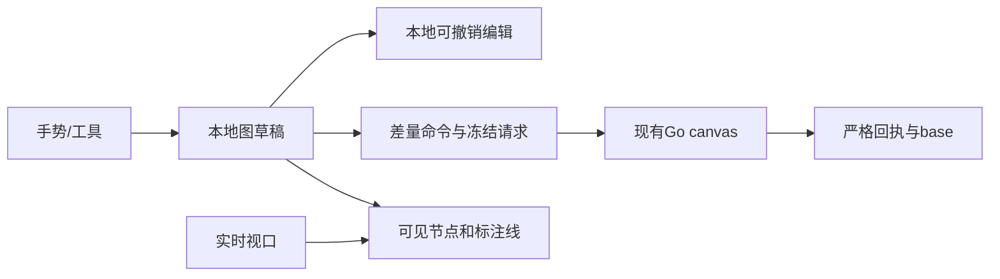

# 画布组件实现调研与迁入设计

2026-10-20 现行节点规范以 [文本节点内编辑](https://www.figma.com/design/uLqmeRWuQuzfrp9xOYg6FT/?node-id=1178-96429)、[图片素材](https://www.figma.com/design/uLqmeRWuQuzfrp9xOYg6FT/?node-id=1178-96865)和[视频素材](https://www.figma.com/design/uLqmeRWuQuzfrp9xOYg6FT/?node-id=1178-97063)为准：

- 图片、视频上传、项目库导入和生成结果复用 `ProjectMediaPreview`，节点内保持完整比例，视频未选中也读取预览，选中后启用播放控件。媒体资源选中不显示下方说明或创作 pop，不增加上传专用节点类型。
- 文本单击选中显示共享 `RichGeneration` 文本生成面板；双击正文进入节点内 `DocumentEditor`，收起生成面板，格式工具置于节点上方。全屏与节点内编辑保留同一个 Tiptap 实例、选择和撤销历史，Escape 返回。
- `DocumentEditor` 与 `PromptEditor` 共用 `useEditorSurface` 生命周期；正文启用官方 Tiptap 标题、列表、引用、对齐和文字格式扩展，提示词保留原 `ComposerSession` 引用与生成合同。正文通过既有 `config.text` 保存 Markdown；对齐段落采用受编辑器 schema 过滤的内嵌 HTML，刷新后恢复格式。不新增后端字段或浏览器私有正文存储。
- 文字生成沿用现有服务端提示词草稿、模型能力、报价与提交流程，节点切换复用本次页面会话中的草稿 ID；不把缺少模型或媒体读取能力显示为可用。页面刷新后的草稿恢复沿已有“找回草稿”入口。
- 选中态取消四角白点，仅保留内侧低对比右下角尺寸入口。左右加号仍支持集中连线；节点操作菜单 hover 或键盘聚焦后显示。

适用范围：画布宿主图模型、交互、保存与共享生成组件；迁移差异另见设计11。文档版本：2026-10-20整理版；历史观察、后续实现及Mock阶段沿各节时点阅读，本次补充待评审。维护职责：画布及媒体/生成合同消费者；评审人未指定。

现成能力的迁入、数据适配与Figma定制补充采用已确认的[画布迁移实施方案](11-画布迁移实施方案.md)，执行和证据见[计划14](../plan/14-画布迁移实施方案.md)。原件下载先解析项目素材库条目身份；编辑与保存继续使用本设计的既有命令边界。按用户最新要求，本轮以独立开发预览Mock图、素材、模型目录和上传回执验证，真实数据接入后续补齐。

状态：按2026-10-18用户要求开始实施。来源：[需求06](../requirement/06-画布组件迁入与定制需求.md)；范围：[PRD05](../prd/05-画布组件迁入与定制.md)；步骤：[计划13](../plan/13-画布组件迁入验证与定制实施计划.md)。功能需求及非功能需求编号只在需求06维护。

## 1. 结果与边界

画布按 Glowloom 规范实现，并统一使用 shadcn。不新增通用插件框架或第二套生产业务客户端。宿主持有权限、图保存、素材身份、报价与生成执行。时间线不进入产品入口。

## 2. 现有边界

可达入口为`src/app/canvas/page.tsx`→`canvas-page.tsx`→动态加载`canvas-editor.tsx`。现有手势包含Pointer Capture、鼠标/触控板/双指、框选、rAF预览和Radix输入区排除；现有保存包含冻结命令、原幂等键、revision、输入版本、恢复分支和冲突处理，继续复用。

服务端`backend/internal/canvas/domain/document.go`已提供文字、group、parent_id、annotation、SetViewport与布局命令，容量为2000节点/4000边。组移动不隐式移动子节点；Connect允许可编辑节点间annotation，包含未锁定生成草稿，业务关系受保护。前端本轮补接这些已有合同，不改数据库，不放开业务节点或草稿删除。

## 3. 文件目录与职责

2026-10-20 用户授权落地页面重建。画布页实现已从 `_components/` 拆到职责目录，文件名不再使用 `canvas-` 前缀或上游产品名。下表是拆分前的职责说明，当前路径见需求 06 第 13 节。

页面独有实现放在 `frontend/src/app/canvas/` 的 `viewport/`、`node/`、`group/`、`history/`、`chrome/`、`image/`、`composer/`、`preview/` 与 `director/`，直接导入具体文件。现有跨页媒体、提示词和业务 API 沿原目录复用。`director/` 保留编辑器已经调用的导演台，不作为新的正式页面表面。

| 文件                                        | 职责及实际消费者                                                                               |
| ------------------------------------------- | ---------------------------------------------------------------------------------------------- |
| `canvas-page.tsx`                           | 读取项目/画布，校验后动态进入编辑器；保持现有入口                                              |
| `canvas-editor.tsx`                         | 编排选择、工具、图草稿、冻结保存、恢复、冲突和生成；不放空间查询算法                           |
| `canvas-viewport.ts`及视口组件              | 实时/提交视口、坐标、框选手势、事件作用域及清理                                                |
| `canvas-render-model.ts`                    | 从节点几何建立索引、查询可见节点与边、组后代及定位边界；供节点层和选择使用                     |
| `canvas-node-layer.tsx`                     | 订阅实时视口，按进入/保留缓冲更新挂载窗口；保护选中/焦点/交互节点；渲染SVG连接与现有CanvasNode |
| `canvas-history.ts`                         | 有界本地编辑历史、合并连续同一字段输入、撤销重做；不发API、不持久化另一份业务图                |
| `editor-state.ts`                           | 图及回执边界校验、文字/group工厂、白名单差量命令、旧分支兼容与复制身份                         |
| `canvas-node.tsx`、`canvas-composer.tsx`    | 节点外壳、文字/group显示及现有参数/提示词；视频/音频选中激活                                   |
| `canvas-toolbar.tsx`、`canvas-mini-map.tsx` | 现有视图控制和快捷键说明；小地图基于全图，操作控件复用shadcn                                   |
| 同目录`*.test.ts(x)`                        | 领域转换、真实组件行为及边界；不增加平行业务客户端或测试脚本                                   |

`frontend/src/api/`是生成文件，本轮只消费已有合同。`components/media/`继续负责授权预览/上传，`components/generation/`负责提示词和报价/采用；页面不复制这些能力。没有跨页消费者时不抽取shared engine目录，不建barrel导出或通用utils。

## 4. 状态与数据流

编辑状态包括nodes、edges和viewport；服务端base、冻结pending与本地draft分开。选中、焦点、播放器、拖动预览属于UI状态。媒体身份为ref_type/ref_id，不将URL、Blob或运行任务塞进图配置。

### 4.1 可见渲染

空间查询使用世界坐标，节点标题和选择手柄计入边界；超大组不能遍历无界格子。进入缓冲小于保留缓冲，减少边界反复挂载；选中、焦点和拖动节点保留。没有节点数量截取，框选和小地图基于全图。连接曲线控制点包围盒与视口相交即渲染，双端离屏也不漏线。

实时视口经rAF修改合成层，并以限频更新可见窗口；手势结束立即同步。节点层独立订阅，避免拖动每一帧刷新保存/生成编排。未选中的视频/音频显示轻量占位，选中后通过原授权预览组件读取；切换/离屏/卸载释放媒体。3D仍使用现有素材预览入口，不加载新的3D引擎。

### 4.2 文字、分组和连接

文字使用`resource/text`和`config.text`；group使用`resource/group`、`config.collapsed`与parent_id。组成员保持世界坐标，移动组时显式批量移动可编辑后代，每个节点只算一次。解组清空选定组成员parent_id，保留组节点以遵守持久删除边界；收起只影响渲染，不删除子节点。

标注连接使用现有annotation，只允许恰好两个可编辑节点，包含未锁定生成草稿；明确显示为标注关系，不作为生成依赖。普通编辑不能修改protected edge。复制节点生成新UUID并清除输入/执行身份；复制组需要独立成员映射，不复制旧任务。数量或合同限制显示真实说明。

### 4.3 历史和保存

历史记录一次手势或一组编辑的前后图，连续文字字段修改合并；不记录viewport和播放/选择，不替代Tiptap正文历史。本地最多保留50次编辑，超出只移除最早历史，不影响图。保存后撤销通过新合法命令前进revision；资源删除与撤销使用现有DeleteNodes/AddNodes合同；已保存生成草稿仍禁止删除。冻结pending存在、结果未知或冲突时暂停历史跳转。

引用标签分配与高水位单独保留到本次编辑会话结束，撤销不回收已分配编号，包括尚未保存的分配；升级后的composer不撤回旧草稿格式。解组遇到只读直接成员时保持原图并反馈原因。批量标注增删按每条命令最多2000项拆分，总请求仍受100条命令限制。

pending同时冻结nodes/edges/viewport及原幂等键；响应必须逐项核对节点字段、边和相机及revision。响应期间的新编辑保留，只有对应冻结字段更新base；相机单独比较避免旧相机覆盖当前手势。恢复分支保存完整图及原pending，旧的仅nodes分支按其base.edges/base.viewport补齐；缺损或跨身份数据拒绝。

读取服务端相机并保留有效视角；用户新手势按即梦专项采用8%～800%缩放（历史5%视角保留），源坐标显式映射`k`↔`zoom`。修改相机只保存视图，不改变节点输入版本或触发生成。保留原自动保存节奏及离开保护。

### 4.4 输入与失败路径

画布快捷键仅在画布事件作用域工作，input/textarea/contenteditable和菜单/弹窗内不触发V/Space、删除、撤销重做。Ctrl/Cmd+S保留原保存；撤销支持Ctrl/Cmd+Z、Shift+Z/Y。Escape逐层退出，由Radix处理弹层焦点。

无权限、过期素材、网络错误、保存未知和冲突沿现有反馈处理。冲突保留本地图或显式载入服务端；结构编辑不能无提示合并删除/重绑业务字段。用户选择保留本地时，受保护服务端数据仍保留，不自动放宽领域校验。

## 5. 验证与交付

FR对应AC-CAN-01～AC-CAN-12；非功能项NFR-CAN-01～NFR-CAN-06分别覆盖容量可达、rAF/限频、保存可靠、输入可访问、媒体清理和工程维护。按计划先测试失败再实现，现有保存/生成用例继续通过。真实性分层：单测/fixture不等于浏览器、数据库、真实媒体或供应商接受。

目录、依赖、许可和实际代码消费者一起核对；前端执行ESLint、Prettier、Next typegen、TypeScript、全量Vitest与生产构建，交互补浏览器尺寸/主题与连续手势。性能记录设备、样本及测量，不用上游CI或协议容量承诺流畅帧率。真实收费生成不在默认工程检查中。

[返回设计导航](00-设计导航.md)

## 6. 即梦一致性设计（2026-10-18）

用户要求布局、功能、交互、快捷键及拖动画布方式与即梦一致，先更新Figma再实现、最后浏览器验收；随后确认字体使用Vercel。此要求替代旧画布的V/H和普通滚轮缩放约定；品牌仍为织光，模型、价格和素材只使用真实业务数据。

[Figma R10设计页](https://www.figma.com/design/uLqmeRWuQuzfrp9xOYg6FT/?node-id=675-26265)包含空画布、图片/文本节点、右键创建、缩放、400px AI侧栏和窄屏提案；图片节点主稿为[675:26529](https://www.figma.com/design/uLqmeRWuQuzfrp9xOYg6FT/?node-id=675-26529)。均为原生可编辑文字、矢量和组件实例，未把完整页面截图作为UI。字体统一Geist，中文回退；Figma状态跳转不作为连续手势证据，窄屏提案需源页面同尺寸核对。

| 区域/操作 | 即梦登录态核对值                                                                                                                   | 实现归属                                                                             |
| --------- | ---------------------------------------------------------------------------------------------------------------------------------- | ------------------------------------------------------------------------------------ |
| 顶部      | 上10px、左右12px、高40px；品牌/项目在左，搜索/历史/分享/更多/账号在右                                                              | `canvas-header.tsx`，历史按需加载`canvas-project-history.tsx`                        |
| 左工具栏  | 48×398px，按钮40×40px、图标20px；左12px、中心相对视口下移28px                                                                      | `canvas-toolbar.tsx`、`canvas.css`                                                   |
| 节点/参数 | 默认新节点320×320px；参数浮层宽680px，距节点20px；输入、菜单不缩放                                                                 | `editor-state.ts`、`canvas-node.tsx`、`canvas-node-panel.tsx`、`canvas-composer.tsx` |
| 视图控制  | 左16px、底20px，156×28px；选择/抓手切换、小地图、线可见、百分比菜单                                                                | `canvas-toolbar.tsx`、`canvas-node-layer.tsx`                                        |
| 平移/缩放 | 普通滚轮及双指滚动平移，按浏览器原始WheelEvent增量平移；Ctrl/⌘滚轮及捏合按指针锚点缩放，单事件倍率2^(-deltaY×0.01)，限制1/1.2～1.2 | 画布视口组件；上下界8%～800%，旧视角兼容与保存端同步调整                             |
| 快捷键    | V选择，Space临时平移；⌘/Ctrl +/-缩放，Shift+1全图、Shift+2选中、⌘/Ctrl+1=100%；⌘/Ctrl+D副本、Z/Shift+Z历史                         | `canvas-editor.tsx`，输入法及输入/菜单/弹窗排除；不把H继续作为已对齐按键             |
| 创建/右键 | 双击空白创建，右键菜单按点击世界坐标放置；节点菜单与空白菜单区分                                                                   | `canvas-context-menu.tsx`，复用官方Radix/shadcn `components/ui/context-menu.tsx`     |

完全一致的退出条件是差异清单全部关闭，不能把只画出的状态算作功能已接通。当前需继续补齐：文本/音频生成、Agent执行、时间线与导演台完整编辑/执行、生成依赖连线、已保存节点删除、系统剪贴板复制粘贴、就地模型/引用/报价流程、AI侧栏可调整与避让、标签/全屏/下载及各异常状态。右键当前仍为平铺菜单，需要按新建节点级联菜单继续对齐；节点两侧创建与布局连线按第9节补齐，供应商执行依赖仍未开放。现有只读业务合同仍生效；需要变更时在领域层落实并验证，不能靠前端伪装成功。分享目前仅复制受现有权限约束的链接，不等于即梦的访问授权管理。

原始滚轮增量以浏览器事件为准。本机输入适配层会把工具传入的滚动量转换为两倍事件增量；已通过相同输入对照源页面并修正，不能再在组件中乘二。单个320px节点的适配画布终态为50%；选中适配不放大超过100%，多节点和侧栏组合仍须继续对照。

颜色值由`frontend/src/app/globals.css`的深浅主题定义统一持有（现有`background/card/border/foreground/muted-foreground`语义变量）；画布样式只消费变量。Geist沿用现有字体加载，无新增运行依赖。节点不展示输入版本等实现字段。

## 7. 现有宿主实现：shadcn与内联富文本

以需求06 SRC-CAN-04为当前范围：时间线入口及本轮新增组件移除。节点外壳、参考架、正文及底部参数分区使用本项目 shadcn。Figma主稿[675:26529](https://www.figma.com/design/uLqmeRWuQuzfrp9xOYg6FT/?node-id=675-26529)同步移除时间线并使用本项目深色主题值。

节点仍由`canvas-node.tsx`负责世界坐标、拖动、尺寸、选中与两侧创建；`canvas-node-panel.tsx`保持输入面板屏幕尺寸及避让。两侧创建按钮调用真实新增文字/图片/视频节点，不把标注连线解释为生成依赖。

下方由`canvas-composer.tsx`组合共享`components/generation/rich-generation.tsx`的`presentation="canvas"`。后者直接复用`PromptEditor`、`ComposerSession`和`ReferenceControls compact`：参考架在上、Tiptap正文在中、真实模型/模式和schema参数及报价操作在下；引用详情、异常与费用确认使用现有shadcn弹层。所有版本、标签高水位、上传和权限规则复用原合同。没有第二份提示词、模型配置或生成请求状态。

首次打开旧草稿先升级为富文本并经canvasOwner.flush保存，再读取节点未决提交；正文变化写入节点的richCanvasDraft，报价前再次保存并核对canvas/input revision。原请求未知时复用冻结正文与幂等键；切换节点后从节点草稿及服务端未决状态恢复。模型名称、支持模式、候选数量、分辨率与费用由实际接口提供。

节点剪贴板只接受同项目、有版本且经命令验证的图；重建节点/边身份并重映射内部工具引用，外部来源保留已核对的素材身份。已保存资源沿DeleteNodes删除，保留本地冲突选择不得复活已删除资源；只读投影与生成草稿继续受领域保护。

导演台继续按需加载Three.js及开发类型，作为不新增通用画布引擎的必要例外；AI历史只读取真实任务。任务详情仅在text.generate/completed/json/passed条件暴露受限outputs[].text，未审核文本和其余provider JSON不返回，API从后端注解生成。两项能力的效果接受与本次样式/富文本验收分别记录。

## 8. 正式运行接入

正式`/canvas`由SessionGate和SpaceProvider授权，`canvas-page.tsx`读取真实项目与画布，再按需加载现有保存编排。视口、Pointer Capture、双指和 rAF 合成在画布视口组件中；`canvas-spatial-index.ts`提供空间索引，由`canvas-render-model.ts`映射节点几何，查询不传数量截断。

节点、分组、标注、工具栏、菜单、参数及面板使用现有 shadcn；共享 RichGeneration/PromptEditor 负责正文、@素材/主体、上传、参数、费用检查及未决恢复。图与引用使用 UUID、封闭 NodeConfig 及受保护业务边，按节点逐类往返保存，未表示的数据保留并明确限制。保存使用 typed commands、revision、input_revision 与幂等回执；原请求未知时保持冻结载荷。素材只绑定真实授权资产回执，URL、storageKey、Blob 不能作为 media_asset UUID。没有第二套画布引擎、API 客户端、插件框架或平行文档存储。

缺表修复使用现有002/003/004迁移；备份、副本恢复和演练后单一事务执行，保留用户/项目/画布数量及归属。正式后端已切回当前源码运行，保留既有密钥、公钥校验配置及只读挂载。工程与浏览器按计划13分别记录。

节点浮层以left/top定位，避免transform将共享编辑器的fixed展开限制在节点内；展开和Escape收起保持同一Tiptap实例。模型目录为空用既有shadcn Empty说明。任务和素材分页接受服务端合法的null尾游标，仍拒绝非法游标、跨项目回执及伪任务。历史时间线仅保留数据兼容，不进入渲染索引和工具栏。

焦点与选中按SRC-CAN-06统一：节点仅改变既有1px边框颜色，删除重复选中规则和偏移外描边；页面不再为shadcn按钮叠加独立outline。共享控件的focus-visible环统一1px，InputGroup仍由外容器显示焦点，内部控件不重复描边；全局原生控件回退焦点保留1px。错误、禁用及键盘语义不变。

## 9. 节点、全能参考与连线重设计

Figma：[节点与引用](https://www.figma.com/design/uLqmeRWuQuzfrp9xOYg6FT/?node-id=708-27224)、[参考与模式弹层](https://www.figma.com/design/uLqmeRWuQuzfrp9xOYg6FT/?node-id=708-27479)、[窄屏工具栏](https://www.figma.com/design/uLqmeRWuQuzfrp9xOYg6FT/?node-id=709-27428)。保持原生可编辑文本、矢量和组件实例。

来源：需求06 SRC-CAN-08、FR-CAN-13～FR-CAN-16。2026-10-18浏览器观察即梦登录态：节点两侧＋打开类型菜单；从图片向右创建视频同时产生一条定向线；空图片在新视频参考架显示不可用占位。全能参考是两项模式选择（首尾帧、全能参考），添加参考是上传/资产库/画布入口，@是就近分类候选列表，空图片不作为可用候选。观察不包含真实生成、费用或供应商效果。

本项目采用同一信息层级，原生Popover/Command/Select/DropdownMenu/Tooltip/Badge/InputGroup组合，使用当前neutral token和Geist，不复制即梦配色与会员元素。模式来自模型目录，不硬编码可执行模型或模式。参考架先展示来源再展示＋；48px预览、编号和自动引用标识，详情使用就近Popover。@候选在输入区附近打开，不加遮罩、不改变画布视口；键盘焦点与输入法由既有Tiptap和Radix共同管理。

布局线继续使用annotation，允许可编辑生成草稿作为端点；role/binding与只读业务边仍禁止通过Connect写入。新建节点与线同一图编辑/命令批次；左/右方向由空间语义确定，仍使用冻结保存与严格读回。连接不触发执行。媒体→新生成草稿的引用先通过现有素材预览接口核验project/id/kind/revision，再加入原PromptDraft references，旧来源或读取失败只保留布局线与待引用状态。异步期间节点或身份变化必须拒绝套用旧结果。

已绑定参考的连线从当前PromptDraft和本画布media_asset映射投影，使用细实线；未填内容的布局线用细虚线，选中相关节点才增强可读性。引用移除后投影随之消失；用户显式创建的普通标注独立保留，不把它变成执行或引用事实。自动引用只能指向真实媒体，不将草稿ID或预览URL充当素材ID。来源版本和标签高水位沿原合同，不自动切换到新版本。

侧边创建先避让同列已有节点；同素材多个副本时，自动引用优先保留原布局线的来源节点。窄屏工具栏改为顶部横向排列，参数区预留顶栏和工具栏空间；就近Popover按可用高度限制整个容器及候选列表，不能只限制列表而把搜索框挤出屏幕。节点设置与展开操作直接组合进InputGroup操作槽位，不用绝对定位覆盖参考架。

参考交互的Portal点击在弹层边界停止向InputGroupAddon冒泡，避免官方Addon将焦点交给隐藏上传框。@保持正文焦点，关闭或恢复输入不自动滚动画布；文件输入真正隐藏，不能以互相覆盖的宽高和sr-only样式撑宽参数区。加载使用固定结构Skeleton；复杂项目检索在Dialog内，不能展开并挤动画布。

2026-10-20引用修正：画布`@`首层为主体、图片、视频、音频，次层仅显示当前草稿已绑定的参考及与当前节点通过annotation实际相连的媒体；不把整个项目或未连接画布素材当作已有参考。annotation两端均可作为参考来源，受保护业务边不参与推断，重复连线按来源节点去重。连接只是候选事实，选择后通过现有媒体预览接口核验范围、类型和版本，再以原线ID加入参考并在当前`@查询`范围插入原子标签；同素材同角色沿既有合同防重。空来源保留禁用状态，断线、来源变更、正文变化或权限切换后拒绝套用异步旧结果。加号仍负责主动添加画布/素材库/上传/主体，`@`菜单不混入这些添加操作。分类支持方向键、Enter、Escape，中文组合期间不拦截确认；普通输入继续留在正文，关闭不滚动画布。菜单使用低对比边框、圆角、分类图标和右向箭头，窄屏限制到视口内。

2026-10-20级联与锚点修正：浏览器实测即梦当前`@`根菜单240px宽、244px高，底部与正文`@`顶部约6px间距，水平中心与输入起点重合；图片分类展开后根菜单保留，右侧约4px间距出现独立240px候选层，顶边跟随分类行；空分类为“暂无相关节点”独立面板。这些为本轮当前页面观察，不是供应商/API合同。本项目采用正文`@`范围的虚拟锚点，不以参考架作锚点；悬停/点击分类时显示独立候选层，活动分类和活动候选有中性色高亮，已提及项显示勾选。二级候选碰到视口边缘自动翻转；窄屏在根菜单内展开候选，保持整体可滚动。输入焦点留在正文，上下键选择、右键/Enter进入二级、左键返回一级、Escape关闭整个候选；选择后仅替换当前触发范围。加号的素材添加菜单保留原锚点。

## 10. 画布宿主评审与交接（2026-10-20整理）

| 评审主题             | 精确章节及承接                                                                                                        |
| -------------------- | --------------------------------------------------------------------------------------------------------------------- |
| 目标、现状与方案取舍 | 第1、2～3节；逐职责迁入与整套替换的比较由[设计11第3节](11-画布迁移实施方案.md#3-迁移方案比较)承接，不重新选择画布权威 |
| 交互、用户流程和状态 | 第4.1～4.4、6～8、9节；快捷键/手势/弹层与引用流程分别按注明日期要求阅读                                               |
| 模块与接口           | 第3、7～8节；宿主持图保存，媒体/PromptEditor/RichGeneration持各自合同，前端只消费生成API                              |
| 数据与失败恢复       | 第4.2～4.4、7～8、9节；base/pending/draft分离，annotation不成为执行事实，输入指针/报价由设计06承接                    |
| 质量与兼容           | 第5、8节及计划13/14；容量合同不等于实测帧率，Mock不等于真实业务/供应商                                                |

兼容评审先检查旧图可读及原命令往返，再接新交互与共享富文本；未知或受保护内容不得在读取、复制或保存中被过滤成“成功”。视角和UI选择不是生成意图；回退视觉/迁入模块时保留理解已保存节点/composer版本的宿主及未决提交恢复，不回退成会静默降级的旧图写入器。兼容回退和发布命令由计划13/14说明，本次不执行。

| 待核对或证据缺口                                         | 关闭条件                                                                                                                       | 责任职责/阻断                         |
| -------------------------------------------------------- | ------------------------------------------------------------------------------------------------------------------------------ | ------------------------------------- |
| 第6节列时间线完整能力差距，与第1/7/8节明确移除时间线入口 | 保留旧差距表来源；评审确认该条只是历史竞品全量差距，不得据此重新扩大当前范围或删除历史数据兼容                                 | 产品/画布职责；阻断范围定稿           |
| 第4.3编号保留到会话结束，与共享编辑器持久labelState描述  | 按设计06第6.2/10/14节核对到底是会话临时状态还是草稿持久分配；不得因退出编辑复用已保存编号                                      | 画布/编辑器职责；阻断引用保存合同接受 |
| 旧Figma主稿675:26529与设计11失效记录                     | 保留历史链接；当前迁入按设计11第2节可定位节点核对，不能用失效主稿宣称视觉对齐                                                  | 设计/画布职责；阻断对应设计状态接受   |
| 第6节完整差距、第8节正式接入和设计11后续证据覆盖不同     | 按计划13/14逐项列实际通过、未验和未接合同；真实上传/读回已有的限定证据不应继续一概称未接入，收费供应商、完整触摸及性能仍未接受 | 测试/画布/平台职责；阻断整体验收声明  |

本文没有改变2000节点/4000边、8%～800%、权限、保存、受保护节点或历史回执合同；本次补充待评审，不把历史执行授权转为新的产品能力接受。

## 11. 画布 UI/UX 拆解与即梦对齐提案（2026-10-20）

状态：设计提案，待评审。用户要求先完成设计拆解与状态设计，本轮停止新增前端实现。第9节此前的局部修正不能作为本轮整体设计已接受、已实现或已验收的证据。

[Figma 设计拆解](https://www.figma.com/design/uLqmeRWuQuzfrp9xOYg6FT/?node-id=1083-155)位于独立页面“画布 UIUX / 即梦对齐 · 10.20”，保留原产品页面和组件库。补充端口拖线与组件复用后共有34张原生可编辑画板：6张拆解/规则及组件展示板、26张桌面状态、2张手机状态；另有5组共享组件，主组件置于展示画板之外。桌面、手机、连接端口和工具栏/资产库各有一个原型起点；原型展示离散状态路径，不模拟真实连续手势、富文本输入、上传、保存、计费或生成。

### 11.1 范围与观察依据

本轮聚焦无限画布中的节点关系、编辑器、参考和参数浮层，不扩大到时间线或其他业务页面。2026-10-20在用户提供的即梦登录态页面观察到：正文输入位置附近出现分类根菜单；分类展开后保留根菜单并在侧边显示空候选层；加号菜单提供上传、资产库、画布入口；展开生成器居中显示大面板，参考分类与清除操作在顶部，正文在中间，参数和生成操作在底部。

即梦有素材的候选列表、引用失效以及手机键盘场景本轮未实测。稿中的候选行、失效反馈、手机分类内展开为Glowloom提案，不能表述为已观察到的即梦行为。Geist、Lucide及现有组件体系继续使用；不复制会员标识、不新增模型或执行能力。

### 11.2 结构与视觉规则

| 区域       | 设计职责             | 本轮提案                                                                                  |
| ---------- | -------------------- | ----------------------------------------------------------------------------------------- |
| 顶部与左侧 | 项目操作与内容创建   | 沿用现有品牌和工具入口，保持位置稳定                                                      |
| 节点与连线 | 表达内容及其参考关系 | 标题在节点外；常态边界低对比，选中提高对比；连接不触发执行                                |
| 常规编辑器 | 服务当前节点的创作   | 跟随节点底边、下方16px居中；顶部参考缩略图与加号，中间正文，底部模型/尺寸/模式/时长与提交 |
| 展开编辑器 | 长提示词与多参考编辑 | 居中大面板；顶部参考分类/清除/折叠，中间可编辑正文，底部固定参数                          |
| 浮层       | 就近完成单个选择     | 添加参考锚定加号；正文引用锚定当前触发范围；层级展开不移动画布                            |

草稿深色值：画布`#0A0A0A`，编辑器`#202020`，浮层`#262626`，活动行`#363636`；常态边界`#2B2B2B`，选中节点边界`#616161`。通过填充、间距和轻阴影分层，不叠加白色外描边。以上是设计建议，待评审后映射到语义变量，不把硬编码色值带入画布实现。文字/图标继续沿用Geist/Lucide。缩略图、候选行与正文标签共享编号与来源身份。

### 11.3 参考与引用流程

`+`负责加入参考；`@`负责在正文提及当前节点已连接或已绑定的参考。项目中的其他素材不能直接冒充当前参考。已连线但无可用内容的来源保留不可用反馈；真正插入前仍遵循第9节的范围、类型、版本核验及防重合同。普通标注线不因此成为执行依赖。

正文输入`@`后显示主体、图片、视频、音频根菜单。桌面悬停或进入分类时，根菜单保持，分类行高亮，独立子菜单与该行顶边对齐；根菜单与子菜单均240px宽，间隙4px。没有该类内容时显示空态；候选显示缩略图、编号和来源说明，已提及显示勾选。选择后只替换当前触发范围为原子引用标签，保留周围文字并继续输入；重复提及不产生重复素材绑定。

方向键上下移动，右方向键进入、左方向键返回，Enter插入，Escape关闭；中文组合输入不被菜单确认逻辑截断。关闭后恢复正文光标，不滚动画布。根菜单上下空间不足翻转，子菜单左右空间不足翻转。手机采用分类内展开、行高至少44px，浮层整体限制在可用视口内。软键盘出现后的高度、避让与滚动仍需实际浏览器验证。

展开/折叠共享原草稿、参考和当前输入上下文，不创建第二份正文状态。移除参考和清除全部的具体确认沿现有合同；断开来源后保留明确的失效标签及移除入口，不把失效标签当可执行参考。节点待生成、生成中、失败与引用失效在规则板分别展示。

### 11.4 状态索引与设计接受条件

| 状态                   | Figma                                                                                                                                                    |
| ---------------------- | -------------------------------------------------------------------------------------------------------------------------------------------------------- |
| 常规编辑、已连接参考   | [01](https://www.figma.com/design/uLqmeRWuQuzfrp9xOYg6FT/?node-id=1083-187)                                                                              |
| 正文引用根菜单         | [02](https://www.figma.com/design/uLqmeRWuQuzfrp9xOYg6FT/?node-id=1083-305)                                                                              |
| 分类候选与已提及反馈   | [03](https://www.figma.com/design/uLqmeRWuQuzfrp9xOYg6FT/?node-id=1083-425)                                                                              |
| 空分类                 | [04](https://www.figma.com/design/uLqmeRWuQuzfrp9xOYg6FT/?node-id=1083-545)                                                                              |
| 插入后的正文标签       | [05](https://www.figma.com/design/uLqmeRWuQuzfrp9xOYg6FT/?node-id=1083-665)                                                                              |
| 展开编辑器             | [06](https://www.figma.com/design/uLqmeRWuQuzfrp9xOYg6FT/?node-id=1083-783)                                                                              |
| 加号添加参考           | [07](https://www.figma.com/design/uLqmeRWuQuzfrp9xOYg6FT/?node-id=1083-901)                                                                              |
| 尺寸/清晰度/数量选择   | [08](https://www.figma.com/design/uLqmeRWuQuzfrp9xOYg6FT/?node-id=1083-1019)                                                                             |
| 手机分类展开与插入结果 | [09](https://www.figma.com/design/uLqmeRWuQuzfrp9xOYg6FT/?node-id=1086-842)、[10](https://www.figma.com/design/uLqmeRWuQuzfrp9xOYg6FT/?node-id=1086-912) |
| 状态和交互规则         | [11](https://www.figma.com/design/uLqmeRWuQuzfrp9xOYg6FT/?node-id=1086-984)                                                                              |

设计接受需要核对：视觉层级与白色描边问题；加入/提及职责；连接来源与不可用状态；候选选中和插入反馈；展开前后上下文；桌面碰撞和手机键盘避让。实现阶段再验证真实来源、保存读回、焦点/输入法、连续键盘操作、320/390px触摸及参数能力限制。模型、价格、模式和数量仍由实际配置决定，稿内展示值不是可用性承诺。

### 11.5 左右连接端口与拖线

2026-10-21 补充：超过拖动阈值后，同一画布中其他可连接节点也同时显示左右 `+`，复用已有端口组件与同侧中心锚点。完成连接、取消或丢失指针捕获后恢复仅选中节点显示；只读、分组等不支持连接的节点不新增入口。 真实项目浏览器验证：左右端口拖动均从 2 个可见端口扩展到 8 个节点的 16 个端口；Escape 取消和松手到空白处后均恢复为 2 个，空白处新建菜单正常打开，未创建额外节点。

用户补充：节点左右`+`均是可拖拽的连接端口，也保留点击创建入口。参考图用于表达交互与视觉效果，其中的时间线等条目不扩大当前能力范围。

| 阶段         | 反馈与结果                                                                                   |
| ------------ | -------------------------------------------------------------------------------------------- |
| 就绪/悬停    | 可见圆28px、命中区域44px；悬停增强端口，左右同一组件                                         |
| 单击         | 未超过拖动判定阈值时，打开锚定该端口的“添加节点”菜单                                         |
| 拖动         | 超过阈值后进入连线手势；起点保持，临时贝塞尔曲线跟随指针，使用蓝色强调；手势不移动节点或画布 |
| 进入已有节点 | 可连接的节点/端口高亮；松手提交连接。自身、重复、只读或不兼容目标不能提交，并显示原因        |
| 空白松手     | 保留临时预览，在落点打开共享“添加节点”浮层；选择类型后才创建节点与线，取消不产生孤立节点     |
| 完成         | 临时蓝线转为普通关系线，选中新建或目标节点；真实可用来源核验后同步参考条和`@`候选            |
| 取消         | Escape、指针取消、捕获丢失或退出操作清理临时线和落点浮层；已有节点、连线及正文保持原状       |

左右只决定几何出线方向及空白处新节点位置，不把拖动方向当作业务依赖或生成执行授权。新增节点与线遵循原批次/撤销合同；连接失败显示原因并恢复原图。来源未准备好或核验失败时展示不可用/待引用反馈，不把普通annotation线伪装为已绑定素材。视口缩放、平移后的端口和指针坐标需一致；实际阈值、连续预览、边缘行为及触摸拖动在实现阶段验收。

**同侧连线共用一个点（2026-10-20 补充）。** 每个节点左、右两侧各保留一个连接锚点，位置为对应`+`的中心。同侧所有已有连线及新增拖线共用该点，不按参考数量错开端点或增加端口。多条曲线从共同锚点平滑分叉/汇聚，靠近端口时保持水平切线；节点移动、缩放、尺寸变化后统一从节点几何重算，不能独立累积线端偏移。连线仍分别保留关系身份，视觉汇合不合并引用记录。

本次修正18张状态稿中下方参考线偏离端口中心10px的问题，核对19张双参考状态的38个终点均与对应端口中心重合（设计坐标误差0）。节点移动状态原已对齐，保持一致；共享规则板同步更新。本次是Figma几何与设计合同修订，实际拖动和缩放联动待实现验证。

Figma新增状态：[12右拖](https://www.figma.com/design/uLqmeRWuQuzfrp9xOYg6FT/?node-id=1098-1618)、[13左拖](https://www.figma.com/design/uLqmeRWuQuzfrp9xOYg6FT/?node-id=1098-1819)、[14已有目标](https://www.figma.com/design/uLqmeRWuQuzfrp9xOYg6FT/?node-id=1098-2020)、[15落点新建](https://www.figma.com/design/uLqmeRWuQuzfrp9xOYg6FT/?node-id=1098-2222)、[16连接结果](https://www.figma.com/design/uLqmeRWuQuzfrp9xOYg6FT/?node-id=1098-2437)、[18起始](https://www.figma.com/design/uLqmeRWuQuzfrp9xOYg6FT/?node-id=1103-3000)。原型以视频新建为一条示例分支，不作为任意节点类型、任意指针位置的可执行连接引擎。

### 11.6 富文本编辑器与全部画布浮层复用

所有画布浮层统一接入共享富文本编辑器及其浮层组件体系。文本、图片、视频等节点的创作面板复用`RichGeneration`/`PromptEditor`/`ComposerSession`，能力、占位、参考类型和参数通过现有业务配置区分。正文、参考、光标上下文和展开状态沿同一会话；节点浮层、常规与展开视图不再各自维护独立正文。

`@`引用、加号添加、参考详情、模型、模式、尺寸、数量、节点参数与端口新建等菜单使用编辑器已有的`Popover`、`Command`、`Select`和统一菜单行。画布右键、工具和全局浮层也消费同一视觉基础，并保留各自焦点、键盘、选择及模态语义。共同约束为字体、图标、颜色、边界、圆角、间距、活动/禁用/选中反馈、Portal层级、碰撞避让及焦点恢复；节点只组合内容和锚点，不复制另一套菜单CSS或编辑器状态。

截至11.7，Figma展示稿中的编辑器/浮层区域均使用共享实例；端口交付时为26个，增加2张锚定状态稿后为28个；11.8继续增加共享资产库实例：

| 组件组                        | 变体与用途                                                                                                                                                        |
| ----------------------------- | ----------------------------------------------------------------------------------------------------------------------------------------------------------------- |
| `Canvas / SharedRichComposer` | 8种：常规、触发引用、插入后、展开、手机、手机插入、空正文、单参考；[主组件](https://www.figma.com/design/uLqmeRWuQuzfrp9xOYg6FT/?node-id=1095-1949)               |
| `Canvas / SharedPopup`        | 9种：根菜单、图片分类、主体分类、候选、空态、添加参考、参数、手机分类、新建节点；[主组件](https://www.figma.com/design/uLqmeRWuQuzfrp9xOYg6FT/?node-id=1095-1950) |
| `Canvas / ConnectionPort`     | 就绪、悬停、拖动、有效目标、无效目标5种；左右共用；[主组件](https://www.figma.com/design/uLqmeRWuQuzfrp9xOYg6FT/?node-id=1098-1451)                               |

[17组件实例与规则板](https://www.figma.com/design/uLqmeRWuQuzfrp9xOYg6FT/?node-id=1099-2200)用于检查复用和样式一致性。颜色在独立`Canvas / UIUX Draft`集合中由语义变量别名绑定，间距、圆角、文字和次级文字复用现有变量/样式；草稿语义映射到既有`--card`、`--popover`、`--accent`，未修改生产CSS或原组件库。此处是设计层面的组件复用成果，实际前端所有浮层的接入与回归仍待设计接受后执行。

### 11.7 创作栏跟随节点与上传素材复用（2026-10-20 补充）

用户明确：创作 pop 栏应跟随所属节点下方；自行上传的图片、视频直接复用现有图片/素材节点。本节更新设计定位及上传呈现合同，仍未开始新增前端实现。

**锚定规则。** 常规创作栏以当前节点实时屏幕矩形为锚点，默认中心对齐，顶部为节点底边加16px。节点拖动、画布平移/缩放、节点尺寸变化和面板内容变化时同步重算。面板宽度、文字及间距采用屏幕像素，不跟随画布缩放；桌面稿常规宽960px，窄屏按可用宽度收缩。左右受限时在工具栏和侧栏之外限位，保留下方关系。首次激活时如空间不足，可调整视口容纳节点与编辑器；仍不足则正文限高滚动、操作条保留并提供展开入口。连续拖动中不突然翻到节点上方或吸附屏幕底部。节点完全离开可见区后收起跟随浮层，草稿保留，回到可见区恢复。上述边缘行为需实现验证。

**浮层层级。** 创作栏锚定节点；正文`@`锚定当前触发范围，添加参考和参数菜单锚定对应按钮。宿主移动时子菜单同步定位，菜单自身允许碰撞翻转。展开编辑器仍居中显示，折叠回当前节点下方，正文、参考及会话不重建。

**上传复用。** 本地上传、素材库选择和生成结果沿相同媒体节点模型展示，来源仅为资源元数据。Figma中20个图片/视频来源节点已使用原组件库`Canvas / Node`（675:26375）的实例，视频复用既有播放图标；未新建独立上传节点组件。截图照片为原稿素材，仅用于展示上传完成状态，并非本轮真实上传记录。

| 入口 / 状态            | 节点及引用结果                                                                          |
| ---------------------- | --------------------------------------------------------------------------------------- |
| 拖到空白画布、全局上传 | 在落点或合理可视位置创建图片/视频素材节点；不自动连接无关节点                           |
| 编辑器上传、添加素材   | 创建或复用当前画布对应素材节点并连接当前创作节点；可用内容核验通过后进入参考条和`@`候选 |
| 上传中、处理中         | 仍是同一素材节点，呈现进度/处理状态；未就绪项不能插入可执行引用                         |
| 上传失败               | 在原节点显示原因、重试及移除；重试复用节点身份，不追加重复节点                          |
| 就绪及复用             | 节点预览、参考缩略图和正文标签指向同一资源身份及版本；重复添加遵循原防重合同            |

已调整16个已有桌面/手机状态的下方锚点，普通状态与新增移动状态中心对齐且间隔16px；连接场景演示左右边缘限位。新增[19节点移动](https://www.figma.com/design/uLqmeRWuQuzfrp9xOYg6FT/?node-id=1113-2856)、[20上传完成](https://www.figma.com/design/uLqmeRWuQuzfrp9xOYg6FT/?node-id=1113-2993)、[21规则板](https://www.figma.com/design/uLqmeRWuQuzfrp9xOYg6FT/?node-id=1115-2804)。01画板拖动视频节点可跳转19；07上传入口跳转20，均为离散设计演示，不包含真实上传或实时几何引擎。截图核对了节点下方关系、引用子菜单和规则板；真实上传读回、媒体播放、缩放、拖动、软键盘和边缘避让仍属于实现阶段验收。

### 11.8 左侧工具栏与资产库（2026-10-20 补充）

依据用户提供的即梦截图及可访问性文本：左侧工具栏在悬停时展示名称，资产入口有活动底色；资产库为居中模态，包含资产/主体、类型、搜索、时间、筛选和底部选择计数/确认。截图是空素材状态，有数据、多选、失败和导入完成为Glowloom设计提案，本轮没有新增即梦浏览器实测。

**工具栏。** 固定左侧垂直居中，宽56px、8个44px命中区。文本/图片/视频创建入口，音频打开音频素材，主体打开主体页，导演台沿既有入口；分隔线下为资产库和上传。默认、悬停、激活、只读复用同一组组件。悬停或键盘焦点显示可读标签，活动入口采用中性填充。只读禁用写入口并说明原因。短视口允许工具栏自身滚动，不能盖住底部视口控件；不从参考截图引入时间线能力。

**选择器。** 桌面为800×680px居中模态，使用已有Dialog、Tabs、AssetPicker及按钮结构。顶部资产/主体，第二行当前类型与搜索、时间、来源筛选；结果独立滚动，底部固定选择计数、选择本页/清空选择及确认。资产类型按当前代码保留图片、视频、音频、3D；主体分角色、场景、物品。此处没有新增文档导入能力。素材范围为当前项目，搜索与筛选查询该范围内的结果，不能仅筛当前已加载页面。

**选择规则。** 资产多选、最多24项；主体单选。素材切换类型、搜索、筛选和翻页保留已选集合，计数包含暂时不可见的选择；选择本页只添加本页可选项，达到上限提供反馈。清除搜索/筛选不等于清空选择；清空选择操作明确可见。确认前再次核验素材就绪状态、权限及版本。请求进行中阻止重复提交；失败保留选择并说明失败项，重试遵循既有节点/资源防重规则。

**入口与关闭。** 左侧资产库的确认是“添加到画布”，复用媒体节点，不自动创建参考连线。编辑器内的素材入口复用同一选择器并使用“添加为参考”，连接到当前节点；引用条与正文标签沿同一资源身份。关闭或Escape取消本次待选会话，恢复入口焦点；Tab留在模态，滚动不透传画布。窄屏采用全屏选择器与固定底栏，本轮仅记录该合同，未新增手机资产库画板或进行键盘实测。

**状态与复用。** 新增`Canvas / Toolbar Draft`（1118:3012）4种变体，`Canvas / AssetLibrary Draft`（1118:3594）7种变体；原SharedPopup增加来源/时间两种菜单，达到11种。媒体卡片沿现有`Card / AssetPicker`实例；原产品页和原组件库主组件未更改。原型支持22→24→选择本页→25→确认→30；分类、搜索空态、菜单展开与关闭为离散示例，不提供真实搜索、上传或导入。

| 画板                                                                         | 内容                           |
| ---------------------------------------------------------------------------- | ------------------------------ |
| [22](https://www.figma.com/design/uLqmeRWuQuzfrp9xOYg6FT/?node-id=1119-3782) | 左侧工具栏悬停提示             |
| [23](https://www.figma.com/design/uLqmeRWuQuzfrp9xOYg6FT/?node-id=1119-4030) | 资产库空态、上传入口、禁用确认 |
| [24](https://www.figma.com/design/uLqmeRWuQuzfrp9xOYg6FT/?node-id=1119-4323) | 浏览和选择本页                 |
| [25](https://www.figma.com/design/uLqmeRWuQuzfrp9xOYg6FT/?node-id=1119-4620) | 多选、勾选反馈及固定底栏       |
| [26](https://www.figma.com/design/uLqmeRWuQuzfrp9xOYg6FT/?node-id=1119-4921) | 来源筛选展开                   |
| [27](https://www.figma.com/design/uLqmeRWuQuzfrp9xOYg6FT/?node-id=1119-5258) | 主体分类空态                   |
| [28](https://www.figma.com/design/uLqmeRWuQuzfrp9xOYg6FT/?node-id=1119-5546) | 搜索无结果                     |
| [29](https://www.figma.com/design/uLqmeRWuQuzfrp9xOYg6FT/?node-id=1119-5839) | 加载失败和重试                 |
| [30](https://www.figma.com/design/uLqmeRWuQuzfrp9xOYg6FT/?node-id=1119-6132) | 添加到画布结果                 |
| [31](https://www.figma.com/design/uLqmeRWuQuzfrp9xOYg6FT/?node-id=1119-6321) | 交互规则                       |
| [32](https://www.figma.com/design/uLqmeRWuQuzfrp9xOYg6FT/?node-id=1122-5193) | 时间范围菜单                   |
| [33](https://www.figma.com/design/uLqmeRWuQuzfrp9xOYg6FT/?node-id=1123-4736) | 工具栏四状态与资产加载骨架     |

验证：读取组件实例与原型跳转，检查工具栏、已选、空态、筛选及规则/组件展示截图。校正了继承的绝对定位按钮与选中勾选对比。真实数据筛选、分页、权限、24项上限、导入失败恢复、键盘/触摸及屏幕尺寸回归待实现验证；本轮未修改前端或运行前端测试。

### 11.9 前端实现与浏览器回归（2026-10-20）

用户随后明确授权前端实现。本轮已将文本节点与创作面板接入同一 PromptEditor 引擎，引用候选及端口新建菜单复用 Popover/Command；创作面板保持节点下方16px，展开保留编辑实例与输入，窄屏适配选中项时为面板留出空间。左右端口支持拖到节点连接、拖到空白处选择新节点及取消；同侧连线共用端口中心。媒体引用、上传及资产库导入复用媒体节点，导入按素材身份去重并避让已有节点。资产库统一搜索、跨搜索选择保留、确认前版本核验和失败恢复。

浏览器在实际 CanvasEditor 的 `/canvas/preview` Mock 路由检查1460px、390px、320px：两条线共用 `980,360` 世界坐标起点；桌面面板与节点相隔16px；三个素材中已存在一个时只新增两个；展开时只有一个 contenteditable；窄屏菜单及资产库没有横向溢出。此证据不代表真实上传、私有项目接口、供应商生成、触屏软键盘或跨浏览器验收。来源/时间筛选因素材接口缺字段，入口明确显示暂不可用。

### 2026-10-20 节点编辑入口收敛

- 文本、图片/视频生成沿用共享富文本引擎；导演台镜头描述和画布 AI 输入复用同一纯文本适配，保持既有字符串接口。
- 节点菜单提供统一重命名，取消重复的节点坐标/尺寸/旧草稿参数弹层；拖动、键盘移动和右下角缩放保留。
- 分组折叠/展开与解组放入现有选中工具栏；导演台通过节点双击或菜单进入专用编辑器，不显示重复底部面板。
- 上传媒体、音频、主体和只读业务节点不新增底部编辑面板；音频与主体入口继续复用资产库。
- 验收覆盖真实项目的切换、重命名保存、分组、导演台镜头描述和公共生成编辑器；不触发收费生成。

### 2026-10-21 节点编辑面板避让

常规编辑器宽680px，窄屏按可用宽度收缩；默认在节点下方16px显示。下方容不下实际面板高度时使用上方空间，与节点正文顶部相隔48px以预留标题。上下都不足时选择空间较大的一侧限制高度并滚动，不将面板限位到节点内部，也不移动节点或画布视口。

2026-10-21 避让回归：真实项目88%缩放下，上方面板底部与文本节点正文顶部相隔48px；向上拖动后面板恢复下方，实测间距约16px；50%缩放无重叠。测试移动已撤销并确认已保存，缩放恢复88%。上下不足与窄屏由定位单测覆盖。
