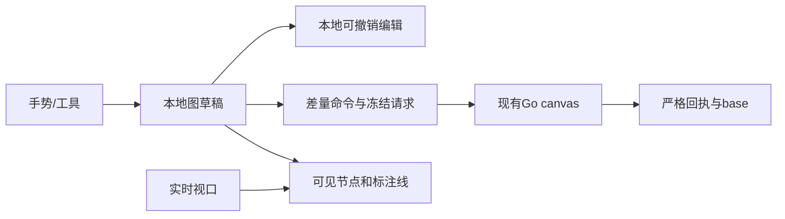

# 画布组件实现调研与迁入设计

技术设计；确认等级沿原来源。需求、PRD、Plan 独立维护，实施状态只见 [BACKLOG](../../BACKLOG.md)。

## 1. 摘要

2026-10-21 最新范围：用户要求清理现有画布前端，迁入 basketikun/infinite-canvas 的画布组件。组件放在 `frontend/src/components/canvas/`，沿上游 `9f2bd9f` 抽取视口、节点几何、连线、小地图与本地图片处理；使用现有 shadcn 和主题。`/canvas` 直接挂载独立组件，旧预览入口与画布前端业务接线移除，后端和共享组件保留。只包含编辑与素材操作，不带入上游 AI、助手、插件、Agent、项目管理或服务。节点、内嵌媒体与连线通过本地 JSON 文件往返，页面提示离开前导出。下文旧业务接线和 Figma 定制作为历史设计，不作为此次组件替换的前置任务。

在正式画布统一节点、引用、连线与编辑组件，保存后可继续工作。

本文采用设计、用户故事与测试场景结构。原始需求、PRD 和 Plan 独立维护；当前实施进度、剩余工作及阻塞项统一见 [BACKLOG](../../BACKLOG.md)。

## 2. 参与者

使用者与参与职责：画布创作者及画布、共享媒体、编辑器消费者。维护职责及确认人沿下方原来源记录；未给出姓名的，不补造人员或排期。

## 3. 背景

原始需求：[06-画布组件迁入与定制需求](../requirement/06-画布组件迁入与定制需求.md)。关联需求与验收：[05-画布组件迁入与定制](../prd/05-画布组件迁入与定制.md)。本文维护技术合同；相关实施步骤与证据见 Plan，状态与调度见 [BACKLOG](../../BACKLOG.md)。

### 3.1 文首来源与范围

画布组件、交互规则及实现边界统一见[第727节](#727-画布组件与交互实现)。交付按设计文档、Figma、代码及真实项目验证的顺序推进。

2026-10-20 现行节点规范以 [文本节点内编辑](https://www.figma.com/design/uLqmeRWuQuzfrp9xOYg6FT/?node-id=1178-96429)、[图片素材](https://www.figma.com/design/uLqmeRWuQuzfrp9xOYg6FT/?node-id=1178-96865)和[视频素材](https://www.figma.com/design/uLqmeRWuQuzfrp9xOYg6FT/?node-id=1178-97063)为准：

- 图片、视频上传、项目库导入和生成结果复用 `ProjectMediaPreview`，节点内保持完整比例，视频未选中也读取预览，选中后启用播放控件。媒体资源选中不显示下方说明或创作 pop，不增加上传专用节点类型。
- 文本单击选中显示共享 `RichGeneration` 文本生成面板；双击正文进入节点内 `DocumentEditor`，收起生成面板，格式工具置于节点上方。全屏与节点内编辑保留同一个 Tiptap 实例、选择和撤销历史，Escape 返回。
- `DocumentEditor` 与 `PromptEditor` 共用 `useEditorSurface` 生命周期；正文启用官方 Tiptap 标题、列表、引用、对齐和文字格式扩展，提示词保留原 `ComposerSession` 引用与生成合同。正文通过既有 `config.text` 保存 Markdown；对齐段落采用受编辑器 schema 过滤的内嵌 HTML，刷新后恢复格式。不新增后端字段或浏览器私有正文存储。
- 文字生成沿用现有服务端提示词草稿、模型能力、报价与提交流程，节点切换复用本次页面会话中的草稿 ID；不把缺少模型或媒体读取能力显示为可用。页面刷新后的草稿恢复沿已有“找回草稿”入口。
- 选中态取消四角白点，仅保留内侧低对比右下角尺寸入口。左右加号仍支持集中连线；节点操作菜单 hover 或键盘聚焦后显示。

适用范围：画布宿主图模型、交互、保存与共享生成组件；迁移差异另见设计11。文档版本：2026-10-21现行交互修订；历史观察和验证沿各节时点阅读；本轮文档与Figma已同步，设计交付记录见设计11，代码待后续实施。维护职责：画布及媒体/生成合同消费者；评审人未指定。

现成能力的迁入、数据适配与Figma定制补充采用已确认的[画布迁移实施方案](11-画布迁移实施方案.md)，执行和证据见[设计11](11-画布迁移实施方案.md)。原件下载先解析项目素材库条目身份；编辑与保存继续使用本设计的既有命令边界。当前验收使用真实项目与接口；早期独立 Mock 预览已退出产品范围，工程测试夹具仍须隔离。

实施进度及调度字段见 [BACKLOG 第4.12节](../../BACKLOG.md#412-10-画布组件实现调研与迁入设计文首来源与范围)。

### 3.2 结果与边界

画布按 Glowloom 规范实现，并统一使用 shadcn。不新增通用插件框架或第二套生产业务客户端。宿主持有权限、图保存、素材身份、报价与生成执行。时间线不进入产品入口。

### 3.3 现有边界

可达入口为`src/app/canvas/page.tsx`→`canvas-page.tsx`→动态加载`canvas-editor.tsx`。现有手势包含Pointer Capture、鼠标/触控板/双指、框选、rAF预览和Radix输入区排除；现有保存包含冻结命令、原幂等键、revision、输入版本、恢复分支和冲突处理，继续复用。

服务端`backend/internal/canvas/domain/document.go`已提供文字、group、parent_id、annotation、SetViewport与布局命令，容量为2000节点/4000边。组移动不隐式移动子节点；Connect允许可编辑节点间annotation，包含未锁定生成草稿，业务关系受保护。前端本轮补接这些已有合同，不改数据库，不放开业务节点或草稿删除。

## 4. 目标

在正式画布统一节点、引用、连线与编辑组件，保存后可继续工作。目标的规则、量化条件与非目标沿需求原文及下方已确认设计，不增加未经确认的指标。

## 5. 使用场景

参与者为画布创作者及画布、共享媒体、编辑器消费者；在下方定义的输入、对象状态、权限和环境条件具备时执行相应操作。各故事按其独立前置条件核对，不能把测试夹具当成真实业务条件。

## 6. 价值

降低组件差异及误操作，保留内容、素材身份和编辑历史。

## 7. 方案

### 7.1 文件目录与职责

2026-10-20 用户授权落地页面重建。画布页实现已从 `_components/` 拆到职责目录，文件名不再使用 `canvas-` 前缀或上游产品名。下表是拆分前的职责说明，当前路径见需求 06 第 13 节。

页面独有实现放在 `frontend/src/app/canvas/` 的 `viewport/`、`node/`、`group/`、`history/`、`chrome/`、`image/`、`composer/`、`preview/` 与 `director/`，直接导入具体文件。现有跨页媒体、提示词和业务 API 沿原目录复用。`director/` 保留编辑器已经调用的导演台，不作为新的正式页面表面。

| 文件                                        | 职责及实际消费者                                                                               |
| ------------------------------------------- | ---------------------------------------------------------------------------------------------- |
| `canvas-page.tsx`                           | 读取项目/画布，校验后动态进入编辑器；保持现有入口                                              |
| `canvas-editor.tsx`                         | 编排选择、工具、图草稿、冻结保存、恢复、冲突和生成；不放空间查询算法                           |
| `canvas-viewport.ts`及视口组件              | 实时/提交视口、坐标、框选手势、事件作用域及清理                                                |
| `canvas-render-model.ts`                    | 从节点几何建立索引、查询可见节点与边、组后代及定位边界；供节点层和选择使用                     |
| `canvas-node-layer.tsx`                     | 订阅实时视口，按进入/保留缓冲更新挂载窗口；保护选中/焦点/交互节点；渲染SVG连接与现有CanvasNode |
| `canvas-history.ts`                         | 有界本地编辑历史、合并连续同一字段输入、撤销重做；不发API、不持久化另一份业务图                |
| `editor-state.ts`                           | 图及回执边界校验、文字/group工厂、白名单差量命令、旧分支兼容与复制身份                         |
| `canvas-node.tsx`、`canvas-composer.tsx`    | 节点外壳、文字/group显示及现有参数/提示词；视频/音频选中激活                                   |
| `canvas-toolbar.tsx`、`canvas-mini-map.tsx` | 现有视图控制和快捷键说明；小地图基于全图，操作控件复用shadcn                                   |
| 同目录`*.test.ts(x)`                        | 领域转换、真实组件行为及边界；不增加平行业务客户端或测试脚本                                   |

`frontend/src/api/`是生成文件，本轮只消费已有合同。`components/media/`继续负责授权预览/上传，`components/generation/`负责提示词和报价/采用；页面不复制这些能力。没有跨页消费者时不抽取shared engine目录，不建barrel导出或通用utils。

### 7.2 状态与数据流

编辑状态包括nodes、edges和viewport；服务端base、冻结pending与本地draft分开。选中、焦点、播放器、拖动预览属于UI状态。媒体身份为ref_type/ref_id，不将URL、Blob或运行任务塞进图配置。

### 7.3 可见渲染

空间查询使用世界坐标，节点标题和选择手柄计入边界；超大组不能遍历无界格子。进入缓冲小于保留缓冲，减少边界反复挂载；选中、焦点和拖动节点保留。没有节点数量截取，框选和小地图基于全图。连接曲线控制点包围盒与视口相交即渲染，双端离屏也不漏线。

实时视口经rAF修改合成层，并以限频更新可见窗口；手势结束立即同步。节点层独立订阅，避免拖动每一帧刷新保存/生成编排。未选中的视频/音频显示轻量占位，选中后通过原授权预览组件读取；切换/离屏/卸载释放媒体。3D仍使用现有素材预览入口，不加载新的3D引擎。

### 7.4 文字、分组和连接

文字使用`resource/text`和`config.text`；group使用`resource/group`、`config.collapsed`与parent_id。组成员保持世界坐标，移动组时显式批量移动可编辑后代，每个节点只算一次。解组清空选定组成员parent_id，保留组节点以遵守持久删除边界；收起只影响渲染，不删除子节点。

标注连接使用现有annotation，只允许恰好两个可编辑节点，包含未锁定生成草稿；明确显示为标注关系，不作为生成依赖。普通编辑不能修改protected edge。复制节点生成新UUID并清除输入/执行身份；复制组需要独立成员映射，不复制旧任务。数量或合同限制显示真实说明。

### 7.5 历史和保存

历史记录一次手势或一组编辑的前后图，连续文字字段修改合并；不记录viewport和播放/选择，不替代Tiptap正文历史。本地最多保留50次编辑，超出只移除最早历史，不影响图。保存后撤销通过新合法命令前进revision；资源删除与撤销使用现有DeleteNodes/AddNodes合同；已保存生成草稿仍禁止删除。冻结pending存在、结果未知或冲突时暂停历史跳转。

引用标签分配与高水位单独保留到本次编辑会话结束，撤销不回收已分配编号，包括尚未保存的分配；升级后的composer不撤回旧草稿格式。解组遇到只读直接成员时保持原图并反馈原因。批量标注增删按每条命令最多2000项拆分，总请求仍受100条命令限制。

pending同时冻结nodes/edges/viewport及原幂等键；响应必须逐项核对节点字段、边和相机及revision。响应期间的新编辑保留，只有对应冻结字段更新base；相机单独比较避免旧相机覆盖当前手势。恢复分支保存完整图及原pending，旧的仅nodes分支按其base.edges/base.viewport补齐；缺损或跨身份数据拒绝。

读取服务端相机并保留有效视角；用户新手势按即梦专项采用8%～800%缩放（历史5%视角保留），源坐标显式映射`k`↔`zoom`。修改相机只保存视图，不改变节点输入版本或触发生成。隐式保存采用设计15的唯一WebSocket队列；完整编辑事务立即提交，保留未确认修改的离开保护。

### 7.6 输入与失败路径

画布快捷键仅在画布事件作用域工作，input/textarea/contenteditable和菜单/弹窗内不触发V/Space、删除、撤销重做。Ctrl/Cmd+S保留原保存；撤销支持Ctrl/Cmd+Z、Shift+Z/Y。Escape逐层退出，由Radix处理弹层焦点。

无权限、过期素材、网络错误、保存未知和冲突沿现有反馈处理。冲突保留本地图或显式载入服务端；结构编辑不能无提示合并删除/重绑业务字段。用户选择保留本地时，受保护服务端数据仍保留，不自动放宽领域校验。

### 7.7 即梦一致性设计（2026-10-18）

用户要求布局、功能、交互、快捷键及拖动画布方式与即梦一致，先更新Figma再实现、最后浏览器验收；随后确认字体使用Vercel。此要求替代旧画布的V/H和普通滚轮缩放约定；品牌仍为织光，模型、价格和素材只使用真实业务数据。

[Figma R10设计页](https://www.figma.com/design/uLqmeRWuQuzfrp9xOYg6FT/?node-id=675-26265)包含空画布、图片/文本节点、右键创建、缩放、400px AI侧栏和窄屏提案；图片节点主稿为[675:26529](https://www.figma.com/design/uLqmeRWuQuzfrp9xOYg6FT/?node-id=675-26529)。均为原生可编辑文字、矢量和组件实例，未把完整页面截图作为UI。字体统一Geist，中文回退；Figma状态跳转不作为连续手势证据，窄屏提案需源页面同尺寸核对。

| 区域/操作 | 即梦登录态核对值                                                                                                                   | 实现归属                                                                             |
| --------- | ---------------------------------------------------------------------------------------------------------------------------------- | ------------------------------------------------------------------------------------ |
| 顶部      | 上10px、左右12px、高40px；品牌/项目在左，搜索/历史/分享/更多/账号在右                                                              | `canvas-header.tsx`，历史按需加载`canvas-project-history.tsx`                        |
| 左工具栏  | 48×398px，按钮40×40px、图标20px；左12px、中心相对视口下移28px                                                                      | `canvas-toolbar.tsx`、`canvas.css`                                                   |
| 节点/参数 | 默认新节点320×320px；参数浮层宽680px，下方16px；上方避让见第727节；输入、菜单不缩放                                                | `editor-state.ts`、`canvas-node.tsx`、`canvas-node-panel.tsx`、`canvas-composer.tsx` |
| 视图控制  | 左16px、底20px，156×28px；选择/抓手切换、小地图、线可见、百分比菜单                                                                | `canvas-toolbar.tsx`、`canvas-node-layer.tsx`                                        |
| 平移/缩放 | 普通滚轮及双指滚动平移，按浏览器原始WheelEvent增量平移；Ctrl/⌘滚轮及捏合按指针锚点缩放，单事件倍率2^(-deltaY×0.01)，限制1/1.2～1.2 | 画布视口组件；上下界8%～800%，旧视角兼容与保存端同步调整                             |
| 快捷键    | V选择，Space临时平移；⌘/Ctrl +/-缩放，Shift+1全图、Shift+2选中、⌘/Ctrl+1=100%；⌘/Ctrl+D副本、Z/Shift+Z历史                         | `canvas-editor.tsx`，输入法及输入/菜单/弹窗排除；不把H继续作为已对齐按键             |
| 创建/右键 | 双击空白创建，右键菜单按点击世界坐标放置；节点菜单与空白菜单区分                                                                   | `canvas-context-menu.tsx`，复用官方Radix/shadcn `components/ui/context-menu.tsx`     |

完全一致的退出条件是差异清单全部关闭，不能把只画出的状态算作功能已接通。当前需继续补齐：文本/音频生成、Agent执行、时间线与导演台完整编辑/执行、生成依赖连线、已保存节点删除、系统剪贴板复制粘贴、就地模型/引用/报价流程、AI侧栏可调整与避让、标签/全屏/下载及各异常状态。右键当前仍为平铺菜单，需要按新建节点级联菜单继续对齐；节点两侧创建与布局连线按第79节补齐，供应商执行依赖仍未开放。现有只读业务合同仍生效；需要变更时在领域层落实并验证，不能靠前端伪装成功。分享目前仅复制受现有权限约束的链接，不等于即梦的访问授权管理。

原始滚轮增量以浏览器事件为准。本机输入适配层会把工具传入的滚动量转换为两倍事件增量；已通过相同输入对照源页面并修正，不能再在组件中乘二。单个320px节点的适配画布终态为50%；选中适配不放大超过100%，多节点和侧栏组合仍须继续对照。

颜色值由`frontend/src/app/globals.css`的深浅主题定义统一持有（现有`background/card/border/foreground/muted-foreground`语义变量）；画布样式只消费变量。Geist沿用现有字体加载，无新增运行依赖。节点不展示输入版本等实现字段。

### 7.8 现有宿主实现：shadcn与内联富文本

以需求06 SRC-CAN-04为当前范围：时间线入口及本轮新增组件移除。节点外壳、参考架、正文及底部参数分区使用本项目 shadcn。Figma主稿[675:26529](https://www.figma.com/design/uLqmeRWuQuzfrp9xOYg6FT/?node-id=675-26529)同步移除时间线并使用本项目深色主题值。

节点组件负责呈现世界坐标、尺寸、选中与两侧创建；节点发起拖动后由画布统一持有完整指针手势，节点外松手、失焦与卸载均释放；`canvas-node-panel.tsx`保持输入面板屏幕尺寸及避让。两侧创建按钮调用真实新增文字/图片/视频节点，不把标注连线解释为生成依赖。

下方由`canvas-composer.tsx`组合共享`components/generation/rich-generation.tsx`的`presentation="canvas"`。后者直接复用`PromptEditor`、`ComposerSession`和`ReferenceControls compact`：参考架在上、Tiptap正文在中、真实模型/模式和schema参数及报价操作在下；引用详情、异常与费用确认使用现有shadcn弹层。所有版本、标签高水位、上传和权限规则复用原合同。没有第二份提示词、模型配置或生成请求状态。

首次打开旧草稿先升级为富文本并经canvasOwner.flush保存，再读取节点未决提交；正文变化写入节点的richCanvasDraft，报价前再次保存并核对canvas/input revision。原请求未知时复用冻结正文与幂等键；切换节点后从节点草稿及服务端未决状态恢复。模型名称、支持模式、候选数量、分辨率与费用由实际接口提供。

节点剪贴板只接受同项目、有版本且经命令验证的图；重建节点/边身份并重映射内部工具引用，外部来源保留已核对的素材身份。已保存资源沿DeleteNodes删除，保留本地冲突选择不得复活已删除资源；只读投影与生成草稿继续受领域保护。

导演台继续按需加载Three.js及开发类型，作为不新增通用画布引擎的必要例外；AI历史只读取真实任务。任务详情仅在text.generate/completed/json/passed条件暴露受限outputs[].text，未审核文本和其余provider JSON不返回，API从后端注解生成。两项能力的效果接受与本次样式/富文本验收分别记录。

### 7.9 节点、全能参考与连线重设计

Figma：[节点与引用](https://www.figma.com/design/uLqmeRWuQuzfrp9xOYg6FT/?node-id=708-27224)、[参考与模式弹层](https://www.figma.com/design/uLqmeRWuQuzfrp9xOYg6FT/?node-id=708-27479)、[窄屏工具栏](https://www.figma.com/design/uLqmeRWuQuzfrp9xOYg6FT/?node-id=709-27428)。保持原生可编辑文本、矢量和组件实例。

来源：需求06 SRC-CAN-08、FR-CAN-13～FR-CAN-16。2026-10-18浏览器观察即梦登录态：节点两侧＋打开类型菜单；从图片向右创建视频同时产生一条定向线；空图片在新视频参考架显示不可用占位。全能参考是两项模式选择（首尾帧、全能参考），添加参考是上传/资产库/画布入口，@是就近分类候选列表，空图片不作为可用候选。观察不包含真实生成、费用或供应商效果。

本项目采用同一信息层级，原生Popover/Command/Select/DropdownMenu/Tooltip/Badge/InputGroup组合，使用当前neutral token和Geist，不复制即梦配色与会员元素。模式来自模型目录，不硬编码可执行模型或模式。参考架先展示来源再展示＋；48px预览、编号和自动引用标识，详情使用就近Popover。@候选在输入区附近打开，不加遮罩、不改变画布视口；键盘焦点与输入法由既有Tiptap和Radix共同管理。

布局线继续使用annotation，允许可编辑生成草稿作为端点；role/binding与只读业务边仍禁止通过Connect写入。新建节点与线同一图编辑/命令批次；左/右方向由空间语义确定，仍使用冻结保存与严格读回。连接不触发执行。媒体→新生成草稿的引用先通过现有素材预览接口核验project/id/kind/revision，再加入原PromptDraft references，旧来源或读取失败只保留布局线与待引用状态。异步期间节点或身份变化必须拒绝套用旧结果。

已绑定参考的连线从当前PromptDraft和本画布media_asset映射投影，使用细实线；未填内容的布局线用细虚线，选中相关节点才增强可读性。引用移除后投影随之消失；用户显式创建的普通标注独立保留，不把它变成执行或引用事实。自动引用只能指向真实媒体，不将草稿ID或预览URL充当素材ID。来源版本和标签高水位沿原合同，不自动切换到新版本。

侧边创建先避让同列已有节点；同素材多个副本时，自动引用优先保留原布局线的来源节点。窄屏工具栏改为顶部横向排列，参数区预留顶栏和工具栏空间；就近Popover按可用高度限制整个容器及候选列表，不能只限制列表而把搜索框挤出屏幕。节点设置与展开操作直接组合进InputGroup操作槽位，不用绝对定位覆盖参考架。

参考交互的Portal点击在弹层边界停止向InputGroupAddon冒泡，避免官方Addon将焦点交给隐藏上传框。@保持正文焦点，关闭或恢复输入不自动滚动画布；文件输入真正隐藏，不能以互相覆盖的宽高和sr-only样式撑宽参数区。加载使用固定结构Skeleton；复杂项目检索在Dialog内，不能展开并挤动画布。

2026-10-20引用修正：画布`@`首层为主体、图片、视频、音频，次层仅显示当前草稿已绑定的参考及与当前节点通过annotation实际相连的媒体；不把整个项目或未连接画布素材当作已有参考。annotation两端均可作为参考来源，受保护业务边不参与推断，重复连线按来源节点去重。连接只是候选事实，选择后通过现有媒体预览接口核验范围、类型和版本，再以原线ID加入参考并在当前`@查询`范围插入原子标签；同素材同角色沿既有合同防重。空来源保留禁用状态，断线、来源变更、正文变化或权限切换后拒绝套用异步旧结果。加号仍负责主动添加画布/素材库/上传/主体，`@`菜单不混入这些添加操作。分类支持方向键、Enter、Escape，中文组合期间不拦截确认；普通输入继续留在正文，关闭不滚动画布。菜单使用低对比边框、圆角、分类图标和右向箭头，窄屏限制到视口内。

2026-10-20级联与锚点修正：浏览器实测即梦当前`@`根菜单240px宽、244px高，底部与正文`@`顶部约6px间距，水平中心与输入起点重合；图片分类展开后根菜单保留，右侧约4px间距出现独立240px候选层，顶边跟随分类行；空分类为“暂无相关节点”独立面板。这些为本轮当前页面观察，不是供应商/API合同。本项目采用正文`@`范围的虚拟锚点，不以参考架作锚点；悬停/点击分类时显示独立候选层，活动分类和活动候选有中性色高亮，已提及项显示勾选。二级候选碰到视口边缘自动翻转；窄屏在根菜单内展开候选，保持整体可滚动。输入焦点留在正文，上下键选择、右键/Enter进入二级、左键返回一级、Escape关闭整个候选；选择后仅替换当前触发范围。加号的素材添加菜单保留原锚点。

### 7.10 画布 UI/UX 拆解与即梦对齐提案（2026-10-20）

状态：设计提案，待评审。用户要求先完成设计拆解与状态设计，本轮停止新增前端实现。第79节此前的局部修正不能作为本轮整体设计已接受、已实现或已验收的证据。

[Figma 设计拆解](https://www.figma.com/design/uLqmeRWuQuzfrp9xOYg6FT/?node-id=1083-155)位于独立页面“画布 UIUX / 即梦对齐 · 10.20”，保留原产品页面和组件库。补充端口拖线与组件复用后共有34张原生可编辑画板：6张拆解/规则及组件展示板、26张桌面状态、2张手机状态；另有5组共享组件，主组件置于展示画板之外。桌面、手机、连接端口和工具栏/资产库各有一个原型起点；原型展示离散状态路径，不模拟真实连续手势、富文本输入、上传、保存、计费或生成。

### 7.11 范围与观察依据

本轮聚焦无限画布中的节点关系、编辑器、参考和参数浮层，不扩大到时间线或其他业务页面。2026-10-20在用户提供的即梦登录态页面观察到：正文输入位置附近出现分类根菜单；分类展开后保留根菜单并在侧边显示空候选层；加号菜单提供上传、资产库、画布入口；展开生成器居中显示大面板，参考分类与清除操作在顶部，正文在中间，参数和生成操作在底部。

即梦有素材的候选列表、引用失效以及手机键盘场景本轮未实测。稿中的候选行、失效反馈、手机分类内展开为Glowloom提案，不能表述为已观察到的即梦行为。Geist、Lucide及现有组件体系继续使用；不复制会员标识、不新增模型或执行能力。

### 7.12 结构与视觉规则

| 区域       | 设计职责             | 本轮提案                                                                                  |
| ---------- | -------------------- | ----------------------------------------------------------------------------------------- |
| 顶部与左侧 | 项目操作与内容创建   | 沿用现有品牌和工具入口，保持位置稳定                                                      |
| 节点与连线 | 表达内容及其参考关系 | 标题在节点外；常态边界低对比，选中提高对比；连接不触发执行                                |
| 常规编辑器 | 服务当前节点的创作   | 跟随节点底边、下方16px居中；顶部参考缩略图与加号，中间正文，底部模型/尺寸/模式/时长与提交 |
| 展开编辑器 | 长提示词与多参考编辑 | 居中大面板；顶部参考分类/清除/折叠，中间可编辑正文，底部固定参数                          |
| 浮层       | 就近完成单个选择     | 添加参考锚定加号；正文引用锚定当前触发范围；层级展开不移动画布                            |

草稿深色值：画布`#0A0A0A`，编辑器`#202020`，浮层`#262626`，活动行`#363636`；常态边界`#2B2B2B`，选中节点边界`#616161`。通过填充、间距和轻阴影分层，不叠加白色外描边。以上是设计建议，待评审后映射到语义变量，不把硬编码色值带入画布实现。文字/图标继续沿用Geist/Lucide。缩略图、候选行与正文标签共享编号与来源身份。

### 7.13 参考与引用流程

`+`负责加入参考；`@`负责在正文提及当前节点已连接或已绑定的参考。项目中的其他素材不能直接冒充当前参考。已连线但无可用内容的来源保留不可用反馈；真正插入前仍遵循第79节的范围、类型、版本核验及防重合同。普通标注线不因此成为执行依赖。

正文输入`@`后显示主体、图片、视频、音频根菜单。桌面悬停或进入分类时，根菜单保持，分类行高亮，独立子菜单与该行顶边对齐；根菜单与子菜单均240px宽，间隙4px。没有该类内容时显示空态；候选显示缩略图、编号和来源说明，已提及显示勾选。选择后只替换当前触发范围为原子引用标签，保留周围文字并继续输入；重复提及不产生重复素材绑定。

方向键上下移动，右方向键进入、左方向键返回，Enter插入，Escape关闭；中文组合输入不被菜单确认逻辑截断。关闭后恢复正文光标，不滚动画布。根菜单上下空间不足翻转，子菜单左右空间不足翻转。手机采用分类内展开、行高至少44px，浮层整体限制在可用视口内。软键盘出现后的高度、避让与滚动仍需实际浏览器验证。

展开/折叠共享原草稿、参考和当前输入上下文，不创建第二份正文状态。移除参考和清除全部的具体确认沿现有合同；断开来源后保留明确的失效标签及移除入口，不把失效标签当可执行参考。节点待生成、生成中、失败与引用失效在规则板分别展示。

### 7.14 状态索引与设计接受条件

| 状态                   | Figma                                                                                                                                                    |
| ---------------------- | -------------------------------------------------------------------------------------------------------------------------------------------------------- |
| 常规编辑、已连接参考   | [01](https://www.figma.com/design/uLqmeRWuQuzfrp9xOYg6FT/?node-id=1083-187)                                                                              |
| 正文引用根菜单         | [02](https://www.figma.com/design/uLqmeRWuQuzfrp9xOYg6FT/?node-id=1083-305)                                                                              |
| 分类候选与已提及反馈   | [03](https://www.figma.com/design/uLqmeRWuQuzfrp9xOYg6FT/?node-id=1083-425)                                                                              |
| 空分类                 | [04](https://www.figma.com/design/uLqmeRWuQuzfrp9xOYg6FT/?node-id=1083-545)                                                                              |
| 插入后的正文标签       | [05](https://www.figma.com/design/uLqmeRWuQuzfrp9xOYg6FT/?node-id=1083-665)                                                                              |
| 展开编辑器             | [06](https://www.figma.com/design/uLqmeRWuQuzfrp9xOYg6FT/?node-id=1083-783)                                                                              |
| 加号添加参考           | [07](https://www.figma.com/design/uLqmeRWuQuzfrp9xOYg6FT/?node-id=1083-901)                                                                              |
| 尺寸/清晰度/数量选择   | [08](https://www.figma.com/design/uLqmeRWuQuzfrp9xOYg6FT/?node-id=1083-1019)                                                                             |
| 手机分类展开与插入结果 | [09](https://www.figma.com/design/uLqmeRWuQuzfrp9xOYg6FT/?node-id=1086-842)、[10](https://www.figma.com/design/uLqmeRWuQuzfrp9xOYg6FT/?node-id=1086-912) |
| 状态和交互规则         | [11](https://www.figma.com/design/uLqmeRWuQuzfrp9xOYg6FT/?node-id=1086-984)                                                                              |

设计接受需要核对：视觉层级与白色描边问题；加入/提及职责；连接来源与不可用状态；候选选中和插入反馈；展开前后上下文；桌面碰撞和手机键盘避让。实现阶段再验证真实来源、保存读回、焦点/输入法、连续键盘操作、320/390px触摸及参数能力限制。模型、价格、模式和数量仍由实际配置决定，稿内展示值不是可用性承诺。

### 7.15 左右连接端口与拖线

2026-10-21 补充：超过拖动阈值后，同一画布中其他可连接节点也同时显示左右 `+`，复用已有端口组件与同侧中心锚点。完成连接、取消或丢失指针捕获后恢复仅选中节点显示；只读、分组等不支持连接的节点不新增入口。 真实项目浏览器验证：左右端口拖动均从 2 个可见端口扩展到 8 个节点的 16 个端口；Escape 取消和松手到空白处后均恢复为 2 个，空白处新建菜单正常打开，未创建额外节点。

用户补充：节点左右`+`均是可拖拽的连接端口，也保留点击创建入口。参考图用于表达交互与视觉效果，其中的时间线等条目不扩大当前能力范围。

| 阶段         | 反馈与结果                                                                                   |
| ------------ | -------------------------------------------------------------------------------------------- |
| 就绪/悬停    | 可见圆28px、命中区域44px；悬停增强端口，左右同一组件                                         |
| 单击         | 未超过拖动判定阈值时，打开锚定该端口的“添加节点”菜单                                         |
| 拖动         | 超过阈值后进入连线手势；起点保持，临时贝塞尔曲线跟随指针，使用蓝色强调；手势不移动节点或画布 |
| 进入已有节点 | 可连接的节点/端口高亮；松手提交连接。自身、重复、只读或不兼容目标不能提交，并显示原因        |
| 空白松手     | 保留临时预览，在落点打开共享“添加节点”浮层；选择类型后才创建节点与线，取消不产生孤立节点     |
| 完成         | 临时蓝线转为普通关系线，选中新建或目标节点；真实可用来源核验后同步参考条和`@`候选            |
| 取消         | Escape、指针取消、捕获丢失或退出操作清理临时线和落点浮层；已有节点、连线及正文保持原状       |

左右只决定几何出线方向及空白处新节点位置，不把拖动方向当作业务依赖或生成执行授权。新增节点与线遵循原批次/撤销合同；连接失败显示原因并恢复原图。来源未准备好或核验失败时展示不可用/待引用反馈，不把普通annotation线伪装为已绑定素材。视口缩放、平移后的端口和指针坐标需一致；实际阈值、连续预览、边缘行为及触摸拖动在实现阶段验收。

**同侧连线共用一个点（2026-10-20 补充）。** 每个节点左、右两侧各保留一个连接锚点，位置为对应`+`的中心。同侧所有已有连线及新增拖线共用该点，不按参考数量错开端点或增加端口。多条曲线从共同锚点平滑分叉/汇聚，靠近端口时保持水平切线；节点移动、缩放、尺寸变化后统一从节点几何重算，不能独立累积线端偏移。连线仍分别保留关系身份，视觉汇合不合并引用记录。

本次修正18张状态稿中下方参考线偏离端口中心10px的问题，核对19张双参考状态的38个终点均与对应端口中心重合（设计坐标误差0）。节点移动状态原已对齐，保持一致；共享规则板同步更新。本次是Figma几何与设计合同修订，实际拖动和缩放联动待实现验证。

Figma新增状态：[12右拖](https://www.figma.com/design/uLqmeRWuQuzfrp9xOYg6FT/?node-id=1098-1618)、[13左拖](https://www.figma.com/design/uLqmeRWuQuzfrp9xOYg6FT/?node-id=1098-1819)、[14已有目标](https://www.figma.com/design/uLqmeRWuQuzfrp9xOYg6FT/?node-id=1098-2020)、[15落点新建](https://www.figma.com/design/uLqmeRWuQuzfrp9xOYg6FT/?node-id=1098-2222)、[16连接结果](https://www.figma.com/design/uLqmeRWuQuzfrp9xOYg6FT/?node-id=1098-2437)、[18起始](https://www.figma.com/design/uLqmeRWuQuzfrp9xOYg6FT/?node-id=1103-3000)。原型以视频新建为一条示例分支，不作为任意节点类型、任意指针位置的可执行连接引擎。

### 7.16 富文本编辑器与全部画布浮层复用

所有画布浮层统一接入共享富文本编辑器及其浮层组件体系。文本、图片、视频等节点的创作面板复用`RichGeneration`/`PromptEditor`/`ComposerSession`，能力、占位、参考类型和参数通过现有业务配置区分。正文、参考、光标上下文和展开状态沿同一会话；节点浮层、常规与展开视图不再各自维护独立正文。

`@`引用、加号添加、参考详情、模型、模式、尺寸、数量、节点参数与端口新建等菜单使用编辑器已有的`Popover`、`Command`、`Select`和统一菜单行。画布右键、工具和全局浮层也消费同一视觉基础，并保留各自焦点、键盘、选择及模态语义。共同约束为字体、图标、颜色、边界、圆角、间距、活动/禁用/选中反馈、Portal层级、碰撞避让及焦点恢复；节点只组合内容和锚点，不复制另一套菜单CSS或编辑器状态。

截至11.7，Figma展示稿中的编辑器/浮层区域均使用共享实例；端口交付时为26个，增加2张锚定状态稿后为28个；11.8继续增加共享资产库实例：

| 组件组                        | 变体与用途                                                                                                                                                        |
| ----------------------------- | ----------------------------------------------------------------------------------------------------------------------------------------------------------------- |
| `Canvas / SharedRichComposer` | 8种：常规、触发引用、插入后、展开、手机、手机插入、空正文、单参考；[主组件](https://www.figma.com/design/uLqmeRWuQuzfrp9xOYg6FT/?node-id=1095-1949)               |
| `Canvas / SharedPopup`        | 9种：根菜单、图片分类、主体分类、候选、空态、添加参考、参数、手机分类、新建节点；[主组件](https://www.figma.com/design/uLqmeRWuQuzfrp9xOYg6FT/?node-id=1095-1950) |
| `Canvas / ConnectionPort`     | 就绪、悬停、拖动、有效目标、无效目标5种；左右共用；[主组件](https://www.figma.com/design/uLqmeRWuQuzfrp9xOYg6FT/?node-id=1098-1451)                               |

[17组件实例与规则板](https://www.figma.com/design/uLqmeRWuQuzfrp9xOYg6FT/?node-id=1099-2200)用于检查复用和样式一致性。颜色在独立`Canvas / UIUX Draft`集合中由语义变量别名绑定，间距、圆角、文字和次级文字复用现有变量/样式；草稿语义映射到既有`--card`、`--popover`、`--accent`，未修改生产CSS或原组件库。此处是设计层面的组件复用成果，实际前端所有浮层的接入与回归仍待设计接受后执行。

### 7.17 创作栏跟随节点与上传素材复用（2026-10-20 补充）

用户明确：创作 pop 栏应跟随所属节点下方；自行上传的图片、视频直接复用现有图片/素材节点。本节更新设计定位及上传呈现合同，仍未开始新增前端实现。

**锚定规则。** 常规创作栏以当前节点实时屏幕矩形为锚点，默认下方16px居中，桌面宽680px，窄屏按可用宽度收缩。节点拖动、平移、缩放、尺寸与面板内容变化时重算；面板文字和控件使用屏幕像素。下方不足时翻到上方，面板底部距节点正文顶部48px；上下都不足则取空间较大侧限高滚动，不把面板推入节点正文，不自动移动视口。具体极端短屏与拖动状态沿第727节。旧960px宽度、首次激活自动移视口及禁止上翻约定停止适用。

**浮层层级。** 创作栏锚定节点；正文`@`锚定当前触发范围，添加参考和参数菜单锚定对应按钮。宿主移动时子菜单同步定位，菜单自身允许碰撞翻转。展开编辑器仍居中显示，折叠回当前节点下方，正文、参考及会话不重建。

**上传复用。** 本地上传、素材库选择和生成结果沿相同媒体节点模型展示，来源仅为资源元数据。Figma中20个图片/视频来源节点已使用原组件库`Canvas / Node`（675:26375）的实例，视频复用既有播放图标；未新建独立上传节点组件。截图照片为原稿素材，仅用于展示上传完成状态，并非本轮真实上传记录。

| 入口 / 状态            | 节点及引用结果                                                                          |
| ---------------------- | --------------------------------------------------------------------------------------- |
| 拖到空白画布、全局上传 | 在落点或合理可视位置创建图片/视频素材节点；不自动连接无关节点                           |
| 编辑器上传、添加素材   | 创建或复用当前画布对应素材节点并连接当前创作节点；可用内容核验通过后进入参考条和`@`候选 |
| 上传中、处理中         | 仍是同一素材节点，呈现进度/处理状态；未就绪项不能插入可执行引用                         |
| 上传失败               | 在原节点显示原因、重试及移除；重试复用节点身份，不追加重复节点                          |
| 就绪及复用             | 节点预览、参考缩略图和正文标签指向同一资源身份及版本；重复添加遵循原防重合同            |

已调整16个已有桌面/手机状态的下方锚点，普通状态与新增移动状态中心对齐且间隔16px；连接场景演示左右边缘限位。新增[19节点移动](https://www.figma.com/design/uLqmeRWuQuzfrp9xOYg6FT/?node-id=1113-2856)、[20上传完成](https://www.figma.com/design/uLqmeRWuQuzfrp9xOYg6FT/?node-id=1113-2993)、[21规则板](https://www.figma.com/design/uLqmeRWuQuzfrp9xOYg6FT/?node-id=1115-2804)。01画板拖动视频节点可跳转19；07上传入口跳转20，均为离散设计演示，不包含真实上传或实时几何引擎。截图核对了节点下方关系、引用子菜单和规则板；真实上传读回、媒体播放、缩放、拖动、软键盘和边缘避让仍属于实现阶段验收。

### 7.18 左侧工具栏与资产库（2026-10-20 补充）

依据用户提供的即梦截图及可访问性文本：左侧工具栏在悬停时展示名称，资产入口有活动底色；资产库为居中模态，包含资产/主体、类型、搜索、时间、筛选和底部选择计数/确认。截图是空素材状态，有数据、多选、失败和导入完成为Glowloom设计提案，本轮没有新增即梦浏览器实测。

**工具栏。** 固定左侧垂直居中，宽56px、8个44px命中区。文本/图片/视频创建入口，音频打开音频素材，主体打开主体页，导演台沿既有入口；分隔线下为资产库和上传。默认、悬停、激活、只读复用同一组组件。悬停或键盘焦点显示可读标签，活动入口采用中性填充。只读禁用写入口并说明原因。短视口允许工具栏自身滚动，不能盖住底部视口控件；不从参考截图引入时间线能力。

**选择器。** 桌面为800×680px居中模态，使用已有Dialog、Tabs、AssetPicker及按钮结构。顶部资产/主体，第二行当前类型与搜索、时间、来源筛选；结果独立滚动，底部固定选择计数、选择本页/清空选择及确认。资产类型按当前代码保留图片、视频、音频、3D；主体分角色、场景、物品。此处没有新增文档导入能力。素材范围为当前项目，搜索与筛选查询该范围内的结果，不能仅筛当前已加载页面。

**选择规则。** 资产多选、最多24项；主体单选。素材切换类型、搜索、筛选和翻页保留已选集合，计数包含暂时不可见的选择；选择本页只添加本页可选项，达到上限提供反馈。清除搜索/筛选不等于清空选择；清空选择操作明确可见。确认前再次核验素材就绪状态、权限及版本。请求进行中阻止重复提交；失败保留选择并说明失败项，重试遵循既有节点/资源防重规则。

**入口与关闭。** 左侧资产库的确认是“添加到画布”，复用媒体节点，不自动创建参考连线。编辑器内的素材入口复用同一选择器并使用“添加为参考”，连接到当前节点；引用条与正文标签沿同一资源身份。关闭或Escape取消本次待选会话，恢复入口焦点；Tab留在模态，滚动不透传画布。窄屏采用全屏选择器与固定底栏，本轮仅记录该合同，未新增手机资产库画板或进行键盘实测。

**状态与复用。** 新增`Canvas / Toolbar Draft`（1118:3012）4种变体，`Canvas / AssetLibrary Draft`（1118:3594）7种变体；原SharedPopup增加来源/时间两种菜单，达到11种。媒体卡片沿现有`Card / AssetPicker`实例；原产品页和原组件库主组件未更改。原型支持22→24→选择本页→25→确认→30；分类、搜索空态、菜单展开与关闭为离散示例，不提供真实搜索、上传或导入。

| 画板                                                                         | 内容                           |
| ---------------------------------------------------------------------------- | ------------------------------ |
| [22](https://www.figma.com/design/uLqmeRWuQuzfrp9xOYg6FT/?node-id=1119-3782) | 左侧工具栏悬停提示             |
| [23](https://www.figma.com/design/uLqmeRWuQuzfrp9xOYg6FT/?node-id=1119-4030) | 资产库空态、上传入口、禁用确认 |
| [24](https://www.figma.com/design/uLqmeRWuQuzfrp9xOYg6FT/?node-id=1119-4323) | 浏览和选择本页                 |
| [25](https://www.figma.com/design/uLqmeRWuQuzfrp9xOYg6FT/?node-id=1119-4620) | 多选、勾选反馈及固定底栏       |
| [26](https://www.figma.com/design/uLqmeRWuQuzfrp9xOYg6FT/?node-id=1119-4921) | 来源筛选展开                   |
| [27](https://www.figma.com/design/uLqmeRWuQuzfrp9xOYg6FT/?node-id=1119-5258) | 主体分类空态                   |
| [28](https://www.figma.com/design/uLqmeRWuQuzfrp9xOYg6FT/?node-id=1119-5546) | 搜索无结果                     |
| [29](https://www.figma.com/design/uLqmeRWuQuzfrp9xOYg6FT/?node-id=1119-5839) | 加载失败和重试                 |
| [30](https://www.figma.com/design/uLqmeRWuQuzfrp9xOYg6FT/?node-id=1119-6132) | 添加到画布结果                 |
| [31](https://www.figma.com/design/uLqmeRWuQuzfrp9xOYg6FT/?node-id=1119-6321) | 交互规则                       |
| [32](https://www.figma.com/design/uLqmeRWuQuzfrp9xOYg6FT/?node-id=1122-5193) | 时间范围菜单                   |
| [33](https://www.figma.com/design/uLqmeRWuQuzfrp9xOYg6FT/?node-id=1123-4736) | 工具栏四状态与资产加载骨架     |

验证：读取组件实例与原型跳转，检查工具栏、已选、空态、筛选及规则/组件展示截图。校正了继承的绝对定位按钮与选中勾选对比。真实数据筛选、分页、权限、24项上限、导入失败恢复、键盘/触摸及屏幕尺寸回归待实现验证；本轮未修改前端或运行前端测试。

### 7.19 前端实现与浏览器回归（2026-10-20）

用户随后明确授权前端实现。本轮已将文本节点与创作面板接入同一 PromptEditor 引擎，引用候选及端口新建菜单复用 Popover/Command；创作面板保持节点下方16px，展开保留编辑实例与输入，窄屏适配选中项时为面板留出空间。左右端口支持拖到节点连接、拖到空白处选择新节点及取消；同侧连线共用端口中心。媒体引用、上传及资产库导入复用媒体节点，导入按素材身份去重并避让已有节点。资产库统一搜索、跨搜索选择保留、确认前版本核验和失败恢复。

浏览器在实际 CanvasEditor 的 `/canvas/preview` Mock 路由检查1460px、390px、320px：两条线共用 `980,360` 世界坐标起点；桌面面板与节点相隔16px；三个素材中已存在一个时只新增两个；展开时只有一个 contenteditable；窄屏菜单及资产库没有横向溢出。此证据不代表真实上传、私有项目接口、供应商生成、触屏软键盘或跨浏览器验收。来源/时间筛选因素材接口缺字段，入口明确显示暂不可用。

### 7.20 -10-20 节点编辑入口收敛

- 文本、图片/视频生成沿用共享富文本引擎；导演台镜头描述和画布 AI 输入复用同一纯文本适配，保持既有字符串接口。
- 节点菜单提供统一重命名，取消重复的节点坐标/尺寸/旧草稿参数弹层；拖动、键盘移动和右下角缩放保留。
- 分组折叠/展开与解组放入现有选中工具栏；导演台通过节点双击或菜单进入专用编辑器，不显示重复底部面板。
- 上传媒体、音频、主体和只读业务节点不新增底部编辑面板；音频与主体入口继续复用资产库。
- 验收覆盖真实项目的切换、重命名保存、分组、导演台镜头描述和公共生成编辑器；不触发收费生成。

### 7.21 拖动稳定性与生成参数浮层修正（2026-10-20）

用户反馈节点拖动抖动、偶发回到旧位置，并要求按提供的即梦截图重设计 pop。本节调整11.7的首次激活视口自动避让规则：选中、拖动和打开浮层均不得为了显示编辑器而改变画布视口。常规编辑器宽680px，窄屏按可用宽度收缩；优先在节点下方16px显示。2026-10-21 根据遮挡反馈修订：下方容不下实际面板高度时，选择上方的可用空间；上方边界与节点正文顶部相隔48px，预留标题与间距。上下都不足时选择空间较大的一侧限制高度并滚动，禁止用底部限位把面板推回节点内部；不移动节点或画布视口。比例、分辨率、数量采用单列分组与分段选择，比例显示轮廓图示；参数菜单默认向上紧贴触发按钮，边缘碰撞由Popover处理。数量和选项沿模型合同，不展示未接入的供应商或会员能力。

拖动由当前指针独占，阻止图片/文字的浏览器原生拖放接管；高频预览每帧合并，松手同步消费最后坐标并一次提交历史。真实协同文档正常接收远端操作，手势预览拥有独立坐标；取消清除预览并显示最新文档。保存回执不能覆盖尚未提交的移动意图，具体坐标所有权见11.12。浮层和连线沿同一预览帧更新。

验收：非100%缩放、连续拖动、快速松手、取消、撤销重做、远端快照及延迟保存回执交错；浏览器检查文本/图片拖动、保存刷新位置、参数键盘选择与窄屏边界。组件测试、Mock浏览器、真实项目持久化分别记录，未运行的场景不视为通过。

2026-10-21 避让回归：真实项目88%缩放下，上方面板底部与文本节点正文顶部相隔48px；向上拖动后面板恢复下方，实测间距约16px；50%缩放无重叠。测试移动已撤销并确认已保存，缩放恢复88%。上下不足与窄屏由定位单测覆盖。

### 7.22 创作栏与参数弹层精简（2026-10-21）

按用户要求先更新 Figma 共享组件及现行桌面/移动画面，再实现代码。设计来源：[桌面参数弹层](https://www.figma.com/design/uLqmeRWuQuzfrp9xOYg6FT/?node-id=1083-1019)、[移动创作栏](https://www.figma.com/design/uLqmeRWuQuzfrp9xOYg6FT/?node-id=1086-912)、共享创作栏 `1095:1949`、参数变体 `1095:1690`。原有共享实例同步更新，使用 Geist 与已有表面、文字、间距变量。

创作栏统一为参考缩略图、提示词和底部操作。默认显示「全能参考」，移除模式下拉、文生图/图生图区分、「需要调整」常驻入口与「预估积分」占位文字。提示词占位精简为「描述创意，@ 引用素材」。生成入口使用向上箭头并保留「检查费用」可访问名称；点击时才反馈具体输入问题。有效输入仍先保存、报价，再明确确认费用；视觉精简不跳过报价或权限验证。

全能参考是统一创作流程，供应商调用模式仍来自模型合同：声明 `omni_reference` 且适用于当前参考时优先使用；其他模式按合同中的角色、媒体类型、适用模式和最低实际素材数量确定。不会按模式名称别名猜测或伪造供应商能力。增加/删除参考、上传完成及模型变化时，模式随同一编辑事务计算，撤销/重做一起恢复；没有适用模式时保留输入并阻止报价。该流程用于首页与画布共用紧凑创作栏，独立高级生成对话框的合同配置不在此次精简范围内。

模型或内部模式切换时，参数字段随新合同在同一次编辑中重建：保留仍有效的值，移除已不存在的字段，其他字段采用新合同默认值，数量限制在新模型范围内。撤销同时恢复模型、模式和原参数；正常输入参数时不静默改写用户输入，不再依赖额外的参数转换入口。

参数弹层宽336px、窄屏最大视口宽减32px。标签为「比例」「分辨率」「数量」，比例显示横竖轮廓、其余枚举使用等宽分段。字段、分辨率和数量上限完全来自当前模型，模型未声明分辨率时不展示示例中的分辨率选项。

本次验证：拖动回归覆盖原生拖放阻断、其他指针、松手最后坐标、取消、远端快照、延迟保存回执、拖动中保存、单击初始化；模式回归覆盖默认统一模式、合同选择、实际素材去重及参考/模式原子撤销。Chrome Mock 页面100%连续正反向拖动、88%缩放下屏幕88×44px对应世界100×50、保存后不回弹、键盘撤销重做通过。390/320px创作栏和参数弹层边界、参数键盘选择通过。真实项目入口此次显示「暂时无法确认登录状态」，因此本轮不将真实数据库保存刷新恢复列为通过；不包含真实供应商生成、真实触屏帧率或跨浏览器验收。

### 7.23 -10-21 预览状态与文本创作草稿修复

按用户最新要求，画布不展示 Mock 标识、调试状态栏或预览选项菜单，重置、节点数量和退出预览等开发控件一并移除。演示文本仅描述创作内容。该段记录当时仅移除可见控件的修复；现行第727节进一步取消整个 Mock 预览产品范围，不能以隐藏工具栏代替移除预览入口。

文本节点复用 RichGeneration 后会创建提示词草稿。预览运输层此前将 POST prompt-drafts 与列表查询一起返回空 items，导致正式草稿校验器抛出 invalid_prompt_draft。预览层补齐内存内创建、条件保存、读取、列表与幂等重放，沿用正式草稿校验；重置时清空，不落盘、不请求真实草稿或供应商接口。

浏览器复核：预览文本输入后切换图片节点再返回，内容保留；真实项目文本创作编辑器正常加载。88%缩放下选中节点向下拖动220px，面板翻到上方且与正文顶部相距约48px；拖线时7个节点14个端口显示，Escape后恢复；上传图片选中后下方编辑面板数量为0。测试位移通过撤销恢复并取得已保存状态。协同拖动并发回执由另一进行中任务修复，整套回归结果单独记录，不将本节局部验证视为所有交互验收。

### 7.24 真实协同拖动回跳修正与验收（2026-10-21）

上一轮 Mock 结论不能覆盖真实协同链路。真实双窗口复现：本地指针保持不动时，节点屏幕横坐标从约830回跳到771；测试中拖动预览260被远端位置800覆盖。根因是手势直接写DOM的left/top，与协同文档React渲染争用同一坐标，松手终点测试遗漏了中间帧。

坐标所有权改为：React文档只拥有left/top及对应基准变量；手势只拥有独立的绝对预览变量，CSS translate由预览减基准计算。协同更新仍正常进入文档，当前手势显示位置保持不变。松手只进行一次同步提交后清除预览，取消直接清除预览并显示最新文档。连线在指针帧以及协同重绘的layout阶段都使用同一预览坐标，避免节点稳定而连线闪回。该方案不延迟或屏蔽远端文档、不添加旧协议兼容分支。

真实环境排查：非正式3300入口的会话读取200，但续期403 origin_forbidden；正式3200读取和续期均200。画布反复重连另因运行中的旧后端拒绝协议2加入，返回invalid_join，且本地canvas表缺少已提交协同升级列。本次先备份本地canvas schema及数据，按实施计划19第72节事务升级现有本地glowloom数据库，再重启现有glowloom-backend重新编译当前源码，healthz200、协议2恢复。未操作生产环境，也未放宽Origin校验。

真实验收：双窗口远端坐标370→371到达时，本地预览438保持，屏幕坐标(890.416,238.109)前后位移0；松手数据库接受回执revision108，节点(438,126)，刷新后完全一致。88%图片连续反向拖动1200帧采样无反向跳帧；100%文本移动(-209,337)→(-109,297)，数据库和刷新一致。测试结束通过UI恢复图片(193,112)、文本(-209,337)，保持其他会话的编辑；原先文本586→337是本轮文本测试之前已同步的修改，未覆盖。新增中间帧回归和连线重绘回归均先失败再通过。此验收不等于跨浏览器或真实触屏性能保证。

### 7.25 保存与心跳职责核查（2026-10-21）

真实画布使用编辑事件驱动的隐式保存：手势结束或完整编辑事务入队后，协同协调器立即通过WebSocket提交；有在途请求时后继意图排队，原请求确认后合并后继操作发送；只有服务端事务落库并返回接受回执后才显示已保存。显式保存与生成前flush会立即排空并等待回执，拖动中的保存等待手势结束。前端不定时轮询HTTP来保存画布，未发生编辑时不会产生保存写入。

服务端WebSocket每5秒Ping并核对PostgreSQL文档头，推送版本、权限及遗漏操作；正常变更也由通知即时唤醒推送。心跳承担保活、版本修复与隐式状态更新，不代替业务写入回执，也不计作用户活动来延长登录会话。重连或版本缺口时的读取是恢复动作，不是周期轮询。

全站尚未统一为服务端推送加心跳：高级生成弹窗对执行中的任务每3秒查询状态，供应商连接检查也每3秒查询；画布外独立提示词草稿为编辑触发的800ms防抖HTTP保存（持续编辑最多5秒），没有固定周期的空写入。后续状态同步统一应由服务端推送事实、心跳校验版本和断线补齐，保留编辑触发写入及持久化回执；不能把前端轮询改名为心跳。此处记录现状与目标，本次画布拖动及创作栏提交不宣称已完成全站同步改造。

### 7.26 长连接保存与交互权限分离

保存和原命令查询共用长连接串行队列。普通断线保留草稿，身份或权限失效时进入只读；心跳用于确认连接和唤醒队列，持久化成功以业务回执为准。拖动故障应根据指针事件、预览坐标、提交意图及回执顺序定位，不能仅凭合并间隔判断。

Glowloom真实页面已复现：仅中断画布WebSocket，节点“移动”变成“查看”、编辑工具栏消失。根因是把liveStatus不为live等同于无编辑权限。修正为最近一次服务端确认的编辑权限与传输状态分离：首次未授权不可编辑；临时断线仍可拖动和编辑，页面内存保留待提交意图；重连确认原请求、追赶权威操作后继续发送，旧回执不得覆盖后继落点；服务端明确只读、身份失效、冲突或无法安全映射时仍停止新编辑。离开/刷新前未确认内容继续受离开保护，不新增浏览器持久业务数据。

取消真实画布900ms静默调度，完整事务立即经唯一WebSocket队列发送；拖动中间帧仅为预览，松手形成一次操作；输入法组合仍在结束后提交。心跳和回执不直接改写手势预览。队列在断线时不发送，恢复后按原键原载荷查证在途操作，再发送后继；不增加HTTP写入或第二套定时保存。生成前flush要求长连接已确认且所有编辑已落库，不能以断线草稿发起生成。

拖动手势统一归画布所有：节点只发起pointerdown，画布注册手势期间的全局pointermove/up/cancel，松手或取消后释放；失焦/页面隐藏取消预览。不能让节点是否收到pointerup决定整个画布后续能否拖动。真实诊断曾记录pointerdown命中节点、后续move/up落到画布背景，旧drag仍为active，导致所有后续pointerdown被拒绝；新增节点外松手及失焦后重新拖动回归。

心跳同时查证仍在途的原操作，覆盖连接健康但业务ACK丢失的情况；无在途操作时不发保存或查证。flush只等待同一队列的持久化确认，断线时明确未确认，不另外发起保存。页面内存缓冲限制1MiB，超限保留已有队列及最新意图对照，不无限积累。

真实Chrome补充验收：88%缩放下拖动途中主动中断WebSocket，完成后再次连续拖动，两个落点均保留；恢复网络后同一队列提交两次位置意图，服务端确认revision114，刷新恢复(80,427)，期间无HTTP画布写入。再恢复测试节点原位置(-209,337)，主动丢弃一次应用层ACK；健康连接的后续心跳以相同op_id、base_revision及载荷发送resolve，返回同一revision115，页面恢复已保存，未重复产生修订。该验证限于本地真实项目及Chrome桌面，不包含真实触屏、多浏览器或长时间断网。

### 7.27 画布组件与交互实现

原条目的当前实施进度和剩余工作已迁入 BACKLOG；其确认范围及历史证据仍按原来源使用。

### 7.28 组件职责与数据流

画布由视口、节点、连线、编辑器和操作浮层组成。节点和关系保存为图文档；选中、悬停、指针捕获、拖动预览及菜单展开属于临时交互状态。交互层通过既有编辑命令更新文档，素材读取、权限检查、保存和生成分别由现有业务模块处理。

| 模块           | 实现职责                                                                                           | 状态与数据边界                                                                                     |
| -------------- | -------------------------------------------------------------------------------------------------- | -------------------------------------------------------------------------------------------------- |
| 视口与坐标     | 维护平移和缩放；提供世界坐标与屏幕坐标转换；按帧合并高频更新                                       | 节点和连线使用世界坐标；工具栏、编辑器和菜单使用屏幕坐标                                           |
| 节点外壳       | 组合标题、内容、端口、选择反馈及右下角尺寸入口；向编辑器提供实时屏幕矩形                           | 节点UUID和类型稳定；选中与悬停不创建业务数据；只读节点沿权限限制操作                               |
| 拖动控制       | 捕获起始指针，记录初始位置；将屏幕位移换算为世界位移，每帧生成预览，松手消费最后坐标并提交一次编辑 | 预览不直接写服务端；远端操作更新文档，当前移动意图按既有协同规则重放；取消清除预览与捕获           |
| 连接端口与曲线 | 左右各一个中心锚点；已有曲线、拖动预览、吸附与命中共用几何计算                                     | 显示命中区域与细线绘制分离；连接预览不改变关系，合法松手后才提交连接命令                           |
| 媒体内容       | 图片与视频复用 ProjectMediaPreview；根据节点用途及正式素材引用决定展示与操作                       | 使用 ref_type/ref_id、版本及授权回执识别素材；上传素材节点不显示生成面板；替换保留节点与关系身份   |
| 文本与提示词   | DocumentEditor 与 PromptEditor 共用 useEditorSurface；按正文或生成用途配置格式、引用和提交能力     | 正文沿 config.text 保存，提示词沿 ComposerSession 保存；同一用途的内嵌和展开视图共用会话与撤销历史 |
| 操作浮层       | 节点提供锚点，Popover负责Portal、碰撞及焦点；菜单组合现有Command、Select和DropdownMenu             | 打开与关闭不改变视口；多选使用整体边界及一套操作栏；只展示当前可用操作                             |

交互顺序为：事件命中与权限判断 → 更新临时预览 → 计算节点、连线与浮层位置 → 完成手势形成一次编辑 → 既有保存队列提交 → 按回执确认。拖动期间的迟到回执不得覆盖尚未提交的移动意图。选中节点不显示四角白点，尺寸调整入口统一位于右下角。

布局宽度、间距、端口命中尺寸和层级由共享设计变量及统一定位入口管理。各节点通过能力和用途组合组件，避免复制样式、散落数值或重复维护编辑状态。

### 7.29 统一组件与交互

- 媒体：图片、视频上传与素材库导入沿对应节点及 ProjectMediaPreview；完整等比展示，视频播放复用现有组件。素材来源节点无下方说明或生成面板；生成草稿节点才显示创作栏。替换与删除保持正式引用、版本及权限规则。
- 文本：单击选中可显示文本创作栏，双击正文进入节点内 DocumentEditor 并收起创作栏；正文、提示词共享生命周期与格式/引用底座，按用途配置能力。只读正文轻量渲染。展开和收起复用同一会话，不复制内容形成第二份状态。
- 浮层：节点只提供锚点与业务内容；所有菜单复用现有 Popover/Command/Select/DropdownMenu 等基础组件。输入内容使用富文本组件，纯操作菜单不额外挂载编辑器。Portal 层级、碰撞、禁用/选中、焦点恢复统一；关闭只处理最上层。
- 引用：`+`加入当前参考，`@`只提及已连接或已绑定且可用的来源；根分类、子候选、空态、勾选和失效状态沿11.3。插入替换当前触发范围，保留周围正文；重复提及不复制资源绑定。
- 拖动：手势只由起始指针控制，屏幕位移按当前缩放换算；每帧合并预览，松手处理最终坐标并形成一次历史。输入区、播放器和菜单消费自身事件；取消和失焦清理预览与捕获。拖动隐藏单选/多选操作工具栏，结束按当前选择恢复；创作栏沿同一预览坐标更新。
- 连线：左右各一个中心锚点；点击开创建菜单，超过阈值转拖线。其他合法节点显示可用端口，目标高亮与临时线吸附使用同一几何。空白松手保留创建菜单，取消不改图；连接不得绕过业务来源核验或触发生成。
- 操作：节点更多、卡片操作在 hover 或键盘 focus 时出现；多选仅显示一套批量栏，选择/拖动/编辑互不抢占。左侧工具栏、资产库、批量选择和分页沿现有共享组件，不新增重复表面。

### 7.30 浮层避让与输入边界

优先下方16px，放不下实际面板高度时翻到上方并距节点正文顶部48px。默认680px，最宽不超过可用视口减32px；左右避让工具栏与已打开侧栏。菜单锚定触发按钮或光标，不能为了放菜单改变节点或画布视口。定位优先复用现有基础组件；必要的节点标题留白及不可重叠规则集中在同一定位入口，不在各节点复制 clamp 逻辑。

上下不足时在空间较大侧限制正文高度、内部滚动，提交、关闭和展开入口保持可达。若可用空间连必要操作行都放不下，收起跟随面板并保留节点上的展开入口，由用户打开既有展开编辑器；不压缩节点、不自动移动视口。节点完全离屏时收起跟随面板、保留草稿；重新进入可视区且仍为当前节点时恢复。手机沿共享窄屏编辑器并考虑软键盘，不能用整页缩小掩盖遮挡。

富文本输入、IME、引用菜单、普通输入、画布手势各守事件边界；滚动正文/候选列表不平移画布。Escape先关当前菜单，再退出展开/正文编辑，不一次清空选择、草稿和视口。只在当前控件持有焦点时处理快捷键。

### 7.31 产品精简与失败反馈

取消 Mock 预览页面、入口、状态栏、示例重置、200/2000节点开关和退出预览等产品功能；不能只隐藏横条而继续提供预览产品流程。必要模拟响应只用于测试目录内隔离夹具，不能作为真实项目的验收或后备数据源，不把既有本地伪素材迁入正式项目。

正常画布只保留必要项目操作及用户可处理的反馈，不新增技术状态条。编辑器加载、草稿读取失败、引用失效分别处理：加载保留面板位置，失败保留节点正文及当前草稿并提供就近重试，原始 `invalid_prompt_draft` 等错误码进入诊断而非正文。重试先恢复原草稿身份，不生成重复草稿，不将失败当空输入。故障排查分别核验加载资源、草稿接口及响应校验；根据实际失败环节恢复原会话。

### 7.32 设计稿与实现承接

先更新文档，再在同一Figma文件修改现有主组件与实例，最后实施并用真实项目验证。Figma需逐项展示：正常下方、底部上翻、短屏/窄屏、节点拖动、左右拖线与全部目标端口、落点创建/取消、上传图片/视频无pop、文本内编辑与展开、引用候选/空态/失效、多选工具栏及编辑器加载/失败。规则说明放设计规范区，不放进产品画面。

Figma在同一文件内维护现行主组件和状态实例，以组件名称及状态索引关联实现。共享组件调整后同步检查各实例，清理重复旧稿；不把设计节点ID写入运行时代码。

完成Figma检查后按需求06 AC-CAN-19～24进入实现，差异和实际验证写入设计11。真实项目验证覆盖引用→上传/库选择→连线→编辑→保存→刷新读回，以及节点边缘、缩放、取消、焦点和失败恢复；不得使用原型跳转、Mock或旧测试记录代替本轮证据。

### 7.33 ST-CAN-01：正式画布节点、保存与数据库运行保持一致

**故事 ID 与标题：** ST-CAN-01；正式画布节点、保存与数据库运行保持一致

**描述：** 作为画布创作者，希望正式画布节点、保存与数据库运行保持一致，以便降低组件差异及误操作，保留内容、素材身份和编辑历史。

**来源与设计：** [13-画布组件迁入验证与定制实施计划的原故事及承接关系](../plan/13-画布组件迁入验证与定制实施计划.md#11-故事范围与任务承接)；需求来源见第3节。

**讨论：** 原任务或证据落点：SRC-CAN-05及实现/数据库章节。候选、估算和就绪情况只在 BACKLOG 维护。

**确认条件：** 沿用原故事对应任务的退出条件及来源 AC／QA；正常结果、边界、失败和权限场景逐项核对，不将本次描述整理升级为新确认。

**追踪：** [CASE-CAN-01](#84-case-can-01正式画布节点保存与数据库运行保持一致)；实施状态见 [BACKLOG](../../BACKLOG.md)。

### 7.34 ST-CAN-02：统一焦点与组件语义在各页面保持可达

**故事 ID 与标题：** ST-CAN-02；统一焦点与组件语义在各页面保持可达

**描述：** 作为画布创作者，希望统一焦点与组件语义在各页面保持可达，以便降低组件差异及误操作，保留内容、素材身份和编辑历史。

**来源与设计：** [13-画布组件迁入验证与定制实施计划的原故事及承接关系](../plan/13-画布组件迁入验证与定制实施计划.md#11-故事范围与任务承接)；需求来源见第3节。

**讨论：** 原任务或证据落点：SRC-CAN-06、SRC-CAN-07。候选、估算和就绪情况只在 BACKLOG 维护。

**确认条件：** 沿用原故事对应任务的退出条件及来源 AC／QA；正常结果、边界、失败和权限场景逐项核对，不将本次描述整理升级为新确认。

**追踪：** [CASE-CAN-02](#85-case-can-02统一焦点与组件语义在各页面保持可达)；实施状态见 [BACKLOG](../../BACKLOG.md)。

### 7.35 ST-CAN-03：新增节点自动形成布局线，合法媒体引用可恢复

**故事 ID 与标题：** ST-CAN-03；新增节点自动形成布局线，合法媒体引用可恢复

**描述：** 作为画布创作者，希望新增节点自动形成布局线，合法媒体引用可恢复，以便降低组件差异及误操作，保留内容、素材身份和编辑历史。

**来源与设计：** [13-画布组件迁入验证与定制实施计划的原故事及承接关系](../plan/13-画布组件迁入验证与定制实施计划.md#11-故事范围与任务承接)；需求来源见第3节。

**讨论：** 原任务或证据落点：SRC-CAN-08及浏览器逐项接受。候选、估算和就绪情况只在 BACKLOG 维护。

**确认条件：** 沿用原故事对应任务的退出条件及来源 AC／QA；正常结果、边界、失败和权限场景逐项核对，不将本次描述整理升级为新确认。

**追踪：** [CASE-CAN-03](#86-case-can-03新增节点自动形成布局线合法媒体引用可恢复)；实施状态见 [BACKLOG](../../BACKLOG.md)。

## 8. 实施与验收

### 8.1 验证与交付

FR对应AC-CAN-01～AC-CAN-12；非功能项NFR-CAN-01～NFR-CAN-06分别覆盖容量可达、rAF/限频、保存可靠、输入可访问、媒体清理和工程维护。按计划先测试失败再实现，现有保存/生成用例继续通过。真实性分层：单测/fixture不等于浏览器、数据库、真实媒体或供应商接受。

目录、依赖、许可和实际代码消费者一起核对；前端执行ESLint、Prettier、Next typegen、TypeScript、全量Vitest与生产构建，交互补浏览器尺寸/主题与连续手势。性能记录设备、样本及测量，不用上游CI或协议容量承诺流畅帧率。真实收费生成不在默认工程检查中。

[返回设计导航](00-设计导航.md)

### 8.2 正式运行接入

正式`/canvas`由SessionGate和SpaceProvider授权，`canvas-page.tsx`读取真实项目与画布，再按需加载现有保存编排。视口、Pointer Capture、双指和 rAF 合成在画布视口组件中；`canvas-spatial-index.ts`提供空间索引，由`canvas-render-model.ts`映射节点几何，查询不传数量截断。

节点、分组、标注、工具栏、菜单、参数及面板使用现有 shadcn；共享 RichGeneration/PromptEditor 负责正文、@素材/主体、上传、参数、费用检查及未决恢复。图与引用使用 UUID、封闭 NodeConfig 及受保护业务边，按节点逐类往返保存，未表示的数据保留并明确限制。保存使用 typed commands、revision、input_revision 与幂等回执；原请求未知时保持冻结载荷。素材只绑定真实授权资产回执，URL、storageKey、Blob 不能作为 media_asset UUID。没有第二套画布引擎、API 客户端、插件框架或平行文档存储。

缺表修复使用现有002/003/004迁移；备份、副本恢复和演练后单一事务执行，保留用户/项目/画布数量及归属。正式后端已切回当前源码运行，保留既有密钥、公钥校验配置及只读挂载。工程与浏览器按设计10分别记录。

节点浮层以left/top定位，避免transform将共享编辑器的fixed展开限制在节点内；展开和Escape收起保持同一Tiptap实例。模型目录为空用既有shadcn Empty说明。任务和素材分页接受服务端合法的null尾游标，仍拒绝非法游标、跨项目回执及伪任务。历史时间线仅保留数据兼容，不进入渲染索引和工具栏。

焦点与选中按SRC-CAN-06统一：节点仅改变既有1px边框颜色，删除重复选中规则和偏移外描边；页面不再为shadcn按钮叠加独立outline。共享控件的focus-visible环统一1px，InputGroup仍由外容器显示焦点，内部控件不重复描边；全局原生控件回退焦点保留1px。错误、禁用及键盘语义不变。

### 8.3 画布宿主评审与交接（2026-10-20整理）

| 评审主题             | 精确章节及承接                                                                                            |
| -------------------- | --------------------------------------------------------------------------------------------------------- |
| 目标、现状与方案取舍 | 第1、2～3节；组件整合方式由[设计11第71节](11-画布迁移实施方案.md#71-组件整合方式)承接，图文档保持单一权威 |
| 交互、用户流程和状态 | 第4.1～4.4、6～8、9节；快捷键/手势/弹层与引用流程分别按注明日期要求阅读                                   |
| 模块与接口           | 第3、7～8节；宿主持图保存，媒体/PromptEditor/RichGeneration持各自合同，前端只消费生成API                  |
| 数据与失败恢复       | 第4.2～4.4、7～8、9节；base/pending/draft分离，annotation不成为执行事实，输入指针/报价由设计06承接        |
| 质量与兼容           | 第5、8节及设计10/14；容量合同不等于实测帧率，Mock不等于真实业务/供应商                                    |

兼容评审先检查旧图可读及原命令往返，再接新交互与共享富文本；未知或受保护内容不得在读取、复制或保存中被过滤成“成功”。视角和UI选择不是生成意图；回退视觉/迁入模块时保留理解已保存节点/composer版本的宿主及未决提交恢复，不回退成会静默降级的旧图写入器。兼容回退和发布命令由设计10/14说明，本次不执行。

| 待核对或证据缺口                                          | 关闭条件                                                                                                                       | 责任职责/阻断                         |
| --------------------------------------------------------- | ------------------------------------------------------------------------------------------------------------------------------ | ------------------------------------- |
| 第77节列时间线完整能力差距，与第1/7/8节明确移除时间线入口 | 保留旧差距表来源；评审确认该条只是历史竞品全量差距，不得据此重新扩大当前范围或删除历史数据兼容                                 | 产品/画布职责；阻断范围定稿           |
| 第4.3编号保留到会话结束，与共享编辑器持久labelState描述   | 按设计06第6.2/10/14节核对到底是会话临时状态还是草稿持久分配；不得因退出编辑复用已保存编号                                      | 画布/编辑器职责；阻断引用保存合同接受 |
| 旧Figma主稿675:26529与设计11失效记录                      | 保留历史链接；当前迁入按设计11第32节可定位节点核对，不能用失效主稿宣称视觉对齐                                                 | 设计/画布职责；阻断对应设计状态接受   |
| 第77节完整差距、第82节正式接入和设计11后续证据覆盖不同    | 按设计10/14逐项列实际通过、未验和未接合同；真实上传/读回已有的限定证据不应继续一概称未接入，收费供应商、完整触摸及性能仍未接受 | 测试/画布/平台职责；阻断整体验收声明  |

本文没有改变2000节点/4000边、8%～800%、权限、保存、受保护节点或历史回执合同；本次补充待评审，不把历史执行授权转为新的产品能力接受。

### 8.4 CASE-CAN-01：正式画布节点、保存与数据库运行保持一致

**场景 ID 与名称：** CASE-CAN-01；核对原故事 ST-CAN-01 的结果。本条是场景索引，具体步骤与预期沿本节保留的原 AC 和测试定义。

**目标：** 正式画布节点、保存与数据库运行保持一致

**前置条件：** 原任务或证据落点：SRC-CAN-05及实现/数据库章节

**角色：** 画布创作者及画布、共享媒体、编辑器消费者，仅使用来源规则允许的操作。

**步骤与结果：** 按 [ST-CAN-01](#733-st-can-01正式画布节点保存与数据库运行保持一致) 对应原任务及 AC／QA 的步骤执行，逐步核对可观察结果；相关原任务、断言、故障注入及验证矩阵在本节保留，不用接口成功替代持久化或用户结果。

**例外：** 沿原任务和 AC 的非法输入、边界、权限、并发及恢复路径；只选原规则适用项，不新增未经确认的条件。

**证据：** 历史命令、样例、结果及未覆盖边界见本节原验证记录；仅有计划而无执行记录的场景仍是“未执行”。本次整理未重跑验证，不改写原通过、失败、跳过或未执行结论。

### 8.5 CASE-CAN-02：统一焦点与组件语义在各页面保持可达

**场景 ID 与名称：** CASE-CAN-02；核对原故事 ST-CAN-02 的结果。本条是场景索引，具体步骤与预期沿本节保留的原 AC 和测试定义。

**目标：** 统一焦点与组件语义在各页面保持可达

**前置条件：** 原任务或证据落点：SRC-CAN-06、SRC-CAN-07

**角色：** 画布创作者及画布、共享媒体、编辑器消费者，仅使用来源规则允许的操作。

**步骤与结果：** 按 [ST-CAN-02](#734-st-can-02统一焦点与组件语义在各页面保持可达) 对应原任务及 AC／QA 的步骤执行，逐步核对可观察结果；相关原任务、断言、故障注入及验证矩阵在本节保留，不用接口成功替代持久化或用户结果。

**例外：** 沿原任务和 AC 的非法输入、边界、权限、并发及恢复路径；只选原规则适用项，不新增未经确认的条件。

**证据：** 历史命令、样例、结果及未覆盖边界见本节原验证记录；仅有计划而无执行记录的场景仍是“未执行”。本次整理未重跑验证，不改写原通过、失败、跳过或未执行结论。

### 8.6 CASE-CAN-03：新增节点自动形成布局线，合法媒体引用可恢复

**场景 ID 与名称：** CASE-CAN-03；核对原故事 ST-CAN-03 的结果。本条是场景索引，具体步骤与预期沿本节保留的原 AC 和测试定义。

**目标：** 新增节点自动形成布局线，合法媒体引用可恢复

**前置条件：** 原任务或证据落点：SRC-CAN-08及浏览器逐项接受

**角色：** 画布创作者及画布、共享媒体、编辑器消费者，仅使用来源规则允许的操作。

**步骤与结果：** 按 [ST-CAN-03](#735-st-can-03新增节点自动形成布局线合法媒体引用可恢复) 对应原任务及 AC／QA 的步骤执行，逐步核对可观察结果；相关原任务、断言、故障注入及验证矩阵在本节保留，不用接口成功替代持久化或用户结果。

**例外：** 沿原任务和 AC 的非法输入、边界、权限、并发及恢复路径；只选原规则适用项，不新增未经确认的条件。

**证据：** 历史命令、样例、结果及未覆盖边界见本节原验证记录；仅有计划而无执行记录的场景仍是“未执行”。本次整理未重跑验证，不改写原通过、失败、跳过或未执行结论。
