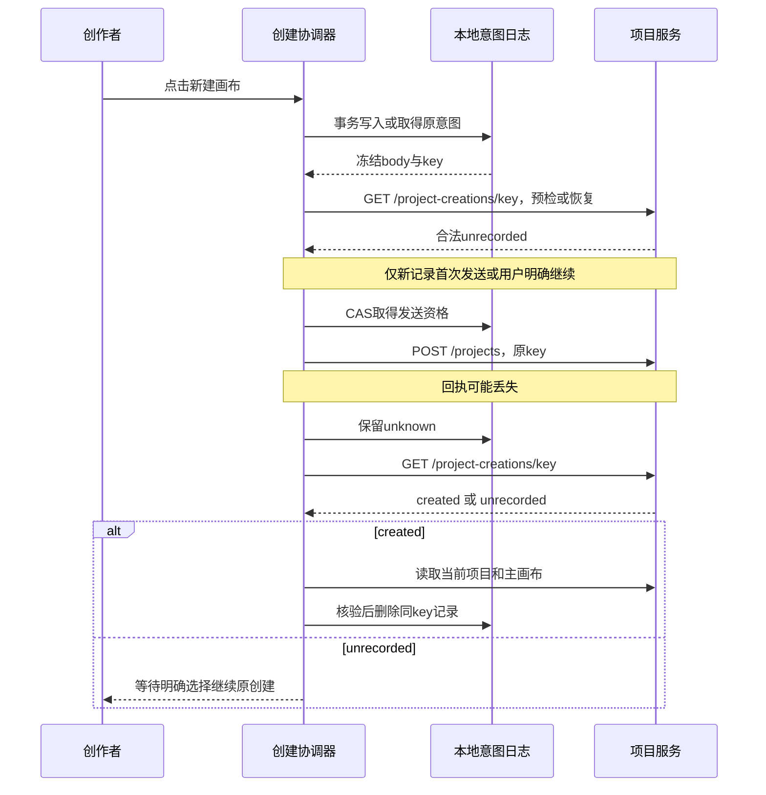

# 项目与画布创建及一致性详细设计

技术设计；确认等级沿原来源。需求、PRD、Plan 独立维护，实施状态只见 [BACKLOG](../../BACKLOG.md)。

## 1. 摘要

创建及恢复同一主画布，保持名称、活动读模型与基础管理的一致性。

本文采用设计、用户故事与测试场景结构。原始需求、PRD 和 Plan 独立维护；当前实施进度、剩余工作及阻塞项统一见 [BACKLOG](../../BACKLOG.md)。

## 2. 参与者

使用者与参与职责：创建、继续和管理项目画布的创作者。维护职责及确认人沿下方原来源记录；未给出姓名的，不补造人员或排期。

## 3. 背景

原始需求：[07-项目与画布创建原始需求](../requirement/07-项目与画布创建原始需求.md)。关联需求与验收：[06-项目与画布创建及继续创作](../prd/06-项目与画布创建及继续创作.md)。本文维护技术合同；相关实施步骤与证据见 Plan，状态与调度见 [BACKLOG](../../BACKLOG.md)。

### 3.1 文首来源与范围

适用范围：快捷创建、恢复、唯一名称、主关联、最近修改与基础管理。文档版本：2026-10-21管理修订；用户已确认立即逻辑删除及回收站保留30天，生命周期、管理界面与到期任务已实现，本地接受见计划15第187节，历史创建接受不外推。维护职责：workspace/canvas及前端项目消费者；评审人未指定。

日期：2026-10-18；最近复核：2026-10-21。创建历史状态：已按用户后续实施授权落地，当前实现和本地接受见[计划15第17节](../plan/15-项目与画布创建及一致性实施计划.md#17-本轮实现与接受记录2026-10-19)。第34节保留实施前盘点；生产环境未迁移或发布。

来源：[需求07](../requirement/07-项目与画布创建原始需求.md)、[调研12](12-即梦项目与画布入口调研.md)。交付定义：[PRD06](../prd/06-项目与画布创建及继续创作.md)；实施步骤：[设计13](#1-摘要)。已有画布编辑规则仍由需求06/设计10负责。

### 3.2 摘要、参与者与范围

一个项目持有唯一稳定的主画布入口。用户点击“新建画布”后，一次创建项目、空主画布、零预算和持久回执；进入编辑器前不填写名称、画幅、模型或风格。默认名称为“未命名画布”，项目名称作为主画布唯一展示名称。结果未知先读回执，不自动另建。

参与者为有创建权限的个人创作者，及当前已有有效团队范围的创作者。服务端身份和范围是授权事实；前端恢复记录不是授权。当前阶段不重新开放团队/空间切换导航，不增加模型供应商、计费、实时协作或时间线。

本设计承接创建FR-PC-01～16及相关BR/DR/NFR，并按需求07第8.2节纳入FR-PC-21/22与FR-PC-23当前页批量部分、BR-PC-14～18及AC-PC-34～36适用部分、AC-PC-38～43。封面编辑、素材导入起点、模板、复制、目录和授权分享仍为条件范围；管理规则明确不代表真实CRUD或到期清理已接受。

### 3.3 当前事实与方案选择

原条目的当前实施进度和剩余工作已迁入 BACKLOG；其确认范围及历史证据仍按原来源使用。

### 3.4 实施前已核验的源码事实

| 边界         | 当前事实与依据                                                                                                                                                                                                     | 本设计采用的处理                                                                  |
| ------------ | ------------------------------------------------------------------------------------------------------------------------------------------------------------------------------------------------------------------ | --------------------------------------------------------------------------------- |
| 原子创建     | [创建命令](../../backend/internal/workspace/application/create_project.go)与[事务](../../backend/internal/workspace/adapter/postgres/create_project_events.go)创建项目、初始画布、零预算及安全事件                 | 继续一个POST、一笔事务；不改成前端串行创建两个对象                                |
| 创建回执     | [持久回执](../../backend/internal/workspace/adapter/postgres/create_project_idempotency.go)使用actor/key与请求哈希，回放时复验可见性；[schema](../../backend/db/schema.sql)中的project_creation_receipt没有TTL字段 | 复用该账本；新增只读恢复查询，不另建服务端创建任务系统                            |
| 前端恢复     | [创建组件](../../frontend/src/app/projects/_components/projects-page.tsx)的attempt只在useRef中                                                                                                                     | 增加领域专用的本地意图日志，发送前持久化，跨刷新恢复                              |
| 身份与范围   | [SpaceProvider](../../frontend/src/components/spaces/space-context.tsx)读取真实空间列表，[请求层](../../frontend/src/lib/request.ts)携带X-Creation-Scope；中间件将其映射为真实Principal                            | 沿用Provider与授权；恢复旧范围只使用经列表再次验证的范围，不把旧团队意图落到个人  |
| 名称         | 主工具栏显示project.name；主画布表另有name，现有独立Rename会修改该字段                                                                                                                                             | 选择读时投影项目名，主画布旧改名/删除接口明确拒绝；不批量改历史名称               |
| 最近修改     | 项目列表按p.update_time排序；画布保存更新文档时间；项目update_time触发器会随项目行更新                                                                                                                             | 新增轻量项目活动读模型，避免为每次画布保存更新项目行、增加项目CAS冲突或升级项目锁 |
| 私有本地数据 | [草稿日志](../../frontend/src/components/generation/draft-save.ts)已有IndexedDB与身份清理栅栏，[会话Provider](../../frontend/src/components/auth/session.tsx)管理主动退出和被动失效                                | 使用相同身份隔离原则；创建意图独立存储，不塞进PromptDraft或重构既有草稿引擎       |

以上为源码盘点；未调用业务服务或执行数据库迁移，不作为实际环境已经满足合同的证据。

### 3.5 取舍

默认值选择“客户端显式发送现有合法字段”，保持POST合同及旧哈希算法不变；不使用空请求体，也不增加一次默认配置查询。新建主画布的持久name初始化为项目名，历史记录不批改。

名称选择“project.name是唯一展示事实”，不在每次改名时同时修改画布内容revision。主画布读取投影名称，历史非主文档仍沿自己的名称。主画布不直接删除，项目生命周期继续由workspace所有。

最近修改选择独立的workspace.project_activity行：与真实变更同事务更新，但不写project.revision或project.update_time。相比把画布时间直接写回项目，此方案避免新增元数据CAS噪声及触发器更新时间污染；保留现有项目写锁强度，详见第710节。新增一张有明确消费者的读模型，不增加后台同步服务。

### 3.6 画布列表管理范围（2026-10-20，2026-10-21复核）

用户以即梦资产页的画布列表为展示参考，要求修复顶部遮挡、卡片比例、右下角编辑入口与分页尺寸，并补齐管理和批量能力。本节承接需求07的SRC-PC-06；删除期限按SRC-PC-07及第716节，不再以文首追加与正文排除并存表达当前范围。

- [Figma 主画板](https://www.figma.com/design/uLqmeRWuQuzfrp9xOYg6FT?node-id=439-19134)：正常文档流排列页头、标签、工具栏、列表和分页；移除标签栏负边距。横向预览统一 16:9，名称与修改时间在下方，更多操作在右下角。首位卡片复用现有快捷创建，不重复定义创建协议。
- [管理状态集](https://www.figma.com/design/uLqmeRWuQuzfrp9xOYg6FT?node-id=1136-94086)：默认、悬停菜单、开始批量、选中、确认、部分失败、已归档、窄屏及重命名。设计原型只表达离散状态，不代表真实后端验收。
- 列表提供当前画布、已归档、回收站；搜索与分页查询服务端，不对当前页伪装全量筛选。排序支持最近内容修改和既有项目更新时间；时间区间、收藏和模板暂不承诺上线。
- 批量仅选择当前页，筛选和翻页清空选择。复用现有 Checkbox、Button、DropdownMenu、Dialog、DataPagination；请求期间禁用重复提交与翻页。删除前确认数量、目标与30天期限，完成后逐项反馈成功、拒绝或未知，未确认项保留选择。
- 写入复用项目归档、取消归档、回收、恢复接口，携带版本与幂等键，保留身份/空间边界。未知结果先读取确认，不能无条件重发新的命令。
- 游标分页不虚构总数；页大小为 12/24/48，桌面操作控件统一 36px，窄屏为 44px。真实封面缺失时显示中性占位，不用参考产品模板冒充用户作品。

## 4. 目标

创建及恢复同一主画布，保持名称、活动读模型与基础管理的一致性。目标的规则、量化条件与非目标沿需求原文及下方已确认设计，不增加未经确认的指标。

## 5. 使用场景

参与者为创建、继续和管理项目画布的创作者；在下方定义的输入、对象状态、权限和环境条件具备时执行相应操作。各故事按其独立前置条件核对，不能把测试夹具当成真实业务条件。

### 5.1 交互、路由与状态

原条目的当前实施进度和剩余工作已迁入 BACKLOG；其确认范围及历史证据仍按原来源使用。

### 5.2 新建与继续

首页画布模式、侧栏及“我的画布”列表复用一个`NewCanvasButton`，不是分别实现三套提交。用户点击才创建；访问页面、渲染组件、切换模式和React StrictMode重放不写入。首页已有“新建画布”链接只去列表的行为在此变成显式新建按钮；普通“我的画布”导航仍只打开列表。

游客点击保留一个不含私有范围/对象的内存动作意图，打开已有认证弹窗；取消不发送请求。同次认证完成后进入范围核验；完整刷新后不自动恢复游客内存动作。已登录时等待SpaceProvider确定selected且writable，记录actor.id与selected.id；不新增空间选择器。页面同时提供真实归属的可访问说明。

首次新建先落prepared意图，再用该key调用恢复GET核验查询合同可用；只有本次beginOrResume确实新建了记录、GET返回合法unrecorded且租约仍有效时，才自动竞争首次发送资格并POST。GET的404/503或畸形200阻断写入。这仍由一次点击完成，新增GET是恢复能力预检，不是默认配置或模型查询。复用旧记录的start、刷新和挂载一律只读恢复，即使旧记录仍为prepared且查询unrecorded，也等待用户“继续原创建”。

被动挂载或刷新恢复查到created时，只展示“重新打开”，不自动导航或清理共享记录；用户明确选择后再读取目标并完成确认。该规则统一用于后台恢复页，避免其他标签页抢焦点。

新建成功先保存目标ID，再读取当前项目/主画布。201中的旧回执只提供身份定位，不覆盖当前名称、状态和版本。正常进入`/canvas?project_id=<id>&canvas_id=<main_id>`；成功创建但加载失败显示“画布已创建，暂时无法打开”与“重新打开”，不重新POST。

确认目标时同时校验项目ID、当前initial_canvas_id、文档project_id与文档ID。归档可读目标以只读打开完成确认；copying保持未就绪且不清记录；403/404、依赖失败、主关联异常都不能作为成功打开。只有同范围本人恢复查询的明确410，才允许在未打开时终结原创建意图。201已验证但保存ID失败时保留内存目标并显示“已创建，创建状态保存失败”，禁止再次POST；可重试本地落盘/只读打开，刷新后按发送前已落盘的原key恢复。不能将这种失败降格成“创建失败”。

空白画布提供已有可用的文本/媒体/上传入口，保存与生成分别反馈。不能把无模型的空态伪装成生成成功。改名入口放在画布标题菜单和列表更多菜单，复用一个`ProjectRenameDialog`；Enter提交、Escape取消，中文输入法组合期间不提交，关闭恢复触发焦点。

### 5.3 状态与操作

| 状态                   | 可见信息                                           | 允许操作/转换                                                               |
| ---------------------- | -------------------------------------------------- | --------------------------------------------------------------------------- |
| 身份/范围读取中        | 正在确认创作归属                                   | 等待或重试；未确认前不发送                                                  |
| 准备本地记录           | 正在准备画布                                       | IndexedDB事务完成后才发送；失败显示“无法保存创建状态，请检查站点存储后重试” |
| 恢复能力预检中/失败    | 正在确认创建服务，或服务暂不可用；尚未发送创建请求 | 保留prepared，仅重试只读查询；不误报创建结果未知或偷偷POST                  |
| submitting             | 正在创建画布                                       | 相同actor/范围的重复点击合并；不提供另一个新建请求                          |
| unknown                | 创建结果尚未确认                                   | “确认创建结果”执行只读恢复；不自动补发POST                                  |
| unrecorded             | 尚未找到创建回执                                   | “继续原创建”明确执行原请求/原key；也可返回列表；不能据此断言对象绝不存在    |
| created/loading        | 已创建，正在打开                                   | 读当前对象，失败仅重新打开                                                  |
| 已创建但记录/清理失败  | 已创建，恢复状态保存或清理失败                     | 保留内存目标；重试本地持久化/只读确认，完成前禁止另一意图                   |
| ready                  | 编辑器可用                                         | 清除本次未完成意图后，后续明确新建才产生另一个key                           |
| 明确校验拒绝           | 输入被拒绝，尚未创建                               | 满足第76节终结条件才清原记录；用户再次明确新建才用新key                     |
| blocked                | 登录、归属、权限或对象状态已变化                   | 停止重放，说明原因；不切范围继续原请求                                      |
| archived               | 项目已归档，只读                                   | 能读取的内容只读展示；不增加取消归档界面，不允许编辑、改名或生成            |
| copying                | 项目准备中                                         | 显示未就绪；不把部分内容当作空画布打开，不新增复制管理界面                  |
| 回收/不可见/主关联异常 | 原对象不可打开，或关联需要处理                     | 返回列表/重试读取；不创建替代项目，不猜选其他文档                           |

错误沿现有Sonner与ApplicationState处理；主区域只保留必要状态，不增加第二套错误横幅。沉浸画布沿项目工具栏，不叠加普通ProductHeader。明暗主题、320/390/768/1440px、短屏与键盘焦点沿DESIGN；本轮不编造像素稿或更新Figma。

## 6. 价值

减少重复创建及内容丢失，删除和恢复遵循原已确认规则。

## 7. 方案

### 7.1 默认值与输入规范（DEC-PC-01）

业务规则唯一来源为需求07第7.16节的DR-PC-01/DR-PC-02/DR-PC-04。下表给出传输与落库位置。

| 项                         | 新入口发送/初始值                                                 | 服务端责任与历史兼容                                                    |
| -------------------------- | ----------------------------------------------------------------- | ----------------------------------------------------------------------- |
| name                       | `未命名画布`                                                      | 继续非空及1～50 Unicode码点校验；同名允许，不按日期或自增号改变默认请求 |
| description                | 空字符串                                                          | 不新增项目说明表单                                                      |
| aspect_ratio               | `16:9`                                                            | 沿现有合法枚举；是兼容与新节点初始偏好，不锁定无限画布的输出比例        |
| style_type                 | `realistic`                                                       | 显式发送；沿现有领域校验，不更改旧调用方省略该字段的既有处理            |
| style_subtype              | 省略                                                              | 不发送空白风格子类型，不自动选择stylized预设                            |
| style_preset_id、style_key | 省略                                                              | 不查询预设作为创建前置；数据库沿现有空值语义                            |
| resolution                 | 服务端仍为`1080p`                                                 | 不新增请求字段；不作为图片/视频清晰度承诺，不影响节点独立参数           |
| allow_overseas_models      | 服务端仍为`false`                                                 | 不扩大模型授权                                                          |
| default_models、封面       | 沿现有空模型映射/无封面                                           | 无模型、预设或额度也能建立空画布、添加和保存文字                        |
| 状态/版本                  | 项目active/revision=1，主画布revision=1，viewport为x=0/y=0/zoom=1 | UUID、归属、版本和时间均由服务端生成；预算limit/reserved/settled均为0   |

前端在`components/projects/project-creation.tsx`的`blankProjectInput()`中生成上述显式请求，第一次持久化后不重新计算。请求仅包含现有DTO允许字段；本地contractVersion不是额外POST字段。恢复读取必须校验字段白名单、类型、枚举及省略语义，不允许从本地记录透传任意JSON、null、身份或scope字段；不支持的版本只阻断，不按当前默认值修复再发送。冻结的是业务字段与省略语义，不要求JSON键顺序或网络字节完全相同；服务端仍按原DTO字段计算原哈希。后端不增加“默认值兜底”来掩盖客户端漏字段，也不调整既有请求哈希的归一化顺序，避免旧回执失配。

改名去首尾空白后按Unicode码点计1～50，组合字符按多个码点计；不按UTF-16长度或可见字素数计，不自动做NFC/NFKC归一化，不折叠大小写。裁剪集合明确沿Go strings.TrimSpace：U+0009～000D、0020、0085、00A0、1680、2000～200A、2028、2029、202F、205F、3000。前端以相同集合裁剪后用Array.from计数，不能直接以JavaScript trim代替（U+0085与U+FEFF处理不同）；U+FEFF、零宽字符不额外裁剪。名称含NUL按现有PATCH规则拒绝，前端还应拒绝未配对代理码元，避免JSON解码替换后变成另一名称。后端维持既有合法UTF-8及码点校验。仅首尾约定空白不同或提交当前名称时视为同值，不制造内容变更；历史超出新入口范围的记录保留，不由本轮批量截断或重写。

### 7.2 创建恢复协议（DEC-PC-02）

原条目的当前实施进度和剩余工作已迁入 BACKLOG；其确认范围及历史证据仍按原来源使用。

### 7.3 本地最小意图与并发

新增领域专用IndexedDB数据库`glowloom-project-intents`，版本1，`intents`对象仓以`[actorId, scopeId]`为主键；另有单行`fence`对象仓保存单调递增的清理epoch。仅创建意图使用，不保存提示词、素材、凭据、邮箱、会话令牌或CSRF。

| 字段                      | 类型与用途                                                                   |
| ------------------------- | ---------------------------------------------------------------------------- |
| actorId、scopeId          | 真实会话账号及真实空间UUID；不持久化前端推测的org_id                         |
| contractVersion           | 数字1；不支持的版本只显示无法恢复，不改写成新版本并重发                      |
| key                       | 本次UUID，与Idempotency-Key相同                                              |
| body                      | 上节显式请求的冻结JSON；保持省略字段及值，不从当前偏好重新构造               |
| phase                     | `prepared / submitting / unknown / created / rejected`                       |
| hasUncertainDispatch      | 布尔值，进入过未知/刷新中断后置true；不因随后一次422而消除先前提交的不确定性 |
| projectId、canvasId       | 仅得到可校验回执后记录，其他阶段为空                                         |
| localRevision、fenceEpoch | 本地CAS与清理栅栏；防迟到响应或旧标签页写回                                  |
| createdAt、updatedAt      | 本地诊断时间，不用于服务端授权、项目排序或回执过期判定                       |

`beginOrResume`使用同一readwrite事务：同actor/范围已有未完成记录则返回原记录，否则创建prepared记录，并返回本次是否新建的disposition。两个标签页同时点击在事务边界合并为同一意图。已有created记录在GET当前目标确认之前保持，其他标签页不能借“响应已到”抢先删除；比较key与localRevision后删除，防止删除下一次意图。

复用记录不等于获得发送资格。`beginDispatch`在readwrite事务中按key/localRevision/fence竞争一次状态转换：首次仅本次新建记录且预检通过的prepared→submitting；用户看过本次只读unrecorded结果后明确继续，才允许prepared或unknown→submitting，明确继续时保守置hasUncertainDispatch=true。同一revision只有一个调用方成功；其余重读记录，仅恢复/只读查询。刷新读到submitting时转unknown并置该标记，不能认为上次未发出。其他标签页通知仅触发读日志，不携带私有body，不自动发送HTTP。

允许的进展为prepared→submitting→unknown或created，预检/恢复查到有效created时prepared也可直接确认created；unknown可只读确认created，或由明确继续重新取得发送资格；created不能被迟到超时降回unknown，也不能被旧ID覆盖。CAS失败先重读：同key已created就使用记录中的目标；记录已删除或已换key则本回调结束，不调用beginOrResume创建另一条记录。并发同key响应可收敛到同一目标，但仅持有效当前租约的发起标签页执行导航，其他页显示可打开，不抢焦点。ready必须以确认打开且acknowledge成功为前提；清理失败保留“已打开、恢复状态待清理”，不开放下一次新建。

已知目标状态同时保留原intentKey；旧目标重新打开不得transition或ack下一条key。迟到回调发现记录已删除或换key时，退出忙碌状态，不触碰后继记录。所有异步边界同时检查当前内存租约，退出意图生效后不等待服务端退出完成才停止导航。

IndexedDB打开排队超过5秒按本地存储阻塞反馈，并关闭迟到连接或中止迟到升级；可显式重试。该时间不用于推断服务端是否创建、记录过期或权限变化。

持久化失败时禁止发送。发送后所有失败回调也要核对key、账号/范围generation和fenceEpoch；取消网络请求并不能证明服务端没提交，因此取消传输进入unknown，不能自动删记录或换key。收敛后同一范围可以再明确新建；不承诺两个独立设备共享同一浏览器意图。

### 7.4 身份、范围与清理

复用SessionProvider的会话核验、getSessionGeneration/getScopeGeneration和既有清理生命周期。业务协调器依赖`useOptionalSession`与`useSpace`，不让请求层导入UI或操作IndexedDB。

主动退出、账号切换、明确权限撤销时：同步使内存租约失效，停止请求/导航，然后在一个本地事务中递增fence并清除意图；旧异步写入必须比较旧epoch而被拒绝。本地清理失败不延缓服务端退出或恢复旧租约；下一次激活先重试清理，完成前不发送创建请求。

激活顺序固定为：读取清理checkpoint → ensureSessionFresh及真实空间核验 → 复核内存generation/账号 → 在日志事务中比较同一checkpoint并授予内存租约。不能在旧异步回调里读取最新epoch为自己续租；checkpoint变更必须重新走完整身份核验。被动过期只撤销内存租约，不增加清理epoch，复验同账号/范围后可用新租约访问原记录。已被服务端接受/提交的请求不因退出而撤销；退出后的迟到响应不显示、不导航，原对象仍沿服务端授权存在。

同账号被动会话到期时：可保留最小意图并停止其展示与写入；重新认证成功、真实空间列表复验后，才允许读取及只读恢复。会话ID/generation只做内存写入租约，不写入本地记录；正常v2续期不销毁同次意图。

刷新后SpaceProvider可能按现有策略选择经服务端空间列表确认的个人范围。协调器可从同账号的未完成意图取得恢复范围提示，但须先由空间列表验证该scope仍存在、可读/可写，再调用既有选择流程；不能从本地UUID直接授权。存在多个待恢复范围时展示恢复项供用户明确选择，不自动切换；无权旧范围的记录被阻断并清除，个人范围可正常浏览，但不能承接旧团队POST。该恢复提示不是常驻团队导航。

### 7.5 服务端查询与重试

新增只读`GET /api/project-creations/{key}`，operationId为`getProjectCreation`，走现有认证、X-Creation-Scope及no-store中间件。路径key是关联标识，不是授权令牌；不记录请求体、私有名称或回执内容到日志。

恢复查询不取得69360咨询锁，也不等待创建事务完成：在授权事务内先核验真实账号/范围，按actor/key读取已提交回执，再按项目→主文档顺序取得读取所需锁并复验归属/状态/关联。持久回执与对象同事务提交，未提交回执不可见时只返回unrecorded，不插入预留行，不修改任何对象。这样不新增“持有咨询锁再等项目”的读取路径，与既有项目写授权先取项目锁的路径相互倒置。原POST仍沿既有幂等合同串行处理相同key；unrecorded既可能是未发出，也可能是原POST还在途，因此继续原创建必须使用原key/body。

| 结果                                                        | 状态码及payload                                                                               | 客户端处理                                                                               |
| ----------------------------------------------------------- | --------------------------------------------------------------------------------------------- | ---------------------------------------------------------------------------------------- |
| 当前范围有本人回执且目标可读                                | 200，`state=created`，非空project_id/canvas_id，project_status为当前事实                      | 记录身份后GET当前项目/画布；不使用初始回执覆盖现名/版本；归档目标只读                    |
| 当前账号该key没有已提交创建回执，包括其他账号使用同一字符串 | 200，`state=unrecorded`，project_id/canvas_id/project_status为null；不查其他账号是否存在该key | 保持原意图；仅用户点“继续原创建”才POST原body/key，不自动重试写入；本地不加载其他账号记录 |
| 当前账号的该key回执位于其他范围                             | 404 `not_found`，不含对象ID                                                                   | 不展示旧记录、不更换范围重试                                                             |
| 同范围本人回执的目标已回收/不可再用                         | 410 `creation_target_unavailable`，不含对象ID                                                 | 按key/localRevision确认清除该本地意图，显示不可用并回列表；不复活、不重建                |
| 身份无效/权限不足                                           | 401/403或既有404                                                                              | 进入认证/权限处理；不继续私有请求                                                        |
| 回执损坏、主关联不匹配、依赖失败                            | 503 `dependency_unavailable`；主关联不合法可返回409 `main_canvas_unavailable`                 | 保留未知状态及原key，提供只读重试，不展示假成功                                          |

请求超时沿现有传输默认值，UI不增加紧密轮询；挂载/恢复后最多一次自动只读查询，其余由用户操作触发。查询失败保留原记录，浏览器恢复不依赖新增常驻worker。

POST仍沿`/api/projects`和既有201响应；重放不替换原持久回执，不更改哈希算法。用原key不同body得到409 `idempotency_key_reused`后停止，不能悄悄生成新key。422只证明本次请求的输入被拒绝，不自动证明较早的同key在途请求未提交；能否终结按第76节。修正内容不能在旧key下改变body，只有符合终结条件且用户明确再次新建才产生新意图。对结果未知的503/网络中断不假定回滚。

新创建协调器在写入前复用ensureSessionFresh；显式调用POST时设置现有请求选项sessionRecovery="never"，避免传输层在协调器不可见处补交写入。401进入已有认证连续性，恢复后先GET回执；GET只读请求可沿原会话恢复机制。项目改名写入也采用相同选项并保留原key，不改变站内其他请求的自动续期策略。

本次不新增自动过期/清除创建回执或本地未确认意图的计时策略。已有回执在项目保留期间持续可查；主动退出会删除本地记录，但不删除服务端回执或项目。数据库清理、站点数据被用户清除、其他设备和未来硬清除后的恢复不属于此保证；未来启用项目硬清除时必须先评审key留痕策略，不能在未知结果上自动创建。

### 7.6 终结、失败与再次新建

只有三种理由可通过key/localRevision/fence的CAS删除记录：当前目标已完整核验且可编辑/只读打开（opened）；同范围本人回执查询明确410（target_unavailable）；唯一首次发送在持续有效租约下收到业务422、且从未进入过未知/重试的明确拒绝（validation_rejected）。对最后一项，先持久化rejected再清理，任一步失败均禁止下一次新建；恢复后只允许清理已具备该证据的rejected记录，不自动发送。未知后重试收到422、401/403/404、409冲突、格式错误响应或查询unrecorded都不证明先前请求没有提交，保留原意图并只读确认。422后的新意图仍需用户再次明确点击，不自动循环重试。

返回列表、关闭提示或暂时离开不清除unknown；返回后新建先恢复原意图，不能提供“放弃并另建”绕过。已created但GET失败只重开；暂时无权限遮蔽记录并阻断，明确撤权沿强清理流程；主关联异常保留定位用于只读重试。浏览器数据被清除、主动退出或换设备后，只承诺从当前授权项目列表找回已提交对象，不保证还持有原创建key；新会话中明确新建是新意图，不承诺跨该边界去重。



### 7.7 名称与主画布一致性（DEC-PC-03）

原条目的当前实施进度和剩余工作已迁入 BACKLOG；其确认范围及历史证据仍按原来源使用。

### 7.8 唯一名称与读取投影

所有新UI读取项目name。画布Get/List在确认document.id等于project.initial_canvas_id时，响应name投影为当前project.name；非主历史文档保留自身名称。存储层历史canvas.document.name不批量修正，也不作为另一个用户可编辑的主名称。

新增workspace的`ProjectNavigation`读取模型包含ProjectID/MainCanvasID/Name/Status/IsDelete；canvas通过消费方小接口读取，经app层映射，避免canvas application导入workspace application形成环（workspace已有复制流程依赖canvas）。读取与授权绑定同一SQL事务，使用现有项目共享锁，再读文档；同一响应内名称和主关联取同一版本。

新UI改名仅调用既有`PATCH /api/projects/{pid}`，body为name与expected_revision，显式传原Idempotency-Key；服务端现有项目生命周期CAS、审计和持久变更回执继续使用。打开对话框先读当前项目版本，未确认可写前不可提交。未保存的输入不替换页面标题；PATCH成功后重读当前项目，分别失效列表/标题缓存。写入成功但GET失败显示“名称已保存，暂时无法确认最新显示”，保留已确认结果及只读重试，不显示“改名失败”或再次发新PATCH。项目名称变化不增加主画布内容revision，不使正在编辑的节点草稿失效。

改名结果未知时冻结body/key并先GET当前项目；当前名相同只能说明现状相同，不能证明本次回执已确认。需要确认原操作时重放原PATCH/key并按原回执处理，然后再GET当前快照；若其他设备已改名，以当前读回值为准，不用旧回执回滚现名。409 revision_conflict保留用户输入，重读后由用户确认再次提交，创建新的修改意图；不自动覆盖新名称。

改名发送中/结果未知时，同项目在当前会话只保留一组冻结输入/key，关闭对话框不触发补交；再次打开显示待确认操作，确认重放必须由用户操作。改名不加入创建日志，不承诺跨完整刷新保留未提交输入或改名key；离开时说明未确认状态，刷新后只读当前名称，不能自动重放旧PATCH或假称原操作已确认。用户之后明确提交另一名称，必须基于新GET的expected_revision，旧在途请求与新请求由服务端CAS裁决，不自动覆盖。

同一账号/范围/项目内，共用项目展示缓存保存name、revision、status和main_id；读取响应按project.revision接收，不让迟到低版本GET覆盖高版本。改名后、重新打开、打开改名框、窗口重新聚焦或可见时触发去重的项目读取，失败保留最后已确认快照并显示刷新失败。只更新展示/能力事实，不用这些GET覆盖编辑器节点或本地草稿。跨标签页可发送项目ID失效通知，由接收方按自己的授权重读；不广播名称或正文。本轮不新增实时协作与持续轮询，不承诺其他设备改名后毫秒同步；保证上述重读边界各处使用同一当前名称。当前主关联不匹配则停止打开，不接受旧回执或缓存中的替代ID。

### 7.9 旧画布路径的兼容行为

| 路径                           | 主画布目标                                                                          | 非主历史文档                                    |
| ------------------------------ | ----------------------------------------------------------------------------------- | ----------------------------------------------- |
| GET canvas及项目文档列表       | 主画布name读时投影项目名                                                            | 沿现有名称与访问授权                            |
| PATCH canvas独立改名           | 409 `main_canvas_managed_by_project`；不写入，不增加文档revision；新UI改走项目PATCH | 沿现有128码点合同，不强行套项目50码点规则       |
| DELETE canvas                  | 409 `main_canvas_required`；不删除，不改变主关联                                    | 沿原合同及权限；媒体归属不变                    |
| POST项目内画布                 | 保留现有历史API创建非主文档的能力，不自动换绑initial_canvas_id                      | 不开放项目内多画布新UI；不把该API当快捷创建入口 |
| GET主关联已失效的项目/画布组合 | 标为不可打开/关联异常；不自动选择另一个文档或重建                                   | 保留数据，后续单独处理                          |

这是对旧主画布改名/删除行为的明确拟议调整，必须在计划中补HTTP兼容回归与调用方核对；不是声称旧接口完全无变化。既有成功的文档命令回执保持原字节，不改历史回执：满足原命令所需当前身份、范围和状态校验后，仍在既有有效期内的旧key原请求优先回放原结果；没有可回放回执时再应用新守卫，随后才读取/校验待修改正文版本。历史已删除主文档不因此自动恢复，读回时明确关联异常。

此处独立画布元数据命令沿现有infra.idempotency_record的24小时有效期；过期key不能借旧成功事实再次改名/删除主画布，按无可回放回执进入新守卫。本设计不扩大其有效期，不把它与无TTL的project_creation_receipt、永久project_change_command混为一谈。

项目回收、归档、恢复由workspace管理，30天规则见第716节；列表的“删除”显式调用项目DELETE，立即逻辑删除项目。主画布独立删除仍拒绝，不自动转译为项目删除，避免绕过在途任务检查。initial_canvas_id只在原子创建或已有明确授权的复制流程建立，不作为用户可变设置开放。

### 7.10 内容与元数据的并发

以[项目授权](../../backend/internal/workspace/adapter/postgres/request_access.go)及[内容授权](../../backend/internal/workspace/adapter/postgres/script_access.go)为准：当前项目元数据写入和canvas写入在首次项目授权时已经取得FOR UPDATE，随后才取得该写命令的幂等锁与文档锁；不能把现状描述成“画布写入仅持共享锁”，也不在本专项降低该锁强度。读取路径按身份/范围 → 项目FOR SHARE → 文档读取；新增恢复GET不取咨询锁，见第75节。原子创建沿原咨询锁/插入合同，不借新增读模型重排所有命令。

活动写入附加在各自已授权事务中，项目/文档之后才锁活动行；活动适配器不能反向申请项目锁或调用另一个独立事务。因此保存与改名按现有项目写锁串行，不发生先共享后排他的锁升级，也不增加项目revision；本轮不承诺提升二者并发吞吐。实施核对受影响路径与69360调用清单，既有写合同中的跨操作key锁行为不由本设计宣称已消除；新增查询/活动不得形成相反等待边，并以双连接集成场景验证。

### 7.11 最近修改读模型与分页

业务口径见DR-PC-06：成功保存节点/连线/引用/采用结果等内容，或名称/说明/封面变更推进最近修改；只有视口变化、打开、预览、任务排队/失败和同值重放不推进。副本尚未就绪不作为用户已编辑内容。

### 7.12 拟新增数据

| 结构                       | 字段与约束                                                                                                                  | 写入责任                                                                     |
| -------------------------- | --------------------------------------------------------------------------------------------------------------------------- | ---------------------------------------------------------------------------- |
| workspace.project_activity | project_id UUID主键且外键指向项目；modified_at timestamptz NOT NULL；basis text枚举created/metadata/content/legacy_metadata | workspace所有，创建/项目元数据和canvas内容通过明确端口更新；不接受客户端时间 |
| 排序索引                   | (modified_at DESC, project_id DESC)                                                                                         | 配合已有项目范围/状态索引；实际执行计划在隔离库测量后确认                    |
| schema与增量               | 最终态schema及拟议017_project_canvas_consistency.sql保持一致                                                                | 编码前核对编号是否被其他工作占用；本轮不创建SQL文件                          |

不新增全量历史版本、访问日志或异步活动同步服务。activity仅为排序事实，不承担授权。读写角色权限沿现有运行角色最小授权，主画布与项目的权限仍由原服务逐次检查。

创建事务插入activity，时间取该项目实际create_time，basis=created。元数据真实变更由workspace在项目CAS同事务更新。canvas在既有保存事务判定主画布内容确有变化后，通过注入的事务绑定`ProjectActivityWriter`更新；只锁活动行，不UPDATE workspace.project。数据库时间在取得活动行写锁后读取，以GREATEST(原值,clock_timestamp())单调推进；回执重放不再touch。

语义比较忽略document viewport/revision/name及节点的传输版本/运行时状态，只比较可编辑内容：节点身份、类型、标题、几何、父组、层序、引用身份、持久草稿配置、候选采用及业务连线。输入版本序号变化但正文/引用相同不单独推进。检查Execute、draft-save及各直接写入/采用路径；非主历史文档不改变主画布活动时间。判定函数放在canvas领域内，不能用“命令非空”代替真实变化。

### 7.13 列表与时间兼容

项目列表和详情增加只读`last_modified_at`及`last_modified_basis`；既有update_time保持项目元数据语义。新UI明确传`order=recent_content`。统一有效时间effective_modified_at=COALESCE(activity.modified_at,project.create_time)，返回字段、ORDER BY、keyset的WHERE比较和next_cursor均使用这个表达式及project.id降序，不能仅在展示时兜底而排序/翻页仍拿可空活动字段。basis同样缺行取created。时间文案使用last_modified_at，不再拿项目update_time冒充画布编辑时间。

未传order的旧调用继续按原项目update_time及原cursor绑定逻辑；保留旧v1游标解码/计算路径。新order使用v2游标：包含有效时间、项目ID及绑定actor/真实范围/查询/状态/回收条件/目录/limit/order的摘要；版本、结构、UUID、时间及绑定不匹配均拒绝。该摘要沿现有cursorBinding仅检测条件错用，没有签名，不能承诺拒绝知道规则者构造的合法边界；游标从不作为权限或数据完整性的证明，每页独立执行账号/范围授权。v1不能用于recent_content，不能因新增字段直接改变旧哈希输入；本轮不新增签名密钥或防伪协议。

列表读取以LEFT JOIN活动行并保留原项目权限/范围/状态过滤；不存在读模型时使用项目create_time并标created，不能因尚无读模型使项目消失。新迁移给历史项目初始化为p.update_time、basis=legacy_metadata，明确只是已有项目资料时间，不从包含视口保存的document.update_time倒推历史内容修改。此类条目显示“项目更新”；下一次真实内容/资料修改后使用新口径。

静态数据集翻页不重复、不漏项；并发修改可能把条目移到已读页之前，客户端按ID去重，返回列表、改名/保存成功后或用户刷新时从首页重读，不承诺跨多次HTTP请求的全量历史快照。修改时间与cursor不允许客户端自行拼接。

### 7.14 模块与接口职责

以下是拟新增或扩展的边界，签名供计划任务互相引用，不是已经存在的实现。

| 边界                 | 签名/职责                                                                                                                                                                                                                                   |
| -------------------- | ------------------------------------------------------------------------------------------------------------------------------------------------------------------------------------------------------------------------------------------- |
| workspace恢复查询    | `ProjectCreationRecoveryQuery.Resolve(ctx context.Context, actor identity.Principal, key uuid.UUID) (ProjectCreationRecovery, error)`；结果含State、ProjectID/CanvasID可空指针、ProjectStatus可空字符串；只读已提交回执，不取得写命令咨询锁 |
| 恢复持久化端口       | `ProjectCreationRecoveryStore.ReadCreationRecovery(ctx, actor, key) (ProjectCreationRecovery, error)`；同一事务鉴权、锁、回执及当前目标校验                                                                                                 |
| workspace导航事实    | `ReadProjectNavigation(ctx, actor, projectID) (ProjectNavigation, error)`，模型含ProjectID、MainCanvasID、Name、Status、IsDelete；由workspace适配器在调用方事务读取                                                                         |
| canvas消费方展示端口 | `ProjectPresentationReader.ReadProjectPresentation(ctx, actor, projectID) (ProjectPresentation, error)`，消费方模型含MainCanvasID/Name/Status；app层负责workspace→canvas映射，禁止反向导入                                                  |
| canvas消费方活动端口 | `ProjectActivityWriter.MarkProjectContentChanged(ctx, actor, projectID) error`；app注入事务绑定的workspace适配器；失败回滚本次保存，不先报成功后异步补                                                                                      |
| canvas领域判定       | `HasContentChanges(before, after domain.Document) bool`；主画布判断在授权/导航边界完成                                                                                                                                                      |
| 本地创建日志         | checkpoint/activate分离检查点与授权租约；beginOrResume只取得意图，beginDispatch竞争发送资格；readForActor、transition及带终结原因的acknowledge均校验租约和CAS；invalidate负责清理，精确共享类型见下方                                       |
| 前端创建协调         | `useProjectCreation(): { start(): Promise<void>; resolve(): Promise<void>; continueOriginal(): Promise<void>; state: ProjectCreationState }`；只通过生成API客户端发送业务请求                                                               |
| 共用控件             | `NewCanvasButton`与`ProjectRenameDialog`归components/projects；首页/侧栏/列表引用，不反向导入路由私有组件                                                                                                                                   |

恢复HTTP输出单独定义`ProjectCreationRecoveryResponse`，state为created/unrecorded枚举，三个可空目标字段在JSON中显式输出null或实际值，不用缺失字段模拟unrecorded。生成前端类型为`API.ProjectCreationRecoveryResponse`；`project.ts`中的拟议`requireCreationRecovery(value: unknown)`校验created的非零UUID/合法状态，及unrecorded的全部目标字段为null。非法200回执留在未知态，不能导航、清记录或重新POST。

前端跨任务共享类型与签名固定如下，只定义合同，不在文档写实现体。ProjectCreationContext的sessionGeneration/scopeGeneration来自现有内存事实，fenceEpoch来自当前日志检查点；进入事务前后均须核对有效租约。

```ts
type IntentPhase =
  "prepared" | "submitting" | "unknown" | "created" | "rejected";
type ProjectCreationContext = {
  actorId: string;
  scopeId: string;
  sessionGeneration: number;
  scopeGeneration: number;
  fenceEpoch: number;
};
type IntentTarget = { projectId: string; canvasId: string };
type ProjectCreationIntent = {
  actorId: string;
  scopeId: string;
  contractVersion: 1;
  key: string;
  body: API.CreateProjectRequest;
  phase: IntentPhase;
  projectId: string | null;
  canvasId: string | null;
  hasUncertainDispatch: boolean;
  localRevision: number;
  fenceEpoch: number;
  createdAt: string;
  updatedAt: string;
};
type ProjectCreationState =
  | { phase: "idle" | "checking_context" | "preparing" }
  | {
      phase:
        | "preflight"
        | "preflight_failed"
        | "submitting"
        | "unknown"
        | "unrecorded";
      intent: ProjectCreationIntent;
    }
  | {
      phase:
        | "opening"
        | "open_failed"
        | "created_storage_failed"
        | "ack_failed"
        | "ready";
      target: IntentTarget;
    }
  | { phase: "blocked" | "rejected" | "storage_failed"; message: string };
interface ProjectIntentStore {
  checkpoint(): Promise<number>;
  activate(context: ProjectCreationContext): Promise<void>;
  beginOrResume(
    context: ProjectCreationContext,
    body: API.CreateProjectRequest,
  ): Promise<{
    intent: ProjectCreationIntent;
    disposition: "new" | "existing";
  }>;
  readForActor(
    context: ProjectCreationContext,
  ): Promise<ProjectCreationIntent[]>;
  beginDispatch(
    context: ProjectCreationContext,
    key: string,
    expectedLocalRevision: number,
    source: "initial" | "explicit_continuation",
  ): Promise<ProjectCreationIntent>;
  transition(
    context: ProjectCreationContext,
    key: string,
    expectedLocalRevision: number,
    phase: IntentPhase,
    target?: IntentTarget,
  ): Promise<ProjectCreationIntent>;
  acknowledge(
    context: ProjectCreationContext,
    key: string,
    expectedLocalRevision: number,
    reason: "opened" | "target_unavailable" | "validation_rejected",
  ): Promise<void>;
  invalidate(
    mode: "active_logout" | "identity_change" | "passive_expiry",
  ): Promise<void>;
}
```

readForActor只读取当前已核验账号的记录，用于列出候选恢复范围；是否展示或选择某scope仍须空间服务复验，不能以本地记录证明权限。active_logout/identity_change同步撤销内存资格并强清日志，passive_expiry遮蔽记录并等待同账号复验。类型不保存令牌，不从API输入读取账号/范围控制字段。

activate只校验并激活协调器提供的已核验上下文，不能自行认证。transition不允许绕过beginDispatch进入submitting，必须遵循第73节转换；hasUncertainDispatch除新建记录初值false外只可变true，未知后的422不能写rejected。acknowledge的reason只能来自协调器已核验的第76节证据，不能因传入任意字符串跳过状态检查。持久化结构/版本、body、UUID、phase与目标字段不变量均在读取边界验证；损坏/不支持记录阻断并提示，不自动删除重建。IndexedDB的blocked/versionchange、配额不足、事务abort及关闭连接均视为存储失败；仅显示经当前账号核验的恢复提示。

初始创建201、恢复目标ID和当前详情分开验证；目标ID必须非零UUID且与当前主关联匹配。内部initial_canvas_id继续由现有HTTP字段canvas_id表达，前端映射为canvasId，不另造第二个可变主ID字段。前端Project模型补status、is_delete、last_modified_at/basis等最小导航事实，不能因为字段可选就把未知状态默认为active。

同站代理显式增加`project-creations/<UUID>`的GET路由及order允许查询；不要放宽成通配全路径。修改后由Handler注释生成OpenAPI与前端API，不手改src/api。身份token、CSRF仍由现有请求层在发送当时注入，不持久化到恢复body。

### 7.15 错误合同与只读状态

| 条件                 | 合同与UI结果                                                                                              |
| -------------------- | --------------------------------------------------------------------------------------------------------- |
| 没有登录             | 沿401/认证连续性；游客未创建，主动取消不补交                                                              |
| 当前范围缺失或不可写 | 沿invalid_creation_scope/forbidden/not_found；不猜个人范围，不自动切团队                                  |
| key与body冲突        | 409 idempotency_key_reused；原意图停止，用户先查结果                                                      |
| 项目改名版本冲突     | 409 revision_conflict；保留输入，重读当前版本再由用户提交                                                 |
| 主关联缺失/不匹配    | 409 main_canvas_unavailable，或无法读取对象时既有404；不重建                                              |
| 主画布直接改名/删除  | 新key分别409 main_canvas_managed_by_project / main_canvas_required；不写回执为成功                        |
| 归档写入/复制中      | 写入沿既有state_conflict或新增明确的project_not_ready；当前详情可读时返回真实status，不暴露未授权复制目标 |
| 明确回收/不可见      | 沿原404；只读恢复查询可在确认同范围本人回执后给410，不能给其他范围泄露存在性                              |
| 依赖/回执损坏        | 503 dependency_unavailable；不当空列表，不换key，不静默丢输入                                             |
| 本地存储/清理失败    | 明确阻断发送；不退化为只有useRef却声称跨刷新可恢复                                                        |

归档只读从服务端事实派生，前端所有节点编辑、上传引用变更、重命名和生成入口共同禁用；服务端权限仍独立拒绝。copying仅展示未就绪元信息，CanvasPage不加载为可编辑图。对没有权限与不存在的对象继续采用原不可区分策略。

### 7.16 逻辑删除、回收站与管理恢复（2026-10-21）

原条目的当前实施进度和剩余工作已迁入 BACKLOG；其确认范围及历史证据仍按原来源使用。

### 7.17 规则来源、状态与职责

业务规则唯一来源为[需求07第11.2～11.3节](../requirement/07-项目与画布创建原始需求.md#112-逻辑删除与30天回收规则2026-10-21)：BR-PC-14～18定义立即逻辑删除、30天期限、原状态恢复、到期清理与逐项核验。此处规定机制，不重新定义保留期。

回收站是现有项目的授权列表视图，不复制项目、不另建“回收库”。workspace持有项目删除/恢复与清理批次；canvas根据项目事实拒绝访问、保存和生成衔接，并保留恢复所需图内容；media独立维护素材归属、共享引用和对象删除；app装配消费方端口，不由workspace直接跨模块级联删表。账号注销仍沿用户系统的保留合同，不能套用画布30天期限。

| 状态     | 服务端事实与界面                                           | 允许的管理行为                                                 |
| -------- | ---------------------------------------------------------- | -------------------------------------------------------------- |
| 使用中   | is_delete=false、status=active；普通画布列表               | 改名、归档、删除；仍需当前权限与版本                           |
| 已归档   | is_delete=false、status=archived；已归档列表、编辑器只读   | 取消归档、删除                                                 |
| 回收期内 | is_delete=true、delete_time≤server_now<purge_after；回收站 | 仅授权读取回收摘要、期限内恢复；普通详情/编辑器不可用          |
| 已过期   | is_delete=true、server_now≥purge_after；退出可恢复列表     | 拒绝恢复；清理结果不确定时保留受控的处理中状态，不能显示已擦除 |

status保留删除前active/archived值；is_delete是独立可见性维度，不用archived代替删除。copying对象沿未就绪合同，不开放本轮删除或恢复。

### 7.18 接口、事务与时间边界

复用现有路由，以下合同及server_time、include_expired、默认过期过滤已实现并完成隔离库兼容验证。不新增公开永久删除/清空回收站入口。

| 接口                                        | 责任与结果                                                                                                                                                                  |
| ------------------------------------------- | --------------------------------------------------------------------------------------------------------------------------------------------------------------------------- |
| GET /api/projects?status=active或archived   | 仅未逻辑删除对象；保持当前搜索、排序和游标绑定                                                                                                                              |
| GET /api/projects?deleted=true              | 当前授权范围的回收摘要，含id、revision、name、status、is_delete、delete_time、purge_after；响应增加server_time（UTC服务端时间）；默认展示可恢复对象，过期对象退出可恢复列表 |
| DELETE /api/projects/{pid}                  | 携带expected_revision、Idempotency-Key；成功事务立即逻辑删除并返回实际快照，不同步物理清理                                                                                  |
| POST /api/projects/{pid}/restore            | 以回收摘要的revision提交；恢复成功保留原ID/主关联/status，返回实际快照                                                                                                      |
| POST /api/projects/{pid}/archive或unarchive | 沿既有CAS和在途守卫；归档不启动删除计时                                                                                                                                     |
| GET /api/projects/{pid}                     | 普通详情排除已回收项目，404不能作为删除成功证明                                                                                                                             |

删除事务在当前会话/真实范围授权后锁定目标项目，检查版本、active/archived状态及在途工作；成功设置is_delete=true、delete_time、purge_after并推进项目revision，与必要审计、事件和幂等回执同事务提交。任何拒绝/回滚不改变状态，不重绑主画布。主画布和私有内容访问必须复验项目逻辑删除，不能只依靠列表隐藏。30天内不能因无当前编辑引用清理恢复所需内容；独立素材删除仍沿各自合同。

恢复使用回收站版本，不能在提交前调用排除已删除对象的普通详情作为前置条件。在持有项目锁后读取服务端时间并检查BR-PC-15的半开窗口；客户端时间不参与授权。revision_conflict、inflight_work、restore_expired及依赖故障按现有错误码返回，不统一写成“结果未知”。权限撤销仍按既有401/403/404隐藏策略处理。到期清理与恢复按相同项目锁和删除批次版本串行化。

原幂等键与原请求体回放只返回原结果并重验当前授权，不改变delete_time/purge_after。恢复成功后若用户再次明确删除，使用新命令与当前revision，形成新删除批次和新窗口；旧清理任务不得作用于该批次。

### 7.19 确认、列表与批量交互

列表查询以URL的`state`、`q`和`sort`为来源；提交搜索写入`q`，刷新、前进后退与切换活跃／归档／回收站保留已提交关键词和排序，默认排序省略`sort`，项目更新排序写为`sort=metadata`。输入草稿与已提交查询分开，修改草稿不提前改变结果；新查询重新开始游标与选择，空搜索移除`q`。

列表保留“画布 / 已归档 / 回收站”，统一“删除”行为为移入回收站。确认框列目标与数量，说明立即逻辑删除、保留30天和到期不可恢复；成功后回收站展示服务端删除时间及准确截止时间。前端Project边界模型需保留并校验delete_time/purge_after，不能继续只投影内容修改时间。列表响应的server_time作为客户端展示剩余时间的基准，结合purge_after显示恢复资格；任何前端禁用都不代替服务端校验。

恢复提示按原状态分别写“恢复到画布”或“恢复到已归档”，完成后给对应列表入口；归档恢复仍只读。过期项不能显示普通恢复成功路径；若显式展示清理进度，要写“已过期、不可恢复”，不能与正常可恢复项混排。

管理反馈修订（2026-10-21，来源：用户提供的回收成功后弹窗未关闭截图及明确修复要求）：组件复用官方 [shadcn/ui Dialog](https://ui.shadcn.com/docs/components/radix/dialog)、Button、Spinner 和 [Sonner](https://ui.shadcn.com/docs/components/radix/sonner)，沿用当前 Radix、Lucide、语义颜色与根级 Toaster，并按 [Vercel Web Interface Guidelines](https://vercel.com/design/guidelines) 检查键盘、焦点、处理中和状态播报。

- 确认：显示操作、数量、目标及恢复期限；取消不发送命令。
- 处理中：保留原操作按钮标签，显示 Spinner 和“正在处理，请稍候…”，禁用重复提交、取消、关闭、Esc 和点击遮罩，锁定本次目标。
- 全部成功：收到有效回执或只读核验确认后，立即关闭 Dialog 及遮罩、刷新当前列表并清除成功项选择；根级 Sonner 右上角仅显示一次带勾的成功 toast，5秒后自动消失且可手动关闭，不需要再点击“完成”。回收提示“已移入回收站 N 个画布。”并说明“30天内可在回收站恢复。”；归档、取消归档、恢复沿用相同结束方式。恢复 toast 提供对应“查看画布 / 查看已归档”链接，混合原状态同时给出两个入口。
- 部分失败、全部拒绝或结果未知：保留结果 Dialog 和逐项原因，不发全量成功 toast；已成功项退出选择，仅保留未完成项，未知项继续使用原操作重试；关闭按钮写“关闭”，避免把未完成误写为“完成”。
- 焦点与播报：反馈不抢焦点；弹窗关闭后回到仍存在的触发按钮，原卡片已移出时回到列表工具栏。处理中使用 polite 状态播报，失败结果可被辅助技术感知。

Figma 现行管理状态集已补齐[处理中](https://www.figma.com/design/uLqmeRWuQuzfrp9xOYg6FT?node-id=1302-99949)及[成功关闭与 Sonner](https://www.figma.com/design/uLqmeRWuQuzfrp9xOYg6FT?node-id=1152-93669)，确认按钮衔接处理中再到成功状态。原型等待时长仅演示离散状态，实现必须等待已确认结果。

批量只选择当前页。搜索、筛选、排序、翻页或每页数量变化均清空选择；确认阶段绑定所见ID及revision，处理中禁止重复提交与变更目标。各项单独CAS/幂等，分成功、明确拒绝、结果未知三类反馈；部分成功不回滚已成功项。身份/范围变化停止后续派发，不把旧结果写入新范围。

### 7.20 管理命令结果未知与创建恢复阻塞

在当前会话保留每项action、pid、expected_revision、原body和key；同key只用于该项命令。初次提交前复验身份、范围及状态；恢复命令使用回收摘要版本。对明确409/422等业务拒绝保留原因，刷新后由用户针对当前状态重新决定，不能吞掉原因后统一查询详情。

网络断开或回执不合法时先只读核验。归档/取消归档/恢复读取当前普通详情；删除读取当前授权回收站并沿全部必要分页按原ID核对删除状态及递增版本。内部核验必须能读取已过期的逻辑删除摘要，不能因默认可恢复列表在截止时移除目标就推定失败；管理核验使用GET /api/projects?deleted=true&include_expired=true；include_expired为可选布尔值，仅与deleted=true共同使用，其他组合返回422；新增条件必须同步HTTP白名单、游标绑定和生成合同。它只扩大当前已授权范围内的状态可见性，不授予跨范围访问。

核验成功只确认观察到的当前状态，不假称取得原命令回执。404、普通列表消失、找不到目标或查询失败均保持未知；不自动换key补发。用户明确重试时使用原body/key查询或回放既有幂等命令，不创建新的删除批次。完整刷新后先重新读当前列表，不自动重放丢失的内存命令；不能凭404伪报已删除。

创建恢复沿第72节，不能套用删除命令的404判定。当前403/404阻塞需保留原意图、显示脱敏错误分类并提供现有登录/归属重读操作；只有同范围本人回执明确410 creation_target_unavailable才按第76节终结。禁止用清IndexedDB、换key或新建副本绕过未知结果。该问题必须在临时画布CRUD接受前修复并按AC-PC-43验证。

### 7.21 到期清理与共享内容保护

到期先在服务端终结恢复资格，再由后台清理；不在DELETE请求中物理删内容，也不承诺在截止秒级完成对象存储擦除。为每个删除批次持久记录清理工作（项目ID、真实范围、删除后revision、purge_after、阶段、重试/错误），以项目ID及删除版本唯一；可由现有后台运行角色调度，不新建独立服务。扫描索引与任务账本需要经隔离迁移验收，不假称现有媒体purge任务已覆盖项目图。

每次领取和实际清理前，在项目锁/引用保护下复核is_delete、删除版本及截止时间；过期前不得创建可执行清理，任务重试不得重复副作用。已恢复、再次删除或范围变化的旧任务终止并记录原因。依赖异常保留墓碑及任务进度以供重试，不退回可恢复状态或假报完成。

清理按所属模块区分项目独占图内容/草稿/历史、项目引用、媒体实体与物理对象；先形成精确清单，再按外键及共享引用顺序清理。素材库实体、其他画布引用、共享对象、作者与审计、计费记录及仍需幂等的回执按各自保留规则处理，不能因项目过期级联删除。保留识别该项目已删除且不可恢复所需的最小墓碑/引用事实；物理对象只有经media确认可删才清理。元数据处理与外部对象操作采用可重试阶段，不把跨系统操作当单数据库事务。清理任务、引用清单、外键处理和权限未通过AC-PC-40前，只能声明“逻辑到期”，不能声明已完成物理清理。

### 7.22 验收与兼容交接

FR-PC-21/22、FR-PC-23批量及AC-PC-34～36适用部分、AC-PC-38～43由[计划15第18节](../plan/15-项目与画布创建及一致性实施计划.md#18-画布管理复核实现与验证2026-10-21)承接。沿用现有删除字段；include_expired省略时保留旧游标的绑定路径，显式新增条件使用独立绑定/版本，不能把新字段直接混进旧哈希；新增server_time是响应的可选兼容字段，旧客户端可忽略。不批量重置历史delete_time/purge_after；历史数据缺失或非法时只读报异常，经独立数据盘点修复，不默认重算30天。

当前已实现期限展示、原状态恢复、未知命令只读核验及原key显式重试；项目图/草稿清理在隔离PG通过回滚、重试、旧任务及双连接锁等待验证，共享素材与账本保留。真实Chrome完成临时画布CRUD；本地专项增量与Glowloom项目清理调度已启用，实际worker完成无到期对象运行。媒体物理对象沿media独立合同，本任务不擦除。安装入口为`glowloom temporal setup --project-retention`，该模式只安装项目清理计划；默认setup与服务重启不会开启它。剩余平台/故障矩阵及生产发布边界见计划15第187节，更名切换见设计23。失败时保留逻辑删除、原时间和回执，暂停调度而非删除墓碑。

### 7.23 ST-PC-01：点击新建直接得到唯一项目和稳定主入口

**故事 ID 与标题：** ST-PC-01；点击新建直接得到唯一项目和稳定主入口

**描述：** 作为创建、继续和管理项目画布的创作者，希望点击新建直接得到唯一项目和稳定主入口，以便减少重复创建及内容丢失，删除和恢复遵循原已确认规则。

**来源与设计：** [15-项目与画布创建及一致性实施计划的原故事及承接关系](../plan/15-项目与画布创建及一致性实施计划.md#11-故事范围与任务承接)；需求来源见第3节。

**讨论：** 原任务或证据落点：T-PC-01～T-PC-04、T-PC-07～T-PC-10适用部分。候选、估算和就绪情况只在 BACKLOG 维护。

**确认条件：** 沿用原故事对应任务的退出条件及来源 AC／QA；正常结果、边界、失败和权限场景逐项核对，不将本次描述整理升级为新确认。

**追踪：** [CASE-PC-01](#84-case-pc-01点击新建直接得到唯一项目和稳定主入口)；实施状态见 [BACKLOG](../../BACKLOG.md)。

### 7.24 ST-PC-02：刷新、丢回执、重新认证后恢复同一意图且不重复创建

**故事 ID 与标题：** ST-PC-02；刷新、丢回执、重新认证后恢复同一意图且不重复创建

**描述：** 作为创建、继续和管理项目画布的创作者，希望刷新、丢回执、重新认证后恢复同一意图且不重复创建，以便减少重复创建及内容丢失，删除和恢复遵循原已确认规则。

**来源与设计：** [15-项目与画布创建及一致性实施计划的原故事及承接关系](../plan/15-项目与画布创建及一致性实施计划.md#11-故事范围与任务承接)；需求来源见第3节。

**讨论：** 原任务或证据落点：T-PC-03、T-PC-08、T-PC-09。候选、估算和就绪情况只在 BACKLOG 维护。

**确认条件：** 沿用原故事对应任务的退出条件及来源 AC／QA；正常结果、边界、失败和权限场景逐项核对，不将本次描述整理升级为新确认。

**追踪：** [CASE-PC-02](#85-case-pc-02刷新丢回执重新认证后恢复同一意图且不重复创建)；实施状态见 [BACKLOG](../../BACKLOG.md)。

### 7.25 ST-PC-03：改名、保存与最近列表读回同一对象状态

**故事 ID 与标题：** ST-PC-03；改名、保存与最近列表读回同一对象状态

**描述：** 作为创建、继续和管理项目画布的创作者，希望改名、保存与最近列表读回同一对象状态，以便减少重复创建及内容丢失，删除和恢复遵循原已确认规则。

**来源与设计：** [15-项目与画布创建及一致性实施计划的原故事及承接关系](../plan/15-项目与画布创建及一致性实施计划.md#11-故事范围与任务承接)；需求来源见第3节。

**讨论：** 原任务或证据落点：T-PC-04～T-PC-07、T-PC-10。候选、估算和就绪情况只在 BACKLOG 维护。

**确认条件：** 沿用原故事对应任务的退出条件及来源 AC／QA；正常结果、边界、失败和权限场景逐项核对，不将本次描述整理升级为新确认。

**追踪：** [CASE-PC-03](#86-case-pc-03改名保存与最近列表读回同一对象状态)；实施状态见 [BACKLOG](../../BACKLOG.md)。

### 7.26 ST-PC-04：综合故障、历史兼容和回退有独立证据

**故事 ID 与标题：** ST-PC-04；综合故障、历史兼容和回退有独立证据

**描述：** 作为创建、继续和管理项目画布的创作者，希望综合故障、历史兼容和回退有独立证据，以便减少重复创建及内容丢失，删除和恢复遵循原已确认规则。

**来源与设计：** [15-项目与画布创建及一致性实施计划的原故事及承接关系](../plan/15-项目与画布创建及一致性实施计划.md#11-故事范围与任务承接)；需求来源见第3节。

**讨论：** 原任务或证据落点：T-PC-11。候选、估算和就绪情况只在 BACKLOG 维护。

**确认条件：** 沿用原故事对应任务的退出条件及来源 AC／QA；正常结果、边界、失败和权限场景逐项核对，不将本次描述整理升级为新确认。

**追踪：** [CASE-PC-04](#87-case-pc-04综合故障历史兼容和回退有独立证据)；实施状态见 [BACKLOG](../../BACKLOG.md)。

### 7.27 ST-PC-05：删除作品立即离开普通列表，30天内能找回原对象

**故事 ID 与标题：** ST-PC-05；删除作品立即离开普通列表，30天内能找回原对象

**描述：** 作为创建、继续和管理项目画布的创作者，希望删除作品立即离开普通列表，30天内能找回原对象，以便减少重复创建及内容丢失，删除和恢复遵循原已确认规则。

**来源与设计：** [15-项目与画布创建及一致性实施计划的原故事及承接关系](../plan/15-项目与画布创建及一致性实施计划.md#181-范围问题与实施边界)；需求来源见第3节。

**讨论：** 前置、权限、边界及待定事项沿下方原任务与来源规则。。候选、估算和就绪情况只在 BACKLOG 维护。

**确认条件：** 沿用原故事对应任务的退出条件及来源 AC／QA；正常结果、边界、失败和权限场景逐项核对，不将本次描述整理升级为新确认。

**追踪：** [CASE-PC-05](#88-case-pc-05删除作品立即离开普通列表30天内能找回原对象)；实施状态见 [BACKLOG](../../BACKLOG.md)。

### 7.28 ST-PC-06：当前页批量管理且准确知道每项结果

**故事 ID 与标题：** ST-PC-06；当前页批量管理且准确知道每项结果

**描述：** 作为创建、继续和管理项目画布的创作者，希望当前页批量管理且准确知道每项结果，以便减少重复创建及内容丢失，删除和恢复遵循原已确认规则。

**来源与设计：** [15-项目与画布创建及一致性实施计划的原故事及承接关系](../plan/15-项目与画布创建及一致性实施计划.md#181-范围问题与实施边界)；需求来源见第3节。

**讨论：** 前置、权限、边界及待定事项沿下方原任务与来源规则。。候选、估算和就绪情况只在 BACKLOG 维护。

**确认条件：** 沿用原故事对应任务的退出条件及来源 AC／QA；正常结果、边界、失败和权限场景逐项核对，不将本次描述整理升级为新确认。

**追踪：** [CASE-PC-06](#89-case-pc-06当前页批量管理且准确知道每项结果)；实施状态见 [BACKLOG](../../BACKLOG.md)。

### 7.29 ST-PC-07：到期停止恢复并安全清理，不误删共享素材

**故事 ID 与标题：** ST-PC-07；到期停止恢复并安全清理，不误删共享素材

**描述：** 作为创建、继续和管理项目画布的创作者，希望到期停止恢复并安全清理，不误删共享素材，以便减少重复创建及内容丢失，删除和恢复遵循原已确认规则。

**来源与设计：** [15-项目与画布创建及一致性实施计划的原故事及承接关系](../plan/15-项目与画布创建及一致性实施计划.md#181-范围问题与实施边界)；需求来源见第3节。

**讨论：** 前置、权限、边界及待定事项沿下方原任务与来源规则。。候选、估算和就绪情况只在 BACKLOG 维护。

**确认条件：** 沿用原故事对应任务的退出条件及来源 AC／QA；正常结果、边界、失败和权限场景逐项核对，不将本次描述整理升级为新确认。

**追踪：** [CASE-PC-07](#810-case-pc-07到期停止恢复并安全清理不误删共享素材)；实施状态见 [BACKLOG](../../BACKLOG.md)。

## 8. 实施与验收

### 8.1 数据增量、历史兼容与回退

本节为实施前发布方案，当时只设计、不执行SQL、不重启服务、不备份或读取业务数据；后续实施状态按文首设计13记录，本次整理不重跑环境。实施时schema是新库最终态；已有库用单独审阅的增量017，保留所有项目、画布、节点、资产和原回执。不修改历史迁移，不批量修复name或initial_canvas_id，不扩大协议容量。

增量只创建活动表/索引/授权并进行幂等的历史元数据时间回填；不添加“每项目只能一文档”的唯一约束。先在隔离副本验证表数量、主关联、孤立活动行、只读角色权限与迁移重跑，再在明确获准的目标环境执行。外键/索引/回填锁时间需测量，不能用文档保存替代演练。

发布顺序为增量与兼容后端 → 生成合同与代理规则 → 新入口和本地恢复 → 原有场景回归。旧客户端仍可用原POST/列表；新客户端要求恢复接口及活动口径存在，未就绪时保持明确不可用，不自动发起无恢复保障的创建。

回退先关闭新建/改名入口并保留未确认意图，回到只读列表/原画布读取；新API的404不能被解释为unrecorded。优先回退前端入口，保留已部署的主画布改名/删除守卫与兼容后端，避免恢复旧直删风险。活动表为增量，可保留，不通过drop表或删除业务对象回退；已确认回执、原名称和主关联均不改写。

### 8.2 验收与交接

AC-PC-01～AC-PC-19及其AC-PC-20～AC-PC-29故障子场景的责任映射见PRD06与设计13：创建字段/原子性/回执由workspace验证；名称投影、主保护、语义活动由canvas和workspace联合验证；本地恢复、身份变化及多标签页由前端与真实浏览器验证；真实保存重开使用服务端读回。NFR-PC-05的耗时采样不设置虚构阈值，NFR-PC-06只记必要的阶段结果和耗时，不采集提示词、名称、原key或素材。

设计关闭DEC-PC-01～DEC-PC-05的文档缺口：DEC-PC-01见第71节；DEC-PC-02见第72节；DEC-PC-03见第6～7节；DEC-PC-04见第4/9节；DEC-PC-05见本节、PRD06与设计13。这里的“关闭”仅表示已有明确设计选择和验证任务，不代表用户已接受或代码已经实现。

仍须在实施接受时确认目标浏览器的本地存储/多标签页行为、隔离数据库增量/锁序、旧回执样本及当前项目状态读取。回收期限已按需求07确认30天，管理接受按第716节单独执行；复制、模板、目录及正式分享仍为候选。

[返回设计导航](00-设计导航.md)

### 8.3 详细设计评审与实施状态边界（2026-10-20整理）

| 评审内容                     | 本文精确位置                                                                                   |
| ---------------------------- | ---------------------------------------------------------------------------------------------- |
| 目标、参与者、现状和方案权衡 | 第1、2节；需求07是PC编号/AC来源，调研12保留问题证据                                            |
| 用户完整流程与页面状态       | 第51节创建/继续，第76节终结，第78节改名；进入画布与持久创建成功分开判断                        |
| 模块职责与接口               | 第5.3、8～9节；workspace持项目/回执/活动，canvas经消费方端口读导航/写活动，app适配避免应用层环 |
| 数据、原子性、并发和结果未知 | 第3、5、6、7节；本地key/版本/fence、服务端回执、项目/文档/活动锁与游标各有边界                 |
| 安全恢复、兼容发布和质量     | 第5.2～5.4、9～11节；原接口/回执不机械统一保留期，非主历史文档不清理，真实验证写设计13         |

本设计中“拟新增”“本轮只设计”是实施前方案语境；文首2026-10-19落地记录和设计13承接后续实现。本次整理没有逐项复核源码、迁移或本地接受，所以既不以原草案否定已有实现，也不把已实现声明外推为当前环境/生产完成。

| 关闭条件与影响                                                                                                                           | 责任职责/阻断                                   |
| ---------------------------------------------------------------------------------------------------------------------------------------- | ----------------------------------------------- |
| 核对设计13和[设计11的2026-10-20活动表修复](11-画布迁移实施方案.md)分别指向的环境/范围；“生产未迁移”与“本地补表6条”不能混为同一次全量迁移 | 数据库/运行职责；阻断目标环境迁移完成结论       |
| 按第72节验证checkpoint/租约、beginDispatch与ack的真实事务/浏览器边界；仅单组件useRef不证明跨刷新恢复                                     | 前端/测试职责；阻断相应AC-PC-20～AC-PC-29接受   |
| 用双连接竞争、旧key原体/过期key及恢复GET不取咨询锁的反例验证；不凭单事务回滚或race宣称死锁风险已关闭                                     | workspace/canvas/数据库职责；阻断并发与兼容接受 |
| 用当前项目读回验证唯一展示名、旧主改名/删守卫、v1/v2分页及真实内容变化；历史元数据时间仍标legacy_metadata                                | 项目/测试职责；阻断一致性接受                   |
| FR-PC-21/22及FR-PC-23批量按第716节验收；FR-PC-17～20、目录及FR-PC-24另行选入；快捷创建通过不代表管理完成                                 | 产品职责；阻断该能力实施就绪                    |

既有创建/改名、错误、字段及锁序不因模板整理变化。原方案与后续实现接受继续按其证据记录，本次补充待评审；没有新的迁移或发布授权。

实施进度及调度字段见 [BACKLOG 第4.14节](../../BACKLOG.md#414-13-项目与画布创建及一致性详细设计详细设计评审与实施状态边界2026-10-20整理)。

### 8.4 CASE-PC-01：点击新建直接得到唯一项目和稳定主入口

**场景 ID 与名称：** CASE-PC-01；核对原故事 ST-PC-01 的结果。本场景按下列来源 AC／QA 组织，具体测试与故障注入定义仍保留在本节。

**目标：** 点击新建直接得到唯一项目和稳定主入口

**前置条件：** 原任务或证据落点：T-PC-01～T-PC-04、T-PC-07～T-PC-10适用部分

**角色：** 创建、继续和管理项目画布的创作者，仅使用来源规则允许的操作。

**步骤与结果：** 逐项执行以下关联的原验收定义；每项沿用其角色、前置、动作、结果与边界。原文标为建议、草案或待确认的，继续保持原状态。

| 原验收 ID                                                                                      | 原定义中的前置、操作、结果及证据要求                                                                                                                                                                                                                                             |
| ---------------------------------------------------------------------------------------------- | -------------------------------------------------------------------------------------------------------------------------------------------------------------------------------------------------------------------------------------------------------------------------------- |
| [AC-PC-01](../requirement/07-项目与画布创建原始需求.md#10-可执行接受场景草案)                  | 前置与角色：角色有创建权；无预设名称、模型或素材；操作步骤：首页点击新建 → 等待打开 → 返回列表 → 再次打开；预期结果：仅新增一项目一主画布；默认名称；无强制配置；重开标识不变；覆盖：FR-PC-01～04、FR-PC-06～07                                                                  |
| [AC-PC-02](../requirement/07-项目与画布创建原始需求.md#10-可执行接受场景草案)                  | 前置与角色：分别从首页、侧栏、列表发起独立新建；操作步骤：逐一新建并返回列表核对；预期结果：每次明确新建各得一个独立对象；文案、归属与默认行为一致；单纯切模式不创建；覆盖：FR-PC-01～04                                                                                         |
| [AC-PC-03](../requirement/07-项目与画布创建原始需求.md#10-可执行接受场景草案)                  | 前置与角色：可延迟创建响应；操作步骤：点击新建并连点 → 响应返回 → 核对列表与持久对象；预期结果：同一意图只有一个项目、一张主画布；下一次明确新建才新增；覆盖：FR-PC-04～05                                                                                                       |
| [AC-PC-04](../requirement/07-项目与画布创建原始需求.md#10-可执行接受场景草案)                  | 前置与角色：服务端已创建，客户端未收到回执；操作步骤：丢弃响应 → 执行恢复/重试 → 打开；预期结果：找回同一对象；无第二个项目或画布；未显示虚假失败后重复新建；覆盖：FR-PC-05、FR-PC-11                                                                                            |
| [AC-PC-05](../requirement/07-项目与画布创建原始需求.md#10-可执行接受场景草案)                  | 前置与角色：可控制创建提交失败或编辑器加载失败；操作步骤：分别注入两类失败 → 查看列表 → 重试；预期结果：提交失败无半成品；创建已成功则可重开原画布，不重复创建；覆盖：FR-PC-04、FR-PC-11                                                                                         |
| [AC-PC-06](../requirement/07-项目与画布创建原始需求.md#10-可执行接受场景草案)                  | 前置与角色：已打开新画布，文字节点可用；操作步骤：加文本 → 输入中文 → 等待保存确认 → 刷新并重开；预期结果：内容与位置读回；正确保存态；无生成任务、报价扣款或输入丢失；覆盖：FR-PC-06、FR-PC-09～10、FR-PC-13                                                                    |
| [AC-PC-07](../requirement/07-项目与画布创建原始需求.md#10-可执行接受场景草案)                  | 前置与角色：有默认命名项目；操作步骤：改合法名称 → 返回列表/搜索 → 重开；再试全空白、超长名称和取消改名；预期结果：合法名各处一致；非法输入有原因且原名不丢；取消不写入；标识和内容不变；覆盖：FR-PC-07～08                                                                      |
| [AC-PC-08](../requirement/07-项目与画布创建原始需求.md#10-可执行接受场景草案)                  | 前置与角色：准备无项目、无匹配结果、请求失败三种状态；操作步骤：打开列表 → 搜索 → 注入失败并重试；预期结果：三种状态可区分；失败不显示“没有画布”；正常条目能打开原对象；覆盖：FR-PC-08、FR-PC-11                                                                                 |
| [AC-PC-09](../requirement/07-项目与画布创建原始需求.md#10-可执行接受场景草案)                  | 前置与角色：用户A/B及获授权团队成员；准备无权限对象；操作步骤：在各范围新建 → 换账号/范围 → 用旧链接和旧请求重试；预期结果：无串列表、串缓存或越权创建；私有项目不自动团队共享；覆盖：FR-PC-03、FR-PC-12                                                                         |
| [AC-PC-10](../requirement/07-项目与画布创建原始需求.md#10-可执行接受场景草案)                  | 前置与角色：创建或编辑中，已有可恢复输入；操作步骤：令会话过期 → 续期/重新登录 → 恢复操作；再模拟权限已撤销；预期结果：恢复同一意图；不重复创建；已撤权时不继续私有写入；覆盖：FR-PC-05、FR-PC-12                                                                                |
| [AC-PC-12](../requirement/07-项目与画布创建原始需求.md#10-可执行接受场景草案)                  | 前置与角色：有无封面、旧字段和关联异常样本；操作步骤：从列表与原链接分别打开；预期结果：兼容内容保持；关联异常明确失败，不用空画布覆盖，不自动重建；覆盖：FR-PC-14                                                                                                               |
| [AC-PC-14](../requirement/07-项目与画布创建原始需求.md#10-可执行接受场景草案)                  | 前置与角色：两个可编辑项目及多页列表，记录原顺序；操作步骤：在较旧项目保存文本/位置或改名 → 返回列表并翻页 → 再只打开/移动视口或制造失败保存；预期结果：内容或资料保存后按约定更新；只读访问和视口操作不伪造内容修改；稳定数据集无重复或漏项；覆盖：FR-PC-08、FR-PC-15、BR-PC-12 |
| [AC-PC-15](../requirement/07-项目与画布创建原始需求.md#10-可执行接受场景草案)                  | 前置与角色：准备归档、处理中及含额外历史文档的项目；操作步骤：打开各状态 → 尝试编辑 → 更新历史文档后再次从列表进入；预期结果：归档不写入，处理中不伪装已就绪；仍进入原主画布；关联异常不猜选替代文档；覆盖：FR-PC-14、FR-PC-16、BR-PC-10                                         |
| [AC-PC-16](../requirement/07-项目与画布创建原始需求.md#10-可执行接受场景草案)                  | 前置与角色：当前阶段界面，无空间切换器；分别有合法范围、范围未确认和游客状态；操作步骤：新建 → 核对归属；游客打开并取消认证；范围未知时尝试创建；预期结果：不强制展示团队选择；沿真实范围创建；取消或范围未确认不落入错误归属；覆盖：FR-PC-03、FR-PC-12、5.4                     |
| [AC-PC-17](../requirement/07-项目与画布创建原始需求.md#10-可执行接受场景草案)                  | 前置与角色：已提交创建但回执丢失，可刷新页面并重新认证；操作步骤：刷新 → 同账号同范围恢复；再切换账号或范围尝试恢复；预期结果：同范围找回同一对象且冻结参数不变；身份改变不自动重放或泄露旧回执；覆盖：FR-PC-05、FR-PC-11～12、BR-PC-11                                          |
| [AC-PC-18](../requirement/07-项目与画布创建原始需求.md#10-可执行接受场景草案)                  | 前置与角色：项目与主画布名称字段不同，保留既有API兼容样本；操作步骤：经拟定主入口改名 → 从列表和链接重开 → 核对历史改名/删除接口兼容行为；预期结果：单一用户名称，无悬空主入口；历史数据保留；旧路径如何兼容须有明确结果；覆盖：FR-PC-07、FR-PC-14、BR-PC-04、BR-PC-10           |
| [AC-PC-19](../requirement/07-项目与画布创建原始需求.md#10-可执行接受场景草案)                  | 前置与角色：有项目创建权限，但无可用模型/预设或付费额度；操作步骤：新建空画布 → 添加并保存文字 → 尝试进入生成；预期结果：空白创作可保存；生成如实显示能力或额度限制，不增加预算、不创建付费任务；覆盖：FR-PC-02、FR-PC-06、FR-PC-13、BR-PC-13                                    |
| [AC-PC-21](../requirement/07-项目与画布创建原始需求.md#101-故障交叉场景原接受编号的必测子场景) | 前置与操作：原POST暂停在提交前；恢复GET返回未记录；明确继续原创建后放行原POST；另测原POST回滚；必须观察到的结果：未记录不等于未创建；继续仍用原key/body；提交时最多一个对象，回滚后仍可沿原意图创建                                                                              |
| [AC-PC-25](../requirement/07-项目与画布创建原始需求.md#101-故障交叉场景原接受编号的必测子场景) | 前置与操作：在名称首尾加入U+0085或U+FEFF，试NUL及1/50/51码点；PATCH成功但GET失败；旧GET最后到达；必须观察到的结果：两端裁剪与计数一致；非法名称拒绝；明确显示写入已保存而当前展示待确认；低版本读回不覆盖新名，画布内容revision不变                                              |
| [AC-PC-27](../requirement/07-项目与画布创建原始需求.md#101-故障交叉场景原接受编号的必测子场景) | 前置与操作：准备主/非主文档、未过期与过期旧成功回执、失效主关联；分别读/改名/删除；必须观察到的结果：当前主名称投影统一；仅原有效回执按原权限回放；新/过期key不能改删主文档；非主原合同保留；不改绑或自动补画布                                                                  |
| [AC-PC-28](../requirement/07-项目与画布创建原始需求.md#101-故障交叉场景原接受编号的必测子场景) | 前置与操作：多页数据含无活动行、相同时间和历史回填条目；翻页、改筛选、复用旧游标，并发保存后回列表；必须观察到的结果：返回时间、排序与游标共用同一兜底时间；静态不重不漏；每页独立授权；条件摘要不被宣称为防伪；并发后刷新首页                                                   |
| [AC-PC-29](../requirement/07-项目与画布创建原始需求.md#101-故障交叉场景原接受编号的必测子场景) | 前置与操作：持久化意图后模拟默认值改变/记录损坏/存储升级阻塞；首次创建前恢复查询不可用；无模型额度时恢复合法记录；必须观察到的结果：合法原body的值及省略语义不变；损坏或不支持记录阻断而非自动修复发送；恢复能力不可用时不进行首次POST；创建不查询模型能力或增加预算             |

**例外：** 沿原任务和 AC 的非法输入、边界、权限、并发及恢复路径；只选原规则适用项，不新增未经确认的条件。

**证据：** 历史命令、样例、结果及未覆盖边界见本节原验证记录；仅有计划而无执行记录的场景仍是“未执行”。本次整理未重跑验证，不改写原通过、失败、跳过或未执行结论。

### 8.5 CASE-PC-02：刷新、丢回执、重新认证后恢复同一意图且不重复创建

**场景 ID 与名称：** CASE-PC-02；核对原故事 ST-PC-02 的结果。本场景按下列来源 AC／QA 组织，具体测试与故障注入定义仍保留在本节。

**目标：** 刷新、丢回执、重新认证后恢复同一意图且不重复创建

**前置条件：** 原任务或证据落点：T-PC-03、T-PC-08、T-PC-09

**角色：** 创建、继续和管理项目画布的创作者，仅使用来源规则允许的操作。

**步骤与结果：** 逐项执行以下关联的原验收定义；每项沿用其角色、前置、动作、结果与边界。原文标为建议、草案或待确认的，继续保持原状态。

| 原验收 ID                                                                                      | 原定义中的前置、操作、结果及证据要求                                                                                                                                                                                                                                 |
| ---------------------------------------------------------------------------------------------- | -------------------------------------------------------------------------------------------------------------------------------------------------------------------------------------------------------------------------------------------------------------------- |
| [AC-PC-01](../requirement/07-项目与画布创建原始需求.md#10-可执行接受场景草案)                  | 前置与角色：角色有创建权；无预设名称、模型或素材；操作步骤：首页点击新建 → 等待打开 → 返回列表 → 再次打开；预期结果：仅新增一项目一主画布；默认名称；无强制配置；重开标识不变；覆盖：FR-PC-01～04、FR-PC-06～07                                                      |
| [AC-PC-02](../requirement/07-项目与画布创建原始需求.md#10-可执行接受场景草案)                  | 前置与角色：分别从首页、侧栏、列表发起独立新建；操作步骤：逐一新建并返回列表核对；预期结果：每次明确新建各得一个独立对象；文案、归属与默认行为一致；单纯切模式不创建；覆盖：FR-PC-01～04                                                                             |
| [AC-PC-03](../requirement/07-项目与画布创建原始需求.md#10-可执行接受场景草案)                  | 前置与角色：可延迟创建响应；操作步骤：点击新建并连点 → 响应返回 → 核对列表与持久对象；预期结果：同一意图只有一个项目、一张主画布；下一次明确新建才新增；覆盖：FR-PC-04～05                                                                                           |
| [AC-PC-04](../requirement/07-项目与画布创建原始需求.md#10-可执行接受场景草案)                  | 前置与角色：服务端已创建，客户端未收到回执；操作步骤：丢弃响应 → 执行恢复/重试 → 打开；预期结果：找回同一对象；无第二个项目或画布；未显示虚假失败后重复新建；覆盖：FR-PC-05、FR-PC-11                                                                                |
| [AC-PC-05](../requirement/07-项目与画布创建原始需求.md#10-可执行接受场景草案)                  | 前置与角色：可控制创建提交失败或编辑器加载失败；操作步骤：分别注入两类失败 → 查看列表 → 重试；预期结果：提交失败无半成品；创建已成功则可重开原画布，不重复创建；覆盖：FR-PC-04、FR-PC-11                                                                             |
| [AC-PC-09](../requirement/07-项目与画布创建原始需求.md#10-可执行接受场景草案)                  | 前置与角色：用户A/B及获授权团队成员；准备无权限对象；操作步骤：在各范围新建 → 换账号/范围 → 用旧链接和旧请求重试；预期结果：无串列表、串缓存或越权创建；私有项目不自动团队共享；覆盖：FR-PC-03、FR-PC-12                                                             |
| [AC-PC-10](../requirement/07-项目与画布创建原始需求.md#10-可执行接受场景草案)                  | 前置与角色：创建或编辑中，已有可恢复输入；操作步骤：令会话过期 → 续期/重新登录 → 恢复操作；再模拟权限已撤销；预期结果：恢复同一意图；不重复创建；已撤权时不继续私有写入；覆盖：FR-PC-05、FR-PC-12                                                                    |
| [AC-PC-16](../requirement/07-项目与画布创建原始需求.md#10-可执行接受场景草案)                  | 前置与角色：当前阶段界面，无空间切换器；分别有合法范围、范围未确认和游客状态；操作步骤：新建 → 核对归属；游客打开并取消认证；范围未知时尝试创建；预期结果：不强制展示团队选择；沿真实范围创建；取消或范围未确认不落入错误归属；覆盖：FR-PC-03、FR-PC-12、5.4         |
| [AC-PC-17](../requirement/07-项目与画布创建原始需求.md#10-可执行接受场景草案)                  | 前置与角色：已提交创建但回执丢失，可刷新页面并重新认证；操作步骤：刷新 → 同账号同范围恢复；再切换账号或范围尝试恢复；预期结果：同范围找回同一对象且冻结参数不变；身份改变不自动重放或泄露旧回执；覆盖：FR-PC-05、FR-PC-11～12、BR-PC-11                              |
| [AC-PC-19](../requirement/07-项目与画布创建原始需求.md#10-可执行接受场景草案)                  | 前置与角色：有项目创建权限，但无可用模型/预设或付费额度；操作步骤：新建空画布 → 添加并保存文字 → 尝试进入生成；预期结果：空白创作可保存；生成如实显示能力或额度限制，不增加预算、不创建付费任务；覆盖：FR-PC-02、FR-PC-06、FR-PC-13、BR-PC-13                        |
| [AC-PC-20](../requirement/07-项目与画布创建原始需求.md#101-故障交叉场景原接受编号的必测子场景) | 前置与操作：同浏览器两标签页同时点击；A收到成功并清理后，延迟B的失败回调；必须观察到的结果：一条意图；首次仅一个发送者；B不能将created降成未知、删除下一条意图或自动再新建；其他页不抢导航焦点                                                                       |
| [AC-PC-21](../requirement/07-项目与画布创建原始需求.md#101-故障交叉场景原接受编号的必测子场景) | 前置与操作：原POST暂停在提交前；恢复GET返回未记录；明确继续原创建后放行原POST；另测原POST回滚；必须观察到的结果：未记录不等于未创建；继续仍用原key/body；提交时最多一个对象，回滚后仍可沿原意图创建                                                                  |
| [AC-PC-22](../requirement/07-项目与画布创建原始需求.md#101-故障交叉场景原接受编号的必测子场景) | 前置与操作：收到201后分别让目标ID落盘、GET目标或本地确认清理失败，再刷新；必须观察到的结果：明确区分已创建与创建失败；保留定位/原key；仅只读恢复或重开；清理前不开放另一意图                                                                                         |
| [AC-PC-23](../requirement/07-项目与画布创建原始需求.md#101-故障交叉场景原接受编号的必测子场景) | 前置与操作：分别模拟首次明确422，以及已有未知结果后重试收到422；再关闭提示或返回列表；必须观察到的结果：仅从未未知的明确首次拒绝可终结；未知后的拒绝不抹除先前不确定性；返回列表不放弃原意图；任何新意图均需再次明确发起                                             |
| [AC-PC-24](../requirement/07-项目与画布创建原始需求.md#101-故障交叉场景原接受编号的必测子场景) | 前置与操作：提交等待时退出或换账号，故障注入本地清理失败；另测同账号被动失效后重认证；必须观察到的结果：旧回调不能借新租约写回/导航；清理完成前新创建被阻断；被动失效可恢复原意图；退出不承诺撤销已被服务端接受的对象                                                |
| [AC-PC-29](../requirement/07-项目与画布创建原始需求.md#101-故障交叉场景原接受编号的必测子场景) | 前置与操作：持久化意图后模拟默认值改变/记录损坏/存储升级阻塞；首次创建前恢复查询不可用；无模型额度时恢复合法记录；必须观察到的结果：合法原body的值及省略语义不变；损坏或不支持记录阻断而非自动修复发送；恢复能力不可用时不进行首次POST；创建不查询模型能力或增加预算 |

**例外：** 沿原任务和 AC 的非法输入、边界、权限、并发及恢复路径；只选原规则适用项，不新增未经确认的条件。

**证据：** 历史命令、样例、结果及未覆盖边界见本节原验证记录；仅有计划而无执行记录的场景仍是“未执行”。本次整理未重跑验证，不改写原通过、失败、跳过或未执行结论。

### 8.6 CASE-PC-03：改名、保存与最近列表读回同一对象状态

**场景 ID 与名称：** CASE-PC-03；核对原故事 ST-PC-03 的结果。本场景按下列来源 AC／QA 组织，具体测试与故障注入定义仍保留在本节。

**目标：** 改名、保存与最近列表读回同一对象状态

**前置条件：** 原任务或证据落点：T-PC-04～T-PC-07、T-PC-10

**角色：** 创建、继续和管理项目画布的创作者，仅使用来源规则允许的操作。

**步骤与结果：** 逐项执行以下关联的原验收定义；每项沿用其角色、前置、动作、结果与边界。原文标为建议、草案或待确认的，继续保持原状态。

| 原验收 ID                                                                                      | 原定义中的前置、操作、结果及证据要求                                                                                                                                                                                                                                             |
| ---------------------------------------------------------------------------------------------- | -------------------------------------------------------------------------------------------------------------------------------------------------------------------------------------------------------------------------------------------------------------------------------- |
| [AC-PC-01](../requirement/07-项目与画布创建原始需求.md#10-可执行接受场景草案)                  | 前置与角色：角色有创建权；无预设名称、模型或素材；操作步骤：首页点击新建 → 等待打开 → 返回列表 → 再次打开；预期结果：仅新增一项目一主画布；默认名称；无强制配置；重开标识不变；覆盖：FR-PC-01～04、FR-PC-06～07                                                                  |
| [AC-PC-02](../requirement/07-项目与画布创建原始需求.md#10-可执行接受场景草案)                  | 前置与角色：分别从首页、侧栏、列表发起独立新建；操作步骤：逐一新建并返回列表核对；预期结果：每次明确新建各得一个独立对象；文案、归属与默认行为一致；单纯切模式不创建；覆盖：FR-PC-01～04                                                                                         |
| [AC-PC-03](../requirement/07-项目与画布创建原始需求.md#10-可执行接受场景草案)                  | 前置与角色：可延迟创建响应；操作步骤：点击新建并连点 → 响应返回 → 核对列表与持久对象；预期结果：同一意图只有一个项目、一张主画布；下一次明确新建才新增；覆盖：FR-PC-04～05                                                                                                       |
| [AC-PC-06](../requirement/07-项目与画布创建原始需求.md#10-可执行接受场景草案)                  | 前置与角色：已打开新画布，文字节点可用；操作步骤：加文本 → 输入中文 → 等待保存确认 → 刷新并重开；预期结果：内容与位置读回；正确保存态；无生成任务、报价扣款或输入丢失；覆盖：FR-PC-06、FR-PC-09～10、FR-PC-13                                                                    |
| [AC-PC-07](../requirement/07-项目与画布创建原始需求.md#10-可执行接受场景草案)                  | 前置与角色：有默认命名项目；操作步骤：改合法名称 → 返回列表/搜索 → 重开；再试全空白、超长名称和取消改名；预期结果：合法名各处一致；非法输入有原因且原名不丢；取消不写入；标识和内容不变；覆盖：FR-PC-07～08                                                                      |
| [AC-PC-08](../requirement/07-项目与画布创建原始需求.md#10-可执行接受场景草案)                  | 前置与角色：准备无项目、无匹配结果、请求失败三种状态；操作步骤：打开列表 → 搜索 → 注入失败并重试；预期结果：三种状态可区分；失败不显示“没有画布”；正常条目能打开原对象；覆盖：FR-PC-08、FR-PC-11                                                                                 |
| [AC-PC-09](../requirement/07-项目与画布创建原始需求.md#10-可执行接受场景草案)                  | 前置与角色：用户A/B及获授权团队成员；准备无权限对象；操作步骤：在各范围新建 → 换账号/范围 → 用旧链接和旧请求重试；预期结果：无串列表、串缓存或越权创建；私有项目不自动团队共享；覆盖：FR-PC-03、FR-PC-12                                                                         |
| [AC-PC-10](../requirement/07-项目与画布创建原始需求.md#10-可执行接受场景草案)                  | 前置与角色：创建或编辑中，已有可恢复输入；操作步骤：令会话过期 → 续期/重新登录 → 恢复操作；再模拟权限已撤销；预期结果：恢复同一意图；不重复创建；已撤权时不继续私有写入；覆盖：FR-PC-05、FR-PC-12                                                                                |
| [AC-PC-11](../requirement/07-项目与画布创建原始需求.md#10-可执行接受场景草案)                  | 前置与角色：可制造保存失败/版本冲突；操作步骤：编辑 → 保存失败 → 切画布或刷新 → 选择恢复；预期结果：真实警示与可恢复输入；不虚报已保存，不静默覆盖远端较新内容；覆盖：FR-PC-09～10、BR-PC-09                                                                                     |
| [AC-PC-12](../requirement/07-项目与画布创建原始需求.md#10-可执行接受场景草案)                  | 前置与角色：有无封面、旧字段和关联异常样本；操作步骤：从列表与原链接分别打开；预期结果：兼容内容保持；关联异常明确失败，不用空画布覆盖，不自动重建；覆盖：FR-PC-14                                                                                                               |
| [AC-PC-13](../requirement/07-项目与画布创建原始需求.md#10-可执行接受场景草案)                  | 前置与角色：新建/改名/列表页面各主题与尺寸；操作步骤：键盘和触摸完成新建 → 添加文本 → 返回 → 查找重开；预期结果：操作可达、焦点可见、无被遮挡按钮；保存结果一致；覆盖：NFR-PC-03～04                                                                                             |
| [AC-PC-14](../requirement/07-项目与画布创建原始需求.md#10-可执行接受场景草案)                  | 前置与角色：两个可编辑项目及多页列表，记录原顺序；操作步骤：在较旧项目保存文本/位置或改名 → 返回列表并翻页 → 再只打开/移动视口或制造失败保存；预期结果：内容或资料保存后按约定更新；只读访问和视口操作不伪造内容修改；稳定数据集无重复或漏项；覆盖：FR-PC-08、FR-PC-15、BR-PC-12 |
| [AC-PC-15](../requirement/07-项目与画布创建原始需求.md#10-可执行接受场景草案)                  | 前置与角色：准备归档、处理中及含额外历史文档的项目；操作步骤：打开各状态 → 尝试编辑 → 更新历史文档后再次从列表进入；预期结果：归档不写入，处理中不伪装已就绪；仍进入原主画布；关联异常不猜选替代文档；覆盖：FR-PC-14、FR-PC-16、BR-PC-10                                         |
| [AC-PC-16](../requirement/07-项目与画布创建原始需求.md#10-可执行接受场景草案)                  | 前置与角色：当前阶段界面，无空间切换器；分别有合法范围、范围未确认和游客状态；操作步骤：新建 → 核对归属；游客打开并取消认证；范围未知时尝试创建；预期结果：不强制展示团队选择；沿真实范围创建；取消或范围未确认不落入错误归属；覆盖：FR-PC-03、FR-PC-12、5.4                     |
| [AC-PC-18](../requirement/07-项目与画布创建原始需求.md#10-可执行接受场景草案)                  | 前置与角色：项目与主画布名称字段不同，保留既有API兼容样本；操作步骤：经拟定主入口改名 → 从列表和链接重开 → 核对历史改名/删除接口兼容行为；预期结果：单一用户名称，无悬空主入口；历史数据保留；旧路径如何兼容须有明确结果；覆盖：FR-PC-07、FR-PC-14、BR-PC-04、BR-PC-10           |
| [AC-PC-19](../requirement/07-项目与画布创建原始需求.md#10-可执行接受场景草案)                  | 前置与角色：有项目创建权限，但无可用模型/预设或付费额度；操作步骤：新建空画布 → 添加并保存文字 → 尝试进入生成；预期结果：空白创作可保存；生成如实显示能力或额度限制，不增加预算、不创建付费任务；覆盖：FR-PC-02、FR-PC-06、FR-PC-13、BR-PC-13                                    |
| [AC-PC-25](../requirement/07-项目与画布创建原始需求.md#101-故障交叉场景原接受编号的必测子场景) | 前置与操作：在名称首尾加入U+0085或U+FEFF，试NUL及1/50/51码点；PATCH成功但GET失败；旧GET最后到达；必须观察到的结果：两端裁剪与计数一致；非法名称拒绝；明确显示写入已保存而当前展示待确认；低版本读回不覆盖新名，画布内容revision不变                                              |
| [AC-PC-26](../requirement/07-项目与画布创建原始需求.md#101-故障交叉场景原接受编号的必测子场景) | 前置与操作：两标签页打开同项目；A改名，B重新聚焦/打开改名框；另测未知PATCH后刷新并明确提交新名称；必须观察到的结果：B在重读边界显示当前名；不广播私有名称；刷新只读且不自动重放；再次提交依赖当前版本，冲突保留输入，名称读取不覆盖节点草稿                                      |
| [AC-PC-27](../requirement/07-项目与画布创建原始需求.md#101-故障交叉场景原接受编号的必测子场景) | 前置与操作：准备主/非主文档、未过期与过期旧成功回执、失效主关联；分别读/改名/删除；必须观察到的结果：当前主名称投影统一；仅原有效回执按原权限回放；新/过期key不能改删主文档；非主原合同保留；不改绑或自动补画布                                                                  |
| [AC-PC-28](../requirement/07-项目与画布创建原始需求.md#101-故障交叉场景原接受编号的必测子场景) | 前置与操作：多页数据含无活动行、相同时间和历史回填条目；翻页、改筛选、复用旧游标，并发保存后回列表；必须观察到的结果：返回时间、排序与游标共用同一兜底时间；静态不重不漏；每页独立授权；条件摘要不被宣称为防伪；并发后刷新首页                                                   |

**例外：** 沿原任务和 AC 的非法输入、边界、权限、并发及恢复路径；只选原规则适用项，不新增未经确认的条件。

**证据：** 历史命令、样例、结果及未覆盖边界见本节原验证记录；仅有计划而无执行记录的场景仍是“未执行”。本次整理未重跑验证，不改写原通过、失败、跳过或未执行结论。

### 8.7 CASE-PC-04：综合故障、历史兼容和回退有独立证据

**场景 ID 与名称：** CASE-PC-04；核对原故事 ST-PC-04 的结果。本场景按下列来源 AC／QA 组织，具体测试与故障注入定义仍保留在本节。

**目标：** 综合故障、历史兼容和回退有独立证据

**前置条件：** 原任务或证据落点：T-PC-11

**角色：** 创建、继续和管理项目画布的创作者，仅使用来源规则允许的操作。

**步骤与结果：** 逐项执行以下关联的原验收定义；每项沿用其角色、前置、动作、结果与边界。原文标为建议、草案或待确认的，继续保持原状态。

| 原验收 ID                                                                                      | 原定义中的前置、操作、结果及证据要求                                                                                                                                                                                                                                             |
| ---------------------------------------------------------------------------------------------- | -------------------------------------------------------------------------------------------------------------------------------------------------------------------------------------------------------------------------------------------------------------------------------- |
| [AC-PC-01](../requirement/07-项目与画布创建原始需求.md#10-可执行接受场景草案)                  | 前置与角色：角色有创建权；无预设名称、模型或素材；操作步骤：首页点击新建 → 等待打开 → 返回列表 → 再次打开；预期结果：仅新增一项目一主画布；默认名称；无强制配置；重开标识不变；覆盖：FR-PC-01～04、FR-PC-06～07                                                                  |
| [AC-PC-02](../requirement/07-项目与画布创建原始需求.md#10-可执行接受场景草案)                  | 前置与角色：分别从首页、侧栏、列表发起独立新建；操作步骤：逐一新建并返回列表核对；预期结果：每次明确新建各得一个独立对象；文案、归属与默认行为一致；单纯切模式不创建；覆盖：FR-PC-01～04                                                                                         |
| [AC-PC-03](../requirement/07-项目与画布创建原始需求.md#10-可执行接受场景草案)                  | 前置与角色：可延迟创建响应；操作步骤：点击新建并连点 → 响应返回 → 核对列表与持久对象；预期结果：同一意图只有一个项目、一张主画布；下一次明确新建才新增；覆盖：FR-PC-04～05                                                                                                       |
| [AC-PC-04](../requirement/07-项目与画布创建原始需求.md#10-可执行接受场景草案)                  | 前置与角色：服务端已创建，客户端未收到回执；操作步骤：丢弃响应 → 执行恢复/重试 → 打开；预期结果：找回同一对象；无第二个项目或画布；未显示虚假失败后重复新建；覆盖：FR-PC-05、FR-PC-11                                                                                            |
| [AC-PC-05](../requirement/07-项目与画布创建原始需求.md#10-可执行接受场景草案)                  | 前置与角色：可控制创建提交失败或编辑器加载失败；操作步骤：分别注入两类失败 → 查看列表 → 重试；预期结果：提交失败无半成品；创建已成功则可重开原画布，不重复创建；覆盖：FR-PC-04、FR-PC-11                                                                                         |
| [AC-PC-06](../requirement/07-项目与画布创建原始需求.md#10-可执行接受场景草案)                  | 前置与角色：已打开新画布，文字节点可用；操作步骤：加文本 → 输入中文 → 等待保存确认 → 刷新并重开；预期结果：内容与位置读回；正确保存态；无生成任务、报价扣款或输入丢失；覆盖：FR-PC-06、FR-PC-09～10、FR-PC-13                                                                    |
| [AC-PC-07](../requirement/07-项目与画布创建原始需求.md#10-可执行接受场景草案)                  | 前置与角色：有默认命名项目；操作步骤：改合法名称 → 返回列表/搜索 → 重开；再试全空白、超长名称和取消改名；预期结果：合法名各处一致；非法输入有原因且原名不丢；取消不写入；标识和内容不变；覆盖：FR-PC-07～08                                                                      |
| [AC-PC-08](../requirement/07-项目与画布创建原始需求.md#10-可执行接受场景草案)                  | 前置与角色：准备无项目、无匹配结果、请求失败三种状态；操作步骤：打开列表 → 搜索 → 注入失败并重试；预期结果：三种状态可区分；失败不显示“没有画布”；正常条目能打开原对象；覆盖：FR-PC-08、FR-PC-11                                                                                 |
| [AC-PC-09](../requirement/07-项目与画布创建原始需求.md#10-可执行接受场景草案)                  | 前置与角色：用户A/B及获授权团队成员；准备无权限对象；操作步骤：在各范围新建 → 换账号/范围 → 用旧链接和旧请求重试；预期结果：无串列表、串缓存或越权创建；私有项目不自动团队共享；覆盖：FR-PC-03、FR-PC-12                                                                         |
| [AC-PC-10](../requirement/07-项目与画布创建原始需求.md#10-可执行接受场景草案)                  | 前置与角色：创建或编辑中，已有可恢复输入；操作步骤：令会话过期 → 续期/重新登录 → 恢复操作；再模拟权限已撤销；预期结果：恢复同一意图；不重复创建；已撤权时不继续私有写入；覆盖：FR-PC-05、FR-PC-12                                                                                |
| [AC-PC-11](../requirement/07-项目与画布创建原始需求.md#10-可执行接受场景草案)                  | 前置与角色：可制造保存失败/版本冲突；操作步骤：编辑 → 保存失败 → 切画布或刷新 → 选择恢复；预期结果：真实警示与可恢复输入；不虚报已保存，不静默覆盖远端较新内容；覆盖：FR-PC-09～10、BR-PC-09                                                                                     |
| [AC-PC-12](../requirement/07-项目与画布创建原始需求.md#10-可执行接受场景草案)                  | 前置与角色：有无封面、旧字段和关联异常样本；操作步骤：从列表与原链接分别打开；预期结果：兼容内容保持；关联异常明确失败，不用空画布覆盖，不自动重建；覆盖：FR-PC-14                                                                                                               |
| [AC-PC-13](../requirement/07-项目与画布创建原始需求.md#10-可执行接受场景草案)                  | 前置与角色：新建/改名/列表页面各主题与尺寸；操作步骤：键盘和触摸完成新建 → 添加文本 → 返回 → 查找重开；预期结果：操作可达、焦点可见、无被遮挡按钮；保存结果一致；覆盖：NFR-PC-03～04                                                                                             |
| [AC-PC-14](../requirement/07-项目与画布创建原始需求.md#10-可执行接受场景草案)                  | 前置与角色：两个可编辑项目及多页列表，记录原顺序；操作步骤：在较旧项目保存文本/位置或改名 → 返回列表并翻页 → 再只打开/移动视口或制造失败保存；预期结果：内容或资料保存后按约定更新；只读访问和视口操作不伪造内容修改；稳定数据集无重复或漏项；覆盖：FR-PC-08、FR-PC-15、BR-PC-12 |
| [AC-PC-15](../requirement/07-项目与画布创建原始需求.md#10-可执行接受场景草案)                  | 前置与角色：准备归档、处理中及含额外历史文档的项目；操作步骤：打开各状态 → 尝试编辑 → 更新历史文档后再次从列表进入；预期结果：归档不写入，处理中不伪装已就绪；仍进入原主画布；关联异常不猜选替代文档；覆盖：FR-PC-14、FR-PC-16、BR-PC-10                                         |
| [AC-PC-16](../requirement/07-项目与画布创建原始需求.md#10-可执行接受场景草案)                  | 前置与角色：当前阶段界面，无空间切换器；分别有合法范围、范围未确认和游客状态；操作步骤：新建 → 核对归属；游客打开并取消认证；范围未知时尝试创建；预期结果：不强制展示团队选择；沿真实范围创建；取消或范围未确认不落入错误归属；覆盖：FR-PC-03、FR-PC-12、5.4                     |
| [AC-PC-17](../requirement/07-项目与画布创建原始需求.md#10-可执行接受场景草案)                  | 前置与角色：已提交创建但回执丢失，可刷新页面并重新认证；操作步骤：刷新 → 同账号同范围恢复；再切换账号或范围尝试恢复；预期结果：同范围找回同一对象且冻结参数不变；身份改变不自动重放或泄露旧回执；覆盖：FR-PC-05、FR-PC-11～12、BR-PC-11                                          |
| [AC-PC-18](../requirement/07-项目与画布创建原始需求.md#10-可执行接受场景草案)                  | 前置与角色：项目与主画布名称字段不同，保留既有API兼容样本；操作步骤：经拟定主入口改名 → 从列表和链接重开 → 核对历史改名/删除接口兼容行为；预期结果：单一用户名称，无悬空主入口；历史数据保留；旧路径如何兼容须有明确结果；覆盖：FR-PC-07、FR-PC-14、BR-PC-04、BR-PC-10           |
| [AC-PC-19](../requirement/07-项目与画布创建原始需求.md#10-可执行接受场景草案)                  | 前置与角色：有项目创建权限，但无可用模型/预设或付费额度；操作步骤：新建空画布 → 添加并保存文字 → 尝试进入生成；预期结果：空白创作可保存；生成如实显示能力或额度限制，不增加预算、不创建付费任务；覆盖：FR-PC-02、FR-PC-06、FR-PC-13、BR-PC-13                                    |
| [AC-PC-20](../requirement/07-项目与画布创建原始需求.md#101-故障交叉场景原接受编号的必测子场景) | 前置与操作：同浏览器两标签页同时点击；A收到成功并清理后，延迟B的失败回调；必须观察到的结果：一条意图；首次仅一个发送者；B不能将created降成未知、删除下一条意图或自动再新建；其他页不抢导航焦点                                                                                   |
| [AC-PC-21](../requirement/07-项目与画布创建原始需求.md#101-故障交叉场景原接受编号的必测子场景) | 前置与操作：原POST暂停在提交前；恢复GET返回未记录；明确继续原创建后放行原POST；另测原POST回滚；必须观察到的结果：未记录不等于未创建；继续仍用原key/body；提交时最多一个对象，回滚后仍可沿原意图创建                                                                              |
| [AC-PC-22](../requirement/07-项目与画布创建原始需求.md#101-故障交叉场景原接受编号的必测子场景) | 前置与操作：收到201后分别让目标ID落盘、GET目标或本地确认清理失败，再刷新；必须观察到的结果：明确区分已创建与创建失败；保留定位/原key；仅只读恢复或重开；清理前不开放另一意图                                                                                                     |
| [AC-PC-23](../requirement/07-项目与画布创建原始需求.md#101-故障交叉场景原接受编号的必测子场景) | 前置与操作：分别模拟首次明确422，以及已有未知结果后重试收到422；再关闭提示或返回列表；必须观察到的结果：仅从未未知的明确首次拒绝可终结；未知后的拒绝不抹除先前不确定性；返回列表不放弃原意图；任何新意图均需再次明确发起                                                         |
| [AC-PC-24](../requirement/07-项目与画布创建原始需求.md#101-故障交叉场景原接受编号的必测子场景) | 前置与操作：提交等待时退出或换账号，故障注入本地清理失败；另测同账号被动失效后重认证；必须观察到的结果：旧回调不能借新租约写回/导航；清理完成前新创建被阻断；被动失效可恢复原意图；退出不承诺撤销已被服务端接受的对象                                                            |
| [AC-PC-25](../requirement/07-项目与画布创建原始需求.md#101-故障交叉场景原接受编号的必测子场景) | 前置与操作：在名称首尾加入U+0085或U+FEFF，试NUL及1/50/51码点；PATCH成功但GET失败；旧GET最后到达；必须观察到的结果：两端裁剪与计数一致；非法名称拒绝；明确显示写入已保存而当前展示待确认；低版本读回不覆盖新名，画布内容revision不变                                              |
| [AC-PC-26](../requirement/07-项目与画布创建原始需求.md#101-故障交叉场景原接受编号的必测子场景) | 前置与操作：两标签页打开同项目；A改名，B重新聚焦/打开改名框；另测未知PATCH后刷新并明确提交新名称；必须观察到的结果：B在重读边界显示当前名；不广播私有名称；刷新只读且不自动重放；再次提交依赖当前版本，冲突保留输入，名称读取不覆盖节点草稿                                      |
| [AC-PC-27](../requirement/07-项目与画布创建原始需求.md#101-故障交叉场景原接受编号的必测子场景) | 前置与操作：准备主/非主文档、未过期与过期旧成功回执、失效主关联；分别读/改名/删除；必须观察到的结果：当前主名称投影统一；仅原有效回执按原权限回放；新/过期key不能改删主文档；非主原合同保留；不改绑或自动补画布                                                                  |
| [AC-PC-28](../requirement/07-项目与画布创建原始需求.md#101-故障交叉场景原接受编号的必测子场景) | 前置与操作：多页数据含无活动行、相同时间和历史回填条目；翻页、改筛选、复用旧游标，并发保存后回列表；必须观察到的结果：返回时间、排序与游标共用同一兜底时间；静态不重不漏；每页独立授权；条件摘要不被宣称为防伪；并发后刷新首页                                                   |
| [AC-PC-29](../requirement/07-项目与画布创建原始需求.md#101-故障交叉场景原接受编号的必测子场景) | 前置与操作：持久化意图后模拟默认值改变/记录损坏/存储升级阻塞；首次创建前恢复查询不可用；无模型额度时恢复合法记录；必须观察到的结果：合法原body的值及省略语义不变；损坏或不支持记录阻断而非自动修复发送；恢复能力不可用时不进行首次POST；创建不查询模型能力或增加预算             |

**例外：** 沿原任务和 AC 的非法输入、边界、权限、并发及恢复路径；只选原规则适用项，不新增未经确认的条件。

**证据：** 历史命令、样例、结果及未覆盖边界见本节原验证记录；仅有计划而无执行记录的场景仍是“未执行”。本次整理未重跑验证，不改写原通过、失败、跳过或未执行结论。

### 8.8 CASE-PC-05：删除作品立即离开普通列表，30天内能找回原对象

**场景 ID 与名称：** CASE-PC-05；核对原故事 ST-PC-05 的结果。本场景按下列来源 AC／QA 组织，具体测试与故障注入定义仍保留在本节。

**目标：** 删除作品立即离开普通列表，30天内能找回原对象

**前置条件：** 采用原任务定义的输入、对象状态、权限、环境和测试数据。

**角色：** 创建、继续和管理项目画布的创作者，仅使用来源规则允许的操作。

**步骤与结果：** 逐项执行以下关联的原验收定义；每项沿用其角色、前置、动作、结果与边界。原文标为建议、草案或待确认的，继续保持原状态。

| 原验收 ID                                                                          | 原定义中的前置、操作、结果及证据要求                                                                                                                                                                                                                                |
| ---------------------------------------------------------------------------------- | ------------------------------------------------------------------------------------------------------------------------------------------------------------------------------------------------------------------------------------------------------------------- |
| [AC-PC-38](../requirement/07-项目与画布创建原始需求.md#113-管理与恢复补充接受场景) | Given / When：以可控服务端时间删除；在截止前、截止相等和截止后恢复；查询/重放删除；Then及所需证据：截止前可恢复，相等/之后返回restore_expired且无变更；原期限不延长，确认框与回收站显示同一截止时间                                                                 |
| [AC-PC-39](../requirement/07-项目与画布创建原始需求.md#113-管理与恢复补充接受场景) | Given / When：删除事务提交后丢失响应；另测事务未提交、普通详情404、跨页回收站、409冲突及503依赖故障；Then及所需证据：只读授权回收站分页按原ID/版本核验；找不到或核验失败保持未知，不以404/列表消失判成功；明确拒绝保留原因，不误报已完成、不新key重复写             |
| [AC-PC-40](../requirement/07-项目与画布创建原始需求.md#113-管理与恢复补充接受场景) | Given / When：截止前调度、到期调度、任务崩溃重试及过期清理与恢复竞争；含共享素材/外部引用；Then及所需证据：截止前不清理；到期逻辑终结且清理可重试；每次实际清理前在事务/引用保护下复核，已恢复/再次删除版本不误清；共享素材与无关项目不变；记录物理清理是否真正完成 |
| [AC-PC-41](../requirement/07-项目与画布创建原始需求.md#113-管理与恢复补充接受场景) | Given / When：分别删除active和archived画布，期限内恢复后重开；Then及所需证据：原ID、主关联及保存内容不变；分别回普通/已归档列表；归档仍只读，提示和目标入口一致，不重跑任务或扣费                                                                                   |
| [AC-PC-42](../requirement/07-项目与画布创建原始需求.md#113-管理与恢复补充接受场景) | Given / When：当前页多选，翻页/筛选/排序/页大小变化；执行中撤权/切账号；混合成功、拒绝与未知项；Then及所需证据：选择不跨条件遗留；提交与处理均绑定当前身份/范围；逐项统计并保留拒绝/未知项以供核对，不把整个批次当原子事务或自动重试                                |

**例外：** 沿原任务和 AC 的非法输入、边界、权限、并发及恢复路径；只选原规则适用项，不新增未经确认的条件。

**证据：** 历史命令、样例、结果及未覆盖边界见本节原验证记录；仅有计划而无执行记录的场景仍是“未执行”。本次整理未重跑验证，不改写原通过、失败、跳过或未执行结论。

### 8.9 CASE-PC-06：当前页批量管理且准确知道每项结果

**场景 ID 与名称：** CASE-PC-06；核对原故事 ST-PC-06 的结果。本场景按下列来源 AC／QA 组织，具体测试与故障注入定义仍保留在本节。

**目标：** 当前页批量管理且准确知道每项结果

**前置条件：** 采用原任务定义的输入、对象状态、权限、环境和测试数据。

**角色：** 创建、继续和管理项目画布的创作者，仅使用来源规则允许的操作。

**步骤与结果：** 逐项执行以下关联的原验收定义；每项沿用其角色、前置、动作、结果与边界。原文标为建议、草案或待确认的，继续保持原状态。

| 原验收 ID                                                                          | 原定义中的前置、操作、结果及证据要求                                                                                                                                                                                                                                |
| ---------------------------------------------------------------------------------- | ------------------------------------------------------------------------------------------------------------------------------------------------------------------------------------------------------------------------------------------------------------------- |
| [AC-PC-38](../requirement/07-项目与画布创建原始需求.md#113-管理与恢复补充接受场景) | Given / When：以可控服务端时间删除；在截止前、截止相等和截止后恢复；查询/重放删除；Then及所需证据：截止前可恢复，相等/之后返回restore_expired且无变更；原期限不延长，确认框与回收站显示同一截止时间                                                                 |
| [AC-PC-39](../requirement/07-项目与画布创建原始需求.md#113-管理与恢复补充接受场景) | Given / When：删除事务提交后丢失响应；另测事务未提交、普通详情404、跨页回收站、409冲突及503依赖故障；Then及所需证据：只读授权回收站分页按原ID/版本核验；找不到或核验失败保持未知，不以404/列表消失判成功；明确拒绝保留原因，不误报已完成、不新key重复写             |
| [AC-PC-40](../requirement/07-项目与画布创建原始需求.md#113-管理与恢复补充接受场景) | Given / When：截止前调度、到期调度、任务崩溃重试及过期清理与恢复竞争；含共享素材/外部引用；Then及所需证据：截止前不清理；到期逻辑终结且清理可重试；每次实际清理前在事务/引用保护下复核，已恢复/再次删除版本不误清；共享素材与无关项目不变；记录物理清理是否真正完成 |
| [AC-PC-41](../requirement/07-项目与画布创建原始需求.md#113-管理与恢复补充接受场景) | Given / When：分别删除active和archived画布，期限内恢复后重开；Then及所需证据：原ID、主关联及保存内容不变；分别回普通/已归档列表；归档仍只读，提示和目标入口一致，不重跑任务或扣费                                                                                   |
| [AC-PC-42](../requirement/07-项目与画布创建原始需求.md#113-管理与恢复补充接受场景) | Given / When：当前页多选，翻页/筛选/排序/页大小变化；执行中撤权/切账号；混合成功、拒绝与未知项；Then及所需证据：选择不跨条件遗留；提交与处理均绑定当前身份/范围；逐项统计并保留拒绝/未知项以供核对，不把整个批次当原子事务或自动重试                                |

**例外：** 沿原任务和 AC 的非法输入、边界、权限、并发及恢复路径；只选原规则适用项，不新增未经确认的条件。

**证据：** 历史命令、样例、结果及未覆盖边界见本节原验证记录；仅有计划而无执行记录的场景仍是“未执行”。本次整理未重跑验证，不改写原通过、失败、跳过或未执行结论。

### 8.10 CASE-PC-07：到期停止恢复并安全清理，不误删共享素材

**场景 ID 与名称：** CASE-PC-07；核对原故事 ST-PC-07 的结果。本场景按下列来源 AC／QA 组织，具体测试与故障注入定义仍保留在本节。

**目标：** 到期停止恢复并安全清理，不误删共享素材

**前置条件：** 采用原任务定义的输入、对象状态、权限、环境和测试数据。

**角色：** 创建、继续和管理项目画布的创作者，仅使用来源规则允许的操作。

**步骤与结果：** 逐项执行以下关联的原验收定义；每项沿用其角色、前置、动作、结果与边界。原文标为建议、草案或待确认的，继续保持原状态。

| 原验收 ID                                                                          | 原定义中的前置、操作、结果及证据要求                                                                                                                                                                                                                                |
| ---------------------------------------------------------------------------------- | ------------------------------------------------------------------------------------------------------------------------------------------------------------------------------------------------------------------------------------------------------------------- |
| [AC-PC-38](../requirement/07-项目与画布创建原始需求.md#113-管理与恢复补充接受场景) | Given / When：以可控服务端时间删除；在截止前、截止相等和截止后恢复；查询/重放删除；Then及所需证据：截止前可恢复，相等/之后返回restore_expired且无变更；原期限不延长，确认框与回收站显示同一截止时间                                                                 |
| [AC-PC-39](../requirement/07-项目与画布创建原始需求.md#113-管理与恢复补充接受场景) | Given / When：删除事务提交后丢失响应；另测事务未提交、普通详情404、跨页回收站、409冲突及503依赖故障；Then及所需证据：只读授权回收站分页按原ID/版本核验；找不到或核验失败保持未知，不以404/列表消失判成功；明确拒绝保留原因，不误报已完成、不新key重复写             |
| [AC-PC-40](../requirement/07-项目与画布创建原始需求.md#113-管理与恢复补充接受场景) | Given / When：截止前调度、到期调度、任务崩溃重试及过期清理与恢复竞争；含共享素材/外部引用；Then及所需证据：截止前不清理；到期逻辑终结且清理可重试；每次实际清理前在事务/引用保护下复核，已恢复/再次删除版本不误清；共享素材与无关项目不变；记录物理清理是否真正完成 |
| [AC-PC-41](../requirement/07-项目与画布创建原始需求.md#113-管理与恢复补充接受场景) | Given / When：分别删除active和archived画布，期限内恢复后重开；Then及所需证据：原ID、主关联及保存内容不变；分别回普通/已归档列表；归档仍只读，提示和目标入口一致，不重跑任务或扣费                                                                                   |
| [AC-PC-42](../requirement/07-项目与画布创建原始需求.md#113-管理与恢复补充接受场景) | Given / When：当前页多选，翻页/筛选/排序/页大小变化；执行中撤权/切账号；混合成功、拒绝与未知项；Then及所需证据：选择不跨条件遗留；提交与处理均绑定当前身份/范围；逐项统计并保留拒绝/未知项以供核对，不把整个批次当原子事务或自动重试                                |

**例外：** 沿原任务和 AC 的非法输入、边界、权限、并发及恢复路径；只选原规则适用项，不新增未经确认的条件。

**证据：** 历史命令、样例、结果及未覆盖边界见本节原验证记录；仅有计划而无执行记录的场景仍是“未执行”。本次整理未重跑验证，不改写原通过、失败、跳过或未执行结论。

### 8.11 管理成功反馈与弹窗结束验证（2026-10-21）

来源：用户提供回收成功后仍滞留在 Dialog 的截图，并要求先修复设计稿；明确组件来源为 shadcn/ui，遵循 Vercel 规范。 后续用户将位置统一修订为右上角；下列首轮居中截图为修订前证据。规则见第719节管理反馈修订，现行 Figma 管理状态集包含确认、处理中、成功及部分失败结果。

- Red：真实组件配合根级 Toaster 的测试先复现“成功通知不存在”和旧“完成”按钮流程；修复后覆盖回收成功自动关闭、只提示一次、列表刷新、焦点回到工具栏、处理中禁重复提交/Esc/关闭、明确拒绝及未知重试不误报成功、批量总数、归档成功、恢复对应列表入口。
- 自动验证：`pnpm exec eslint .`、`pnpm exec prettier --check .`、`pnpm exec next typegen`、`pnpm exec tsc --noEmit` 通过；最终 `pnpm exec vitest run` 为124个文件、1023项通过；`pnpm exec next build` 通过。首轮发现并修复测试类型与粗焦点环问题；首轮画布 `open.test.tsx` 的“实际编辑步骤经协议2发送，数据库回执前flush不能生成”在并行构建时超时，专项68项与其后独立全量均通过。保留 Vite 配置预警及 jsdom 导航提示，不当作真实浏览器证据。
- 真实浏览器：本地 `127.0.0.1:3300`，Codex 内置浏览器1146×853，连接当前真实本地服务。新建并命名临时画布“Toast流程验收 2026-10-21”，完成回收→回收站找回→恢复→toast内“查看画布”返回active→再次回收。确认成功后弹窗/遮罩自动消失、当前列表移除目标、顶部居中带勾toast，焦点回到管理工具栏；首次提示自然消失，后续截图用Sonner的Alt+T主动聚焦，验证可键盘访问及焦点内暂停计时。
- 本次只操作新建临时画布，验收后保留在可恢复回收站。失败/未知和批量分支来自受控API测试；本轮未注入真实后端故障，未覆盖手机、触屏、完整屏幕阅读器、跨浏览器或生产发布。

[返回设计导航](00-设计导航.md)
