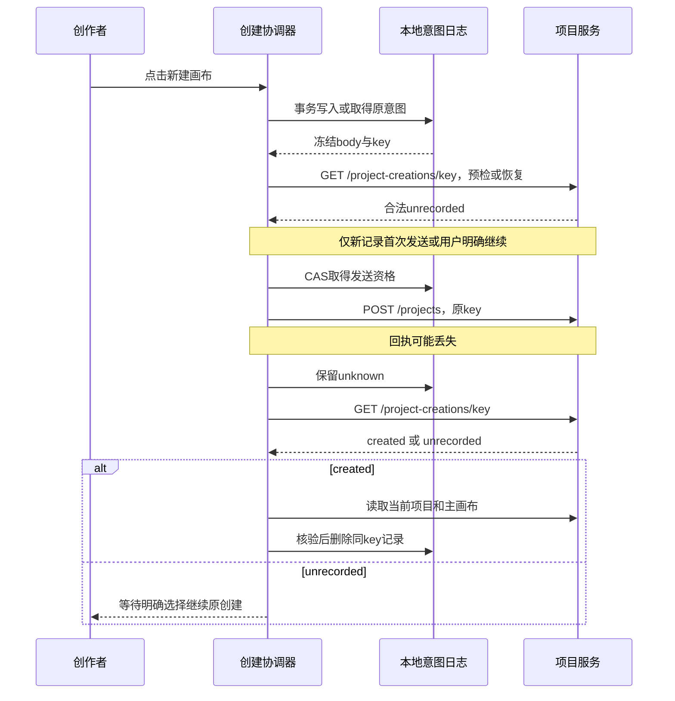

# 项目与画布创建及一致性详细设计

更新：2026-10-21（结构整理）；文档确认状态沿原来源，未重新认定方案接受。

## 1. 摘要

创建及恢复同一主画布，保持名称、活动读模型与基础管理的一致性。

本文按设计、用户故事与测试场景结构整理。原需求、确认结论和历史验证沿来源记录保留；当前实施进度、剩余工作及阻塞项统一见 [BACKLOG](../../BACKLOG.md)。

### 1.1 产品定义：摘要

来源：原PRD《06-项目与画布创建及继续创作》第1节。

创作者点击“新建画布”后即可得到可编辑、可保存、可再次打开的创作空间，不先填写名称或画幅。系统一次建立项目与主画布，名称统一；网络中断或刷新后能确认原创建结果，避免重复项目和丢失入口。

交付包含快捷创建与继续，以及基础画布管理：查找/改名、归档/取消归档、删除立即逻辑删除、回收站保留30天及恢复、当前页批量。删除后不需再做一次“移入回收站”才生效；逻辑删除与进入回收站是同一动作。不新增画布编辑器、目录或分享授权。

## 2. 参与者

使用者与参与职责：创建、继续和管理项目画布的创作者。维护职责及确认人沿下方原来源记录；未给出姓名的，不补造人员或排期。

### 2.1 产品定义：目标用户

来源：原PRD《06-项目与画布创建及继续创作》第4节。

| 人群                         | 任务与约束                                                                     |
| ---------------------------- | ------------------------------------------------------------------------------ |
| 想先尝试一个想法的个人创作者 | 尚未确定名称/比例，先输入文字或放素材；期待关闭后还可找回                      |
| 围绕同一主题持续制作的创作者 | 反复编辑与采用结果，需要统一名称和可靠的最近列表；团队用户仅沿已有有效归属工作 |

当前没有访谈证明场景频率，以上人群沿产品范围与本轮需求定义。平台治理人员不因能管理账号就获得私有项目读取权；团队功能入口仍遵循当前阶段边界。

首轮聚焦快速试想法和持续创作两类任务，因为一次创建与可继续返回是同一用户价值闭环。

### 2.2 需求原文与规则：用户、场景与价值

来源：原需求《07-项目与画布创建原始需求》第2节。

主要用户沿产品范围定义，为围绕图片、视频、声音开展创作的个人和内容制作者。以下场景用于需求分析，尚无本轮用户访谈或漏斗数据证明各场景的频率。

| 场景             | 用户想完成的事                         | 当前需要解决的障碍                   | 用户可感知的结果                     |
| ---------------- | -------------------------------------- | ------------------------------------ | ------------------------------------ |
| 快速试想法       | 先放一句提示词或一张参考图，再探索方向 | 开始前被名称、比例和风格配置打断     | 进入空白画布即可添加内容             |
| 围绕一个主题制作 | 在同一处组织参考、节点、候选和采用结果 | 不清楚哪些内容属于同一项目           | 素材与创作过程能在原画布继续使用     |
| 离开后继续       | 找回昨天的修改和待完成任务             | 分不清项目、画布与生成历史           | 从最近画布进入同一对象与保存内容     |
| 团队范围内创作   | 在有权限的团队上下文开始工作           | 归属或可见范围不清，切换后可能串内容 | 创建前能识别当前归属，创建后权限一致 |

价值主张：让创作者把一次想法尽快变成可继续编辑的创作空间，减少开始前的配置，并保留从输入、参考到结果的上下文。替代做法是反复使用独立生成页、下载再整理素材或跨工具保存；本专项优先改善开始和继续的连贯性，不宣称生成质量优于竞品。

## 3. 背景

需求来源：[07-项目与画布创建原始需求](13-项目与画布创建及一致性详细设计.md#310-需求原文与规则文首来源与范围)。产品范围来源：[06-项目与画布创建及继续创作](13-项目与画布创建及一致性详细设计.md#38-产品定义文首来源与范围)。

下方保留来源的日期、适用范围与确认状态。早期盘点和历史结果只支持其原时点；整理文档不重新执行实现、测试、迁移或发布。

### 3.1 文首来源与范围

来源：原设计《13-项目与画布创建及一致性详细设计》文首。

适用范围：快捷创建、恢复、唯一名称、主关联、最近修改与基础管理。文档版本：2026-10-21管理修订；用户已确认立即逻辑删除及回收站保留30天，生命周期、管理界面与到期任务已实现，本地接受见设计13第8.30节，历史创建接受不外推。维护职责：workspace/canvas及前端项目消费者；评审人未指定。

日期：2026-10-18；最近复核：2026-10-21。创建历史状态：已按用户后续实施授权落地，当前实现和本地接受见[设计13第8.17节](13-项目与画布创建及一致性详细设计.md#817-本轮实现与接受记录2026-10-19)。第3.4节保留实施前盘点；生产环境未迁移或发布。

来源：[需求07](13-项目与画布创建及一致性详细设计.md#310-需求原文与规则文首来源与范围)、[调研12](12-即梦项目与画布入口调研.md)。交付定义：[PRD06](13-项目与画布创建及一致性详细设计.md#38-产品定义文首来源与范围)；实施步骤：[设计13](#1-摘要)。已有画布编辑规则仍由需求06/设计10负责。

### 3.2 摘要、参与者与范围

来源：原设计《13-项目与画布创建及一致性详细设计》第1节。

一个项目持有唯一稳定的主画布入口。用户点击“新建画布”后，一次创建项目、空主画布、零预算和持久回执；进入编辑器前不填写名称、画幅、模型或风格。默认名称为“未命名画布”，项目名称作为主画布唯一展示名称。结果未知先读回执，不自动另建。

参与者为有创建权限的个人创作者，及当前已有有效团队范围的创作者。服务端身份和范围是授权事实；前端恢复记录不是授权。当前阶段不重新开放团队/空间切换导航，不增加模型供应商、计费、实时协作或时间线。

本设计承接创建FR-PC-01～16及相关BR/DR/NFR，并按需求07第8.2节纳入FR-PC-21/22与FR-PC-23当前页批量部分、BR-PC-14～18及AC-PC-34～36适用部分、AC-PC-38～43。封面编辑、素材导入起点、模板、复制、目录和授权分享仍为条件范围；管理规则明确不代表真实CRUD或到期清理已接受。

### 3.3 当前事实与方案选择

来源：原设计《13-项目与画布创建及一致性详细设计》第2节。

原条目的当前实施进度和剩余工作已迁入 BACKLOG；其确认范围及历史证据仍按原来源使用。

### 3.4 实施前已核验的源码事实

来源：原设计《13-项目与画布创建及一致性详细设计》第2.1节。

| 边界         | 当前事实与依据                                                                                                                                                                                                     | 本设计采用的处理                                                                  |
| ------------ | ------------------------------------------------------------------------------------------------------------------------------------------------------------------------------------------------------------------ | --------------------------------------------------------------------------------- |
| 原子创建     | [创建命令](../../backend/internal/workspace/application/create_project.go)与[事务](../../backend/internal/workspace/adapter/postgres/create_project_events.go)创建项目、初始画布、零预算及安全事件                 | 继续一个POST、一笔事务；不改成前端串行创建两个对象                                |
| 创建回执     | [持久回执](../../backend/internal/workspace/adapter/postgres/create_project_idempotency.go)使用actor/key与请求哈希，回放时复验可见性；[schema](../../backend/db/schema.sql)中的project_creation_receipt没有TTL字段 | 复用该账本；新增只读恢复查询，不另建服务端创建任务系统                            |
| 前端恢复     | [创建组件](../../frontend/src/app/projects/_components/projects-page.tsx)的attempt只在useRef中                                                                                                                     | 增加领域专用的本地意图日志，发送前持久化，跨刷新恢复                              |
| 身份与范围   | [SpaceProvider](../../frontend/src/components/spaces/space-context.tsx)读取真实空间列表，[请求层](../../frontend/src/lib/request.ts)携带X-Creation-Scope；中间件将其映射为真实Principal                            | 沿用Provider与授权；恢复旧范围只使用经列表再次验证的范围，不把旧团队意图落到个人  |
| 名称         | 主工具栏显示project.name；主画布表另有name，现有独立Rename会修改该字段                                                                                                                                             | 选择读时投影项目名，主画布旧改名/删除接口明确拒绝；不批量改历史名称               |
| 最近修改     | 项目列表按p.update_time排序；画布保存更新文档时间；项目update_time触发器会随项目行更新                                                                                                                             | 新增轻量项目活动读模型，避免为每次画布保存更新项目行、增加项目CAS冲突或升级项目锁 |
| 私有本地数据 | [草稿日志](../../frontend/src/components/generation/draft-save.ts)已有IndexedDB与身份清理栅栏，[会话Provider](../../frontend/src/components/auth/session.tsx)管理主动退出和被动失效                                | 使用相同身份隔离原则；创建意图独立存储，不塞进PromptDraft或重构既有草稿引擎       |

以上为源码盘点；未调用业务服务或执行数据库迁移，不作为实际环境已经满足合同的证据。

### 3.5 取舍

来源：原设计《13-项目与画布创建及一致性详细设计》第2.2节。

默认值选择“客户端显式发送现有合法字段”，保持POST合同及旧哈希算法不变；不使用空请求体，也不增加一次默认配置查询。新建主画布的持久name初始化为项目名，历史记录不批改。

名称选择“project.name是唯一展示事实”，不在每次改名时同时修改画布内容revision。主画布读取投影名称，历史非主文档仍沿自己的名称。主画布不直接删除，项目生命周期继续由workspace所有。

最近修改选择独立的workspace.project_activity行：与真实变更同事务更新，但不写project.revision或project.update_time。相比把画布时间直接写回项目，此方案避免新增元数据CAS噪声及触发器更新时间污染；保留现有项目写锁强度，详见第7.10节。新增一张有明确消费者的读模型，不增加后台同步服务。

### 3.6 画布列表管理范围（2026-10-20，2026-10-21复核）

来源：原设计《13-项目与画布创建及一致性详细设计》第2.3节。

用户以即梦资产页的画布列表为展示参考，要求修复顶部遮挡、卡片比例、右下角编辑入口与分页尺寸，并补齐管理和批量能力。本节承接需求07的SRC-PC-06；删除期限按SRC-PC-07及第7.16节，不再以文首追加与正文排除并存表达当前范围。

- [Figma 主画板](https://www.figma.com/design/uLqmeRWuQuzfrp9xOYg6FT?node-id=439-19134)：正常文档流排列页头、标签、工具栏、列表和分页；移除标签栏负边距。横向预览统一 16:9，名称与修改时间在下方，更多操作在右下角。首位卡片复用现有快捷创建，不重复定义创建协议。
- [管理状态集](https://www.figma.com/design/uLqmeRWuQuzfrp9xOYg6FT?node-id=1136-94086)：默认、悬停菜单、开始批量、选中、确认、部分失败、已归档、窄屏及重命名。设计原型只表达离散状态，不代表真实后端验收。
- 列表提供当前画布、已归档、回收站；搜索与分页查询服务端，不对当前页伪装全量筛选。排序支持最近内容修改和既有项目更新时间；时间区间、收藏和模板暂不承诺上线。
- 批量仅选择当前页，筛选和翻页清空选择。复用现有 Checkbox、Button、DropdownMenu、Dialog、DataPagination；请求期间禁用重复提交与翻页。删除前确认数量、目标与30天期限，完成后逐项反馈成功、拒绝或未知，未确认项保留选择。
- 写入复用项目归档、取消归档、回收、恢复接口，携带版本与幂等键，保留身份/空间边界。未知结果先读取确认，不能无条件重发新的命令。
- 游标分页不虚构总数；页大小为 12/24/48，桌面操作控件统一 36px，窄屏为 44px。真实封面缺失时显示中性占位，不用参考产品模板冒充用户作品。

### 3.7 文首来源与范围

来源：原任务文档《15-项目与画布创建及一致性实施计划》文首。

> 执行说明：保留原技术任务与验证步骤；本次按模板补齐规划内容，不要求调用特定技能或改变已约定的执行方式。

**Goal:** 创作者能开始、找回及管理同一画布；删除立即逻辑删除，在回收站保留30天，期限内恢复原对象；已有创建证据与管理补充接受分别记录。

**Architecture:** 复用workspace原子创建、持久回执、生命周期CAS与canvas保存链路。前端使用领域专用IndexedDB意图日志；后端增加只读恢复查询、主名称投影/主入口保护和事务内项目活动读模型，不新增服务或通用重试框架。

**Tech Stack:** 现有Go/Gin/GORM/PostgreSQL、Next.js/React/TypeScript、原生IndexedDB、shadcn/Geist/Lucide、swag与@umijs/openapi；版本以实施时锁文件为准，不借本计划升级依赖。

**Spec:** [详细设计13](#1-摘要)；交付依据为[PRD06](13-项目与画布创建及一致性详细设计.md#38-产品定义文首来源与范围)，规则/接受编号以[需求07](13-项目与画布创建及一致性详细设计.md#310-需求原文与规则文首来源与范围)为唯一来源。

实施进度及调度字段见 [BACKLOG 第4.124节](../../BACKLOG.md#4124-15-项目与画布创建及一致性实施计划文首来源与范围)。

### 3.8 产品定义：文首来源与范围

来源：原PRD《06-项目与画布创建及继续创作》文首。

| 项目       | 内容                                                                                                                                       |
| ---------- | ------------------------------------------------------------------------------------------------------------------------------------------ |
| 版本与更新 | 2026-10-21；同步基础管理与立即逻辑删除、30天回收规则                                                                                       |
| 维护与决策 | 维护人未指定；范围与接受以已记录的用户确认及上游依据为准                                                                                   |
| 交付范围   | 创建与继续、改名与列表、归档、逻辑删除/恢复和当前页批量；到期清理单独接受                                                                  |
| 上游依据   | [需求07](13-项目与画布创建及一致性详细设计.md#310-需求原文与规则文首来源与范围)、[调研12](12-即梦项目与画布入口调研.md)、[设计13](#1-摘要) |
| 迭代与证据 | [设计13](13-项目与画布创建及一致性详细设计.md#817-本轮实现与接受记录2026-10-19)；各证据层次及未执行项分别记录                              |

日期：2026-10-18；最近复核：2026-10-21。创建历史状态：用户已授权实现，核心闭环及本地工程门禁已落地；分层接受、残余组合场景与发布边界见[设计13第8.17节](13-项目与画布创建及一致性详细设计.md#817-本轮实现与接受记录2026-10-19)。不以本地通过替代生产发布接受。

来源：[需求07](13-项目与画布创建及一致性详细设计.md#310-需求原文与规则文首来源与范围)定义规则与AC；[调研12](12-即梦项目与画布入口调研.md)记录证据与取舍；[详细设计13](#1-摘要)定义界面、接口、数据与恢复机制；[设计13](#1-摘要)拆解步骤。用户价值、范围与接受条件在本文件汇总，不复制第二套领域规则。

原实施进度及调度字段见 [BACKLOG第5.2节](../../BACKLOG.md#52-prd06文首来源与范围)。

### 3.9 产品定义：背景

来源：原PRD《06-项目与画布创建及继续创作》第2节。

2026-10-18实施前盘点：创建界面仍要求名称和默认画幅；首页“新建画布”只跳转列表。后台已有原子创建与持久回执，但前端创建key只留在组件内存。项目名和画布名分属不同字段，画布保存时间与项目列表时间也不同，不能只删除表单就宣布整个旅程成立。

竞品调研支持将开始与继续放在同一创作上下文，但不证明某个竞品后端结构。此次变更依据用户确认的对象关系和本地源码差距，不以市场份额、生成质量或未经验证的转化率作为承诺。

上述为创建方案形成时的历史差距；2026-10-19证据见设计13第8.17节。2026-10-21管理检查发现当前会话创建恢复受阻、回收丢响应核验及期限展示缺口；本轮修正文档并实现：修复访问地址不一致、实际依赖装配阻断恢复、删除丢回执核验和批量重试结果丢失；当前管理证据与后续工作见设计13第8.23节。

### 3.10 需求原文与规则：文首来源与范围

来源：原需求《07-项目与画布创建原始需求》文首。

| 文档管理项 | 内容                                                                                                                 |
| ---------- | -------------------------------------------------------------------------------------------------------------------- |
| 版本与更新 | 2026-10-21；统一画布管理范围，明确立即逻辑删除及回收站保留30天                                                       |
| 状态与接受 | 一项目一主画布及既有创建授权保留；用户于2026-10-21确认逻辑删除、回收站保留30天；本轮修正文档，管理实现与产品接受另验 |
| 维护与评审 | 项目创作产品、交互及工程职责；具体人员未指定                                                                         |
| 来源与性质 | SRC-PC-01～SRC-PC-07；管理范围按第7.47节区分已纳入与候选，历史证据见设计13第8.17节，当前管理核验见第18节             |
| 适用范围   | 创建与继续、列表/改名、归档、逻辑删除、30天恢复及当前页批量；设计13、PRD06、设计13承接；画布内部能力引用需求06       |

日期：2026-10-18；最近复核：2026-10-21。创建历史状态：用户已授权按最新需求链实施；快捷创建、恢复、名称与主画布一致性及最近修改已实现并进行本地接受。实际证据与未执行边界见[设计13第8.17节](13-项目与画布创建及一致性详细设计.md#817-本轮实现与接受记录2026-10-19)，不代表生产发布接受。

调研依据见[调研12](12-即梦项目与画布入口调研.md)，具体交互/接口/数据见[详细设计13](#1-摘要)，交付见[PRD06](13-项目与画布创建及一致性详细设计.md#38-产品定义文首来源与范围)，步骤见[设计13](#1-摘要)。本文件负责用户需要、业务规则与接受条件；本轮只补文档，不变更代码或数据库。

承接状态：创建/继续建议和第7.51节细化规则已由详细设计13、PRD06和设计13承接，DEC-PC-01～DEC-PC-05已有方案、代码及分层验证记录。管理范围与30天规则见第7.47节；已有PRD05/设计10负责画布组件，不能代替本专项接受。2026-10-21仅修正文档，不把既有创建接受扩展为管理CRUD已通过。

### 3.11 需求原文与规则：原始诉求与来源

来源：原需求《07-项目与画布创建原始需求》第1节。

**原始需求表述：作为创作者，我希望点击“新建画布”就能开始一个独立的创作项目，在其中组织素材、保留生成过程，并在离开后找到原来的内容继续创作，而不必先完成一套项目配置。**

上述表述是对本轮诉求的产品化整理，不是逐字引用。创建不是用户的最终目的；能开始、保存并继续完成创作才是完整结果。

| 来源                                                                                                                                      | 内容                                                                                                    | 状态与用途                                               |
| ----------------------------------------------------------------------------------------------------------------------------------------- | ------------------------------------------------------------------------------------------------------- | -------------------------------------------------------- |
| SRC-PC-01：本轮用户要求                                                                                                                   | 使用 pm-market-research 分析即梦，先明确项目创建、画布创建等原始需求                                    | 已确认调研与需求整理任务；不代表授权实施全部建议         |
| SRC-PC-02：本轮用户明确选择                                                                                                               | “一个项目对应一张主画布；点击‘新建画布’即可开始（推荐）”                                                | 已确认本专项的对象关系和主要入口方向                     |
| SRC-PC-03：本轮用户要求再次审查                                                                                                           | 检查文档能否正确承接项目相关需求                                                                        | 授权复核与修正文档；不自动接受新增建议或启动代码实施     |
| SRC-PC-04：本轮用户要求补齐设计                                                                                                           | 明确默认值、创建恢复、名称和主画布一致性，整理PRD与实施计划，先不改代码                                 | 已确认文档范围与代码边界；具体方案保存不等于逐条产品接受 |
| SRC-PC-05：本轮用户要求闭环复核                                                                                                           | 再次审查需求、详细设计、PRD与实施计划，修正默认值、创建恢复、名称与主画布一致性的遗漏和冲突，先不改代码 | 授权跨文档修正与补充故障验收；不代表新增实现或产品接受   |
| SRC-PC-06：2026-10-20列表管理要求                                                                                                         | 按即梦参考补齐画布列表、归档/恢复及当前页批量管理；原记录由设计13第3.6节承接                            | 管理交互范围依据；不代表后端或浏览器接受                 |
| SRC-PC-07：2026-10-21本轮用户要求                                                                                                         | 先检查并修正文档；删除立即逻辑删除，回收站保留30天                                                      | 删除方式与期限已确认；本轮不改代码或执行数据清理         |
| [产品范围](24-产品总览与交付边界设计.md#33-需求原文与规则文首来源与范围) CAP-GL-01、CAP-GL-15～CAP-GL-18、CAP-GL-21～CAP-GL-25、CAP-GL-32 | 继续创作、画布、素材、管理、任务和保存                                                                  | 已有能力目录；不等于各项都已交付                         |
| [用户系统需求](01-用户系统总体设计.md#36-需求原文与规则文首来源与范围)                                                                    | 身份、个人/团队范围、对象授权与会话恢复                                                                 | 沿用已有合同，不另建身份体系                             |
| [画布需求06](10-画布组件实现调研与迁入设计.md#37-需求原文与规则文首来源与范围)                                                            | 画布编辑、引用、保存和最新范围调整                                                                      | 沿用专项规则；时间线已退出当前实现与接受范围             |
| [调研记录](12-即梦项目与画布入口调研.md) SRC-PC-RESEARCH-01～SRC-PC-RESEARCH-08                                                           | 即梦登录态页面观察、其他产品官方资料、本地源码                                                          | 分别支持事实、方案推导与差距，不视为用户确认             |

## 4. 目标

创建及恢复同一主画布，保持名称、活动读模型与基础管理的一致性。目标的规则、量化条件与非目标沿需求原文及下方已确认设计，不增加未经确认的指标。

### 4.1 产品定义：目标

来源：原PRD《06-项目与画布创建及继续创作》第3节。

| 目标         | 可执行成功条件                                                                         | 证据                                                                 |
| ------------ | -------------------------------------------------------------------------------------- | -------------------------------------------------------------------- |
| 直接开始     | 首页、侧栏、列表均可一次创建；无名称/模型/画幅前置；同一意图只新增一个项目和一个主入口 | AC-PC-01～AC-PC-05、AC-PC-16、AC-PC-19，服务端对象/回执数量及浏览器  |
| 失败后可继续 | 结果未知先查询；刷新和同账号同范围重新认证能恢复原key/body；账号或范围改变不串写       | AC-PC-04～AC-PC-05、AC-PC-09～10、AC-PC-17，事务故障/身份/浏览器证据 |
| 原内容可找回 | 保存重开不丢内容；名称、主关联和最近修改一致；归档/处理中不误写                        | AC-PC-06～AC-PC-08、AC-PC-11～15、AC-PC-18，真实服务读回及兼容测试   |

接受时上述选入场景及设计13第8.40节AC-PC-20～AC-PC-29故障子场景逐项记录通过、失败或未执行。子场景细化原19项创建接受；管理独立按第7.39节验收，不借创建通过宣告管理完成。没有现成的用户漏斗、性能基线或业务增长目标；阶段耗时与首次内容保存/重开情况先采样，不编造秒数或留存率。工程测试通过不能代替真实保存、权限与浏览器接受。

上述三项为发布前行为关键结果；以设计13截至2026-10-19的实际矩阵作为已知基线，在该批次接受前判断。发布后用户结果和观察周期尚未确定，见第7.38节。

## 5. 使用场景

参与者为创建、继续和管理项目画布的创作者；在下方定义的输入、对象状态、权限和环境条件具备时执行相应操作。各故事按其独立前置条件核对，不能把测试夹具当成真实业务条件。

### 5.1 交互、路由与状态

来源：原设计《13-项目与画布创建及一致性详细设计》第4节。

原条目的当前实施进度和剩余工作已迁入 BACKLOG；其确认范围及历史证据仍按原来源使用。

### 5.2 新建与继续

来源：原设计《13-项目与画布创建及一致性详细设计》第4.1节。

首页画布模式、侧栏及“我的画布”列表复用一个`NewCanvasButton`，不是分别实现三套提交。用户点击才创建；访问页面、渲染组件、切换模式和React StrictMode重放不写入。首页已有“新建画布”链接只去列表的行为在此变成显式新建按钮；普通“我的画布”导航仍只打开列表。

游客点击保留一个不含私有范围/对象的内存动作意图，打开已有认证弹窗；取消不发送请求。同次认证完成后进入范围核验；完整刷新后不自动恢复游客内存动作。已登录时等待SpaceProvider确定selected且writable，记录actor.id与selected.id；不新增空间选择器。页面同时提供真实归属的可访问说明。

首次新建先落prepared意图，再用该key调用恢复GET核验查询合同可用；只有本次beginOrResume确实新建了记录、GET返回合法unrecorded且租约仍有效时，才自动竞争首次发送资格并POST。GET的404/503或畸形200阻断写入。这仍由一次点击完成，新增GET是恢复能力预检，不是默认配置或模型查询。复用旧记录的start、刷新和挂载一律只读恢复，即使旧记录仍为prepared且查询unrecorded，也等待用户“继续原创建”。

被动挂载或刷新恢复查到created时，只展示“重新打开”，不自动导航或清理共享记录；用户明确选择后再读取目标并完成确认。该规则统一用于后台恢复页，避免其他标签页抢焦点。

新建成功先保存目标ID，再读取当前项目/主画布。201中的旧回执只提供身份定位，不覆盖当前名称、状态和版本。正常进入`/canvas?project_id=<id>&canvas_id=<main_id>`；成功创建但加载失败显示“画布已创建，暂时无法打开”与“重新打开”，不重新POST。

确认目标时同时校验项目ID、当前initial_canvas_id、文档project_id与文档ID。归档可读目标以只读打开完成确认；copying保持未就绪且不清记录；403/404、依赖失败、主关联异常都不能作为成功打开。只有同范围本人恢复查询的明确410，才允许在未打开时终结原创建意图。201已验证但保存ID失败时保留内存目标并显示“已创建，创建状态保存失败”，禁止再次POST；可重试本地落盘/只读打开，刷新后按发送前已落盘的原key恢复。不能将这种失败降格成“创建失败”。

空白画布提供已有可用的文本/媒体/上传入口，保存与生成分别反馈。不能把无模型的空态伪装成生成成功。改名入口放在画布标题菜单和列表更多菜单，复用一个`ProjectRenameDialog`；Enter提交、Escape取消，中文输入法组合期间不提交，关闭恢复触发焦点。

### 5.3 状态与操作

来源：原设计《13-项目与画布创建及一致性详细设计》第4.2节。

| 状态                   | 可见信息                                           | 允许操作/转换                                                               |
| ---------------------- | -------------------------------------------------- | --------------------------------------------------------------------------- |
| 身份/范围读取中        | 正在确认创作归属                                   | 等待或重试；未确认前不发送                                                  |
| 准备本地记录           | 正在准备画布                                       | IndexedDB事务完成后才发送；失败显示“无法保存创建状态，请检查站点存储后重试” |
| 恢复能力预检中/失败    | 正在确认创建服务，或服务暂不可用；尚未发送创建请求 | 保留prepared，仅重试只读查询；不误报创建结果未知或偷偷POST                  |
| submitting             | 正在创建画布                                       | 相同actor/范围的重复点击合并；不提供另一个新建请求                          |
| unknown                | 创建结果尚未确认                                   | “确认创建结果”执行只读恢复；不自动补发POST                                  |
| unrecorded             | 尚未找到创建回执                                   | “继续原创建”明确执行原请求/原key；也可返回列表；不能据此断言对象绝不存在    |
| created/loading        | 已创建，正在打开                                   | 读当前对象，失败仅重新打开                                                  |
| 已创建但记录/清理失败  | 已创建，恢复状态保存或清理失败                     | 保留内存目标；重试本地持久化/只读确认，完成前禁止另一意图                   |
| ready                  | 编辑器可用                                         | 清除本次未完成意图后，后续明确新建才产生另一个key                           |
| 明确校验拒绝           | 输入被拒绝，尚未创建                               | 满足第7.6节终结条件才清原记录；用户再次明确新建才用新key                    |
| blocked                | 登录、归属、权限或对象状态已变化                   | 停止重放，说明原因；不切范围继续原请求                                      |
| archived               | 项目已归档，只读                                   | 能读取的内容只读展示；不增加取消归档界面，不允许编辑、改名或生成            |
| copying                | 项目准备中                                         | 显示未就绪；不把部分内容当作空画布打开，不新增复制管理界面                  |
| 回收/不可见/主关联异常 | 原对象不可打开，或关联需要处理                     | 返回列表/重试读取；不创建替代项目，不猜选其他文档                           |

错误沿现有Sonner与ApplicationState处理；主区域只保留必要状态，不增加第二套错误横幅。沉浸画布沿项目工具栏，不叠加普通ProductHeader。明暗主题、320/390/768/1440px、短屏与键盘焦点沿DESIGN；本轮不编造像素稿或更新Figma。

### 5.4 T-PC-10：三处入口、改名、列表与编辑状态

来源：原任务文档《15-项目与画布创建及一致性实施计划》第14节。

**Files:** 拟新增components/projects/new-canvas-button.tsx、project-rename-dialog.tsx与相邻测试；修改首页、侧栏、projects-page/project-list、canvas-header/canvas-page/canvas-editor及project.ts；扩展已有页面/布局/画布测试。

**Interfaces:** 三入口消费T-PC-09协调器；改名仅用现有updateProject(name,expected_revision)+显式key；主标题和列表同读project.name；列表使用recent_content及last_modified_at/basis；当前状态决定编辑能力。

- Red：`all new canvas actions share one creation flow`覆盖首页/侧栏/列表的独立新建，普通“我的画布”导航不写；`project name accepts code points not UTF16 units`覆盖1/50/51码点、组合字符、中文输入法与取消；补`project name trims the same whitespace as Go`验证U+0085、U+FEFF、NUL及未配对代理码元，与后端PATCH边界回归对照。
- Red：`rename receipt never overwrites a newer project name`、`late lower revision reads never replace current presentation`、`rename committed but reread failed reports saved`、`focus refreshes project name without replacing graph drafts`、`refresh of unknown rename never automatically patches`、`main canvas title uses current project name`、`archived and preparing projects cannot edit or generate`、`legacy activity renders project update label`，固定加载/空/错误/无匹配结果各状态。
- Green：移除创建必填弹窗，保留状态/恢复入口；加入单一改名控件与CAS/未知回执反馈，改名写入保留原key并显式sessionRecovery="never"；生成/编辑/上传引用入口对只读统一禁用，但不弱化服务端校验。
- Green：保存/改名/重开成功后让最近列表从第一页读取，分页以ID去重；共享展示缓存按项目revision拒绝迟到低版本，重开/聚焦/对话框打开时去重读取；跨标签页只广播失效ID；更新名称/能力事实不覆盖节点草稿。改名未知保留会话内原输入/key，刷新只读现名，后续明确新改名需当前CAS版本；写成功但读失败明确反馈，尚未读取的内容不得被空画布覆盖；沿画布已有恢复、原生焦点和Sonner合同。
- 验证：在frontend执行`pnpm exec vitest run src/components/projects src/app/projects src/app/canvas src/app/_components/home-page.test.tsx src/components/layout/basic-layout.test.tsx`，核对新增测试确实执行。手机/短屏/主题与存储事务用T-PC-11验收。
- 审阅：共享组件不得导入路由私有组件；不放开时间线、模板、复制、回收或正式授权分享入口；不直接改生成文件修类型错误。

实施进度及调度字段见 [BACKLOG 第4.137节](../../BACKLOG.md#4137-15-项目与画布创建及一致性实施计划t-pc-10三处入口改名列表与编辑状态)。

### 5.5 产品定义：正常旅程

来源：原PRD《06-项目与画布创建及继续创作》第6.1.1节。

明确新建 → 有效账号/范围 → 本地记录持久化 → 恢复查询预检 → 竞争首次发送资格 → 单次POST → 保存目标ID → 读取当前项目与主画布 → 编辑/保存 → 返回列表 → 打开同一对象。预检仅本次新记录合法unrecorded时允许首次自动POST，复用旧记录始终走只读恢复并等待明确继续。各入口共用创建协调器；页面访问和模式切换不创建。

默认值、字段和命名计数见需求DR-PC-01/DR-PC-02/DR-PC-04。项目名称作为唯一展示事实，不通过同步修改画布内容revision传播改名。生成比例、模型和清晰度仍在具体节点按真实能力调整。

### 5.6 需求原文与规则：从空白开始

来源：原需求《07-项目与画布创建原始需求》第5.1节。

1. 用户在首页画布模式、侧栏或“我的画布”列表点击“新建画布”；这些入口表示同一个动作。
2. 系统核验登录态与当前个人/团队范围。需要登录时保留“新建画布”的意图，登录成功后恢复，不重复创建。
3. 建立一项独立项目及其空白主画布，给出默认名称；不要求先选模型、比例、风格或充值。
4. 打开新画布，能识别当前名称、归属与保存状态，并知道如何添加文本、媒体节点或素材。
5. 用户添加内容。只有明确提交生成时才进入模型、输入校验和报价流程。
6. 用户返回列表或关闭后重开，能够找到同一项目、同一主画布及已保存的内容。

以上第1、3步的快捷开始方向来自 SRC-PC-02；默认名称、无表单及恢复细节为实现该方向的产品建议。

### 5.7 需求原文与规则：继续已有创作

来源：原需求《07-项目与画布创建原始需求》第5.2节。

1. 用户从最近画布、完整列表或原链接打开对象。
2. 系统读取项目与匹配的主画布，展示真实保存内容和真实任务状态。
3. 加载失败提供重试；没有权限或已被回收时说明访问状态，不自动创建替代项目。
4. 编辑、自动保存、返回和再次打开形成闭环；未保存修改不能被“已保存”文案掩盖。

### 5.8 需求原文与规则：从生成结果或资产开始

来源：原需求《07-项目与画布创建原始需求》第5.3节。

这是需单独评审的候选流程：用户明确选择“添加到现有画布”或“新建画布并添加”；新建路径沿5.1，已有路径不得偷偷创建项目。引用导入失败时保留已建画布并允许重试，不误报内容已放入，也不重复上传或生成。浏览、预览和下载动作本身不创建项目。

### 5.9 需求原文与规则：当前阶段的身份与入口衔接

来源：原需求《07-项目与画布创建原始需求》第5.4节。

当前[阶段入口设计09](09-统一顶栏与阶段入口设计.md)隐藏个人/团队切换、团队和邀请入口，但保留已有服务授权与归属。FR-PC-03不要求因此重开空间切换器或先创建团队；有有效会话时沿服务端确认的当前范围创建，没有可确认范围时先处理登录/上下文恢复，不能自行猜测为个人或其他团队。归属可在原有上下文或项目信息中识别，具体呈现待交互评审。

游客关闭或取消登录时仍停留原页面，不创建项目。认证后只能恢复同一账号及授权范围下的创建意图；若身份或范围已改变，先告知原操作未继续，用户重新发起新建。已失效身份的私有内容按用户系统合同隔离，不为了“保留草稿”将其交给另一个账号。

## 6. 价值

减少重复创建及内容丢失，删除和恢复遵循原已确认规则。

### 6.1 产品定义：价值主张

来源：原PRD《06-项目与画布创建及继续创作》第5节。

| 六要素       | 快速试想法                                      | 持续完成创作                                                             |
| ------------ | ----------------------------------------------- | ------------------------------------------------------------------------ |
| 谁           | 已有一个创作想法的个人创作者                    | 在一个主题下多次返回编辑的个人或已有团队创作者                           |
| 为什么       | 想先做再决定细节，创建表单和失败重试会打断      | 想保留素材、输入和结果，名称/入口/时间不一致妨碍继续                     |
| 现在怎么做   | 先填表、跳转列表，或使用独立生成页              | 依赖列表/原链接，手动辨认项目和保存状态                                  |
| 如何改善     | 一次新建空画布，冻结意图，未知结果可查          | 单一名称、稳定主关联、真实最近修改及保存重开                             |
| 之后得到什么 | 不必提前配置即可开始，连点/刷新不增加同意图副本 | 返回时找到原对象，并准确知道可编辑、只读或未就绪                         |
| 替代方式     | 在其他生成工具试完再整理、重新建项目            | 本地文件夹、跨工具搬运或反复复制链接；本次通过保留过程上下文减少整理成本 |

价值表述：让想法尽快进入一个可继续的创作空间，让离开后的返回仍接上原来的工作。生成质量、供应商模型、付费结果及正式协作不由本专项保证。

## 7. 方案

### 7.1 默认值与输入规范（DEC-PC-01）

来源：原设计《13-项目与画布创建及一致性详细设计》第3节。

业务规则唯一来源为需求07第7.16节的DR-PC-01/DR-PC-02/DR-PC-04。下表给出传输与落库位置。

| 项                         | 新入口发送/初始值                                                 | 服务端责任与历史兼容                                                    |
| -------------------------- | ----------------------------------------------------------------- | ----------------------------------------------------------------------- |
| name                       | `未命名画布`                                                      | 继续非空及1～50 Unicode码点校验；同名允许，不按日期或自增号改变默认请求 |
| description                | 空字符串                                                          | 不新增项目说明表单                                                      |
| aspect_ratio               | `16:9`                                                            | 沿现有合法枚举；是兼容与新节点初始偏好，不锁定无限画布的输出比例        |
| style_type                 | `realistic`                                                       | 显式发送；沿现有领域校验，不更改旧调用方省略该字段的既有处理            |
| style_subtype              | 省略                                                              | 不发送空白风格子类型，不自动选择stylized预设                            |
| style_preset_id、style_key | 省略                                                              | 不查询预设作为创建前置；数据库沿现有空值语义                            |
| resolution                 | 服务端仍为`1080p`                                                 | 不新增请求字段；不作为图片/视频清晰度承诺，不影响节点独立参数           |
| allow_overseas_models      | 服务端仍为`false`                                                 | 不扩大模型授权                                                          |
| default_models、封面       | 沿现有空模型映射/无封面                                           | 无模型、预设或额度也能建立空画布、添加和保存文字                        |
| 状态/版本                  | 项目active/revision=1，主画布revision=1，viewport为x=0/y=0/zoom=1 | UUID、归属、版本和时间均由服务端生成；预算limit/reserved/settled均为0   |

前端在`components/projects/project-creation.tsx`的`blankProjectInput()`中生成上述显式请求，第一次持久化后不重新计算。请求仅包含现有DTO允许字段；本地contractVersion不是额外POST字段。恢复读取必须校验字段白名单、类型、枚举及省略语义，不允许从本地记录透传任意JSON、null、身份或scope字段；不支持的版本只阻断，不按当前默认值修复再发送。冻结的是业务字段与省略语义，不要求JSON键顺序或网络字节完全相同；服务端仍按原DTO字段计算原哈希。后端不增加“默认值兜底”来掩盖客户端漏字段，也不调整既有请求哈希的归一化顺序，避免旧回执失配。

改名去首尾空白后按Unicode码点计1～50，组合字符按多个码点计；不按UTF-16长度或可见字素数计，不自动做NFC/NFKC归一化，不折叠大小写。裁剪集合明确沿Go strings.TrimSpace：U+0009～000D、0020、0085、00A0、1680、2000～200A、2028、2029、202F、205F、3000。前端以相同集合裁剪后用Array.from计数，不能直接以JavaScript trim代替（U+0085与U+FEFF处理不同）；U+FEFF、零宽字符不额外裁剪。名称含NUL按现有PATCH规则拒绝，前端还应拒绝未配对代理码元，避免JSON解码替换后变成另一名称。后端维持既有合法UTF-8及码点校验。仅首尾约定空白不同或提交当前名称时视为同值，不制造内容变更；历史超出新入口范围的记录保留，不由本轮批量截断或重写。

### 7.2 创建恢复协议（DEC-PC-02）

来源：原设计《13-项目与画布创建及一致性详细设计》第5节。

原条目的当前实施进度和剩余工作已迁入 BACKLOG；其确认范围及历史证据仍按原来源使用。

### 7.3 本地最小意图与并发

来源：原设计《13-项目与画布创建及一致性详细设计》第5.1节。

新增领域专用IndexedDB数据库`glowloom-project-intents`，版本1，`intents`对象仓以`[actorId, scopeId]`为主键；另有单行`fence`对象仓保存单调递增的清理epoch。仅创建意图使用，不保存提示词、素材、凭据、邮箱、会话令牌或CSRF。

| 字段                      | 类型与用途                                                                   |
| ------------------------- | ---------------------------------------------------------------------------- |
| actorId、scopeId          | 真实会话账号及真实空间UUID；不持久化前端推测的org_id                         |
| contractVersion           | 数字1；不支持的版本只显示无法恢复，不改写成新版本并重发                      |
| key                       | 本次UUID，与Idempotency-Key相同                                              |
| body                      | 上节显式请求的冻结JSON；保持省略字段及值，不从当前偏好重新构造               |
| phase                     | `prepared / submitting / unknown / created / rejected`                       |
| hasUncertainDispatch      | 布尔值，进入过未知/刷新中断后置true；不因随后一次422而消除先前提交的不确定性 |
| projectId、canvasId       | 仅得到可校验回执后记录，其他阶段为空                                         |
| localRevision、fenceEpoch | 本地CAS与清理栅栏；防迟到响应或旧标签页写回                                  |
| createdAt、updatedAt      | 本地诊断时间，不用于服务端授权、项目排序或回执过期判定                       |

`beginOrResume`使用同一readwrite事务：同actor/范围已有未完成记录则返回原记录，否则创建prepared记录，并返回本次是否新建的disposition。两个标签页同时点击在事务边界合并为同一意图。已有created记录在GET当前目标确认之前保持，其他标签页不能借“响应已到”抢先删除；比较key与localRevision后删除，防止删除下一次意图。

复用记录不等于获得发送资格。`beginDispatch`在readwrite事务中按key/localRevision/fence竞争一次状态转换：首次仅本次新建记录且预检通过的prepared→submitting；用户看过本次只读unrecorded结果后明确继续，才允许prepared或unknown→submitting，明确继续时保守置hasUncertainDispatch=true。同一revision只有一个调用方成功；其余重读记录，仅恢复/只读查询。刷新读到submitting时转unknown并置该标记，不能认为上次未发出。其他标签页通知仅触发读日志，不携带私有body，不自动发送HTTP。

允许的进展为prepared→submitting→unknown或created，预检/恢复查到有效created时prepared也可直接确认created；unknown可只读确认created，或由明确继续重新取得发送资格；created不能被迟到超时降回unknown，也不能被旧ID覆盖。CAS失败先重读：同key已created就使用记录中的目标；记录已删除或已换key则本回调结束，不调用beginOrResume创建另一条记录。并发同key响应可收敛到同一目标，但仅持有效当前租约的发起标签页执行导航，其他页显示可打开，不抢焦点。ready必须以确认打开且acknowledge成功为前提；清理失败保留“已打开、恢复状态待清理”，不开放下一次新建。

已知目标状态同时保留原intentKey；旧目标重新打开不得transition或ack下一条key。迟到回调发现记录已删除或换key时，退出忙碌状态，不触碰后继记录。所有异步边界同时检查当前内存租约，退出意图生效后不等待服务端退出完成才停止导航。

IndexedDB打开排队超过5秒按本地存储阻塞反馈，并关闭迟到连接或中止迟到升级；可显式重试。该时间不用于推断服务端是否创建、记录过期或权限变化。

持久化失败时禁止发送。发送后所有失败回调也要核对key、账号/范围generation和fenceEpoch；取消网络请求并不能证明服务端没提交，因此取消传输进入unknown，不能自动删记录或换key。收敛后同一范围可以再明确新建；不承诺两个独立设备共享同一浏览器意图。

### 7.4 身份、范围与清理

来源：原设计《13-项目与画布创建及一致性详细设计》第5.2节。

复用SessionProvider的会话核验、getSessionGeneration/getScopeGeneration和既有清理生命周期。业务协调器依赖`useOptionalSession`与`useSpace`，不让请求层导入UI或操作IndexedDB。

主动退出、账号切换、明确权限撤销时：同步使内存租约失效，停止请求/导航，然后在一个本地事务中递增fence并清除意图；旧异步写入必须比较旧epoch而被拒绝。本地清理失败不延缓服务端退出或恢复旧租约；下一次激活先重试清理，完成前不发送创建请求。

激活顺序固定为：读取清理checkpoint → ensureSessionFresh及真实空间核验 → 复核内存generation/账号 → 在日志事务中比较同一checkpoint并授予内存租约。不能在旧异步回调里读取最新epoch为自己续租；checkpoint变更必须重新走完整身份核验。被动过期只撤销内存租约，不增加清理epoch，复验同账号/范围后可用新租约访问原记录。已被服务端接受/提交的请求不因退出而撤销；退出后的迟到响应不显示、不导航，原对象仍沿服务端授权存在。

同账号被动会话到期时：可保留最小意图并停止其展示与写入；重新认证成功、真实空间列表复验后，才允许读取及只读恢复。会话ID/generation只做内存写入租约，不写入本地记录；正常v2续期不销毁同次意图。

刷新后SpaceProvider可能按现有策略选择经服务端空间列表确认的个人范围。协调器可从同账号的未完成意图取得恢复范围提示，但须先由空间列表验证该scope仍存在、可读/可写，再调用既有选择流程；不能从本地UUID直接授权。存在多个待恢复范围时展示恢复项供用户明确选择，不自动切换；无权旧范围的记录被阻断并清除，个人范围可正常浏览，但不能承接旧团队POST。该恢复提示不是常驻团队导航。

### 7.5 服务端查询与重试

来源：原设计《13-项目与画布创建及一致性详细设计》第5.3节。

新增只读`GET /api/project-creations/{key}`，operationId为`getProjectCreation`，走现有认证、X-Creation-Scope及no-store中间件。路径key是关联标识，不是授权令牌；不记录请求体、私有名称或回执内容到日志。

恢复查询不取得69360咨询锁，也不等待创建事务完成：在授权事务内先核验真实账号/范围，按actor/key读取已提交回执，再按项目→主文档顺序取得读取所需锁并复验归属/状态/关联。持久回执与对象同事务提交，未提交回执不可见时只返回unrecorded，不插入预留行，不修改任何对象。这样不新增“持有咨询锁再等项目”的读取路径，与既有项目写授权先取项目锁的路径相互倒置。原POST仍沿既有幂等合同串行处理相同key；unrecorded既可能是未发出，也可能是原POST还在途，因此继续原创建必须使用原key/body。

| 结果                                                        | 状态码及payload                                                                               | 客户端处理                                                                               |
| ----------------------------------------------------------- | --------------------------------------------------------------------------------------------- | ---------------------------------------------------------------------------------------- |
| 当前范围有本人回执且目标可读                                | 200，`state=created`，非空project_id/canvas_id，project_status为当前事实                      | 记录身份后GET当前项目/画布；不使用初始回执覆盖现名/版本；归档目标只读                    |
| 当前账号该key没有已提交创建回执，包括其他账号使用同一字符串 | 200，`state=unrecorded`，project_id/canvas_id/project_status为null；不查其他账号是否存在该key | 保持原意图；仅用户点“继续原创建”才POST原body/key，不自动重试写入；本地不加载其他账号记录 |
| 当前账号的该key回执位于其他范围                             | 404 `not_found`，不含对象ID                                                                   | 不展示旧记录、不更换范围重试                                                             |
| 同范围本人回执的目标已回收/不可再用                         | 410 `creation_target_unavailable`，不含对象ID                                                 | 按key/localRevision确认清除该本地意图，显示不可用并回列表；不复活、不重建                |
| 身份无效/权限不足                                           | 401/403或既有404                                                                              | 进入认证/权限处理；不继续私有请求                                                        |
| 回执损坏、主关联不匹配、依赖失败                            | 503 `dependency_unavailable`；主关联不合法可返回409 `main_canvas_unavailable`                 | 保留未知状态及原key，提供只读重试，不展示假成功                                          |

请求超时沿现有传输默认值，UI不增加紧密轮询；挂载/恢复后最多一次自动只读查询，其余由用户操作触发。查询失败保留原记录，浏览器恢复不依赖新增常驻worker。

POST仍沿`/api/projects`和既有201响应；重放不替换原持久回执，不更改哈希算法。用原key不同body得到409 `idempotency_key_reused`后停止，不能悄悄生成新key。422只证明本次请求的输入被拒绝，不自动证明较早的同key在途请求未提交；能否终结按第7.6节。修正内容不能在旧key下改变body，只有符合终结条件且用户明确再次新建才产生新意图。对结果未知的503/网络中断不假定回滚。

新创建协调器在写入前复用ensureSessionFresh；显式调用POST时设置现有请求选项sessionRecovery="never"，避免传输层在协调器不可见处补交写入。401进入已有认证连续性，恢复后先GET回执；GET只读请求可沿原会话恢复机制。项目改名写入也采用相同选项并保留原key，不改变站内其他请求的自动续期策略。

本次不新增自动过期/清除创建回执或本地未确认意图的计时策略。已有回执在项目保留期间持续可查；主动退出会删除本地记录，但不删除服务端回执或项目。数据库清理、站点数据被用户清除、其他设备和未来硬清除后的恢复不属于此保证；未来启用项目硬清除时必须先评审key留痕策略，不能在未知结果上自动创建。

### 7.6 终结、失败与再次新建

来源：原设计《13-项目与画布创建及一致性详细设计》第5.4节。

只有三种理由可通过key/localRevision/fence的CAS删除记录：当前目标已完整核验且可编辑/只读打开（opened）；同范围本人回执查询明确410（target_unavailable）；唯一首次发送在持续有效租约下收到业务422、且从未进入过未知/重试的明确拒绝（validation_rejected）。对最后一项，先持久化rejected再清理，任一步失败均禁止下一次新建；恢复后只允许清理已具备该证据的rejected记录，不自动发送。未知后重试收到422、401/403/404、409冲突、格式错误响应或查询unrecorded都不证明先前请求没有提交，保留原意图并只读确认。422后的新意图仍需用户再次明确点击，不自动循环重试。

返回列表、关闭提示或暂时离开不清除unknown；返回后新建先恢复原意图，不能提供“放弃并另建”绕过。已created但GET失败只重开；暂时无权限遮蔽记录并阻断，明确撤权沿强清理流程；主关联异常保留定位用于只读重试。浏览器数据被清除、主动退出或换设备后，只承诺从当前授权项目列表找回已提交对象，不保证还持有原创建key；新会话中明确新建是新意图，不承诺跨该边界去重。



### 7.7 名称与主画布一致性（DEC-PC-03）

来源：原设计《13-项目与画布创建及一致性详细设计》第6节。

原条目的当前实施进度和剩余工作已迁入 BACKLOG；其确认范围及历史证据仍按原来源使用。

### 7.8 唯一名称与读取投影

来源：原设计《13-项目与画布创建及一致性详细设计》第6.1节。

所有新UI读取项目name。画布Get/List在确认document.id等于project.initial_canvas_id时，响应name投影为当前project.name；非主历史文档保留自身名称。存储层历史canvas.document.name不批量修正，也不作为另一个用户可编辑的主名称。

新增workspace的`ProjectNavigation`读取模型包含ProjectID/MainCanvasID/Name/Status/IsDelete；canvas通过消费方小接口读取，经app层映射，避免canvas application导入workspace application形成环（workspace已有复制流程依赖canvas）。读取与授权绑定同一SQL事务，使用现有项目共享锁，再读文档；同一响应内名称和主关联取同一版本。

新UI改名仅调用既有`PATCH /api/projects/{pid}`，body为name与expected_revision，显式传原Idempotency-Key；服务端现有项目生命周期CAS、审计和持久变更回执继续使用。打开对话框先读当前项目版本，未确认可写前不可提交。未保存的输入不替换页面标题；PATCH成功后重读当前项目，分别失效列表/标题缓存。写入成功但GET失败显示“名称已保存，暂时无法确认最新显示”，保留已确认结果及只读重试，不显示“改名失败”或再次发新PATCH。项目名称变化不增加主画布内容revision，不使正在编辑的节点草稿失效。

改名结果未知时冻结body/key并先GET当前项目；当前名相同只能说明现状相同，不能证明本次回执已确认。需要确认原操作时重放原PATCH/key并按原回执处理，然后再GET当前快照；若其他设备已改名，以当前读回值为准，不用旧回执回滚现名。409 revision_conflict保留用户输入，重读后由用户确认再次提交，创建新的修改意图；不自动覆盖新名称。

改名发送中/结果未知时，同项目在当前会话只保留一组冻结输入/key，关闭对话框不触发补交；再次打开显示待确认操作，确认重放必须由用户操作。改名不加入创建日志，不承诺跨完整刷新保留未提交输入或改名key；离开时说明未确认状态，刷新后只读当前名称，不能自动重放旧PATCH或假称原操作已确认。用户之后明确提交另一名称，必须基于新GET的expected_revision，旧在途请求与新请求由服务端CAS裁决，不自动覆盖。

同一账号/范围/项目内，共用项目展示缓存保存name、revision、status和main_id；读取响应按project.revision接收，不让迟到低版本GET覆盖高版本。改名后、重新打开、打开改名框、窗口重新聚焦或可见时触发去重的项目读取，失败保留最后已确认快照并显示刷新失败。只更新展示/能力事实，不用这些GET覆盖编辑器节点或本地草稿。跨标签页可发送项目ID失效通知，由接收方按自己的授权重读；不广播名称或正文。本轮不新增实时协作与持续轮询，不承诺其他设备改名后毫秒同步；保证上述重读边界各处使用同一当前名称。当前主关联不匹配则停止打开，不接受旧回执或缓存中的替代ID。

### 7.9 旧画布路径的兼容行为

来源：原设计《13-项目与画布创建及一致性详细设计》第6.2节。

| 路径                           | 主画布目标                                                                          | 非主历史文档                                    |
| ------------------------------ | ----------------------------------------------------------------------------------- | ----------------------------------------------- |
| GET canvas及项目文档列表       | 主画布name读时投影项目名                                                            | 沿现有名称与访问授权                            |
| PATCH canvas独立改名           | 409 `main_canvas_managed_by_project`；不写入，不增加文档revision；新UI改走项目PATCH | 沿现有128码点合同，不强行套项目50码点规则       |
| DELETE canvas                  | 409 `main_canvas_required`；不删除，不改变主关联                                    | 沿原合同及权限；媒体归属不变                    |
| POST项目内画布                 | 保留现有历史API创建非主文档的能力，不自动换绑initial_canvas_id                      | 不开放项目内多画布新UI；不把该API当快捷创建入口 |
| GET主关联已失效的项目/画布组合 | 标为不可打开/关联异常；不自动选择另一个文档或重建                                   | 保留数据，后续单独处理                          |

这是对旧主画布改名/删除行为的明确拟议调整，必须在计划中补HTTP兼容回归与调用方核对；不是声称旧接口完全无变化。既有成功的文档命令回执保持原字节，不改历史回执：满足原命令所需当前身份、范围和状态校验后，仍在既有有效期内的旧key原请求优先回放原结果；没有可回放回执时再应用新守卫，随后才读取/校验待修改正文版本。历史已删除主文档不因此自动恢复，读回时明确关联异常。

此处独立画布元数据命令沿现有infra.idempotency_record的24小时有效期；过期key不能借旧成功事实再次改名/删除主画布，按无可回放回执进入新守卫。本设计不扩大其有效期，不把它与无TTL的project_creation_receipt、永久project_change_command混为一谈。

项目回收、归档、恢复由workspace管理，30天规则见第7.16节；列表的“删除”显式调用项目DELETE，立即逻辑删除项目。主画布独立删除仍拒绝，不自动转译为项目删除，避免绕过在途任务检查。initial_canvas_id只在原子创建或已有明确授权的复制流程建立，不作为用户可变设置开放。

### 7.10 内容与元数据的并发

来源：原设计《13-项目与画布创建及一致性详细设计》第6.3节。

以[项目授权](../../backend/internal/workspace/adapter/postgres/request_access.go)及[内容授权](../../backend/internal/workspace/adapter/postgres/script_access.go)为准：当前项目元数据写入和canvas写入在首次项目授权时已经取得FOR UPDATE，随后才取得该写命令的幂等锁与文档锁；不能把现状描述成“画布写入仅持共享锁”，也不在本专项降低该锁强度。读取路径按身份/范围 → 项目FOR SHARE → 文档读取；新增恢复GET不取咨询锁，见第7.5节。原子创建沿原咨询锁/插入合同，不借新增读模型重排所有命令。

活动写入附加在各自已授权事务中，项目/文档之后才锁活动行；活动适配器不能反向申请项目锁或调用另一个独立事务。因此保存与改名按现有项目写锁串行，不发生先共享后排他的锁升级，也不增加项目revision；本轮不承诺提升二者并发吞吐。实施核对受影响路径与69360调用清单，既有写合同中的跨操作key锁行为不由本设计宣称已消除；新增查询/活动不得形成相反等待边，并以双连接集成场景验证。

### 7.11 最近修改读模型与分页

来源：原设计《13-项目与画布创建及一致性详细设计》第7节。

业务口径见DR-PC-06：成功保存节点/连线/引用/采用结果等内容，或名称/说明/封面变更推进最近修改；只有视口变化、打开、预览、任务排队/失败和同值重放不推进。副本尚未就绪不作为用户已编辑内容。

### 7.12 拟新增数据

来源：原设计《13-项目与画布创建及一致性详细设计》第7.1节。

| 结构                       | 字段与约束                                                                                                                  | 写入责任                                                                     |
| -------------------------- | --------------------------------------------------------------------------------------------------------------------------- | ---------------------------------------------------------------------------- |
| workspace.project_activity | project_id UUID主键且外键指向项目；modified_at timestamptz NOT NULL；basis text枚举created/metadata/content/legacy_metadata | workspace所有，创建/项目元数据和canvas内容通过明确端口更新；不接受客户端时间 |
| 排序索引                   | (modified_at DESC, project_id DESC)                                                                                         | 配合已有项目范围/状态索引；实际执行计划在隔离库测量后确认                    |
| schema与增量               | 最终态schema及拟议017_project_canvas_consistency.sql保持一致                                                                | 编码前核对编号是否被其他工作占用；本轮不创建SQL文件                          |

不新增全量历史版本、访问日志或异步活动同步服务。activity仅为排序事实，不承担授权。读写角色权限沿现有运行角色最小授权，主画布与项目的权限仍由原服务逐次检查。

创建事务插入activity，时间取该项目实际create_time，basis=created。元数据真实变更由workspace在项目CAS同事务更新。canvas在既有保存事务判定主画布内容确有变化后，通过注入的事务绑定`ProjectActivityWriter`更新；只锁活动行，不UPDATE workspace.project。数据库时间在取得活动行写锁后读取，以GREATEST(原值,clock_timestamp())单调推进；回执重放不再touch。

语义比较忽略document viewport/revision/name及节点的传输版本/运行时状态，只比较可编辑内容：节点身份、类型、标题、几何、父组、层序、引用身份、持久草稿配置、候选采用及业务连线。输入版本序号变化但正文/引用相同不单独推进。检查Execute、draft-save及各直接写入/采用路径；非主历史文档不改变主画布活动时间。判定函数放在canvas领域内，不能用“命令非空”代替真实变化。

### 7.13 列表与时间兼容

来源：原设计《13-项目与画布创建及一致性详细设计》第7.2节。

项目列表和详情增加只读`last_modified_at`及`last_modified_basis`；既有update_time保持项目元数据语义。新UI明确传`order=recent_content`。统一有效时间effective_modified_at=COALESCE(activity.modified_at,project.create_time)，返回字段、ORDER BY、keyset的WHERE比较和next_cursor均使用这个表达式及project.id降序，不能仅在展示时兜底而排序/翻页仍拿可空活动字段。basis同样缺行取created。时间文案使用last_modified_at，不再拿项目update_time冒充画布编辑时间。

未传order的旧调用继续按原项目update_time及原cursor绑定逻辑；保留旧v1游标解码/计算路径。新order使用v2游标：包含有效时间、项目ID及绑定actor/真实范围/查询/状态/回收条件/目录/limit/order的摘要；版本、结构、UUID、时间及绑定不匹配均拒绝。该摘要沿现有cursorBinding仅检测条件错用，没有签名，不能承诺拒绝知道规则者构造的合法边界；游标从不作为权限或数据完整性的证明，每页独立执行账号/范围授权。v1不能用于recent_content，不能因新增字段直接改变旧哈希输入；本轮不新增签名密钥或防伪协议。

列表读取以LEFT JOIN活动行并保留原项目权限/范围/状态过滤；不存在读模型时使用项目create_time并标created，不能因尚无读模型使项目消失。新迁移给历史项目初始化为p.update_time、basis=legacy_metadata，明确只是已有项目资料时间，不从包含视口保存的document.update_time倒推历史内容修改。此类条目显示“项目更新”；下一次真实内容/资料修改后使用新口径。

静态数据集翻页不重复、不漏项；并发修改可能把条目移到已读页之前，客户端按ID去重，返回列表、改名/保存成功后或用户刷新时从首页重读，不承诺跨多次HTTP请求的全量历史快照。修改时间与cursor不允许客户端自行拼接。

### 7.14 模块与接口职责

来源：原设计《13-项目与画布创建及一致性详细设计》第8节。

以下是拟新增或扩展的边界，签名供计划任务互相引用，不是已经存在的实现。

| 边界                 | 签名/职责                                                                                                                                                                                                                                   |
| -------------------- | ------------------------------------------------------------------------------------------------------------------------------------------------------------------------------------------------------------------------------------------- |
| workspace恢复查询    | `ProjectCreationRecoveryQuery.Resolve(ctx context.Context, actor identity.Principal, key uuid.UUID) (ProjectCreationRecovery, error)`；结果含State、ProjectID/CanvasID可空指针、ProjectStatus可空字符串；只读已提交回执，不取得写命令咨询锁 |
| 恢复持久化端口       | `ProjectCreationRecoveryStore.ReadCreationRecovery(ctx, actor, key) (ProjectCreationRecovery, error)`；同一事务鉴权、锁、回执及当前目标校验                                                                                                 |
| workspace导航事实    | `ReadProjectNavigation(ctx, actor, projectID) (ProjectNavigation, error)`，模型含ProjectID、MainCanvasID、Name、Status、IsDelete；由workspace适配器在调用方事务读取                                                                         |
| canvas消费方展示端口 | `ProjectPresentationReader.ReadProjectPresentation(ctx, actor, projectID) (ProjectPresentation, error)`，消费方模型含MainCanvasID/Name/Status；app层负责workspace→canvas映射，禁止反向导入                                                  |
| canvas消费方活动端口 | `ProjectActivityWriter.MarkProjectContentChanged(ctx, actor, projectID) error`；app注入事务绑定的workspace适配器；失败回滚本次保存，不先报成功后异步补                                                                                      |
| canvas领域判定       | `HasContentChanges(before, after domain.Document) bool`；主画布判断在授权/导航边界完成                                                                                                                                                      |
| 本地创建日志         | checkpoint/activate分离检查点与授权租约；beginOrResume只取得意图，beginDispatch竞争发送资格；readForActor、transition及带终结原因的acknowledge均校验租约和CAS；invalidate负责清理，精确共享类型见下方                                       |
| 前端创建协调         | `useProjectCreation(): { start(): Promise<void>; resolve(): Promise<void>; continueOriginal(): Promise<void>; state: ProjectCreationState }`；只通过生成API客户端发送业务请求                                                               |
| 共用控件             | `NewCanvasButton`与`ProjectRenameDialog`归components/projects；首页/侧栏/列表引用，不反向导入路由私有组件                                                                                                                                   |

恢复HTTP输出单独定义`ProjectCreationRecoveryResponse`，state为created/unrecorded枚举，三个可空目标字段在JSON中显式输出null或实际值，不用缺失字段模拟unrecorded。生成前端类型为`API.ProjectCreationRecoveryResponse`；`project.ts`中的拟议`requireCreationRecovery(value: unknown)`校验created的非零UUID/合法状态，及unrecorded的全部目标字段为null。非法200回执留在未知态，不能导航、清记录或重新POST。

前端跨任务共享类型与签名固定如下，只定义合同，不在文档写实现体。ProjectCreationContext的sessionGeneration/scopeGeneration来自现有内存事实，fenceEpoch来自当前日志检查点；进入事务前后均须核对有效租约。

```ts
type IntentPhase =
  "prepared" | "submitting" | "unknown" | "created" | "rejected";
type ProjectCreationContext = {
  actorId: string;
  scopeId: string;
  sessionGeneration: number;
  scopeGeneration: number;
  fenceEpoch: number;
};
type IntentTarget = { projectId: string; canvasId: string };
type ProjectCreationIntent = {
  actorId: string;
  scopeId: string;
  contractVersion: 1;
  key: string;
  body: API.CreateProjectRequest;
  phase: IntentPhase;
  projectId: string | null;
  canvasId: string | null;
  hasUncertainDispatch: boolean;
  localRevision: number;
  fenceEpoch: number;
  createdAt: string;
  updatedAt: string;
};
type ProjectCreationState =
  | { phase: "idle" | "checking_context" | "preparing" }
  | {
      phase:
        | "preflight"
        | "preflight_failed"
        | "submitting"
        | "unknown"
        | "unrecorded";
      intent: ProjectCreationIntent;
    }
  | {
      phase:
        | "opening"
        | "open_failed"
        | "created_storage_failed"
        | "ack_failed"
        | "ready";
      target: IntentTarget;
    }
  | { phase: "blocked" | "rejected" | "storage_failed"; message: string };
interface ProjectIntentStore {
  checkpoint(): Promise<number>;
  activate(context: ProjectCreationContext): Promise<void>;
  beginOrResume(
    context: ProjectCreationContext,
    body: API.CreateProjectRequest,
  ): Promise<{
    intent: ProjectCreationIntent;
    disposition: "new" | "existing";
  }>;
  readForActor(
    context: ProjectCreationContext,
  ): Promise<ProjectCreationIntent[]>;
  beginDispatch(
    context: ProjectCreationContext,
    key: string,
    expectedLocalRevision: number,
    source: "initial" | "explicit_continuation",
  ): Promise<ProjectCreationIntent>;
  transition(
    context: ProjectCreationContext,
    key: string,
    expectedLocalRevision: number,
    phase: IntentPhase,
    target?: IntentTarget,
  ): Promise<ProjectCreationIntent>;
  acknowledge(
    context: ProjectCreationContext,
    key: string,
    expectedLocalRevision: number,
    reason: "opened" | "target_unavailable" | "validation_rejected",
  ): Promise<void>;
  invalidate(
    mode: "active_logout" | "identity_change" | "passive_expiry",
  ): Promise<void>;
}
```

readForActor只读取当前已核验账号的记录，用于列出候选恢复范围；是否展示或选择某scope仍须空间服务复验，不能以本地记录证明权限。active_logout/identity_change同步撤销内存资格并强清日志，passive_expiry遮蔽记录并等待同账号复验。类型不保存令牌，不从API输入读取账号/范围控制字段。

activate只校验并激活协调器提供的已核验上下文，不能自行认证。transition不允许绕过beginDispatch进入submitting，必须遵循第7.3节转换；hasUncertainDispatch除新建记录初值false外只可变true，未知后的422不能写rejected。acknowledge的reason只能来自协调器已核验的第7.6节证据，不能因传入任意字符串跳过状态检查。持久化结构/版本、body、UUID、phase与目标字段不变量均在读取边界验证；损坏/不支持记录阻断并提示，不自动删除重建。IndexedDB的blocked/versionchange、配额不足、事务abort及关闭连接均视为存储失败；仅显示经当前账号核验的恢复提示。

初始创建201、恢复目标ID和当前详情分开验证；目标ID必须非零UUID且与当前主关联匹配。内部initial_canvas_id继续由现有HTTP字段canvas_id表达，前端映射为canvasId，不另造第二个可变主ID字段。前端Project模型补status、is_delete、last_modified_at/basis等最小导航事实，不能因为字段可选就把未知状态默认为active。

同站代理显式增加`project-creations/<UUID>`的GET路由及order允许查询；不要放宽成通配全路径。修改后由Handler注释生成OpenAPI与前端API，不手改src/api。身份token、CSRF仍由现有请求层在发送当时注入，不持久化到恢复body。

### 7.15 错误合同与只读状态

来源：原设计《13-项目与画布创建及一致性详细设计》第9节。

| 条件                 | 合同与UI结果                                                                                              |
| -------------------- | --------------------------------------------------------------------------------------------------------- |
| 没有登录             | 沿401/认证连续性；游客未创建，主动取消不补交                                                              |
| 当前范围缺失或不可写 | 沿invalid_creation_scope/forbidden/not_found；不猜个人范围，不自动切团队                                  |
| key与body冲突        | 409 idempotency_key_reused；原意图停止，用户先查结果                                                      |
| 项目改名版本冲突     | 409 revision_conflict；保留输入，重读当前版本再由用户提交                                                 |
| 主关联缺失/不匹配    | 409 main_canvas_unavailable，或无法读取对象时既有404；不重建                                              |
| 主画布直接改名/删除  | 新key分别409 main_canvas_managed_by_project / main_canvas_required；不写回执为成功                        |
| 归档写入/复制中      | 写入沿既有state_conflict或新增明确的project_not_ready；当前详情可读时返回真实status，不暴露未授权复制目标 |
| 明确回收/不可见      | 沿原404；只读恢复查询可在确认同范围本人回执后给410，不能给其他范围泄露存在性                              |
| 依赖/回执损坏        | 503 dependency_unavailable；不当空列表，不换key，不静默丢输入                                             |
| 本地存储/清理失败    | 明确阻断发送；不退化为只有useRef却声称跨刷新可恢复                                                        |

归档只读从服务端事实派生，前端所有节点编辑、上传引用变更、重命名和生成入口共同禁用；服务端权限仍独立拒绝。copying仅展示未就绪元信息，CanvasPage不加载为可编辑图。对没有权限与不存在的对象继续采用原不可区分策略。

### 7.16 逻辑删除、回收站与管理恢复（2026-10-21）

来源：原设计《13-项目与画布创建及一致性详细设计》第13节。

原条目的当前实施进度和剩余工作已迁入 BACKLOG；其确认范围及历史证据仍按原来源使用。

### 7.17 规则来源、状态与职责

来源：原设计《13-项目与画布创建及一致性详细设计》第13.1节。

业务规则唯一来源为[需求07第11.2～11.3节](13-项目与画布创建及一致性详细设计.md#749-需求原文与规则逻辑删除与30天回收规则2026-10-21)：BR-PC-14～18定义立即逻辑删除、30天期限、原状态恢复、到期清理与逐项核验。此处规定机制，不重新定义保留期。

回收站是现有项目的授权列表视图，不复制项目、不另建“回收库”。workspace持有项目删除/恢复与清理批次；canvas根据项目事实拒绝访问、保存和生成衔接，并保留恢复所需图内容；media独立维护素材归属、共享引用和对象删除；app装配消费方端口，不由workspace直接跨模块级联删表。账号注销仍沿用户系统的保留合同，不能套用画布30天期限。

| 状态     | 服务端事实与界面                                           | 允许的管理行为                                                 |
| -------- | ---------------------------------------------------------- | -------------------------------------------------------------- |
| 使用中   | is_delete=false、status=active；普通画布列表               | 改名、归档、删除；仍需当前权限与版本                           |
| 已归档   | is_delete=false、status=archived；已归档列表、编辑器只读   | 取消归档、删除                                                 |
| 回收期内 | is_delete=true、delete_time≤server_now<purge_after；回收站 | 仅授权读取回收摘要、期限内恢复；普通详情/编辑器不可用          |
| 已过期   | is_delete=true、server_now≥purge_after；退出可恢复列表     | 拒绝恢复；清理结果不确定时保留受控的处理中状态，不能显示已擦除 |

status保留删除前active/archived值；is_delete是独立可见性维度，不用archived代替删除。copying对象沿未就绪合同，不开放本轮删除或恢复。

### 7.18 接口、事务与时间边界

来源：原设计《13-项目与画布创建及一致性详细设计》第13.2节。

复用现有路由，以下合同及server_time、include_expired、默认过期过滤已实现并完成隔离库兼容验证。不新增公开永久删除/清空回收站入口。

| 接口                                        | 责任与结果                                                                                                                                                                  |
| ------------------------------------------- | --------------------------------------------------------------------------------------------------------------------------------------------------------------------------- |
| GET /api/projects?status=active或archived   | 仅未逻辑删除对象；保持当前搜索、排序和游标绑定                                                                                                                              |
| GET /api/projects?deleted=true              | 当前授权范围的回收摘要，含id、revision、name、status、is_delete、delete_time、purge_after；响应增加server_time（UTC服务端时间）；默认展示可恢复对象，过期对象退出可恢复列表 |
| DELETE /api/projects/{pid}                  | 携带expected_revision、Idempotency-Key；成功事务立即逻辑删除并返回实际快照，不同步物理清理                                                                                  |
| POST /api/projects/{pid}/restore            | 以回收摘要的revision提交；恢复成功保留原ID/主关联/status，返回实际快照                                                                                                      |
| POST /api/projects/{pid}/archive或unarchive | 沿既有CAS和在途守卫；归档不启动删除计时                                                                                                                                     |
| GET /api/projects/{pid}                     | 普通详情排除已回收项目，404不能作为删除成功证明                                                                                                                             |

删除事务在当前会话/真实范围授权后锁定目标项目，检查版本、active/archived状态及在途工作；成功设置is_delete=true、delete_time、purge_after并推进项目revision，与必要审计、事件和幂等回执同事务提交。任何拒绝/回滚不改变状态，不重绑主画布。主画布和私有内容访问必须复验项目逻辑删除，不能只依靠列表隐藏。30天内不能因无当前编辑引用清理恢复所需内容；独立素材删除仍沿各自合同。

恢复使用回收站版本，不能在提交前调用排除已删除对象的普通详情作为前置条件。在持有项目锁后读取服务端时间并检查BR-PC-15的半开窗口；客户端时间不参与授权。revision_conflict、inflight_work、restore_expired及依赖故障按现有错误码返回，不统一写成“结果未知”。权限撤销仍按既有401/403/404隐藏策略处理。到期清理与恢复按相同项目锁和删除批次版本串行化。

原幂等键与原请求体回放只返回原结果并重验当前授权，不改变delete_time/purge_after。恢复成功后若用户再次明确删除，使用新命令与当前revision，形成新删除批次和新窗口；旧清理任务不得作用于该批次。

### 7.19 确认、列表与批量交互

来源：原设计《13-项目与画布创建及一致性详细设计》第13.3节。

列表保留“画布 / 已归档 / 回收站”，统一“删除”行为为移入回收站。确认框列目标与数量，说明立即逻辑删除、保留30天和到期不可恢复；成功后回收站展示服务端删除时间及准确截止时间。前端Project边界模型需保留并校验delete_time/purge_after，不能继续只投影内容修改时间。列表响应的server_time作为客户端展示剩余时间的基准，结合purge_after显示恢复资格；任何前端禁用都不代替服务端校验。

恢复提示按原状态分别写“恢复到画布”或“恢复到已归档”，完成后给对应列表入口；归档恢复仍只读。过期项不能显示普通恢复成功路径；若显式展示清理进度，要写“已过期、不可恢复”，不能与正常可恢复项混排。

管理反馈修订（2026-10-21，来源：用户提供的回收成功后弹窗未关闭截图及明确修复要求）：组件复用官方 [shadcn/ui Dialog](https://ui.shadcn.com/docs/components/radix/dialog)、Button、Spinner 和 [Sonner](https://ui.shadcn.com/docs/components/radix/sonner)，沿用当前 Radix、Lucide、语义颜色与根级 Toaster，并按 [Vercel Web Interface Guidelines](https://vercel.com/design/guidelines) 检查键盘、焦点、处理中和状态播报。

- 确认：显示操作、数量、目标及恢复期限；取消不发送命令。
- 处理中：保留原操作按钮标签，显示 Spinner 和“正在处理，请稍候…”，禁用重复提交、取消、关闭、Esc 和点击遮罩，锁定本次目标。
- 全部成功：收到有效回执或只读核验确认后，立即关闭 Dialog 及遮罩、刷新当前列表并清除成功项选择；根级 Sonner 右上角仅显示一次带勾的成功 toast，5秒后自动消失且可手动关闭，不需要再点击“完成”。回收提示“已移入回收站 N 个画布。”并说明“30天内可在回收站恢复。”；归档、取消归档、恢复沿用相同结束方式。恢复 toast 提供对应“查看画布 / 查看已归档”链接，混合原状态同时给出两个入口。
- 部分失败、全部拒绝或结果未知：保留结果 Dialog 和逐项原因，不发全量成功 toast；已成功项退出选择，仅保留未完成项，未知项继续使用原操作重试；关闭按钮写“关闭”，避免把未完成误写为“完成”。
- 焦点与播报：反馈不抢焦点；弹窗关闭后回到仍存在的触发按钮，原卡片已移出时回到列表工具栏。处理中使用 polite 状态播报，失败结果可被辅助技术感知。

Figma 现行管理状态集已补齐[处理中](https://www.figma.com/design/uLqmeRWuQuzfrp9xOYg6FT?node-id=1302-99949)及[成功关闭与 Sonner](https://www.figma.com/design/uLqmeRWuQuzfrp9xOYg6FT?node-id=1152-93669)，确认按钮衔接处理中再到成功状态。原型等待时长仅演示离散状态，实现必须等待已确认结果。

批量只选择当前页。搜索、筛选、排序、翻页或每页数量变化均清空选择；确认阶段绑定所见ID及revision，处理中禁止重复提交与变更目标。各项单独CAS/幂等，分成功、明确拒绝、结果未知三类反馈；部分成功不回滚已成功项。身份/范围变化停止后续派发，不把旧结果写入新范围。

### 7.20 管理命令结果未知与创建恢复阻塞

来源：原设计《13-项目与画布创建及一致性详细设计》第13.4节。

在当前会话保留每项action、pid、expected_revision、原body和key；同key只用于该项命令。初次提交前复验身份、范围及状态；恢复命令使用回收摘要版本。对明确409/422等业务拒绝保留原因，刷新后由用户针对当前状态重新决定，不能吞掉原因后统一查询详情。

网络断开或回执不合法时先只读核验。归档/取消归档/恢复读取当前普通详情；删除读取当前授权回收站并沿全部必要分页按原ID核对删除状态及递增版本。内部核验必须能读取已过期的逻辑删除摘要，不能因默认可恢复列表在截止时移除目标就推定失败；管理核验使用GET /api/projects?deleted=true&include_expired=true；include_expired为可选布尔值，仅与deleted=true共同使用，其他组合返回422；新增条件必须同步HTTP白名单、游标绑定和生成合同。它只扩大当前已授权范围内的状态可见性，不授予跨范围访问。

核验成功只确认观察到的当前状态，不假称取得原命令回执。404、普通列表消失、找不到目标或查询失败均保持未知；不自动换key补发。用户明确重试时使用原body/key查询或回放既有幂等命令，不创建新的删除批次。完整刷新后先重新读当前列表，不自动重放丢失的内存命令；不能凭404伪报已删除。

创建恢复沿第7.2节，不能套用删除命令的404判定。当前403/404阻塞需保留原意图、显示脱敏错误分类并提供现有登录/归属重读操作；只有同范围本人回执明确410 creation_target_unavailable才按第7.6节终结。禁止用清IndexedDB、换key或新建副本绕过未知结果。该问题必须在临时画布CRUD接受前修复并按AC-PC-43验证。

### 7.21 到期清理与共享内容保护

来源：原设计《13-项目与画布创建及一致性详细设计》第13.5节。

到期先在服务端终结恢复资格，再由后台清理；不在DELETE请求中物理删内容，也不承诺在截止秒级完成对象存储擦除。为每个删除批次持久记录清理工作（项目ID、真实范围、删除后revision、purge_after、阶段、重试/错误），以项目ID及删除版本唯一；可由现有后台运行角色调度，不新建独立服务。扫描索引与任务账本需要经隔离迁移验收，不假称现有媒体purge任务已覆盖项目图。

每次领取和实际清理前，在项目锁/引用保护下复核is_delete、删除版本及截止时间；过期前不得创建可执行清理，任务重试不得重复副作用。已恢复、再次删除或范围变化的旧任务终止并记录原因。依赖异常保留墓碑及任务进度以供重试，不退回可恢复状态或假报完成。

清理按所属模块区分项目独占图内容/草稿/历史、项目引用、媒体实体与物理对象；先形成精确清单，再按外键及共享引用顺序清理。素材库实体、其他画布引用、共享对象、作者与审计、计费记录及仍需幂等的回执按各自保留规则处理，不能因项目过期级联删除。保留识别该项目已删除且不可恢复所需的最小墓碑/引用事实；物理对象只有经media确认可删才清理。元数据处理与外部对象操作采用可重试阶段，不把跨系统操作当单数据库事务。清理任务、引用清单、外键处理和权限未通过AC-PC-40前，只能声明“逻辑到期”，不能声明已完成物理清理。

### 7.22 验收与兼容交接

来源：原设计《13-项目与画布创建及一致性详细设计》第13.6节。

FR-PC-21/22、FR-PC-23批量及AC-PC-34～36适用部分、AC-PC-38～43由[设计13第8.23节](13-项目与画布创建及一致性详细设计.md#823-画布管理复核实现与验证2026-10-21)承接。沿用现有删除字段；include_expired省略时保留旧游标的绑定路径，显式新增条件使用独立绑定/版本，不能把新字段直接混进旧哈希；新增server_time是响应的可选兼容字段，旧客户端可忽略。不批量重置历史delete_time/purge_after；历史数据缺失或非法时只读报异常，经独立数据盘点修复，不默认重算30天。

当前已实现期限展示、原状态恢复、未知命令只读核验及原key显式重试；项目图/草稿清理在隔离PG通过回滚、重试、旧任务及双连接锁等待验证，共享素材与账本保留。真实Chrome完成临时画布CRUD；本地专项增量与Glowloom项目清理调度已启用，实际worker完成无到期对象运行。媒体物理对象沿media独立合同，本任务不擦除。安装入口为`glowloom temporal setup --project-retention`，该模式只安装项目清理计划；默认setup与服务重启不会开启它。剩余平台/故障矩阵及生产发布边界见设计13第8.30节，更名切换见设计23。失败时保留逻辑删除、原时间和回执，暂停调度而非删除墓碑。

### 7.23 迭代规划与交付基线（2026-10-20）

来源：原任务文档《15-项目与画布创建及一致性实施计划》第1节。

| 规划项   | 本文结论                                                                                       |
| -------- | ---------------------------------------------------------------------------------------------- |
| 目标     | 创作者一次新建得到可继续的项目及主画布，未知结果可找回原对象，名称和最近修改保持一致。         |
| 适用范围 | 既有创建T-PC-01～11及AC-PC-01～29保留；管理补充T-PC-12～15及对应AC见第8.23节，历史通过不外推。 |

实施进度及调度字段见 [BACKLOG 第4.125节](../../BACKLOG.md#4125-15-项目与画布创建及一致性实施计划迭代规划与交付基线2026-10-20)。

### 7.24 故事、范围与任务承接

来源：原任务文档《15-项目与画布创建及一致性实施计划》第1.1节。

用户故事按本节下方的统一字段展开；原优先级、估算、候选/承诺及就绪记录已迁入 BACKLOG。

故事优先级沿来源需求和原任务依赖，不因本次排列重新定级。接受条件沿原任务引用的 AC／QA；现有工程实现不因容量数据缺失被回退为未实现，但缺估算、责任或外部条件的剩余范围不自动列入新承诺。实际选入时先核对就绪条件，再从高优先级故事选择，达到容量停止；未选范围留待办，不重复计入跨计划的同一工作。

实施进度及调度字段见 [BACKLOG 第4.126节](../../BACKLOG.md#4126-15-项目与画布创建及一致性实施计划故事范围与任务承接)。

### 7.25 顺序、关键依赖与风险

来源：原任务文档《15-项目与画布创建及一致性实施计划》第1.2节。

沿原T-PC-01 → T-PC-02 → T-PC-03 → T-PC-04 → T-PC-05 → T-PC-06 → T-PC-07 → T-PC-08 → T-PC-09 → T-PC-10 → T-PC-11；跨标签页与服务端回执是恢复链的共同前置。

上述为依赖链与候选关键路径；缺少工时和资源日历，不能据此计算最长工期。外部依赖负责人和关键知识备份未在原记录明确的，纳入迭代前落实，不臆造人员。

| 风险与触发条件                         | 对用户或交付的影响       | 应对及承接位置                                                              |
| -------------------------------------- | ------------------------ | --------------------------------------------------------------------------- |
| 未知结果、迟到回调、落盘或确认清理失败 | 另建项目或丢失已创建入口 | T-PC-08/T-PC-09与AC-PC-20～AC-PC-29故障场景保留原key/body，不用替代创建恢复 |
| 旧主文档回执、活动分页和版本读回交错   | 破坏主入口或显示旧名称   | T-PC-04～T-PC-06/T-PC-10验证兼容和CAS；按第17.4/17.5节分开识别已测和残余    |

### 7.26 完成标准、证据与待决

来源：原任务文档《15-项目与画布创建及一致性实施计划》第1.3节。

完成标准仍是对应故事的 AC／QA 和原任务退出条件。工程、模拟、真实数据库、浏览器、真实第三方、产品接受及发布逐层记录；本次只整理文档，没有重新执行历史验证、迁移或真实调用。

证据入口：第17.1～17.5节；已有604项及浏览器复验是原快照，不代表本轮生产或收费供应商接受。

实施进度及调度字段见 [BACKLOG 第4.127节](../../BACKLOG.md#4127-15-项目与画布创建及一致性实施计划完成标准证据与待决)。

### 7.27 Global Constraints

来源：原任务文档《15-项目与画布创建及一致性实施计划》第2节。

- 一个项目持有唯一稳定的主画布入口；不添加“每项目只能一文档”的唯一约束，不批改历史关联。
- 默认名称为“未命名画布”；aspect_ratio=`16:9`、style_type=`realistic`；服务端resolution仍为`1080p`，零预算，不自动发布模型或生成。
- 改名按去首尾空白后的1～50 Unicode码点校验，不自动做NFC/NFKC归一化；项目名称是主画布唯一展示名称。
- 同次创建冻结body/key；结果未知先只读查询；只有用户选择“继续原创建”才重发原POST。
- 当前阶段不重新开放团队/空间切换导航，不增加模型供应商、计费、实时协作或时间线。
- 业务依赖保持adapter → application → domain，跨模块通过消费方小接口与app映射，所有数据库写入在原授权事务内完成。
- 源码只改明确任务范围；Go测试在backend/tests/业务模块；前端API只由Handler注释生成，不手改src/api。
- 未经用户明确要求不提交、推送、合并或发布。技能默认的逐任务commit在本仓库替换为逐任务审阅暂存范围外的diff，不能自动git add或commit。

### 7.28 ST-PC-01：点击新建直接得到唯一项目和稳定主入口

**故事 ID 与标题：** ST-PC-01；点击新建直接得到唯一项目和稳定主入口

**描述：** 作为创建、继续和管理项目画布的创作者，希望点击新建直接得到唯一项目和稳定主入口，以便减少重复创建及内容丢失，删除和恢复遵循原已确认规则。

**来源与设计：** [15-项目与画布创建及一致性实施计划的原故事及承接关系](13-项目与画布创建及一致性详细设计.md#724-故事范围与任务承接)；需求来源见第3节。

**讨论：** 原任务或证据落点：T-PC-01～T-PC-04、T-PC-07～T-PC-10适用部分。候选、估算和就绪情况只在 BACKLOG 维护。

**确认条件：** 沿用原故事对应任务的退出条件及来源 AC／QA；正常结果、边界、失败和权限场景逐项核对，不将本次描述整理升级为新确认。

**追踪：** [CASE-PC-01](#831-case-pc-01点击新建直接得到唯一项目和稳定主入口)；实施状态见 [BACKLOG](../../BACKLOG.md)。

### 7.29 ST-PC-02：刷新、丢回执、重新认证后恢复同一意图且不重复创建

**故事 ID 与标题：** ST-PC-02；刷新、丢回执、重新认证后恢复同一意图且不重复创建

**描述：** 作为创建、继续和管理项目画布的创作者，希望刷新、丢回执、重新认证后恢复同一意图且不重复创建，以便减少重复创建及内容丢失，删除和恢复遵循原已确认规则。

**来源与设计：** [15-项目与画布创建及一致性实施计划的原故事及承接关系](13-项目与画布创建及一致性详细设计.md#724-故事范围与任务承接)；需求来源见第3节。

**讨论：** 原任务或证据落点：T-PC-03、T-PC-08、T-PC-09。候选、估算和就绪情况只在 BACKLOG 维护。

**确认条件：** 沿用原故事对应任务的退出条件及来源 AC／QA；正常结果、边界、失败和权限场景逐项核对，不将本次描述整理升级为新确认。

**追踪：** [CASE-PC-02](#832-case-pc-02刷新丢回执重新认证后恢复同一意图且不重复创建)；实施状态见 [BACKLOG](../../BACKLOG.md)。

### 7.30 ST-PC-03：改名、保存与最近列表读回同一对象状态

**故事 ID 与标题：** ST-PC-03；改名、保存与最近列表读回同一对象状态

**描述：** 作为创建、继续和管理项目画布的创作者，希望改名、保存与最近列表读回同一对象状态，以便减少重复创建及内容丢失，删除和恢复遵循原已确认规则。

**来源与设计：** [15-项目与画布创建及一致性实施计划的原故事及承接关系](13-项目与画布创建及一致性详细设计.md#724-故事范围与任务承接)；需求来源见第3节。

**讨论：** 原任务或证据落点：T-PC-04～T-PC-07、T-PC-10。候选、估算和就绪情况只在 BACKLOG 维护。

**确认条件：** 沿用原故事对应任务的退出条件及来源 AC／QA；正常结果、边界、失败和权限场景逐项核对，不将本次描述整理升级为新确认。

**追踪：** [CASE-PC-03](#833-case-pc-03改名保存与最近列表读回同一对象状态)；实施状态见 [BACKLOG](../../BACKLOG.md)。

### 7.31 ST-PC-04：综合故障、历史兼容和回退有独立证据

**故事 ID 与标题：** ST-PC-04；综合故障、历史兼容和回退有独立证据

**描述：** 作为创建、继续和管理项目画布的创作者，希望综合故障、历史兼容和回退有独立证据，以便减少重复创建及内容丢失，删除和恢复遵循原已确认规则。

**来源与设计：** [15-项目与画布创建及一致性实施计划的原故事及承接关系](13-项目与画布创建及一致性详细设计.md#724-故事范围与任务承接)；需求来源见第3节。

**讨论：** 原任务或证据落点：T-PC-11。候选、估算和就绪情况只在 BACKLOG 维护。

**确认条件：** 沿用原故事对应任务的退出条件及来源 AC／QA；正常结果、边界、失败和权限场景逐项核对，不将本次描述整理升级为新确认。

**追踪：** [CASE-PC-04](#834-case-pc-04综合故障历史兼容和回退有独立证据)；实施状态见 [BACKLOG](../../BACKLOG.md)。

### 7.32 ST-PC-05：删除作品立即离开普通列表，30天内能找回原对象

**故事 ID 与标题：** ST-PC-05；删除作品立即离开普通列表，30天内能找回原对象

**描述：** 作为创建、继续和管理项目画布的创作者，希望删除作品立即离开普通列表，30天内能找回原对象，以便减少重复创建及内容丢失，删除和恢复遵循原已确认规则。

**来源与设计：** [15-项目与画布创建及一致性实施计划的原故事及承接关系](13-项目与画布创建及一致性详细设计.md#824-范围问题与实施边界)；需求来源见第3节。

**讨论：** 前置、权限、边界及待定事项沿下方原任务与来源规则。。候选、估算和就绪情况只在 BACKLOG 维护。

**确认条件：** 沿用原故事对应任务的退出条件及来源 AC／QA；正常结果、边界、失败和权限场景逐项核对，不将本次描述整理升级为新确认。

**追踪：** [CASE-PC-05](#835-case-pc-05删除作品立即离开普通列表30天内能找回原对象)；实施状态见 [BACKLOG](../../BACKLOG.md)。

### 7.33 ST-PC-06：当前页批量管理且准确知道每项结果

**故事 ID 与标题：** ST-PC-06；当前页批量管理且准确知道每项结果

**描述：** 作为创建、继续和管理项目画布的创作者，希望当前页批量管理且准确知道每项结果，以便减少重复创建及内容丢失，删除和恢复遵循原已确认规则。

**来源与设计：** [15-项目与画布创建及一致性实施计划的原故事及承接关系](13-项目与画布创建及一致性详细设计.md#824-范围问题与实施边界)；需求来源见第3节。

**讨论：** 前置、权限、边界及待定事项沿下方原任务与来源规则。。候选、估算和就绪情况只在 BACKLOG 维护。

**确认条件：** 沿用原故事对应任务的退出条件及来源 AC／QA；正常结果、边界、失败和权限场景逐项核对，不将本次描述整理升级为新确认。

**追踪：** [CASE-PC-06](#836-case-pc-06当前页批量管理且准确知道每项结果)；实施状态见 [BACKLOG](../../BACKLOG.md)。

### 7.34 ST-PC-07：到期停止恢复并安全清理，不误删共享素材

**故事 ID 与标题：** ST-PC-07；到期停止恢复并安全清理，不误删共享素材

**描述：** 作为创建、继续和管理项目画布的创作者，希望到期停止恢复并安全清理，不误删共享素材，以便减少重复创建及内容丢失，删除和恢复遵循原已确认规则。

**来源与设计：** [15-项目与画布创建及一致性实施计划的原故事及承接关系](13-项目与画布创建及一致性详细设计.md#824-范围问题与实施边界)；需求来源见第3节。

**讨论：** 前置、权限、边界及待定事项沿下方原任务与来源规则。。候选、估算和就绪情况只在 BACKLOG 维护。

**确认条件：** 沿用原故事对应任务的退出条件及来源 AC／QA；正常结果、边界、失败和权限场景逐项核对，不将本次描述整理升级为新确认。

**追踪：** [CASE-PC-07](#837-case-pc-07到期停止恢复并安全清理不误删共享素材)；实施状态见 [BACKLOG](../../BACKLOG.md)。

### 7.35 产品定义：关键失败体验

来源：原PRD《06-项目与画布创建及继续创作》第6.1.2节。

未知结果先只读查询；查询不等待原POST结束，未发现回执也不能推断原请求已停止。等待用户选择“继续原创建”，仍用原body/key；跨标签页共享意图与原子发送资格，迟到回调不回退状态、不删除下一次意图。关闭提示或返回列表不放弃未知意图。

已经创建但目标ID落盘、打开或确认清理失败，明确显示已创建，仅只读恢复/重开，清理前不开放下一次新建。可终结的例外为同范围本人回执明确不可用，或唯一首次且从未进入未知的明确校验拒绝；未知后重试收到422仍需保留原意图。已回收、无权限或主关联失效时分别处理，不创建替代项目。主动退出清除本地意图，清理失败阻断后续发送；被动过期只在同账号同范围复验后恢复。退出不撤销已经接受的服务端对象；原key不再持有时可从授权列表查找。

名称校验裁剪集合与服务端一致，按码点计数；改名写成功但最新GET失败时分开反馈。迟到低版本读回不覆盖新名；重新打开、聚焦及改名时重读项目事实，不覆盖编辑器节点草稿。改名未知保留当前会话的原key；完整刷新后只读现名，不自动重放。跨设备实时同步与跨刷新改名输入持久化不在本批次承诺内。项目名称与主关联仍以当前授权读回为准，旧主文档有效回执仅在原期限内回放，新/过期key受主保护。

归档只读、复制中未就绪、无模型和无额度均展示真实限制。没有合适本地存储时明确阻断新建，不以无法跨刷新恢复的降级实现冒充完成。

### 7.36 产品定义：首轮关键能力与接受映射

来源：原PRD《06-项目与画布创建及继续创作》第6.2节。

| 交付组                 | 需求来源                                                                       | 接受入口                                   | 详细设计             | 计划任务                                    |
| ---------------------- | ------------------------------------------------------------------------------ | ------------------------------------------ | -------------------- | ------------------------------------------- |
| 默认值/原子创建        | FR-PC-01～04、FR-PC-06、FR-PC-13、BR-PC-01～02/BR-PC-08/BR-PC-13、DR-PC-01～02 | AC-PC-01～03、AC-PC-05～06、AC-PC-19       | 设计13第3～4节       | T-PC-02、T-PC-09～T-PC-11                   |
| 持久意图/创建恢复      | FR-PC-05/FR-PC-11/FR-PC-12、BR-PC-07/BR-PC-11、DR-PC-03/DR-PC-07               | AC-PC-03～05、AC-PC-09～10、AC-PC-16～17   | 设计13第7.2节        | T-PC-03、T-PC-08～T-PC-09、T-PC-11          |
| 名称/稳定主画布        | FR-PC-07/FR-PC-14、BR-PC-04/BR-PC-10、DR-PC-04～05                             | AC-PC-07、AC-PC-12、AC-PC-15、AC-PC-18     | 设计13第7.7节        | T-PC-02、T-PC-04、T-PC-10～T-PC-11          |
| 最近列表/当前状态      | FR-PC-08/FR-PC-15/FR-PC-16、BR-PC-12、DR-PC-06/DR-PC-08                        | AC-PC-08、AC-PC-14～15                     | 设计13第7/9节        | T-PC-01、T-PC-05～T-PC-07、T-PC-10～T-PC-11 |
| 保存/私有边界/通用质量 | FR-PC-09～10、BR-PC-03/BR-PC-05/BR-PC-06/BR-PC-09、NFR-PC-01～06               | AC-PC-06、AC-PC-09～13、AC-PC-16、AC-PC-19 | 设计13第4～5/8～11节 | T-PC-04～T-PC-11                            |

F/BR/DR/NFR与接受规则均以需求07为准；引用到的既有画布保存、版本、引用、模型和报价合同继续生效。所有新增建议仍待产品接受；此表定义建议交付批次，不声称用户已经逐条接受细节。

创建批次不等于完整管理交付。当前另纳入FR-PC-21/22及FR-PC-23当前页批量部分，详见第7.39节；FR-PC-17～20、FR-PC-23目录部分及FR-PC-24继续为候选。主画布独立删除仍受保护；列表删除显式调用项目生命周期，不绕过在途检查。

### 7.37 产品定义：技术与数据边界

来源：原PRD《06-项目与画布创建及继续创作》第6.3节。

沿现有Next.js/React、shadcn/Geist、Go/Gin/GORM、PostgreSQL与生成API客户端；不引入新服务或通用重试框架。后端持久回执作为创建事实，本地日志只存意图；新增活动读模型处理最近修改，不增加项目元数据CAS噪声。schema增量与回退见设计13第8.1节。

### 7.38 产品定义：假设与未决问题

来源：原PRD《06-项目与画布创建及继续创作》第6.4节。

目标浏览器需通过原生IndexedDB多连接事务、刷新、退出与存储拒绝场景；隔离数据库需验证活动回填、锁序、旧回执兼容及旧游标路径。保留当前项目写授权的排他锁，不承诺提升保存/改名并发吞吐。缺活动行的显示、排序与分页必须共用创建时间兜底；游标摘要只检测条件错用，每页仍独立鉴权，不承诺无签名摘要可防伪。现有业务数据是否有失效主关联，只能在后续获准环境盘点，不以本文件虚构“已修复”。这些是明确设计的验证门槛，不是默认值或恢复机制仍未选择。

| 假设、依赖或问题                                                                   | 决策影响                         | 验证或关闭条件                                | 责任职责与阻断阶段                    |
| ---------------------------------------------------------------------------------- | -------------------------------- | --------------------------------------------- | ------------------------------------- |
| 原生IndexedDB、多连接/刷新/退出/拒绝存储及AC-PC-20～AC-PC-29组合仍需按计划逐项核对 | 不能以核心闭环实现替代全场景接受 | 设计13第8.17节逐项补齐，失败/未执行维持原状态 | 研发与验收职责；阻断相应产品接受      |
| 活动回填、锁序、旧回执/游标与失效主关联需隔离及获准环境证据                        | 迁移与兼容接受有实际环境依赖     | 隔离库及真实服务读回；业务数据盘点另获授权    | 研发与运维职责；阻断相应环境迁移/发布 |
| 场景频率、漏斗、性能及发布后结果基线/观察周期未建立                                | 不能承诺秒数、留存或转化改善     | 先采样阶段耗时、首次内容保存/重开并确认口径   | 产品职责；阻断量化结果承诺            |

### 7.39 产品定义：基础画布管理与30天回收

来源：原PRD《06-项目与画布创建及继续创作》第6.5节。

面向需要整理、删除及找回误删作品的创作者。当前列表、已归档和回收站形成同一管理旅程；单项更多菜单和当前页批量共用动作与权限规则。

用户确认删除后立即逻辑删除并进入回收站，原入口不可编辑；保留30天。确认框说明期限，回收站显示删除时间、实际恢复截止时间及原状态。期限内恢复原对象，原归档作品回“已归档”，其余回“画布”；不产生副本或生成费用。到期禁止恢复并进入自动清理，物理内容清理经引用保护及独立验收后才报告完成。规则与时间边界唯一来源为设计13第7.49节，接口与机制见设计13第7.16节。

| 交付组           | 需求与接受                                       | 设计 / 计划                         | 可观察结果                                             |
| ---------------- | ------------------------------------------------ | ----------------------------------- | ------------------------------------------------------ |
| 归档与继续       | FR-PC-21；AC-PC-34、AC-PC-41归档部分             | 设计13第13.1～13.3节；T-PC-12/13/15 | 归档只读，取消归档及删除恢复后去向正确                 |
| 删除与恢复       | FR-PC-22、BR-PC-14～16；AC-PC-35、AC-PC-38/39/41 | 设计13第13.2～13.4节；T-PC-12/13/15 | 立即逻辑删除，30天内原对象恢复；准确期限、丢响应不误报 |
| 当前页批量       | FR-PC-23批量、BR-PC-18；AC-PC-36批量、AC-PC-42   | 设计13第13.3～13.4节；T-PC-13/15    | 选择范围明确，成功/拒绝/未知分开，部分失败可核对       |
| 到期清理         | BR-PC-17；AC-PC-40                               | 设计13第7.21节；T-PC-14/15          | 期限内保留；到期停止恢复，清理可重试且不误删共享素材   |
| 当前创建阻塞复验 | FR-PC-11/12；AC-PC-43                            | 设计13第7.20节；T-PC-15             | 先诊断和修复原恢复路径，再以临时画布完成CRUD闭环       |

2026-10-21用户已续授权按修订文档实现管理功能、修复CRUD并更新PRD/Plan；验证使用独立测试库和临时画布，不删除或清理原有画布。当前实现与接受分别记录：现有单元/fixture及跳过数据库集成的测试不能替代真实写入与到期清理，第18.6节保留实现前快照，当前实际证据在设计13第8.30节维护。T-PC-12～15的实际进度与证据见设计13第8.30节；工程、数据库、浏览器和发布分别记录，未完成项保留未执行/阻塞。

当前本地结果（2026-10-21）：临时画布的新建、改名、文本保存重开、归档只读/取消归档、active及archived删除恢复、双项批量删除恢复均经真实Chrome验证。删除与进入回收站同一事务生效，期限30×24小时，恢复保持原ID和状态。未知管理命令先只读核验，仅明确点击“重试原操作”才按原key/版本回放；批量重试保留其他拒绝项。本地现有业务库已应用专项增量；Glowloom命名空间的项目清理调度已显式启用，每天北京时间13:00运行。实际worker完成一次无到期对象运行，未清理已有业务内容。截止即停止恢复不依赖调度运行；隔离清理证据与业务实际清理仍分别记录。更名及数据完整性证据见[设计23](23-Glowloom命名统一与数据迁移设计.md)。

### 7.40 需求原文与规则：已确认的对象关系

来源：原需求《07-项目与画布创建原始需求》第3节。

**一个项目对应一张主画布。创建项目与创建主画布由一次“新建画布”动作完成。**

| 对象     | 用户语义                               | 边界                                                               |
| -------- | -------------------------------------- | ------------------------------------------------------------------ |
| 项目     | 一次独立创作的归属与管理单位           | 承载身份归属、创作资料和主画布关系；不要求用户先填写项目表单       |
| 主画布   | 项目的主要可视化编辑空间               | 承载节点、位置、引用关系与编辑状态；本轮不提供项目内多画布切换     |
| 节点     | 画布中的文本、媒体或生成草稿等编辑对象 | 一张画布可有多个节点；节点不是另一个项目                           |
| 资产     | 可被创作引用的素材或结果               | 资产归属、可见性和生命周期沿资产合同；从画布移除引用不等于删除资产 |
| 生成任务 | 对指定输入进行的一次执行               | 项目创建、节点创建与生成提交是不同动作                             |
| 导出文件 | 从创作产物形成的交付文件               | 与可继续编辑的项目、画布分开                                       |

项目和画布可有不同的内部标识，但用户不应为了开始创作理解这些标识。“一张主画布”不授权清理已有额外画布、迁移历史数据或收缩服务端协议；历史情况必须在后续设计中核对。

“一张主画布”指唯一、稳定的主要编辑入口，不等于数据库已具备“每项目最多一条画布记录”的约束。不得通过“最近修改的画布”临时猜选主画布，也不得因存在其他历史文档自动换绑。主画布关联缺失或失效时进入可解释的异常路径。

建议在主要导航、列表与创建按钮中统一使用“画布／我的画布／新建画布”。“项目信息”可保留为管理语义。主画布标题与项目展示名建议保持同一个用户名称，避免列表和编辑器出现两个名字。

### 7.41 需求原文与规则：本专项的范围

来源：原需求《07-项目与画布创建原始需求》第4节。

| 层次               | 包含内容                                                                       | 接受状态                                                                |
| ------------------ | ------------------------------------------------------------------------------ | ----------------------------------------------------------------------- |
| 本轮已确认方向     | 一项目一张主画布；一次新建即可开始                                             | 用户已确认                                                              |
| 本轮深化的需求建议 | 入口一致、默认命名、低配置创建、归属、首次编辑、保存重开、失败恢复、查找与改名 | 原需求建议阶段逐项评审；后续实施授权及本地接受见顶部与设计13第8.17节    |
| 当前管理范围       | 列表/改名、归档/取消归档、逻辑删除/恢复、30天回收及当前页批量                  | FR-PC-21/22及FR-PC-23的批量部分；期限已确认，实施与接受见设计13第8.23节 |
| 保留的完整候选能力 | 从素材开始、模板/同款、复制、封面、目录、分享与协作                            | FR-PC-17～20、FR-PC-23目录部分、FR-PC-24仍须独立选入                    |
| 由其他专项负责     | 节点编辑、提示词引用、上传、模型、报价与生成执行                               | 沿需求02～06；本文件只规定创建与这些能力的衔接                          |

不以竞品出现某个入口为理由增加时间线；不把项目多画布、任意工作流自动执行或团队实时共编作为快捷创建的前置条件。

### 7.42 需求原文与规则：功能性需求建议

来源：原需求《07-项目与画布创建原始需求》第6节。

以下 FR-PC-01～FR-PC-16 为待评审的具体行为，不因编号存在而成为已接受合同。

| 编号     | 用户需要                     | 可观察行为                                                                                                       |
| -------- | ---------------------------- | ---------------------------------------------------------------------------------------------------------------- |
| FR-PC-01 | 从主要位置快速开始           | 首页画布模式、侧栏、完整列表的“新建画布”调用同一语义；只切换模式、浏览页面不创建对象                             |
| FR-PC-02 | 不填写长表单也能开始         | 点击新建后直接进入可编辑空画布；名称自动给出，可随后修改；比例、风格、分辨率、模型不作为开始门槛                 |
| FR-PC-03 | 清楚内容属于哪里             | 个人用户沿当前个人范围创建；团队用户沿既有授权范围创建；有多个范围时，在开始前能识别当前范围                     |
| FR-PC-04 | 一次操作得到完整空间         | 创建成功代表项目和唯一主画布均可读取；列表中不出现无法打开的半成品                                               |
| FR-PC-05 | 连点或网络重试不建多个副本   | 同一次创建意图仅返回一个项目及主画布；明确发起下一次新建才创建另一个对象                                         |
| FR-PC-06 | 空画布知道从哪里开始         | 提供添加文本、媒体节点、上传或从资产选择的有效起点；只有可用能力显示为可执行动作                                 |
| FR-PC-07 | 能改名并认出自己的作品       | 默认名“未命名画布”；列表、顶部标题、最近记录一致；同名可存在，以标识区分；非法名称给原因                         |
| FR-PC-08 | 找到并继续原内容             | 列表显示名称、真实更新时间、封面或空白态；支持按名称查找与最近修改排序；失败、空列表、无搜索结果分开             |
| FR-PC-09 | 明白数据是否已保存           | 区分加载、保存中、已保存、未保存/失败和冲突；只有确认持久化后才能显示已保存                                      |
| FR-PC-10 | 关闭或刷新后继续             | 已保存节点、引用和既有合同支持的视口能够读回；失败重试保留可恢复输入，不能覆盖服务器较新内容                     |
| FR-PC-11 | 创建失败时知道下一步         | 明确失败允许重试；请求结果未知先恢复原结果；创建成功但打开失败重开原对象，不另建                                 |
| FR-PC-12 | 权限或登录变化不导致串项目   | 保留可恢复草稿并沿认证合同处理续期；会话确认失效后停止私有写入；账号/团队切换后不复用旧范围创建意图              |
| FR-PC-13 | 创建不会意外扣费             | 建项目、建画布、改名、移动或添加空节点均不触发付费生成；生成前继续使用真实模型和报价确认                         |
| FR-PC-14 | 已有项目仍可继续             | 未命名、无封面、旧版或主画布关联异常分别处理；关联异常不得伪装成空白，也不得自动覆盖旧内容                       |
| FR-PC-15 | 修改后的项目能在最近列表找回 | 最近修改的时间与排序反映已成功保存的主画布内容或项目资料变更；仅打开/预览不能伪造修改；分页与同时间排序保持稳定  |
| FR-PC-16 | 打开项目时知道能否继续编辑   | 区分可编辑、归档只读、复制处理中、已回收和访问受限；状态在服务端核验；项目可见不代表可写，缺失状态不能默认可编辑 |

### 7.43 需求原文与规则：创建时的信息要求

来源：原需求《07-项目与画布创建原始需求》第6.1节。

| 信息                 | 创建时用户是否必填 | 建议规则                                                                                    |
| -------------------- | ------------------ | ------------------------------------------------------------------------------------------- |
| 展示名称             | 否                 | 自动给“未命名画布”；改名按约定集合去首尾空白后1～50 Unicode码点，见DR-PC-04；不要求全局唯一 |
| 个人/团队归属        | 沿当前明确上下文   | 由真实授权决定；不静默落到另一范围；不新增团队创建步骤                                      |
| 项目说明、业务分类   | 否                 | 后续有明确管理需要再补，不阻断开始                                                          |
| 比例/分辨率          | 否                 | 属于具体生成节点或导出目标；无限画布不被一个固定媒体尺寸锁定                                |
| 模型、风格、参考素材 | 否                 | 在用户执行对应创作任务时设置；不能伪造默认已可用模型                                        |
| 封面                 | 否                 | 空项目使用中性占位；不得使用别人的私有素材或假生成结果                                      |
| 成员与分享权限       | 否                 | 创建沿已有可见范围，不自动公开；额外分享单独发起                                            |

已有数据若包含更长名称、旧风格、比例或分辨率，仍应可读取；新增规则不授权截断或重写历史内容。

### 7.44 需求原文与规则：业务、数据与衔接规则

来源：原需求《07-项目与画布创建原始需求》第7节。

| 编号     | 规则建议                                                                                                  | 依据或边界                                                                     |
| -------- | --------------------------------------------------------------------------------------------------------- | ------------------------------------------------------------------------------ |
| BR-PC-01 | 一次新建成功对应一个项目与一张主画布，二者属于同一授权范围                                                | 对象关系来自 SRC-PC-02；完整成功语义由本专项建议                               |
| BR-PC-02 | 用户明确点击新建后即建立可找回的空项目；仅打开入口或切换模式不创建                                        | 建议采用即时创建；不以首次生成成功作为项目存在条件                             |
| BR-PC-03 | 主画布作为该项目的编辑入口，不提供单独“删除主画布但保留无入口项目”动作                                    | 建议；不批改历史数据；旧API新请求的守卫与有效回执兼容按DR-PC-05明确调整        |
| BR-PC-04 | 项目重命名不改变标识、节点、引用或生成记录；主画布与项目展示名保持一致                                    | 具体方案见DR-PC-04与设计13第7.7节；待评审                                      |
| BR-PC-05 | 名称、比例和项目元信息不能静默修改已生成媒体或历史输入快照                                                | 沿引用与生成专项约束                                                           |
| BR-PC-06 | 素材引用不自动扩大素材权限；创建与打开都校验对象权限和范围                                                | 沿用户系统与资产合同                                                           |
| BR-PC-07 | 请求未知与明确失败分开；恢复同一创建时不能更换身份、归属或意图后仍复用原回执                              | 沿现有幂等与身份隔离原则                                                       |
| BR-PC-08 | 新建空画布不提交生成、不触发自动执行、不要求预充值；后续生成可因能力或额度不可用而受限                    | 创建与模型/报价分开                                                            |
| BR-PC-09 | 有未保存修改时切换项目、退出或重试，应明确风险并提供已有合同支持的恢复路径                                | 沿画布保存与认证连续性；不承诺未经设计的离线同步                               |
| BR-PC-10 | 主画布使用稳定关联；针对主画布的改名、删除须与项目名称及可打开状态协调，不能从另一接口破坏项目入口        | 建议；适配既有画布API及历史调用方的方案须单独设计                              |
| BR-PC-11 | 同一创建意图冻结账号、范围、默认名称及兼容参数；未知回执恢复不重新生成默认值或换幂等身份                  | 建议；页面刷新、会话续期和明确发起另一次新建的边界须设计                       |
| BR-PC-12 | 名称、说明、封面及主画布内容的成功保存可计为项目最近修改；浏览/预览、单纯视口移动和失败保存不作为内容修改 | 建议；项目元数据时间、画布版本时间和最近访问时间分清，不能直接假定已有字段满足 |
| BR-PC-13 | 没有可用模型、风格预设或付费额度不应阻断空白创作空间建立；创建不自动发布模型、扩大授权或增加付费预算      | 建议；后续生成沿AI接入与报价合同，空画布可用不等于生成可用                     |

需要保留的数据语义包括：项目稳定标识、主画布稳定标识、所有者与范围、展示名称、创建/真实内容更新时间、生命周期状态，以及服务端已保存版本。草稿、任务、节点与资产按各自合同关联，不在此规定表名、接口或新数据库结构。

仅查看或打开不应伪造“内容已修改”；若需记录最近访问，应与内容更新时间分开。已有旧字段作为兼容事实处理，不能因为数据库存在1080p或风格字段就在新建界面强制用户选择。

创建界面不必填参数，不等于现有接口允许省略必填字段。当前创建合同仍要求名称与画幅；设计阶段须明确默认值由谁提供、如何与同一创建意图冻结以及如何保留旧调用方，未完成前不能只删除前端表单。

### 7.45 需求原文与规则：创建与打开的异常状态

来源：原需求《07-项目与画布创建原始需求》第8节。

| 状态                   | 用户反馈                     | 后续行为                                                               |
| ---------------------- | ---------------------------- | ---------------------------------------------------------------------- |
| 尚未开始               | “新建画布”可操作             | 用户点击后才创建                                                       |
| 创建中                 | 明确进度语义，限制重复提交   | 当前意图保持不变；不展示假画布成功态                                   |
| 创建结果未知           | 告知正在确认结果             | 查询或重试同一意图；不能直接鼓励再次新建                               |
| 明确创建失败           | 给原因与后续入口             | 首次且从未未知的业务校验拒绝可终结；再次新建需明确点击；其余保留原意图 |
| 已创建、编辑器打开失败 | 告知画布已创建，提供重新打开 | 保留原对象，重开而非新建                                               |
| 正在打开               | 读取与编辑器加载状态         | 不允许空文档覆盖尚未返回的服务端内容                                   |
| 无权限/已回收/不存在   | 沿授权策略展示访问状态       | 不泄露其他用户内容，不自动创建替代对象                                 |
| 名称修改失败           | 显示失败，保留输入           | 不出现顶部改名成功而列表仍是旧名的假完成                               |
| 未保存或冲突           | 显示真实状态和可恢复路径     | 保留输入；不能以刷新覆盖冲突解决过程                                   |
| 登录被取消             | 回到原页面，未创建           | 保留非私有的操作意图；不能在后台继续创建                               |
| 归档只读               | 展示只读原因与允许的查看操作 | 不接受节点/生成写入；恢复编辑是否提供取消归档取决于管理范围评审        |
| 复制处理中或失败       | 单独显示准备状态与可恢复动作 | 不把半成品当成空白项目；不自动重跑生成任务                             |

### 7.46 需求原文与规则：非功能性要求建议

来源：原需求《07-项目与画布创建原始需求》第9节。

| 编号      | 要求                                                             | 验证方式                                                   |
| --------- | ---------------------------------------------------------------- | ---------------------------------------------------------- |
| NFR-PC-01 | 创建、列表、读取和改名逐项校验身份与范围                         | 两个用户、个人/团队、撤权、对象标识篡改等隔离场景          |
| NFR-PC-02 | 网络中断、响应丢失和重复提交不造成重复创建或丢内容               | 控制请求结果与恢复，检查真实对象数量及读回结果             |
| NFR-PC-03 | 新建、首次编辑与重开在手机、桌面、短屏及明暗主题可完成           | 沿画布专项320/390/768/1440px，覆盖键盘与中文输入           |
| NFR-PC-04 | 加载、错误、创建和命名控件有可访问名称及可见焦点                 | 键盘完成新建、返回、查找、改名；遵循现有细焦点环规则       |
| NFR-PC-05 | 记录真实创建耗时、首个可编辑状态耗时和重开成功情况               | 建立目标设备/网络基线后再定阈值；本轮不编造性能承诺        |
| NFR-PC-06 | 观测能够区分创建尝试、创建成功、打开成功、首个内容保存和再次打开 | 建议指标见调研；不把包含提示词或私有素材的内容写入分析事件 |

### 7.47 需求原文与规则：画布管理范围与后续候选

来源：原需求《07-项目与画布创建原始需求》第11节。

创建与继续沿既有接受记录；SRC-PC-06/07已将归档、删除/恢复及当前页批量纳入管理范围。下表保留其他候选及其边界，不将管理规则确认写成实现完成。

| 候选                | 用户价值               | 下次深化必须明确的规则                                       |
| ------------------- | ---------------------- | ------------------------------------------------------------ |
| 从资产/生成结果开始 | 有素材时不必从空白重做 | 新建/添加到已有的选择；引用、导入失败与权限                  |
| 模板或同款          | 快速得到可编辑起点     | 预览不创建；使用后建立独立副本；不可复用私有素材             |
| 复制项目            | 保留原方案再探索       | 副本身份独立；引用与快照策略；不重跑任务或重复计费           |
| 封面与项目信息      | 多项目时方便识别       | 封面来源、生成/上传失败、所有者/更新时间与可见性             |
| 归档、删除恢复      | 收起已完成工作并可纠错 | 已纳入；删除立即逻辑删除，回收站保留30天，具体规则见第7.49节 |
| 文件夹与批量管理    | 创作数量增长后分类     | 当前页批量已纳入；目录仍为候选，不改变归属或权限             |
| 分享、协作          | 交付或共同创作         | 查看/复制/编辑边界、撤销、冲突及私有资产引用                 |

### 7.48 需求原文与规则：项目管理需求与接受入口

来源：原需求《07-项目与画布创建原始需求》第11.1节。

FR-PC-21、FR-PC-22及FR-PC-23的当前页批量部分已纳入管理设计，适用AC-PC-34～AC-PC-36及第7.50节补充场景。FR-PC-17～20、FR-PC-23的目录部分、FR-PC-24仍为条件需求，对应AC-PC-30～AC-PC-33、AC-PC-36目录场景及AC-PC-37需另行选入。代码存在与产品接受分别记录。

| 编号                   | 条件需求建议                                                                                              | 接受编号与最小可执行场景                                                                                |
| ---------------------- | --------------------------------------------------------------------------------------------------------- | ------------------------------------------------------------------------------------------------------- |
| FR-PC-17 项目信息/封面 | 可读所有者、归属、创建/内容修改时间、状态；若提供封面编辑，仅选择有权限且合法的素材，失败保留原封面       | AC-PC-30：有管理权限者查看并改封面，再重开；无权限素材被拒绝；失败不改名、不换归属                      |
| FR-PC-18 从资产开始    | 明确选择新建或添加到已有；校验目标项目可写、素材可引用；部分失败可恢复                                    | AC-PC-31：两条路径分别执行并读回；同次导入重试不重复创建/添加；不可引用素材不冒充成功                   |
| FR-PC-19 模板/同款     | 预览不创建；明确使用才形成独立项目与主画布；私有素材、凭据与原权限不随模板公开                            | AC-PC-32：预览后退出无新增；使用后修改副本，原模板不变；缺失引用给明确信息                              |
| FR-PC-20 复制项目      | 副本项目、主画布、节点标识独立；引用采用共享授权还是独立副本必须逐类约定；处理中/失败不对外宣称可编辑完成 | AC-PC-33：复制含节点/引用的项目并修改，源项目不变；失败重试无重复目标；不重跑任务、不复制付费执行身份   |
| FR-PC-21 归档/取消归档 | 已纳入；归档只读、取消归档恢复同一对象；有阻断工作时拒绝归档                                              | AC-PC-34：在途工作阻断且不改状态；归档后只读，取消后原对象可继续                                        |
| FR-PC-22 删除/恢复     | 已纳入；删除立即逻辑删除，回收站保留30天；恢复原标识、内容和原active/archived状态；共享素材不误删         | AC-PC-35：回收后普通列表/原编辑链接不可用；期限内恢复，过期拒绝；AC-PC-38～AC-PC-41补边界、丢回执与清理 |
| FR-PC-23 目录/批量     | 当前页批量已纳入，逐项反馈；目录仍为候选，不迁移归属或扩大权限                                            | AC-PC-36：批量部分失败可核对，不重复写；AC-PC-42覆盖选择/范围；目录移动场景仅另行选入时接受             |
| FR-PC-24 分享/协作     | 复制现有链接不等于授权分享；只有明确发起且按已评审权限合同才改变访问范围；撤销后停止新增私有访问          | AC-PC-37：复制链接给无权限账号仍拒绝；若提供正式分享，分别验证查看/复制/编辑与撤销，私有引用不得越权    |

需求覆盖分为创建与继续、已纳入的基础管理和其余管理候选；各组接受不能互相替代。管理动作是否面向个人、团队角色或平台管理者开放，必须与用户系统逐项映射；不能从“项目所有者”推断绕过当前角色限制。

本轮用户无需再次确认“一项目一主画布”。创建默认值、即时保留空项目、恢复及一致性已在第7.51节和详细设计13形成具体草案；从素材/模板开始的交付批次、复制与分享仍按条件需求另评审；逻辑删除及回收站30天规则按SRC-PC-07执行，不再列为期限待定。当前没有创建配额、转化率、访问量和性能基线，不把竞品套餐或编造数字设为织光门槛。

下一步评审本来源、详细设计13和PRD06/设计13，再按获得的实施授权执行；本轮没有绘制像素稿或改Figma。保存本文件不表示需求草案已全部接受。

### 7.49 需求原文与规则：逻辑删除与30天回收规则（2026-10-21）

来源：原需求《07-项目与画布创建原始需求》第11.2节。

产品统一称“回收站”，用户所述“回收库”指同一能力，不另建数据库或复制一份画布。

| 编号     | 业务规则                                                                                                                                                                                                               | 接受入口                         |
| -------- | ---------------------------------------------------------------------------------------------------------------------------------------------------------------------------------------------------------------------- | -------------------------------- |
| BR-PC-14 | 删除确认后，在同一事务内将项目置为逻辑删除，立即退出普通/归档列表并停止原画布访问和写入；保留主关联、节点、引用及原active/archived状态，不同步物理删除                                                                 | AC-PC-35                         |
| BR-PC-15 | 服务端以成功删除时间delete_time为起点，purge_after=delete_time+30×24小时；有效恢复窗口为delete_time≤当前服务端时间<purge_after。到达截止时刻即不可恢复；查询、刷新、归档和同key重放均不延长期限                        | AC-PC-38                         |
| BR-PC-16 | 期限内且当前授权/版本有效时恢复原项目与主画布，不生成新标识；原active回普通画布，原archived回已归档。恢复不重跑任务、不重扣费；以后明确再次删除，才按新的成功删除时间起算30天                                          | AC-PC-35、AC-PC-41               |
| BR-PC-17 | 30天内保留恢复所需内容；到期退出可恢复列表并自动进入清理流程。清理前重验逻辑删除、版本、截止时间和共享引用；恢复抢先成功则取消该删除批次的清理。共享素材、其他项目、审计及必要回执按各自合同保留，不能按本期限级联误删 | AC-PC-40                         |
| BR-PC-18 | 单项和批量删除都复用真实授权、在途工作阻断、版本校验及幂等；每项独立结果。丢响应保留原命令身份并只读核验，普通详情404不证明删除成功；明确拒绝与结果未知分开，未知时不换key重发                                         | AC-PC-34～36、AC-PC-39、AC-PC-42 |

回收站展示名称、删除时间、准确恢复截止时间和原状态；内容修改时间不能冒充删除时间。删除确认应明确“立即移入回收站，保留30天，截止后不可恢复”；不提供跳过回收站或提前清空的入口。截止时间来自服务端，客户端倒计时只用于显示，不能替代服务端恢复检查。到期清理是应交付的生命周期步骤，当前是否已有可执行任务及引用保护由设计13第8.23节核验，不能以字段存在或文档保存宣称已物理擦除。

### 7.50 需求原文与规则：管理与恢复补充接受场景

来源：原需求《07-项目与画布创建原始需求》第11.3节。

| 编号     | Given / When                                                                          | Then及所需证据                                                                                                                                           |
| -------- | ------------------------------------------------------------------------------------- | -------------------------------------------------------------------------------------------------------------------------------------------------------- |
| AC-PC-38 | 以可控服务端时间删除；在截止前、截止相等和截止后恢复；查询/重放删除                   | 截止前可恢复，相等/之后返回restore_expired且无变更；原期限不延长，确认框与回收站显示同一截止时间                                                         |
| AC-PC-39 | 删除事务提交后丢失响应；另测事务未提交、普通详情404、跨页回收站、409冲突及503依赖故障 | 只读授权回收站分页按原ID/版本核验；找不到或核验失败保持未知，不以404/列表消失判成功；明确拒绝保留原因，不误报已完成、不新key重复写                       |
| AC-PC-40 | 截止前调度、到期调度、任务崩溃重试及过期清理与恢复竞争；含共享素材/外部引用           | 截止前不清理；到期逻辑终结且清理可重试；每次实际清理前在事务/引用保护下复核，已恢复/再次删除版本不误清；共享素材与无关项目不变；记录物理清理是否真正完成 |
| AC-PC-41 | 分别删除active和archived画布，期限内恢复后重开                                        | 原ID、主关联及保存内容不变；分别回普通/已归档列表；归档仍只读，提示和目标入口一致，不重跑任务或扣费                                                      |
| AC-PC-42 | 当前页多选，翻页/筛选/排序/页大小变化；执行中撤权/切账号；混合成功、拒绝与未知项      | 选择不跨条件遗留；提交与处理均绑定当前身份/范围；逐项统计并保留拒绝/未知项以供核对，不把整个批次当原子事务或自动重试                                     |
| AC-PC-43 | 当前会话新建被原创建恢复403/404阻塞，点击确认与刷新；另测合法已回收目标410            | 记录脱敏状态/错误码和归属诊断；403/404保留原意图且不另建，提供原有登录/归属重读路径；仅同范围本人明确410按既有合同终结本地意图；修复后临时画布创建可读回 |

### 7.51 需求原文与规则：本次细化规则草案

来源：原需求《07-项目与画布创建原始需求》第13节。

下列DR-PC把已识别的创建细节明确为可评审规则。来源为SRC-PC-04/05要求的设计深化、闭环复核与现有合同，不把本轮文档授权误标为所有规则已由用户确认。技术结构、签名与锁序只在详细设计13维护。

| 编号     | 明确的规则草案                                                                                                                                                                                                                                                          | 接受入口                                            |
| -------- | ----------------------------------------------------------------------------------------------------------------------------------------------------------------------------------------------------------------------------------------------------------------------- | --------------------------------------------------- |
| DR-PC-01 | 明确点击新建后即保留一个可找回的空项目；默认名称“未命名画布”，允许同名，不先填表；没有编辑也不因离开自动删除                                                                                                                                                            | AC-PC-01～03、AC-PC-05                              |
| DR-PC-02 | 新入口显式使用兼容初值：画幅16:9、风格realistic、空说明、无预设/封面；服务端现有1080p、false海外模型及零预算保持；不把这些值当成所有节点的固定规格                                                                                                                      | AC-PC-01、AC-PC-06、AC-PC-19                        |
| DR-PC-03 | 发送前持久保存冻结意图；跨标签页仅首次取得发送资格者提交；未知/刷新后先只读查回执，未记录也不证明请求未在途；只有用户明确继续才按原key/body提交；已创建仅重开，清理失败不另建；首次从未未知的明确拒绝可终结，未知后422不能消除先前不确定性                              | AC-PC-03～05、AC-PC-17，AC-PC-20～AC-PC-23/AC-PC-29 |
| DR-PC-04 | project.name为主画布唯一展示名称；按Go TrimSpace同一空白集合裁剪后1～50 Unicode码点，含NUL拒绝，不自动归一化；保留中文组合输入；同值不制造变更；项目改名不改变画布内容revision；写成功/读失败分开反馈，迟到低版本不覆盖新名；重开/聚焦/改名时重读，不承诺跨设备实时推送 | AC-PC-07、AC-PC-18，AC-PC-25～AC-PC-26              |
| DR-PC-05 | 主入口以稳定主关联确定，不能按最近文档猜选；无可回放回执的新请求独立改名/删除主画布明确拒绝，历史有效回执按原权限回放，不延长其原期限；非主历史文档继续原合同，不自动清理或换绑                                                                                         | AC-PC-12、AC-PC-15、AC-PC-18                        |
| DR-PC-06 | 最近修改包括真实内容与名称/说明/封面的成功改变；不包括只看、预览、视口或同值重放；历史只有项目资料时间则如实标识；缺活动行仍可见，返回时间、排序和翻页使用同一兜底口径；新旧游标分清，条件摘要不代替每页授权                                                            | AC-PC-08、AC-PC-14，AC-PC-28                        |
| DR-PC-07 | 意图绑定真实账号和范围；主动退出/切账号撤销本地恢复资格，清理失败时先阻断新发送；被动失效可在同账号同范围复验后恢复；旧异步回调不能取得新租约；无权旧团队意图不落入个人范围，游客取消不创建；退出不撤销已经接受的服务端创建                                             | AC-PC-09～10、AC-PC-16～17，AC-PC-24                |
| DR-PC-08 | 创建不要求模型/额度可用、不触发收费；归档只读、复制中未就绪、回收/无权/主关联失效分别处理；状态不明不默认可编辑                                                                                                                                                         | AC-PC-06、AC-PC-15、AC-PC-19                        |
| DR-PC-09 | 创建FR-PC-01～16沿既有基线；新增基础管理为FR-PC-21/22及FR-PC-23当前页批量部分；其余候选单独决策。文档确认不代表实现或发布                                                                                                                                               | AC-PC-01～29、AC-PC-34～36适用部分、AC-PC-38～43    |

## 8. 实施与验收

### 8.1 数据增量、历史兼容与回退

来源：原设计《13-项目与画布创建及一致性详细设计》第10节。

本节为实施前发布方案，当时只设计、不执行SQL、不重启服务、不备份或读取业务数据；后续实施状态按文首设计13记录，本次整理不重跑环境。实施时schema是新库最终态；已有库用单独审阅的增量017，保留所有项目、画布、节点、资产和原回执。不修改历史迁移，不批量修复name或initial_canvas_id，不扩大协议容量。

增量只创建活动表/索引/授权并进行幂等的历史元数据时间回填；不添加“每项目只能一文档”的唯一约束。先在隔离副本验证表数量、主关联、孤立活动行、只读角色权限与迁移重跑，再在明确获准的目标环境执行。外键/索引/回填锁时间需测量，不能用文档保存替代演练。

发布顺序为增量与兼容后端 → 生成合同与代理规则 → 新入口和本地恢复 → 原有场景回归。旧客户端仍可用原POST/列表；新客户端要求恢复接口及活动口径存在，未就绪时保持明确不可用，不自动发起无恢复保障的创建。

回退先关闭新建/改名入口并保留未确认意图，回到只读列表/原画布读取；新API的404不能被解释为unrecorded。优先回退前端入口，保留已部署的主画布改名/删除守卫与兼容后端，避免恢复旧直删风险。活动表为增量，可保留，不通过drop表或删除业务对象回退；已确认回执、原名称和主关联均不改写。

### 8.2 验收与交接

来源：原设计《13-项目与画布创建及一致性详细设计》第11节。

AC-PC-01～AC-PC-19及其AC-PC-20～AC-PC-29故障子场景的责任映射见PRD06与设计13：创建字段/原子性/回执由workspace验证；名称投影、主保护、语义活动由canvas和workspace联合验证；本地恢复、身份变化及多标签页由前端与真实浏览器验证；真实保存重开使用服务端读回。NFR-PC-05的耗时采样不设置虚构阈值，NFR-PC-06只记必要的阶段结果和耗时，不采集提示词、名称、原key或素材。

设计关闭DEC-PC-01～DEC-PC-05的文档缺口：DEC-PC-01见第7.1节；DEC-PC-02见第7.2节；DEC-PC-03见第6～7节；DEC-PC-04见第4/9节；DEC-PC-05见本节、PRD06与设计13。这里的“关闭”仅表示已有明确设计选择和验证任务，不代表用户已接受或代码已经实现。

仍须在实施接受时确认目标浏览器的本地存储/多标签页行为、隔离数据库增量/锁序、旧回执样本及当前项目状态读取。回收期限已按需求07确认30天，管理接受按第7.16节单独执行；复制、模板、目录及正式分享仍为候选。

[返回设计导航](00-设计导航.md)

### 8.3 详细设计评审与实施状态边界（2026-10-20整理）

来源：原设计《13-项目与画布创建及一致性详细设计》第12节。

| 评审内容                     | 本文精确位置                                                                                   |
| ---------------------------- | ---------------------------------------------------------------------------------------------- |
| 目标、参与者、现状和方案权衡 | 第1、2节；需求07是PC编号/AC来源，调研12保留问题证据                                            |
| 用户完整流程与页面状态       | 第5.1节创建/继续，第7.6节终结，第7.8节改名；进入画布与持久创建成功分开判断                     |
| 模块职责与接口               | 第5.3、8～9节；workspace持项目/回执/活动，canvas经消费方端口读导航/写活动，app适配避免应用层环 |
| 数据、原子性、并发和结果未知 | 第3、5、6、7节；本地key/版本/fence、服务端回执、项目/文档/活动锁与游标各有边界                 |
| 安全恢复、兼容发布和质量     | 第5.2～5.4、9～11节；原接口/回执不机械统一保留期，非主历史文档不清理，真实验证写设计13         |

本设计中“拟新增”“本轮只设计”是实施前方案语境；文首2026-10-19落地记录和设计13承接后续实现。本次整理没有逐项复核源码、迁移或本地接受，所以既不以原草案否定已有实现，也不把已实现声明外推为当前环境/生产完成。

| 关闭条件与影响                                                                                                                           | 责任职责/阻断                                   |
| ---------------------------------------------------------------------------------------------------------------------------------------- | ----------------------------------------------- |
| 核对设计13和[设计11的2026-10-20活动表修复](11-画布迁移实施方案.md)分别指向的环境/范围；“生产未迁移”与“本地补表6条”不能混为同一次全量迁移 | 数据库/运行职责；阻断目标环境迁移完成结论       |
| 按第7.2节验证checkpoint/租约、beginDispatch与ack的真实事务/浏览器边界；仅单组件useRef不证明跨刷新恢复                                    | 前端/测试职责；阻断相应AC-PC-20～AC-PC-29接受   |
| 用双连接竞争、旧key原体/过期key及恢复GET不取咨询锁的反例验证；不凭单事务回滚或race宣称死锁风险已关闭                                     | workspace/canvas/数据库职责；阻断并发与兼容接受 |
| 用当前项目读回验证唯一展示名、旧主改名/删守卫、v1/v2分页及真实内容变化；历史元数据时间仍标legacy_metadata                                | 项目/测试职责；阻断一致性接受                   |
| FR-PC-21/22及FR-PC-23批量按第7.16节验收；FR-PC-17～20、目录及FR-PC-24另行选入；快捷创建通过不代表管理完成                                | 产品职责；阻断该能力实施就绪                    |

既有创建/改名、错误、字段及锁序不因模板整理变化。原方案与后续实现接受继续按其证据记录，本次补充待评审；没有新的迁移或发布授权。

实施进度及调度字段见 [BACKLOG 第4.14节](../../BACKLOG.md#414-13-项目与画布创建及一致性详细设计详细设计评审与实施状态边界2026-10-20整理)。

### 8.4 Review Focus

来源：原任务文档《15-项目与画布创建及一致性实施计划》第3节。

1. POST已经提交但201丢失，刷新并同账号重新认证：T-PC-03/T-PC-08/T-PC-09必须恢复原key/body和同一对象。
2. 两个标签页连点新建、随后退出且迟到回执到达：T-PC-08/T-PC-09分别保证意图合并、首次发送资格CAS、状态不倒退、栅栏清理和不串账号导航；共享一条记录本身不能防止重复发送。
3. 主画布旧改名/删除key已有成功回执，但新key应受保护：T-PC-04同时覆盖原回执回放与新守卫。
4. 仅视口保存、相同内容重放、改名与内容保存并发：T-PC-05/T-PC-06区分活动时间，保留现有首次授权FOR UPDATE，不引入锁升级/元数据CAS噪声，不宣称并发吞吐提升。
5. 刷新恢复旧团队意图时Provider选择个人，或旧游标被用于新排序：T-PC-06/T-PC-09拒绝跨范围/跨口径复用。

承重假设按“影响×发生可能×低成本可验证程度”排序，均为设计评审判断，不是线上故障统计。以下证据在获得实施授权后的首轮取证；本轮只核对源码与文档。

| 优先序 / 判断 | 原方案成立的依据与失败条件                                                                        | 最小验证 / 停止条件                                                                                       |
| ------------- | ------------------------------------------------------------------------------------------------- | --------------------------------------------------------------------------------------------------------- |
| 1 / 高×高×高  | 持久意图可跨刷新复用；若两个标签页都把取得记录当成发送资格，或迟到失败回退created，则恢复协调失败 | T-PC-08双调用CAS单测，再T-PC-11原生双连接AC-PC-20；出现第二次首次派发、错误清理或替代key即阻断新入口交付  |
| 2 / 高×中×高  | 既有原子回执能定位对象；若unrecorded或未知后的422被当成肯定未创建，则可能另建                     | T-PC-03/T-PC-09控制在途POST与GET先后，AC-PC-21～AC-PC-23；任何自动换key、再次创建或已创建被标失败即停止   |
| 3 / 高×中×高  | 同一项目名称作为事实且有CAS；若裁剪不同或迟到低版本读覆盖，展示与输入仍不一致                     | T-PC-10边界字符/响应重排单测，AC-PC-25～AC-PC-26；客户端服务端分歧、旧名覆盖或草稿被GET覆盖即停止         |
| 4 / 高×中×中  | 活动同行事务可提供最近修改；若锁序描述错误或缺行只在显示兜底，则并发/分页不能成立                 | T-PC-05双连接锁回归、T-PC-06缺行同时间分页，AC-PC-28；新增死锁等待边、静态漏项/重复或权限依赖cursor即停止 |
| 5 / 高×中×中  | 旧回执不变且新主保护可拦截；若过期回执仍放行、保护先于有效回放或主关联被重绑，则兼容失败          | T-PC-04真实HTTP及隔离库AC-PC-27；新请求能改删主文档、有效旧回放失效或关联被改即停止                       |

经源码支持、继续保留的机制是原子创建/持久回执、项目CAS与真实范围授权；不为此另造创建任务服务。尚无法仅靠文档判断的是目标浏览器事务行为、实际数据完整性和执行计划，分别在T-PC-11和隔离库取证，不冒充已验证。

### 8.5 执行前置、依赖与文件责任

来源：原任务文档《15-项目与画布创建及一致性实施计划》第4节。

开始编码前再次核对Git根目录、main/当前分支、已有修改和新文档评审状态。若用户仍限定只改文档，到此为止；不得为了验证计划运行实际迁移、重启现有容器或调用收费供应商。

任务顺序：T-PC-01 → T-PC-02 → T-PC-03 → T-PC-04 → T-PC-05 → T-PC-06 → T-PC-07 → T-PC-08 → T-PC-09 → T-PC-10 → T-PC-11。T-PC-03只消费既有回执与T-PC-02创建事实；T-PC-04/T-PC-05的端口由app注入，先固定签名再写消费者。编号是执行建议，不授权额外分代理或创建工作树。

| 落点（相对glowloom-server）                                                                                                                                                                            | 操作与职责                                                            |
| ------------------------------------------------------------------------------------------------------------------------------------------------------------------------------------------------------ | --------------------------------------------------------------------- |
| backend/db/schema.sql；backend/db/migrations/017_project_canvas_consistency.sql                                                                                                                        | 更新最终态；拟新增活动表/索引/增量，编号实施前核对                    |
| backend/internal/workspace/application/project_creation_recovery.go；adapter/http/project_creation_recovery.go；adapter/postgres/project_creation_recovery.go                                          | 拟新增只读创建恢复边界，不替代原创建命令                              |
| backend/internal/workspace/adapter/postgres/create_project.go、create_project_events.go、create_project_idempotency.go                                                                                 | 修改初始主名称、活动插入/回执校验；原哈希算法和历史回执保留           |
| backend/internal/workspace/application/project_navigation.go；adapter/postgres/project_navigation.go、project_activity.go                                                                              | 拟新增导航事实和活动事务适配                                          |
| backend/internal/canvas/application/project_presentation.go、project_activity.go；domain/content_change.go                                                                                             | 拟新增小端口/消费方模型及内容语义判定                                 |
| backend/internal/canvas/adapter/postgres/store.go、draft_save.go；adapter/http/handler.go                                                                                                              | 主名称投影、主文档新请求守卫、内容活动写入及错误映射                  |
| backend/internal/workspace/application/list_projects.go；adapter/postgres/list_projects.go、project_lifecycle.go、update_project.go；adapter/http/handler.go、project_lifecycle.go                     | 新排序/读字段、元数据活动、旧游标兼容及真实状态                       |
| backend/internal/app/project_canvas_wiring.go；public_api.go                                                                                                                                           | 拟新增跨模块映射并接线，不在domain引入GORM或反向模块依赖              |
| frontend/src/components/projects/project-creation-state.ts、project-intent-store.ts、project-creation.tsx、new-canvas-button.tsx、project-rename-dialog.tsx                                            | 拟新增纯类型/状态、本地事务、协调器及跨页面控件                       |
| frontend/src/components/projects/project.ts；components/auth/session.tsx；components/spaces/space-context.tsx；app/layout.tsx或已有Provider组合                                                        | 真实状态验证、身份清理/范围恢复及唯一协调器装配；不得重构无关认证流程 |
| frontend/src/app/_components/home-page.tsx；components/layout/product-navigation.tsx；app/projects/_components/projects-page.tsx、project-list.tsx；app/canvas/chrome/header.tsx、open.tsx、editor.tsx | 入口、列表/标题/改名、只读禁写与重开反馈                              |
| frontend/src/app/api/[...path]/route.ts；frontend/src/api/                                                                                                                                             | 更新同站代理精确路由/查询；API目录仅生成                              |
| backend/tests/workspace/、backend/tests/canvas/、backend/tests/app/；前端相邻*.test.ts(x)                                                                                                              | 新行为与隔离/兼容测试；具体文件和用例见各任务                         |

不创建通用utils、另一套请求客户端或离线同步平台。计划中的拟新增文件本轮均未创建；若实施前发现同名已有工作，先读现状，在授权范围内合并设计，不覆盖他人文件。

### 8.6 T-PC-01：活动读模型与安全增量

来源：原任务文档《15-项目与画布创建及一致性实施计划》第5节。

**Files:** 修改schema.sql；拟新增017_project_canvas_consistency.sql及`backend/tests/workspace/project_activity_migration_test.go`。

**Interfaces:** 产出workspace.project_activity(project_id、modified_at、basis)，主键/外键、basis枚举及排序索引按设计13第7.11节；运行角色只获该模型所需SELECT/INSERT/UPDATE。无节点或主关联修复。

- Red：编写`TestProjectActivityMigrationPreservesLegacyProjects`，准备不同项目/额外历史文档和回执，断言增量后ID、名称、主关联、节点及回执不变，历史basis为legacy_metadata且时间来自p.update_time。
- Red：增加`TestProjectActivityMigrationIsRepeatable`与`TestProjectActivityRejectsOrphansAndInvalidBasis`，覆盖重跑无重复、主键/外键/枚举和运行角色越界拒绝；在隔离库确认旧结构下失败原因是新模型不存在，不是环境缺失。
- Green：实现幂等增量及最终schema，历史行只回填读模型；核对017是否可用，不改既有迁移。空库和已存在活动行均可重跑，已产生的新活动不能被回填覆盖。
- 验证：在backend运行`go test ./tests/workspace -run '^TestProjectActivity' -count=1 -v`；需要指向隔离库的LV_TEST_WORKSPACE_DB_DSN。出现SKIP只能记未执行，不算通过。
- 审阅：核对增量只增加模型/授权，不更新workspace.project或canvas内容；保留独立回退说明，不DROP业务表。

实施进度及调度字段见 [BACKLOG 第4.128节](../../BACKLOG.md#4128-15-项目与画布创建及一致性实施计划t-pc-01活动读模型与安全增量)。

### 8.7 T-PC-02：原子空白创建与主名称初始化

来源：原任务文档《15-项目与画布创建及一致性实施计划》第6节。

**Files:** 修改workspace/adapter/postgres/create_project.go、create_project_events.go；扩展`backend/tests/workspace/create_project_command_test.go`、create_project_command_integration_test.go、blank_project_integration_test.go。

**Interfaces:** 继续`CreateProjectCommand.ExecuteIdempotent(ctx, actor, key, input) (CreatedProject,error)`；消费T-PC-01活动表，201字段及旧指纹算法不变。初始画布name取project.Name。

- Red：`TestBlankProjectCreatesMatchingMainNameAndActivity`用显式默认body验证一个项目/主画布/活动行、两份安全事件和零预算，画布名等于项目名，版本均为1，viewport为0/0/1，不存在生成任务。
- Red：`TestBlankProjectRollbackIncludesActivityAndReceipt`注入创建、活动或事件写入失败，断言整笔事务回滚；`TestBlankProjectReplayRetainsOriginalSnapshot`对已改名项目重放旧key，验证旧回执不被改写而身份不重复。
- Green：只调整初始名称参数与事务内活动插入；保留原输入校验、范围复验、UUID生成及key/hash逻辑，不把缺字段请求默认接受为新行为。
- 验证：`go test ./tests/workspace -run 'TestBlankProject|TestCreateProject' -count=1 -v`，检查普通单测和隔离库集成分别有真实结果。
- 审阅：核对无风格预设/模型/额度查询作为创建前置，无权限与回执可见性校验未弱化。

实施进度及调度字段见 [BACKLOG 第4.129节](../../BACKLOG.md#4129-15-项目与画布创建及一致性实施计划t-pc-02原子空白创建与主名称初始化)。

### 8.8 T-PC-03：只读创建回执恢复查询

来源：原任务文档《15-项目与画布创建及一致性实施计划》第7节。

**Files:** 拟新增workspace/application/project_creation_recovery.go、adapter/postgres/project_creation_recovery.go、adapter/http/project_creation_recovery.go；修改app/public_api.go；拟新增`backend/tests/workspace/project_creation_recovery_test.go`与project_creation_recovery_integration_test.go。

**Interfaces:** 实现设计13第7.14节的`ProjectCreationRecoveryQuery.Resolve`及`ProjectCreationRecoveryStore.ReadCreationRecovery`；HTTP GET /api/project-creations/{key}，operationId=getProjectCreation，固定created/unrecorded和可空身份字段。

- Red：`TestProjectCreationRecoveryNeverCreates`验证没有回执时200/unrecorded、三个目标字段为null且项目/预算/事件数不变；损坏回执不能变成unrecorded。
- Red：`TestProjectCreationRecoveryIsActorAndScopeBound`验证其他账号使用同字符串只得到unrecorded且不探测其他账号、本人其他范围404、同范围已回收410且不泄露ID、会话失效401、故障503；`TestProjectCreationRecoveryMayObserveUncommittedAsUnrecorded`暂停原POST，GET只读返回unrecorded，随后提交/回滚并按原key明确继续，最多一个对象；`TestProjectCreationRecoveryAddsNoAdvisoryProjectLockInversion`覆盖与项目写事务并发查询。
- Green：复用持久回执表但恢复GET不取得69360咨询锁、不等原POST完成；按设计13第5.3/6.3节核验范围→已提交回执→当前项目/主文档。只读unrecorded不是未在途证明；不返回原私有body，不插入“查询记录”，不修改原回执。
- 验证：`go test ./tests/workspace -run '^TestProjectCreationRecovery' -count=1 -v`；在同一隔离库核对查询超时/中断为未知结果而非“确定未创建”，双连接场景确认没有新增反向等待边。
- 审阅：查询路由为GET且no-store，key不作为权限；当前名/状态以后续GET为准，恢复查询不扩大旧POST权限。

实施进度及调度字段见 [BACKLOG 第4.130节](../../BACKLOG.md#4130-15-项目与画布创建及一致性实施计划t-pc-03只读创建回执恢复查询)。

### 8.9 T-PC-04：单一展示名称与主入口保护

来源：原任务文档《15-项目与画布创建及一致性实施计划》第8节。

**Files:** 拟新增workspace/application/project_navigation.go、adapter/postgres/project_navigation.go、canvas/application/project_presentation.go、app/project_canvas_wiring.go；修改canvas存储/HTTP映射及必要构造函数接线；拟新增`backend/tests/canvas/main_canvas_contract_integration_test.go`，扩展`backend/tests/workspace/project_lifecycle_http_integration_test.go`的名称边界。

**Interfaces:** `ReadProjectNavigation`返回workspace事实，由app映射到canvas的`ProjectPresentationReader.ReadProjectPresentation`；消费方模型含MainCanvasID/Name/Status。工作范围不向外暴露修改initial_canvas_id的命令。

- Red：`TestMainCanvasNameProjectsCurrentProjectName`先创建、保存节点、通过项目PATCH改名，再GET主/非主文档；断言主响应名称一致、非主原名不变、节点及文档内容revision不因项目改名改变；workspace的`TestProjectRenameUnicodeWhitespaceAndCodePointBoundaries`覆盖U+0085、U+FEFF、NUL、1/50/51码点及同值不推进版本/活动，与T-PC-10前端样本一致。
- Red：`TestMainCanvasRejectsNewDirectRenameAndDelete`验证新key返回指定409，目标不改；`TestMainCanvasLegacyReceiptReplaysWithoutNewMutation`验证仍在24小时有效期内的原成功key回放原字节，新key及过期key均受守卫；`TestMissingMainNeverRebindsToLatestDocument`覆盖失效关联与额外文档。
- Green：同事务读取导航并做主名称投影；旧文档mutator在原有效回执回放之后、读取/校验待修改正文版本及实际写入之前增加主保护。既有独立主文档改名/删除不自动转成项目生命周期命令，不延长infra回执有效期。
- 验证：`go test ./tests/canvas -run 'TestMainCanvas|TestMissingMain' -count=1 -v`及`go test ./tests/workspace -run '^TestProjectNameHTTPUnicodeCodepointsAndGoWhitespace$' -count=1 -v`，按现有夹具要求配置隔离数据库；补HTTP状态及授权回归，不能只用mock验证。
- 审阅：workspace application已有复制依赖canvas，禁止在canvas application反向导入workspace；用app映射避免循环，不更新历史回执或批改文档name。

实施进度及调度字段见 [BACKLOG 第4.131节](../../BACKLOG.md#4131-15-项目与画布创建及一致性实施计划t-pc-04单一展示名称与主入口保护)。

### 8.10 T-PC-05：真实内容活动与并发锁序

来源：原任务文档《15-项目与画布创建及一致性实施计划》第9节。

**Files:** 拟新增canvas/domain/content_change.go、canvas/application/project_activity.go、workspace/adapter/postgres/project_activity.go；修改canvas/store.go、draft_save.go、workspace项目元数据事务路径及app接线；拟新增`backend/tests/canvas/content_activity_test.go`、content_activity_integration_test.go及`backend/tests/workspace/project_activity_integration_test.go`。

**Interfaces:** `HasContentChanges(before,after domain.Document) bool`；`ProjectActivityWriter.MarkProjectContentChanged(ctx,actor,projectID) error`绑定调用方事务，只更新活动行。workspace元数据成功变更调用同一拥有者内的活动写入函数。

- Red：`TestContentActivityIgnoresViewportAndTransportVersions`覆盖仅viewport、同值保存、输入序号/运行状态变化不推进；`TestContentActivityTracksNodesReferencesAndAdoption`覆盖文字/几何/引用/连线/采用结果改变推进，非主文档不推进。
- Red：`TestProjectActivityDoesNotAdvanceProjectRevision`及`TestProjectRenameAndCanvasSaveAvoidLockUpgrade`并发保存/改名，验证两条写路径首次项目授权沿现有FOR UPDATE串行且无共享锁升级；活动单调、项目CAS仅资料修改推进；回执重放不touch，活动写失败则内容保存回滚。
- Green：在持久化前后对比语义内容，取得活动行锁后使用数据库时间与GREATEST；不更新workspace.project来模拟最近内容时间，不新增异步事件消费才最终补齐的成功窗口。
- 核对所有直接写canvas.node/document的路径，使用`rg -n '(UPDATE|INSERT INTO) canvas\.(node|document)' backend/internal`读清单；对本次会改变主内容的Execute、draft-save及采用路径补事务端口，非本次功能不新增执行入口。
- 验证：`go test -race ./tests/workspace ./tests/canvas -run 'TestContentActivity|TestProjectActivity|TestProjectRenameAndCanvasSave' -count=1 -v`；集成未启用需如实记未接受。
- 审阅：元数据名称/说明/封面推进活动，模型配置/只看/视口不推进；活动端口只使用原事务，不反向申请项目锁；核对受影响路径与69360清单，不把既有全站锁行为宣称为本轮已解决；不采集私有输入到活动表。

实施进度及调度字段见 [BACKLOG 第4.132节](../../BACKLOG.md#4132-15-项目与画布创建及一致性实施计划t-pc-05真实内容活动与并发锁序)。

### 8.11 T-PC-06：最近修改排序、旧游标与状态读取

来源：原任务文档《15-项目与画布创建及一致性实施计划》第10节。

**Files:** 修改workspace/application/list_projects.go、adapter/postgres/list_projects.go、project_lifecycle.go、adapter/http/handler.go、project_lifecycle.go及相关DTO；扩展`backend/tests/workspace/list_projects_query_test.go`、list_projects_query_integration_test.go、project_lifecycle_http_integration_test.go。

**Interfaces:** 新增order=recent_content、last_modified_at/basis只读字段及v2游标；order省略继续旧update_time/v1逻辑。当前项目读取仍走授权，不提供对未发布复制目标的普遍访问。

- Red：`TestRecentContentOrderUsesActivityAndStablePaging`覆盖多页/同时间/过滤及ID去重；`TestRecentContentMissingActivityUsesSameEffectiveTimeEverywhere`准备缺活动行，核对返回时间、ORDER BY、WHERE边界及next_cursor共用创建时间兜底，静态无重复/漏项；`TestLegacyProjectCursorAndUpdateTimeRemainCompatible`固定旧游标绑定输入和旧时间；`TestProjectCursorRejectsScopeOrderAndFilterMismatch`拒绝版本/结构/绑定错用，补合法构造边界仍逐页鉴权的用例，不把无签名摘要当防伪。
- Red：`TestProjectRecentTimeDistinguishesLegacyMetadata`确认历史回填不伪装内容修改；`TestProjectReadStateNeverAssumesEditable`覆盖active/archived、允许暴露的copying未就绪、回收及失效主关联。若当前安全查询不允许读取复制目标，保留404，不为显示状态放开隔离。
- Green：同权限查询LEFT JOIN活动，返回/排序/边界/游标统一COALESCE活动时间与创建时间；添加新游标分支但不重写旧哈希路径、不新增签名密钥；detail只读状态与导航事实保持一致，后端照常拒绝归档写入。
- 验证：`go test ./tests/workspace -run 'TestRecentContent|TestLegacyProjectCursor|TestProjectCursor|TestProjectRecentTime|TestProjectReadState' -count=1 -v`；静态分页保证与并发刷新策略分别记录。
- 审阅：缺活动行不丢项目、旧cursor不被误解释成新口径、不因新字段把未知项目默认active。

实施进度及调度字段见 [BACKLOG 第4.133节](../../BACKLOG.md#4133-15-项目与画布创建及一致性实施计划t-pc-06最近修改排序旧游标与状态读取)。

### 8.12 T-PC-07：生成API与同站代理合同

来源：原任务文档《15-项目与画布创建及一致性实施计划》第11节。

**Files:** 修改受影响Handler注释和`frontend/src/app/api/[...path]/route.ts`；API生成更新frontend/src/api/；扩展route.test.ts与`frontend/tests/unit/api-generation.test.ts`。

**Interfaces:** getProjectCreation生成函数消费T-PC-03；列表order/新只读字段消费T-PC-06；现有createProject、updateProject等operationId保持。请求层仍负责CSRF、scope与原显式key。

- Red：`project creation recovery proxy is GET only and scope bound`验证精确UUID路径、拒绝POST/重复查询/未知查询；`recent content order proxy accepts only known order values`固定允许值；既有POST仍能传原key且不放宽通配。
- Green：完成精确路由/查询白名单及注释，从frontend运行`pnpm api:generate`，不手改生成API，不创建跟踪的backend/docs产物。
- 验证：在frontend运行`pnpm api:check`及`pnpm exec vitest run 'src/app/api/[...path]/route.test.ts' tests/unit/api-generation.test.ts`；核对operationId与实际路由双向一致。
- 审阅：GET恢复不写；私有接口no-store；新API404不能被客户端当成200/unrecorded，不能靠万能代理绕过合同。

实施进度及调度字段见 [BACKLOG 第4.134节](../../BACKLOG.md#4134-15-项目与画布创建及一致性实施计划t-pc-07生成api与同站代理合同)。

### 8.13 T-PC-08：领域专用本地意图日志

来源：原任务文档《15-项目与画布创建及一致性实施计划》第12节。

**Files:** 拟新增frontend/src/components/projects/project-creation-state.ts、project-intent-store.ts及相邻project-creation-state.test.ts、project-intent-store.test.ts。

**Interfaces:** 设计13第5/8节定义的ProjectCreationContext/ProjectCreationIntent与日志操作；checkpoint/activate分离检查点与核验后租约，beginOrResume返回意图和new/existing，beginDispatch竞争首次/明确继续发送资格；transition与带终结原因的acknowledge按key/localRevision/fence比较。日志不发送HTTP、不导入UI或认证组件。

- Red：`recovered attempt retains exact body and idempotency key`、`late completion cannot remove the next attempt`、`unsupported persisted version cannot be submitted`、`corrupt body and target fields block dispatch`，断言值与省略语义不受当前默认值变化影响，CAS拒绝陈旧写入，损坏记录不被修复后发送。
- Red：`only one initial dispatch wins across clients`、`created cannot regress after a late timeout`、`uncertain retry rejection cannot terminate an intent`、`storage failure prevents dispatch eligibility`、`logout fence rejects queued old writes`、`different actors never read an eligible pending intent`；覆盖清理失败/下一次激活、beginDispatch与三种终结原因，未知标志只可置true。用注入事务适配验证协调合同，不把内存替身说成验证了原生IndexedDB。
- Green：原生IndexedDB v1、intents/fence两个仓；事务先落记录再竞争发送，clear与epoch递增同事务。刷新中断submitting转unknown；状态不回退，CAS冲突重读但不新建意图；存储blocked/versionchange/abort均阻断。不引入持久化框架，不改PromptDraft/branchJournal的数据形状，不存凭据/私有输入。
- 验证：`pnpm exec vitest run src/components/projects/project-creation-controller.test.ts src/components/projects/project-intent-store.test.ts`；原生多连接并发/浏览器存储拒绝留给T-PC-11真实浏览器验证，不能由mock代替。
- 审阅：readForActor必须有当前已核验账号租约；本地时间不是权限或过期事实；写入失败不能回落到useRef后仍发送。

实施进度及调度字段见 [BACKLOG 第4.135节](../../BACKLOG.md#4135-15-项目与画布创建及一致性实施计划t-pc-08领域专用本地意图日志)。

### 8.14 T-PC-09：创建协调器、认证与范围恢复

来源：原任务文档《15-项目与画布创建及一致性实施计划》第13节。

**Files:** 拟新增components/projects/project-creation.tsx及project-creation.test.tsx；修改auth/session.tsx、spaces/space-context.tsx与已有Provider组合；扩展session-activation.test.tsx、session-metadata.test.ts、scope相关现有测试。

**Interfaces:** `useProjectCreation()`产出start/resolve/continueOriginal与state，消费T-PC-07生成API、T-PC-08日志以及useOptionalSession/useSpace。一个共享Provider持有协调状态；组件渲染无写副作用。

- Red：`a repeated start resumes the same unresolved intent`、`refresh first resolves without posting`、`unrecorded requires explicit continuation`、`created but editor load failed only reopens`、`malformed recovery receipt never clears or reposts`；补`initial creation requires recovery preflight`覆盖404/503/畸形200均零POST，及复用prepared也不自动提交；`receipt persistence failure never reports creation failed`、`acknowledgement failure blocks a new intent`、`returning to list does not abandon unknown creation`及首次422/未知后422的不同终结。记录HTTP调用数量/body/key并校验目标ID，不用假成功替代恢复。
- Red：`guest cancellation creates nothing`、`passive reauthentication resumes only matching scope`、`restored team intent never posts into personal scope`、`logout during submission ignores late receipt`、`StrictMode does not create`，对应Review Focus第1/2/5项。
- Green：先取checkpoint，再复用ensureSessionFresh核验身份/真实空间，比较原checkpoint及generation激活租约，再读/写记录；落盘后先GET预检，只有new记录合法unrecorded才自动竞争首次发送；existing记录即使prepared也等待明确继续；仅beginDispatch成功者POST，明确sessionRecovery="never"，认证恢复后先GET。挂载仅最多一次只读查询。在project.ts定义requireCreationRecovery(value: unknown)，只接受生成类型中符合state/目标字段不变量的回执。201落盘、当前目标核验和本地确认清理分别反馈；created不回退unknown，其他标签页只提示可打开不抢焦点。主动退出/切账号接入清理栅栏；被动失效只遮蔽最小记录；恢复旧scope前用真实空间列表验证，多个待恢复范围需明确选择，不显示常驻空间切换器。
- 验证：`pnpm exec vitest run src/app/projects/_components/projects-page.test.tsx src/components/auth/session-activation.test.tsx src/components/auth/session-metadata.test.ts`，再执行改动到的space-context相关测试。确认认证续期不被当成新账号，正常导航不清空意图。
- 审阅：不改请求层为UI控制器，不在日志存csrf/session token，不自动重放未知写入、不生成替代key。

实施进度及调度字段见 [BACKLOG 第4.136节](../../BACKLOG.md#4136-15-项目与画布创建及一致性实施计划t-pc-09创建协调器认证与范围恢复)。

### 8.15 T-PC-11：综合接受、增量演练与回退证据

来源：原任务文档《15-项目与画布创建及一致性实施计划》第15节。

**Files:** 只在完成实现后更新本计划的实际结果及接受证据引用；不新增通用测试脚本或逐轮交付日志。浏览器截图/命令输出放本轮任务证据目录，不混入产品静态资源。

**Interfaces:** 消费T-PC-01～T-PC-10完整链路，按需求AC-PC-01～AC-PC-19及AC-PC-20～AC-PC-29逐项记录；不把测试通过写成真实供应商或生产接受。

- Go门禁：在backend运行变更文件gofmt/goimports检查、`go vet ./...`、仓库适用golangci-lint、`go test -race ./tests/workspace ./tests/canvas ./tests/app ./tests/realtime`及govulncheck；记录版本与缺失条件，不自动安装/升级工具链。
- 前端门禁：在frontend运行`pnpm api:check`、`pnpm exec eslint .`、`pnpm exec prettier --check .`、`pnpm exec next typegen`、`pnpm exec tsc --noEmit`、`pnpm exec vitest run`、`pnpm exec next build`。既有无关失败单独记录，不擅自改出本任务范围。
- 隔离库：以明确指定的隔离数据库运行新增集成用例，验证增量重跑、原ID/主关联/旧回执保留及运行角色；未配置的环境测试SKIP列为未接受。不得用已有业务库执行测试清理。
- 浏览器恢复：按AC-PC-20～AC-PC-24/X10执行多连接首次派发、在途查询unrecorded、201后落盘/GET/确认清理失败、首次422与未知后422、退出清理失败、损坏记录及存储blocked/versionchange；并覆盖丢201刷新、同账号重登录、API恢复503/404。检查原key/body、真实对象数量与当前身份范围，未授权时无迟到导航；不能用不同设备不共享意图的边界冒充多标签通过。
- 浏览器完整旅程：三入口分别新建；空模型/零额度保存文字；改名；保存重开；旧关联/归档只读；只移动视口不提高最近修改；AC-PC-25～AC-PC-28的名称字符、双页聚焦、响应重排、旧主接口及缺活动行分页；320/390/768/1440px、短屏及明暗主题、键盘/中文输入。通过服务端真实读回确认名称/节点/引用/主入口，不只看toast。
- 回退演练：关闭新入口，保留回执和本地未确认意图；恢复API不可用时阻断重放；保留兼容后端的主保护与增量表；不通过删项目、改历史name/主关联或drop读模型回退。
- 仅在获得对应环境操作授权后，再审阅目标库备份/副本演练与上线；本计划不授权服务重启、真实收费生成、提交推送或发布。

实施进度及调度字段见 [BACKLOG 第4.138节](../../BACKLOG.md#4138-15-项目与画布创建及一致性实施计划t-pc-11综合接受增量演练与回退证据)。

### 8.16 需求、验收与任务追踪

来源：原任务文档《15-项目与画布创建及一致性实施计划》第16节。

| 接受编号           | 核验重点                         | 任务                                              |
| ------------------ | -------------------------------- | ------------------------------------------------- |
| AC-PC-01～AC-PC-03 | 默认值、三入口、原子性与防重复   | T-PC-02、T-PC-08～T-PC-10、T-PC-11                |
| AC-PC-04～AC-PC-05 | 未知回执、部分失败与重新打开     | T-PC-02～T-PC-03、T-PC-08～T-PC-09、T-PC-11       |
| AC-PC-06           | 内容保存读回、无付费任务         | T-PC-02、T-PC-05、T-PC-10～T-PC-11                |
| AC-PC-07           | 名称边界、取消、CAS与多处一致    | T-PC-04、T-PC-10～T-PC-11                         |
| AC-PC-08           | 列表/搜索/错误与无匹配状态       | T-PC-06～T-PC-07、T-PC-10～T-PC-11                |
| AC-PC-09～AC-PC-10 | 身份、范围、会话失效和撤权       | T-PC-03、T-PC-07～T-PC-09、T-PC-11                |
| AC-PC-11           | 原有未保存/冲突恢复继续有效      | T-PC-05、T-PC-10～T-PC-11，沿需求06不另写保存引擎 |
| AC-PC-12           | 旧字段、旧主关联与旧回执         | T-PC-01、T-PC-04、T-PC-06、T-PC-11                |
| AC-PC-13           | 多端/主题/焦点/中文输入          | T-PC-10～T-PC-11                                  |
| AC-PC-14           | 活动时间、同值/视口与分页        | T-PC-01、T-PC-05～T-PC-06、T-PC-10～T-PC-11       |
| AC-PC-15           | 只读、未就绪与稳定主关联         | T-PC-04、T-PC-06、T-PC-10～T-PC-11                |
| AC-PC-16           | 隐藏空间入口、范围恢复、游客取消 | T-PC-07、T-PC-09～T-PC-11                         |
| AC-PC-17           | 跨刷新恢复与身份隔离             | T-PC-03、T-PC-08～T-PC-09、T-PC-11                |
| AC-PC-18           | 主改名/删除兼容与单一名称        | T-PC-04、T-PC-10～T-PC-11                         |
| AC-PC-19           | 无模型/零额度的空白创作          | T-PC-02、T-PC-10～T-PC-11                         |

NFR-PC-01/NFR-PC-02由恢复、权限、事务与并发场景覆盖；NFR-PC-03/NFR-PC-04由多端与键盘覆盖；NFR-PC-05/NFR-PC-06在T-PC-11记录真实阶段耗时/成功失败，不添加私有内容或编造指标门槛。管理补充为FR-PC-21/22及FR-PC-23当前页批量部分，AC-PC-34～36适用部分及AC-PC-38～43由第8.23节承接；FR-PC-17～20、FR-PC-23目录和FR-PC-24仍未自动选入。

| 必测子场景 | 上级接受 / 任务                                                | 证据层级                             |
| ---------- | -------------------------------------------------------------- | ------------------------------------ |
| AC-PC-20   | AC-PC-03/AC-PC-17；T-PC-08～T-PC-09、T-PC-11                   | CAS单测与原生IndexedDB双连接/浏览器  |
| AC-PC-21   | AC-PC-04/AC-PC-17；T-PC-02～T-PC-03、T-PC-09、T-PC-11          | 隔离库在途事务与浏览器原key继续      |
| AC-PC-22   | AC-PC-05/AC-PC-17；T-PC-08～T-PC-09、T-PC-11                   | 日志故障注入与真实服务读回           |
| AC-PC-23   | AC-PC-04/AC-PC-05；T-PC-08～T-PC-09、T-PC-11                   | 两种422与离开/重入的请求记录         |
| AC-PC-24   | AC-PC-10/AC-PC-17；T-PC-08～T-PC-09、T-PC-11                   | 会话/清理故障单测及双标签身份验证    |
| AC-PC-25   | AC-PC-07/AC-PC-18；T-PC-04、T-PC-10～T-PC-11                   | 前后端字符边界、响应重排与服务端读回 |
| AC-PC-26   | AC-PC-07/AC-PC-18；T-PC-10～T-PC-11                            | 双标签聚焦、刷新及并发CAS接受        |
| AC-PC-27   | AC-PC-12/AC-PC-15/AC-PC-18；T-PC-04、T-PC-11                   | 真实HTTP与隔离库旧回执/非主文档      |
| AC-PC-28   | AC-PC-14；T-PC-01、T-PC-05～T-PC-06、T-PC-10～T-PC-11          | 缺行/同时间静态分页和并发后首页刷新  |
| AC-PC-29   | AC-PC-01/AC-PC-17/AC-PC-19；T-PC-02、T-PC-08～T-PC-09、T-PC-11 | 冻结DTO/损坏记录单测与原生存储异常   |

每项子场景按需求07的前置、步骤与预期执行，证据条目包含环境、操作者范围、请求关联的脱敏标识、对象数量/当前ID、通过/失败/未执行及具体原因。不能将本表存在视为场景已执行。

自审重点已纳入任务：DEC-PC-01→T-PC-02/T-PC-10；DEC-PC-02→T-PC-03/T-PC-08/T-PC-09；DEC-PC-03→T-PC-04～T-PC-06；DEC-PC-04→T-PC-06/T-PC-09/T-PC-10；DEC-PC-05→PRD范围表与本追踪表。执行者从本节、详细设计和对应任务即可核对依赖；任何新增产品政策先更新需求，不在任务执行时暗增。

### 8.17 本轮实现与接受记录（2026-10-19）

来源：原任务文档《15-项目与画布创建及一致性实施计划》第17节。

原条目的当前实施进度和剩余工作已迁入 BACKLOG；其确认范围及历史证据仍按原来源使用。

### 8.18 实现结果与执行裁决

来源：原任务文档《15-项目与画布创建及一致性实施计划》第17.1节。

T-PC-01～T-PC-10的核心实现已落地。T-PC-11已完成本地工程门禁、隔离数据库和下表列明的浏览器场景。上文保留原复合检查清单，不将一组测试通过等同于该行所有组合都已接受。拟议测试按实际模块合并命名，以下测试文件和运行结果为证据来源。

| 任务             | 当前结果与实际证据                                                                                                                                                                                                                                                                                                                |
| ---------------- | --------------------------------------------------------------------------------------------------------------------------------------------------------------------------------------------------------------------------------------------------------------------------------------------------------------------------------- |
| T-PC-01          | `017_project_canvas_consistency.sql`与最终schema包含独立活动表、约束和最小运行权限；`project_activity_migration_test.go`覆盖回填、重跑不覆盖新活动、非法basis/孤儿拒绝。新空库按schema头部的`--single-transaction`初始化成功，017连续重跑两次成功。第一次漏传事务参数的演练失败，另建空库按正确命令重做，没有修改schema绕过约束。 |
| T-PC-02          | 默认项目、主画布同名，零预算、初始版本和活动原子写入；旧key回放原创建快照。`project_canvas_creation_integration_test.go`及`project_canvas_fault_integration_test.go`以最终回执写入故障验证整笔创建回滚。                                                                                                                          |
| T-PC-03          | 恢复GET为只读、no-store，区分unrecorded、当前created、回收410及主关联409；实际数据库测试覆盖其他账号、本人的另一个已授权团队范围、损坏回执、已删除主文档及69360咨询锁在途时不等待。                                                                                                                                               |
| T-PC-04          | GET/List投影当前项目名称，旧有效改名/删除回执先回放，新key或过期key受主保护；名称不改变画布内容revision。`main_canvas_contract_integration_test.go`与`TestProjectNameHTTPUnicodeCodepointsAndGoWhitespace`覆盖HTTP 409、两类旧回执及Unicode边界。                                                                                 |
| T-PC-05          | 主内容与活动在同一事务提交；视口/重放不touch，项目CAS不受内容保存影响。`content_activity_test.go`、`content_activity_integration_test.go`及`TestProjectRenameAndCanvasSaveAvoidLockUpgrade`验证语义比较、原锁序下并发改名/保存不丢数据。                                                                                          |
| T-PC-06          | 新排序使用活动时间，缺行统一兜底创建时间；新v2游标单独绑定order和筛选，旧默认排序分支保留。`project_recent_content_integration_test.go`验证缺行的显示/排序/分页边界一致；已有项目HTTP、授权及游标回归通过。                                                                                                                       |
| T-PC-07          | 精确恢复GET与项目PATCH代理、order白名单、生成客户端已完成；`pnpm api:check`重生成比对通过。                                                                                                                                                                                                                                       |
| T-PC-08～T-PC-09 | 原生IndexedDB冻结body/key、首次发送CAS、scope/actor隔离、清理fence及单调状态；共享Provider覆盖三个入口。Controller、Store、实际页面和Session回归通过，原生存储与真实HTTP证据分列于下。                                                                                                                                            |
| T-PC-10          | 共享改名控件、Unicode/IME、未知结果原key重试、成功后读取失败仅GET、列表刷新及只读能力已接线。展示缓存拒绝低版本名称及同版本旧活动时间覆盖；跨页失效只广播ID。                                                                                                                                                                     |

执行裁决：

- 自动挂载/刷新恢复只显示“重新打开”；明确点击后才导航与确认清理。没有新增持久页所有者字段，因此对所有后台恢复统一采用保守行为，避免其他标签页抢焦点。
- 已知目标必须绑定原intentKey。独立只读复审复现的“旧重开误清后继key”和“迟到回执停在submitting”已各补竞争测试并修复；不把旧目标挂到下一条意图。
- 原生数据库升级排队时，后续open可能不收到blocked事件。浏览器先复现超过6秒不结束，再加入5秒可用性上限，验证阻断发送且关闭迟到连接；超时不作为服务端未创建的证据。
- 退出意图同步撤销内存租约；即使ack已提交、服务端退出尚未返回，迟到回调也不能导航。跨页身份通知同步撤销创建租约。
- 保留当前工作区及无关改动，不自动提交。执行中其他任务提交了上游恢复/整理，工作区项数因此变化；本任务不回滚并行提交。

### 8.19 工程与隔离库验证

来源：原任务文档《15-项目与画布创建及一致性实施计划》第17.2节。

| 层级     | 命令/结果                                                                                                                                                                                                                                                                               |
| -------- | --------------------------------------------------------------------------------------------------------------------------------------------------------------------------------------------------------------------------------------------------------------------------------------- |
| Go       | `go vet ./...`、仓库`golangci-lint run ./...`、gofmt/goimports检查通过；lint为0 issues。`govulncheck ./...`无可调用漏洞，工具另列一个未被当前代码调用的依赖模块漏洞。                                                                                                                   |
| Go race  | 启用隔离workspace/canvas DSN运行`go test -race ./...`通过；再执行`go test -race ./tests/workspace ./tests/canvas ./tests/app ./tests/realtime -count=1`通过。后补并发/跨范围/旧删除回执测试分别以race执行通过。其他未配置DSN的集成测试仍可能SKIP，不能据此宣称全部外部系统接受。        |
| 前端     | `pnpm api:check`、`pnpm exec eslint .`、`pnpm exec prettier --check .`、`pnpm exec next typegen`、`pnpm exec tsc --noEmit`、`pnpm exec next build`通过。最终`pnpm exec vitest run`为89文件、602条测试通过。退出测试等待实际会话协调器激活后再点击，避免把尚未激活的UI瞬间当作退出资格。 |
| 数据环境 | 本机单独创建PG18集群，127.0.0.1:55479；`glowloom_reference`等数据库均为本任务新建测试库，没有访问业务库。新schema、增量演练和运行权限验证分开记录；不等同于业务库升级。                                                                                                                 |

### 8.20 浏览器与故障证据

来源：原任务文档《15-项目与画布创建及一致性实施计划》第17.3节。

实际产品旅程使用Chrome、Next.js、完整BusinessRouter和上述隔离数据库，没有用前端API假响应代替成功：

- 侧栏、列表、首页画布模式分别快捷创建；默认值无需表单。空模型与零预算下添加文字、保存、重开，真实数据库有原节点。
- 真实代理在服务端完成创建后丢弃201连接；本地日志保留原key/body为unknown，刷新通过GET找回同一项目和主画布，无重复对象。最终交互需明确“重新打开”。
- 两标签页同时点击，通过延迟恢复GET制造并发；只新增一个回执/项目，第二页不自动提交或抢导航。旧回调及后继key的精确调度另由双Controller测试覆盖。
- 改名含中文与emoji，首尾约定空白被裁剪；当前名称在标题、列表及另一标签聚焦后统一，另一页原文字节点仍在。归档夹具显示只读，编辑/生成入口关闭。
- 实际浏览器禁用IndexedDB后新建被阻断，数据库对象数不变。320/390/768/1440px、明暗主题、Escape和输入焦点已检查；320×568改名框完整可见。axe扫描0项确定违规、2项待人工判断，未宣称完整无障碍认证。

原生存储故障夹具另使用当前Store/Controller源码转译、真实Chrome IndexedDB，HTTP端口在该夹具中为可控替身：多连接CAS唯一首次发送、Quota事务回滚、201后ID落盘失败仅重开、ack失败不重发、损坏版本、升级排队、被动失效同账号恢复、其他账号隔离、退出清理失败阻断激活和重试清理均通过。此层证明本地事务/状态合同，不能冒充每种故障均经过真实服务器与认证页面。

### 8.21 接受范围与残余项

来源：原任务文档《15-项目与画布创建及一致性实施计划》第17.4节。

AC-PC-20～AC-PC-29均已有对应自动化、隔离库或浏览器证据；但尚未把每项所有组合都在真实HTTP双页下逐一重演。尤其真实团队旧意图的重新认证、服务端在途POST提交/回滚与用户退出的全部交错、不同浏览器崩溃/磁盘故障，保持完整产品接受未关闭。核心功能本地接受通过，不能将此写成全部AC-PC-01～AC-PC-29已获生产接受。

未执行生产迁移、真实供应商生成、部署、提交、推送或线上CI；它们没有被本轮授权。回退仅关闭新入口，保留恢复日志、持久回执、活动表和主画布保护，不删项目或修改历史关联。回退策略已代码审阅，未在运行产品中切换入口演练。

完整命令日志、原生浏览器夹具、截图、基线与最终逐文件工作区清单保留于本任务外部证据目录`project-canvas-implementation/`；未将测试账号/会话、服务密钥或生成日志写入仓库。

### 8.22 agent-browser 实际产品复验（2026-10-19）

来源：原任务文档《15-项目与画布创建及一致性实施计划》第17.5节。

以已推送的 `e0671750` 为基线，使用 agent-browser 驱动 Chromium、Next 生产构建、完整 BusinessRouter 与新建隔离 PG18 测试库复验；没有访问业务库或调用收费模型。

- 默认创建、三个入口、中文/emoji 节点保存重开、Unicode 名称边界及跨页改名保留未保存草稿通过。
- 原 POST 在途、提交成功丢失 201、恢复 GET 503/404、双页同 key 续交、旧目标重开与后继意图竞争均已用真实 HTTP 重演；计数与脱敏 key/body 哈希验证没有重复项目。
- 团队旧意图重新认证及 A 退出/B 登录时 A 的迟到 201 已用真实服务端重演。团队/第二账号为隔离库夹具；协议为兼容 v1，不能据此关闭 v2 会话恢复全部组合。
- 改名 200 响应丢失后复用原 key 确认；成功改名后 GET 503 仅重读，不补发 PATCH。归档只读入口禁用；320/390px 项目列表与无结果搜索通过。
- 原生 IndexedDB 在真实创建 201 后分别注入 created 写入 QuotaExceededError 和确认清理 AbortError，均保留原目标且不重复 POST。发现失败提示未区分本地环节，已修复 Provider 展示，新增两项回归先失败后通过；新生产构建浏览器重放通过。
- 修复后的 ESLint、Prettier、Next typegen、tsc、生产构建通过；Vitest 为 89 文件、604 项通过。基线的 CI `39184085803` 前端/后端/镜像已全部成功；本次提示修复尚未提交、推送或运行远端 CI。

尚未关闭：首页六张预览图的优化请求返回 400，直接原图返回有效 PNG；不阻断创建，但整站不能声明零缺陷。未覆盖真实部署/业务迁移、真实供应商、多浏览器或长期运行。第8.21节的历史记录保留，本节只补充实际执行的场景，不提升为生产接受。

完整报告、逐项复现步骤、截图、录像、脱敏请求记录与命令日志在外部证据目录 `project-canvas-browser-qa-e0671750/`，没有将测试凭据或会话写入仓库。

### 8.23 画布管理复核、实现与验证（2026-10-21）

来源：原任务文档《15-项目与画布创建及一致性实施计划》第18节。

原条目的当前实施进度和剩余工作已迁入 BACKLOG；其确认范围及历史证据仍按原来源使用。

### 8.24 范围、问题与实施边界

来源：原任务文档《15-项目与画布创建及一致性实施计划》第18.1节。

来源为[需求07第7.47节](13-项目与画布创建及一致性详细设计.md#747-需求原文与规则画布管理范围与后续候选)、[设计13第7.16节](13-项目与画布创建及一致性详细设计.md#716-逻辑删除回收站与管理恢复2026-10-21)及[设计13第7.39节](13-项目与画布创建及一致性详细设计.md#739-产品定义基础画布管理与30天回收)。用户已明确“删除立即逻辑删除、回收站保留30天”，文档修订后用户已续授权实现画布管理、修复CRUD并同步PRD/Plan；本节任务据此执行，不再受上一轮“只改文档”的阶段限制。保留工作区已有管理实现及其他并行改动，不重做创建或擅自删除已有内容。

用户故事按本节下方的统一字段展开；原优先级、估算、候选/承诺及就绪记录已迁入 BACKLOG。

顺序：T-PC-12 → T-PC-13 → T-PC-14 → T-PC-15；T-PC-15中的当前创建阻塞诊断可先做，是临时画布CRUD的前置。任务与故事不重复估算；本轮没有新增人员、工期、容量或发布承诺。规则已明确，不再把30天列为产品待决；清理依赖清单、具体增量与目标环境证据仍须实现前核对。

实施进度及调度字段见 [BACKLOG 第4.139节](../../BACKLOG.md#4139-15-项目与画布创建及一致性实施计划范围问题与实施边界)。

### 8.25 T-PC-12：生命周期合同与恢复边界

来源：原任务文档《15-项目与画布创建及一致性实施计划》第18.2节。

落点：workspace的project领域、lifecycle/list应用及HTTP/PostgreSQL适配，canvas项目访问守卫，生成API及同站代理白名单。按设计13第13.2/13.4节，不新增公开永久删除接口。

- Red：用可控服务端时间覆盖立即逻辑删除、原ID/status保留、30天截止前/相等/之后、同key原体重放不延期、版本冲突、在途工作、越权和事务回滚；核验主画布普通读写同时被项目删除事实阻止。
- 固定回收列表delete_time/purge_after及server_time、默认期限过滤与include_expired核验合同；游标绑定新增条件，过期核验仍限当前授权范围；历史删除时间不得重置。
- Green/Refactor：沿现有事务和幂等回执修复差距，锁后核服务端时间；生成API与代理查询白名单同步，不手改生成文件。隔离库验证后才更新实际通过记录。

实施进度及调度字段见 [BACKLOG 第4.140节](../../BACKLOG.md#4140-15-项目与画布创建及一致性实施计划t-pc-12生命周期合同与恢复边界)。

### 8.26 T-PC-13：管理界面、期限与未知结果

来源：原任务文档《15-项目与画布创建及一致性实施计划》第18.3节。

落点：frontend项目模型/管理动作/确认框、projects列表及相关测试；复用现有shadcn组件，不扩大到目录、模板或分享。

- Red：删除已提交但响应丢失、普通详情404、回收摘要跨页/过期、恢复503、revision_conflict/inflight_work/restore_expired，以及身份/范围变化分别验证；明确拒绝原因不能被catch吞掉，未知不换key再写。
- 展示准确删除/截止时间和30天确认说明；已归档对象恢复后指向已归档，空列表/加载/失败区分；前端保留并校验时间字段。
- 当前页批量在翻页、查询、筛选、排序、页大小变化后清空选择；分别反馈成功、明确拒绝与未知，保留未确认项；处理中锁定目标，不自动重复执行。
- 按AC-PC-34～36适用部分、AC-PC-38/39/41/42运行单元、合同及真实浏览器检查；工程fixture证据与真实写入分列。

实施进度及调度字段见 [BACKLOG 第4.141节](../../BACKLOG.md#4141-15-项目与画布创建及一致性实施计划t-pc-13管理界面期限与未知结果)。

### 8.27 T-PC-14：到期清理与共享引用保护

来源：原任务文档《15-项目与画布创建及一致性实施计划》第18.4节。

落点：workspace到期扫描/持久任务及现有后台角色，canvas/media等消费方清理端口，必要schema增量与审计。现有媒体purge流程不自动等于项目内容清理。

- 实现前列出项目独占图、草稿/历史、引用、媒体实体/物理对象、主关联外键、审计/计费/回执各自的保留和清理顺序；核对现有能力与需新增的任务账本/索引。清单未闭合时不执行物理清理。
- Red：截止前不执行、截止到达、恢复与领取竞争、再次删除版本隔离、任务崩溃/外部删除超时、重复投递、共享对象及外键约束；禁止恢复先成功后被旧任务清理。
- 依据设计13第7.21节实现删除批次唯一任务、锁内资格复验和可重试阶段；保留最小墓碑与必要历史事实，只有media确认无保留/共享依赖才物理删对象。
- 在隔离库/独立测试对象存储运行AC-PC-40，记录逻辑过期、内容清理、对象清理分别是否完成；本计划不授权业务库迁移或实际数据清理。

实施进度及调度字段见 [BACKLOG 第4.142节](../../BACKLOG.md#4142-15-项目与画布创建及一致性实施计划t-pc-14到期清理与共享引用保护)。

### 8.28 T-PC-15：当前阻塞诊断与真实管理接受

来源：原任务文档《15-项目与画布创建及一致性实施计划》第18.5节。

- 按AC-PC-43诊断当前会话原创建恢复403/404；保留原意图与key，仅在同范围本人明确410时终结，不能清IndexedDB或另建来掩盖问题。修复后以独立临时画布验证创建读回。
- 两张明确标记的临时画布覆盖创建、改名、保存重开、归档/取消归档、从active及archived删除恢复、批量部分失败与刷新读回；不对用户原有画布执行这些写入。
- 隔离时钟和数据库验证30天边界、幂等、清理/恢复竞争及共享素材保护；不等待真实30天，不修改业务数据日期来制造通过；并发交错全矩阵仍未关闭。
- 运行适用工程门禁及桌面/窄屏、键盘、焦点、明暗主题检查；分列单元/fixture、真实数据库、浏览器、产品接受及发布证据。
- 出口：AC-PC-34～36适用部分及AC-PC-38～43逐项有实际结果；清理未完成则管理整体验收保持未完成，不以文档和字段代替。发布与生产操作仍需用户实际授权。

实施进度及调度字段见 [BACKLOG 第4.143节](../../BACKLOG.md#4143-15-项目与画布创建及一致性实施计划t-pc-15当前阻塞诊断与真实管理接受)。

### 8.29 实现前检查记录

来源：原任务文档《15-项目与画布创建及一致性实施计划》第18.6节。

| 层次             | 2026-10-21已知事实                                                                                                                                                                    | 不能推出的结论                                           |
| ---------------- | ------------------------------------------------------------------------------------------------------------------------------------------------------------------------------------- | -------------------------------------------------------- |
| 文档             | 本轮统一需求/设计/PRD/计划，删除方式与30天来自用户明确指令；静态校验结果随本轮交付说明                                                                                                | 不代表实现任务或产品接受完成                             |
| 当前源码         | 服务端已有逻辑删除、30天及原状态恢复规则；前端已有基础管理；回收丢响应读普通详情、期限展示和恢复去向仍有缺口                                                                          | 不代表真实CRUD或清理全部可用                             |
| 上轮单元/fixture | 前端`pnpm exec vitest run tests/unit/app/projects/_components/projects-page.test.tsx tests/unit/components/projects`为7文件45项通过；当前manageProject内存故障注入复现已删除但读回404 | 不代表真实数据库网络故障通过；本轮文档修改未重跑这些测试 |
| 上轮后端命令     | `go test -count=1 -v ./tests/workspace ./tests/canvas`退出0，未配置隔离DSN的数据库集成跳过                                                                                            | 跳过不计入数据库验收                                     |
| 上轮浏览器       | 普通四项列表、已归档空列表、回收站已有一项可读；归档确认框可打开                                                                                                                      | 未执行现有画布的改名/归档/删除/恢复写入                  |
| 当前创建阻塞     | 新建停留原创建恢复提示；确认、刷新后仍出现归属/权限提示，根因未定                                                                                                                     | 不扩大为所有账号或整个创建服务不可用；AC-PC-43未通过     |
| 到期清理         | 未取得覆盖项目图、共享引用及对象存储的真实运行证据                                                                                                                                    | 不能声称已有自动物理清理或已擦除数据                     |

本节为实现前检查快照；后续授权与实际实现/验证见第8.30节。原第8.17节保留为2026-10-19历史记录，不被当前工作区或运行状态覆盖。

### 8.30 本轮实现与验证记录

来源：原任务文档《15-项目与画布创建及一致性实施计划》第18.7节。

用户于2026-10-21授权继续实现。以下为当前源码及本地证据，不代表生产发布。

| 任务    | 已落地内容                                                                                                                                                                                                                      | 当前接受边界                                                                 |
| ------- | ------------------------------------------------------------------------------------------------------------------------------------------------------------------------------------------------------------------------------- | ---------------------------------------------------------------------------- |
| T-PC-12 | 回收列表默认过滤到期对象；server_time/delete_time/purge_after；显式include_expired仅与deleted=true组合，独立游标绑定；保留原立即逻辑删除、30天半开恢复窗口和锁后服务端时间检查；修复实际素材包work guard对deleted项目的错误拒绝 | 隔离PG18真实HTTP/授权/分页及领域回归通过；业务库未重放schema                 |
| T-PC-13 | 删除丢回执按回收站全部必要分页核验（含到期墓碑）；明确4xx拒绝保留原因；未知命令当前会话内跨弹窗保留，显式重试原key/版本，身份清理时清除；URL统一筛选、期限/恢复去向、累计三类批量结果和选择边界                                 | 前端回归与类型/构建通过；浏览器实际闭环单独记录下表                          |
| T-PC-14 | workspace持久任务绑定项目/范围/删除版本；项目锁内复核；canvas清理节点、输入、边及私有历史载荷，prompt清理草稿载荷；失败回滚/重试、旧任务跳过；已有flow worker与显式调度启用入口                                                 | 隔离PG运行角色与双连接锁等待验证通过；本地业务库专项增量及Glowloom调度已启用 |
| T-PC-15 | 无凭据探测确认3300请求被配置为3200的后端以origin_forbidden拒绝；界面明确访问地址问题；保持精确Origin校验，将本地后端配置对齐3300；旧开发镜像仍构建已移除的旧入口，按现有Dockerfile重建后已正常启动                              | 不清除原IndexedDB或换创建key；两张临时画布的实际CRUD与批量恢复通过           |

清理归属与保留清单：canvas节点/边/输入及command_log/save_receipt的私有内容、prompt_draft及回执私有载荷在过期后清理；项目/文档标识与删除墓碑、必要幂等元数据保留。素材库实体、媒体物理对象、其他项目、复制快照、script/bible独立记录、计费与审计沿各自合同保留，本任务不宣称擦除这些数据。队列任务完成仅表示本批项目图/草稿载荷处理完毕，不表示存储桶或备份已擦除。

| 验证             | 实际结果                                                                                                                                                                                                              |
| ---------------- | --------------------------------------------------------------------------------------------------------------------------------------------------------------------------------------------------------------------- |
| Red → Green      | 新增回收列表到期过滤/时钟合同测试先失败后通过；删除丢回执及明确拒绝测试先失败后通过；Origin分类、真实完整owner装配恢复404及原key续交测试先失败后通过                                                                  |
| 隔离数据库       | 使用独立本地PG18集群127.0.0.1:55439，库名glowloom_reference以满足现有历史预算测试保护；独立schema与增量演练；后续本地业务库只应用project_retention_incremental.sql，不重放schema                                      |
| 后端Race专项阶段 | workspace/canvas/maintenance/app按包串行执行，阶段1143个测试/子场景通过、81项依外部条件跳过（真实Temporal另有专门通过记录）；首轮自定义隔离库名触发既有glowloom_reference保护，换独立集群后重跑通过，不能掩盖首轮失败 |
| Temporal         | 独立命名空间glowloom-canvas-management-20261021；真实schedule创建/幂等安装/手动触发与flow worker处理通过；测试schedule已删除；后续glowloom-local仅安装项目清理计划并由真实worker完成一次无到期对象运行                |
| 前端             | 最终全量124文件1020项通过；中间全量有1项既有canvas异步加载超时，局部及最终完整重跑通过，原失败日志保留                                                                                                                |
| 工程门禁         | ESLint、Prettier、Next typegen、tsc、Next生产构建、go vet、golangci-lint（0 issues）通过；govulncheck无可达漏洞，报告一个未调用模块漏洞，原始输出保留                                                                 |
| 真实浏览器       | 已在当前Chrome/真实本地服务完成两张临时画布创建、改名、保存重开、单项归档/取消归档、两种原状态恢复及双项批量回收/恢复；期限精确为30天                                                                                 |

真实CRUD细目：A为`d094abb5-975d-46ff-b929-9230d21aad12`/主画布`ae73abd5-d19c-40f4-bad5-dfa69ee5f40e`，B为`d7231fff-7758-497d-9af3-7285ba32acb2`/主画布`2e40740e-962d-42df-8c5a-71571c188846`，名称均以“CRUD验收2026-10-21”标记。A保存验证文本后经历归档→删除→恢复到已归档→取消归档，再与B一起从active删除→批量恢复；原ID、主关联和文本均保留。“查看已归档/查看画布”返回正确列表。搜索经键盘Enter提交通过；批量仅操作这两张新测试对象。结束时两项再次逻辑删除，保留30天可恢复，用户原有四张画布和原有回收项未操作。

更名切换后再次真实验收：新增`Glowloom更名验收2026-10-21`，项目`3e89ba6b-e39f-46f3-93da-126448c21da5`、主画布`6d9d4178-0fe1-4d4b-af0f-711bfc4e0072`。新建打开→改名→归档→删除→恢复到已归档→取消归档→再次删除均成功，恢复沿原ID/主关联。最终仅该临时对象留在回收站，2026-10-21 14:59:52删除、2026-11-20 14:59:52截止（北京时间）；原四张画布未操作。新主题的项目变化消息已消费，非空分区lag为0，其他分区log-end为0。

命名兼容修复后最终后端全量Race：2763个测试/子场景通过、840个依条件跳过，24个有测试包通过；已提供workspace/canvas/billing独立PG及Temporal测试地址。最终go vet、golangci-lint和govulncheck再次通过；其余前端门禁沿上表，同一代码未重复执行。完整更名证据见设计23。

真实恢复缺陷与修复：原生产装配的PackageWorkGuard复用素材库授权查询，素材库正确隐藏deleted项目，导致恢复时错误404；历史fixture只装配三类work owner，未覆盖完整列表。新增测试改用实际`ProvideWorkspaceLifecycleStore`，先复现错误，再让素材模块内部生命周期端口在调用方已授权并持有项目锁的事务中读取自身package_job。原素材库授权路径不变，跨范围恢复仍拒绝。最终真实浏览器恢复通过。

独立复审发现并修复：未知命令缺少原key显式续交、恢复导航URL与本地筛选不同步、重试未知项覆盖其他拒绝结果；最后静态复核无剩余阻断。混合成功/409/网络未知及迟到读回为自动化fixture证据，没有在用户业务会话注入故障。工程全量与真实浏览器不能互相替代。

| AC与接受层次                  | 本轮证据与结论                                                                                                                                                        |
| ----------------------------- | --------------------------------------------------------------------------------------------------------------------------------------------------------------------- |
| AC-PC-34/35、AC-PC-41核心旅程 | 真实Chrome临时画布归档只读、取消归档、两种状态删除恢复、文本和ID保留通过；隔离库验证在途阻断/版本/越权                                                                |
| AC-PC-36批量、AC-PC-39/42     | 真实双项删除恢复通过；单元覆盖跨页丢回执、404不判成功、明确拒绝、未知原key重试及混合结果累计；真实多账号撤权/网络故障全组合未重演                                     |
| AC-PC-38                      | 隔离时钟边界与幂等规则通过，真实回收卡片展示delete_time及恰好30天purge_after；未改变业务数据时钟                                                                      |
| AC-PC-40                      | 隔离PG图/草稿清理、回滚重试、旧版本跳过与共享资产保留，独立Temporal真实调度通过；没有媒体物理删除；本地调度已启用且无到期对象；双连接锁等待通过，并发故障全矩阵未关闭 |
| AC-PC-43                      | 精确Origin错配诊断并对齐后两次真实创建成功；原意图不清除。410/跨范围分支沿已有测试，不宣称本轮每项真实组合都重演                                                      |
| 桌面/其他平台与发布           | 当前Chrome桌面通过；本轮未新增窄屏、明暗主题、真实触屏和多浏览器全矩阵。未部署、未跑远端CI、未提交或推送                                                              |

第18.2～18.5节未勾选项代表其整组验收矩阵尚未逐一执行，不代表核心实现缺失。核心本地CRUD通过；本地后台清理已显式启用，管理整体验收的剩余矩阵仍未关闭。截图、脱敏结果和命令日志存于本任务外部证据目录，详见最终交付报告。

部署/运行：本机后端及前端已用现有dev Dockerfile重建，`LV_PUBLIC_ORIGIN=http://127.0.0.1:3300`与`LV_FRONTEND_PORT=3300`已持久对齐；保留单一精确Origin。API、worker、relay与前端健康检查通过。数据库与角色采用保留OID的名称迁移，对象桶经逐项校验复制，业务内容及原有画布未清理。当前资源和兼容证据见[设计23](23-Glowloom命名统一与数据迁移设计.md)。

新增空库最终态在`backend/db/schema.sql`；现有库使用`backend/db/project_retention_incremental.sql`，已在隔离库演练并应用本地现有库。过期后台清理通过`glowloom temporal setup --project-retention`显式安装，该模式仅安装项目清理计划；本地当前计划每天UTC05:00（北京时间13:00）运行。启用时无到期项目，实际worker空运行成功。默认setup不安装项目清理计划，服务重启不会自动开启这项内容删除。生产环境未迁移或发布；现有工作区并行改动保留，未提交或推送。

[返回设计导航](00-设计导航.md)

### 8.31 CASE-PC-01：点击新建直接得到唯一项目和稳定主入口

**场景 ID 与名称：** CASE-PC-01；核对原故事 ST-PC-01 的结果。本场景按下列来源 AC／QA 组织，具体测试与故障注入定义仍保留在本节。

**目标：** 点击新建直接得到唯一项目和稳定主入口

**前置条件：** 原任务或证据落点：T-PC-01～T-PC-04、T-PC-07～T-PC-10适用部分

**角色：** 创建、继续和管理项目画布的创作者，仅使用来源规则允许的操作。

**步骤与结果：** 逐项执行以下关联的原验收定义；每项沿用其角色、前置、动作、结果与边界。原文标为建议、草案或待确认的，继续保持原状态。

| 原验收 ID                                                                                             | 原定义中的前置、操作、结果及证据要求                                                                                                                                                                                                                                             |
| ----------------------------------------------------------------------------------------------------- | -------------------------------------------------------------------------------------------------------------------------------------------------------------------------------------------------------------------------------------------------------------------------------- |
| [AC-PC-01](13-项目与画布创建及一致性详细设计.md#839-需求原文与规则可执行接受场景草案)                 | 前置与角色：角色有创建权；无预设名称、模型或素材；操作步骤：首页点击新建 → 等待打开 → 返回列表 → 再次打开；预期结果：仅新增一项目一主画布；默认名称；无强制配置；重开标识不变；覆盖：FR-PC-01～04、FR-PC-06～07                                                                  |
| [AC-PC-02](13-项目与画布创建及一致性详细设计.md#839-需求原文与规则可执行接受场景草案)                 | 前置与角色：分别从首页、侧栏、列表发起独立新建；操作步骤：逐一新建并返回列表核对；预期结果：每次明确新建各得一个独立对象；文案、归属与默认行为一致；单纯切模式不创建；覆盖：FR-PC-01～04                                                                                         |
| [AC-PC-03](13-项目与画布创建及一致性详细设计.md#839-需求原文与规则可执行接受场景草案)                 | 前置与角色：可延迟创建响应；操作步骤：点击新建并连点 → 响应返回 → 核对列表与持久对象；预期结果：同一意图只有一个项目、一张主画布；下一次明确新建才新增；覆盖：FR-PC-04～05                                                                                                       |
| [AC-PC-04](13-项目与画布创建及一致性详细设计.md#839-需求原文与规则可执行接受场景草案)                 | 前置与角色：服务端已创建，客户端未收到回执；操作步骤：丢弃响应 → 执行恢复/重试 → 打开；预期结果：找回同一对象；无第二个项目或画布；未显示虚假失败后重复新建；覆盖：FR-PC-05、FR-PC-11                                                                                            |
| [AC-PC-05](13-项目与画布创建及一致性详细设计.md#839-需求原文与规则可执行接受场景草案)                 | 前置与角色：可控制创建提交失败或编辑器加载失败；操作步骤：分别注入两类失败 → 查看列表 → 重试；预期结果：提交失败无半成品；创建已成功则可重开原画布，不重复创建；覆盖：FR-PC-04、FR-PC-11                                                                                         |
| [AC-PC-06](13-项目与画布创建及一致性详细设计.md#839-需求原文与规则可执行接受场景草案)                 | 前置与角色：已打开新画布，文字节点可用；操作步骤：加文本 → 输入中文 → 等待保存确认 → 刷新并重开；预期结果：内容与位置读回；正确保存态；无生成任务、报价扣款或输入丢失；覆盖：FR-PC-06、FR-PC-09～10、FR-PC-13                                                                    |
| [AC-PC-07](13-项目与画布创建及一致性详细设计.md#839-需求原文与规则可执行接受场景草案)                 | 前置与角色：有默认命名项目；操作步骤：改合法名称 → 返回列表/搜索 → 重开；再试全空白、超长名称和取消改名；预期结果：合法名各处一致；非法输入有原因且原名不丢；取消不写入；标识和内容不变；覆盖：FR-PC-07～08                                                                      |
| [AC-PC-08](13-项目与画布创建及一致性详细设计.md#839-需求原文与规则可执行接受场景草案)                 | 前置与角色：准备无项目、无匹配结果、请求失败三种状态；操作步骤：打开列表 → 搜索 → 注入失败并重试；预期结果：三种状态可区分；失败不显示“没有画布”；正常条目能打开原对象；覆盖：FR-PC-08、FR-PC-11                                                                                 |
| [AC-PC-09](13-项目与画布创建及一致性详细设计.md#839-需求原文与规则可执行接受场景草案)                 | 前置与角色：用户A/B及获授权团队成员；准备无权限对象；操作步骤：在各范围新建 → 换账号/范围 → 用旧链接和旧请求重试；预期结果：无串列表、串缓存或越权创建；私有项目不自动团队共享；覆盖：FR-PC-03、FR-PC-12                                                                         |
| [AC-PC-10](13-项目与画布创建及一致性详细设计.md#839-需求原文与规则可执行接受场景草案)                 | 前置与角色：创建或编辑中，已有可恢复输入；操作步骤：令会话过期 → 续期/重新登录 → 恢复操作；再模拟权限已撤销；预期结果：恢复同一意图；不重复创建；已撤权时不继续私有写入；覆盖：FR-PC-05、FR-PC-12                                                                                |
| [AC-PC-12](13-项目与画布创建及一致性详细设计.md#839-需求原文与规则可执行接受场景草案)                 | 前置与角色：有无封面、旧字段和关联异常样本；操作步骤：从列表与原链接分别打开；预期结果：兼容内容保持；关联异常明确失败，不用空画布覆盖，不自动重建；覆盖：FR-PC-14                                                                                                               |
| [AC-PC-14](13-项目与画布创建及一致性详细设计.md#839-需求原文与规则可执行接受场景草案)                 | 前置与角色：两个可编辑项目及多页列表，记录原顺序；操作步骤：在较旧项目保存文本/位置或改名 → 返回列表并翻页 → 再只打开/移动视口或制造失败保存；预期结果：内容或资料保存后按约定更新；只读访问和视口操作不伪造内容修改；稳定数据集无重复或漏项；覆盖：FR-PC-08、FR-PC-15、BR-PC-12 |
| [AC-PC-15](13-项目与画布创建及一致性详细设计.md#839-需求原文与规则可执行接受场景草案)                 | 前置与角色：准备归档、处理中及含额外历史文档的项目；操作步骤：打开各状态 → 尝试编辑 → 更新历史文档后再次从列表进入；预期结果：归档不写入，处理中不伪装已就绪；仍进入原主画布；关联异常不猜选替代文档；覆盖：FR-PC-14、FR-PC-16、BR-PC-10                                         |
| [AC-PC-16](13-项目与画布创建及一致性详细设计.md#839-需求原文与规则可执行接受场景草案)                 | 前置与角色：当前阶段界面，无空间切换器；分别有合法范围、范围未确认和游客状态；操作步骤：新建 → 核对归属；游客打开并取消认证；范围未知时尝试创建；预期结果：不强制展示团队选择；沿真实范围创建；取消或范围未确认不落入错误归属；覆盖：FR-PC-03、FR-PC-12、5.4                     |
| [AC-PC-17](13-项目与画布创建及一致性详细设计.md#839-需求原文与规则可执行接受场景草案)                 | 前置与角色：已提交创建但回执丢失，可刷新页面并重新认证；操作步骤：刷新 → 同账号同范围恢复；再切换账号或范围尝试恢复；预期结果：同范围找回同一对象且冻结参数不变；身份改变不自动重放或泄露旧回执；覆盖：FR-PC-05、FR-PC-11～12、BR-PC-11                                          |
| [AC-PC-18](13-项目与画布创建及一致性详细设计.md#839-需求原文与规则可执行接受场景草案)                 | 前置与角色：项目与主画布名称字段不同，保留既有API兼容样本；操作步骤：经拟定主入口改名 → 从列表和链接重开 → 核对历史改名/删除接口兼容行为；预期结果：单一用户名称，无悬空主入口；历史数据保留；旧路径如何兼容须有明确结果；覆盖：FR-PC-07、FR-PC-14、BR-PC-04、BR-PC-10           |
| [AC-PC-19](13-项目与画布创建及一致性详细设计.md#839-需求原文与规则可执行接受场景草案)                 | 前置与角色：有项目创建权限，但无可用模型/预设或付费额度；操作步骤：新建空画布 → 添加并保存文字 → 尝试进入生成；预期结果：空白创作可保存；生成如实显示能力或额度限制，不增加预算、不创建付费任务；覆盖：FR-PC-02、FR-PC-06、FR-PC-13、BR-PC-13                                    |
| [AC-PC-21](13-项目与画布创建及一致性详细设计.md#840-需求原文与规则故障交叉场景原接受编号的必测子场景) | 前置与操作：原POST暂停在提交前；恢复GET返回未记录；明确继续原创建后放行原POST；另测原POST回滚；必须观察到的结果：未记录不等于未创建；继续仍用原key/body；提交时最多一个对象，回滚后仍可沿原意图创建                                                                              |
| [AC-PC-25](13-项目与画布创建及一致性详细设计.md#840-需求原文与规则故障交叉场景原接受编号的必测子场景) | 前置与操作：在名称首尾加入U+0085或U+FEFF，试NUL及1/50/51码点；PATCH成功但GET失败；旧GET最后到达；必须观察到的结果：两端裁剪与计数一致；非法名称拒绝；明确显示写入已保存而当前展示待确认；低版本读回不覆盖新名，画布内容revision不变                                              |
| [AC-PC-27](13-项目与画布创建及一致性详细设计.md#840-需求原文与规则故障交叉场景原接受编号的必测子场景) | 前置与操作：准备主/非主文档、未过期与过期旧成功回执、失效主关联；分别读/改名/删除；必须观察到的结果：当前主名称投影统一；仅原有效回执按原权限回放；新/过期key不能改删主文档；非主原合同保留；不改绑或自动补画布                                                                  |
| [AC-PC-28](13-项目与画布创建及一致性详细设计.md#840-需求原文与规则故障交叉场景原接受编号的必测子场景) | 前置与操作：多页数据含无活动行、相同时间和历史回填条目；翻页、改筛选、复用旧游标，并发保存后回列表；必须观察到的结果：返回时间、排序与游标共用同一兜底时间；静态不重不漏；每页独立授权；条件摘要不被宣称为防伪；并发后刷新首页                                                   |
| [AC-PC-29](13-项目与画布创建及一致性详细设计.md#840-需求原文与规则故障交叉场景原接受编号的必测子场景) | 前置与操作：持久化意图后模拟默认值改变/记录损坏/存储升级阻塞；首次创建前恢复查询不可用；无模型额度时恢复合法记录；必须观察到的结果：合法原body的值及省略语义不变；损坏或不支持记录阻断而非自动修复发送；恢复能力不可用时不进行首次POST；创建不查询模型能力或增加预算             |

**例外：** 沿原任务和 AC 的非法输入、边界、权限、并发及恢复路径；只选原规则适用项，不新增未经确认的条件。

**证据：** 历史命令、样例、结果及未覆盖边界见本节原验证记录；仅有计划而无执行记录的场景仍是“未执行”。本次整理未重跑验证，不改写原通过、失败、跳过或未执行结论。

### 8.32 CASE-PC-02：刷新、丢回执、重新认证后恢复同一意图且不重复创建

**场景 ID 与名称：** CASE-PC-02；核对原故事 ST-PC-02 的结果。本场景按下列来源 AC／QA 组织，具体测试与故障注入定义仍保留在本节。

**目标：** 刷新、丢回执、重新认证后恢复同一意图且不重复创建

**前置条件：** 原任务或证据落点：T-PC-03、T-PC-08、T-PC-09

**角色：** 创建、继续和管理项目画布的创作者，仅使用来源规则允许的操作。

**步骤与结果：** 逐项执行以下关联的原验收定义；每项沿用其角色、前置、动作、结果与边界。原文标为建议、草案或待确认的，继续保持原状态。

| 原验收 ID                                                                                             | 原定义中的前置、操作、结果及证据要求                                                                                                                                                                                                                                 |
| ----------------------------------------------------------------------------------------------------- | -------------------------------------------------------------------------------------------------------------------------------------------------------------------------------------------------------------------------------------------------------------------- |
| [AC-PC-01](13-项目与画布创建及一致性详细设计.md#839-需求原文与规则可执行接受场景草案)                 | 前置与角色：角色有创建权；无预设名称、模型或素材；操作步骤：首页点击新建 → 等待打开 → 返回列表 → 再次打开；预期结果：仅新增一项目一主画布；默认名称；无强制配置；重开标识不变；覆盖：FR-PC-01～04、FR-PC-06～07                                                      |
| [AC-PC-02](13-项目与画布创建及一致性详细设计.md#839-需求原文与规则可执行接受场景草案)                 | 前置与角色：分别从首页、侧栏、列表发起独立新建；操作步骤：逐一新建并返回列表核对；预期结果：每次明确新建各得一个独立对象；文案、归属与默认行为一致；单纯切模式不创建；覆盖：FR-PC-01～04                                                                             |
| [AC-PC-03](13-项目与画布创建及一致性详细设计.md#839-需求原文与规则可执行接受场景草案)                 | 前置与角色：可延迟创建响应；操作步骤：点击新建并连点 → 响应返回 → 核对列表与持久对象；预期结果：同一意图只有一个项目、一张主画布；下一次明确新建才新增；覆盖：FR-PC-04～05                                                                                           |
| [AC-PC-04](13-项目与画布创建及一致性详细设计.md#839-需求原文与规则可执行接受场景草案)                 | 前置与角色：服务端已创建，客户端未收到回执；操作步骤：丢弃响应 → 执行恢复/重试 → 打开；预期结果：找回同一对象；无第二个项目或画布；未显示虚假失败后重复新建；覆盖：FR-PC-05、FR-PC-11                                                                                |
| [AC-PC-05](13-项目与画布创建及一致性详细设计.md#839-需求原文与规则可执行接受场景草案)                 | 前置与角色：可控制创建提交失败或编辑器加载失败；操作步骤：分别注入两类失败 → 查看列表 → 重试；预期结果：提交失败无半成品；创建已成功则可重开原画布，不重复创建；覆盖：FR-PC-04、FR-PC-11                                                                             |
| [AC-PC-09](13-项目与画布创建及一致性详细设计.md#839-需求原文与规则可执行接受场景草案)                 | 前置与角色：用户A/B及获授权团队成员；准备无权限对象；操作步骤：在各范围新建 → 换账号/范围 → 用旧链接和旧请求重试；预期结果：无串列表、串缓存或越权创建；私有项目不自动团队共享；覆盖：FR-PC-03、FR-PC-12                                                             |
| [AC-PC-10](13-项目与画布创建及一致性详细设计.md#839-需求原文与规则可执行接受场景草案)                 | 前置与角色：创建或编辑中，已有可恢复输入；操作步骤：令会话过期 → 续期/重新登录 → 恢复操作；再模拟权限已撤销；预期结果：恢复同一意图；不重复创建；已撤权时不继续私有写入；覆盖：FR-PC-05、FR-PC-12                                                                    |
| [AC-PC-16](13-项目与画布创建及一致性详细设计.md#839-需求原文与规则可执行接受场景草案)                 | 前置与角色：当前阶段界面，无空间切换器；分别有合法范围、范围未确认和游客状态；操作步骤：新建 → 核对归属；游客打开并取消认证；范围未知时尝试创建；预期结果：不强制展示团队选择；沿真实范围创建；取消或范围未确认不落入错误归属；覆盖：FR-PC-03、FR-PC-12、5.4         |
| [AC-PC-17](13-项目与画布创建及一致性详细设计.md#839-需求原文与规则可执行接受场景草案)                 | 前置与角色：已提交创建但回执丢失，可刷新页面并重新认证；操作步骤：刷新 → 同账号同范围恢复；再切换账号或范围尝试恢复；预期结果：同范围找回同一对象且冻结参数不变；身份改变不自动重放或泄露旧回执；覆盖：FR-PC-05、FR-PC-11～12、BR-PC-11                              |
| [AC-PC-19](13-项目与画布创建及一致性详细设计.md#839-需求原文与规则可执行接受场景草案)                 | 前置与角色：有项目创建权限，但无可用模型/预设或付费额度；操作步骤：新建空画布 → 添加并保存文字 → 尝试进入生成；预期结果：空白创作可保存；生成如实显示能力或额度限制，不增加预算、不创建付费任务；覆盖：FR-PC-02、FR-PC-06、FR-PC-13、BR-PC-13                        |
| [AC-PC-20](13-项目与画布创建及一致性详细设计.md#840-需求原文与规则故障交叉场景原接受编号的必测子场景) | 前置与操作：同浏览器两标签页同时点击；A收到成功并清理后，延迟B的失败回调；必须观察到的结果：一条意图；首次仅一个发送者；B不能将created降成未知、删除下一条意图或自动再新建；其他页不抢导航焦点                                                                       |
| [AC-PC-21](13-项目与画布创建及一致性详细设计.md#840-需求原文与规则故障交叉场景原接受编号的必测子场景) | 前置与操作：原POST暂停在提交前；恢复GET返回未记录；明确继续原创建后放行原POST；另测原POST回滚；必须观察到的结果：未记录不等于未创建；继续仍用原key/body；提交时最多一个对象，回滚后仍可沿原意图创建                                                                  |
| [AC-PC-22](13-项目与画布创建及一致性详细设计.md#840-需求原文与规则故障交叉场景原接受编号的必测子场景) | 前置与操作：收到201后分别让目标ID落盘、GET目标或本地确认清理失败，再刷新；必须观察到的结果：明确区分已创建与创建失败；保留定位/原key；仅只读恢复或重开；清理前不开放另一意图                                                                                         |
| [AC-PC-23](13-项目与画布创建及一致性详细设计.md#840-需求原文与规则故障交叉场景原接受编号的必测子场景) | 前置与操作：分别模拟首次明确422，以及已有未知结果后重试收到422；再关闭提示或返回列表；必须观察到的结果：仅从未未知的明确首次拒绝可终结；未知后的拒绝不抹除先前不确定性；返回列表不放弃原意图；任何新意图均需再次明确发起                                             |
| [AC-PC-24](13-项目与画布创建及一致性详细设计.md#840-需求原文与规则故障交叉场景原接受编号的必测子场景) | 前置与操作：提交等待时退出或换账号，故障注入本地清理失败；另测同账号被动失效后重认证；必须观察到的结果：旧回调不能借新租约写回/导航；清理完成前新创建被阻断；被动失效可恢复原意图；退出不承诺撤销已被服务端接受的对象                                                |
| [AC-PC-29](13-项目与画布创建及一致性详细设计.md#840-需求原文与规则故障交叉场景原接受编号的必测子场景) | 前置与操作：持久化意图后模拟默认值改变/记录损坏/存储升级阻塞；首次创建前恢复查询不可用；无模型额度时恢复合法记录；必须观察到的结果：合法原body的值及省略语义不变；损坏或不支持记录阻断而非自动修复发送；恢复能力不可用时不进行首次POST；创建不查询模型能力或增加预算 |

**例外：** 沿原任务和 AC 的非法输入、边界、权限、并发及恢复路径；只选原规则适用项，不新增未经确认的条件。

**证据：** 历史命令、样例、结果及未覆盖边界见本节原验证记录；仅有计划而无执行记录的场景仍是“未执行”。本次整理未重跑验证，不改写原通过、失败、跳过或未执行结论。

### 8.33 CASE-PC-03：改名、保存与最近列表读回同一对象状态

**场景 ID 与名称：** CASE-PC-03；核对原故事 ST-PC-03 的结果。本场景按下列来源 AC／QA 组织，具体测试与故障注入定义仍保留在本节。

**目标：** 改名、保存与最近列表读回同一对象状态

**前置条件：** 原任务或证据落点：T-PC-04～T-PC-07、T-PC-10

**角色：** 创建、继续和管理项目画布的创作者，仅使用来源规则允许的操作。

**步骤与结果：** 逐项执行以下关联的原验收定义；每项沿用其角色、前置、动作、结果与边界。原文标为建议、草案或待确认的，继续保持原状态。

| 原验收 ID                                                                                             | 原定义中的前置、操作、结果及证据要求                                                                                                                                                                                                                                             |
| ----------------------------------------------------------------------------------------------------- | -------------------------------------------------------------------------------------------------------------------------------------------------------------------------------------------------------------------------------------------------------------------------------- |
| [AC-PC-01](13-项目与画布创建及一致性详细设计.md#839-需求原文与规则可执行接受场景草案)                 | 前置与角色：角色有创建权；无预设名称、模型或素材；操作步骤：首页点击新建 → 等待打开 → 返回列表 → 再次打开；预期结果：仅新增一项目一主画布；默认名称；无强制配置；重开标识不变；覆盖：FR-PC-01～04、FR-PC-06～07                                                                  |
| [AC-PC-02](13-项目与画布创建及一致性详细设计.md#839-需求原文与规则可执行接受场景草案)                 | 前置与角色：分别从首页、侧栏、列表发起独立新建；操作步骤：逐一新建并返回列表核对；预期结果：每次明确新建各得一个独立对象；文案、归属与默认行为一致；单纯切模式不创建；覆盖：FR-PC-01～04                                                                                         |
| [AC-PC-03](13-项目与画布创建及一致性详细设计.md#839-需求原文与规则可执行接受场景草案)                 | 前置与角色：可延迟创建响应；操作步骤：点击新建并连点 → 响应返回 → 核对列表与持久对象；预期结果：同一意图只有一个项目、一张主画布；下一次明确新建才新增；覆盖：FR-PC-04～05                                                                                                       |
| [AC-PC-06](13-项目与画布创建及一致性详细设计.md#839-需求原文与规则可执行接受场景草案)                 | 前置与角色：已打开新画布，文字节点可用；操作步骤：加文本 → 输入中文 → 等待保存确认 → 刷新并重开；预期结果：内容与位置读回；正确保存态；无生成任务、报价扣款或输入丢失；覆盖：FR-PC-06、FR-PC-09～10、FR-PC-13                                                                    |
| [AC-PC-07](13-项目与画布创建及一致性详细设计.md#839-需求原文与规则可执行接受场景草案)                 | 前置与角色：有默认命名项目；操作步骤：改合法名称 → 返回列表/搜索 → 重开；再试全空白、超长名称和取消改名；预期结果：合法名各处一致；非法输入有原因且原名不丢；取消不写入；标识和内容不变；覆盖：FR-PC-07～08                                                                      |
| [AC-PC-08](13-项目与画布创建及一致性详细设计.md#839-需求原文与规则可执行接受场景草案)                 | 前置与角色：准备无项目、无匹配结果、请求失败三种状态；操作步骤：打开列表 → 搜索 → 注入失败并重试；预期结果：三种状态可区分；失败不显示“没有画布”；正常条目能打开原对象；覆盖：FR-PC-08、FR-PC-11                                                                                 |
| [AC-PC-09](13-项目与画布创建及一致性详细设计.md#839-需求原文与规则可执行接受场景草案)                 | 前置与角色：用户A/B及获授权团队成员；准备无权限对象；操作步骤：在各范围新建 → 换账号/范围 → 用旧链接和旧请求重试；预期结果：无串列表、串缓存或越权创建；私有项目不自动团队共享；覆盖：FR-PC-03、FR-PC-12                                                                         |
| [AC-PC-10](13-项目与画布创建及一致性详细设计.md#839-需求原文与规则可执行接受场景草案)                 | 前置与角色：创建或编辑中，已有可恢复输入；操作步骤：令会话过期 → 续期/重新登录 → 恢复操作；再模拟权限已撤销；预期结果：恢复同一意图；不重复创建；已撤权时不继续私有写入；覆盖：FR-PC-05、FR-PC-12                                                                                |
| [AC-PC-11](13-项目与画布创建及一致性详细设计.md#839-需求原文与规则可执行接受场景草案)                 | 前置与角色：可制造保存失败/版本冲突；操作步骤：编辑 → 保存失败 → 切画布或刷新 → 选择恢复；预期结果：真实警示与可恢复输入；不虚报已保存，不静默覆盖远端较新内容；覆盖：FR-PC-09～10、BR-PC-09                                                                                     |
| [AC-PC-12](13-项目与画布创建及一致性详细设计.md#839-需求原文与规则可执行接受场景草案)                 | 前置与角色：有无封面、旧字段和关联异常样本；操作步骤：从列表与原链接分别打开；预期结果：兼容内容保持；关联异常明确失败，不用空画布覆盖，不自动重建；覆盖：FR-PC-14                                                                                                               |
| [AC-PC-13](13-项目与画布创建及一致性详细设计.md#839-需求原文与规则可执行接受场景草案)                 | 前置与角色：新建/改名/列表页面各主题与尺寸；操作步骤：键盘和触摸完成新建 → 添加文本 → 返回 → 查找重开；预期结果：操作可达、焦点可见、无被遮挡按钮；保存结果一致；覆盖：NFR-PC-03～04                                                                                             |
| [AC-PC-14](13-项目与画布创建及一致性详细设计.md#839-需求原文与规则可执行接受场景草案)                 | 前置与角色：两个可编辑项目及多页列表，记录原顺序；操作步骤：在较旧项目保存文本/位置或改名 → 返回列表并翻页 → 再只打开/移动视口或制造失败保存；预期结果：内容或资料保存后按约定更新；只读访问和视口操作不伪造内容修改；稳定数据集无重复或漏项；覆盖：FR-PC-08、FR-PC-15、BR-PC-12 |
| [AC-PC-15](13-项目与画布创建及一致性详细设计.md#839-需求原文与规则可执行接受场景草案)                 | 前置与角色：准备归档、处理中及含额外历史文档的项目；操作步骤：打开各状态 → 尝试编辑 → 更新历史文档后再次从列表进入；预期结果：归档不写入，处理中不伪装已就绪；仍进入原主画布；关联异常不猜选替代文档；覆盖：FR-PC-14、FR-PC-16、BR-PC-10                                         |
| [AC-PC-16](13-项目与画布创建及一致性详细设计.md#839-需求原文与规则可执行接受场景草案)                 | 前置与角色：当前阶段界面，无空间切换器；分别有合法范围、范围未确认和游客状态；操作步骤：新建 → 核对归属；游客打开并取消认证；范围未知时尝试创建；预期结果：不强制展示团队选择；沿真实范围创建；取消或范围未确认不落入错误归属；覆盖：FR-PC-03、FR-PC-12、5.4                     |
| [AC-PC-18](13-项目与画布创建及一致性详细设计.md#839-需求原文与规则可执行接受场景草案)                 | 前置与角色：项目与主画布名称字段不同，保留既有API兼容样本；操作步骤：经拟定主入口改名 → 从列表和链接重开 → 核对历史改名/删除接口兼容行为；预期结果：单一用户名称，无悬空主入口；历史数据保留；旧路径如何兼容须有明确结果；覆盖：FR-PC-07、FR-PC-14、BR-PC-04、BR-PC-10           |
| [AC-PC-19](13-项目与画布创建及一致性详细设计.md#839-需求原文与规则可执行接受场景草案)                 | 前置与角色：有项目创建权限，但无可用模型/预设或付费额度；操作步骤：新建空画布 → 添加并保存文字 → 尝试进入生成；预期结果：空白创作可保存；生成如实显示能力或额度限制，不增加预算、不创建付费任务；覆盖：FR-PC-02、FR-PC-06、FR-PC-13、BR-PC-13                                    |
| [AC-PC-25](13-项目与画布创建及一致性详细设计.md#840-需求原文与规则故障交叉场景原接受编号的必测子场景) | 前置与操作：在名称首尾加入U+0085或U+FEFF，试NUL及1/50/51码点；PATCH成功但GET失败；旧GET最后到达；必须观察到的结果：两端裁剪与计数一致；非法名称拒绝；明确显示写入已保存而当前展示待确认；低版本读回不覆盖新名，画布内容revision不变                                              |
| [AC-PC-26](13-项目与画布创建及一致性详细设计.md#840-需求原文与规则故障交叉场景原接受编号的必测子场景) | 前置与操作：两标签页打开同项目；A改名，B重新聚焦/打开改名框；另测未知PATCH后刷新并明确提交新名称；必须观察到的结果：B在重读边界显示当前名；不广播私有名称；刷新只读且不自动重放；再次提交依赖当前版本，冲突保留输入，名称读取不覆盖节点草稿                                      |
| [AC-PC-27](13-项目与画布创建及一致性详细设计.md#840-需求原文与规则故障交叉场景原接受编号的必测子场景) | 前置与操作：准备主/非主文档、未过期与过期旧成功回执、失效主关联；分别读/改名/删除；必须观察到的结果：当前主名称投影统一；仅原有效回执按原权限回放；新/过期key不能改删主文档；非主原合同保留；不改绑或自动补画布                                                                  |
| [AC-PC-28](13-项目与画布创建及一致性详细设计.md#840-需求原文与规则故障交叉场景原接受编号的必测子场景) | 前置与操作：多页数据含无活动行、相同时间和历史回填条目；翻页、改筛选、复用旧游标，并发保存后回列表；必须观察到的结果：返回时间、排序与游标共用同一兜底时间；静态不重不漏；每页独立授权；条件摘要不被宣称为防伪；并发后刷新首页                                                   |

**例外：** 沿原任务和 AC 的非法输入、边界、权限、并发及恢复路径；只选原规则适用项，不新增未经确认的条件。

**证据：** 历史命令、样例、结果及未覆盖边界见本节原验证记录；仅有计划而无执行记录的场景仍是“未执行”。本次整理未重跑验证，不改写原通过、失败、跳过或未执行结论。

### 8.34 CASE-PC-04：综合故障、历史兼容和回退有独立证据

**场景 ID 与名称：** CASE-PC-04；核对原故事 ST-PC-04 的结果。本场景按下列来源 AC／QA 组织，具体测试与故障注入定义仍保留在本节。

**目标：** 综合故障、历史兼容和回退有独立证据

**前置条件：** 原任务或证据落点：T-PC-11

**角色：** 创建、继续和管理项目画布的创作者，仅使用来源规则允许的操作。

**步骤与结果：** 逐项执行以下关联的原验收定义；每项沿用其角色、前置、动作、结果与边界。原文标为建议、草案或待确认的，继续保持原状态。

| 原验收 ID                                                                                             | 原定义中的前置、操作、结果及证据要求                                                                                                                                                                                                                                             |
| ----------------------------------------------------------------------------------------------------- | -------------------------------------------------------------------------------------------------------------------------------------------------------------------------------------------------------------------------------------------------------------------------------- |
| [AC-PC-01](13-项目与画布创建及一致性详细设计.md#839-需求原文与规则可执行接受场景草案)                 | 前置与角色：角色有创建权；无预设名称、模型或素材；操作步骤：首页点击新建 → 等待打开 → 返回列表 → 再次打开；预期结果：仅新增一项目一主画布；默认名称；无强制配置；重开标识不变；覆盖：FR-PC-01～04、FR-PC-06～07                                                                  |
| [AC-PC-02](13-项目与画布创建及一致性详细设计.md#839-需求原文与规则可执行接受场景草案)                 | 前置与角色：分别从首页、侧栏、列表发起独立新建；操作步骤：逐一新建并返回列表核对；预期结果：每次明确新建各得一个独立对象；文案、归属与默认行为一致；单纯切模式不创建；覆盖：FR-PC-01～04                                                                                         |
| [AC-PC-03](13-项目与画布创建及一致性详细设计.md#839-需求原文与规则可执行接受场景草案)                 | 前置与角色：可延迟创建响应；操作步骤：点击新建并连点 → 响应返回 → 核对列表与持久对象；预期结果：同一意图只有一个项目、一张主画布；下一次明确新建才新增；覆盖：FR-PC-04～05                                                                                                       |
| [AC-PC-04](13-项目与画布创建及一致性详细设计.md#839-需求原文与规则可执行接受场景草案)                 | 前置与角色：服务端已创建，客户端未收到回执；操作步骤：丢弃响应 → 执行恢复/重试 → 打开；预期结果：找回同一对象；无第二个项目或画布；未显示虚假失败后重复新建；覆盖：FR-PC-05、FR-PC-11                                                                                            |
| [AC-PC-05](13-项目与画布创建及一致性详细设计.md#839-需求原文与规则可执行接受场景草案)                 | 前置与角色：可控制创建提交失败或编辑器加载失败；操作步骤：分别注入两类失败 → 查看列表 → 重试；预期结果：提交失败无半成品；创建已成功则可重开原画布，不重复创建；覆盖：FR-PC-04、FR-PC-11                                                                                         |
| [AC-PC-06](13-项目与画布创建及一致性详细设计.md#839-需求原文与规则可执行接受场景草案)                 | 前置与角色：已打开新画布，文字节点可用；操作步骤：加文本 → 输入中文 → 等待保存确认 → 刷新并重开；预期结果：内容与位置读回；正确保存态；无生成任务、报价扣款或输入丢失；覆盖：FR-PC-06、FR-PC-09～10、FR-PC-13                                                                    |
| [AC-PC-07](13-项目与画布创建及一致性详细设计.md#839-需求原文与规则可执行接受场景草案)                 | 前置与角色：有默认命名项目；操作步骤：改合法名称 → 返回列表/搜索 → 重开；再试全空白、超长名称和取消改名；预期结果：合法名各处一致；非法输入有原因且原名不丢；取消不写入；标识和内容不变；覆盖：FR-PC-07～08                                                                      |
| [AC-PC-08](13-项目与画布创建及一致性详细设计.md#839-需求原文与规则可执行接受场景草案)                 | 前置与角色：准备无项目、无匹配结果、请求失败三种状态；操作步骤：打开列表 → 搜索 → 注入失败并重试；预期结果：三种状态可区分；失败不显示“没有画布”；正常条目能打开原对象；覆盖：FR-PC-08、FR-PC-11                                                                                 |
| [AC-PC-09](13-项目与画布创建及一致性详细设计.md#839-需求原文与规则可执行接受场景草案)                 | 前置与角色：用户A/B及获授权团队成员；准备无权限对象；操作步骤：在各范围新建 → 换账号/范围 → 用旧链接和旧请求重试；预期结果：无串列表、串缓存或越权创建；私有项目不自动团队共享；覆盖：FR-PC-03、FR-PC-12                                                                         |
| [AC-PC-10](13-项目与画布创建及一致性详细设计.md#839-需求原文与规则可执行接受场景草案)                 | 前置与角色：创建或编辑中，已有可恢复输入；操作步骤：令会话过期 → 续期/重新登录 → 恢复操作；再模拟权限已撤销；预期结果：恢复同一意图；不重复创建；已撤权时不继续私有写入；覆盖：FR-PC-05、FR-PC-12                                                                                |
| [AC-PC-11](13-项目与画布创建及一致性详细设计.md#839-需求原文与规则可执行接受场景草案)                 | 前置与角色：可制造保存失败/版本冲突；操作步骤：编辑 → 保存失败 → 切画布或刷新 → 选择恢复；预期结果：真实警示与可恢复输入；不虚报已保存，不静默覆盖远端较新内容；覆盖：FR-PC-09～10、BR-PC-09                                                                                     |
| [AC-PC-12](13-项目与画布创建及一致性详细设计.md#839-需求原文与规则可执行接受场景草案)                 | 前置与角色：有无封面、旧字段和关联异常样本；操作步骤：从列表与原链接分别打开；预期结果：兼容内容保持；关联异常明确失败，不用空画布覆盖，不自动重建；覆盖：FR-PC-14                                                                                                               |
| [AC-PC-13](13-项目与画布创建及一致性详细设计.md#839-需求原文与规则可执行接受场景草案)                 | 前置与角色：新建/改名/列表页面各主题与尺寸；操作步骤：键盘和触摸完成新建 → 添加文本 → 返回 → 查找重开；预期结果：操作可达、焦点可见、无被遮挡按钮；保存结果一致；覆盖：NFR-PC-03～04                                                                                             |
| [AC-PC-14](13-项目与画布创建及一致性详细设计.md#839-需求原文与规则可执行接受场景草案)                 | 前置与角色：两个可编辑项目及多页列表，记录原顺序；操作步骤：在较旧项目保存文本/位置或改名 → 返回列表并翻页 → 再只打开/移动视口或制造失败保存；预期结果：内容或资料保存后按约定更新；只读访问和视口操作不伪造内容修改；稳定数据集无重复或漏项；覆盖：FR-PC-08、FR-PC-15、BR-PC-12 |
| [AC-PC-15](13-项目与画布创建及一致性详细设计.md#839-需求原文与规则可执行接受场景草案)                 | 前置与角色：准备归档、处理中及含额外历史文档的项目；操作步骤：打开各状态 → 尝试编辑 → 更新历史文档后再次从列表进入；预期结果：归档不写入，处理中不伪装已就绪；仍进入原主画布；关联异常不猜选替代文档；覆盖：FR-PC-14、FR-PC-16、BR-PC-10                                         |
| [AC-PC-16](13-项目与画布创建及一致性详细设计.md#839-需求原文与规则可执行接受场景草案)                 | 前置与角色：当前阶段界面，无空间切换器；分别有合法范围、范围未确认和游客状态；操作步骤：新建 → 核对归属；游客打开并取消认证；范围未知时尝试创建；预期结果：不强制展示团队选择；沿真实范围创建；取消或范围未确认不落入错误归属；覆盖：FR-PC-03、FR-PC-12、5.4                     |
| [AC-PC-17](13-项目与画布创建及一致性详细设计.md#839-需求原文与规则可执行接受场景草案)                 | 前置与角色：已提交创建但回执丢失，可刷新页面并重新认证；操作步骤：刷新 → 同账号同范围恢复；再切换账号或范围尝试恢复；预期结果：同范围找回同一对象且冻结参数不变；身份改变不自动重放或泄露旧回执；覆盖：FR-PC-05、FR-PC-11～12、BR-PC-11                                          |
| [AC-PC-18](13-项目与画布创建及一致性详细设计.md#839-需求原文与规则可执行接受场景草案)                 | 前置与角色：项目与主画布名称字段不同，保留既有API兼容样本；操作步骤：经拟定主入口改名 → 从列表和链接重开 → 核对历史改名/删除接口兼容行为；预期结果：单一用户名称，无悬空主入口；历史数据保留；旧路径如何兼容须有明确结果；覆盖：FR-PC-07、FR-PC-14、BR-PC-04、BR-PC-10           |
| [AC-PC-19](13-项目与画布创建及一致性详细设计.md#839-需求原文与规则可执行接受场景草案)                 | 前置与角色：有项目创建权限，但无可用模型/预设或付费额度；操作步骤：新建空画布 → 添加并保存文字 → 尝试进入生成；预期结果：空白创作可保存；生成如实显示能力或额度限制，不增加预算、不创建付费任务；覆盖：FR-PC-02、FR-PC-06、FR-PC-13、BR-PC-13                                    |
| [AC-PC-20](13-项目与画布创建及一致性详细设计.md#840-需求原文与规则故障交叉场景原接受编号的必测子场景) | 前置与操作：同浏览器两标签页同时点击；A收到成功并清理后，延迟B的失败回调；必须观察到的结果：一条意图；首次仅一个发送者；B不能将created降成未知、删除下一条意图或自动再新建；其他页不抢导航焦点                                                                                   |
| [AC-PC-21](13-项目与画布创建及一致性详细设计.md#840-需求原文与规则故障交叉场景原接受编号的必测子场景) | 前置与操作：原POST暂停在提交前；恢复GET返回未记录；明确继续原创建后放行原POST；另测原POST回滚；必须观察到的结果：未记录不等于未创建；继续仍用原key/body；提交时最多一个对象，回滚后仍可沿原意图创建                                                                              |
| [AC-PC-22](13-项目与画布创建及一致性详细设计.md#840-需求原文与规则故障交叉场景原接受编号的必测子场景) | 前置与操作：收到201后分别让目标ID落盘、GET目标或本地确认清理失败，再刷新；必须观察到的结果：明确区分已创建与创建失败；保留定位/原key；仅只读恢复或重开；清理前不开放另一意图                                                                                                     |
| [AC-PC-23](13-项目与画布创建及一致性详细设计.md#840-需求原文与规则故障交叉场景原接受编号的必测子场景) | 前置与操作：分别模拟首次明确422，以及已有未知结果后重试收到422；再关闭提示或返回列表；必须观察到的结果：仅从未未知的明确首次拒绝可终结；未知后的拒绝不抹除先前不确定性；返回列表不放弃原意图；任何新意图均需再次明确发起                                                         |
| [AC-PC-24](13-项目与画布创建及一致性详细设计.md#840-需求原文与规则故障交叉场景原接受编号的必测子场景) | 前置与操作：提交等待时退出或换账号，故障注入本地清理失败；另测同账号被动失效后重认证；必须观察到的结果：旧回调不能借新租约写回/导航；清理完成前新创建被阻断；被动失效可恢复原意图；退出不承诺撤销已被服务端接受的对象                                                            |
| [AC-PC-25](13-项目与画布创建及一致性详细设计.md#840-需求原文与规则故障交叉场景原接受编号的必测子场景) | 前置与操作：在名称首尾加入U+0085或U+FEFF，试NUL及1/50/51码点；PATCH成功但GET失败；旧GET最后到达；必须观察到的结果：两端裁剪与计数一致；非法名称拒绝；明确显示写入已保存而当前展示待确认；低版本读回不覆盖新名，画布内容revision不变                                              |
| [AC-PC-26](13-项目与画布创建及一致性详细设计.md#840-需求原文与规则故障交叉场景原接受编号的必测子场景) | 前置与操作：两标签页打开同项目；A改名，B重新聚焦/打开改名框；另测未知PATCH后刷新并明确提交新名称；必须观察到的结果：B在重读边界显示当前名；不广播私有名称；刷新只读且不自动重放；再次提交依赖当前版本，冲突保留输入，名称读取不覆盖节点草稿                                      |
| [AC-PC-27](13-项目与画布创建及一致性详细设计.md#840-需求原文与规则故障交叉场景原接受编号的必测子场景) | 前置与操作：准备主/非主文档、未过期与过期旧成功回执、失效主关联；分别读/改名/删除；必须观察到的结果：当前主名称投影统一；仅原有效回执按原权限回放；新/过期key不能改删主文档；非主原合同保留；不改绑或自动补画布                                                                  |
| [AC-PC-28](13-项目与画布创建及一致性详细设计.md#840-需求原文与规则故障交叉场景原接受编号的必测子场景) | 前置与操作：多页数据含无活动行、相同时间和历史回填条目；翻页、改筛选、复用旧游标，并发保存后回列表；必须观察到的结果：返回时间、排序与游标共用同一兜底时间；静态不重不漏；每页独立授权；条件摘要不被宣称为防伪；并发后刷新首页                                                   |
| [AC-PC-29](13-项目与画布创建及一致性详细设计.md#840-需求原文与规则故障交叉场景原接受编号的必测子场景) | 前置与操作：持久化意图后模拟默认值改变/记录损坏/存储升级阻塞；首次创建前恢复查询不可用；无模型额度时恢复合法记录；必须观察到的结果：合法原body的值及省略语义不变；损坏或不支持记录阻断而非自动修复发送；恢复能力不可用时不进行首次POST；创建不查询模型能力或增加预算             |

**例外：** 沿原任务和 AC 的非法输入、边界、权限、并发及恢复路径；只选原规则适用项，不新增未经确认的条件。

**证据：** 历史命令、样例、结果及未覆盖边界见本节原验证记录；仅有计划而无执行记录的场景仍是“未执行”。本次整理未重跑验证，不改写原通过、失败、跳过或未执行结论。

### 8.35 CASE-PC-05：删除作品立即离开普通列表，30天内能找回原对象

**场景 ID 与名称：** CASE-PC-05；核对原故事 ST-PC-05 的结果。本场景按下列来源 AC／QA 组织，具体测试与故障注入定义仍保留在本节。

**目标：** 删除作品立即离开普通列表，30天内能找回原对象

**前置条件：** 采用原任务定义的输入、对象状态、权限、环境和测试数据。

**角色：** 创建、继续和管理项目画布的创作者，仅使用来源规则允许的操作。

**步骤与结果：** 逐项执行以下关联的原验收定义；每项沿用其角色、前置、动作、结果与边界。原文标为建议、草案或待确认的，继续保持原状态。

| 原验收 ID                                                                                 | 原定义中的前置、操作、结果及证据要求                                                                                                                                                                                                                                |
| ----------------------------------------------------------------------------------------- | ------------------------------------------------------------------------------------------------------------------------------------------------------------------------------------------------------------------------------------------------------------------- |
| [AC-PC-38](13-项目与画布创建及一致性详细设计.md#750-需求原文与规则管理与恢复补充接受场景) | Given / When：以可控服务端时间删除；在截止前、截止相等和截止后恢复；查询/重放删除；Then及所需证据：截止前可恢复，相等/之后返回restore_expired且无变更；原期限不延长，确认框与回收站显示同一截止时间                                                                 |
| [AC-PC-39](13-项目与画布创建及一致性详细设计.md#750-需求原文与规则管理与恢复补充接受场景) | Given / When：删除事务提交后丢失响应；另测事务未提交、普通详情404、跨页回收站、409冲突及503依赖故障；Then及所需证据：只读授权回收站分页按原ID/版本核验；找不到或核验失败保持未知，不以404/列表消失判成功；明确拒绝保留原因，不误报已完成、不新key重复写             |
| [AC-PC-40](13-项目与画布创建及一致性详细设计.md#750-需求原文与规则管理与恢复补充接受场景) | Given / When：截止前调度、到期调度、任务崩溃重试及过期清理与恢复竞争；含共享素材/外部引用；Then及所需证据：截止前不清理；到期逻辑终结且清理可重试；每次实际清理前在事务/引用保护下复核，已恢复/再次删除版本不误清；共享素材与无关项目不变；记录物理清理是否真正完成 |
| [AC-PC-41](13-项目与画布创建及一致性详细设计.md#750-需求原文与规则管理与恢复补充接受场景) | Given / When：分别删除active和archived画布，期限内恢复后重开；Then及所需证据：原ID、主关联及保存内容不变；分别回普通/已归档列表；归档仍只读，提示和目标入口一致，不重跑任务或扣费                                                                                   |
| [AC-PC-42](13-项目与画布创建及一致性详细设计.md#750-需求原文与规则管理与恢复补充接受场景) | Given / When：当前页多选，翻页/筛选/排序/页大小变化；执行中撤权/切账号；混合成功、拒绝与未知项；Then及所需证据：选择不跨条件遗留；提交与处理均绑定当前身份/范围；逐项统计并保留拒绝/未知项以供核对，不把整个批次当原子事务或自动重试                                |

**例外：** 沿原任务和 AC 的非法输入、边界、权限、并发及恢复路径；只选原规则适用项，不新增未经确认的条件。

**证据：** 历史命令、样例、结果及未覆盖边界见本节原验证记录；仅有计划而无执行记录的场景仍是“未执行”。本次整理未重跑验证，不改写原通过、失败、跳过或未执行结论。

### 8.36 CASE-PC-06：当前页批量管理且准确知道每项结果

**场景 ID 与名称：** CASE-PC-06；核对原故事 ST-PC-06 的结果。本场景按下列来源 AC／QA 组织，具体测试与故障注入定义仍保留在本节。

**目标：** 当前页批量管理且准确知道每项结果

**前置条件：** 采用原任务定义的输入、对象状态、权限、环境和测试数据。

**角色：** 创建、继续和管理项目画布的创作者，仅使用来源规则允许的操作。

**步骤与结果：** 逐项执行以下关联的原验收定义；每项沿用其角色、前置、动作、结果与边界。原文标为建议、草案或待确认的，继续保持原状态。

| 原验收 ID                                                                                 | 原定义中的前置、操作、结果及证据要求                                                                                                                                                                                                                                |
| ----------------------------------------------------------------------------------------- | ------------------------------------------------------------------------------------------------------------------------------------------------------------------------------------------------------------------------------------------------------------------- |
| [AC-PC-38](13-项目与画布创建及一致性详细设计.md#750-需求原文与规则管理与恢复补充接受场景) | Given / When：以可控服务端时间删除；在截止前、截止相等和截止后恢复；查询/重放删除；Then及所需证据：截止前可恢复，相等/之后返回restore_expired且无变更；原期限不延长，确认框与回收站显示同一截止时间                                                                 |
| [AC-PC-39](13-项目与画布创建及一致性详细设计.md#750-需求原文与规则管理与恢复补充接受场景) | Given / When：删除事务提交后丢失响应；另测事务未提交、普通详情404、跨页回收站、409冲突及503依赖故障；Then及所需证据：只读授权回收站分页按原ID/版本核验；找不到或核验失败保持未知，不以404/列表消失判成功；明确拒绝保留原因，不误报已完成、不新key重复写             |
| [AC-PC-40](13-项目与画布创建及一致性详细设计.md#750-需求原文与规则管理与恢复补充接受场景) | Given / When：截止前调度、到期调度、任务崩溃重试及过期清理与恢复竞争；含共享素材/外部引用；Then及所需证据：截止前不清理；到期逻辑终结且清理可重试；每次实际清理前在事务/引用保护下复核，已恢复/再次删除版本不误清；共享素材与无关项目不变；记录物理清理是否真正完成 |
| [AC-PC-41](13-项目与画布创建及一致性详细设计.md#750-需求原文与规则管理与恢复补充接受场景) | Given / When：分别删除active和archived画布，期限内恢复后重开；Then及所需证据：原ID、主关联及保存内容不变；分别回普通/已归档列表；归档仍只读，提示和目标入口一致，不重跑任务或扣费                                                                                   |
| [AC-PC-42](13-项目与画布创建及一致性详细设计.md#750-需求原文与规则管理与恢复补充接受场景) | Given / When：当前页多选，翻页/筛选/排序/页大小变化；执行中撤权/切账号；混合成功、拒绝与未知项；Then及所需证据：选择不跨条件遗留；提交与处理均绑定当前身份/范围；逐项统计并保留拒绝/未知项以供核对，不把整个批次当原子事务或自动重试                                |

**例外：** 沿原任务和 AC 的非法输入、边界、权限、并发及恢复路径；只选原规则适用项，不新增未经确认的条件。

**证据：** 历史命令、样例、结果及未覆盖边界见本节原验证记录；仅有计划而无执行记录的场景仍是“未执行”。本次整理未重跑验证，不改写原通过、失败、跳过或未执行结论。

### 8.37 CASE-PC-07：到期停止恢复并安全清理，不误删共享素材

**场景 ID 与名称：** CASE-PC-07；核对原故事 ST-PC-07 的结果。本场景按下列来源 AC／QA 组织，具体测试与故障注入定义仍保留在本节。

**目标：** 到期停止恢复并安全清理，不误删共享素材

**前置条件：** 采用原任务定义的输入、对象状态、权限、环境和测试数据。

**角色：** 创建、继续和管理项目画布的创作者，仅使用来源规则允许的操作。

**步骤与结果：** 逐项执行以下关联的原验收定义；每项沿用其角色、前置、动作、结果与边界。原文标为建议、草案或待确认的，继续保持原状态。

| 原验收 ID                                                                                 | 原定义中的前置、操作、结果及证据要求                                                                                                                                                                                                                                |
| ----------------------------------------------------------------------------------------- | ------------------------------------------------------------------------------------------------------------------------------------------------------------------------------------------------------------------------------------------------------------------- |
| [AC-PC-38](13-项目与画布创建及一致性详细设计.md#750-需求原文与规则管理与恢复补充接受场景) | Given / When：以可控服务端时间删除；在截止前、截止相等和截止后恢复；查询/重放删除；Then及所需证据：截止前可恢复，相等/之后返回restore_expired且无变更；原期限不延长，确认框与回收站显示同一截止时间                                                                 |
| [AC-PC-39](13-项目与画布创建及一致性详细设计.md#750-需求原文与规则管理与恢复补充接受场景) | Given / When：删除事务提交后丢失响应；另测事务未提交、普通详情404、跨页回收站、409冲突及503依赖故障；Then及所需证据：只读授权回收站分页按原ID/版本核验；找不到或核验失败保持未知，不以404/列表消失判成功；明确拒绝保留原因，不误报已完成、不新key重复写             |
| [AC-PC-40](13-项目与画布创建及一致性详细设计.md#750-需求原文与规则管理与恢复补充接受场景) | Given / When：截止前调度、到期调度、任务崩溃重试及过期清理与恢复竞争；含共享素材/外部引用；Then及所需证据：截止前不清理；到期逻辑终结且清理可重试；每次实际清理前在事务/引用保护下复核，已恢复/再次删除版本不误清；共享素材与无关项目不变；记录物理清理是否真正完成 |
| [AC-PC-41](13-项目与画布创建及一致性详细设计.md#750-需求原文与规则管理与恢复补充接受场景) | Given / When：分别删除active和archived画布，期限内恢复后重开；Then及所需证据：原ID、主关联及保存内容不变；分别回普通/已归档列表；归档仍只读，提示和目标入口一致，不重跑任务或扣费                                                                                   |
| [AC-PC-42](13-项目与画布创建及一致性详细设计.md#750-需求原文与规则管理与恢复补充接受场景) | Given / When：当前页多选，翻页/筛选/排序/页大小变化；执行中撤权/切账号；混合成功、拒绝与未知项；Then及所需证据：选择不跨条件遗留；提交与处理均绑定当前身份/范围；逐项统计并保留拒绝/未知项以供核对，不把整个批次当原子事务或自动重试                                |

**例外：** 沿原任务和 AC 的非法输入、边界、权限、并发及恢复路径；只选原规则适用项，不新增未经确认的条件。

**证据：** 历史命令、样例、结果及未覆盖边界见本节原验证记录；仅有计划而无执行记录的场景仍是“未执行”。本次整理未重跑验证，不改写原通过、失败、跳过或未执行结论。

### 8.38 产品定义：交付与发布

来源：原PRD《06-项目与画布创建及继续创作》第7节。

执行顺序：详细设计/PRD → 数据增量与兼容服务端 → 生成合同与同站代理 → 本地恢复及入口/改名/列表 → 隔离库和真实浏览器接受。实际证据见设计13第8.17节；原复合验收项未逐项完成者仍保持未勾选，不补造线上指标。

创建退出条件：AC-PC-01～AC-PC-19及AC-PC-20～AC-PC-29均有对应真实证据；新增接口与旧POST、旧回执、旧游标兼容；身份/范围无串写；失败不伪报成功；新画布零预算且不执行付费生成；新增增量可在隔离库重跑且不改历史主关联。文档、代码、工程、数据库与产品接受分别标记。管理补充退出条件为第7.39节对应AC逐项完成，并包含真实临时画布CRUD、丢响应及30天边界/共享清理证据；任何未完成项不得算整体管理接受。

未获得实施与目标环境操作授权前，不改代码、不跑迁移、不重启服务、不生成收费内容、不提交/推送/发布。未选入的候选能力继续留在需求07；本轮逻辑删除与30天期限已确认，不再要求重复确认。其他环境与Git操作仍按实际授权执行。

| 范围或批次 | 用户结果与交付决定                                                | 相对顺序                                                                       | 接受条件与证据                                     |
| ---------- | ----------------------------------------------------------------- | ------------------------------------------------------------------------------ | -------------------------------------------------- |
| 首轮       | 快捷创建、持久意图恢复、统一名称与主关联、最近列表和权限状态衔接  | 设计/PRD→数据兼容→生成合同/代理→前端入口/恢复→隔离库与真实浏览器；无已估算工期 | AC-PC-01～AC-PC-19、AC-PC-20～AC-PC-29逐项真实证据 |
| 管理补充   | FR-PC-21/22、FR-PC-23当前页批量；立即逻辑删除、30天恢复与到期清理 | 先补合同/实现缺口，再工程、隔离库和真实浏览器接受；无虚构工期                  | AC-PC-34～36适用部分、AC-PC-38～43；设计13第8.23节 |
| 后续候选   | FR-PC-17～20、FR-PC-23目录、FR-PC-24及跨设备实时同步等            | 独立深化、估算和选入                                                           | 候选不等于已交付                                   |
| 本批非目标 | 新画布编辑器、目录、分享授权、付费生成及尚未选入的其他管理        | 不纳入基础管理补充                                                             | 不改变既有模型/报价与权限合同                      |

| 决策日期与范围         | 已确认事项                                                 | 确认来源                             | 尚未接受事项                                           |
| ---------------------- | ---------------------------------------------------------- | ------------------------------------ | ------------------------------------------------------ |
| 既有对象关系与实现授权 | 用户确认对象关系并授权实现；核心闭环与本地门禁已落地       | 需求07、设计13、设计13第8.17节       | 新增建议细则仍待产品接受，不自动逐条确认               |
| 2026-10-19接受记录     | 分层证据沿实际矩阵保留                                     | 设计13第8.17节                       | 残余组合、真实产品与生产发布不得由本地通过替代         |
| 2026-10-21管理修订     | 用户确认删除立即逻辑删除、回收站保留30天；同步已有管理范围 | 需求07的SRC-PC-06/07；设计13第7.16节 | 真实管理CRUD、过期清理与产品接受仍按设计13第8.23节核验 |

### 8.39 需求原文与规则：可执行接受场景草案

来源：原需求《07-项目与画布创建原始需求》第10节。

验收目标是“开始并继续一项创作”，不是按钮能点击。除另注外，角色为已登录且有创建权限的个人创作者，使用隔离测试范围；真实服务、浏览器与付费供应商证据分开记录。这些场景最初为尚未执行的接受定义；后续逐项结果及未覆盖边界按设计13第8.17节维护，本次不重跑或重置已有结果。

| 编号 / 目标                     | 前置与角色                                                       | 操作步骤                                                                         | 预期结果                                                                             | 覆盖                                   |
| ------------------------------- | ---------------------------------------------------------------- | -------------------------------------------------------------------------------- | ------------------------------------------------------------------------------------ | -------------------------------------- |
| AC-PC-01 快捷开始               | 角色有创建权；无预设名称、模型或素材                             | 首页点击新建 → 等待打开 → 返回列表 → 再次打开                                    | 仅新增一项目一主画布；默认名称；无强制配置；重开标识不变                             | FR-PC-01～04、FR-PC-06～07             |
| AC-PC-02 多入口一致             | 分别从首页、侧栏、列表发起独立新建                               | 逐一新建并返回列表核对                                                           | 每次明确新建各得一个独立对象；文案、归属与默认行为一致；单纯切模式不创建             | FR-PC-01～04                           |
| AC-PC-03 防止重复创建           | 可延迟创建响应                                                   | 点击新建并连点 → 响应返回 → 核对列表与持久对象                                   | 同一意图只有一个项目、一张主画布；下一次明确新建才新增                               | FR-PC-04～05                           |
| AC-PC-04 结果未知恢复           | 服务端已创建，客户端未收到回执                                   | 丢弃响应 → 执行恢复/重试 → 打开                                                  | 找回同一对象；无第二个项目或画布；未显示虚假失败后重复新建                           | FR-PC-05、FR-PC-11                     |
| AC-PC-05 部分失败               | 可控制创建提交失败或编辑器加载失败                               | 分别注入两类失败 → 查看列表 → 重试                                               | 提交失败无半成品；创建已成功则可重开原画布，不重复创建                               | FR-PC-04、FR-PC-11                     |
| AC-PC-06 首次编辑与重开         | 已打开新画布，文字节点可用                                       | 加文本 → 输入中文 → 等待保存确认 → 刷新并重开                                    | 内容与位置读回；正确保存态；无生成任务、报价扣款或输入丢失                           | FR-PC-06、FR-PC-09～10、FR-PC-13       |
| AC-PC-07 名称一致               | 有默认命名项目                                                   | 改合法名称 → 返回列表/搜索 → 重开；再试全空白、超长名称和取消改名                | 合法名各处一致；非法输入有原因且原名不丢；取消不写入；标识和内容不变                 | FR-PC-07～08                           |
| AC-PC-08 真实列表状态           | 准备无项目、无匹配结果、请求失败三种状态                         | 打开列表 → 搜索 → 注入失败并重试                                                 | 三种状态可区分；失败不显示“没有画布”；正常条目能打开原对象                           | FR-PC-08、FR-PC-11                     |
| AC-PC-09 身份与归属             | 用户A/B及获授权团队成员；准备无权限对象                          | 在各范围新建 → 换账号/范围 → 用旧链接和旧请求重试                                | 无串列表、串缓存或越权创建；私有项目不自动团队共享                                   | FR-PC-03、FR-PC-12                     |
| AC-PC-10 会话失效               | 创建或编辑中，已有可恢复输入                                     | 令会话过期 → 续期/重新登录 → 恢复操作；再模拟权限已撤销                          | 恢复同一意图；不重复创建；已撤权时不继续私有写入                                     | FR-PC-05、FR-PC-12                     |
| AC-PC-11 未保存离开             | 可制造保存失败/版本冲突                                          | 编辑 → 保存失败 → 切画布或刷新 → 选择恢复                                        | 真实警示与可恢复输入；不虚报已保存，不静默覆盖远端较新内容                           | FR-PC-09～10、BR-PC-09                 |
| AC-PC-12 旧项目兼容             | 有无封面、旧字段和关联异常样本                                   | 从列表与原链接分别打开                                                           | 兼容内容保持；关联异常明确失败，不用空画布覆盖，不自动重建                           | FR-PC-14                               |
| AC-PC-13 多端可达               | 新建/改名/列表页面各主题与尺寸                                   | 键盘和触摸完成新建 → 添加文本 → 返回 → 查找重开                                  | 操作可达、焦点可见、无被遮挡按钮；保存结果一致                                       | NFR-PC-03～04                          |
| AC-PC-14 最近修改与分页         | 两个可编辑项目及多页列表，记录原顺序                             | 在较旧项目保存文本/位置或改名 → 返回列表并翻页 → 再只打开/移动视口或制造失败保存 | 内容或资料保存后按约定更新；只读访问和视口操作不伪造内容修改；稳定数据集无重复或漏项 | FR-PC-08、FR-PC-15、BR-PC-12           |
| AC-PC-15 项目状态与主画布稳定   | 准备归档、处理中及含额外历史文档的项目                           | 打开各状态 → 尝试编辑 → 更新历史文档后再次从列表进入                             | 归档不写入，处理中不伪装已就绪；仍进入原主画布；关联异常不猜选替代文档               | FR-PC-14、FR-PC-16、BR-PC-10           |
| AC-PC-16 隐藏空间入口与取消登录 | 当前阶段界面，无空间切换器；分别有合法范围、范围未确认和游客状态 | 新建 → 核对归属；游客打开并取消认证；范围未知时尝试创建                          | 不强制展示团队选择；沿真实范围创建；取消或范围未确认不落入错误归属                   | FR-PC-03、FR-PC-12、5.4                |
| AC-PC-17 跨刷新恢复创建意图     | 已提交创建但回执丢失，可刷新页面并重新认证                       | 刷新 → 同账号同范围恢复；再切换账号或范围尝试恢复                                | 同范围找回同一对象且冻结参数不变；身份改变不自动重放或泄露旧回执                     | FR-PC-05、FR-PC-11～12、BR-PC-11       |
| AC-PC-18 名称及主画布操作一致   | 项目与主画布名称字段不同，保留既有API兼容样本                    | 经拟定主入口改名 → 从列表和链接重开 → 核对历史改名/删除接口兼容行为              | 单一用户名称，无悬空主入口；历史数据保留；旧路径如何兼容须有明确结果                 | FR-PC-07、FR-PC-14、BR-PC-04、BR-PC-10 |
| AC-PC-19 空模型与空额度         | 有项目创建权限，但无可用模型/预设或付费额度                      | 新建空画布 → 添加并保存文字 → 尝试进入生成                                       | 空白创作可保存；生成如实显示能力或额度限制，不增加预算、不创建付费任务               | FR-PC-02、FR-PC-06、FR-PC-13、BR-PC-13 |

命名边界按DR-PC-04覆盖1、50、51个Unicode码点、中文及组合字符，前后端计数一致。性能、离线能力和付费生成不因上述接受草案而被视为已验收。

### 8.40 需求原文与规则：故障交叉场景（原接受编号的必测子场景）

来源：原需求《07-项目与画布创建原始需求》第10.1节。

以下细化原19项接受，不增加新交付能力。角色除另注外仍为同账号同范围的有权创作者；原定义要求待实施后执行；后续分层证据见设计13第8.17节，未覆盖项继续保留。每项要求同时检查可见反馈、请求数量/身份与真实对象读回，不只检查组件状态。

| 子场景 / 上级接受                       | 前置与操作                                                                                           | 必须观察到的结果                                                                                                                 |
| --------------------------------------- | ---------------------------------------------------------------------------------------------------- | -------------------------------------------------------------------------------------------------------------------------------- |
| AC-PC-20 / AC-PC-03、AC-PC-17           | 同浏览器两标签页同时点击；A收到成功并清理后，延迟B的失败回调                                         | 一条意图；首次仅一个发送者；B不能将created降成未知、删除下一条意图或自动再新建；其他页不抢导航焦点                               |
| AC-PC-21 / AC-PC-04、AC-PC-17           | 原POST暂停在提交前；恢复GET返回未记录；明确继续原创建后放行原POST；另测原POST回滚                    | 未记录不等于未创建；继续仍用原key/body；提交时最多一个对象，回滚后仍可沿原意图创建                                               |
| AC-PC-22 / AC-PC-05、AC-PC-17           | 收到201后分别让目标ID落盘、GET目标或本地确认清理失败，再刷新                                         | 明确区分已创建与创建失败；保留定位/原key；仅只读恢复或重开；清理前不开放另一意图                                                 |
| AC-PC-23 / AC-PC-04、AC-PC-05           | 分别模拟首次明确422，以及已有未知结果后重试收到422；再关闭提示或返回列表                             | 仅从未未知的明确首次拒绝可终结；未知后的拒绝不抹除先前不确定性；返回列表不放弃原意图；任何新意图均需再次明确发起                 |
| AC-PC-24 / AC-PC-10、AC-PC-17           | 提交等待时退出或换账号，故障注入本地清理失败；另测同账号被动失效后重认证                             | 旧回调不能借新租约写回/导航；清理完成前新创建被阻断；被动失效可恢复原意图；退出不承诺撤销已被服务端接受的对象                    |
| AC-PC-25 / AC-PC-07、AC-PC-18           | 在名称首尾加入U+0085或U+FEFF，试NUL及1/50/51码点；PATCH成功但GET失败；旧GET最后到达                  | 两端裁剪与计数一致；非法名称拒绝；明确显示写入已保存而当前展示待确认；低版本读回不覆盖新名，画布内容revision不变                 |
| AC-PC-26 / AC-PC-07、AC-PC-18           | 两标签页打开同项目；A改名，B重新聚焦/打开改名框；另测未知PATCH后刷新并明确提交新名称                 | B在重读边界显示当前名；不广播私有名称；刷新只读且不自动重放；再次提交依赖当前版本，冲突保留输入，名称读取不覆盖节点草稿          |
| AC-PC-27 / AC-PC-12、AC-PC-15、AC-PC-18 | 准备主/非主文档、未过期与过期旧成功回执、失效主关联；分别读/改名/删除                                | 当前主名称投影统一；仅原有效回执按原权限回放；新/过期key不能改删主文档；非主原合同保留；不改绑或自动补画布                       |
| AC-PC-28 / AC-PC-14                     | 多页数据含无活动行、相同时间和历史回填条目；翻页、改筛选、复用旧游标，并发保存后回列表               | 返回时间、排序与游标共用同一兜底时间；静态不重不漏；每页独立授权；条件摘要不被宣称为防伪；并发后刷新首页                         |
| AC-PC-29 / AC-PC-01、AC-PC-17、AC-PC-19 | 持久化意图后模拟默认值改变/记录损坏/存储升级阻塞；首次创建前恢复查询不可用；无模型额度时恢复合法记录 | 合法原body的值及省略语义不变；损坏或不支持记录阻断而非自动修复发送；恢复能力不可用时不进行首次POST；创建不查询模型能力或增加预算 |

### 8.41 需求原文与规则：承接矩阵与实施前必须补齐的设计

来源：原需求《07-项目与画布创建原始需求》第12节。

| 项目需求面           | 上游来源                            | 本文件承接                                 | 接受入口                                   | 当前边界                                     |
| -------------------- | ----------------------------------- | ------------------------------------------ | ------------------------------------------ | -------------------------------------------- |
| 对象关系/快捷开始    | SRC-PC-02、CAP-GL-01/23             | 第7.40节、FR-PC-01～05、BR-PC-01～02       | AC-PC-01～05                               | 关系已确认；方案见设计13第3～5节             |
| 归属/权限/认证连续性 | 用户需求02、阶段入口设计09          | 第5.9节、FR-PC-03/FR-PC-12、BR-PC-06～07   | AC-PC-09～10、AC-PC-16～17                 | 不重开隐藏入口；逐项沿用真实授权             |
| 名称/主画布一致性    | CAP-GL-23、SRC-PC-02                | FR-PC-07/FR-PC-14、BR-PC-04/BR-PC-10       | AC-PC-07、AC-PC-12、AC-PC-15、AC-PC-18     | 方案见设计13第7.7节，兼容需实施验证          |
| 查找/最近修改/分页   | CAP-GL-01/23                        | FR-PC-08/FR-PC-15、BR-PC-12                | AC-PC-08、AC-PC-14                         | 活动读模型/新旧游标见设计13第7.11节          |
| 编辑/保存/重开       | CAP-GL-15～CAP-GL-18/32、画布需求06 | FR-PC-06/FR-PC-09～10、BR-PC-09            | AC-PC-06、AC-PC-11、AC-PC-13               | 沿画布合同，不重新开放时间线                 |
| 模型/报价/任务       | AI需求04、画布需求06                | FR-PC-13、BR-PC-08/BR-PC-13                | AC-PC-06、AC-PC-19                         | 创建不执行生成；真实生成另验                 |
| 项目信息/素材起点    | CAP-GL-21/23                        | FR-PC-17～FR-PC-18                         | AC-PC-30～AC-PC-31                         | 条件需求，未选入交付                         |
| 模板/复制            | CAP-GL-02/23/25                     | FR-PC-19～FR-PC-20                         | AC-PC-32～AC-PC-33                         | 引用与副本合同待评审                         |
| 生命周期/批量        | CAP-GL-23、SRC-PC-06/07             | FR-PC-16/21/22、FR-PC-23批量、BR-PC-14～18 | AC-PC-15/34/35、AC-PC-36批量、AC-PC-38～42 | 已纳入基础管理；目录仍为候选，实施与接受另验 |
| 分享/协作            | CAP-GL-27                           | FR-PC-24                                   | AC-PC-37                                   | 复制URL不授予权限，正式分享另评审            |

实施交接至少需要明确以下设计决定；这些缺口不要求推翻已确认的对象关系，也不以新增空PRD/Plan占位来掩盖。

1. **DEC-PC-01 创建输入**：默认名称、兼容画幅/风格/分辨率的事实来源；客户端/服务端责任；请求内容冻结与旧调用方兼容。不因隐藏表单省略现有必填字段。
2. **DEC-PC-02 意图恢复**：同次创建跨刷新、会话续期的恢复载体和服务端回执查询/重试方式；身份范围改变、明确失败及另一次新建的边界；不保存认证凭据。
3. **DEC-PC-03 对象与显示一致性**：主画布唯一稳定关联、单一展示名、旧改名/删除接口、最近修改事实来源与列表分页；列清需要适配的既有合同，不自动删历史文档。
4. **DEC-PC-04 状态与权限**：有效当前范围与隐藏入口的关系；游客取消、归档只读、复制中、回收、权限撤销的界面与服务端行为。
5. **DEC-PC-05 交付映射**：明确选入哪些FR-PC-01～FR-PC-16和FR-PC-17～FR-PC-24，补相应交互状态、模块/数据/接口/错误路径；PRD逐项引用需求，Plan据此安排验证；回收期限按第7.49节已确认30天；复制与分享的未定策略仍另评审。

DEC-PC-01见详细设计13第7.1节，DEC-PC-02见第3节，DEC-PC-03见第6～7节，DEC-PC-04见第4/9节，DEC-PC-05见PRD06范围映射与设计13追踪。五项均已给出文档方案，不再留作实现者自行猜测；仍需评审和按计划验证，不宣告代码或完整项目管理已接受。

### 8.42 需求原文与规则：范围状态、质量接受与未决交接

来源：原需求《07-项目与画布创建原始需求》第14节。

第4/6/10/10.1/11/12/13节保留了需求形成时的“尚未授权实施”“待评审”“尚未执行”等表述。实施授权和2026-10-19分层接受后来已按文档顶部及设计13第8.17节记录；早期表述只描述当时阶段，不作为否定后续实现的当前结论。规则是否获产品逐条接受、用例在什么环境通过仍须依实际记录，不从实施授权推导全部业务决策已确认。

### 8.43 需求原文与规则：范围与相对优先顺序

来源：原需求《07-项目与画布创建原始需求》第14.1节。

| 范围                                                       | 当前安排与理由                                                                             | 接受边界                                                                 |
| ---------------------------------------------------------- | ------------------------------------------------------------------------------------------ | ------------------------------------------------------------------------ |
| FR-PC-01～FR-PC-16、BR-PC-01～BR-PC-13、DR-PC-01～DR-PC-09 | 快捷开始与继续创作为本专项主闭环；冻结意图、完整创建、权限、保存和防重是相互依赖的必要条件 | AC-PC-01～AC-PC-19及AC-PC-20～AC-PC-29；原本地接受按设计13，生产发布另验 |
| FR-PC-21/22及FR-PC-23当前页批量                            | 已纳入基础管理；删除立即逻辑删除，回收站保留30天                                           | AC-PC-34～36适用部分、AC-PC-38～42，管理产品接受独立记录                 |
| FR-PC-17～20、FR-PC-23目录、FR-PC-24                       | 其余完整管理候选，未自动选入                                                               | AC-PC-30～33、AC-PC-36目录、AC-PC-37仅另行选入时适用                     |
| 非目标与其他领域                                           | 第7.41节不增加多画布、时间线、任意工作流和实时共编前置；第7.44节沿身份/素材/生成合同       | 创建成功不代表模型、额度、供应商执行或导出已接受                         |

这是既有范围和依赖顺序的整理，不新增P0/P1决定、交付日期或容量承诺。DR-PC-09“建议交付”的产品接受性质保留；实际实施范围需与PRD06和设计13逐项核对。

### 8.44 需求原文与规则：非功能验收的显式入口

来源：原需求《07-项目与画布创建原始需求》第14.2节。

以下QA-PC仅细化原第7.46节NFR-PC-01～NFR-PC-06，并链接第10/10.1节已有场景；它们是定义补齐，不代表新增范围、阈值或执行通过。

| 验证编号与覆盖         | Given / When                                                     | Then及所需证据                                                                                               |
| ---------------------- | ---------------------------------------------------------------- | ------------------------------------------------------------------------------------------------------------ |
| QA-PC-01；NFR-PC-01    | A/B账号、个人/授权团队与失权对象；创建、列表、读、改名和重放请求 | 各入口独立授权，无串列表/缓存/对象或越权副作用；AC-PC-09/10/16/17及AC-PC-24，正式身份API与浏览器证据         |
| QA-PC-02；NFR-PC-02    | 原请求可能在途、已创建丢回执、本地落盘失败和并发标签             | 按AC-PC-20～AC-PC-24/10操作并核对象数、原key/body及回执；同意图一个项目/主画布，未知不替代新建               |
| QA-PC-03；NFR-PC-03/04 | 原320/390/768/1440px、短屏及明暗主题，中文输入与键盘/触摸        | 完成新建→首次保存→返回查找→改名重开，焦点/控件可达、无假保存；AC-PC-13及相关AC-PC-01/07，记录实际浏览器/设备 |
| QA-PC-04；NFR-PC-05    | 固定目标设备、网络和样本                                         | 量创建耗时、首个可编辑耗时及重开成功情况，分别记录样本与失败；阈值尚未确认时只报告基线，不给达标结论         |
| QA-PC-05；NFR-PC-06    | 依序触发创建尝试/成功、打开、首个内容保存与再次打开，另注入失败  | 事件能区分各阶段且不记录提示词、私有素材或访问凭据；检查分析事件/日志与真实对象，失败不误报成功              |

QA-PC不替代第8.39节功能场景及第8.41节承接矩阵；设计13第8.2节与设计13的T-PC-11承接质量接受，执行结果仍记录在设计13第8.17节，不在需求文档中复制测试通过表。

### 8.45 需求原文与规则：依赖、待决与关闭条件

来源：原需求《07-项目与画布创建原始需求》第14.3节。

| 事项                                      | 所需职责                     | 关闭条件                                                                                       | 阻断范围                                   |
| ----------------------------------------- | ---------------------------- | ---------------------------------------------------------------------------------------------- | ------------------------------------------ |
| DEC-PC-01～DEC-PC-05及DR-PC的逐条接受范围 | 产品/设计与工程评审职责      | 对照详细设计13、PRD06及设计13已有实现，标明已接受切片和未接受规则；原方向无需重确认            | 未接受规则的产品承诺；不否定已有授权实现   |
| 创建与继续的正式环境证据                  | 项目/会话/画布工程及运行职责 | 同一版本核创建、恢复、改名、保存与重开，核对设计13第8.17节未完成项；Mock画布证据不替代正式数据 | 生产发布与未覆盖用例接受                   |
| 基础管理与其余候选政策                    | 产品及相应领域职责           | 基础管理按第11.2～11.3节补真实证据；复制、目录、分享另行确认其范围与策略                       | 管理验收与其余候选各自阻断，不否定既有创建 |
| 性能和业务量基线                          | 前端/后端工程与运行职责      | QA-PC-04形成真实条件与样本后评审阈值，创建配额另有明确政策                                     | 量化质量/容量承诺                          |

本次修订保留一项目一主画布、原创建默认值与AC-PC-20～AC-PC-29反例；按SRC-PC-06/07修正管理范围和删除期限，新增BR-PC-14～18及AC-PC-38～43，不重新执行或扩大历史接受。

### 8.46 管理成功反馈与弹窗结束验证（2026-10-21）

来源：用户提供回收成功后仍滞留在 Dialog 的截图，并要求先修复设计稿；明确组件来源为 shadcn/ui，遵循 Vercel 规范。 后续用户将位置统一修订为右上角；下列首轮居中截图为修订前证据。规则见第7.19节管理反馈修订，现行 Figma 管理状态集包含确认、处理中、成功及部分失败结果。

- Red：真实组件配合根级 Toaster 的测试先复现“成功通知不存在”和旧“完成”按钮流程；修复后覆盖回收成功自动关闭、只提示一次、列表刷新、焦点回到工具栏、处理中禁重复提交/Esc/关闭、明确拒绝及未知重试不误报成功、批量总数、归档成功、恢复对应列表入口。
- 自动验证：`pnpm exec eslint .`、`pnpm exec prettier --check .`、`pnpm exec next typegen`、`pnpm exec tsc --noEmit` 通过；最终 `pnpm exec vitest run` 为124个文件、1023项通过；`pnpm exec next build` 通过。首轮发现并修复测试类型与粗焦点环问题；首轮画布 `open.test.tsx` 的“实际编辑步骤经协议2发送，数据库回执前flush不能生成”在并行构建时超时，专项68项与其后独立全量均通过。保留 Vite 配置预警及 jsdom 导航提示，不当作真实浏览器证据。
- 真实浏览器：本地 `127.0.0.1:3300`，Codex 内置浏览器1146×853，连接当前真实本地服务。新建并命名临时画布“Toast流程验收 2026-10-21”，完成回收→回收站找回→恢复→toast内“查看画布”返回active→再次回收。确认成功后弹窗/遮罩自动消失、当前列表移除目标、顶部居中带勾toast，焦点回到管理工具栏；首次提示自然消失，后续截图用Sonner的Alt+T主动聚焦，验证可键盘访问及焦点内暂停计时。
- 本次只操作新建临时画布，验收后保留在可恢复回收站。失败/未知和批量分支来自受控API测试；本轮未注入真实后端故障，未覆盖手机、触屏、完整屏幕阅读器、跨浏览器或生产发布。

[返回设计导航](00-设计导航.md)
