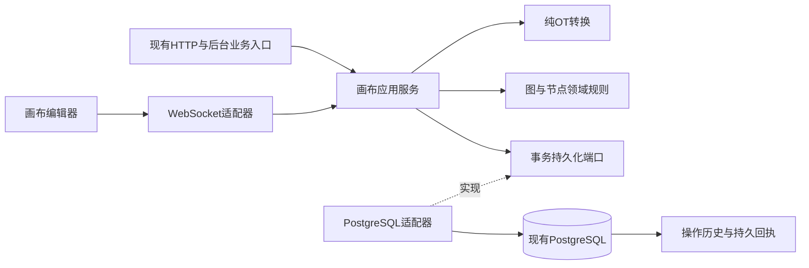

# 画布数据服务与DAG设计

| 项目 | 内容 |
| --- | --- |
| 版本与日期 | v0.1；2026-10-20 |
| 状态 | 系统设计建议，待评审；未实施、未迁移、未运行验收 |
| 上游 | [需求08](../requirement/08-画布数据库持久化与DAG需求.md) v0.3全部DATA规则；共享写入合同同时供需求09、10使用 |
| 方法 | pm-execution:user-stories与test-scenarios：以用户场景确定职责和确认条件；技术方案基于本仓库源码及官方资料 |
| 关联 | [实时通道设计15](15-画布WebSocket实时通道设计.md)、[OT设计16](16-画布OT协同一致性设计.md)；专项PRD与Plan尚未形成 |
| 维护/评审 | 画布产品、后端、前端、数据库与测试职责；具体人员未指定 |

## 1. 目标、现状与约束

让用户保存全部画布业务信息，关闭或换设备后恢复同一份合法图；数据库是权威来源。延续一项目一主画布、项目统一名称、素材权限和生成授权合同。

核对基线为`67a38fbc`及2026-10-20当前源码；并行工作区里的UI变化不作为已发布行为。关键依据：

| 位置 | 现状与差距 |
| --- | --- |
| `backend/internal/canvas/domain/document.go` | 已有节点、边、11类编辑命令和父子关系检查；配置按整块替换，普通连线只允许annotation；有2000节点、4000边、100命令的现行输入上限 |
| `backend/internal/canvas/adapter/postgres/store.go` | 已有文档行锁、权限、幂等、节点/边保存、输入版本、command_log及infra.outbox事务 |
| `backend/db/schema.sql` | 已有同画布端点复合外键、节点父外键、版本日志唯一键；没有通用DAG无环约束；父外键尚有NOT VALID状态 |
| `frontend/src/app/canvas/editor.tsx`、`components/generation/draft-save.ts` | 正式编辑器仍用IndexedDB保存恢复分支；需要移除画布内容的常态本地持久化 |
| `frontend/src/app/canvas/composer/references.ts` | prompt_reference可为界面派生线；不得把这类线重复保存为第二套依赖事实 |

现行数量上限是兼容与压测输入，不是已接受的性能指标。本文不启动工作流调度、不清理业务库、不重新开放时间线。

## 2. 服务拆分与方案选择

采用**现有Go业务进程内的职责拆分**，以canvas为业务所有者。三个需求不直接对应三个独立部署服务；避免跨服务提交和第二份图状态。后续只有在连接规模或团队边界有实际证据时才考虑进程拆分。

箭头表达运行调用与接口实现；代码依赖维持adapter → application → domain。不得由domain导入数据库、WebSocket或应用身份DTO。

| 职责/建议落点 | 拥有的状态与行为 | 明确边界 |
| --- | --- | --- |
| canvas/application的提交协调职责 | 授权、基准/历史选择、调用OT与图校验、决定事务结果 | 所有图写入共用；不管理socket |
| canvas/domain图规则 | 节点类型、配置、父子关系、依赖合法性、内容变更判断 | 纯函数，不读数据库；权限通过应用层预先取得的事实校验 |
| canvas/domain的OT能力 | 确定性操作转换与应用，见设计16 | 不自行保存或调用供应商 |
| canvas/adapter/postgres | 实现原子读写、行锁、历史/回执查询、恢复一致快照 | 无进程外副作用；持久化结构唯一来源仍是schema.sql |
| canvas/adapter/http及拟新增实时适配器 | DTO/帧校验、错误映射、身份上下文 | 不各自实现业务规则 |
| workspace、identity、media、prompt、operation | 现有归属、会话、素材、提示词、生成事实 | 小接口显式注入；生成结果是受信系统操作，不是客户端任意字段 |

方案比较：继续整图/整配置覆盖容易丢并发修改，不选；直接引入独立协作数据库会增加双写及权限同步，不选；复用关系表、增量命令和单事务选择为建议方案。服务接口按消费者需要拆分，不为每个职责建立空包或转发层。

## 3. 用户故事与交互状态

| 故事卡片 | 场景讨论与界限 | 确认条件 |
| --- | --- | --- |
| US-DATA-01：作为创作者，我要换设备继续已保存画布 | 读数据库，加载失败显示重试而非创建空图；恢复不依赖原浏览器 | AC-DATA-01、AC-DATA-02、AC-DATA-07 |
| US-DATA-02：作为创作者，我要连线和删除后关系仍正确 | 将标注、依赖、分组分开；非法操作说明原因并保持已提交状态 | AC-DATA-03、AC-DATA-05、AC-DATA-06 |
| US-DATA-03：作为现有用户，我要升级时保住作品 | 已保存数据原位演进；旧未同步分支先显式处置，不自动覆盖服务端 | AC-DATA-04、AC-DATA-08 |

故事存在依赖，不宣称可以任意顺序实现或一迭代完成；估算由后续Plan承担。没有新增页面原型；沿画布保存提示、只读状态和恢复面板调整。

状态：加载中 → 可编辑/只读；读失败 → 重试；编辑后 → 未保存；提交后无回执 → 待确认；只有持久回执 → 已保存；确定拒绝 → 显示原因并保留当前会话中的待处理意图。断线时暂停新结构操作为本设计建议，保留内存及关闭提示；不能承诺刷新后恢复未发送内容。

## 4. 数据模型与节点覆盖

### 4.1 持久数据结构

以下为拟定增量规格，不是已执行DDL。现有表优先扩展；空库改schema.sql，已有库另写经审核的增量迁移。

| 对象 | 建议字段、类型及约束 | 生命周期与索引 |
| --- | --- | --- |
| `canvas.document`（扩展） | `revision`升级bigint；`schema_version int NOT NULL DEFAULT 1`；`protocol_version int NOT NULL DEFAULT 1`；`history_floor bigint NOT NULL DEFAULT 1`；范围满足`1 <= history_floor <= revision` | 保留项目FK、主画布绑定及软删除；protocol_version=2为原子切换标志；wire版本用十进制字符串 |
| `canvas.node`（沿用） | UUID身份，document_id，类型/动作、title、config jsonb、布局、parent_id、资产引用及input_revision | 保留唯一(document_id,id)；软删除后的UUID不得复用；config按类型版本校验，未知版本只读 |
| `canvas.edge`（扩展） | 保留UUID、同画布复合端点FK；新增`relation_class text`默认`unclassified`，允许annotation/dependency/provenance/unclassified | 迁移按业务语义分类，未分类阻止v2启用；端点索引(document_id,source_node_id)、(document_id,target_node_id)；语义重复键先由领域校验，避免对jsonb绑定作错误通用唯一约束 |
| `canvas.command_log`（扩展） | revision升级bigint；新增`protocol_version int DEFAULT 1`、`op_id uuid NULL`、`base_revision bigint NULL`、`original_ops jsonb NULL`；现有commands在v2保存规范化已接受操作数组，包括空数组 | 保留unique(document_id,revision)；v2要求op_id/base_revision非空及JSON类型正确，unique(document_id,op_id) where op_id is not null；系统写入也必须有版本日志 |
| `canvas.operation_receipt`（新增） | `document_id uuid`、`actor_id uuid`、`op_id uuid`、`request_hash text`、`status text`、`observed_revision bigint`、`result_revision bigint NULL`、`result jsonb`、`created_at timestamptz`；PK(document_id,actor_id,op_id) | status=accepted/noop/rejected；accepted/noop须result_revision非空；拒绝不增加文档版本；请求哈希为64位hex；同op_id不同请求返回冲突；保留期覆盖重试和审计 |
| `canvas.node_input`（沿用） | 不可变(node_id,input_revision)及输入内容、创建者 | 真正改变生成输入才增加版本；布局和纯no-op不增加；任务绑定此版本 |
| `canvas.user_view`（新增） | PK(document_id,user_id)，viewport jsonb，view_revision bigint默认1，updated_at | 用户私有；尺寸/坐标校验沿现有边界；独立CAS更新，不增加共享图revision或项目内容活动 |
| `canvas.recovery_snapshot`（新增） | PK(document_id,revision)，schema_version/protocol_version，完整规范图jsonb，sha256，created_at；数据类型与hash校验 | 首次v2切换必须有快照；后续按经压测确定的阈值生成；不是另一套可写主状态 |

`operation_receipt`与旧`save_receipt`并存用于协议隔离：旧回执有result_revision>1及整图响应约束，不能硬塞新协议的拒绝结果。v1写入停用后保留旧回执用于迁移核实，不向无权用户返回。v2初版不自动清理回执、日志或墓碑；启用保留策略必须证明快照、转换窗口、重试和撤销窗口仍匹配。

读侧从关系表在同一一致性读事务取得规范图；快照与日志供重放/历史转换。没有日志覆盖的旧revision不能被假称为可OT恢复；以切换快照revision作为history_floor。

### 4.2 字段与类型覆盖

| 类型/对象（源码合同） | 需要保存 | 派生/瞬时与权限 |
| --- | --- | --- |
| 全部节点 | id、title、type/action、config、x/y/width/height、parent_id、z_index及版本 | 选中/hover/拖拽预览仅内存，拖拽结束的位置必须提交 |
| text、group | config.text；config.collapsed；分组归属 | 文本当前为纯文本，不能凭空宣称支持任意富文本marks |
| image/video/audio/model | media_asset稳定ID、类型、布局 | 临时签名URL由media读接口生成，不作为身份；移除节点不删除资产 |
| image_generation/video_generation | Draft及Composer：document/references/modelVersion/mode/params/labelState；旧纯文本字段保留迁移语义 | input_revision只由服务端分配；绑定/标签不允许客户端任意伪造授权事实 |
| generation | version/capability/model_profile_id/mode/prompt/params/output_count/inputs | 生成配置可编辑，执行状态由operation拥有 |
| batch_table | 全局设置、列/行稳定ID、prompt、enabled、input_node_ids槽位 | 空槽、次序要保存；不能按数组下标识别协作对象 |
| director | domain.DirectorConfig定义的场景、物体、相机、灯、镜头、变换、关键帧、封面/资产引用 | ID稳定；模型运行对象和渲染缓存仅内存；保留所有已存在配置字段 |
| timeline及受保护业务投影 | 原配置与引用按原协议保存、只读兼容；last_operation_id及结果归业务服务 | 迁移不删；不重开被退出范围的UI，不开放受保护节点编辑 |
| 关系 | edge_type/端点/role/binding与明确语义；输入配置内的节点引用同样纳入图校验 | prompt_reference显示线由输入事实派生，不重复落库；连线外观不自动成为执行关系 |

实施前把NodeConfig各子结构字段生成/核对为逐字段清单，并用所有现行类型快照回归；新字段没有归属和版本规则不得上线。前端不发送未知节点的全量替换，服务端拒绝未知schema的修改，读取保持原信息。

## 5. DAG与统一提交事务

### 5.1 图的定义

建议依赖方向统一为“上游输入 → 下游消费节点”。DAG是节点级依赖子图，分组parent单独成森林，annotation允许视觉环（自环仍沿现有拒绝规则）。

| 关系 | 建议分类与权威来源 |
| --- | --- |
| annotation | 标注，不进入DAG；“连线作为提示词参考”的操作必须显式写入实际绑定，不能靠视觉邻接自动执行 |
| input | dependency；绑定具体消费角色和输入版本，节点端点须同画布 |
| reference | 有输入消费含义时dependency；纯资料引用为provenance；必须以role/binding及拥有该关系的业务路径分类 |
| promote | 默认作为已发生采用/派生历史的provenance；如实际调用方表达当前输入消费，则经显式映射进入dependency |
| composer/工具配置的节点输入 | 从实际绑定派生dependency；以(binding_id或owner_id/row_id/column_id)去重；纯资产引用可无同画布节点，不制造虚构节点 |

reference/promote现存语义不能从名称猜测后直接迁移；未分类记录必须在启用v2前由业务盘点消除。该建议是设计选择待评审，不将存量不明数据自动删边。跨画布节点依赖暂拒绝；跨项目资产引用依media授权，不误当作节点边。

提交候选状态后统一校验：端点存在且未删除 → 类型/端口/授权 → 同义关系去重 → 分组无环 → 依赖图Kahn拓扑检查O(V+E)。未遍历全部依赖节点即`dag_cycle`，返回有权查看的冲突节点/边ID。并发校验在同一文档锁内；两条分别合法但合并成环的边只能接受不成环的一组。

删除资源节点与其可编辑边、配置引用清理在同一事务；不能清理的受保护关系则拒绝整个批次。现有生成草稿禁止删除的业务保护继续生效，放开须另评审。删除分组按当前语义解除子节点归属，保留世界坐标；移动分组提交明确成员ID及绝对位置批次，不在服务器重算一份不同成员集合。

### 5.2 应用接口与提交顺序

应用层定义消费端口，建议签名语义为`LoadAuthorizedSnapshot`、`SubmitOperation`、`ReadChanges(after,through)`、`LookupReceipt(opID)`、`SaveUserView(expectedViewRevision)`。参数均带context、当前Principal、documentID；具体Go接口在实现时按消费者拆小。

`SubmitOperation`输入及输出以设计15/16的v2操作信封为准。唯一权威接受路径：

1. 验证帧结构、schema/type版本、操作规模；开启数据库事务。
2. 按既有identity/workspace授权锁序核验账号、范围、成员/项目状态，再锁定canvas.document行。扩展锁序前检查现有生成、复制及授权路径，不反转现有锁顺序。
3. **在文档锁之后**查询operation_receipt；相同身份/操作/hash重放原结果，不同hash拒绝。多个连接提交同op_id不得分别提交两次。
4. 读取基准到当前版本的完整连续操作历史；超出history_floor返回`history_expired`，不尝试猜测。调用设计16转换，再做全部图、prompt、media与输入版本校验。
5. 接受时，图更新、input版本、canonical日志、revision+1、回执、项目内容活动及outbox一次提交。规范化后为空的操作记noop并占一个revision，便于连续确认，但不更新内容活动/输入版本。
6. 确定业务拒绝可写rejected回执，不改图或revision；鉴权失败不持久化私人请求内容。事务错误不写成功回执。
7. 事务提交后才能ACK或广播。提交结果未知则返回/保持pending，原信封重试核实；数据库内不等待socket发送、Kafka或供应商。

`request_hash`覆盖不可变原信封（protocol、document、op_id、base_revision、operations），不包含网络连接ID；客户端重连必须重发冻结信封。拒绝后重新编辑应生成新op_id。数据库行锁提供序列化边界，参考[PostgreSQL显式锁文档](https://www.postgresql.org/docs/current/explicit-locking.html)；具体锁序与死锁回归仍是本项目验证责任。

系统生成回写按内部授权及输入版本绑定转成规范系统操作；只投影结果引用，不覆盖新草稿，不重触发生成。项目改名/归档等metadata变更若推进画布revision，必须有对应规范事件；不得出现无法重放的版本空洞。

## 6. 迁移、兼容与恢复

建议逐画布切换，protocol_version作为服务端开关，禁止v1/v2并行不受控写同一图：

1. 只读盘点已有画布、未知节点、未分类边、孤儿引用/无效父链、日志与回执；记录问题，不能把修复设计解释为删除授权。
2. 备份并验证可恢复；扩展结构，空库与增量结构对照。父FK及新增约束先检查数据，再验证，不强制清理未知数据。
3. 部署能读新旧结构的兼容版本；仍按v1写。准备节点/边语义映射及schema往返验证。
4. 切换事务锁住文档，停止旧写入，读取一致快照R、设置history_floor=R及protocol_version=2；旧客户端写入返回`protocol_upgrade_required`，不得用“兼容”绕过OT。
5. 旧浏览器分支一次性由同账号/同范围显式选择恢复或丢弃；先核实旧pending回执，再与当前状态比较后产生新操作。成功保存并确认后才清除对应画布记录，不删除共享库中其他模块记录。
6. 失败回退到能理解v2数据的兼容版本或只读模式；已有v2写入时不能直接换回仅懂v1的旧二进制。反向数据迁移须单独演练。

v2正式编辑不写IndexedDB/localStorage/sessionStorage/Cache Storage画布内容；响应no-store，服务worker不得缓存私有图。用户视口通过独立服务端偏好保存，光标/选中只在内存。旧共享document.viewport仅作为未设置个人视图时的初始种子。

## 7. 测试场景与观测

每个场景记录目标、角色、前置数据、逐步动作及数据库/界面结果，依据pm-execution:test-scenarios；不是本轮执行记录。

| 场景与前置 | 动作 → 预期 | 覆盖 |
| --- | --- | --- |
| TS-DATA-01；有权限创作者、所有现行节点样本 | 修改各持久字段→确认→清浏览器数据→重新登录重开；数据库内容相同，临时URL可变化，未知字段不丢 | AC-DATA-01、AC-DATA-02、AC-DATA-07 |
| TS-DATA-02；两个客户端同一合法图 | 并发加入相反依赖→最多接受不成环结果；标注环不误拒；删除受保护节点→整批拒绝 | AC-DATA-03、AC-DATA-06 |
| TS-DATA-03；隔离迁移库与旧本地分支 | 备份→增量→切换→旧写入拒绝→一次性恢复→兼容回退；逐项校验无数据丢失 | AC-DATA-04 |
| TS-DATA-04；绑定输入版本的生成结果 | 修改草稿→旧任务完成→结果引用保存；新输入不被覆盖，重放不增加任务/费用 | AC-DATA-05 |
| TS-DATA-05；未确认操作、可控断网 | 页面保持→提示待确认；刷新→仅恢复数据库内容；不伪造本地恢复承诺 | AC-DATA-08 |
| TS-DATA-06；事务各提交点故障 | 提交前失败→无部分状态；提交后ACK丢失→同op_id得到同一回执 | NFR-DATA-01、NFR-DATA-02 |

观测保存耗时、锁等待、拒绝分类、图规模、日志窗口、快照重放结果；日志只记录ID/版本/错误分类，不记录私有提示词或凭据。性能预算由真实数据量及部署测量确定，本文不声称已达标。

## 8. 追踪与评审门槛

| 上游规则 | 设计位置 |
| --- | --- |
| FR-DATA-01、FR-DATA-02；DR-DATA-01～07 | 第3、4、6节 |
| FR-DATA-03；BR-DATA-01～06 | 第4、5节 |
| FR-DATA-04、FR-DATA-05 | 第5、6节 |
| BR-DATA-07～10；NFR-DATA-01～02 | 第5、6、7节 |
| AC-DATA-01～08 | 第7节及对应接口/迁移合同 |

待关闭：存量关系分类、字段逐项清单、增量SQL与锁序审查、容量/保留期限、断线交互和视口归属的产品接受。以上均有明确方案入口；未关闭前不能把设计草稿称为可直接上线的数据库方案。设计15、16不得另写一套图约束或事务事实来源。
