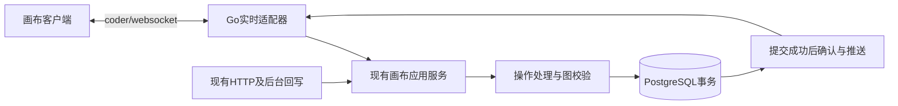

# 画布数据服务与DAG设计

技术设计；确认等级沿原来源。需求、PRD、Plan 独立维护，实施状态只见 [BACKLOG](../../BACKLOG.md)。

## 1. 摘要

以数据库权威提交保存完整画布，约束依赖图并保留回执和恢复边界。

本文采用设计、用户故事与测试场景结构。原始需求、PRD 和 Plan 独立维护；当前实施进度、剩余工作及阻塞项统一见 [BACKLOG](../../BACKLOG.md)。

## 2. 参与者

使用者与参与职责：保存画布的创作者及数据、数据库消费者。维护职责及确认人沿下方原来源记录；未给出姓名的，不补造人员或排期。

## 3. 背景

原始需求：[08-画布数据库持久化与DAG需求](../requirement/08-画布数据库持久化与DAG需求.md)。关联需求与验收：[07-画布数据库持久化与DAG](../prd/07-画布数据库持久化与DAG.md)。本文维护技术合同；相关实施步骤与证据见 Plan，状态与调度见 [BACKLOG](../../BACKLOG.md)。

### 3.1 文首来源与范围

| 项目       | 内容                                                                                                                                                                                                                    |
| ---------- | ----------------------------------------------------------------------------------------------------------------------------------------------------------------------------------------------------------------------- |
| 版本与更新 | v0.8；2026-10-20                                                                                                                                                                                                        |
| 维护与评审 | 画布后端、前端、数据库及测试职责；实际人员与评审人未指定                                                                                                                                                                |
| 适用范围   | 现有Go进程和PostgreSQL内的数据权威、节点/关系、DAG及保存恢复；实施状态见设计14                                                                                                                                          |
| 上游基线   | [需求08](../requirement/08-画布数据库持久化与DAG需求.md) v0.4：全部DATA规则；保留既有结构；新任务见[设计模板](../templates/01-设计模板.md)                                                                              |
| 下游关联   | [实时设计15](15-画布WebSocket实时通道设计.md)、[OT设计17](17-画布OT处理设计.md)；[PRD07](../prd/07-画布数据库持久化与DAG.md)、[设计14](#1-摘要)；均为待评审草稿；[调研16](16-画布持久化与协同成熟方案调研.md)为选型依据 |

实施进度及调度字段见 [BACKLOG 第4.15节](../../BACKLOG.md#415-14-画布数据服务与dag设计文首来源与范围)。

## 4. 目标

以数据库权威提交保存完整画布，约束依赖图并保留回执和恢复边界。目标的规则、量化条件与非目标沿需求原文及下方已确认设计，不增加未经确认的指标。

### 4.1 设计目标、现状与约束

数据库是唯一权威画布，已确认内容可以跨会话恢复，依赖关系保持合法。延续一项目一主画布、项目名称及素材权限；媒体文件沿对象存储，生成与费用沿原业务入口。

2026-10-20静态核对发现：[领域模型](../../backend/internal/canvas/domain/document.go)已有节点、连线和编辑命令；[存储实现](../../backend/internal/canvas/adapter/postgres/store.go)已有文档行锁、版本检查、图保存、输入版本、日志、回执和outbox事务；[保存回执](../../backend/internal/canvas/adapter/postgres/draft_save.go)已有按用户和幂等键加事务锁、核对请求hash的能力。现有expected_revision不符会拒绝，尚无OT；这些是源码事实，不是运行验收。

### 4.2 原始需求复核与范围结论

| 原始诉求                                 | 承接及复核结果                                                    | 必须纠正或保留的边界                                                                      |
| ---------------------------------------- | ----------------------------------------------------------------- | ----------------------------------------------------------------------------------------- |
| 整个画布节点信息存数据库，不使用本地存储 | 本文第5、6、8节；AC-DATA-01、02、07、08                           | 完整配置与未知字段保护不能以只列样例代替；画布本地持久化和恢复链路整体退出                |
| 必要数据库服务与DAG                      | 本文第4、5节；AC-DATA-03～06                                      | 复用表及事务，DAG只约束依赖子图；第78节按实际配置及写入口分类，未知历史关系有明确保护规则 |
| WebSocket更新及后续多人基础              | [设计15](15-画布WebSocket实时通道设计.md)第4～6节；AC-SYNC-01～04 | 编辑上行、确认、下行均覆盖；补初始化完成标记、终态回执及发送权限，单实例是本版建议范围    |
| OT处理并发一致性                         | [设计17](17-画布OT处理设计.md)第4～7节；AC-COL-01～06             | 设计17第4.4、4.6节已确定受限富文本算法适配和逐字段操作；性质与运行验证仍是实施验收条件    |

结论：三个方向均有承接；本版进一步明确富文本适配、全字段操作映射和存量关系分类处理。设计决策已落到现有类型及入口，仍待评审；实现正确性、真实存量盘点和运行指标另列第82节，不将文档完整等同于验收。撤销、个人视口和首期部署范围属于需求细化，不能冒充用户逐项确认。

### 4.3 三份设计一致性复核与落地结论

| 核对点             | 本次发现及修正                                                                                           | 验证与计划承接                                                                        |
| ------------------ | -------------------------------------------------------------------------------------------------------- | ------------------------------------------------------------------------------------- |
| 图权威与协议       | 三份均使用同一PG提交、单文档revision及服务端接受顺序；快照JSON与操作流分工一致                           | 设计14负责存储，设计15负责实时，设计17负责OT及联合接受；不新增第二图或服务            |
| OT基准及集合       | 补旧基准校验和因果转换；同锚点新增补双向规则；并发集合重排改为局部明确冲突，避免未证明的通用Move OT      | 设计17第4.2、4.5节；先以固定反例及Go/TS性质验证再接入全图                             |
| 原子批次与现有代码 | 原saveInputs重复Apply不适合新操作；明确一次求值、每批最终输入版本；业务reject不能通过事务error回滚掉回执 | 本文第74节；真实PG故障与版本回归                                                      |
| 恢复及旧写入口     | history_unavailable写终态；ack补齐身份/版本，ready区分可读可写；移除同基准旧整配置写入例外               | 设计15第75节、设计17第717节；重连/旧客户端测试                                        |
| Undo及复杂度       | 保留自己的可证明贡献；重叠删除保守整批拒绝；不建永久字符墓碑、跨刷新历史产品或通用树引擎                 | 设计17第718节；插入、无重叠删除及冲突Undo分别验证                                     |
| 必要范围与非目标   | 节点全字段、资产权限、DAG、WebSocket双向、富文本/引用及恢复不能省；多实例房间、离线编辑、光标邀请不纳入  | 三个原需求分别由PRD07/08/09定义交付，再由设计14/18/19拆解；各自验收，联合接受归设计17 |

交接责任以以下产物为界；同一能力只实现一次，其他专项通过接口消费并补各自层级的验证：

| 产物                                    | 唯一实现归属                                        | 消费与验收边界                                                                      |
| --------------------------------------- | --------------------------------------------------- | ----------------------------------------------------------------------------------- |
| 有限操作、转换结果、前像/触碰元数据语义 | 设计17 T-COL-01、T-COL-08                           | 数据提供有界历史并持久化；转换内核不访问PG或socket                                  |
| 事务、输入版本、图约束与持久回执        | 设计14 T-DATA-01～03                                | OT输出候选及规范资料；数据统一检查当前权限/图并提交，WS只传递结果                   |
| 节点及系统写入适配／composer编辑适配    | 设计17 T-COL-03／T-COL-04                           | 前者排除后者负责的富文本、引用、标签与上传回调；不重复维护整配置差分                |
| 内存B/P/Q与网络恢复                     | 设计17 T-COL-05／设计15 T-SYNC-03                   | OT决定意图如何协调；WS决定何时连接、查证和交付消息，保存提示由WS接入消费协调器状态  |
| 旧入口版本门禁、迁移与回退演练          | 设计14 T-DATA-05                                    | OT移除旧控件整配置调用；数据统一封住服务端旧模型入口，避免双方各做一套门禁          |
| 专项证据与联合报告                      | 设计14 T-DATA-06、设计15 T-SYNC-05、设计17 T-COL-07 | 前两者各维护本专项AC；后者引用其证据，汇总OT证据并补AC-COL-06，不重复实现或整套重测 |

复核结论：修正后可按计划进入有退出条件的实现验证，当前没有确认需要新增基础服务或扩大产品范围。**文档一致不等于OT算法已证明**：首个算法关卡若出现无法解释的三方/编辑器反例，须修正设计再继续，不能绕过门禁、用全部拒绝或整图覆盖充当OT完成。容量、真实存量、身份/代理环境与产品细化接受仍是明确交付条件，不伪造已关闭。

### 4.4 三条文档链路复核（2026-10-20）

本次保留需求08/09/10及其18项AC，各专项的原始规则、产品交付定义、技术机制和任务证据分别归入设计14/15/17，当前实施进度统一在BACKLOG维护。修正了原型与正式内核混在一个任务、隔离演练与生产切换混淆、专项验收被不相关Undo/全字段接入阻塞，以及验收表只有编号没有可检查预期的问题；来源元数据、个人视图、连接生命周期和NFR确认时点也已补齐承接。

复核后的候选范围是12个故事、19项任务；新T-COL-08承接原T-COL-02中已有的正式内核工作，不新增产品能力或独立服务。三份计划第81节逐项记录AC的主要实现任务、最小情境、预期与证据；任务依赖按交接产物推进，不按文件编号顺序等待整体完成。未发现需要新增基础设施、通用Move/格式化OT、离线持久缓存或第二份权威图的理由。

此为文档静态复核，不能确认OT实现已经正确。冲突/Undo/视口等产品细化、设计评审前的同步目标、真实旧库分类、实际身份/路由、人员容量及算法/运行证据仍未完成；它们是具名的后续关卡，不以本次文档检查冒充关闭。

## 5. 使用场景

参与者为保存画布的创作者及数据、数据库消费者；在下方定义的输入、对象状态、权限和环境条件具备时执行相应操作。各故事按其独立前置条件核对，不能把测试夹具当成真实业务条件。

### 5.1 用户流程与交互状态

入口沿现有画布，不新增页面原型。流程为权限检查→加载数据库图→编辑→待确认→持久回执→已保存。

| 状态/触发            | 用户可见与允许动作                                                               | 退出或恢复                               | 对应验收       |
| -------------------- | -------------------------------------------------------------------------------- | ---------------------------------------- | -------------- |
| 加载中/加载失败      | 暂停编辑，失败显示重试；不把错误当空画布                                         | 成功加载同一权威版本                     | AC-DATA-01、07 |
| 可编辑/未保存/待确认 | 内存显示编辑；在途或仍有缓冲时不能显示全部已保存                                 | 接受回执且本地队列排空；拒绝显示具体原因 | AC-DATA-01、06 |
| 断线或确认不明       | 保留已确认可写权限及有界页面内意图，临时断线仅暂停发送；提示关闭会丢失未送达内容 | 重新授权、查回执、补日志或安全重建       | AC-DATA-08     |
| 无权限/只读          | 归档只读；无读权限清理私有画面，不再恢复旧账号草稿                               | 沿既有授权入口                           | AC-DATA-06     |
| 旧本地分支           | 不再读取、恢复或写入；不自动上传或删除历史记录                                   | 按第82节迁移处置                         | AC-DATA-04     |

## 6. 价值

保存、图校验与日志在同一原子边界成立，不依赖浏览器业务持久缓存。

## 7. 方案

### 7.1 方案比较与选择

| 方案                                  | 价值与成本                                      | 结论                           |
| ------------------------------------- | ----------------------------------------------- | ------------------------------ |
| 现有关系表＋统一事务＋coder/websocket | 复用权限、节点与业务引用，只有必要日志/回执增量 | 采用此最小方向；数据细节待评审 |
| 第二份协同图、独立OT服务或图数据库    | 引入双写、跨服务授权与运维，本次未有必要性证据  | 不纳入                         |
| 每次整图覆盖或只保存在浏览器          | 不能满足可靠保存和兼容并发修改                  | 不采用                         |

不新增快照、用户视图、独立回执表，不预建跨实例消息系统；保留现有表的必要增量和一致性读。保存失败恢复、授权、DAG及原始需求要求的OT不是可为“简化”删掉的内容。

### 7.2 模块职责与接口合同

原条目的当前实施进度和剩余工作已迁入 BACKLOG；其确认范围及历史证据仍按原来源使用。

### 7.3 职责和依赖

| 模块                     | 输入/输出及职责                                      | 不负责                             |
| ------------------------ | ---------------------------------------------------- | ---------------------------------- |
| 画布客户端/实时适配器    | 编辑意图、版本、回执与增量；连接职责见设计15         | 不决定保存成功、权限或DAG合法性    |
| canvas应用服务与领域规则 | 接收已认证主体和操作；转换后得到合法候选图或明确拒绝 | 不另存权威内存图，不直接调用供应商 |
| PostgreSQL适配器         | 锁定、校验事实、图/输入/日志/回执/原outbox原子提交   | 事务内不等待网络广播               |

这是运行流程；代码依赖仍按adapter → application → domain。实时适配器只负责连接与消息，业务规则沿现有canvas模块，OT具体边界见设计17。媒体文件继续用对象存储，生成任务与计费仍由原业务入口负责。

### 7.4 保存与读取合同

复用现有授权读取与Execute入口并扩充操作模型；具体Go签名留给实现，不创建空接口层。读取返回同一版本图；提交输入为服务端主体、document_id、op_id、base_revision、operation_version和命令。成功仅指事务已提交；确定拒绝和结果未知区分，按下面路径处理。

HTTP残留写入、WebSocket编辑与后台结果回写最终遵循相同的授权、版本、图校验和事务规则；不是要求把后台生成伪装成客户端命令。

1. 校验输入与操作模型版本，按已有锁序核对账号、项目及写权限。
2. 复用用户＋幂等键的事务锁和save_receipt：同op_id同请求返回原接受或拒绝结果，不同请求拒绝且不得覆盖已有终态；操作身份为(actor_id,op_id)，不能将他人的相同UUID当成自己的回执。请求hash覆盖文档、基准版本、操作模型版本和原命令，不因重连而变化。
3. 锁定document行，读取当前图。尚未接入OT时只接受相同expected_revision；OT接入后按设计17利用连续日志和前像校验原基准，再转换基准之后的操作；还原/转换超出已验证预算或日志不完整时持久拒绝并要求重同步，不直接把旧操作改成最新版本。
4. 对候选结果检查图、资产/提示词引用和输入版本；图变更、revision、规范命令日志、输入快照、save_receipt、原有内容活动及outbox在一次事务提交。
5. 提交成功才确认并推送。数据库错误或提交结果未知均不能标“已保存”；用原op_id与原请求核实。广播失败不撤销数据库提交，客户端按版本恢复。回执本身提交失败时同样只能报告结果未知，不能先返回确定拒绝。

确定业务拒绝在同一幂等锁及文档锁下写rejected终态回执，不改图或revision，提交拒绝回执后才发送reject；用户调整后用新op_id。请求格式/认证失败为入口错误，瞬时故障或提交结果未知不是终态拒绝，不写成功回执、不以not_found宣称原请求失败；连接中断不明时只用原请求查证。若OT将整个批次转换为空操作，仍记录一次接受版本、零应用效果及成功回执；内部日志项保留原操作/触碰等处理元数据，复用当前回执约束，但不修改生成输入或内容活动。事务内不等待socket、Kafka或供应商。

现有GORM事务回调返回error会回滚，因此“业务拒绝已判定”须作为事务内结果值：在任何图写入前完成领域检查，写rejected回执，事务回调成功结束后再向协议返回reject。预期且可分类的唯一键/引用约束冲突，须在图写入前建立的SAVEPOINT内执行，失败先ROLLBACK TO SAVEPOINT撤掉全部图/输入/日志副作用，再写拒绝回执；外层授权/幂等/文档锁仍在保存点之前。未分类SQL错误、连接故障或死锁整笔回滚并返回可查证错误，重试仍用原信封；不能在已中止的PG事务中直接插拒绝回执。图、输入、日志或回执任一步失败均不能单独留下成功事实。

新operation_version的输入版本以**原子提交后的最终输入**为边界：同一存续Draft节点在一个接受批次内最多推进一次input_revision，SameInput未变不推进，新建Draft从1开始；保存最终合法输入快照。现行[saveInputs](../../backend/internal/canvas/adapter/postgres/draft_save.go)会对原命令逐条再Apply并保存中间草稿，不能原样复用于细粒度OT。新路径从一次候选求值的结果收集图、规范效果、输入版本和快照，持久层不再次执行原命令；内部步骤允许临时不满足跨字段约束，完整批次必须通过。旧输入版本及历史任务引用原样保留，不重编号；生成/报价只使用已确认的最终输入版本，编辑批次内不夹带执行生成。事务失败不保存中间输入，纯布局、标签协调和noop不额外产生输入版本。

行锁及保存点回滚依据[PostgreSQL锁文档](https://www.postgresql.org/docs/current/explicit-locking.html)和[ROLLBACK TO文档](https://www.postgresql.org/docs/current/sql-rollback-to.html)（2026-10-20核验）；项目锁序与授权竞态仍需实现验证。所有推进revision的写入必须有可解释日志；旧后台写入不能满足时，该段历史只允许重读快照，不能用于OT。

DR-DATA-04的客户端来源由入口附加内部source_kind（websocket/http/system）记录于现有日志/回执元数据；不接受客户端自行声明的系统身份。重连连接号只用于运行诊断，不作为操作身份或请求hash的一部分，不保存凭据，也不新增来源表/业务消息。

请求hash覆盖语义等价的规范JSON，原始请求与服务器规范化后的效果分开；字段顺序不应引起误判。同op_id若已有终态，重复请求返回相同结果；校验成功但被后续图约束拒绝的操作不能进入已接受日志。涉及生成的实际业务写入同样记录可解释效果，旧任务结果只补结果引用，不重写当前输入。

### 7.5 数据、状态与一致性

原条目的当前实施进度和剩余工作已迁入 BACKLOG；其确认范围及历史证据仍按原来源使用。

### 7.6 现有表及必要增量

继续使用[现有schema](../../backend/db/schema.sql)，不为WebSocket新增数据库或第二套图。

| 现有表              | 保留职责                                                            | 必要调整                                                                                                                                                                                                                                                                                                                                                                         |
| ------------------- | ------------------------------------------------------------------- | -------------------------------------------------------------------------------------------------------------------------------------------------------------------------------------------------------------------------------------------------------------------------------------------------------------------------------------------------------------------------------- |
| canvas.document     | 项目归属、名称、共享图revision                                      | 每个接受批次推进一次revision；当前integer上限继续受保护，本轮不预先改bigint                                                                                                                                                                                                                                                                                                      |
| canvas.node         | 稳定UUID、类型、标题、config JSONB、位置/尺寸、分组、资产与任务引用 | 所有业务字段入库；配置并发编辑按受支持字段处理，不能无条件替换整块config                                                                                                                                                                                                                                                                                                         |
| canvas.edge         | UUID、类型、方向、role/binding和同画布端点                          | 复用现有结构，补业务图校验；不新建relation_class列                                                                                                                                                                                                                                                                                                                               |
| canvas.node_input   | 不可变生成输入及input_revision                                      | 延续输入版本与任务结果绑定，布局修改不生成新输入版本                                                                                                                                                                                                                                                                                                                             |
| canvas.command_log  | 按document_id、revision记录接受后的命令                             | 拟增加op_id uuid、base_revision integer、operation_version integer，可空以兼容旧行；新模型必须填写，版本为正、基准不超过接受前版本；保留(document_id,revision)唯一键，增加(document_id,create_by,op_id)非空唯一索引；commands仍为数组，每项保留可广播的规范效果及仅服务器可读的处理元数据；元数据含原操作/基准、字段/集合触碰、必要前后像及文本位置映射，支撑基准还原、CAS和Undo |
| canvas.save_receipt | actor_id＋idem_key、请求hash、结果版本和响应                        | op_id复用idem_key；拟加status（accepted/rejected，旧行默认accepted），result_revision允许拒绝时为空；accepted仍要求>1，rejected必须为空，原因及observed_revision在response_body；保留现有用户＋幂等键唯一约束，不新建回执表                                                                                                                                                      |

上述日志与回执调整是拟议增量，尚未改DDL；业务拒绝也需终态回执，否则重连重试可能在首次拒绝后又被接受。撤销所需前值只保存本次实际改动的字段，删除记录必要的对象/引用前像；服务端生成并校验，不信任客户端声称的旧值，不每次保存整份画布。日志内撤销资料不原样广播；零应用效果的日志仍留元数据项，对外changes的commands可为空，客户端仍消费该revision。还须保留撤销判定所需的原始目标/区间和写入触碰信息；操作转换为noop也不能丢掉这部分归属证据，否则无法判断重叠删除或同值写入是否被他人触碰。operation_version是操作模型版本，不扩展成多套协议注册机制。新操作模型对应的日志必须完整；旧日志或未知写入无法解释时，返回需重同步，不能凭空转换。初版不自动清理日志、回执或删除标记；但每次转换/Undo读取的版本数、字节和耗时必须有实测上限，超限明确重同步/不可撤销，不以“全部保留”为由无限扫描。保留期限与容量在发布前按数据量评估。

当前关系表在一致性读事务中即可构成快照，不新增recovery_snapshot表。加载须读到同一revision的节点和边：使用同一REPEATABLE READ事务读取并完成权限校验，不能把数次独立查询拼成快照。

视口、选中、悬停和拖拽预览拟只放当前页面内存；拖拽结束的节点位置必须保存。个人视口恢复按DR-DATA-07是细化建议而非用户已确认必需能力；本版建议不做跨会话恢复，不新增user_view表；既有document.viewport仅保留兼容读取，不再作为其他人可覆盖的实时相机状态，也不删除历史值。此取舍须在评审确认，不能自行报告为用户已接受；需要恢复时应扩充服务端个人偏好而非恢复浏览器持久化。

### 7.7 全节点信息的保存边界

下表中的“完整保存”包含所列类型的所有嵌套字段，不允许保存器只挑示例字段。配置以业务结构为边界，全部字段操作及并发裁决见[设计17第710节](17-画布OT处理设计.md#710-按现有类型的逐字段操作映射)，不再把逐字段映射留到实施时选择。

| 字段/类型                            | 数据库持久状态                                                                                                                                                                                                                      | 派生或瞬时状态                                                            |
| ------------------------------------ | ----------------------------------------------------------------------------------------------------------------------------------------------------------------------------------------------------------------------------------- | ------------------------------------------------------------------------- |
| 全部Node公共字段                     | id、title、node_type/action、config、x/y、width/height、parent_id、z_index、ref_type/id、input_revision、last_operation_id；后两项由业务服务维护                                                                                    | 选中、悬停、拖拽中间帧仅内存                                              |
| text、group、image/video/audio/model | config.text、config.collapsed及公共字段；媒体保存稳定资产ID                                                                                                                                                                         | 资源URL按权限生成，不作为资产身份                                         |
| image_generation/video_generation    | [Draft](../../backend/internal/canvas/domain/draft.go)完整字段；composer按[提示词Draft](../../backend/internal/prompt/domain/draft.go)完整保存document、references、modelVersion、mode、params、labelState、schemaVersion及嵌套内容 | 临时编辑选区、输入法状态不持久化；生成结果不混入用户草稿                  |
| generation                           | [GenerationConfig](../../backend/internal/canvas/domain/generation.go)的version、capability、model_profile_id、mode、prompt、params、output_count、inputs                                                                           | 任务执行状态由原operation业务管理                                         |
| batch_table                          | [BatchTableConfig](../../backend/internal/canvas/domain/batch_table.go)全部设置、reference_columns和rows；保留稳定ID、顺序及空输入槽                                                                                                | 运行进度读取任务事实                                                      |
| director                             | [DirectorConfig](../../backend/internal/canvas/domain/director.go)全部场景字段及objects/cameras/lights/shots/cover等嵌套配置                                                                                                        | 渲染对象、加载缓存只在内存                                                |
| timeline及受保护节点                 | [TimelineConfig](../../backend/internal/canvas/domain/timeline.go)全部轨道/片段/字幕/裁切字段保留；timeline在editable门禁下可编辑，不能整体标只读                                                                                   | 有last_operation_id等不满足editable条件的节点维持保护；渲染进度不混入配置 |
| Edge及输入引用                       | edge全部字段；配置内的真实输入绑定按其拥有者保存                                                                                                                                                                                    | prompt_reference显示线由输入绑定派生，不另存重复关系                      |

初始实现的强类型解码可能忽略未知字段；首轮DAG切片已用保留原文的NodeConfig解码与图只读保护阻止有损写入，项目复制和素材保留检查对不透明配置继续拒绝不安全处理。load提供read_only_reason；前端只读呈现、完整新操作模型及存量修复进度另按设计14接受，不能“读不懂后保存成空配置”。实施验收逐类型、逐字段往返读回；仅验证位置和纯文本不能算全节点验收。

### 7.8 DAG与删除语义

图采用节点集合和有向关系集合；应用内按稳定节点ID建立邻接表。依赖方向为“来源节点 → 消费节点”；分组parent单独构成森林。下表是2026-10-20源码核对后的**分类规则**，不是已完成的生产库盘点。

[普通保存](../../backend/internal/canvas/adapter/postgres/store.go)的edge写入及[领域Connect](../../backend/internal/canvas/domain/document.go)只接受annotation且role/binding为空；[工程复制](../../backend/internal/canvas/domain/project_copy.go)也拒绝非annotation。schema允许input/reference/promote并不证明现有运行代码赋予了它们某种用途。本次backend生产代码搜索未找到这三类边的创建路径；不能据此声称数据库里没有历史记录。

### 7.9 现行关系来源的确定分类

| 来源/实际拥有者                                                                                                    | 分类及方向                                           | DAG、编辑与删除规则                                                                                                                                                                           |
| ------------------------------------------------------------------------------------------------------------------ | ---------------------------------------------------- | --------------------------------------------------------------------------------------------------------------------------------------------------------------------------------------------- |
| canvas.edge的annotation，且role/binding为空                                                                        | 展示连线；保持存储方向                               | 不进入依赖DAG；允许视觉环，拒绝自环/非法端点；删节点同批删关联annotation；同方向同端点的普通标注为重复，反方向不是同一边                                                                      |
| batch_table.rows[].input_node_ids；validToolReferences                                                             | 当前节点输入；image资源节点→batch_table              | 以(owner_node_id,row_id,column_id)标识绑定，非空槽形成依赖；disabled行也保留并校验结构依赖，执行时仍沿enabled开关。只接受现行image/media_asset节点；删来源节点清空所有相应槽，保留行/列与空槽 |
| director.objects[].source_node_id；validDirectorReferences                                                         | 场景素材输入；model资源（billboard为image）→director | 来源节点存在时计入结构依赖，asset_id必须与节点引用一致；删来源时将其ref_id保留到asset_id并清空source_node_id，不删除场景物体                                                                  |
| timeline.clips[].node_id；validTimelineReferences                                                                  | 时间线素材输入；与clip.kind相符的资源→timeline       | 来源节点存在时计入结构依赖；删来源时保留asset_id并清空node_id，不删除片段。text/subtitle不得带素材节点/资产引用                                                                               |
| composer.references[].source（media/subject）；draft_sources核验                                                   | 固定来源ID/版本的资产或主体引用；不是canvas.node ID  | 不生成节点依赖边；sourceId不能与node UUID按字符串碰巧相等匹配。删除来源资源节点不删除已固定的绑定；素材撤权/失效沿资产业务验证                                                                |
| composer.pending_upload                                                                                            | 当前用户上传尝试身份                                 | 不进入节点DAG；完成后经代次/attempt检查换成media来源，不新增自动生成任务                                                                                                                      |
| generation.inputs[].media_asset_id；director仅asset_id的物体、panorama/cover/screenshots；timeline仅asset_id的clip | 直接资产引用                                         | 不进入节点DAG；继续资产存在性/项目权限校验，不自动寻找“同素材节点”并建立依赖                                                                                                                  |
| 前端prompt_reference显示线及connectedReferenceSources的annotation候选                                              | 从绑定或邻接关系派生的UI提示                         | 不作为依赖事实；用户选择素材后以真实持久绑定为准，画线本身不等于消费最新节点输出                                                                                                              |
| node.parent_id                                                                                                     | 分组归属：父group→子node                             | 只检查父子森林，不进入输入DAG；解除分组保持成员世界坐标                                                                                                                                       |
| director内部camera/shot/object/骨骼引用；timeline.track_id                                                         | 同一配置内的对象关系                                 | 用现有ID和业务键检查存在性/类型，删除同批清理或明确拒绝；不变成canvas节点边                                                                                                                   |
| node_input、last_operation_id及任务结果的输入版本关联                                                              | 已冻结输入/执行来源                                  | 沿原业务不可变事实保存，不当作当前执行依赖；历史结果不得改写当前配置                                                                                                                          |
| canvas.edge的input/reference/promote，或带role/binding的annotation、未知类型/载荷                                  | 未支持的历史业务关系U                                | 本版无已核实生产写入口，全部走第710节保护；不根据名称猜成“input依赖/reference资料/promote历史”，不自动改类或删除                                                                              |

源码依据：[批量引用检查与清理](../../backend/internal/canvas/domain/batch_table.go)、[导演引用检查与清理](../../backend/internal/canvas/domain/director.go)、[时间线引用检查与清理](../../backend/internal/canvas/domain/timeline.go)、[提示词来源核验](../../backend/internal/prompt/adapter/postgres/draft_sources.go)、[前端引用候选与绑定](../../frontend/src/app/canvas/composer/references.ts)。前三类依赖来自配置本身，不复制存成canvas.edge，也不使删除显示线同时删除输入。

同一节点对可以被多个行/列/片段合法引用，不能当作duplicate_relation拒绝。业务关系按拥有者＋槽位/对象ID区分；构建邻接表时相同来源/目标合并为一条可达边，原绑定和删除清理仍全部保留。未来若引入“消费生成节点最新输出”的能力，必须新增明确输入合同与分类，不能借annotation或资产ID暗中实现。

### 7.10 存量记录的确定处理流程

不新增relation_class字段、关系注册服务或迁移数据库。本版分类在读取/校验时由上述闭合分支派生，记录定位使用document_id、edge_id或配置路径。

1. **已知合法**：普通annotation及已知配置输入按第79节检查。加载时验证端点同画布、输入类型/资产匹配、内部引用、分组森林和依赖DAG；只有完整可解释且通过检查才可标记图已验证。
2. **已知损坏**：缺失端点、非法类型/资产、分组环、依赖环归入invalid_graph；保留原始数据与原因。初版该画布只读，停止新输入执行/复制，不自动删边“修好”。已有任务终态仍由所属业务幂等入账，不因画布隔离丢失任务事实。
3. **未知U**：保留原载荷，不认证整图DAG合法。为避免绕过未知依赖，初版同样让该画布只读并停止新输入执行/复制；不尝试只冻结某个端点，因为未知绑定可能影响其他节点。其他已验证画布正常使用。未知载荷必须在强类型解码前被检测，不能先解码丢字段后再保存。
4. **修复与解封**：实施迁移前只读盘点每个U/invalid记录的类型、role/binding结构、端点、对应生产写入证据和数量；内容中可能有私有数据，报告仅列定位及错误类别。由所属业务给出映射或修复，不默认删除；备份后经有审计的显式修复批次重检整图，通过后解除只读。若查到真实的历史生产合同，再补该合同的精确分类及用例，不能因为字段名相似自动套用。

这明确了当前每一种可见来源及未知存量分支的行为，设计上不再留“reference可能是任何用途”的开放判断。实际数据库中U/损坏记录的数量、样本和修复工作属于实施前盘点，本轮未连接业务数据库，不能宣称已经分类完每条生产记录。

### 7.11 事务内校验及删除

同一提交先在候选图上完成全部命令及规范清理，再检查：端点同画布、节点/输入类型和资产权限、按绑定身份去重、分组无环、依赖无环。Kahn拓扑检查复杂度O(V＋E)；与写入持有同一文档锁，并发修改不能先各自通过旧图后拼出环。现行可写输入均来自资源节点，普通用户不能直接创建任意input边；抽象成环测试属于领域校验向量，不伪造当前UI已有自由工作流接线。

删资源节点时：annotation删除、batch槽置空、director/timeline将节点引用固定成已有asset_id，三者与删除一次提交并广播规范效果；资产本体不删。若所属节点受保护、发生未知关系或无法证明绑定合法，整批拒绝。其他配置内对象删除依照设计17逐字段规则。DAG定义仅承担结构校验，不附带自动调度、级联重跑或计费。

### 7.12 异常、安全与恢复

| 条件与发现方式                      | 系统及用户结果                                     | 恢复与验证                                            |
| ----------------------------------- | -------------------------------------------------- | ----------------------------------------------------- |
| 数据库失败/提交结果未知             | 不确认保存、不先广播；不把超时转为确定拒绝         | 原op_id查证；事务故障及ACK丢失测试，AC-DATA-08        |
| 非法引用、成环或受保护删除          | 整批拒绝，图不变，持久拒绝回执避免迟到重试再次生效 | 调整意图后新op_id，AC-DATA-03、05、06                 |
| 未知节点/配置字段或无连续可解释日志 | 阻止有损写入或转换，不吞字段                       | 当前模型升级/只读，重读快照并保留会话意图，AC-DATA-07 |
| 权限撤销、账号切换或归档            | 最新授权决定读写；禁止旧账号内容串入新会话         | 按设计15断开/只读，AC-DATA-06                         |
| 旧任务迟到                          | 保存结果来源而非覆盖新输入                         | 不重复生成或收费，AC-DATA-05                          |

正式画布业务数据不写浏览器持久缓存，加载失败不覆盖数据库；具体迁移见第82节。日志只记录必要ID/版本/错误分类，不输出凭据及完整提示词。

### 7.13 ST-DATA-01：作为创作者，希望提交结果、输入版本和回执一致，以免重复或丢失修改

**故事 ID 与标题：** ST-DATA-01；作为创作者，希望提交结果、输入版本和回执一致，以免重复或丢失修改。

**描述：** 作为创作者，希望提交结果、输入版本和回执一致，以免重复或丢失修改。

**来源与设计：** [17-画布数据库持久化与DAG实施计划的原故事及承接关系](../plan/17-画布数据库持久化与DAG实施计划.md#3-候选待办与就绪检查definition-of-ready)；需求来源见第3节。

**讨论：** PRD／需求来源：[07-画布数据库持久化与DAG](../prd/07-画布数据库持久化与DAG.md) §6.2 CAP-DATA-01；需求08；明确的AC：AC-DATA-01、05、06、08。候选、估算和就绪情况只在 BACKLOG 维护。

**确认条件：** 沿用原故事对应任务的退出条件及来源 AC／QA；正常结果、边界、失败和权限场景逐项核对，不将本次描述整理升级为新确认。

**追踪：** [CASE-DATA-01](#83-case-data-01作为创作者希望提交结果输入版本和回执一致以免重复或丢失修改)；实施状态见 [BACKLOG](../../BACKLOG.md)。

### 7.14 ST-DATA-02：作为创作者，希望连线和素材删除符合业务关系，以免留下非法图

**故事 ID 与标题：** ST-DATA-02；作为创作者，希望连线和素材删除符合业务关系，以免留下非法图。

**描述：** 作为创作者，希望连线和素材删除符合业务关系，以免留下非法图。

**来源与设计：** [17-画布数据库持久化与DAG实施计划的原故事及承接关系](../plan/17-画布数据库持久化与DAG实施计划.md#3-候选待办与就绪检查definition-of-ready)；需求来源见第3节。

**讨论：** PRD／需求来源：[07-画布数据库持久化与DAG](../prd/07-画布数据库持久化与DAG.md) §6.2 CAP-DATA-02；需求08；明确的AC：AC-DATA-03、05、06。候选、估算和就绪情况只在 BACKLOG 维护。

**确认条件：** 沿用原故事对应任务的退出条件及来源 AC／QA；正常结果、边界、失败和权限场景逐项核对，不将本次描述整理升级为新确认。

**追踪：** [CASE-DATA-02](#84-case-data-02作为创作者希望连线和素材删除符合业务关系以免留下非法图)；实施状态见 [BACKLOG](../../BACKLOG.md)。

### 7.15 ST-DATA-03：作为跨设备用户，希望所有已保存字段恢复且旧内容不丢失

**故事 ID 与标题：** ST-DATA-03；作为跨设备用户，希望所有已保存字段恢复且旧内容不丢失。

**描述：** 作为跨设备用户，希望所有已保存字段恢复且旧内容不丢失。

**来源与设计：** [17-画布数据库持久化与DAG实施计划的原故事及承接关系](../plan/17-画布数据库持久化与DAG实施计划.md#3-候选待办与就绪检查definition-of-ready)；需求来源见第3节。

**讨论：** PRD／需求来源：[07-画布数据库持久化与DAG](../prd/07-画布数据库持久化与DAG.md) §6.2 CAP-DATA-03；需求08；明确的AC：AC-DATA-02、04、07。候选、估算和就绪情况只在 BACKLOG 维护。

**确认条件：** 沿用原故事对应任务的退出条件及来源 AC／QA；正常结果、边界、失败和权限场景逐项核对，不将本次描述整理升级为新确认。

**追踪：** [CASE-DATA-03](#85-case-data-03作为跨设备用户希望所有已保存字段恢复且旧内容不丢失)；实施状态见 [BACKLOG](../../BACKLOG.md)。

### 7.16 ST-DATA-04：作为创作者，希望保存失败、断线和重开时看到真实状态

**故事 ID 与标题：** ST-DATA-04；作为创作者，希望保存失败、断线和重开时看到真实状态。

**描述：** 作为创作者，希望保存失败、断线和重开时看到真实状态。

**来源与设计：** [17-画布数据库持久化与DAG实施计划的原故事及承接关系](../plan/17-画布数据库持久化与DAG实施计划.md#3-候选待办与就绪检查definition-of-ready)；需求来源见第3节。

**讨论：** PRD／需求来源：[07-画布数据库持久化与DAG](../prd/07-画布数据库持久化与DAG.md) §6.2 CAP-DATA-04；需求08；明确的AC：AC-DATA-01～08。候选、估算和就绪情况只在 BACKLOG 维护。

**确认条件：** 沿用原故事对应任务的退出条件及来源 AC／QA；正常结果、边界、失败和权限场景逐项核对，不将本次描述整理升级为新确认。

**追踪：** [CASE-DATA-04](#86-case-data-04作为创作者希望保存失败断线和重开时看到真实状态)；实施状态见 [BACKLOG](../../BACKLOG.md)。

## 8. 实施与验收

### 8.1 质量保障与可验证性

沿用pm-execution:test-scenarios；以下为待执行场景，不是测试结果。

| 前置与角色                   | 动作与预期结果                                                                                                        | 对应验收                    |
| ---------------------------- | --------------------------------------------------------------------------------------------------------------------- | --------------------------- |
| 有权限用户、全部现行节点样本 | 逐字段编辑并确认→清浏览器数据→另一浏览器重开；数据库字段与图完整，未知配置不会被删                                    | AC-DATA-01、02、07          |
| 两客户端、合法依赖图         | 领域向量检查相反依赖；真实入口删除批量/导演/时间线的共同素材节点、画标注环；槽置空/资产固定与删除原子完成，标注环允许 | AC-DATA-03、06              |
| 旧数据库及残留浏览器记录样本 | 备份→数据库迁移→恢复→回退演练；已保存数据不丢，本地旧记录不读取/恢复/自动覆盖                                         | AC-DATA-04                  |
| 旧输入任务执行中             | 编辑新输入→旧结果返回→重试保存；保留新输入，结果绑定旧版本，不新增任务/费用                                           | AC-DATA-05                  |
| 在途编辑及故障注入           | 提交前/后断网、进程重启、刷新；只确认真实提交，重复请求一次效果，未发送内容不承诺刷新恢复                             | AC-DATA-08；NFR-DATA-01、02 |

FR-DATA-01～05由第3～6、8节承接，DR-DATA-01～07及BR-DATA-01～10由第4～6节承接。NFR-DATA-01～02记录保存/读取耗时、锁等待、图规模与恢复结果；容量、历史期限、RPO/RTO在发布前明确测量条件及目标，不能把无指标当已验收。字段覆盖逐项对照第77节、设计17第710节及源码类型；额外验证同素材多个槽不被误判重复、sourceId碰巧等于node ID也不造依赖、未知promote/input/reference整图只读、损坏关系无自动删除。以上仅为设计校验，未运行测试。

### 8.2 兼容、发布边界与评审

正式画布及preview的节点、边、草稿、快照、待发送命令不再写localStorage、sessionStorage、IndexedDB或缓存响应；运行时内存允许存在。加载失败显示重试，不用空图覆盖服务器。临时断线仅暂停发送，基线可安全协调且最近确认可写时允许继续编辑；明确失权或重同步不安全时暂停新编辑。保留当前页面未确认内容并提示关闭风险；刷新仅保证恢复数据库已确认内容。

按2026-10-20用户再次明确的范围，画布彻底移除浏览器业务持久化及本地分支恢复实现，不保留一次性迁移读写入口。正式画布只从后端读取已确认节点、边及完整配置，编辑通过现有命令接口入库；预览使用临时内存夹具。旧浏览器记录不再读取、恢复、上传或自动删除，也不能覆盖数据库。共享富文本在画布模式下同样不读写本地分支；其他模块存储不在本次清理范围。旧数据库先备份、盘点，再作增量迁移；schema.sql只用于空库。

切换协同写入时，旧整配置客户端不得与新操作模型混写。以服务器接受的操作版本检查控制写入口；不认识版本则拒绝编辑并提示升级。兼容构建能保留读取新数据，失败可切只读；不回退到会丢字段的旧写入逻辑。具体DDL及迁移脚本留到实现阶段。

先在隔离环境完成切换及回退演练，取得数据、实时及OT联合接受证据；生产正式切换是此后的发布动作，不是取得验收证据的前置条件。未解释的历史关系仍按只读保护。

补充切换次序：兼容读取与增量结构→所有写入口支持规范日志和新回执→客户端新操作模型→只开放已经证明的操作。拒绝回执新增后，旧replaySave不能把rejected反序列化为成功图；在写出新回执前升级读写双方，未兼容的旧构建不得回滚写入。个人视口不恢复是建议取舍，需评审，不自动删旧值。

| 待决或风险           | 影响/建议                                                    | 责任职责           | 关闭条件与阻断阶段                                                            |
| -------------------- | ------------------------------------------------------------ | ------------------ | ----------------------------------------------------------------------------- |
| 真实存量盘点与修复   | 第78节已明确已知分类、未知U及损坏图保护，不臆测生产数据      | 画布产品、后端     | 实施前实际行数/样本、备份及修复验证；未核实画布不解封，阻断这些画布的写入接受 |
| 全字段及写入口落实   | 设计17第710节已给映射；未知字段保护和后台/HTTP规范日志须实现 | 前后端、测试       | 类型往返、来源权限及全部写入口验证通过；阻断运行接受                          |
| 回执增量与锁序       | 拒绝也必须终态幂等，避免死锁                                 | 后端、数据库       | 迁移及并发重试设计审查；阻断存储实现接受                                      |
| 视口与断线编辑范围   | 不恢复视口、断线暂停为本版建议                               | 产品、前端         | 体验取舍确认；阻断相关产品范围接受                                            |
| 容量、历史与灾备目标 | 不能无限保留而没有运行预算                                   | 数据库、运维、测试 | 定义数据规模/期限/恢复目标并验证；阻断发布                                    |

| 评审日期与版本         | 接受范围                                                     | 确认来源       | 残余限制                                                                    |
| ---------------------- | ------------------------------------------------------------ | -------------- | --------------------------------------------------------------------------- |
| 2026-10-20；v0.6待评审 | 已选择coder/websocket、复用Go/PG、只做文档；其他规则未获确认 | 本会话用户指令 | 三项设计方案已明确；实际旧库盘点、OT实现及运行目标尚未验证，无实现/发布接受 |

### 8.3 CASE-DATA-01：作为创作者，希望提交结果、输入版本和回执一致，以免重复或丢失修改

**场景 ID 与名称：** CASE-DATA-01；核对原故事 ST-DATA-01 的结果。本场景按下列来源 AC／QA 组织，具体测试与故障注入定义仍保留在本节。

**目标：** 作为创作者，希望提交结果、输入版本和回执一致，以免重复或丢失修改。

**前置条件：** PRD／需求来源：[07-画布数据库持久化与DAG](../prd/07-画布数据库持久化与DAG.md) §6.2 CAP-DATA-01；需求08；明确的AC：AC-DATA-01、05、06、08

**角色：** 保存画布的创作者及数据、数据库消费者，仅使用来源规则允许的操作。

**步骤与结果：** 逐项执行以下关联的原验收定义；每项沿用其角色、前置、动作、结果与边界。原文标为建议、草案或待确认的，继续保持原状态。

| 原验收 ID                                                                         | 原定义中的前置、操作、结果及证据要求                                                                                                                                                                                                   |
| --------------------------------------------------------------------------------- | -------------------------------------------------------------------------------------------------------------------------------------------------------------------------------------------------------------------------------------- |
| [AC-DATA-01](../requirement/08-画布数据库持久化与DAG需求.md#6-质量目标与独立验收) | 前置与操作：修改各类节点、分组、连线和配置，收到保存确认后关闭重开；通过条件：内容与合法关系完整恢复；服务端读回一致；读取失败不覆盖旧状态；所需证据：真实浏览器、API、隔离数据库                                                      |
| [AC-DATA-05](../requirement/08-画布数据库持久化与DAG需求.md#6-质量目标与独立验收) | 前置与操作：引用素材、重放编辑、后台生成回写与新输入交错；通过条件：资产权限和来源版本正确；普通同步不新增生成或费用；结果不覆盖新输入；所需证据：真实业务接口/数据库；涉及供应商的部分单列证据                                        |
| [AC-DATA-06](../requirement/08-画布数据库持久化与DAG需求.md#6-质量目标与独立验收) | 前置与操作：未授权读取、越权提交、归档后写入以及事务中故障；通过条件：拒绝无权操作，无部分持久化或成功回执；合法读取沿权限合同；所需证据：授权及事务集成测试                                                                           |
| [AC-DATA-08](../requirement/08-画布数据库持久化与DAG需求.md#6-质量目标与独立验收) | 前置与操作：断线产生未确认内存修改，分别保持页面和刷新/关闭重开；通过条件：页面存续时准确提示未保存/待确认；重开恢复数据库已确认内容，不承诺找回未送达数据；无后台本地持久缓存作为替代；所需证据：断网浏览器、存储检查与数据库确认记录 |

**例外：** 沿原任务和 AC 的非法输入、边界、权限、并发及恢复路径；只选原规则适用项，不新增未经确认的条件。

**证据：** 历史命令、样例、结果及未覆盖边界见本节原验证记录；仅有计划而无执行记录的场景仍是“未执行”。本次整理未重跑验证，不改写原通过、失败、跳过或未执行结论。

### 8.4 CASE-DATA-02：作为创作者，希望连线和素材删除符合业务关系，以免留下非法图

**场景 ID 与名称：** CASE-DATA-02；核对原故事 ST-DATA-02 的结果。本场景按下列来源 AC／QA 组织，具体测试与故障注入定义仍保留在本节。

**目标：** 作为创作者，希望连线和素材删除符合业务关系，以免留下非法图。

**前置条件：** PRD／需求来源：[07-画布数据库持久化与DAG](../prd/07-画布数据库持久化与DAG.md) §6.2 CAP-DATA-02；需求08；明确的AC：AC-DATA-03、05、06

**角色：** 保存画布的创作者及数据、数据库消费者，仅使用来源规则允许的操作。

**步骤与结果：** 逐项执行以下关联的原验收定义；每项沿用其角色、前置、动作、结果与边界。原文标为建议、草案或待确认的，继续保持原状态。

| 原验收 ID                                                                         | 原定义中的前置、操作、结果及证据要求                                                                                                                                                            |
| --------------------------------------------------------------------------------- | ----------------------------------------------------------------------------------------------------------------------------------------------------------------------------------------------- |
| [AC-DATA-03](../requirement/08-画布数据库持久化与DAG需求.md#6-质量目标与独立验收) | 前置与操作：创建自环、非法端点、跨范围关系及并发成环依赖；另画视觉标注环；通过条件：非法依赖不落库、无部分写入；标注不误当依赖；最终图满足约束；所需证据：图领域测试及真实数据库并发测试        |
| [AC-DATA-05](../requirement/08-画布数据库持久化与DAG需求.md#6-质量目标与独立验收) | 前置与操作：引用素材、重放编辑、后台生成回写与新输入交错；通过条件：资产权限和来源版本正确；普通同步不新增生成或费用；结果不覆盖新输入；所需证据：真实业务接口/数据库；涉及供应商的部分单列证据 |
| [AC-DATA-06](../requirement/08-画布数据库持久化与DAG需求.md#6-质量目标与独立验收) | 前置与操作：未授权读取、越权提交、归档后写入以及事务中故障；通过条件：拒绝无权操作，无部分持久化或成功回执；合法读取沿权限合同；所需证据：授权及事务集成测试                                    |

**例外：** 沿原任务和 AC 的非法输入、边界、权限、并发及恢复路径；只选原规则适用项，不新增未经确认的条件。

**证据：** 历史命令、样例、结果及未覆盖边界见本节原验证记录；仅有计划而无执行记录的场景仍是“未执行”。本次整理未重跑验证，不改写原通过、失败、跳过或未执行结论。

### 8.5 CASE-DATA-03：作为跨设备用户，希望所有已保存字段恢复且旧内容不丢失

**场景 ID 与名称：** CASE-DATA-03；核对原故事 ST-DATA-03 的结果。本场景按下列来源 AC／QA 组织，具体测试与故障注入定义仍保留在本节。

**目标：** 作为跨设备用户，希望所有已保存字段恢复且旧内容不丢失。

**前置条件：** PRD／需求来源：[07-画布数据库持久化与DAG](../prd/07-画布数据库持久化与DAG.md) §6.2 CAP-DATA-03；需求08；明确的AC：AC-DATA-02、04、07

**角色：** 保存画布的创作者及数据、数据库消费者，仅使用来源规则允许的操作。

**步骤与结果：** 逐项执行以下关联的原验收定义；每项沿用其角色、前置、动作、结果与边界。原文标为建议、草案或待确认的，继续保持原状态。

| 原验收 ID                                                                         | 原定义中的前置、操作、结果及证据要求                                                                                                                                                                                                                     |
| --------------------------------------------------------------------------------- | -------------------------------------------------------------------------------------------------------------------------------------------------------------------------------------------------------------------------------------------------------- |
| [AC-DATA-02](../requirement/08-画布数据库持久化与DAG需求.md#6-质量目标与独立验收) | 前置与操作：禁用/检查浏览器持久存储后编辑；清除浏览器数据并重新登录；通过条件：编辑保存仍可完成，已保存内容恢复；无画布业务内容的本地持久化写入；所需证据：浏览器存储检查、另一设备或独立浏览器上下文                                                    |
| [AC-DATA-04](../requirement/08-画布数据库持久化与DAG需求.md#6-质量目标与独立验收) | 前置与操作：旧数据库画布参与升级演练；旧浏览器记录存在时打开新入口；通过条件：已保存内容不丢；不读取/恢复或自动上传旧浏览器记录，页面不存在本地恢复入口；数据库恢复与回退有证据；所需证据：脱敏迁移样本及迁移/回退演练                                   |
| [AC-DATA-07](../requirement/08-画布数据库持久化与DAG需求.md#6-质量目标与独立验收) | 前置与操作：按已核对的正式节点/字段清单逐类编辑并重开；旧客户端读取含未知类型或字段的文档；通过条件：全部持久字段从数据库恢复；派生和瞬时字段分类有依据；未知内容被保留或明确阻止不安全写入，不静默删除；所需证据：节点字段清单、浏览器、API与数据库读回 |

**例外：** 沿原任务和 AC 的非法输入、边界、权限、并发及恢复路径；只选原规则适用项，不新增未经确认的条件。

**证据：** 历史命令、样例、结果及未覆盖边界见本节原验证记录；仅有计划而无执行记录的场景仍是“未执行”。本次整理未重跑验证，不改写原通过、失败、跳过或未执行结论。

### 8.6 CASE-DATA-04：作为创作者，希望保存失败、断线和重开时看到真实状态

**场景 ID 与名称：** CASE-DATA-04；核对原故事 ST-DATA-04 的结果。本场景按下列来源 AC／QA 组织，具体测试与故障注入定义仍保留在本节。

**目标：** 作为创作者，希望保存失败、断线和重开时看到真实状态。

**前置条件：** PRD／需求来源：[07-画布数据库持久化与DAG](../prd/07-画布数据库持久化与DAG.md) §6.2 CAP-DATA-04；需求08；明确的AC：AC-DATA-01～08

**角色：** 保存画布的创作者及数据、数据库消费者，仅使用来源规则允许的操作。

**步骤与结果：** 逐项执行以下关联的原验收定义；每项沿用其角色、前置、动作、结果与边界。原文标为建议、草案或待确认的，继续保持原状态。

| 原验收 ID                                                                         | 原定义中的前置、操作、结果及证据要求                                                                                                                                                                                                                     |
| --------------------------------------------------------------------------------- | -------------------------------------------------------------------------------------------------------------------------------------------------------------------------------------------------------------------------------------------------------- |
| [AC-DATA-01](../requirement/08-画布数据库持久化与DAG需求.md#6-质量目标与独立验收) | 前置与操作：修改各类节点、分组、连线和配置，收到保存确认后关闭重开；通过条件：内容与合法关系完整恢复；服务端读回一致；读取失败不覆盖旧状态；所需证据：真实浏览器、API、隔离数据库                                                                        |
| [AC-DATA-02](../requirement/08-画布数据库持久化与DAG需求.md#6-质量目标与独立验收) | 前置与操作：禁用/检查浏览器持久存储后编辑；清除浏览器数据并重新登录；通过条件：编辑保存仍可完成，已保存内容恢复；无画布业务内容的本地持久化写入；所需证据：浏览器存储检查、另一设备或独立浏览器上下文                                                    |
| [AC-DATA-03](../requirement/08-画布数据库持久化与DAG需求.md#6-质量目标与独立验收) | 前置与操作：创建自环、非法端点、跨范围关系及并发成环依赖；另画视觉标注环；通过条件：非法依赖不落库、无部分写入；标注不误当依赖；最终图满足约束；所需证据：图领域测试及真实数据库并发测试                                                                 |
| [AC-DATA-04](../requirement/08-画布数据库持久化与DAG需求.md#6-质量目标与独立验收) | 前置与操作：旧数据库画布参与升级演练；旧浏览器记录存在时打开新入口；通过条件：已保存内容不丢；不读取/恢复或自动上传旧浏览器记录，页面不存在本地恢复入口；数据库恢复与回退有证据；所需证据：脱敏迁移样本及迁移/回退演练                                   |
| [AC-DATA-05](../requirement/08-画布数据库持久化与DAG需求.md#6-质量目标与独立验收) | 前置与操作：引用素材、重放编辑、后台生成回写与新输入交错；通过条件：资产权限和来源版本正确；普通同步不新增生成或费用；结果不覆盖新输入；所需证据：真实业务接口/数据库；涉及供应商的部分单列证据                                                          |
| [AC-DATA-06](../requirement/08-画布数据库持久化与DAG需求.md#6-质量目标与独立验收) | 前置与操作：未授权读取、越权提交、归档后写入以及事务中故障；通过条件：拒绝无权操作，无部分持久化或成功回执；合法读取沿权限合同；所需证据：授权及事务集成测试                                                                                             |
| [AC-DATA-07](../requirement/08-画布数据库持久化与DAG需求.md#6-质量目标与独立验收) | 前置与操作：按已核对的正式节点/字段清单逐类编辑并重开；旧客户端读取含未知类型或字段的文档；通过条件：全部持久字段从数据库恢复；派生和瞬时字段分类有依据；未知内容被保留或明确阻止不安全写入，不静默删除；所需证据：节点字段清单、浏览器、API与数据库读回 |
| [AC-DATA-08](../requirement/08-画布数据库持久化与DAG需求.md#6-质量目标与独立验收) | 前置与操作：断线产生未确认内存修改，分别保持页面和刷新/关闭重开；通过条件：页面存续时准确提示未保存/待确认；重开恢复数据库已确认内容，不承诺找回未送达数据；无后台本地持久缓存作为替代；所需证据：断网浏览器、存储检查与数据库确认记录                   |

**例外：** 沿原任务和 AC 的非法输入、边界、权限、并发及恢复路径；只选原规则适用项，不新增未经确认的条件。

**证据：** 历史命令、样例、结果及未覆盖边界见本节原验证记录；仅有计划而无执行记录的场景仍是“未执行”。本次整理未重跑验证，不改写原通过、失败、跳过或未执行结论。
