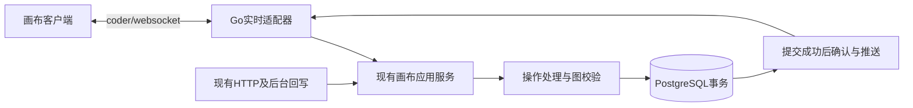

# 画布数据服务与DAG设计

更新：2026-10-21（结构整理）；文档确认状态沿原来源，未重新认定方案接受。

## 1. 摘要

以数据库权威提交保存完整画布，约束依赖图并保留回执和恢复边界。

本文按设计、用户故事与测试场景结构整理。原需求、确认结论和历史验证沿来源记录保留；当前实施进度、剩余工作及阻塞项统一见 [BACKLOG](../../BACKLOG.md)。

### 1.1 产品定义：摘要（Summary）

来源：原PRD《07-画布数据库持久化与DAG》第1节。

让创作者关闭页面、清除浏览器数据或换设备后，仍能从数据库恢复已确认的完整画布。此次交付围绕可靠保存、合法依赖关系和安全迁移，建立实时同步及OT共同使用的权威数据基础。

## 2. 参与者

使用者与参与职责：保存画布的创作者及数据、数据库消费者。维护职责及确认人沿下方原来源记录；未给出姓名的，不补造人员或排期。

### 2.1 产品定义：目标用户（Market Segments）

来源：原PRD《07-画布数据库持久化与DAG》第4节。

| 用户细分                 | 要完成的任务与问题                                                 | 使用情境及约束                                                           | 首轮聚焦原因                                       |
| ------------------------ | ------------------------------------------------------------------ | ------------------------------------------------------------------------ | -------------------------------------------------- |
| 跨会话继续创作的画布用户 | 创作内容不能依赖某个浏览器，错误关系和迟到结果不能破坏已保存内容。 | 关闭重开、换设备、恢复旧画布及引用生成素材；必须具有当前画布和资产权限。 | 直接对应原始需求及本专项目标；尚无新增用户访谈结论 |

## 3. 背景

需求来源：[08-画布数据库持久化与DAG需求](14-画布数据服务与DAG设计.md#35-需求原文与规则文首来源与范围)。产品范围来源：[07-画布数据库持久化与DAG](14-画布数据服务与DAG设计.md#33-产品定义文首来源与范围)。

下方保留来源的日期、适用范围与确认状态。早期盘点和历史结果只支持其原时点；整理文档不重新执行实现、测试、迁移或发布。

### 3.1 文首来源与范围

来源：原设计《14-画布数据服务与DAG设计》文首。

| 项目       | 内容                                                                                                                                                                                                                                       |
| ---------- | ------------------------------------------------------------------------------------------------------------------------------------------------------------------------------------------------------------------------------------------ |
| 版本与更新 | v0.8；2026-10-20                                                                                                                                                                                                                           |
| 维护与评审 | 画布后端、前端、数据库及测试职责；实际人员与评审人未指定                                                                                                                                                                                   |
| 适用范围   | 现有Go进程和PostgreSQL内的数据权威、节点/关系、DAG及保存恢复；实施状态见设计14                                                                                                                                                             |
| 上游基线   | [需求08](14-画布数据服务与DAG设计.md#35-需求原文与规则文首来源与范围) v0.4：全部DATA规则；保留既有结构；新任务见[设计模板](../templates/01-设计模板.md)                                                                                    |
| 下游关联   | [实时设计15](15-画布WebSocket实时通道设计.md)、[OT设计17](17-画布OT处理设计.md)；[PRD07](14-画布数据服务与DAG设计.md#33-产品定义文首来源与范围)、[设计14](#1-摘要)；均为待评审草稿；[调研16](16-画布持久化与协同成熟方案调研.md)为选型依据 |

实施进度及调度字段见 [BACKLOG 第4.15节](../../BACKLOG.md#415-14-画布数据服务与dag设计文首来源与范围)。

### 3.2 文首来源与范围

来源：原任务文档《17-画布数据库持久化与DAG实施计划》文首。

| 项目           | 内容                                                                                                                                                                                                                                                               |
| -------------- | ------------------------------------------------------------------------------------------------------------------------------------------------------------------------------------------------------------------------------------------------------------------ |
| 版本与更新     | v0.4；2026-10-20                                                                                                                                                                                                                                                   |
| 规划与交付责任 | 规划负责人及人员未指定；任务按实际所需职责列出，不代表已安排团队                                                                                                                                                                                                   |
| 上游基线       | [08-画布数据库持久化与DAG需求](14-画布数据服务与DAG设计.md#35-需求原文与规则文首来源与范围) v0.4 → [14-画布数据服务与DAG设计](#1-摘要) v0.8 → [07-画布数据库持久化与DAG](14-画布数据服务与DAG设计.md#33-产品定义文首来源与范围) v0.4；任务由设计14第7.18节能力拆解 |
| 计划适用范围   | 仅画布数据库持久化与DAG；跨专项通过明确产物依赖，不作为合并总计划                                                                                                                                                                                                  |

实施进度及调度字段见 [BACKLOG 第4.148节](../../BACKLOG.md#4148-17-画布数据库持久化与dag实施计划文首来源与范围)。

### 3.3 产品定义：文首来源与范围

来源：原PRD《07-画布数据库持久化与DAG》文首。

| 项目       | 内容                                                                                                                                        |
| ---------- | ------------------------------------------------------------------------------------------------------------------------------------------- |
| 版本与更新 | v0.4；2026-10-20                                                                                                                            |
| 文档状态   | 草稿；交付细化及接受条件待评审；已有DAG后端及前端HTTP数据库接入切片，整体未验收，进度见设计14                                               |
| 维护与决策 | 维护人与最终接受人未指定；按专项交付职责安排                                                                                                |
| 交付范围   | 仅画布数据库持久化与DAG首轮范围；不合并另外两个专项                                                                                         |
| 上游依据   | [08-画布数据库持久化与DAG需求](14-画布数据服务与DAG设计.md#35-需求原文与规则文首来源与范围) v0.4 → [14-画布数据服务与DAG设计](#1-摘要) v0.8 |
| 迭代与证据 | [17-画布数据库持久化与DAG任务与验证](#1-摘要) v0.4；AC-DATA-01～08，已有后端局部证据、完整接受未完成                                        |

### 3.4 产品定义：背景（Background）

来源：原PRD《07-画布数据库持久化与DAG》第2节。

原始诉求明确要求整个画布节点信息保存在数据库、不使用本地持久存储，并补齐DAG结构。设计14的源码核对表明已有节点、边、事务、日志及回执基础；全字段覆盖、终态拒绝、新操作输入版本和历史关系保护仍需实施验证，不能把已有表等同于完整交付。本文将设计归纳为用户价值、首轮交付能力和接受条件；计划仅据本文拆故事与任务，详细机制继续引用设计。

### 3.5 需求原文与规则：文首来源与范围

来源：原需求《08-画布数据库持久化与DAG需求》文首。

| 文档管理项 | 内容                                                                  |
| ---------- | --------------------------------------------------------------------- |
| 版本与更新 | v0.4；2026-10-20；用户明确彻底退出画布本地存储及恢复链路              |
| 状态与接受 | 用户已提出方向并要求精准拆分；本文细化规则仍待评审，未实施或验收      |
| 方法与来源 | 沿用pm-product-strategy的product-strategy分析；原始诉求及本轮拆分要求 |
| 目标       | 画布内容可靠存入数据库，可跨会话恢复，持久化图始终满足业务约束。      |
| 责任与追踪 | 画布产品、前后端、测试职责；具体人员未定；追踪主题为DATA              |
| 本轮范围   | 需求整理；不改代码、数据库、协议，不迁移或上线                        |

### 3.6 需求原文与规则：原始需求与问题

来源：原需求《08-画布数据库持久化与DAG需求》第1节。

用户明确提出“节点信息保存在数据库中，不使用本地存储”，并要求设计画布数据库服务及DAG数据结构。本需求回答：**保存什么、以哪里为准、怎样的图才合法、已保存数据如何恢复。**

数据库存储与DAG在本稿作为同一个数据需求的两个子能力：前者定义持久状态，后者定义该状态的结构和合法性；两者分别有验收项。同步通道和并发转换分别交由[实时同步需求09](15-画布WebSocket实时通道设计.md#35-需求原文与规则文首来源与范围)、[协同一致性需求10](17-画布OT处理设计.md#35-需求原文与规则文首来源与范围)，不作为本需求独立验收的前提。

沿用[需求06](10-画布组件实现调研与迁入设计.md#37-需求原文与规则文首来源与范围)、[需求07](13-项目与画布创建及一致性详细设计.md#310-需求原文与规则文首来源与范围)的一项目一主画布、资产与项目归属规则，以及[用户系统需求](01-用户系统总体设计.md#36-需求原文与规则文首来源与范围)的权限合同。

“画布节点信息入库、不使用本地存储”是用户已明确的方向。本文将其细化为画布业务内容、草稿、节点、边、快照、待发送操作不写入localStorage、sessionStorage、IndexedDB或其他浏览器持久缓存；运行时内存副本可以存在。待设计核对的是具体字段、共享草稿调用及非业务偏好的边界，不能以“边界待定”为由保留正式画布节点内容的常态本地持久化，也不扩大为清理全站登录、偏好或其他模块数据。

### 3.7 需求原文与规则：现状依据与范围

来源：原需求《08-画布数据库持久化与DAG需求》第2节。

沿用2026-10-20本轮前序静态检查：`backend/db/schema.sql`已有`canvas.document/node/edge/node_input/command_log/save_receipt`；`backend/internal/canvas/adapter/postgres/store.go`已有事务、版本检查与幂等回执。正式`frontend/src/app/canvas/editor.tsx`的`persistCanvas`仍通过`frontend/src/components/generation/draft-save.ts`的IndexedDB保存本地恢复分支；`frontend/src/app/canvas/preview/data.ts`也有本地持久化。已有边类型包括`input/reference/promote/annotation`。

以上是本轮实现前的源码基线，不代表实现后的当前状态；运行证据见设计14。新要求与原“本地恢复分支”方向有变化，当前用户再次明确完全清理画布本地存储实现：移除读写及本地恢复入口，直接使用后端服务；保留历史验收记录，不自动删除存量本地数据。

纳入：内容与布局持久化、逻辑数据模型、DAG合法性、稳定引用、版本与持久回执、旧数据库迁移及画布本地存储实现退出。

排除：WebSocket连接管理、OT转换、多人交互界面；DAG自动执行、级联重跑与计费授权也不因建模而自动纳入。媒体二进制继续沿对象存储合同。

### 3.8 需求原文与规则：拆分来源追踪

来源：原需求《08-画布数据库持久化与DAG需求》第8节。

旧稿RT编号仅用于追踪来源，现行规则以本文新编号为准，不保留旧合并文档为第二事实来源。拆分不代表新增实施授权。

| 旧稿标识  | 现行标识           |
| --------- | ------------------ |
| FR-RT-01  | FR-DATA-01         |
| FR-RT-02  | FR-DATA-02         |
| FR-RT-04  | FR-DATA-03         |
| FR-RT-09  | FR-DATA-04         |
| FR-RT-10  | FR-DATA-05         |
| DR-RT-01  | DR-DATA-01         |
| DR-RT-02  | DR-DATA-02         |
| DR-RT-03  | DR-DATA-03         |
| DR-RT-04  | DR-DATA-04         |
| DR-RT-05  | DR-DATA-05         |
| DR-RT-06  | DR-DATA-06         |
| DR-RT-07  | DR-DATA-07         |
| BR-RT-01  | BR-DATA-01         |
| BR-RT-02  | BR-DATA-02         |
| BR-RT-03  | BR-DATA-03         |
| BR-RT-04  | BR-DATA-04         |
| BR-RT-05  | BR-DATA-05         |
| BR-RT-06  | BR-DATA-06         |
| BR-RT-07  | BR-DATA-07         |
| BR-RT-10  | BR-DATA-08         |
| BR-RT-11  | BR-DATA-09         |
| NFR-RT-01 | NFR-DATA-01        |
| AC-RT-01  | AC-DATA-01         |
| AC-RT-02  | AC-DATA-02         |
| AC-RT-04  | AC-DATA-03         |
| AC-RT-11  | AC-DATA-04         |
| AC-RT-12  | AC-DATA-05         |
| DEC-RT-02 | 第7.24节断线行为   |
| DEC-RT-03 | 第7.24节DAG语义    |
| DEC-RT-07 | 第7.24节迁移与视口 |
| DEC-RT-08 | 第4.7节假设验证    |

原DEC-RT-01的存储解释、DEC-RT-06的数据规模/历史/恢复部分归第7.24节；新增BR-DATA-10、NFR-DATA-02、AC-DATA-06用于显式承接原稿共享权限与图质量边界。

## 4. 目标

以数据库权威提交保存完整画布，约束依赖图并保留回执和恢复边界。目标的规则、量化条件与非目标沿需求原文及下方已确认设计，不增加未经确认的指标。

### 4.1 设计目标、现状与约束

来源：原设计《14-画布数据服务与DAG设计》第1节。

数据库是唯一权威画布，已确认内容可以跨会话恢复，依赖关系保持合法。延续一项目一主画布、项目名称及素材权限；媒体文件沿对象存储，生成与费用沿原业务入口。

2026-10-20静态核对发现：[领域模型](../../backend/internal/canvas/domain/document.go)已有节点、连线和编辑命令；[存储实现](../../backend/internal/canvas/adapter/postgres/store.go)已有文档行锁、版本检查、图保存、输入版本、日志、回执和outbox事务；[保存回执](../../backend/internal/canvas/adapter/postgres/draft_save.go)已有按用户和幂等键加事务锁、核对请求hash的能力。现有expected_revision不符会拒绝，尚无OT；这些是源码事实，不是运行验收。

### 4.2 原始需求复核与范围结论

来源：原设计《14-画布数据服务与DAG设计》第1.1节。

| 原始诉求                                 | 承接及复核结果                                                    | 必须纠正或保留的边界                                                                       |
| ---------------------------------------- | ----------------------------------------------------------------- | ------------------------------------------------------------------------------------------ |
| 整个画布节点信息存数据库，不使用本地存储 | 本文第5、6、8节；AC-DATA-01、02、07、08                           | 完整配置与未知字段保护不能以只列样例代替；画布本地持久化和恢复链路整体退出                 |
| 必要数据库服务与DAG                      | 本文第4、5节；AC-DATA-03～06                                      | 复用表及事务，DAG只约束依赖子图；第7.8节按实际配置及写入口分类，未知历史关系有明确保护规则 |
| WebSocket更新及后续多人基础              | [设计15](15-画布WebSocket实时通道设计.md)第4～6节；AC-SYNC-01～04 | 编辑上行、确认、下行均覆盖；补初始化完成标记、终态回执及发送权限，单实例是本版建议范围     |
| OT处理并发一致性                         | [设计17](17-画布OT处理设计.md)第4～7节；AC-COL-01～06             | 设计17第4.4、4.6节已确定受限富文本算法适配和逐字段操作；性质与运行验证仍是实施验收条件     |

结论：三个方向均有承接；本版进一步明确富文本适配、全字段操作映射和存量关系分类处理。设计决策已落到现有类型及入口，仍待评审；实现正确性、真实存量盘点和运行指标另列第8.2节，不将文档完整等同于验收。撤销、个人视口和首期部署范围属于需求细化，不能冒充用户逐项确认。

### 4.3 三份设计一致性复核与落地结论

来源：原设计《14-画布数据服务与DAG设计》第1.2节。

| 核对点             | 本次发现及修正                                                                                           | 验证与计划承接                                                                        |
| ------------------ | -------------------------------------------------------------------------------------------------------- | ------------------------------------------------------------------------------------- |
| 图权威与协议       | 三份均使用同一PG提交、单文档revision及服务端接受顺序；快照JSON与操作流分工一致                           | 设计14负责存储，设计15负责实时，设计17负责OT及联合接受；不新增第二图或服务            |
| OT基准及集合       | 补旧基准校验和因果转换；同锚点新增补双向规则；并发集合重排改为局部明确冲突，避免未证明的通用Move OT      | 设计17第4.2、4.5节；先以固定反例及Go/TS性质验证再接入全图                             |
| 原子批次与现有代码 | 原saveInputs重复Apply不适合新操作；明确一次求值、每批最终输入版本；业务reject不能通过事务error回滚掉回执 | 本文第7.4节；真实PG故障与版本回归                                                     |
| 恢复及旧写入口     | history_unavailable写终态；ack补齐身份/版本，ready区分可读可写；移除同基准旧整配置写入例外               | 设计15第7.5节、设计17第7.17节；重连/旧客户端测试                                      |
| Undo及复杂度       | 保留自己的可证明贡献；重叠删除保守整批拒绝；不建永久字符墓碑、跨刷新历史产品或通用树引擎                 | 设计17第7.18节；插入、无重叠删除及冲突Undo分别验证                                    |
| 必要范围与非目标   | 节点全字段、资产权限、DAG、WebSocket双向、富文本/引用及恢复不能省；多实例房间、离线编辑、光标邀请不纳入  | 三个原需求分别由PRD07/08/09定义交付，再由设计14/18/19拆解；各自验收，联合接受归设计17 |

交接责任以以下产物为界；同一能力只实现一次，其他专项通过接口消费并补各自层级的验证：

| 产物                                    | 唯一实现归属                                        | 消费与验收边界                                                                      |
| --------------------------------------- | --------------------------------------------------- | ----------------------------------------------------------------------------------- |
| 有限操作、转换结果、前像/触碰元数据语义 | 设计17 T-COL-01、T-COL-08                           | 数据提供有界历史并持久化；转换内核不访问PG或socket                                  |
| 事务、输入版本、图约束与持久回执        | 设计14 T-DATA-01～03                                | OT输出候选及规范资料；数据统一检查当前权限/图并提交，WS只传递结果                   |
| 节点及系统写入适配／composer编辑适配    | 设计17 T-COL-03／T-COL-04                           | 前者排除后者负责的富文本、引用、标签与上传回调；不重复维护整配置差分                |
| 内存B/P/Q与网络恢复                     | 设计17 T-COL-05／设计15 T-SYNC-03                   | OT决定意图如何协调；WS决定何时连接、查证和交付消息，保存提示由WS接入消费协调器状态  |
| 旧入口版本门禁、迁移与回退演练          | 设计14 T-DATA-05                                    | OT移除旧控件整配置调用；数据统一封住服务端旧模型入口，避免双方各做一套门禁          |
| 专项证据与联合报告                      | 设计14 T-DATA-06、设计15 T-SYNC-05、设计17 T-COL-07 | 前两者各维护本专项AC；后者引用其证据，汇总OT证据并补AC-COL-06，不重复实现或整套重测 |

复核结论：修正后可按计划进入有退出条件的实现验证，当前没有确认需要新增基础服务或扩大产品范围。**文档一致不等于OT算法已证明**：首个算法关卡若出现无法解释的三方/编辑器反例，须修正设计再继续，不能绕过门禁、用全部拒绝或整图覆盖充当OT完成。容量、真实存量、身份/代理环境与产品细化接受仍是明确交付条件，不伪造已关闭。

### 4.4 三条文档链路复核（2026-10-20）

来源：原设计《14-画布数据服务与DAG设计》第1.3节。

本次保留需求08/09/10及其18项AC，各专项的原始规则、产品交付定义、技术机制和任务证据分别归入设计14/15/17，当前实施进度统一在BACKLOG维护。修正了原型与正式内核混在一个任务、隔离演练与生产切换混淆、专项验收被不相关Undo/全字段接入阻塞，以及验收表只有编号没有可检查预期的问题；来源元数据、个人视图、连接生命周期和NFR确认时点也已补齐承接。

复核后的候选范围是12个故事、19项任务；新T-COL-08承接原T-COL-02中已有的正式内核工作，不新增产品能力或独立服务。三份计划第8.1节逐项记录AC的主要实现任务、最小情境、预期与证据；任务依赖按交接产物推进，不按文件编号顺序等待整体完成。未发现需要新增基础设施、通用Move/格式化OT、离线持久缓存或第二份权威图的理由。

此为文档静态复核，不能确认OT实现已经正确。冲突/Undo/视口等产品细化、设计评审前的同步目标、真实旧库分类、实际身份/路由、人员容量及算法/运行证据仍未完成；它们是具名的后续关卡，不以本次文档检查冒充关闭。

### 4.5 迭代摘要

来源：原任务文档《17-画布数据库持久化与DAG实施计划》第1节。

| 摘要项                | 内容                                                                       |
| --------------------- | -------------------------------------------------------------------------- |
| Sprint Goal：迭代目标 | 已确认内容能独立从数据库恢复，非法图和重复请求不能产生部分或重复业务效果。 |
| Duration：迭代周期    | 未确认；当前是首轮候选交付拆解，选定容量后再按就绪故事编排迭代             |
| 主要风险              | 存量U关系或未知字段被有损解码；先交付可验证产物再扩展                      |

本计划将PRD能力逐项映射为故事、任务与接受证据，保留全部首轮需求；迭代选择不自动删除未就绪能力。本文只编写计划，不执行代码、数据库操作、提交、推送或发布。

实施进度及调度字段见 [BACKLOG 第4.149节](../../BACKLOG.md#4149-17-画布数据库持久化与dag实施计划迭代摘要)。

### 4.6 产品定义：目标（Objective）

来源：原PRD《07-画布数据库持久化与DAG》第3节。

已确认内容能独立从数据库恢复，非法图和重复请求不能产生部分或重复业务效果。

| 目标与关键结果 | 指标定义及适用人群                               | 当前基线与来源               | 目标及观察周期                                               | 数据来源或测量方式                 |
| -------------- | ------------------------------------------------ | ---------------------------- | ------------------------------------------------------------ | ---------------------------------- |
| 内容恢复       | AC-DATA-01、02、07覆盖的全部正式持久字段         | 已有存储实现；完整验收未执行 | 首轮接受前逐项通过，清浏览器数据后读回相同                   | 真实浏览器、API、隔离PG及字段对照  |
| 安全保存与恢复 | AC-DATA-03～06、08中的图、权限、原子性及断线情境 | 无本轮执行证据               | 首轮接受前非法修改零部分写入，重试一次效果；迁移与回退可复现 | 事务故障、旧库样本、回执及恢复报告 |

以上是发布前的行为接受，不代表已取得用户增长或线上稳定性结果；暂无相应业务统计，不虚构指标。

### 4.7 需求原文与规则：产品策略与成功标准

来源：原需求《08-画布数据库持久化与DAG需求》第3节。

| 维度       | 本需求策略                                                                               |
| ---------- | ---------------------------------------------------------------------------------------- |
| 愿景       | 让画布成为可持续保存和继续编辑的创作资料                                                 |
| 用户与任务 | 优先个人创作者的关闭重开、换设备继续；兼顾后续协作的数据基础                             |
| 成本       | 复用已有数据库与权限；新增历史、索引和备份成本需要测量                                   |
| 价值       | 已保存内容不依赖某个浏览器，关系和生成来源可以解释                                       |
| 取舍       | 不依赖本地持久离线草稿；不把DAG建模扩大为执行引擎                                        |
| 指标       | 候选核心指标：正确恢复全部已确认编辑效果的会话数／需要恢复的会话数；同时观察图约束违规数 |
| 增长       | 保存可信可能改善继续创作和留存，待验证，不作营收承诺                                     |
| 能力       | 数据建模、事务、图校验、迁移回退、故障恢复与观测                                         |
| 可持续优势 | 积累可信创作资料和溯源；数据库与DAG本身不是独占优势                                      |

假设验证：用代表性画布完成重开、跨浏览器恢复和非法图提交演练，观察用户是否能准确区分已保存与未保存。无基线前不设定经营改善幅度。

## 5. 使用场景

参与者为保存画布的创作者及数据、数据库消费者；在下方定义的输入、对象状态、权限和环境条件具备时执行相应操作。各故事按其独立前置条件核对，不能把测试夹具当成真实业务条件。

### 5.1 用户流程与交互状态

来源：原设计《14-画布数据服务与DAG设计》第3节。

入口沿现有画布，不新增页面原型。流程为权限检查→加载数据库图→编辑→待确认→持久回执→已保存。

| 状态/触发            | 用户可见与允许动作                                                               | 退出或恢复                               | 对应验收       |
| -------------------- | -------------------------------------------------------------------------------- | ---------------------------------------- | -------------- |
| 加载中/加载失败      | 暂停编辑，失败显示重试；不把错误当空画布                                         | 成功加载同一权威版本                     | AC-DATA-01、07 |
| 可编辑/未保存/待确认 | 内存显示编辑；在途或仍有缓冲时不能显示全部已保存                                 | 接受回执且本地队列排空；拒绝显示具体原因 | AC-DATA-01、06 |
| 断线或确认不明       | 保留已确认可写权限及有界页面内意图，临时断线仅暂停发送；提示关闭会丢失未送达内容 | 重新授权、查回执、补日志或安全重建       | AC-DATA-08     |
| 无权限/只读          | 归档只读；无读权限清理私有画面，不再恢复旧账号草稿                               | 沿既有授权入口                           | AC-DATA-06     |
| 旧本地分支           | 不再读取、恢复或写入；不自动上传或删除历史记录                                   | 按第8.2节迁移处置                        | AC-DATA-04     |

### 5.2 产品定义：体验与状态

来源：原PRD《07-画布数据库持久化与DAG》第6.1节。

打开画布→授权与一致性读取→编辑并显示未保存→服务端提交成功后确认。读取失败不当作空图；结果不明保持待确认；关闭页面会丢失未送达内存内容。未知类型或无法解释的旧关系进入只读保护，画布本地持久化及恢复链路退出，旧浏览器记录不再参与运行或覆盖服务端。具体状态与错误按上游设计第3、6节，不另建原型或第二套业务规则。

## 6. 价值

保存、图校验与日志在同一原子边界成立，不依赖浏览器业务持久缓存。

### 6.1 产品定义：价值主张（Value Propositions）

来源：原PRD《07-画布数据库持久化与DAG》第5节。

| 六要素                   | 跨会话继续创作的画布用户                                                                     |
| ------------------------ | -------------------------------------------------------------------------------------------- |
| Who：谁                  | 跨会话继续创作的画布用户                                                                     |
| Why：为什么              | 创作内容不能依赖某个浏览器，错误关系和迟到结果不能破坏已保存内容。                           |
| What before：现在怎么做  | 使用现有画布与保存入口；目前不能据源码保证所有节点字段、只读及失败路径都能可靠恢复。         |
| How：如何改善            | 完整字段持久化、原子保存与依赖校验，并对历史数据执行可回退迁移。                             |
| What after：之后得到什么 | 已确认图可重开恢复；不合法修改明确失败；旧内容不会被静默覆盖。                               |
| Alternatives：替代方式   | 手工导出或只保留当前页面无法满足数据库权威与跨设备恢复；在现有Go、PostgreSQL能力上补齐闭环。 |

## 7. 方案

### 7.1 方案比较与选择

来源：原设计《14-画布数据服务与DAG设计》第2节。

| 方案                                  | 价值与成本                                      | 结论                           |
| ------------------------------------- | ----------------------------------------------- | ------------------------------ |
| 现有关系表＋统一事务＋coder/websocket | 复用权限、节点与业务引用，只有必要日志/回执增量 | 采用此最小方向；数据细节待评审 |
| 第二份协同图、独立OT服务或图数据库    | 引入双写、跨服务授权与运维，本次未有必要性证据  | 不纳入                         |
| 每次整图覆盖或只保存在浏览器          | 不能满足可靠保存和兼容并发修改                  | 不采用                         |

不新增快照、用户视图、独立回执表，不预建跨实例消息系统；保留现有表的必要增量和一致性读。保存失败恢复、授权、DAG及原始需求要求的OT不是可为“简化”删掉的内容。

### 7.2 模块职责与接口合同

来源：原设计《14-画布数据服务与DAG设计》第4节。

原条目的当前实施进度和剩余工作已迁入 BACKLOG；其确认范围及历史证据仍按原来源使用。

### 7.3 职责和依赖

来源：原设计《14-画布数据服务与DAG设计》第4.1节。

| 模块                     | 输入/输出及职责                                      | 不负责                             |
| ------------------------ | ---------------------------------------------------- | ---------------------------------- |
| 画布客户端/实时适配器    | 编辑意图、版本、回执与增量；连接职责见设计15         | 不决定保存成功、权限或DAG合法性    |
| canvas应用服务与领域规则 | 接收已认证主体和操作；转换后得到合法候选图或明确拒绝 | 不另存权威内存图，不直接调用供应商 |
| PostgreSQL适配器         | 锁定、校验事实、图/输入/日志/回执/原outbox原子提交   | 事务内不等待网络广播               |

这是运行流程；代码依赖仍按adapter → application → domain。实时适配器只负责连接与消息，业务规则沿现有canvas模块，OT具体边界见设计17。媒体文件继续用对象存储，生成任务与计费仍由原业务入口负责。

### 7.4 保存与读取合同

来源：原设计《14-画布数据服务与DAG设计》第4.2节。

复用现有授权读取与Execute入口并扩充操作模型；具体Go签名留给实现，不创建空接口层。读取返回同一版本图；提交输入为服务端主体、document_id、op_id、base_revision、operation_version和命令。成功仅指事务已提交；确定拒绝和结果未知区分，按下面路径处理。

HTTP残留写入、WebSocket编辑与后台结果回写最终遵循相同的授权、版本、图校验和事务规则；不是要求把后台生成伪装成客户端命令。

1. 校验输入与操作模型版本，按已有锁序核对账号、项目及写权限。
2. 复用用户＋幂等键的事务锁和save_receipt：同op_id同请求返回原接受或拒绝结果，不同请求拒绝且不得覆盖已有终态；操作身份为(actor_id,op_id)，不能将他人的相同UUID当成自己的回执。请求hash覆盖文档、基准版本、操作模型版本和原命令，不因重连而变化。
3. 锁定document行，读取当前图。尚未接入OT时只接受相同expected_revision；OT接入后按设计17利用连续日志和前像校验原基准，再转换基准之后的操作；还原/转换超出已验证预算或日志不完整时持久拒绝并要求重同步，不直接把旧操作改成最新版本。
4. 对候选结果检查图、资产/提示词引用和输入版本；图变更、revision、规范命令日志、输入快照、save_receipt、原有内容活动及outbox在一次事务提交。
5. 提交成功才确认并推送。数据库错误或提交结果未知均不能标“已保存”；用原op_id与原请求核实。广播失败不撤销数据库提交，客户端按版本恢复。回执本身提交失败时同样只能报告结果未知，不能先返回确定拒绝。

确定业务拒绝在同一幂等锁及文档锁下写rejected终态回执，不改图或revision，提交拒绝回执后才发送reject；用户调整后用新op_id。请求格式/认证失败为入口错误，瞬时故障或提交结果未知不是终态拒绝，不写成功回执、不以not_found宣称原请求失败；连接中断不明时只用原请求查证。若OT将整个批次转换为空操作，仍记录一次接受版本、零应用效果及成功回执；内部日志项保留原操作/触碰等处理元数据，复用当前回执约束，但不修改生成输入或内容活动。事务内不等待socket、Kafka或供应商。

现有GORM事务回调返回error会回滚，因此“业务拒绝已判定”须作为事务内结果值：在任何图写入前完成领域检查，写rejected回执，事务回调成功结束后再向协议返回reject。预期且可分类的唯一键/引用约束冲突，须在图写入前建立的SAVEPOINT内执行，失败先ROLLBACK TO SAVEPOINT撤掉全部图/输入/日志副作用，再写拒绝回执；外层授权/幂等/文档锁仍在保存点之前。未分类SQL错误、连接故障或死锁整笔回滚并返回可查证错误，重试仍用原信封；不能在已中止的PG事务中直接插拒绝回执。图、输入、日志或回执任一步失败均不能单独留下成功事实。

新operation_version的输入版本以**原子提交后的最终输入**为边界：同一存续Draft节点在一个接受批次内最多推进一次input_revision，SameInput未变不推进，新建Draft从1开始；保存最终合法输入快照。现行[saveInputs](../../backend/internal/canvas/adapter/postgres/draft_save.go)会对原命令逐条再Apply并保存中间草稿，不能原样复用于细粒度OT。新路径从一次候选求值的结果收集图、规范效果、输入版本和快照，持久层不再次执行原命令；内部步骤允许临时不满足跨字段约束，完整批次必须通过。旧输入版本及历史任务引用原样保留，不重编号；生成/报价只使用已确认的最终输入版本，编辑批次内不夹带执行生成。事务失败不保存中间输入，纯布局、标签协调和noop不额外产生输入版本。

行锁及保存点回滚依据[PostgreSQL锁文档](https://www.postgresql.org/docs/current/explicit-locking.html)和[ROLLBACK TO文档](https://www.postgresql.org/docs/current/sql-rollback-to.html)（2026-10-20核验）；项目锁序与授权竞态仍需实现验证。所有推进revision的写入必须有可解释日志；旧后台写入不能满足时，该段历史只允许重读快照，不能用于OT。

DR-DATA-04的客户端来源由入口附加内部source_kind（websocket/http/system）记录于现有日志/回执元数据；不接受客户端自行声明的系统身份。重连连接号只用于运行诊断，不作为操作身份或请求hash的一部分，不保存凭据，也不新增来源表/业务消息。

请求hash覆盖语义等价的规范JSON，原始请求与服务器规范化后的效果分开；字段顺序不应引起误判。同op_id若已有终态，重复请求返回相同结果；校验成功但被后续图约束拒绝的操作不能进入已接受日志。涉及生成的实际业务写入同样记录可解释效果，旧任务结果只补结果引用，不重写当前输入。

### 7.5 数据、状态与一致性

来源：原设计《14-画布数据服务与DAG设计》第5节。

原条目的当前实施进度和剩余工作已迁入 BACKLOG；其确认范围及历史证据仍按原来源使用。

### 7.6 现有表及必要增量

来源：原设计《14-画布数据服务与DAG设计》第5.1节。

继续使用[现有schema](../../backend/db/schema.sql)，不为WebSocket新增数据库或第二套图。

| 现有表              | 保留职责                                                            | 必要调整                                                                                                                                                                                                                                                                                                                                                                         |
| ------------------- | ------------------------------------------------------------------- | -------------------------------------------------------------------------------------------------------------------------------------------------------------------------------------------------------------------------------------------------------------------------------------------------------------------------------------------------------------------------------- |
| canvas.document     | 项目归属、名称、共享图revision                                      | 每个接受批次推进一次revision；当前integer上限继续受保护，本轮不预先改bigint                                                                                                                                                                                                                                                                                                      |
| canvas.node         | 稳定UUID、类型、标题、config JSONB、位置/尺寸、分组、资产与任务引用 | 所有业务字段入库；配置并发编辑按受支持字段处理，不能无条件替换整块config                                                                                                                                                                                                                                                                                                         |
| canvas.edge         | UUID、类型、方向、role/binding和同画布端点                          | 复用现有结构，补业务图校验；不新建relation_class列                                                                                                                                                                                                                                                                                                                               |
| canvas.node_input   | 不可变生成输入及input_revision                                      | 延续输入版本与任务结果绑定，布局修改不生成新输入版本                                                                                                                                                                                                                                                                                                                             |
| canvas.command_log  | 按document_id、revision记录接受后的命令                             | 拟增加op_id uuid、base_revision integer、operation_version integer，可空以兼容旧行；新模型必须填写，版本为正、基准不超过接受前版本；保留(document_id,revision)唯一键，增加(document_id,create_by,op_id)非空唯一索引；commands仍为数组，每项保留可广播的规范效果及仅服务器可读的处理元数据；元数据含原操作/基准、字段/集合触碰、必要前后像及文本位置映射，支撑基准还原、CAS和Undo |
| canvas.save_receipt | actor_id＋idem_key、请求hash、结果版本和响应                        | op_id复用idem_key；拟加status（accepted/rejected，旧行默认accepted），result_revision允许拒绝时为空；accepted仍要求>1，rejected必须为空，原因及observed_revision在response_body；保留现有用户＋幂等键唯一约束，不新建回执表                                                                                                                                                      |

上述日志与回执调整是拟议增量，尚未改DDL；业务拒绝也需终态回执，否则重连重试可能在首次拒绝后又被接受。撤销所需前值只保存本次实际改动的字段，删除记录必要的对象/引用前像；服务端生成并校验，不信任客户端声称的旧值，不每次保存整份画布。日志内撤销资料不原样广播；零应用效果的日志仍留元数据项，对外changes的commands可为空，客户端仍消费该revision。还须保留撤销判定所需的原始目标/区间和写入触碰信息；操作转换为noop也不能丢掉这部分归属证据，否则无法判断重叠删除或同值写入是否被他人触碰。operation_version是操作模型版本，不扩展成多套协议注册机制。新操作模型对应的日志必须完整；旧日志或未知写入无法解释时，返回需重同步，不能凭空转换。初版不自动清理日志、回执或删除标记；但每次转换/Undo读取的版本数、字节和耗时必须有实测上限，超限明确重同步/不可撤销，不以“全部保留”为由无限扫描。保留期限与容量在发布前按数据量评估。

当前关系表在一致性读事务中即可构成快照，不新增recovery_snapshot表。加载须读到同一revision的节点和边：使用同一REPEATABLE READ事务读取并完成权限校验，不能把数次独立查询拼成快照。

视口、选中、悬停和拖拽预览拟只放当前页面内存；拖拽结束的节点位置必须保存。个人视口恢复按DR-DATA-07是细化建议而非用户已确认必需能力；本版建议不做跨会话恢复，不新增user_view表；既有document.viewport仅保留兼容读取，不再作为其他人可覆盖的实时相机状态，也不删除历史值。此取舍须在评审确认，不能自行报告为用户已接受；需要恢复时应扩充服务端个人偏好而非恢复浏览器持久化。

### 7.7 全节点信息的保存边界

来源：原设计《14-画布数据服务与DAG设计》第5.2节。

下表中的“完整保存”包含所列类型的所有嵌套字段，不允许保存器只挑示例字段。配置以业务结构为边界，全部字段操作及并发裁决见[设计17第7.10节](17-画布OT处理设计.md#710-按现有类型的逐字段操作映射)，不再把逐字段映射留到实施时选择。

| 字段/类型                            | 数据库持久状态                                                                                                                                                                                                                      | 派生或瞬时状态                                                            |
| ------------------------------------ | ----------------------------------------------------------------------------------------------------------------------------------------------------------------------------------------------------------------------------------- | ------------------------------------------------------------------------- |
| 全部Node公共字段                     | id、title、node_type/action、config、x/y、width/height、parent_id、z_index、ref_type/id、input_revision、last_operation_id；后两项由业务服务维护                                                                                    | 选中、悬停、拖拽中间帧仅内存                                              |
| text、group、image/video/audio/model | config.text、config.collapsed及公共字段；媒体保存稳定资产ID                                                                                                                                                                         | 资源URL按权限生成，不作为资产身份                                         |
| image_generation/video_generation    | [Draft](../../backend/internal/canvas/domain/draft.go)完整字段；composer按[提示词Draft](../../backend/internal/prompt/domain/draft.go)完整保存document、references、modelVersion、mode、params、labelState、schemaVersion及嵌套内容 | 临时编辑选区、输入法状态不持久化；生成结果不混入用户草稿                  |
| generation                           | [GenerationConfig](../../backend/internal/canvas/domain/generation.go)的version、capability、model_profile_id、mode、prompt、params、output_count、inputs                                                                           | 任务执行状态由原operation业务管理                                         |
| batch_table                          | [BatchTableConfig](../../backend/internal/canvas/domain/batch_table.go)全部设置、reference_columns和rows；保留稳定ID、顺序及空输入槽                                                                                                | 运行进度读取任务事实                                                      |
| director                             | [DirectorConfig](../../backend/internal/canvas/domain/director.go)全部场景字段及objects/cameras/lights/shots/cover等嵌套配置                                                                                                        | 渲染对象、加载缓存只在内存                                                |
| timeline及受保护节点                 | [TimelineConfig](../../backend/internal/canvas/domain/timeline.go)全部轨道/片段/字幕/裁切字段保留；timeline在editable门禁下可编辑，不能整体标只读                                                                                   | 有last_operation_id等不满足editable条件的节点维持保护；渲染进度不混入配置 |
| Edge及输入引用                       | edge全部字段；配置内的真实输入绑定按其拥有者保存                                                                                                                                                                                    | prompt_reference显示线由输入绑定派生，不另存重复关系                      |

初始实现的强类型解码可能忽略未知字段；首轮DAG切片已用保留原文的NodeConfig解码与图只读保护阻止有损写入，项目复制和素材保留检查对不透明配置继续拒绝不安全处理。load提供read_only_reason；前端只读呈现、完整新操作模型及存量修复进度另按设计14接受，不能“读不懂后保存成空配置”。实施验收逐类型、逐字段往返读回；仅验证位置和纯文本不能算全节点验收。

### 7.8 DAG与删除语义

来源：原设计《14-画布数据服务与DAG设计》第5.3节。

图采用节点集合和有向关系集合；应用内按稳定节点ID建立邻接表。依赖方向为“来源节点 → 消费节点”；分组parent单独构成森林。下表是2026-10-20源码核对后的**分类规则**，不是已完成的生产库盘点。

[普通保存](../../backend/internal/canvas/adapter/postgres/store.go)的edge写入及[领域Connect](../../backend/internal/canvas/domain/document.go)只接受annotation且role/binding为空；[工程复制](../../backend/internal/canvas/domain/project_copy.go)也拒绝非annotation。schema允许input/reference/promote并不证明现有运行代码赋予了它们某种用途。本次backend生产代码搜索未找到这三类边的创建路径；不能据此声称数据库里没有历史记录。

### 7.9 现行关系来源的确定分类

来源：原设计《14-画布数据服务与DAG设计》第5.3.1节。

| 来源/实际拥有者                                                                                                    | 分类及方向                                           | DAG、编辑与删除规则                                                                                                                                                                           |
| ------------------------------------------------------------------------------------------------------------------ | ---------------------------------------------------- | --------------------------------------------------------------------------------------------------------------------------------------------------------------------------------------------- |
| canvas.edge的annotation，且role/binding为空                                                                        | 展示连线；保持存储方向                               | 不进入依赖DAG；允许视觉环，拒绝自环/非法端点；删节点同批删关联annotation；同方向同端点的普通标注为重复，反方向不是同一边                                                                      |
| batch_table.rows[].input_node_ids；validToolReferences                                                             | 当前节点输入；image资源节点→batch_table              | 以(owner_node_id,row_id,column_id)标识绑定，非空槽形成依赖；disabled行也保留并校验结构依赖，执行时仍沿enabled开关。只接受现行image/media_asset节点；删来源节点清空所有相应槽，保留行/列与空槽 |
| director.objects[].source_node_id；validDirectorReferences                                                         | 场景素材输入；model资源（billboard为image）→director | 来源节点存在时计入结构依赖，asset_id必须与节点引用一致；删来源时将其ref_id保留到asset_id并清空source_node_id，不删除场景物体                                                                  |
| timeline.clips[].node_id；validTimelineReferences                                                                  | 时间线素材输入；与clip.kind相符的资源→timeline       | 来源节点存在时计入结构依赖；删来源时保留asset_id并清空node_id，不删除片段。text/subtitle不得带素材节点/资产引用                                                                               |
| composer.references[].source（media/subject）；draft_sources核验                                                   | 固定来源ID/版本的资产或主体引用；不是canvas.node ID  | 不生成节点依赖边；sourceId不能与node UUID按字符串碰巧相等匹配。删除来源资源节点不删除已固定的绑定；素材撤权/失效沿资产业务验证                                                                |
| composer.pending_upload                                                                                            | 当前用户上传尝试身份                                 | 不进入节点DAG；完成后经代次/attempt检查换成media来源，不新增自动生成任务                                                                                                                      |
| generation.inputs[].media_asset_id；director仅asset_id的物体、panorama/cover/screenshots；timeline仅asset_id的clip | 直接资产引用                                         | 不进入节点DAG；继续资产存在性/项目权限校验，不自动寻找“同素材节点”并建立依赖                                                                                                                  |
| 前端prompt_reference显示线及connectedReferenceSources的annotation候选                                              | 从绑定或邻接关系派生的UI提示                         | 不作为依赖事实；用户选择素材后以真实持久绑定为准，画线本身不等于消费最新节点输出                                                                                                              |
| node.parent_id                                                                                                     | 分组归属：父group→子node                             | 只检查父子森林，不进入输入DAG；解除分组保持成员世界坐标                                                                                                                                       |
| director内部camera/shot/object/骨骼引用；timeline.track_id                                                         | 同一配置内的对象关系                                 | 用现有ID和业务键检查存在性/类型，删除同批清理或明确拒绝；不变成canvas节点边                                                                                                                   |
| node_input、last_operation_id及任务结果的输入版本关联                                                              | 已冻结输入/执行来源                                  | 沿原业务不可变事实保存，不当作当前执行依赖；历史结果不得改写当前配置                                                                                                                          |
| canvas.edge的input/reference/promote，或带role/binding的annotation、未知类型/载荷                                  | 未支持的历史业务关系U                                | 本版无已核实生产写入口，全部走第7.10节保护；不根据名称猜成“input依赖/reference资料/promote历史”，不自动改类或删除                                                                             |

源码依据：[批量引用检查与清理](../../backend/internal/canvas/domain/batch_table.go)、[导演引用检查与清理](../../backend/internal/canvas/domain/director.go)、[时间线引用检查与清理](../../backend/internal/canvas/domain/timeline.go)、[提示词来源核验](../../backend/internal/prompt/adapter/postgres/draft_sources.go)、[前端引用候选与绑定](../../frontend/src/app/canvas/composer/references.ts)。前三类依赖来自配置本身，不复制存成canvas.edge，也不使删除显示线同时删除输入。

同一节点对可以被多个行/列/片段合法引用，不能当作duplicate_relation拒绝。业务关系按拥有者＋槽位/对象ID区分；构建邻接表时相同来源/目标合并为一条可达边，原绑定和删除清理仍全部保留。未来若引入“消费生成节点最新输出”的能力，必须新增明确输入合同与分类，不能借annotation或资产ID暗中实现。

### 7.10 存量记录的确定处理流程

来源：原设计《14-画布数据服务与DAG设计》第5.3.2节。

不新增relation_class字段、关系注册服务或迁移数据库。本版分类在读取/校验时由上述闭合分支派生，记录定位使用document_id、edge_id或配置路径。

1. **已知合法**：普通annotation及已知配置输入按第7.9节检查。加载时验证端点同画布、输入类型/资产匹配、内部引用、分组森林和依赖DAG；只有完整可解释且通过检查才可标记图已验证。
2. **已知损坏**：缺失端点、非法类型/资产、分组环、依赖环归入invalid_graph；保留原始数据与原因。初版该画布只读，停止新输入执行/复制，不自动删边“修好”。已有任务终态仍由所属业务幂等入账，不因画布隔离丢失任务事实。
3. **未知U**：保留原载荷，不认证整图DAG合法。为避免绕过未知依赖，初版同样让该画布只读并停止新输入执行/复制；不尝试只冻结某个端点，因为未知绑定可能影响其他节点。其他已验证画布正常使用。未知载荷必须在强类型解码前被检测，不能先解码丢字段后再保存。
4. **修复与解封**：实施迁移前只读盘点每个U/invalid记录的类型、role/binding结构、端点、对应生产写入证据和数量；内容中可能有私有数据，报告仅列定位及错误类别。由所属业务给出映射或修复，不默认删除；备份后经有审计的显式修复批次重检整图，通过后解除只读。若查到真实的历史生产合同，再补该合同的精确分类及用例，不能因为字段名相似自动套用。

这明确了当前每一种可见来源及未知存量分支的行为，设计上不再留“reference可能是任何用途”的开放判断。实际数据库中U/损坏记录的数量、样本和修复工作属于实施前盘点，本轮未连接业务数据库，不能宣称已经分类完每条生产记录。

### 7.11 事务内校验及删除

来源：原设计《14-画布数据服务与DAG设计》第5.3.3节。

同一提交先在候选图上完成全部命令及规范清理，再检查：端点同画布、节点/输入类型和资产权限、按绑定身份去重、分组无环、依赖无环。Kahn拓扑检查复杂度O(V＋E)；与写入持有同一文档锁，并发修改不能先各自通过旧图后拼出环。现行可写输入均来自资源节点，普通用户不能直接创建任意input边；抽象成环测试属于领域校验向量，不伪造当前UI已有自由工作流接线。

删资源节点时：annotation删除、batch槽置空、director/timeline将节点引用固定成已有asset_id，三者与删除一次提交并广播规范效果；资产本体不删。若所属节点受保护、发生未知关系或无法证明绑定合法，整批拒绝。其他配置内对象删除依照设计17逐字段规则。DAG定义仅承担结构校验，不附带自动调度、级联重跑或计费。

### 7.12 异常、安全与恢复

来源：原设计《14-画布数据服务与DAG设计》第6节。

| 条件与发现方式                      | 系统及用户结果                                     | 恢复与验证                                            |
| ----------------------------------- | -------------------------------------------------- | ----------------------------------------------------- |
| 数据库失败/提交结果未知             | 不确认保存、不先广播；不把超时转为确定拒绝         | 原op_id查证；事务故障及ACK丢失测试，AC-DATA-08        |
| 非法引用、成环或受保护删除          | 整批拒绝，图不变，持久拒绝回执避免迟到重试再次生效 | 调整意图后新op_id，AC-DATA-03、05、06                 |
| 未知节点/配置字段或无连续可解释日志 | 阻止有损写入或转换，不吞字段                       | 当前模型升级/只读，重读快照并保留会话意图，AC-DATA-07 |
| 权限撤销、账号切换或归档            | 最新授权决定读写；禁止旧账号内容串入新会话         | 按设计15断开/只读，AC-DATA-06                         |
| 旧任务迟到                          | 保存结果来源而非覆盖新输入                         | 不重复生成或收费，AC-DATA-05                          |

正式画布业务数据不写浏览器持久缓存，加载失败不覆盖数据库；具体迁移见第8.2节。日志只记录必要ID/版本/错误分类，不输出凭据及完整提示词。

### 7.13 候选待办与就绪检查（Definition of Ready）

来源：原任务文档《17-画布数据库持久化与DAG实施计划》第3节。

用户故事按本节下方的统一字段展开；原优先级、估算、候选/承诺及就绪记录已迁入 BACKLOG。

实施进度及调度字段见 [BACKLOG 第4.153节](../../BACKLOG.md#4153-17-画布数据库持久化与dag实施计划候选待办与就绪检查definition-of-ready)。

### 7.14 ST-DATA-01：作为创作者，希望提交结果、输入版本和回执一致，以免重复或丢失修改

**故事 ID 与标题：** ST-DATA-01；作为创作者，希望提交结果、输入版本和回执一致，以免重复或丢失修改。

**描述：** 作为创作者，希望提交结果、输入版本和回执一致，以免重复或丢失修改。

**来源与设计：** [17-画布数据库持久化与DAG实施计划的原故事及承接关系](14-画布数据服务与DAG设计.md#713-候选待办与就绪检查definition-of-ready)；需求来源见第3节。

**讨论：** PRD／需求来源：[07-画布数据库持久化与DAG](14-画布数据服务与DAG设计.md#33-产品定义文首来源与范围) §6.2 CAP-DATA-01；需求08；明确的AC：AC-DATA-01、05、06、08。候选、估算和就绪情况只在 BACKLOG 维护。

**确认条件：** 沿用原故事对应任务的退出条件及来源 AC／QA；正常结果、边界、失败和权限场景逐项核对，不将本次描述整理升级为新确认。

**追踪：** [CASE-DATA-01](#811-case-data-01作为创作者希望提交结果输入版本和回执一致以免重复或丢失修改)；实施状态见 [BACKLOG](../../BACKLOG.md)。

### 7.15 ST-DATA-02：作为创作者，希望连线和素材删除符合业务关系，以免留下非法图

**故事 ID 与标题：** ST-DATA-02；作为创作者，希望连线和素材删除符合业务关系，以免留下非法图。

**描述：** 作为创作者，希望连线和素材删除符合业务关系，以免留下非法图。

**来源与设计：** [17-画布数据库持久化与DAG实施计划的原故事及承接关系](14-画布数据服务与DAG设计.md#713-候选待办与就绪检查definition-of-ready)；需求来源见第3节。

**讨论：** PRD／需求来源：[07-画布数据库持久化与DAG](14-画布数据服务与DAG设计.md#33-产品定义文首来源与范围) §6.2 CAP-DATA-02；需求08；明确的AC：AC-DATA-03、05、06。候选、估算和就绪情况只在 BACKLOG 维护。

**确认条件：** 沿用原故事对应任务的退出条件及来源 AC／QA；正常结果、边界、失败和权限场景逐项核对，不将本次描述整理升级为新确认。

**追踪：** [CASE-DATA-02](#812-case-data-02作为创作者希望连线和素材删除符合业务关系以免留下非法图)；实施状态见 [BACKLOG](../../BACKLOG.md)。

### 7.16 ST-DATA-03：作为跨设备用户，希望所有已保存字段恢复且旧内容不丢失

**故事 ID 与标题：** ST-DATA-03；作为跨设备用户，希望所有已保存字段恢复且旧内容不丢失。

**描述：** 作为跨设备用户，希望所有已保存字段恢复且旧内容不丢失。

**来源与设计：** [17-画布数据库持久化与DAG实施计划的原故事及承接关系](14-画布数据服务与DAG设计.md#713-候选待办与就绪检查definition-of-ready)；需求来源见第3节。

**讨论：** PRD／需求来源：[07-画布数据库持久化与DAG](14-画布数据服务与DAG设计.md#33-产品定义文首来源与范围) §6.2 CAP-DATA-03；需求08；明确的AC：AC-DATA-02、04、07。候选、估算和就绪情况只在 BACKLOG 维护。

**确认条件：** 沿用原故事对应任务的退出条件及来源 AC／QA；正常结果、边界、失败和权限场景逐项核对，不将本次描述整理升级为新确认。

**追踪：** [CASE-DATA-03](#813-case-data-03作为跨设备用户希望所有已保存字段恢复且旧内容不丢失)；实施状态见 [BACKLOG](../../BACKLOG.md)。

### 7.17 ST-DATA-04：作为创作者，希望保存失败、断线和重开时看到真实状态

**故事 ID 与标题：** ST-DATA-04；作为创作者，希望保存失败、断线和重开时看到真实状态。

**描述：** 作为创作者，希望保存失败、断线和重开时看到真实状态。

**来源与设计：** [17-画布数据库持久化与DAG实施计划的原故事及承接关系](14-画布数据服务与DAG设计.md#713-候选待办与就绪检查definition-of-ready)；需求来源见第3节。

**讨论：** PRD／需求来源：[07-画布数据库持久化与DAG](14-画布数据服务与DAG设计.md#33-产品定义文首来源与范围) §6.2 CAP-DATA-04；需求08；明确的AC：AC-DATA-01～08。候选、估算和就绪情况只在 BACKLOG 维护。

**确认条件：** 沿用原故事对应任务的退出条件及来源 AC／QA；正常结果、边界、失败和权限场景逐项核对，不将本次描述整理升级为新确认。

**追踪：** [CASE-DATA-04](#814-case-data-04作为创作者希望保存失败断线和重开时看到真实状态)；实施状态见 [BACKLOG](../../BACKLOG.md)。

### 7.18 产品定义：首轮关键能力

来源：原PRD《07-画布数据库持久化与DAG》第6.2节。

CAP标识仅追踪本PRD交付能力，不替代上游FR/AC。每项由本专项计划的对应故事承接。

| 能力                       | 用户结果                                                             | 需求及设计来源                     | 接受条件               |
| -------------------------- | -------------------------------------------------------------------- | ---------------------------------- | ---------------------- |
| CAP-DATA-01 可靠原子保存   | 已保存数据和结果来源可信，重试不产生重复任务或费用                   | FR-DATA-01、05；设计14第4、5、6节  | AC-DATA-01、05、06、08 |
| CAP-DATA-02 合法图与引用   | 依赖无环、标注不被误禁；删除后无悬空业务引用                         | FR-DATA-03；设计14第7.8节          | AC-DATA-03、05、06     |
| CAP-DATA-03 完整恢复与迁移 | 全部持久字段从数据库恢复；旧数据库画布安全迁移，本地恢复链路整体退出 | FR-DATA-01、02、04；设计14第5、8节 | AC-DATA-02、04、07     |
| CAP-DATA-04 存储质量与接受 | 不靠浏览器缓存恢复；失败、规模和恢复边界有真实证据                   | NFR-DATA-01、02；设计14第7、8节    | AC-DATA-01～08         |

### 7.19 产品定义：技术与运营边界

来源：原PRD《07-画布数据库持久化与DAG》第6.3节。

复用现有Go服务、PostgreSQL关系表和事务，不新增第二份权威图、图数据库或独立数据微服务。节点全字段的保存与读回属于本文；编辑意图到操作的映射属于PRD09。本文提供日志、持久回执和原子提交，PRD08负责传输，PRD09负责转换；协同Undo所需前像由本文存储、其生成与解释规则由设计17维护。

### 7.20 产品定义：假设与未决问题

来源：原PRD《07-画布数据库持久化与DAG》第6.4节。

| 假设、依赖或问题                                                         | 决策影响             | 验证方式或建议              | 责任人或职责               | 关闭条件与阻断阶段                         |
| ------------------------------------------------------------------------ | -------------------- | --------------------------- | -------------------------- | ------------------------------------------ |
| 真实存量关系与未知字段分布尚未盘点                                       | 影响迁移与可编辑范围 | 设计14的只读盘点及脱敏演练  | 数据实施职责，人员未指定   | 切换前形成分类报告；无法解释的数据保留只读 |
| 规模、历史保留、恢复目标及迁移窗口未实测或接受                           | 影响资源配置与发布   | 设计14测量并形成运行手册    | 数据与运行职责，人员未指定 | 接受前明确限额及恢复目标并有证据           |
| 个人视口等其余设计细化待产品评审；用户已明确退出画布本地持久化及恢复链路 | 影响体验及兼容       | 按设计14第8.2节逐项记录结论 | 产品决策人未指定           | 受影响实现前确认；不自动扩大范围           |

### 7.21 需求原文与规则：功能需求

来源：原需求《08-画布数据库持久化与DAG需求》第4节。

以下为待评审细化，DATA前两项聚焦保存，第三项聚焦图，第四项聚焦迁移，第五项聚焦业务引用。

| 编号       | 触发与需要             | 必须具备的结果与异常边界                                                                                                    | 验收                               |
| ---------- | ---------------------- | --------------------------------------------------------------------------------------------------------------------------- | ---------------------------------- |
| FR-DATA-01 | 保存并重新进入画布     | 服务端恢复节点内容、位置、大小、分组、关系和必要生成配置；加载失败不得以空白画布覆盖原数据                                  | AC-DATA-01、AC-DATA-02、AC-DATA-07 |
| FR-DATA-02 | 当前浏览器数据被清除   | 已保存画布不受影响；正式画布不把业务内容写入浏览器持久存储                                                                  | AC-DATA-02、AC-DATA-08             |
| FR-DATA-03 | 构建或修改依赖关系     | 区分依赖、标注、归属与历史关系；用于执行依赖的子图有向无环，错误关系被拒绝并解释                                            | AC-DATA-03                         |
| FR-DATA-04 | 升级已有画布和恢复记录 | 盘点现有数据库；已保存内容完整保留，移除画布本地存储及恢复链路，旧浏览器记录不再读取/上传；禁止直接清库或自动覆盖服务端版本 | AC-DATA-04                         |
| FR-DATA-05 | 保存涉及引用和生成状态 | 引用指向真实且有权访问的资产/输入；同步、重放或连线不自动发起生成、计费或其他外部副作用                                     | AC-DATA-05                         |

### 7.22 需求原文与规则：逻辑信息需求

来源：原需求《08-画布数据库持久化与DAG需求》第5.1节。

以下不等于新表清单，详细结构、索引与约束进入设计。

| 编号       | 对象               | 信息与约束                                                                                                                                                                                                         |
| ---------- | ------------------ | ------------------------------------------------------------------------------------------------------------------------------------------------------------------------------------------------------------------ |
| DR-DATA-01 | 画布文档           | 稳定标识、项目归属、版本及生命周期；沿用一项目一主画布和名称合同                                                                                                                                                   |
| DR-DATA-02 | 节点               | 稳定标识、类型、内容/配置、布局、分组、资产及生成输入引用、必要版本信息；节点内容以数据库为权威                                                                                                                    |
| DR-DATA-03 | 关系               | 稳定标识、语义类型、方向、端点及需要时的端口/绑定；不能引用不存在或无权引用的对象                                                                                                                                  |
| DR-DATA-04 | 操作与确认         | 操作身份、操作者、客户端来源、基于的版本、接受后的版本、操作内容与处理结果；支持幂等、重连核实、审计和恢复，保留周期待设计                                                                                         |
| DR-DATA-05 | 恢复基线           | 可读回一致版本的图状态，必要时结合操作历史恢复；快照机制、压缩与历史截断待设计，不强制新增快照表                                                                                                                   |
| DR-DATA-06 | 媒体               | 数据库保存业务元数据及稳定资产引用，媒体二进制沿对象存储合同；不把临时URL或浏览器对象URL当作唯一资产身份                                                                                                           |
| DR-DATA-07 | 个人视图与瞬时交互 | 建议视口属于用户个人状态，需要恢复时存服务端；选中、悬停、光标与拖拽预览可仅存内存。作为拖拽结果的最终节点位置仍必须入库，不能以“拖拽预览”为由免除保存。不得用他人的平移缩放覆盖当前视图；现有文档级视口需设计调整 |

**覆盖清单要求（FR-DATA-01、DR-DATA-02的设计交接）：** 对正式画布每一种现有可编辑节点逐项列出字段及归属，包括文本/富文本、媒体引用、生成草稿、分组和其他现有业务节点。每个字段须标为“数据库持久状态”“由持久状态可重建的派生值”或“当前会话瞬时状态”；不得以未列入示例为由漏存节点业务信息。类型定义与版本演进也须有兼容/拒绝规则，避免旧客户端读到新类型后整份保存删掉未知数据。该清单在设计中维护，不在需求中臆造现有节点全集。

### 7.23 需求原文与规则：图和保存规则

来源：原需求《08-画布数据库持久化与DAG需求》第5.2节。

- **BR-DATA-01：DAG约束作用于明确具有依赖语义的子图。** 普通标注线可以用于表达想法，不能仅因形成视觉环就当作执行依赖错误。`input/reference/promote`各自是否进入依赖子图，必须结合实际业务逐一映射。
- **BR-DATA-02：服务端在接受变更时保证图合法。** 包括端点存在、所属范围、节点/端口兼容、自环、重复语义关系和有向环等；并发下也须成立，不能只依靠客户端连线检查。
- **BR-DATA-03：分组归属与依赖分开。** 分组不得形成父子循环；移动分组不自动改变生成依赖。
- **BR-DATA-04：删除必须有完整结果。** 建议同一接受单元处理节点及其相关可编辑边；受保护业务关系的删除限制沿既有合同，不能留下悬挂边或偷偷删除媒体资产。
- **BR-DATA-05：DAG表达依赖不等于执行引擎。** 拓扑顺序、上下游影响与输入溯源进入设计范围；自动调度、级联重跑和计费授权需独立需求。
- **BR-DATA-06：生成输入须能对应具体版本。** 下游输入来自哪个节点、哪份内容及哪次结果应可解释；编辑旧输入不自动改写已执行任务的历史。
- **BR-DATA-07：数据库提交成功才可确认“已保存”。** 收到WebSocket消息、写入内存或广播成功均不能替代持久化确认；数据库提交成功但回执丢失时显示待确认，允许查证。
- **BR-DATA-08：不依赖持久离线草稿。** 不承诺断网编辑在刷新、关闭、浏览器崩溃后保留；页面内未确认修改必须可识别。临时断线仅暂停发送，最近一次服务端确认可写且基线可安全协调时，允许在当前页面继续编辑并保留有界内存队列；首次未授权、明确失权或无法安全重同步时暂停编辑。连接与恢复规则统一见需求09、设计15。
- **BR-DATA-09：所有写入遵循同一事实来源。** HTTP残留写入、WebSocket编辑、后台生成回写不能绕开版本、幂等、授权及图校验；初始化和资产上传可继续使用适合的现有接口。

**BR-DATA-10：授权贯穿读取与提交。** 无权访问者不得读取私有画布或写入；归档后沿既有只读规则。事务失败不得留下部分节点、边或成功回执。该规则对任何传输入口成立；实时订阅和撤权通知由需求09负责。

数据层提供稳定对象身份、提交版本、幂等处理结果及可读的一致状态；操作历史保留与恢复读取能力由本需求设计提供，需求09只消费，需求10的转换结果必须再次经过本需求图校验。

### 7.24 需求原文与规则：待决与设计交接

来源：原需求《08-画布数据库持久化与DAG需求》第7节。

| 事项                                                   | 关闭条件与责任                                                                                 | 阶段           |
| ------------------------------------------------------ | ---------------------------------------------------------------------------------------------- | -------------- |
| 本地存储边界、断线可编辑范围、个人视口                 | 页面内可编辑边界已按2026-10-21用户要求明确；前端盘点正式与共享草稿调用，断线状态交由需求09呈现 | 交互与数据设计 |
| input/reference/promote对应的DAG语义、端口和跨画布规则 | 产品与后端用真实业务实例逐一映射，明确删边、删节点与历史约束                                   | 图设计         |
| 旧未同步分支、已保存数据的迁移与回退                   | 定义身份校验、用户选择、增量迁移与恢复演练，禁止盲目覆盖                                       | 迁移设计       |
| 容量、操作历史期限、恢复目标                           | 测量代表性数据和部署能力，明确图规模、保留周期、RPO/RTO与性能预算                              | 设计及发布     |

后续专项设计承接FR-DATA-01～05、DR-DATA-01～07、BR-DATA-01～10、NFR-DATA-01～02与AC-DATA-01～08，形成数据模型、事务/约束、迁移与恢复方案；后续交付已由[PRD07](14-画布数据服务与DAG设计.md#33-产品定义文首来源与范围)和[设计14](#1-摘要)草稿承接，未实现/验收。数据库详细设计应复用现有能力，不先创建未来服务或表。

## 8. 实施与验收

### 8.1 质量保障与可验证性

来源：原设计《14-画布数据服务与DAG设计》第7节。

沿用pm-execution:test-scenarios；以下为待执行场景，不是测试结果。

| 前置与角色                   | 动作与预期结果                                                                                                        | 对应验收                    |
| ---------------------------- | --------------------------------------------------------------------------------------------------------------------- | --------------------------- |
| 有权限用户、全部现行节点样本 | 逐字段编辑并确认→清浏览器数据→另一浏览器重开；数据库字段与图完整，未知配置不会被删                                    | AC-DATA-01、02、07          |
| 两客户端、合法依赖图         | 领域向量检查相反依赖；真实入口删除批量/导演/时间线的共同素材节点、画标注环；槽置空/资产固定与删除原子完成，标注环允许 | AC-DATA-03、06              |
| 旧数据库及残留浏览器记录样本 | 备份→数据库迁移→恢复→回退演练；已保存数据不丢，本地旧记录不读取/恢复/自动覆盖                                         | AC-DATA-04                  |
| 旧输入任务执行中             | 编辑新输入→旧结果返回→重试保存；保留新输入，结果绑定旧版本，不新增任务/费用                                           | AC-DATA-05                  |
| 在途编辑及故障注入           | 提交前/后断网、进程重启、刷新；只确认真实提交，重复请求一次效果，未发送内容不承诺刷新恢复                             | AC-DATA-08；NFR-DATA-01、02 |

FR-DATA-01～05由第3～6、8节承接，DR-DATA-01～07及BR-DATA-01～10由第4～6节承接。NFR-DATA-01～02记录保存/读取耗时、锁等待、图规模与恢复结果；容量、历史期限、RPO/RTO在发布前明确测量条件及目标，不能把无指标当已验收。字段覆盖逐项对照第7.7节、设计17第7.10节及源码类型；额外验证同素材多个槽不被误判重复、sourceId碰巧等于node ID也不造依赖、未知promote/input/reference整图只读、损坏关系无自动删除。以上仅为设计校验，未运行测试。

### 8.2 兼容、发布边界与评审

来源：原设计《14-画布数据服务与DAG设计》第8节。

正式画布及preview的节点、边、草稿、快照、待发送命令不再写localStorage、sessionStorage、IndexedDB或缓存响应；运行时内存允许存在。加载失败显示重试，不用空图覆盖服务器。临时断线仅暂停发送，基线可安全协调且最近确认可写时允许继续编辑；明确失权或重同步不安全时暂停新编辑。保留当前页面未确认内容并提示关闭风险；刷新仅保证恢复数据库已确认内容。

按2026-10-20用户再次明确的范围，画布彻底移除浏览器业务持久化及本地分支恢复实现，不保留一次性迁移读写入口。正式画布只从后端读取已确认节点、边及完整配置，编辑通过现有命令接口入库；预览使用临时内存夹具。旧浏览器记录不再读取、恢复、上传或自动删除，也不能覆盖数据库。共享富文本在画布模式下同样不读写本地分支；其他模块存储不在本次清理范围。旧数据库先备份、盘点，再作增量迁移；schema.sql只用于空库。

切换协同写入时，旧整配置客户端不得与新操作模型混写。以服务器接受的操作版本检查控制写入口；不认识版本则拒绝编辑并提示升级。兼容构建能保留读取新数据，失败可切只读；不回退到会丢字段的旧写入逻辑。具体DDL及迁移脚本留到实现阶段。

先在隔离环境完成切换及回退演练，取得数据、实时及OT联合接受证据；生产正式切换是此后的发布动作，不是取得验收证据的前置条件。未解释的历史关系仍按只读保护。

补充切换次序：兼容读取与增量结构→所有写入口支持规范日志和新回执→客户端新操作模型→只开放已经证明的操作。拒绝回执新增后，旧replaySave不能把rejected反序列化为成功图；在写出新回执前升级读写双方，未兼容的旧构建不得回滚写入。个人视口不恢复是建议取舍，需评审，不自动删旧值。

| 待决或风险           | 影响/建议                                                     | 责任职责           | 关闭条件与阻断阶段                                                            |
| -------------------- | ------------------------------------------------------------- | ------------------ | ----------------------------------------------------------------------------- |
| 真实存量盘点与修复   | 第7.8节已明确已知分类、未知U及损坏图保护，不臆测生产数据      | 画布产品、后端     | 实施前实际行数/样本、备份及修复验证；未核实画布不解封，阻断这些画布的写入接受 |
| 全字段及写入口落实   | 设计17第7.10节已给映射；未知字段保护和后台/HTTP规范日志须实现 | 前后端、测试       | 类型往返、来源权限及全部写入口验证通过；阻断运行接受                          |
| 回执增量与锁序       | 拒绝也必须终态幂等，避免死锁                                  | 后端、数据库       | 迁移及并发重试设计审查；阻断存储实现接受                                      |
| 视口与断线编辑范围   | 不恢复视口、断线暂停为本版建议                                | 产品、前端         | 体验取舍确认；阻断相关产品范围接受                                            |
| 容量、历史与灾备目标 | 不能无限保留而没有运行预算                                    | 数据库、运维、测试 | 定义数据规模/期限/恢复目标并验证；阻断发布                                    |

| 评审日期与版本         | 接受范围                                                     | 确认来源       | 残余限制                                                                    |
| ---------------------- | ------------------------------------------------------------ | -------------- | --------------------------------------------------------------------------- |
| 2026-10-20；v0.6待评审 | 已选择coder/websocket、复用Go/PG、只做文档；其他规则未获确认 | 本会话用户指令 | 三项设计方案已明确；实际旧库盘点、OT实现及运行目标尚未验证，无实现/发布接受 |

### 8.3 团队可用性

来源：原任务文档《17-画布数据库持久化与DAG实施计划》第2.1节。

| 成员或实际职责                       | 休假、会议、值班及其他已知占用 | 关键能力或资源限制                                                       |
| ------------------------------------ | ------------------------------ | ------------------------------------------------------------------------ |
| 任务所列实施与验收职责；尚未指定人员 | 未提供                         | 与设计14、18、19可能共享人员和环境，须统一分配，不能重复计算同一人的时间 |

实施进度及调度字段见 [BACKLOG 第4.150节](../../BACKLOG.md#4150-17-画布数据库持久化与dag实施计划团队可用性)。

### 8.4 本轮故事

来源：原任务文档《17-画布数据库持久化与DAG实施计划》第4.1节。

| 顺序与故事                | 对迭代目标的贡献                         | 估算               | 负责人                 | 前置依赖                                                                         |
| ------------------------- | ---------------------------------------- | ------------------ | ---------------------- | -------------------------------------------------------------------------------- |
| ST-DATA-01 可靠保存       | 以免重复或丢失修改。                     | 待估算（理想工时） | 职责见任务；人员未指定 | 操作合同交接后实现；事务失败与回执行为需验证                                     |
| ST-DATA-02 合法依赖       | 以免留下非法图。                         | 待估算（理想工时） | 职责见任务；人员未指定 | 依赖存储事务及现行字段清单；存量分类另行盘点                                     |
| ST-DATA-03 完整恢复与迁移 | 希望所有已保存字段恢复且旧内容不丢失。   | 待估算（理想工时） | 职责见任务；人员未指定 | 需真实存量只读样本及迁移窗口；隔离切换演练依赖同步、OT接入；生产切换另候联合接受 |
| ST-DATA-04 数据接受       | 希望保存失败、断线和重开时看到真实状态。 | 待估算（理想工时） | 职责见任务；人员未指定 | 前三故事及真实WS、OT入口完成后验收                                               |

实施进度及调度字段见 [BACKLOG 第4.154节](../../BACKLOG.md#4154-17-画布数据库持久化与dag实施计划本轮故事)。

### 8.5 故事内任务

来源：原任务文档《17-画布数据库持久化与DAG实施计划》第4.3节。

下表代码路径是已知实施落点，不代表本次修改了这些文件；以设计中的链接和实施时源码复核为准。验收编号的完整定义仅在上游需求维护。

| 所属故事／任务        | 可检查产物与责任                                                                  | 前置任务                                                                                       | 设计或实施落点                                                                              | 验证及完成条件                                                                                                                                                                                                                                                             |
| --------------------- | --------------------------------------------------------------------------------- | ---------------------------------------------------------------------------------------------- | ------------------------------------------------------------------------------------------- | -------------------------------------------------------------------------------------------------------------------------------------------------------------------------------------------------------------------------------------------------------------------------- |
| ST-DATA-01／T-DATA-01 | 现有表、日志、回执的必要增量与读写合同；数据实施职责，人员未指定                  | 设计17 T-COL-01合同产物                                                                        | 设计14第4～5节；backend/db/schema.sql、canvas/domain/document.go及adapter/postgres/store.go | 空库与现有库增量分别验证；一致性快照、accepted/rejected、source_kind、前像/触碰资料及有界日志查询合同具备。先确定容量/历史读取测试场景与候选限额，不等终验才发现无界读取；AC-DATA-01、06、07                                                                               |
| ST-DATA-01／T-DATA-02 | 统一原子提交与终态回执；数据实施职责，人员未指定                                  | T-DATA-01、T-COL-08                                                                            | 设计14第4.2、5节；adapter/postgres/draft_save.go、store.go                                  | 调用转换内核取得一次求值结果；当前权限与完整候选图复核后持久化，最终输入改变才每批最多推进一次input_revision，新建从1开始，布局/标签/noop不推进。预期约束失败用保存点后提交拒绝回执，未知DB故障回滚查证；图/日志/回执/outbox无半提交，重试一次效果；AC-DATA-01、05、06、08 |
| ST-DATA-02／T-DATA-03 | 依赖分类、图校验及删除清理；数据实施职责，人员未指定                              | T-DATA-01、T-DATA-02                                                                           | 设计14第7.8节；现有canvas领域及配置写入入口                                                 | 批量槽位、导演sourceNodeID、时间线nodeID形成正确依赖；分组森林单验；标注环允许；资产保留、槽清空/固定资产与删除原子；未知关系只读；AC-DATA-03、05、06                                                                                                                      |
| ST-DATA-03／T-DATA-04 | 全字段持久化读回清单及旧库只读分类报告；数据实施职责，人员未指定                  | T-DATA-01；现行类型及设计17字段清单                                                            | 设计14第5、8节；现有节点配置序列化与存储入口                                                | 核对45个结构、259个直接JSON字段的历史基线，按实施版本复核差异；未知字段在有损解码前保护；脱敏样本分已知/U/非法。个人视口/选中不进入共享增量；document.viewport只兼容读取，最终节点位置持久化，禁止跨端覆盖个人视图；AC-DATA-04、07及DR-DATA-07                             |
| ST-DATA-03／T-DATA-05 | 迁移及切换/回退演练、浏览器持久化退出与服务端版本门禁；数据与前端职责，人员未指定 | T-DATA-02、T-DATA-03、T-DATA-04、T-SYNC-03、T-COL-03、T-COL-04、T-COL-05；演练不要求Undo已验收 | 设计14第8.2节；frontend/src/app/canvas/editor.tsx与现有持久化入口                           | 隔离环境备份→增量→切新入口→逐字段读回→验证本地存储及恢复链路退出→兼容只读回退，形成运行手册；正式/预览入口无业务持久缓存，旧模型不能整配置覆盖。不再读取/恢复本地分支，不自动删除或上传历史记录。此任务交付演练证据，不执行生产切换；AC-DATA-02、04、07、08                |
| ST-DATA-04／T-DATA-06 | 数据专项接受及容量/恢复记录；验收职责，人员未指定                                 | T-DATA-02、T-DATA-03、T-DATA-04、T-DATA-05、T-SYNC-03、T-SYNC-04、T-COL-03、T-COL-04、T-COL-05 | 设计14第7、8节；隔离PG、业务API及浏览器                                                     | 按第8.8节逐项接受8项DATA AC；不重复开发OT/网络状态机，不将Undo作为数据接受前置。按事先固定场景/目标实测保存及读取、图规模、日志预算、备份恢复RPO/RTO；无目标不能标NFR通过。证据交给T-COL-07，生产切换在联合接受后另行安排                                                  |

### 8.6 依赖顺序与关键路径

来源：原任务文档《17-画布数据库持久化与DAG实施计划》第5节。

关联交接：[18-画布WebSocket实时同步任务与验证](15-画布WebSocket实时通道设计.md)、[19-画布OT协同一致性任务与验证](17-画布OT处理设计.md)。

| 前置故事或外部条件             | 依赖故事／任务        | 依赖负责人或外部团队             | 需要就绪的时间点         | 不满足时的影响与处理                     |
| ------------------------------ | --------------------- | -------------------------------- | ------------------------ | ---------------------------------------- |
| T-COL-01合同；T-COL-08正式内核 | T-DATA-01、T-DATA-02  | OT与数据职责；人员未指定         | 合同先交接；事务接内核前 | 原型不是正式依赖产物，数据不重写转换     |
| T-DATA-01、T-DATA-02           | T-DATA-03、T-DATA-04  | 数据职责；人员未指定             | 领域/持久化接入时        | 只读存量盘点可提前，不等待整个OT专项     |
| T-SYNC-03；T-COL-03、04、05    | T-DATA-05 → T-DATA-06 | 前端、数据及验收职责；人员未指定 | 隔离切换演练及数据接受前 | 不要求Undo先完成；生产切换另在联合接受后 |
| T-DATA-06专项证据              | 设计17 T-COL-07       | 验收职责；人员未指定             | 联合接受前               | 消费证据，仅重验受影响缺口               |

执行顺序：合同 → 存储与正式转换内核接入 → 图/全字段读回 → 隔离切换演练 → 数据接受 → 联合接受 → 后续正式发布。

此为候选关键路径；没有工时与资源数据，尚不能计算工期。数据库、WS和OT仍在现有系统内协作，文档拆分不意味着新增三个服务。单写者实时闭环可作为中间检查，不代替完整OT，也不是已批准拆批发布。

### 8.7 风险与应对

来源：原任务文档《17-画布数据库持久化与DAG实施计划》第6节。

| 风险                                     | 影响故事与目标 | 预警或触发条件                | 缓解措施                           | 负责人                   | 后备处理                     |
| ---------------------------------------- | -------------- | ----------------------------- | ---------------------------------- | ------------------------ | ---------------------------- |
| 存量U关系或未知字段被有损解码            | ST-DATA-02、03 | 样本无法按当前schema解释      | 先分类再开放编辑                   | 对应实施职责，人员未指定 | 保留原数据并只读，不猜测依赖 |
| 拒绝回执随事务一起回滚或输入版本重复递增 | ST-DATA-01     | 故障向量出现二次效果/中间版本 | 保存点、终态回执和最终输入版本回归 | 对应实施职责，人员未指定 | 阻止切换，修正设计或事务     |
| 迁移窗口、共享人员及恢复资源未知         | ST-DATA-03、04 | 演练资源未落实                | 核对容量、恢复环境及手册           | 对应实施职责，人员未指定 | 保留候选，不先操作业务库     |

### 8.8 完成标准、范围确认与执行记录

来源：原任务文档《17-画布数据库持久化与DAG实施计划》第7节。

本表由T-DATA-06归集，实际规则仍以上游需求/设计为准；复用证据须标明实现版本、配置、样本及适用AC，不重复计算工时。只有新改动、失败或未覆盖场景才补跑相关验证。

共同DoD：PRD范围与设计合同一致、对应AC有可复现实验和评审记录；新增实现通过AGENTS.md与项目规定的适用工程检查。静态文档、单元/性质测试、隔离PG、浏览器/真实WS、实际供应商、产品接受和发布分别记录，不互相替代。

| 验收编号   | 主要责任故事／实现任务                       | 最低场景与明确预期                                                             | 计划证据                                             | 实际状态与限制                   |
| ---------- | -------------------------------------------- | ------------------------------------------------------------------------------ | ---------------------------------------------------- | -------------------------------- |
| AC-DATA-01 | ST-DATA-01；T-DATA-02、04                    | 全部正式字段确认后重开与DB同版本；读取失败保留原状态                           | 真实浏览器/API/隔离PG                                | 未执行；验收人未指定，无运行证据 |
| AC-DATA-02 | ST-DATA-03；T-DATA-05                        | 禁用/清空浏览器持久存储仍能保存和恢复；正式/预览无业务缓存                     | 浏览器存储审计、独立上下文和PG                       | 未执行；验收人未指定，无运行证据 |
| AC-DATA-03 | ST-DATA-02；T-DATA-03                        | 自环/非法端点/跨范围及并发成环拒绝无半写；标注环允许                           | 领域向量、真实PG并发                                 | 未执行；验收人未指定，无运行证据 |
| AC-DATA-04 | ST-DATA-03；T-DATA-04、05                    | 旧数据库迁移不丢；本地旧记录不再读取/恢复/自动覆盖，验证存储退出；兼容只读回退 | 脱敏样本、迁移/恢复及回退记录                        | 未执行；验收人未指定，无运行证据 |
| AC-DATA-05 | ST-DATA-01、02；T-DATA-02、03                | 无权资产拒绝；新输入版本不被迟到结果覆盖，重复编辑无额外任务/收费              | 真实业务接口/PG；供应商另列；同一数据集可供AC-COL-04 | 未执行；验收人未指定，无运行证据 |
| AC-DATA-06 | ST-DATA-01、02；T-DATA-02、03                | 越权读写/归档写入拒绝，注入事务失败无部分图/成功回执，拒绝回执失败只报结果未知 | 真实身份、隔离PG故障注入                             | 未执行；验收人未指定，无运行证据 |
| AC-DATA-07 | ST-DATA-03；T-DATA-04、05                    | 逐类全字段读回；未知类型/字段有损写被阻断；拖拽最终位置保存而个人视图不串端    | 实施版本字段清单、浏览器/API/PG                      | 未执行；验收人未指定，无运行证据 |
| AC-DATA-08 | ST-DATA-01、03；T-DATA-02、05；消费T-SYNC-03 | 断线页内意图不丢且待确认准确；刷新仅恢复已确认内容，不偷偷本地持久化           | 断网浏览器、回执及存储检查                           | 未执行；验收人未指定，无运行证据 |

本专项完成后将证据交接设计17 T-COL-07，联合报告不在本计划重复建立；只有专项通过不能宣称三个原始需求已整体交付。

| 确认日期与版本   | 目标、容量及已承诺故事                           | 确认来源               |
| ---------------- | ------------------------------------------------ | ---------------------- |
| 2026-10-20；v0.2 | 按独立PRD拆解候选计划；容量未确认、0个已承诺故事 | 当前用户要求的文档拆解 |

执行后须补充实际完成故事与工时、未完成原因、缓冲使用和目标证据。本次没有运行算法、浏览器、数据库或业务供应商验证，也没有生成迁移SQL或修改应用代码。发布及迁移手册由设计14 T-DATA-05交付，尚未编写；准备计划不授权执行运行环境操作。

实施进度及调度字段见 [BACKLOG 第4.156节](../../BACKLOG.md#4156-17-画布数据库持久化与dag实施计划完成标准范围确认与执行记录)。

### 8.9 首轮DAG后端实施状态（2026-10-20）

来源：原任务文档《17-画布数据库持久化与DAG实施计划》第7.1节。

用户本轮授权先提交/推送现有文档基线，再开始DAG持久化。文档基线9c927590已推送main；以下是此后的实现范围。先复用现有expected_revision、文档行锁及事务完成可独立验证的图保护，尚未满足T-COL-08依赖，不把这一切片标成全部T-DATA-01～06完成，也不将现有CAS称为OT。

| 对应任务          | 已实现范围与检查入口                                                                                                                                                                                                                                                              |
| ----------------- | --------------------------------------------------------------------------------------------------------------------------------------------------------------------------------------------------------------------------------------------------------------------------------- |
| T-DATA-03         | [图规则](../../backend/internal/canvas/domain/graph.go)从批量槽位、导演来源及时间线节点引用提取邻接关系，分组森林单验；视觉环允许，重复同方向标注/非法端点拒绝；删除清空全部槽、固定素材ID，受保护消费者不能被隐式改写                                                            |
| T-DATA-02相关基础 | [求值与输入快照](../../backend/internal/canvas/domain/document.go)一次处理完整批次；保存器直接写入结果，最终图检查不被中间引用状态误拒；图/日志/旧回执仍沿同一事务提交                                                                                                            |
| T-DATA-04相关保护 | [配置解码](../../backend/internal/canvas/domain/config_json.go)保留顶层/嵌套未知原文，load返回read_only_reason；整个未知/损坏图禁止普通写入，HTTP返回canvas_graph_read_only；项目复制及素材历史引用检查不能把未知解释成无引用，导出/转写/深度处理的新输入冻结同样拒绝整图只读状态 |
| T-DATA-01相关读取 | Get以REPEATABLE READ和现有文档锁读取一致图；并发提交引发40001时最多三次重试整个授权读取，复用原有关系表                                                                                                                                                                           |
| T-DATA-06部分证据 | [领域用例](../../backend/tests/canvas/dag_test.go)、[真实PG用例](../../backend/tests/canvas/dag_integration_test.go)覆盖完整批次、重开/重放、非法引用整批回滚、并发单胜者、旧关系与未知字段只读、删除槽位/资产保留及HTTP错误                                                      |

本轮检查包含默认后端全量测试、隔离PG画布测试与race、go vet、canvas范围golangci-lint、生成API一致性及govulncheck。隔离PG全包运行明确排除了仅允许固定glowloom_reference库名的历史容量压力用例；未为运行该用例操作同名既有库。govulncheck未发现可达或导入包漏洞，另有一个未被当前代码调用的依赖模块公告。实际命令、完整输出与工作区差异由本次交付记录提供，不把这些工程检查等同于18项AC或完整计划接受。

实施进度及调度字段见 [BACKLOG 第4.157节](../../BACKLOG.md#4157-17-画布数据库持久化与dag实施计划首轮dag后端实施状态2026-10-20)。

### 8.10 前端数据库接入与本地存储退出切片（2026-10-20）

来源：原任务文档《17-画布数据库持久化与DAG实施计划》第7.2节。

先将第8.9节后端实现以 `27a290e8` 提交并推送到main，再按用户明确授权继续现有HTTP入口。用户随后明确“完全清理掉本地存储的实现”，因此原一次性本地分支恢复方案退出：不再读取、写入、恢复或上传浏览器画布分支，也不自动删除旧浏览器记录；正式数据只从后端读取。此变更已同步需求08 v0.4、设计14 v0.8及PRD07 v0.4。

| 对应任务              | 本轮实现与证据                                                                                                                                                                                                                                                                                                                                                     | 边界                                                                                                               |
| --------------------- | ------------------------------------------------------------------------------------------------------------------------------------------------------------------------------------------------------------------------------------------------------------------------------------------------------------------------------------------------------------------ | ------------------------------------------------------------------------------------------------------------------ |
| T-DATA-04、05相关前端 | [画布入口](../../frontend/src/app/canvas/open.tsx)并行读取项目与数据库画布；[编辑器](../../frontend/src/app/canvas/editor.tsx)复用生成的命令API、expected_revision及原幂等键。已确认内容重开从后端恢复；读失败不显示可保存的空图，未知结果仅在内存保留原请求供重试                                                                                                 | 仍是现行HTTP/CAS合同；不宣称OT或实时协同已完成                                                                     |
| T-DATA-04相关只读     | 消费read_only_reason；未知配置原样保留，以安全摘要展示，禁止编辑/生成/保存。冲突返回未知生成配置同样不解析；归档节点移除重命名及尺寸控件。变为只读后未保存意图及离开警告仍保留，明确失效/账号切换清理页面私有状态                                                                                                                                                  | 未作真实存量数据库盘点或修复；瞬时核验失败暂停写入但保留内存及原请求，可重新核验                                   |
| T-DATA-05相关存储退出 | 删除整图持久化、分支读取/恢复/清理UI；共享富文本canvas模式不再读取或写入本地分支。个人相机仅页内内存，旧document.viewport只兼容读取。预览节点、幂等回执与上传文件改为页面内存，刷新恢复示例；重置不再重载页面                                                                                                                                                      | 共享非画布草稿、登录/偏好及项目创建意图属于其他模块；没有把它们误删，也不将其声明为画布数据来源                    |
| T-DATA-06部分验证     | [页面回归](../../frontend/tests/unit/app/canvas/open.test.tsx)、[预览回归](../../frontend/tests/unit/app/canvas/preview/data.test.ts)、[共享富文本回归](../../frontend/tests/unit/components/generation/generation-dialog.test.tsx)；全前端109文件706测试通过。真实Next浏览器＋BusinessRouter＋独立PG18验证禁用存储后保存、重开读回、未知图/归档只读及预览刷新重置 | 单元、真实浏览器/API/PG、产品接受分开记录；未完成全部正式类型逐字段接受、容量/RPO/RTO、备份迁移回退或WS/OT联合验收 |

独立评审提出的三项Important（瞬时核验失败误清内存、未知配置冲突面板崩溃、只读后丢失离开保护）均已先复现再修复，并通过上述全量回归。ESLint、Next类型生成、TypeScript及生产构建按最终交付记录核对。全仓Prettier检查存在HEAD已有且本轮未改的 `frontend/public/THIRD_PARTY_NOTICES.md` 格式问题；本轮变动的前端文件格式检查通过。没有启动WebSocket或OT，没有操作业务数据库或执行生产切换。本轮前端与文档切片按本次授权提交main；其他专项的并行改动继续保留在工作区，不混入提交。

提交前再次从main提取仅含本轮增量的独立候选，避免混入先前画布UI及项目管理修改；该候选全前端108文件702测试通过（不含并行UI的额外测试），ESLint、TypeScript及生产构建通过。静态复查正式入口→生成API→数据库节点/连线查询与事务写入，无浏览器业务存储、自动恢复或读失败空图回写；真实独立PG重验重开/重放、节点及连线持久化、删除清理、未知图保护和并发单胜者。本轮不引入WebSocket或OT。

### 8.11 CASE-DATA-01：作为创作者，希望提交结果、输入版本和回执一致，以免重复或丢失修改

**场景 ID 与名称：** CASE-DATA-01；核对原故事 ST-DATA-01 的结果。本场景按下列来源 AC／QA 组织，具体测试与故障注入定义仍保留在本节。

**目标：** 作为创作者，希望提交结果、输入版本和回执一致，以免重复或丢失修改。

**前置条件：** PRD／需求来源：[07-画布数据库持久化与DAG](14-画布数据服务与DAG设计.md#33-产品定义文首来源与范围) §6.2 CAP-DATA-01；需求08；明确的AC：AC-DATA-01、05、06、08

**角色：** 保存画布的创作者及数据、数据库消费者，仅使用来源规则允许的操作。

**步骤与结果：** 逐项执行以下关联的原验收定义；每项沿用其角色、前置、动作、结果与边界。原文标为建议、草案或待确认的，继续保持原状态。

| 原验收 ID                                                                      | 原定义中的前置、操作、结果及证据要求                                                                                                                                                                                                   |
| ------------------------------------------------------------------------------ | -------------------------------------------------------------------------------------------------------------------------------------------------------------------------------------------------------------------------------------- |
| [AC-DATA-01](14-画布数据服务与DAG设计.md#816-需求原文与规则质量目标与独立验收) | 前置与操作：修改各类节点、分组、连线和配置，收到保存确认后关闭重开；通过条件：内容与合法关系完整恢复；服务端读回一致；读取失败不覆盖旧状态；所需证据：真实浏览器、API、隔离数据库                                                      |
| [AC-DATA-05](14-画布数据服务与DAG设计.md#816-需求原文与规则质量目标与独立验收) | 前置与操作：引用素材、重放编辑、后台生成回写与新输入交错；通过条件：资产权限和来源版本正确；普通同步不新增生成或费用；结果不覆盖新输入；所需证据：真实业务接口/数据库；涉及供应商的部分单列证据                                        |
| [AC-DATA-06](14-画布数据服务与DAG设计.md#816-需求原文与规则质量目标与独立验收) | 前置与操作：未授权读取、越权提交、归档后写入以及事务中故障；通过条件：拒绝无权操作，无部分持久化或成功回执；合法读取沿权限合同；所需证据：授权及事务集成测试                                                                           |
| [AC-DATA-08](14-画布数据服务与DAG设计.md#816-需求原文与规则质量目标与独立验收) | 前置与操作：断线产生未确认内存修改，分别保持页面和刷新/关闭重开；通过条件：页面存续时准确提示未保存/待确认；重开恢复数据库已确认内容，不承诺找回未送达数据；无后台本地持久缓存作为替代；所需证据：断网浏览器、存储检查与数据库确认记录 |

**例外：** 沿原任务和 AC 的非法输入、边界、权限、并发及恢复路径；只选原规则适用项，不新增未经确认的条件。

**证据：** 历史命令、样例、结果及未覆盖边界见本节原验证记录；仅有计划而无执行记录的场景仍是“未执行”。本次整理未重跑验证，不改写原通过、失败、跳过或未执行结论。

### 8.12 CASE-DATA-02：作为创作者，希望连线和素材删除符合业务关系，以免留下非法图

**场景 ID 与名称：** CASE-DATA-02；核对原故事 ST-DATA-02 的结果。本场景按下列来源 AC／QA 组织，具体测试与故障注入定义仍保留在本节。

**目标：** 作为创作者，希望连线和素材删除符合业务关系，以免留下非法图。

**前置条件：** PRD／需求来源：[07-画布数据库持久化与DAG](14-画布数据服务与DAG设计.md#33-产品定义文首来源与范围) §6.2 CAP-DATA-02；需求08；明确的AC：AC-DATA-03、05、06

**角色：** 保存画布的创作者及数据、数据库消费者，仅使用来源规则允许的操作。

**步骤与结果：** 逐项执行以下关联的原验收定义；每项沿用其角色、前置、动作、结果与边界。原文标为建议、草案或待确认的，继续保持原状态。

| 原验收 ID                                                                      | 原定义中的前置、操作、结果及证据要求                                                                                                                                                            |
| ------------------------------------------------------------------------------ | ----------------------------------------------------------------------------------------------------------------------------------------------------------------------------------------------- |
| [AC-DATA-03](14-画布数据服务与DAG设计.md#816-需求原文与规则质量目标与独立验收) | 前置与操作：创建自环、非法端点、跨范围关系及并发成环依赖；另画视觉标注环；通过条件：非法依赖不落库、无部分写入；标注不误当依赖；最终图满足约束；所需证据：图领域测试及真实数据库并发测试        |
| [AC-DATA-05](14-画布数据服务与DAG设计.md#816-需求原文与规则质量目标与独立验收) | 前置与操作：引用素材、重放编辑、后台生成回写与新输入交错；通过条件：资产权限和来源版本正确；普通同步不新增生成或费用；结果不覆盖新输入；所需证据：真实业务接口/数据库；涉及供应商的部分单列证据 |
| [AC-DATA-06](14-画布数据服务与DAG设计.md#816-需求原文与规则质量目标与独立验收) | 前置与操作：未授权读取、越权提交、归档后写入以及事务中故障；通过条件：拒绝无权操作，无部分持久化或成功回执；合法读取沿权限合同；所需证据：授权及事务集成测试                                    |

**例外：** 沿原任务和 AC 的非法输入、边界、权限、并发及恢复路径；只选原规则适用项，不新增未经确认的条件。

**证据：** 历史命令、样例、结果及未覆盖边界见本节原验证记录；仅有计划而无执行记录的场景仍是“未执行”。本次整理未重跑验证，不改写原通过、失败、跳过或未执行结论。

### 8.13 CASE-DATA-03：作为跨设备用户，希望所有已保存字段恢复且旧内容不丢失

**场景 ID 与名称：** CASE-DATA-03；核对原故事 ST-DATA-03 的结果。本场景按下列来源 AC／QA 组织，具体测试与故障注入定义仍保留在本节。

**目标：** 作为跨设备用户，希望所有已保存字段恢复且旧内容不丢失。

**前置条件：** PRD／需求来源：[07-画布数据库持久化与DAG](14-画布数据服务与DAG设计.md#33-产品定义文首来源与范围) §6.2 CAP-DATA-03；需求08；明确的AC：AC-DATA-02、04、07

**角色：** 保存画布的创作者及数据、数据库消费者，仅使用来源规则允许的操作。

**步骤与结果：** 逐项执行以下关联的原验收定义；每项沿用其角色、前置、动作、结果与边界。原文标为建议、草案或待确认的，继续保持原状态。

| 原验收 ID                                                                      | 原定义中的前置、操作、结果及证据要求                                                                                                                                                                                                                     |
| ------------------------------------------------------------------------------ | -------------------------------------------------------------------------------------------------------------------------------------------------------------------------------------------------------------------------------------------------------- |
| [AC-DATA-02](14-画布数据服务与DAG设计.md#816-需求原文与规则质量目标与独立验收) | 前置与操作：禁用/检查浏览器持久存储后编辑；清除浏览器数据并重新登录；通过条件：编辑保存仍可完成，已保存内容恢复；无画布业务内容的本地持久化写入；所需证据：浏览器存储检查、另一设备或独立浏览器上下文                                                    |
| [AC-DATA-04](14-画布数据服务与DAG设计.md#816-需求原文与规则质量目标与独立验收) | 前置与操作：旧数据库画布参与升级演练；旧浏览器记录存在时打开新入口；通过条件：已保存内容不丢；不读取/恢复或自动上传旧浏览器记录，页面不存在本地恢复入口；数据库恢复与回退有证据；所需证据：脱敏迁移样本及迁移/回退演练                                   |
| [AC-DATA-07](14-画布数据服务与DAG设计.md#816-需求原文与规则质量目标与独立验收) | 前置与操作：按已核对的正式节点/字段清单逐类编辑并重开；旧客户端读取含未知类型或字段的文档；通过条件：全部持久字段从数据库恢复；派生和瞬时字段分类有依据；未知内容被保留或明确阻止不安全写入，不静默删除；所需证据：节点字段清单、浏览器、API与数据库读回 |

**例外：** 沿原任务和 AC 的非法输入、边界、权限、并发及恢复路径；只选原规则适用项，不新增未经确认的条件。

**证据：** 历史命令、样例、结果及未覆盖边界见本节原验证记录；仅有计划而无执行记录的场景仍是“未执行”。本次整理未重跑验证，不改写原通过、失败、跳过或未执行结论。

### 8.14 CASE-DATA-04：作为创作者，希望保存失败、断线和重开时看到真实状态

**场景 ID 与名称：** CASE-DATA-04；核对原故事 ST-DATA-04 的结果。本场景按下列来源 AC／QA 组织，具体测试与故障注入定义仍保留在本节。

**目标：** 作为创作者，希望保存失败、断线和重开时看到真实状态。

**前置条件：** PRD／需求来源：[07-画布数据库持久化与DAG](14-画布数据服务与DAG设计.md#33-产品定义文首来源与范围) §6.2 CAP-DATA-04；需求08；明确的AC：AC-DATA-01～08

**角色：** 保存画布的创作者及数据、数据库消费者，仅使用来源规则允许的操作。

**步骤与结果：** 逐项执行以下关联的原验收定义；每项沿用其角色、前置、动作、结果与边界。原文标为建议、草案或待确认的，继续保持原状态。

| 原验收 ID                                                                      | 原定义中的前置、操作、结果及证据要求                                                                                                                                                                                                                     |
| ------------------------------------------------------------------------------ | -------------------------------------------------------------------------------------------------------------------------------------------------------------------------------------------------------------------------------------------------------- |
| [AC-DATA-01](14-画布数据服务与DAG设计.md#816-需求原文与规则质量目标与独立验收) | 前置与操作：修改各类节点、分组、连线和配置，收到保存确认后关闭重开；通过条件：内容与合法关系完整恢复；服务端读回一致；读取失败不覆盖旧状态；所需证据：真实浏览器、API、隔离数据库                                                                        |
| [AC-DATA-02](14-画布数据服务与DAG设计.md#816-需求原文与规则质量目标与独立验收) | 前置与操作：禁用/检查浏览器持久存储后编辑；清除浏览器数据并重新登录；通过条件：编辑保存仍可完成，已保存内容恢复；无画布业务内容的本地持久化写入；所需证据：浏览器存储检查、另一设备或独立浏览器上下文                                                    |
| [AC-DATA-03](14-画布数据服务与DAG设计.md#816-需求原文与规则质量目标与独立验收) | 前置与操作：创建自环、非法端点、跨范围关系及并发成环依赖；另画视觉标注环；通过条件：非法依赖不落库、无部分写入；标注不误当依赖；最终图满足约束；所需证据：图领域测试及真实数据库并发测试                                                                 |
| [AC-DATA-04](14-画布数据服务与DAG设计.md#816-需求原文与规则质量目标与独立验收) | 前置与操作：旧数据库画布参与升级演练；旧浏览器记录存在时打开新入口；通过条件：已保存内容不丢；不读取/恢复或自动上传旧浏览器记录，页面不存在本地恢复入口；数据库恢复与回退有证据；所需证据：脱敏迁移样本及迁移/回退演练                                   |
| [AC-DATA-05](14-画布数据服务与DAG设计.md#816-需求原文与规则质量目标与独立验收) | 前置与操作：引用素材、重放编辑、后台生成回写与新输入交错；通过条件：资产权限和来源版本正确；普通同步不新增生成或费用；结果不覆盖新输入；所需证据：真实业务接口/数据库；涉及供应商的部分单列证据                                                          |
| [AC-DATA-06](14-画布数据服务与DAG设计.md#816-需求原文与规则质量目标与独立验收) | 前置与操作：未授权读取、越权提交、归档后写入以及事务中故障；通过条件：拒绝无权操作，无部分持久化或成功回执；合法读取沿权限合同；所需证据：授权及事务集成测试                                                                                             |
| [AC-DATA-07](14-画布数据服务与DAG设计.md#816-需求原文与规则质量目标与独立验收) | 前置与操作：按已核对的正式节点/字段清单逐类编辑并重开；旧客户端读取含未知类型或字段的文档；通过条件：全部持久字段从数据库恢复；派生和瞬时字段分类有依据；未知内容被保留或明确阻止不安全写入，不静默删除；所需证据：节点字段清单、浏览器、API与数据库读回 |
| [AC-DATA-08](14-画布数据服务与DAG设计.md#816-需求原文与规则质量目标与独立验收) | 前置与操作：断线产生未确认内存修改，分别保持页面和刷新/关闭重开；通过条件：页面存续时准确提示未保存/待确认；重开恢复数据库已确认内容，不承诺找回未送达数据；无后台本地持久缓存作为替代；所需证据：断网浏览器、存储检查与数据库确认记录                   |

**例外：** 沿原任务和 AC 的非法输入、边界、权限、并发及恢复路径；只选原规则适用项，不新增未经确认的条件。

**证据：** 历史命令、样例、结果及未覆盖边界见本节原验证记录；仅有计划而无执行记录的场景仍是“未执行”。本次整理未重跑验证，不改写原通过、失败、跳过或未执行结论。

### 8.15 产品定义：交付与发布（Release）

来源：原PRD《07-画布数据库持久化与DAG》第7节。

| 范围或批次   | 用户结果与交付决定                                                                                   | 相对顺序或预计周期             | 接受条件与证据入口                                            |
| ------------ | ---------------------------------------------------------------------------------------------------- | ------------------------------ | ------------------------------------------------------------- |
| 首轮候选范围 | CAP-DATA-01～04均保留，按本PRD逐项接受                                                               | 具体迭代容量、周期与日期未确认 | [17-画布数据库持久化与DAG任务与验证](#1-摘要)；AC-DATA-01～08 |
| 关联专项     | 先交付数据合同和存储能力，随后接入PRD08、PRD09；正式切换及发布须等待三个专项的接受和设计17联合验证。 | 合同先交接；实现按任务依赖推进 | 引用各专项证据，不重复认领                                    |
| 不纳入本轮   | 离线编辑、在线光标/邀请、多实例协同和通用算法平台                                                    | 无后续排期承诺                 | 扩大范围须先更新需求及设计                                    |

首轮范围不等于一个迭代的容量承诺，也不意味着三个专项可独立发布。隔离环境切换/回退演练及各专项接受先于联合接受，联合接受先于生产正式切换；算法门禁、迁移演练、真实路由和权限/联合接受未通过时暂停正式切换；迁移及回退手册由设计14交付，发布操作另需明确授权。

| 决策日期与版本   | 已接受的目标及范围                                                                                      | 确认来源     | 尚未接受的事项                                      |
| ---------------- | ------------------------------------------------------------------------------------------------------- | ------------ | --------------------------------------------------- |
| 2026-10-20；v0.2 | 按来源需求／产品范围 → 对应设计与验收 → BACKLOG实施进度分开承接三个需求；coder/websocket＋现有Go/PG方向 | 当前用户会话 | 本PRD细化、设计评审、人员/容量/日期、实际验收及发布 |

| 2026-10-20；v0.4 | 用户明确完全清理画布本地存储及本地恢复实现；已确认内容直接从后端读取，页内未确认内容仅内存 | 当前用户会话明确指示 | 完整专项接受、存量数据库迁移、WebSocket/OT及发布仍未完成 |

### 8.16 需求原文与规则：质量目标与独立验收

来源：原需求《08-画布数据库持久化与DAG需求》第6节。

| 编号        | 目标与口径                                                         | 验证方法与待决                                                                      |
| ----------- | ------------------------------------------------------------------ | ----------------------------------------------------------------------------------- |
| NFR-DATA-01 | 已确认持久化的操作在约定故障模型下不丢失，不重复产生业务效果       | 覆盖事务失败、提交后断网、应用重启；数据库灾难恢复RPO/RTO另定，不承诺任意灾难零丢失 |
| NFR-DATA-02 | 约定数据规模下，服务端接受的图均满足已评审约束，任何失败无部分提交 | 覆盖非法端点、并发成环、引用越权和事务回滚；节点/边容量、保存/加载时延与RPO/RTO待定 |

**独立验收入口：** 可以使用现有HTTP接口和真实数据库完成，不要求先接入WebSocket或OT。并发图约束可在数据事务层验证；版本冲突允许明确拒绝，自动合并不属于此处接受标准。

| 编号       | 前置与操作                                                                    | 通过条件                                                                                                    | 所需证据                                      |
| ---------- | ----------------------------------------------------------------------------- | ----------------------------------------------------------------------------------------------------------- | --------------------------------------------- |
| AC-DATA-01 | 修改各类节点、分组、连线和配置，收到保存确认后关闭重开                        | 内容与合法关系完整恢复；服务端读回一致；读取失败不覆盖旧状态                                                | 真实浏览器、API、隔离数据库                   |
| AC-DATA-02 | 禁用/检查浏览器持久存储后编辑；清除浏览器数据并重新登录                       | 编辑保存仍可完成，已保存内容恢复；无画布业务内容的本地持久化写入                                            | 浏览器存储检查、另一设备或独立浏览器上下文    |
| AC-DATA-03 | 创建自环、非法端点、跨范围关系及并发成环依赖；另画视觉标注环                  | 非法依赖不落库、无部分写入；标注不误当依赖；最终图满足约束                                                  | 图领域测试及真实数据库并发测试                |
| AC-DATA-04 | 旧数据库画布参与升级演练；旧浏览器记录存在时打开新入口                        | 已保存内容不丢；不读取/恢复或自动上传旧浏览器记录，页面不存在本地恢复入口；数据库恢复与回退有证据           | 脱敏迁移样本及迁移/回退演练                   |
| AC-DATA-05 | 引用素材、重放编辑、后台生成回写与新输入交错                                  | 资产权限和来源版本正确；普通同步不新增生成或费用；结果不覆盖新输入                                          | 真实业务接口/数据库；涉及供应商的部分单列证据 |
| AC-DATA-06 | 未授权读取、越权提交、归档后写入以及事务中故障                                | 拒绝无权操作，无部分持久化或成功回执；合法读取沿权限合同                                                    | 授权及事务集成测试                            |
| AC-DATA-07 | 按已核对的正式节点/字段清单逐类编辑并重开；旧客户端读取含未知类型或字段的文档 | 全部持久字段从数据库恢复；派生和瞬时字段分类有依据；未知内容被保留或明确阻止不安全写入，不静默删除          | 节点字段清单、浏览器、API与数据库读回         |
| AC-DATA-08 | 断线产生未确认内存修改，分别保持页面和刷新/关闭重开                           | 页面存续时准确提示未保存/待确认；重开恢复数据库已确认内容，不承诺找回未送达数据；无后台本地持久缓存作为替代 | 断网浏览器、存储检查与数据库确认记录          |

AC-DATA-05中的重放和结果版本绑定可通过应用入口验证；WebSocket重连是否正确调用、OT转换是否保留编辑分别归需求09、10验收。所有条件均未执行；生产灾难恢复和真实供应商证据另列。

### 8.17 需求原文与规则：原始诉求覆盖复核（2026-10-20）

来源：原需求《08-画布数据库持久化与DAG需求》第9节。

本节是需求承接检查，结论为：**三个需求的职责划分可以承接原始诉求，本轮补齐后可作为详细设计输入；不代表具体设计已完成、用户已接受细化方案或功能已经实现。**

| 原始诉求（按用户原意整理）               | 主责及可追踪条目                                                                                               | 验收与设计交接                                                                | 复核结论                                                                  |
| ---------------------------------------- | -------------------------------------------------------------------------------------------------------------- | ----------------------------------------------------------------------------- | ------------------------------------------------------------------------- |
| 整个画布节点信息入数据库，不使用本地存储 | 本文FR-DATA-01、FR-DATA-02；DR-DATA-01～07                                                                     | AC-DATA-01、AC-DATA-02、AC-DATA-07、AC-DATA-08；逐节点字段清单与现有存储差距  | 已覆盖；本轮补齐全类型清单、未知字段保护与断线刷新取舍                    |
| 必要的数据库服务设计、DAG数据结构        | 本文FR-DATA-03～05；BR-DATA-01～06及第7.24节                                                                   | AC-DATA-03～07；表结构/约束/索引/事务、依赖子图、版本、迁移回退进入详细设计   | 已有明确设计输入；设计14已明确数据/DAG处理；实际DDL、实现及运行验证未完成 |
| 使用WebSocket更新画布、建立连接          | [需求09](15-画布WebSocket实时通道设计.md#35-需求原文与规则文首来源与范围) FR-SYNC-01～03、IR-SYNC-01～02       | AC-SYNC-01～04；上行提交、确认、下行变更与初始化/重连合同                     | 已覆盖；本轮修正编号并明确双向操作链路                                    |
| 为后续多用户协同建立基础                 | 需求08的数据合同、需求09的授权与同步、[需求10](17-画布OT处理设计.md#35-需求原文与规则文首来源与范围)的并发语义 | AC-SYNC-04及AC-COL-01、AC-COL-05、AC-COL-06；双账号联合验证                   | 已覆盖底座；邀请、在线光标等完整协作界面不是本次原始诉求的必要前提        |
| 使用OT处理协同数据问题                   | 需求10 FR-COL-01～03、BR-COL-01～06及第3.6节释义                                                               | AC-COL-01～06；真实操作支持清单、转换/冲突矩阵、富文本与恢复中的待确认操作    | 已覆盖；不能以仅拒绝旧版本或仅文本样例替代OT交付                          |
| 先整理原始需求，并精准拆分               | 需求08、09、10各自范围、规则、接受条件、待决与来源追踪                                                         | 分别进入来源需求／产品范围 → 对应设计与验收 → BACKLOG实施进度；当前仅文档复核 | 已按三个独立目标组织，不新增代码或迁移授权                                |

本轮修正了需求09两处、需求10一处验收引用的旧尾号遗留，改为现行完整标识。此前只识别完整编号的检查没有发现这些简写错误，本次验证须同时展开简写和编号范围。

仍待设计/评审关闭：哪些关系进入DAG、具体数据库增量、WebSocket部署与会话协议、OT操作类型与转换规则、富文本与跨语言位置单位、容量/时延/历史保留目标。这些是设计决策项，不能被报告为已实现，也不能借此缩减用户已提出的三个方向。

[返回设计导航](00-设计导航.md)
