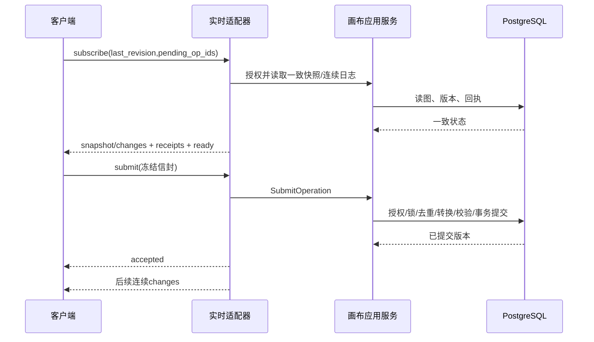

# 画布WebSocket实时通道设计

| 项目 | 内容 |
| --- | --- |
| 版本与日期 | v0.1；2026-10-20 |
| 状态 | 设计建议待评审；未实现、未配置代理、未运行验收 |
| 上游 | [需求09](../requirement/09-画布WebSocket实时同步需求.md) v0.3全部SYNC规则 |
| 关联 | [数据设计14](14-画布数据服务与DAG设计.md)、[OT设计16](16-画布OT协同一致性设计.md)；专项PRD与Plan未形成 |
| 方法与责任 | pm-execution:user-stories/test-scenarios；画布前后端、身份、部署与测试职责，具体人员未定 |

## 1. 现状、目标与部署选择

让编辑操作、权威确认和他人修改通过WebSocket双向传输，连接中断后按数据库版本恢复。HTTP继续处理初始化辅助请求、项目管理、上传及会话续期。

源码核对：当前`frontend/src/app/api/[...path]/route.ts`是fetch型HTTP代理，转发Cookie、Origin及创建范围等头；没有WebSocket升级通路。`backend/internal/canvas/adapter/http/handler.go`只有HTTP画布路由。已有identity认证、PostgreSQL和infra.outbox→Kafka投递，不能把这些当成已存在的socket会话实现。

**建议采用同站入口代理将`/api/canvases/{id}/live`的Upgrade请求直接路由到Go，其余路径沿现有Next BFF。** 本地开发也须具备同一入口路径，不把LV_BACKEND_ORIGIN暴露给浏览器。仓库当前Compose没有核实可复用的升级代理，此配置是实施前置工作。若现有部署平台不能支持长连接，先解决部署，不用轮询冒充需求已完成。

| 方案 | 判断 |
| --- | --- |
| Next现有Route Handler直接fetch转发升级 | 当前实现不支持，不假设加一个API路由即可完成 |
| 同站反向代理 → Go实时适配器 | 建议选用；共享Cookie和Origin，复用现有服务权限与事务 |
| 浏览器跨站直连独立协作服务 | 暂不选；增加跨站凭据、部署和数据权威边界 |

协议依据[RFC 6455](https://datatracker.ietf.org/doc/html/rfc6455)；升级代理的Upgrade/Connection头和超时要求参考[NGINX官方说明](https://nginx.org/en/docs/http/websocket.html)，并不表示当前已部署NGINX。Go库候选为[coder/websocket](https://github.com/coder/websocket)，利用其context、限读和关闭能力；具体固定版本、依赖风险与代理兼容需要选型验证，不在本轮安装。

## 2. 用户故事和状态

| 故事卡片 | 场景讨论 | 确认 |
| --- | --- | --- |
| US-SYNC-01：创作者编辑后希望其他窗口立即看到 | 一端写、另一端观察；编辑提交也走WebSocket，不能只做通知 | AC-SYNC-01 |
| US-SYNC-02：断网后希望知道哪些修改保存了 | 同一操作重试查证、补齐版本；禁止未确认状态显示已保存 | AC-SYNC-02、AC-SYNC-03 |
| US-SYNC-03：成员权限变化后访问立即受控 | 连接建立不永久授予读写权；切换账号清理旧连接与私有内存 | AC-SYNC-04 |

| 连接/同步状态 | 允许动作与界面 | 转移 |
| --- | --- | --- |
| connecting / initializing | 展示加载或已知只读画面，暂停结构写入 | 收到snapshot/changes及ready后进入live |
| live + clean | 可编辑，显示已保存版本 | 本地操作→dirty→pending |
| live + pending | 当前会话保留outstanding/buffer，显示同步中 | 自己的accepted/noop/rejected及完整版本应用后更新状态 |
| reconnecting | 显示断线/待确认，暂停新结构操作，保留已有内存意图 | 鉴权成功→resume；失效→reauth_required |
| resync_required | 暂停写入，获取权威快照并处理未确认意图 | 可重放→live；不能安全变换→明确人工恢复 |
| readonly / revoked | 禁止写；撤权清理待发私有消息、关闭连接 | 按既有登录/权限流程恢复，不能自动创建新画布 |

连接状态与保存状态分别呈现；远端新版本到达并不意味着本地pending已保存。

## 3. 服务职责与生命周期

实时适配器负责Upgrade、帧校验、心跳、连接关闭；会话协调职责负责订阅与按版本追赶；画布应用服务负责授权查询、提交与持久回执；OT不放进socket handler。

每连接一个受服务生命周期管理的context，一个读取循环和一个有界写入循环；关闭取消订阅/计时器、释放队列并等待退出。升级后context的所有者显式转移给连接管理器，不能依赖已经完成的HTTP处理函数或无主background goroutine。

同一文档跨实例仍由数据库行锁排序，不依赖进程内房间锁或粘性会话。每实例只持有本实例连接和版本游标，不持有权威图。

跨实例传播建议复用既有outbox/Kafka的“文档版本发生变化”提示：不同实时实例须各自接收所需提示，不能用一个竞争消费组导致只有一个实例通知。每实例收到提示后按数据库日志拉取连续版本；提示可重复或丢失，周期性核对活跃文档head作为兜底。Kafka不是浏览器可直接读的操作历史，也不直接把私有outbox负载广播到socket。

## 4. 鉴权与协议

### 4.1 连接规则

- `GET /api/canvases/{document_id}/live`升级，子协议建议`glowloom.canvas.v2`。握手严格匹配Origin允许列表，检查会话Cookie和文档可读权限；拒绝缺失/未知Origin的浏览器请求，不开启通配跨站。
- 原生浏览器WebSocket不能像普通请求随意加自定义头，故范围选择在首帧显式传入scope_id并由服务端验证；它不是授权凭据。不得信任客户端actor_id/org_id，当前Principal从身份服务取得。
- 握手与每次提交复用当前会话/项目授权；建立连接、心跳和被动收消息不自动延长“用户活跃”期限。沿既有HTTP刷新流程续期，过期连接关闭后重新认证连接。
- 对出站私有数据，在取数及实际写队列出队时再次核验会话/项目有效性；撤权提示清空未发送队列。已写入网络缓冲的历史字节无法撤回，权限线性化点和最大检测窗口需在身份设计评审中明确，不能宣称物理瞬时撤回。
- 未授权返回不泄漏资源详情的错误；日志禁止Cookie、token及正文。无access token拼接在URL中。

### 4.2 帧合同

JSON UTF-8、每帧一个对象；UUID为字符串，revision/base_revision/seq为十进制字符串。`v=2`为传输协议版本，`schema_version`为图类型版本，`ot_version`为转换语义版本；版本不支持则拒绝写入，禁止宽松忽略未知操作。

| 方向与type | 核心字段 | 语义 |
| --- | --- | --- |
| C→S `subscribe` | scope_id、schema_version、ot_version、last_revision或null、pending_op_ids[] | 固定握手文档；pending仅查本人的回执；初次连接不相信本地持久快照 |
| S→C `snapshot` | document_id、revision、history_floor、schema_version、ot_version、nodes、edges、自己的view、access | 一致权威状态；来自数据设计14，包含只读能力 |
| S→C `changes` | from_revision、to_revision、operations[] | 连续规范日志，每项含op_id、revision、actor展示所需最小信息、canonical_ops、outcome |
| S→C `ready` | revision | 初始追赶结束标记；只保证到该revision连续，之后仍可能有changes |
| C→S `submit` | op_id、base_revision、schema_version、ot_version、operations[] | 不可变在途信封；同op_id重传原内容；一次原子批次 |
| S→C `accepted` | op_id、revision、canonical_ops、outcome=accepted/noop | 已持久化；与changes中同op_id/revision可能重复，只应用一次 |
| S→C `rejected` | op_id、code、observed_revision、safe_details | 确定未写图；可持久回执；前端按设计16重算 |
| C→S `receipt_query` / S→C `receipts` | 本人op_ids；逐项accepted/noop/rejected/not_found | 已授权范围内核实；not_found不等于之前肯定未到达，若旧请求还在途仍须同op_id提交查证 |
| C→S `catch_up` | after_revision | 不连续或重连时补齐；超窗口返回resync_required |
| S→C `resync_required` | reason、head_revision、history_floor | 不能盲目重放旧操作；见第5节 |
| C→S `view_update` / S→C `view_saved` | expected_view_revision、viewport；view_revision | 用户私有CAS，不入图OT日志，不广播给其他用户 |
| S→C `access_changed` / `reauth_required` | read/write状态或原因 | 禁止后续无权读写；需登录刷新走现有HTTP |

帧例子仅说明合同，UUID为占位：

```json
{
  "v": 2,
  "type": "submit",
  "op_id": "<uuid>",
  "base_revision": "42",
  "schema_version": 1,
  "ot_version": 1,
  "operations": [{"kind":"node.move","id":"<node-uuid>","x":120,"y":80}]
}
```

新HTTP辅助入口（快照/回执/用户视图若实施）按现有swag→openapi2ts链生成。WebSocket帧不伪装为HTTP OpenAPI操作：建议由后端闭合消息模型导出JSON Schema和TS类型，建立生成一致性及跨语言golden vectors；不得维护另一套手写且不校验的业务DTO。schema导出与消费工具在实施前做最小验证，尚未生成文件。

### 4.3 错误与流控

| code | 是否能原信封重试 | 行为 |
| --- | --- | --- |
| `op_id_conflict` | 否 | 同ID不同请求，明确客户端错误 |
| `invalid_operation`、`dag_cycle`、`protected_relation` | 否 | 确定拒绝；修改意图后新op_id |
| `history_expired`、`schema_mismatch`、`ot_version_mismatch` | 原操作不得盲目改base重发 | 重建/升级；保留会话内意图 |
| `permission_denied`、`reauth_required` | 仅重新授权后查证 | 停止写入或关闭；不向新账号移交旧状态 |
| `rate_limited`、`server_busy` | 可按retry_after同信封重试 | 不产生成功回执，不启动新操作ID |
| 断线、提交超时、数据库提交结果未知 | 可 | pending不变，查回执/同信封重试 |

工程初始参数建议：心跳25秒、60秒无响应关闭、写队列256帧或8MiB先到者触发慢客户端关闭、submit帧1MiB上限，保留100命令/2000节点/4000边现行上限。以上是压测候选，不是性能接受承诺；snapshot/changes须分片传输，单帧同样限界并带snapshot_id、chunk_index/count和最终hash，客户端完整校验后才替换状态。复杂director配置可能接近上限，必须纳入压测而非悄悄截断。

队列满时发送可行的resync提示并关闭，不静默丢掉中间操作；重连指数退避加抖动，服务端retry_after优先。禁止不受控累积心跳、读循环或重连定时器。

## 5. 初始化、提交与恢复时序



初始化先登记文档版本提示订阅（只缓存提示，不读私有正文），再在授权一致性事务读快照R；随后从数据库补读R之后到固定水位H的连续日志，发送ready(H)，转入live后继续从H追赶。任何提示都只促成数据库追赶，实际发送按revision排序，因此不会在“读快照—注册订阅”间漏修改。授权失败撤销订阅。

重连时页面有权威内存基线R：先重新授权及核实pending回执，再补R之后日志。ACK先于缺失的较早revision到达时仅暂存，不跳版本；自己accepted与changes重复按(op_id,revision)消重。页面刷新无基线则读取snapshot，不从浏览器持久缓存恢复。

历史不足：读当前snapshot，核实未确认操作的回执。已接受操作不得再提交；未接受且有足够基准/转换证据才由设计16重建操作。缺证据或查询不明则保留会话内对照并提示选择，不把旧整图覆盖当前状态。回执和日志保留政策必须与数据设计14一致。

提交后进程在ACK前崩溃：回执和日志已在数据库，重连查证恢复；提交前崩溃：不存在成功回执，同op_id重试正常执行。广播失败不回滚已提交数据。

## 6. 验证与运行边界

| 测试场景：角色与前置 | 动作 → 逐步预期 | 覆盖 |
| --- | --- | --- |
| TS-SYNC-01；两个授权浏览器、代理入口 | A通过socket提交→数据库提交→A确认→B自动显示；抓包核验不存在HTTP代提交；初始化期间再提交不漏版本 | AC-SYNC-01 |
| TS-SYNC-02；故障注入与同一op_id | 发送前/提交中/提交后ACK前断网→重连查询→重发；数据库仅一次业务效果，界面不误报 | AC-SYNC-02 |
| TS-SYNC-03；两个Go实例、跨实例连接 | 重启一个实例、丢提示、重复帧、慢消费→head核对或重连补齐；按序收敛且无连接泄漏 | AC-SYNC-03 |
| TS-SYNC-04；普通成员/管理员/未授权者 | 越权订阅拒绝→已有成员撤权→队列清理和连接结束；归档后读可用写拒绝；切账号不串内容 | AC-SYNC-04 |
| TS-SYNC-05；history_floor高于客户端基准 | catch_up→resync_required→snapshot和回执核实；pending不被直接丢弃/重放 | AC-SYNC-02、AC-SYNC-03 |

观测连接数、握手拒绝、ACK/远端可见延迟、lag、backpressure关闭、补齐成功率、撤权窗口及goroutine数量。每项带图规模/人数/网络/部署条件，不预设已达标。实时请求不调用收费供应商。

## 7. 兼容与评审交接

部署兼容数据库和统一提交路径 → 升级代理与帧合同 → 验证单写者同步 → OT集成 → 逐画布protocol_version=2切换。服务关闭先停止新连接，等待有界在途事务结束，通知重连并释放连接；不能为等慢socket无限等待。

没有OT的单写者验证只是SYNC专项接受，不代表可以删去OT或完成用户全部要求。旧v1整配置写入在v2画布上拒绝，后台业务写入必须可规范化记录。回退使用可读v2的兼容构建，不能让旧客户端全量覆盖新状态。

| 上游 | 承接 |
| --- | --- |
| FR-SYNC-01～03 | 第2、4、5节 |
| BR-SYNC-01～06；IR-SYNC-01～02 | 第3～5节 |
| NFR-SYNC-01～03；AC-SYNC-01～04 | 第4、6节 |

待关闭：实际反向代理部署、库固定版本、会话续期与授权线性化点、帧类型生成、快照分片和流控参数、outbox跨实例分发方案及压测。设计草稿保存不等于上述运行条件已具备。
