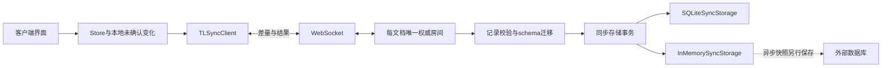

# 画布持久化与协同成熟方案调研

| 项目 | 内容 |
| --- | --- |
| 日期与状态 | 2026-10-20；调研结论待评审，不是系统设计定稿或实施批准 |
| 来源 | [数据需求08](../requirement/08-画布数据库持久化与DAG需求.md)、[实时需求09](../requirement/09-画布WebSocket实时同步需求.md)、[OT需求10](../requirement/10-画布OT协同一致性需求.md) |
| 方法 | pm-market-research:competitor-analysis；按能力、成熟度、集成成本、数据控制和许可比较五条路线 |
| 工具证据 | GitHub读取官方仓库、许可证、发布与适配器源码；Context7查询ShareDB、Hocuspocus、tldraw文档；官方网页交叉核验 |
| 限制 | Firecrawl搜索返回402额度不足，未取得资料；未安装依赖、运行原型、压测、修改数据库或服务 |
| 当前设计 | 用户已选择coder/websocket；[数据设计14](14-画布数据服务与DAG设计.md)、[实时设计15](15-画布WebSocket实时通道设计.md)已收敛为最小设计，[OT处理17](17-画布OT处理设计.md)单独说明算法边界；未实现 |
| 用户补充约束 | Tiptap仅是富文本编辑器，不是整个画布的操作同步方案；不采用付费服务，候选须核实免费生产使用及自托管条件 |

## 0. 最新范围澄清：先选择WebSocket通信组件

用户进一步明确：需要类似Netty的WebSocket协议与连接服务，不要过度设计。因此本轮优先比较Go通信组件；下文第1～8节保留为前序协同引擎调研记录，不代表当前需要引入整套协同产品，也不构成实施方案。数据库、节点与连线、OT三项原始需求仍保留。

截至2026-10-20核查的候选如下。许可证允许在遵守相应声明及分发条款的前提下免费商用；“可自部署”对库而言是随我们的Go程序部署，对独立服务器而言是自行运行该服务器。

| 候选 | 定位与公开能力 | 许可 | 对现有服务的判断 |
| --- | --- | --- | --- |
| [coder/websocket](https://github.com/coder/websocket) | Go WebSocket库，支持context、JSON辅助、Ping/Pong及关闭握手，接入标准HTTP处理器 | [ISC](https://github.com/coder/websocket/blob/master/LICENSE.txt) | 首选评估；可在现有Gin服务接入，依赖及API较精简 |
| [gorilla/websocket](https://github.com/gorilla/websocket) | Go WebSocket库，提供HTTP升级、消息读写及连接控制 | [BSD-2-Clause](https://github.com/gorilla/websocket/blob/main/LICENSE) | 成熟备选；应用须遵守一个并发读者和一个并发写者的约束 |
| [gnet](https://github.com/panjf2000/gnet) | Go事件驱动网络框架，机制接近Netty；WebSocket属于需要在其上接入的应用层协议 | Apache-2.0 | 若重点是类似Netty的底层网络框架，可继续研究；当前没有性能证据要求替换已有HTTP服务路径 |
| [Centrifugo开源版](https://github.com/centrifugal/centrifugo) | 独立实时消息服务器，支持WebSocket与频道订阅，可自行部署 | Apache-2.0 | 需要现成的独立消息服务时再考虑；本轮无需因此新增部署组件，商业扩展不在候选范围 |

**用户已选择coder/websocket。** 原调研将gorilla/websocket作为备选；当前最小设计见设计14、15、17。 这是基于现有Go＋Gin的集成便利性判断，尚未进行接入或性能测试；不以项目宣传的吞吐量代替本项目验证。官方API依据：[coder文档](https://pkg.go.dev/github.com/coder/websocket)、[Gorilla文档](https://pkg.go.dev/github.com/gorilla/websocket)。

节点新增、移动、配置修改以及连线新增、删除都可以作为消息内容经WebSocket传递；通信库不要求更换画布模型，也不负责理解图结构。PostgreSQL仍由已有Go业务代码读写，因此这一层无需寻找“自带PostgreSQL的WebSocket框架”。

**自建画布的WebSocket业务处理是合理的，但不等于要自研WebSocket协议或OT算法。** WebSocket负责消息传输；OT负责调整并发操作，使各客户端得到一致结果。这些通信组件不包含OT。先确认通信组件即可，当前没有依据把自行实现OT作为默认结论。本轮不展开表结构、消息协议、服务拆分或算法实现。

## 1. 前序结论与候选优先级（整体协同引擎）

**选型对象是整个画布的记录同步与操作合并服务，Tiptap只是其中的一个编辑器适配点。** 前一轮依据富文本集成便利性提高Hocuspocus优先级不充分；不再以此排序整个画布方案。

按用户要求进一步核对`tldraw/sync-core` **v5.5.2** 的包级许可证、实际npm制品、存储和同步源码后，结论是：

1. **技术上值得深入参考。** 中央房间权威、记录差量、客户端回退/重放、删除记录及schema迁移都适用于分析画布问题；底层存在自定义record用法，不必一概认定要替换整套编辑器。
2. **当前不能作为“免费商用生产”的已合格依赖。** sync-core自身也受tldraw许可证约束；官网要求商业项目取得商业许可。README仍有保留水印即可使用的冲突表述，本轮不能据此认定免费授权成立。完整证据见[第8节](#8-tldraw-sync深入核查)。
3. **PostgreSQL不是现成接入。** 本版本存储接口要求同步事务，官方持久化实现为SQLite；挂一个异步保存回调不等于把PostgreSQL变成权威提交数据库。

因此，tldraw sync保留为架构研究对象，付费Liveblocks退出当前候选。后续若比较可免费自托管的实现，应以ShareDB的整图OT能力、Yjs的共享结构能力作为对象，分别验证其业务适配；Hocuspocus和ProseMirror collab仅按具体子问题评估，不由Tiptap反推整个画布的服务选型。原始OT方向保留，未直接改为CRDT。

## 2. 我们实际需要比较什么

### 2.1 仓库约束

本地核对依据为2026-10-20源码，工作区存在并行修改；这些事实不等于新协同能力已交付。

| 已有基础 | 对选型的影响 |
| --- | --- |
| Go＋Gin＋GORM＋PostgreSQL；`backend/internal/canvas/adapter/postgres/store.go`已有事务、文档行锁、版本检查、日志与outbox | 新协作服务不能独立写一份图，再要求Go异步同步成另一份权威图 |
| `backend/internal/canvas/domain/document.go`已有节点、连线、分组、配置及命令 | 通用JSON同步还需映射业务操作、删除语义和字段权限 |
| `frontend/package.json`固定Tiptap 3.32.0及`@tiptap/pm`；提示词含自定义引用节点 | 纯字符串OT或Quill Delta不能未经适配直接替代当前编辑器文档 |
| `frontend/src/app/canvas/editor.tsx`仍调用`branchJournal`，实现位于`frontend/src/components/generation/draft-save.ts` | 选择任何库都必须移除正式画布对浏览器持久化恢复分支的依赖 |
| 现有业务依赖、标注线、父子分组、派生引用线含义不同 | “所有可见边组成一个DAG”并非可直接采用的数据定义 |

### 2.2 选型门槛

| 门槛 | 对应需求 | 需要看到的证据 |
| --- | --- | --- |
| 我们的数据库持久保存，关闭全部浏览器后可恢复 | DATA；AC-DATA-01、02、07、08 | 冷启动、清浏览器数据、数据库独立读回；不能靠客户端重新上传恢复 |
| 编辑与确认经WebSocket双向传递 | SYNC；AC-SYNC-01～04 | 双客户端、断线、重复提交、权限变化；不是仅增加变更通知 |
| 并发修改按明确规则合并 | COL；AC-COL-01～06 | 本地未确认操作、多客户端交错、撤销、删除与编辑冲突 |
| 合并后仍符合DAG和业务权限 | DATA＋COL | 并发成环、越权素材引用、生成状态保护；权威提交前校验 |
| 与现有节点及Tiptap兼容 | DATA＋COL | 引用节点、中文输入、emoji、复制粘贴、节点删除、版本演进 |
| 无付费服务依赖，可免费用于我们的生产场景 | 用户2026-10-20补充 | 核实服务端、客户端及必要依赖许可；试用、个人非商业许可和自托管能力均不自动等于免费商用 |

不使用star数量代替可靠性证据；不把“支持PostgreSQL”理解为“能原样复用我们的表和事务”；不以文档示例替代故障验证。

## 3. 五条成熟路线比较

| 路线 | 可复用能力 | 数据与部署方式 | 对我们的主要缺口 | 本轮判断 |
| --- | --- | --- | --- | --- |
| ShareDB＋OT类型 | 协同操作框架、客户端待确认处理、版本和操作历史；默认json0 | JavaScript服务；数据库适配器保存快照和操作 | PostgreSQL适配器自称实验性；Tiptap绑定、业务事务、DAG仍需适配 | OT约束下首选验证对象 |
| Yjs＋Hocuspocus | CRDT共享数据、连接与持久化扩展；Tiptap绑定仅为局部能力 | JavaScript服务；Yjs二进制状态可由Database扩展存入自有数据库 | 默认延迟保存；与Go关系模型、事务和拒绝非法更新的机制需要验证 | 按共享结构能力比较，不因Tiptap集成提高整图选型优先级；须重新评审OT要求 |
| ProseMirror collab | 富文本Step、版本、待确认变更与rebase | 中央权威；传输、保存、认证由应用提供 | 不负责画布图同步；Go服务端正确应用Step与自定义schema不是现成能力 | 局部备选，不作为完整画布服务 |
| tldraw sync | 画布记录同步、schema校验/迁移、连接恢复 | JavaScript房间；官方推荐SQLite持久化，提供Cloudflare模板 | 自定义Store适配、同步事务与PostgreSQL整合、DAG及生产许可 | 深入研究其机制；当前不满足免费商用依赖门槛 |
| Liveblocks | 托管协作、Storage/Yjs/Tiptap等集成 | 云服务；官方也提供企业付费Sync自托管 | 付费与用户当前约束不符 | 排除；保留资料作比较，不进入验证或采购 |

公开依据分别见：[ShareDB数据库适配器](https://github.com/share/sharedb/blob/main/docs/adapters/database.md)、[Hocuspocus持久化](https://tiptap.dev/docs/hocuspocus/guides/persistence)、[ProseMirror协作指南](https://prosemirror.net/docs/guide/#collab)、[tldraw sync](https://tldraw.dev/docs/sync)、[Liveblocks存储说明](https://liveblocks.io/docs/platform/data-storage)。

### 3.1 ShareDB：成熟框架与存储适配器要分开判断

官方类型接口把`apply`、`transform`等算法职责交给具体OT类型。默认JSON类型不意味着自动理解提示词引用、媒体权限或DAG；文档中的rich-text示例也不能证明与当前Tiptap文档直接兼容。[OT类型](https://github.com/share/sharedb/blob/main/docs/types/index.md)

官方列出的[sharedb-postgres](https://github.com/share/sharedb-postgres)同时保存snapshot和oplog，不支持查询订阅；README仍明确写着“Moderately experimental”。查看其[index.js](https://github.com/share/sharedb-postgres/blob/main/index.js)，提交通过一条SQL组合更新快照与操作记录，但这不等于已与我们的`canvas.node`、素材输入、保存回执及outbox组成同一事务。适配器使用自身连接池，不能靠把它和Go部署在一起得到原子提交。

ShareDB提供提交前后中间件；`commit`可检查应用操作后的候选快照，`afterWrite`在数据库写入成功后触发。竞争提交时中间件可能重复执行，因此它适合挂载校验，但不能无保护地触发生成、扣费等副作用。[提交生命周期](https://github.com/share/sharedb/blob/main/docs/middleware/op-submission.md)

**工程判断：** 首轮原型应先证明单一权威提交、存储失败恢复和Tiptap适配；如果这些需要同时重写存储层和富文本转换，框架节省的工作可能不足以抵消集成成本。不能先采用两套独立写库再补一致性。

### 3.2 Yjs＋Hocuspocus：编辑器集成更直接，保存合同需补齐

[Tiptap协作扩展源码](https://github.com/ueberdosis/tiptap/blob/main/packages/extension-collaboration/src/collaboration.ts)直接使用Yjs同步与撤销插件，也声明了与普通UndoRedo扩展的冲突。由此可判断其富文本集成路径比把Tiptap文档映射为另一种OT模型更直接；本地版本和自定义引用节点的兼容性仍未实测。

Hocuspocus要求保存Yjs二进制状态，JSON可额外用于展示或查询，不能每次从JSON重新建立协作历史；其`onStoreDocument`默认带debounce。这意味着“远端看到变化”或provider完成同步，不能直接显示为“我们的数据库已经保存”。即便减少debounce，也需单独验证提交失败、崩溃窗口和持久确认语义。[持久化指南](https://tiptap.dev/docs/hocuspocus/guides/persistence)、[hooks](https://tiptap.dev/docs/hocuspocus/server/hooks)

Yjs的浏览器持久化由额外的`y-indexeddb` provider提供，因此使用CRDT不强制使用浏览器数据库。按本需求可以只保留会话内状态及服务端持久化；代价是未送达的编辑不会在关闭浏览器后自动恢复。[离线持久化说明](https://docs.yjs.dev/getting-started/allowing-offline-editing)

**工程判断：** CRDT收敛不等于业务合法。不能先把任意Yjs更新合入广播，再声称用普通事务回滚即可恢复所有副本。必须验证准入、非法操作的处理及客户端恢复。若图和文本采用不同权威模型，还需明确删除节点时文本归属、版本关联和生成输入快照；不能默认两者天然原子。

### 3.3 ProseMirror collab：可复用富文本算法，服务仍要自己补

官方方案由中央权威确定Step顺序；客户端接收新Step后重定位未确认变更再提交。传输、历史保留和权威服务由应用实现。它解决编辑器文档协作，不提供完整的节点、连线和数据库服务。[协作指南](https://prosemirror.net/docs/guide/#collab)

GitHub仓库已归档，但[README](https://github.com/ProseMirror/prosemirror-collab)明确说明迁往维护者的代码站，不能据此认定项目停止维护。本轮新站直接访问失败，未核验迁移后的最新发布。因此只记录已有能力，不宣称最新版本适配已确定。

**工程判断：** 可以作为OT/rebase方向下的富文本对照组；自定义reference节点、客户端Step和服务端文档校验需要同一schema及版本规则。只把Step当JSON存进Go而不正确应用和校验，不足以满足要求。

### 3.4 tldraw：画布整体方案成熟，迁入边界较大

官方sync用于tldraw自身产品；每个文档须只有一个权威`TLSocketRoom`。当前官方持久化路径包括内存快照回调及SQLite存储，支持自托管JavaScript服务。接入我们的PostgreSQL仍需单独评估；默认内存方案不能算作持久保存。[官方sync文档](https://tldraw.dev/docs/sync)

Context7同时返回了`DatabasePersistenceAdapter/persistenceAdapter`示例；本轮核对当前[TLSocketRoom源码](https://github.com/tldraw/tldraw/blob/main/packages/sync-core/src/lib/TLSocketRoom.ts)及[API报告](https://github.com/tldraw/tldraw/blob/main/packages/sync-core/api-report.api.md)，公开选项为`storage: TLSyncStorage`，未找到该示例接口。故不把检索示例作为可直接运行的实现，具体接口须对锁定版本核实。

**补充核查后的判断：** 底层支持自定义Store/record，技术上可研究保留现有编辑器的接法，不能笼统认为必须更换编辑器。但它仍与现有画布状态模型和数据库合同存在适配工作，且sync-core本身的生产许可未通过免费使用门槛。详见第8节。

### 3.5 Liveblocks：不能忽略新自托管选项，也不能误认为免费组件

官方文档现已提供企业方案付费附加的Sync自托管，故“只能使用其云服务”不是准确结论。其云产品保存协作状态；另外镜像到自有数据库不自动满足“自有数据库为权威”的要求。企业自托管是否支持我们的PostgreSQL、同步提交和备份方式，本轮公开资料没有给出足够依据。[存储与自托管](https://liveblocks.io/docs/platform/data-storage)、[数据库镜像集成](https://liveblocks.io/docs/integrations)

**按用户补充约束：** 退出当前候选，不进入采购或验证；不将SDK开放源码等同于服务端自由自托管许可。

## 4. 维护与许可核验

以下是2026-10-20查询GitHub官方仓库与`releases/latest`的快照，不是安装建议；最新文档/main源码与下列release可能存在差异，后续原型须固定版本。

| 对象 | 本轮看到的发布/维护证据 | 许可证据与影响 |
| --- | --- | --- |
| ShareDB | [v6.0.4](https://github.com/share/sharedb/releases/tag/v6.0.4)，2026-10-05；未归档 | [MIT原文](https://github.com/share/sharedb/blob/main/LICENSE)；API许可证标签为NOASSERTION，已以原文校正 |
| sharedb-postgres | [v6.0.0](https://github.com/share/sharedb-postgres/releases/tag/v6.0.0)，2026-06-23；未归档 | 仓库API识别MIT；README实验性说明优先于版本号带来的成熟印象 |
| Yjs | [v13.6.33](https://github.com/yjs/yjs/releases/tag/v13.6.33)，2026-09-23；未归档 | [MIT原文](https://github.com/yjs/yjs/blob/main/LICENSE) |
| Hocuspocus | [v4.7.1](https://github.com/ueberdosis/hocuspocus/releases/tag/v4.7.1)，2026-10-12；未归档 | [MIT原文](https://github.com/ueberdosis/hocuspocus/blob/main/LICENSE.md)；不等于全部Tiptap商业产品免费 |
| ProseMirror collab | GitHub归档系迁移；新站最新发布未核实 | README声明MIT；随锁定版本复核许可证 |
| tldraw | [v5.5.2](https://github.com/tldraw/tldraw/releases/tag/v5.5.2)，2026-10-02；未归档 | [根许可证](https://github.com/tldraw/tldraw/blob/main/LICENSE.md)限制生产使用，需适用的生产许可；[sync-core包](https://github.com/tldraw/tldraw/blob/main/packages/sync-core/package.json)也指向许可证文件，不能假设sync-core为MIT |
| Liveblocks | 官方文档可核验当前云服务与企业自托管；不以SDK发布代替服务端维护证据 | 自托管为企业付费附加能力，须核对合同与使用范围 |

许可只记录官方原文和适用性待核事项；未完成全部传递依赖或固定制品的许可清单审查。

## 5. 成熟系统中值得借鉴的方式

### 5.1 数据类型决定冲突处理

Figma在**2019年的历史技术文章**中介绍了中央权威、对象属性粒度更新及服务端拒绝成环父子变更；当时的属性覆盖机制并不合并同一文本值中的字符编辑。这是设计案例，不是其2026年实现证明，也不是可直接采用的开源服务。[Figma技术说明](https://www.figma.com/blog/how-figmas-multiplayer-technology-works/)

对我们的启发是：坐标、提示词正文、素材绑定和依赖关系不能因为都在一个JSON里就共用整块覆盖规则。复用成熟算法的对象应按数据语义划分，同时维持单一业务提交约束。这是调研判断，尚不确定服务拆分或部署数量。

### 5.2 DAG检查须位于权威提交路径

例：初始图无边，甲提交A→B，乙提交B→A。两端各自检查都通过，合并后却成环。**最终所有人看到同一个环也算“收敛”，但不满足DAG要求。**

[React Flow防环示例](https://reactflow.dev/examples/interaction/prevent-cycles)提供前端连接检查；结合上述并发反例可知，前端检查只能改善交互，服务端仍须在一致状态下校验和提交。分组父链与业务依赖应分别判断；标注线、可重建的提示词引用显示线也不能未经分类并入依赖图。

本轮没有证据支持为此更换图数据库。当前PostgreSQL已有关系与事务基础；是否使用邻接关系、递归查询或内存图遍历，以及锁粒度和性能界限，留给原型证据和后续设计决定。

### 5.3 传输、合并、持久确认是三个不同承诺

| 层次 | 用户需要的结果 | 不能作为充分证据的现象 |
| --- | --- | --- |
| WebSocket传输 | 编辑和远端变化及时到达 | socket连上或消息已发送 |
| OT／CRDT／Step rebase | 并发编辑按支持的语义得到一致结果 | 最后一次整图覆盖后两端碰巧相同 |
| 权威持久提交 | 已确认内容在服务重启和浏览器关闭后仍可恢复 | 所有人看到变化、内存缓存已有内容、异步保存已排队 |

因此三个需求仍应独立保留；选中一个协作框架也不会取消数据库与实时通道的验收责任。

## 6. 下一轮验证建议，不在本轮执行

当前先完成tldraw sync机制研究，不因文档写完启动实现。后续免费候选的验证以整图记录、操作语义和数据库合同为主，ShareDB与Yjs可作对照；是否采用CRDT需在需求10明确决策。富文本适配是其中一个场景，不单独决定整图协同选型。付费Liveblocks及未获得免费生产授权依据的tldraw sync不进入生产依赖候选。

| 验证场景 | 要记录的结果 | 不通过时的含义 |
| --- | --- | --- |
| 两人分别移动节点、修改提示词；三端交错发送 | 兼容修改都保留，待确认队列最终清空，数据库一致 | 操作模型或客户端协调不满足COL |
| 同一提示词并发插删、中文输入、emoji、自定义引用与撤销 | 文档schema合法，引用稳定，撤销不覆盖他人贡献 | 不能把纯文本演示视为Tiptap适配完成 |
| 并发反向连边、删除节点同时编辑/连线 | 权威图无环、无悬空关系；各端拒绝恢复可解释 | 协作引擎不能直接承担业务图约束 |
| 发送后断线、数据库失败、写库后回执前崩溃、同步后保存前崩溃 | 不虚报已保存、不重复提交副作用；重启可查证结果 | 保存合同未成立 |
| 清除浏览器业务存储并关闭全部客户端后重启服务 | 全部已确认节点/关系/配置恢复，不靠本地数据补回 | 不满足无本地持久依赖 |
| 撤销成员权限、切换账号、伪造素材引用 | 读写和待发消息受现有身份权限控制 | 独立协作服务破坏权限边界 |
| 生成任务读取、节点删除和文本更新交错 | 读取明确版本的合法输入，服务间不出现双写分歧 | Go业务与协作状态的权威边界未解决 |

每个原型记录固定版本、真实PostgreSQL数据、浏览器证据、故障时间点和未通过项；本轮不承诺排期、并发容量或性能指标。

## 7. 对需求和前序草稿的影响

| 对象 | 本轮处理 |
| --- | --- |
| 需求08 | 保留数据库权威、全字段覆盖、无本地持久依赖及DAG目标；具体存储形式待选型 |
| 需求09 | 保留双向WebSocket与恢复目标；不预定自研Go socket协议或固定库 |
| 需求10 | 保留原始OT要求和已有释义；CRDT只作为替代路线供评审，没有改名或偷换验收 |
| 设计14、15 | 前序曾暂停等待调研；用户选择coder/websocket后已重写为最小设计。当前以14、15及OT处理17为准；本节保留调研背景 |
| PRD、Plan、实现 | 尚未进入；完成候选验证与选型评审后再承接 |

本轮完成的是官方资料与源码层面的筛选。运行正确性、当前Tiptap版本兼容、数据库故障恢复、性能及生产接受均未验证。

## 8. tldraw sync深入核查

本节以GitHub **v5.5.2标签源码**为依据，额外只读检查npm的`@tldraw/sync-core@5.5.2`制品许可证；未安装、执行该包或修改项目依赖。官网用来解释产品边界，API细节以固定版本源码为准。以下分别标明可核实事实与对本项目的判断。

### 8.1 免费、自托管与许可证是不同问题

| 问题 | 核查结果 |
| --- | --- |
| 能否自行部署？ | 可以；官方提供Node服务示例，不强制购买Cloudflare托管 |
| sync-core是否独立MIT许可？ | 否；[包内LICENSE](https://github.com/tldraw/tldraw/blob/v5.5.2/packages/sync-core/LICENSE.md)明确指向tldraw许可证，实际npm包内文件相同 |
| 默认许可证允许什么？ | [版本根LICENSE](https://github.com/tldraw/tldraw/blob/v5.5.2/LICENSE.md)默认只允许开发环境；生产需另有适用许可 |
| 是否有免费途径？ | 官网提供限期试用及酌情发放的非商业hobby许可；均不能推定适用于我们长期商业产品 |
| sync是否另收费？ | 官方说已持有SDK许可时sync不额外收费；这不等于无需SDK许可 |
| 为什么网上会写“免费”？ | [同版本README](https://github.com/tldraw/tldraw/blob/v5.5.2/packages/sync-core/README.md)仍写保留水印可商用，与当前官网和LICENSE不一致；不能挑选宽松摘要当作生产授权 |
| tldraw的其他包都是相同许可吗？ | 不是；例如[store包LICENSE](https://github.com/tldraw/tldraw/blob/v5.5.2/packages/store/LICENSE.md)为MIT，但不能把它的许可套到sync-core上 |

官方对许可的完整说明见[License](https://tldraw.dev/community/license)；sync无需额外许可的语境见[发布说明](https://tldraw.dev/blog/announcing-tldraw-sync)。**当前决策：不把原版sync-core引入免费商用生产方案。** 自托管只解决部署控制，复制或fork也不会自动改变适用许可。这里保留机制研究，不继续商业采购，不以试用方案充当长期免费方案。

### 8.2 它实际由哪些部分组成

| 部分 | 源码职责 | 是否要求替换我们的画布UI |
| --- | --- | --- |
| `@tldraw/sync`的`useSync` | 连接tldraw的`TLStore`、presence和客户端同步 | 高层hook与tldraw记录/编辑器生态关联较强 |
| `@tldraw/sync-core`的`TLSyncClient` | 监听Store变更、发送差量、处理确认及客户端rebase | 底层泛型支持自定义record，不能说必须采用整个tldraw编辑器 |
| `TLSocketRoom`、`TLSyncRoom` | 管理连接、校验和迁移记录、权威提交、分发结果 | 运行于JavaScript后端，需要自己接入身份和业务规则 |
| `TLSyncStorage` | 同步事务、记录、删除标记、时钟和增量恢复 | 默认实现不能直接代替现有Go/PostgreSQL事务 |

可核实依据：[useSync](https://github.com/tldraw/tldraw/blob/v5.5.2/packages/sync/src/useSync.ts)、[TLSyncClient](https://github.com/tldraw/tldraw/blob/v5.5.2/packages/sync-core/src/lib/TLSyncClient.ts)、[自定义doc/presence记录测试](https://github.com/tldraw/tldraw/blob/v5.5.2/packages/sync-core/src/test/TLSyncClientRebase.test.ts)。该测试确实以自定义`StoreSchema`构造`Store`和`TLSyncClient`，并没有实例化完整画布编辑器。

**对本项目的判断：** 可以研究把既有节点映射为record、以Store变化驱动UI的方式；成本主要在状态所有权和操作语义，而不是视觉组件全部重写。但公开产品定位仍面向tldraw画布，自定义record测试不等于官方承诺任意业务数据库都能直接适配。

以下只说明现有库的机制，不是我们的目标系统设计：

### 8.3 协同机制：记录差量与客户端rebase

源码中记录操作为`put`、`patch`和`remove`，由稳定record ID寻址。客户端先在内存中显示修改，再推送给房间。房间执行存储事务后返回`push_result`，其中`clientClock`关联客户端提交，`serverClock`表示服务器同步时钟，结果可以是：

- `commit`：实际变化与提交一致。
- `discard`：没有产生可提交的文档变化；可能与只读、记录已删除或授权拒绝有关，不能统一解释成“保存成功”。
- `rebaseWithDiff`：实际接受的变化与提交不同，以返回差量校正客户端。

客户端收到远端更新或确认后，先撤回本地尚未确认的推测性变化，再应用服务器结果，最后重放剩余待确认和未发送的变化。[协议类型](https://github.com/tldraw/tldraw/blob/v5.5.2/packages/sync-core/src/lib/protocol.ts)、[服务端提交](https://github.com/tldraw/tldraw/blob/v5.5.2/packages/sync-core/src/lib/TLSyncRoom.ts)、[客户端rebase](https://github.com/tldraw/tldraw/blob/v5.5.2/packages/sync-core/src/lib/TLSyncClient.ts)

**不能因为出现rebase就把它当作通用文本OT引擎。** 这个版本的`diffRecord`对`props`和`meta`有特定嵌套比较规则；普通对象字段可能整值替换。字符串前缀追加有`append`优化，其余字符串编辑会产生`put`；追加应用时若长度不符合基准会忽略该追加。数组也有自身差量规则。这是确定的记录补丁语义，不是自动识别用户意图的通用转换算法。[diff实现](https://github.com/tldraw/tldraw/blob/v5.5.2/packages/sync-core/src/lib/diff.ts)

对现有画布的直接影响：把完整`NodeConfig`塞进一个顶层对象字段，不能保证两个不同业务子字段的并发修改都保留；同理，普通字符串同步不能满足全部富文本插删要求。需要先按节点属性和业务操作验证覆盖范围，不能只验证拖动坐标就称为OT需求已满足。

### 8.4 数据库：同步事务接口是实质约束

`TLSyncStorage.transaction`返回同步结果，回调类型明确禁止Promise；读取记录、写入和删除也处于这套同步事务中。提供的是可插拔**同步存储接口**，不是一个可随意`await pg.query()`的异步数据库适配器接口。[存储合同](https://github.com/tldraw/tldraw/blob/v5.5.2/packages/sync-core/src/lib/TLSyncStorage.ts)

[SQLiteSyncStorage](https://github.com/tldraw/tldraw/blob/v5.5.2/packages/sync-core/src/lib/SQLiteSyncStorage.ts)管理records、tombstones、schema和时钟；[Node示例](https://github.com/tldraw/tldraw/blob/v5.5.2/templates/simple-server-example/src/server/rooms.ts)按房间打开`better-sqlite3`数据库。本轮未找到该版本提供的官方PostgreSQL适配实现。

| 接法 | 可以得到什么 | 与我们的要求差距 |
| --- | --- | --- |
| Node＋SQLite | 使用官方同步持久化路径，不强制Cloudflare | 服务端SQLite不是浏览器本地存储，但增加独立数据库，不能假装已接现有PostgreSQL |
| 内存Store＋异步PostgreSQL快照 | 周期性或变化后保存房间状态 | 事务结果先成立、外部保存后完成，崩溃窗口内可能丢失已广播变化 |
| 在`onCommittedChanges`里调用Go写库 | 获得客户端提交后的通知 | 是提交后尽力回调，不是事务钩子；服务器主动修改也不触发它 |
| 自定义PostgreSQL存储层 | 理论上可研究不同执行边界 | 须解决同步接口与远程异步I/O不匹配；属于核心适配/改造，不是配置工作 |

服务端源码在存储事务返回后发送确认，再异步安排`onCommittedChanges`。所以该回调不能用来证明“确认前PostgreSQL已提交”。存储层选择为SQLite时，其事务与另一个Go业务事务也不会自动原子化。[TLSyncRoom提交顺序](https://github.com/tldraw/tldraw/blob/v5.5.2/packages/sync-core/src/lib/TLSyncRoom.ts)、[回调合同](https://github.com/tldraw/tldraw/blob/v5.5.2/packages/sync-core/src/lib/TLSocketRoom.ts)

“不使用本地存储”在原需求中针对浏览器业务持久化；不据此错误排除服务端SQLite。但是否接受新增数据库和数据权威调整，是另一项未作出的选择；本轮继续以现有PostgreSQL集成为评估基线。

### 8.5 单房间权威与故障恢复

官方要求每个文档全局只有一个权威房间。示例进程里的`Map<roomId, room>`只保证本进程复用；启动两个Node实例后随机分发同一画布连接并不能保证唯一性。共享一个PostgreSQL也不会自动解决两个房间各自维护状态的问题。[官方房间说明](https://tldraw.dev/docs/sync)

可借鉴的部署原则是按文档分配权威所有者，再考虑所有者故障后的接管；若未来自行实现，需要另行证明旧所有者失效后不能继续写入。Cloudflare Durable Objects是官方采用的实现之一，不代表我们必须使用该付费云产品。

重连时客户端上报已知时钟和schema；服务端根据记录变更与删除标记补齐。删除历史不足时改用完整状态重新初始化，再处理会话内未确认变化。presence与持久记录分开。[存储增量合同](https://github.com/tldraw/tldraw/blob/v5.5.2/packages/sync-core/src/lib/TLSyncStorage.ts)、[重连实现](https://github.com/tldraw/tldraw/blob/v5.5.2/packages/sync-core/src/lib/TLSyncClient.ts)

这些恢复信息不等于完整审计操作日志，也不等于我们生成任务的持久幂等回执；不能用`clientClock`直接承诺任务或费用“恰好一次”。关闭页面后，会话内变化的恢复也不能脱离本需求的无浏览器持久化约束另作承诺。

### 8.6 DAG、权限与原子业务命令不会自动获得

源码支持schema校验和按record类型的`authorizeRecord`。授权器同步运行，可拒绝单个记录操作；拒绝可能跳过某个操作，让剩余变化提交，再以discard/rebase校正客户端。因此，“一次push里有多个记录”不等于“我们的删除节点及关联边业务命令必然全成全败”。[房间实现及授权接口](https://github.com/tldraw/tldraw/blob/v5.5.2/packages/sync-core/src/lib/TLSyncRoom.ts)

我们的结构性操作需要额外验证：

- 并发A→B与B→A，或互相设为父节点时，权威结果仍合法。
- 删除节点、删除关联边和处理提示词引用之间，不能部分成功。
- 当前记录schema合法，不代表素材可访问、输入版本有效或客户端可以写生成状态。
- 逐record同步授权接口不能直接承担需要异步访问Go/PostgreSQL的整图校验；把检查移到提交后也不能替代提交前约束。

这是业务适配缺口，不是声称库缺少通用同步功能。该版本确实有[rebase回归测试](https://github.com/tldraw/tldraw/blob/v5.5.2/packages/sync-core/src/test/TLSyncClientRebase.test.ts)和[随机同步测试](https://github.com/tldraw/tldraw/blob/v5.5.2/packages/sync-core/src/test/syncFuzz.test.ts)，是值得借鉴的验证方式；本轮只读取源码，未运行这些测试，更未验证我们的DAG。

### 8.7 在免费约束下如何使用本次结论

| 处理 | 范围 |
| --- | --- |
| 借鉴机制 | 稳定ID、属性差量、每文档权威顺序、本地pending队列、回退/应用/重放、时钟与删除标记、schema迁移、随机交错测试 |
| 不直接采用 | 受当前tldraw许可约束的sync-core作为免费商用依赖；免费demo作为生产后端；异步快照作为数据库持久确认 |
| 后续免费候选验证重点 | 先比较完整画布记录与操作模型，再验证PostgreSQL原子提交和DAG；Tiptap仅作为节点内容的一个适配场景 |
| 保持待定 | 具体引擎、是否引入Node服务、是否调整OT要求、是否增加服务端数据库；本轮没有完成这些设计决策 |

因此，我们可以深入借鉴tldraw sync的实现思路，但在当前免费约束下，不把“研究它”推进为“选用它”。付费服务已移出候选，下一阶段的判断依据应是画布操作语义、免费生产许可和实际存储集成能力。
