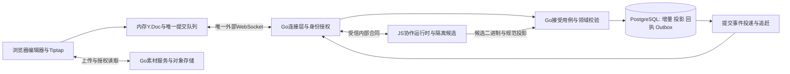

# 画布Yjs协作编辑设计

已确认方向：Yjs协作、Go业务服务、服务端持久事实、无浏览器业务持久草稿。以下接线、共享结构和恢复细节为工程设计建议，须通过第8节验证；不代表已启用生产Yjs服务。

## 1. 摘要

使用Yjs统一画布节点、关系与Tiptap富文本的协作编辑，提供连续输入、多人状态同步、个人撤销和版本恢复。Go保留项目、权限、素材、任务及持久接受职责。

## 2. 参与者

项目编辑者、只读访问者、Tiptap编辑器、Yjs协作服务及Go业务服务。

## 3. 背景

依据[协作需求10](../requirement/10-画布协作编辑需求.md)与[完整画布需求06](../requirement/06-画布组件迁入与定制需求.md)。使用支持免费生产使用与自托管的依赖，迁入代码保留来源与许可证。[竞品研究03](../research/03-画布节点保存与协作机制竞品研究.md)提供保存机制对照；竞品服务器内部实现未知，不照搬其本地业务缓存。Yjs负责兼容更新的合并，Go负责业务可接受性，数据库负责持久事实，三个职责不能互相替代。

## 4. 目标

兼容编辑被保留，各端与持久状态收敛；正文格式和引用完整；个人撤销保留他人有效贡献；保存结果可查证。

## 5. 使用场景

多人编辑不同节点、同时修改同一正文、拖动与改文交错、断线后继续输入、撤销本人编辑，以及浏览和恢复历史版本。

## 6. 价值

多人在同一画布连续创作，内容、参考素材和生成来源保持完整一致。

## 7. 方案

### 7.0 工程边界与部署建议

2026-10-24 已确认全面采用 Yjs：正式入口及 WebSocket 只使用 protocol 4，移除 `NEXT_PUBLIC_CANVAS_YJS` 双轨开关和 protocol 3 写入入口。Go 接受 Yjs 隔离候选后直接执行领域投影校验与数据库事务，不再调用 OT 提交、变换或贡献撤销。有限的领域字段赋值、图验证与输入版本推进属于投影校验，不承担客户端并发合并。删除恢复改用已接受删除事实、当前 epoch/commitSeq 和最新图验证授权身份复用；已有历史记录保留，不批量销毁。

复用现有前端、Go应用和`canvas-collab` JavaScript核心。增加承担实际Y.Doc运行的内部协作进程是现有方案的接线需要；先按单协作实例、按画布隔离房间落地，不为起步部署引入Redis、Kafka或跨区域架构。所有应用进程由Docker运行，复用现有PostgreSQL与对象存储。业务模块仍遵循adapter → application → domain。

| 模块                                     | 唯一责任                                                  | 不承担                                         |
| ---------------------------------------- | --------------------------------------------------------- | ---------------------------------------------- |
| 前端编辑器/会话                          | 即时反馈、Yjs/Tiptap绑定、意图与未确认队列、保存呈现      | 自证权限、把本地变化当持久成功、业务IDB恢复    |
| Go WebSocket adapter                     | `coder/websocket`连接、统一身份、协议分发、限流及授权投递 | 用连接成功代替保存确认                         |
| JS协作运行时                             | 每画布已接受Y.Doc缓存、候选解码/合并、规范投影和同步差量  | 直接信任客户端JSON、直接改Go业务表、接受前广播 |
| Go application/domain + postgres adapter | 当前权限、合法图/素材/系统字段、幂等与数据库事务          | 在Go另写一套Yjs算法或将临时JSON当独立权威文档  |
| 提交事件投递器                           | 重试已提交事件、按版本补齐有权客户端                      | 决定一次编辑是否被接受、依赖内存通知保证正确性 |

外部仍只有一条画布编辑WS；Go与JS的内部调用不是第二条客户端保存通道。建议顺序为Go接收→JS prepare→Go事务commit→JS安装已提交候选→Go投递；中间失败沿原提交查证。内部调用绑定文档、epoch、writerTerm、基线commitSeq、原提交身份与hash，不能接受浏览器直传“已验证候选”。具体RPC路径与版本由共享合同生成，本文不伪称这些内部接口已存在。

#### 7.0.1 首次接线合同

内部运行时采用无状态候选计算：每次由Go传入已持久化二进制及同版本DTO，在隔离Y.Doc中计算候选，避免进程缓存成为第二权威。`/v1/initialize`仅供显式迁移，`/v1/prepare`绑定documentId、epoch、writerTerm、commitSeq和原始updateId/hash；HTTP层只监听内部网络且校验受信调用身份。数据库提交后才向客户端发布，失联后从数据库重新构造。

共享模型通过`service-document`映射正式Go DTO：服务端修订、权限和内容版本不进入可写共享字段；位置/尺寸为原子组，编辑参数values逐键共享，正文进入XmlFragment。投影从当前权威DTO补充服务端字段，并由Go重新校验全部业务字段。旧版纯文本仅在首次正文编辑时转为Tiptap，迁移不能悄悄改写既有正文、素材身份和引用注册表。

### 7.1 共享文档

每个画布epoch具有一份Y.Doc，节点与关系按稳定ID组织。可独立修改的属性分别建模，位置和尺寸各为完整字段组；正文绑定对应节点的Y.XmlFragment。图、正文及引用使用统一协作会话。

引用保存稳定referenceId、assetId及绑定版本；格式、引用提及和元数据保持同一schema。写入端校验schema版本；不兼容结构完整只读展示。

#### 7.1.1 共享粒度和状态归属

| 数据           | 建议模型                                          | 理由与约束                                                              |
| -------------- | ------------------------------------------------- | ----------------------------------------------------------------------- |
| 节点           | `nodes: Y.Map<nodeId, Y.Map>`                     | 标题、参数等可独立属性分别更新；禁止把整个nodes数组作为单值替换         |
| 布局           | 每节点position与size各为一个不可变字段组          | x/y或width/height保持同一手势结果；不合并成来自两个端的半组坐标         |
| 参数与业务引用 | 节点内版本化字段/Map，引用注册表以referenceId定位 | 不以每次替换整个config.editor JSON实现目标协作；迁移保留所有既有参数    |
| 正文           | `text`按稳定正文身份映射到`Y.XmlFragment`         | Tiptap正文、格式与自定义引用共享同一schema；不双写独立HTML正文          |
| 边             | `edges: Y.Map<edgeId, Y.Map>`                     | 端点、端口、用途、顺序和绑定按业务约束分组变更；依赖与视觉线分开        |
| 资产与任务     | 共享图保存稳定身份/版本和必要显示投影             | 媒体字节不进Y.Doc；任务状态和费用等系统事实来自Go，不允许普通客户端改写 |
| 在线与视图     | presence与个人偏好独立                            | 游标/选择/预览不进持久图；不通过同步他人viewport控制当前用户视图        |

前端共享schema、投影器、协议编解码、候选校验由`canvas-collab`承担可复用核心；运行服务和数据库适配各自拥有I/O。字段清单和数据合同由设计14维护。`schemaVersion`、`epoch`、`writerTerm`、`commitSeq`属于服务端控制面，不因出现在客户端信封就可信。

参考显示编号不是绑定身份：共享提示词的labelState及编号墓碑继续保留，但不能让各端独立highWater + 1后直接合并成重复编号。建议由受信接受路径为新bindingId分配尚未使用的编号，与正文引用/分配记录同事务持久化；客户端未确认编号只是预览。已有绑定/编号不因他人新增而重排，撤销不回收给其他绑定。服务端分配产生的派生Yjs更新须纳入同一候选二进制、投影和回执版本并返回客户端，不能只改JSON。并发新增、重复提及、删除/恢复及失权引用需在真实schema下验证；此前独立草稿的整份CAS改号不直接复用于共享画布。

[Yjs更新协议](https://docs.yjs.dev/api/document-updates)支持增量同步，但state vector不是我们的数据库修订号，也不能单独证明删除已确认或业务提交成功。

### 7.2 编辑与合并

| 编辑能力           | 规则                                                             |
| ------------------ | ---------------------------------------------------------------- |
| 不同对象或不同属性 | 保留兼容的各端修改                                               |
| 同字段赋值         | 按Yjs共享类型的确定性规则收敛；不是服务器到达顺序的最后写入获胜  |
| 位置与尺寸         | 每组完整更新，拖动预览走presence，结束后提交最终值               |
| 同段富文本         | Tiptap协作绑定处理插入、删除、格式和选区映射                     |
| 分组与连线         | 候选整体经过成员、端点、父子关系及DAG校验                        |
| 删除与编辑交错     | 删除已接受后，旧生命周期编辑不复活对象；确定拒绝与恢复有明确反馈 |
| 生成结果           | 绑定已确认的输入版本，保留后来编辑的内容                         |

中文、emoji、组合输入、段落、换行及自定义引用节点均使用实际Tiptap schema验证。输入过程中允许接收远端变化并继续本地编辑。

#### 7.2.1 自动保存事务和生命周期

拖动期间保留本地预览并按需发presence；pointerup形成一次完整位置事务，取消不提交中间位置。Tiptap的完整文档事务、参数提交、节点新增/删除、连线变更分别带稳定用户动作身份；IME遵循编辑器实际transaction边界，未完成组合输入不能被全量远端快照重置。

事务完成即进入唯一写队列。可以在封包前合并同一待发送队列内的更新，记录所覆盖动作并作为整笔接受；不另设“闲置若干秒才保存”的独立写路径，不因持续输入无限延后发送。已封包的updateId和bytes不可改变，也不能仅因最终投影相同就丢掉承载后继依赖的更新。服务端串行接受不阻塞用户继续在有界内存中编辑，详见设计15。

删除优先是业务生命周期规则，不能声称Y.Map天然满足所有删改竞争。编辑先被接受、删除后被接受时，删除作用于最新合法状态；删除先被接受时，对已删实例的迟到编辑须明确拒绝，不能因投影无变化而假称该编辑生效。删除节点与应删除的可编辑关联在同一事务处理；受保护关系沿设计14校验。

为保持DR-DATA-02/03的稳定身份，建议区分稳定业务ID与对象的生命周期代次：删除保留墓碑/代次；显式撤销删除恢复同一业务ID，但由服务端接受路径分配新代次并建立新的嵌套Yjs实例。客户端不能自报新代次解除墓碑；旧代次的更新即使晚于恢复到达，也不能改动新实例。候选校验须从实际结构目标识别旧代次，而非只比较投影是否变化。正文、边及引用随恢复动作重新校验，保留稳定引用及历史来源，不把恢复偷偷变成新ID复制。若原关系现已无权、已变化或会成环，恢复动作整笔受阻并说明原因，不静默部分恢复。

这是生命周期实现建议，需CASE-COL-09证明在固定Yjs版本下可隔离旧结构并保留引用；未证明不得启用删除恢复。用户要求是稳定身份、删除不被迟到编辑复活和个人贡献可撤销，不把代次字段误称用户已指定实现。

#### 7.2.2 接受结果与冲突提示

accepted表示原操作被持久处理并参与合法合并，不承诺它写入的值永远可见。同字段并发只能得到一个当前值；如接受后已被其他更新取代，界面说明已合并/该字段已被协作者更新，不能报数据库失败，也不能自动生成新更新抢回旧值。互斥字段如位置组整体取一个合法结果；其他兼容属性继续保留。

每个原动作保留回执关联、涉及字段与当前版本，便于区分合并覆盖、确定拒绝和未知结果。输入意图仅在本页必要恢复期间保留，不为冲突提示新增浏览器持久草稿。被拒绝内容进入恢复区；仍未处理的恢复内容使保存状态保持“需恢复”，不能仅凭权威基线干净显示整个页面已保存。

### 7.3 合法接受与恢复

协作服务在隔离候选中应用更新，经Go验证权限、schema、图和引用后持久接受，再广播正式更新。客户端乐观状态与服务端已接受状态分开跟踪。每次候选从最新已接受二进制基线派生，不能先污染正在为其他人提供同步的房间Y.Doc，再尝试回滚。

拒绝的二进制更新保持未接受，不传播到其他客户端。原提交及依赖它的后续更新进入恢复状态；客户端从已接受基线重建Y.Doc，保留本页输入以供恢复。后续意图经重新验证后生成新的更新，禁止将含已拒绝结构的原增量直接重放。

Yjs二进制状态、增量、原始提交身份、哈希与回执持久保存。重连查询原提交结果并进行差量同步。持久接受及单写者门禁沿[设计14](14-画布数据与接口设计.md)，消息与状态沿[设计15](15-画布WebSocket实时通道设计.md)。

WebSocket 关闭及会话续期的临时失败均进入连接退避，间隔为2、4、8、16秒并封顶30秒，成功同步后清零；不以三次失败永久停止，不依赖浏览器额外触发 online 事件。只对网络错误、408、429和5xx续期失败继续重试；认证/授权失败及账号变化停止自动重试，等待明确恢复身份。离页/销毁取消计时器和续期请求。退避仅建立连接，不以 HTTP 轮询保存正文，也不改写未决提交身份；正文仍由完整编辑事务提交，未知回执由原提交查证及 WebSocket 心跳恢复。

#### 7.3.1 候选可信边界与拒绝恢复

解码前限制载荷与解压大小、结构数量和计算预算；解码后检查允许的根、嵌套共享类型、schema、内容长度和对象生命周期。投影合法还不够：必须验证该更新的struct与delete-set因果依赖已完整集成，拒绝带悬置依赖的候选，避免今天看似无变化的内容明天被另一更新激活。固定Yjs版本下由解码适配器与专门回归保证，不依赖state vector相等来判定no-op；已有`AdmissionGate`原语可复用，但数据库适配与生产证明仍沿计划完成。

Go只接受可信内部运行时根据二进制生成并绑定相同基线的规范投影，浏览器提供的changedPaths、actor、origin和JSON只作声明，不作权限证据。服务端控制字段、资产归属、生成结果和计费身份不得由任意Yjs更新改写。业务校验根据真实候选差异执行。

若U1被确定拒绝，后续基于U1生成的U2不能直接`applyUpdate`到权威图，更不能用`mergeUpdates`消除拒绝事实。客户端先暂停该依赖队列，将P的终态和已接受贡献与待恢复意图分离，在本页内存完整保留富文本输入、语义动作及引用身份后才销毁旧乐观Y.Doc，从最新已接受状态重建。恢复源包含被拒P的用户输入及所有受影响后继，不只保留最后一份整图JSON。恢复期间暂停新增业务编辑，继续接收已接受更新；使用这些更新补齐B并重新校验恢复候选。目标仍存在、代次匹配且不覆盖他人新值的兼容意图可重新生成更新；同字段被修改、对象删除、引用失效或无法无损重建时展示原输入与当前内容，由用户选择调整后重新应用、继续留存或明确放弃。不能静默以旧值覆盖新值。确定未被接受且可安全重建的意图使用新updateId；已接受动作不重复执行，结果未知的动作不得进入此分支。重建使用新的Yjs clientID并重新绑定编辑器、选区和撤销器，禁止把旧对象复用当成功回滚。结果未知则先查证，不能提前当成拒绝重建后再重复提交。

### 7.4 个人撤销与版本恢复

使用Y.UndoManager按本地编辑origin跟踪本人贡献，结合业务动作记录约束结构性撤销；文本与画布操作的分组边界对应用户动作。远端更新和系统结果不进入个人撤销栈。显式设置trackedOrigins，并在用户动作边界调用stopCapturing，避免默认时间窗口混合不相关动作；服务端审计身份来自认证会话，origin不是作者凭据。撤销与重做均经过当前权限、图和素材校验；生命周期动作按7.2.1处理。重建或切epoch后旧栈不能无条件沿用；跨重开完整撤销栈不是本次自动新增承诺。[官方UndoManager文档](https://github.com/yjs/docs/blob/main/api/undo-manager.md)只支持库行为，业务规则由本设计定义。

个人撤销的实施规则：正文对本人结构执行选择性撤销；属性恢复必须验证目标字段的贡献/版本仍允许撤回，不能仅凭值相同判断是本人贡献。A赋值后B修改该字段，A撤销/重做不得覆盖B；若库候选将改变B的有效结果，则该动作不提交并提示无法独立撤销。A创建节点后B在其内编辑，A撤销创建不得直接删除B的内容；分组/连线同样验证其他人的依赖。无冲突本人动作正常撤销，相关多对象动作保持原子性，不为“部分成功”破坏图或引用。

P结果未知时允许记录后继撤销意图，但先查清P再构造撤销；不能取消网络等待就假定原提交未发生。未封包编辑已进入Yjs因果链时，撤销也是新事务或在完整可证明的重建中处理，不能简单从Q删除字节。重做再次按当前基线验证，不强行恢复过期快照。UndoManager的origin过滤不能代替上述授权、贡献保护和结构约束。

版本历史可浏览完整只读快照。恢复产生新的已确认版本，以新epoch隔离恢复前的编辑，客户端明确处理未确认内容并重新同步。

### 7.5 在线状态与个人视图

在线成员、光标、选择和拖动预览使用有过期时间的presence。个人视口、缩放、网格、小地图和吸附偏好按[交互设计](10-画布交互设计.md#75-手势与个人视图)保存。

### 7.6 运行与数据切换

协作应用服务通过Docker运行，复用现有基础依赖。Go授权及接受接口和Yjs运行时以明确的版本、提交身份与错误合同连接。

存量画布保留原始只读快照，转换为Yjs后逐项核对节点、正文格式、引用、关系及生成来源，并完成二进制回读。每个画布按epoch启用唯一写入通道，旧协议客户端拒写。切换、回退、重启及回执丢失均需演练。

### 7.7 故障边界与扩展

每个画布的有效owner串行准备候选；数据库的writerTerm和expectedCommitSeq负责阻止失去所有权的旧实例写入，不能把进程内锁当跨实例门禁。基线改变时丢弃未提交候选并重新准备，重试有上限且不改变原提交身份。运行时崩溃后只加载已提交检查点与更新，不从浏览器快照恢复权威状态。

先在真实规模下测量房间内存、更新合并成本、ACK延迟、广播积压与重连成本；需要多实例时按documentId分片，沿用持久fencing、Outbox和补齐合同。Redis等可用于通知和presence路由，不能成为替代数据库的保存证明。人数、图规模、RTT、频率与p95/p99目标先定义再测，不承诺未经测量的容量。

### 7.8 用户故事与设计追踪

| 故事               | 角色、操作与价值                                         | 来源及确认条件                                                        |
| ------------------ | -------------------------------------------------------- | --------------------------------------------------------------------- |
| ST-COL-01 协作基础 | 编辑者与同事改不同节点或同一正文，希望兼容输入都保留     | FR-COL-01；AC-COL-01/02/05；不同字段、IME、格式、引用及非法图分别验证 |
| ST-COL-02 编辑覆盖 | 创作者调整输入和素材，期望任务结果保留发起时来源         | FR-COL-03、FR-DATA-05；AC-COL-04；新输入与旧结果不互相覆盖            |
| ST-COL-03 连续协作 | 已获授权者短暂断线后继续编辑，期望查清原提交且不重复生效 | FR-SYNC-02、BR-COL-04；AC-COL-06；页面内存上限及关闭后损失边界明确    |
| ST-COL-04 个人撤销 | 编辑者撤销自己的动作，期望同事有效编辑仍存在             | FR-COL-02；AC-COL-03；字段、正文、删除恢复和epoch变化分别验证         |
| ST-COL-05 联合接受 | 获授权者重开或恢复版本，期望持久数据与所有客户端一致     | AC-COL-01～06；旧协议、旧epoch、运行时重启和复制/引用边界不被绕过     |

故事保留现有ID。新增技术细化是验收建议，不新增用户角色、收费功能、完整离线承诺或任意DAG执行能力；人员与容量待实际确认。

## 8. 实施与验收

以下定义验收条件；执行步骤与版本化结果见[对应实施计划](../plan/19-画布Yjs协作编辑实施计划.md)。未执行或未覆盖的场景不能视为通过。

[PRD09](../prd/09-画布协作编辑.md)承接CAP-COL-01～05、AC-COL-01～06；[计划19](../plan/19-画布Yjs协作编辑实施计划.md)组织实施。验收覆盖至少三个客户端、两个授权账号、同段富文本与引用并发、个人撤销、非法候选拒绝、断线重放、撤权、版本恢复和服务重启。

关闭重开后核对各端内容、引用身份及数据库投影；保存状态与持久回执一致。进度及未通过项见[BACKLOG](../../BACKLOG.md)。

技术不变量：①仅持久接受更新可成为房间权威状态；②候选二进制、投影、回执与提交事件属于同一接受版本；③拒绝的因果结构不会经后续更新漏入；④旧owner/协议/epoch无权写；⑤浏览器业务存储禁用仍能在线协作；⑥并发结果合法且可由持久二进制重建。详细故障场景CASE-COL-01～14见计划19，所有新增场景当前均须实际执行后才能计通过。

[返回设计导航](00-设计导航.md)

## 10. Go 正式入口的第二阶段接线合同

### Yjs 如何生效

1. 首次打开由 Go 读取已授权画布；尚无 Yjs 状态时，有写权限的连接触发服务器无损转换。浏览器接收已接受基线，在页面内存建立 `Y.Doc`。
2. 正文通过 Tiptap 绑定 `Y.XmlFragment`；节点身份、位置、尺寸、引用和参数使用共享结构。视口、选择、上传中间态和光标不作为业务图持久化。旧工具的 `native` 配置作为原子字段同步，不把其中所有字符串宣称为字符级合并。
3. 完成的编辑生成二进制增量，冻结为不可变请求 P；P 等待回执期间的后继编辑留在 Q。本地立即显示，保存状态仍是待确认。服务端5秒心跳驱动遗漏查证与补齐，浏览器不运行保存轮询。
4. Go 复核身份和权限，私有 Node 从当前已接受状态建立临时文档并应用更新。Yjs 解决共享结构的并发合并；其更新具备可交换、可结合和幂等属性，但这些属性不代替权限或业务约束。依据：[Yjs Document Updates](https://docs.yjs.dev/api/document-updates)。
5. Go 在事务围栏内再次核对 epoch、writerTerm、commitSeq，校验图、素材、引用编号、稳定身份和输入版本。业务投影、Yjs二进制、接受增量、持久回执与 Outbox 原子提交。并发导致基线变化时，从新基线重新准备同一增量。
6. 服务端提交后发送最新已接受快照与原请求 ACK。当前下行采用有界完整状态，尚非 state-vector 增量广播。页面仅在 P/Q、组合输入、上传、手势和恢复待办均清空后显示“已保存”。
7. 断线保留页面内存中的原 P/Q。重连先查原回执，结果未知时不换请求身份；明确拒绝或 epoch 改变后进入意图恢复。刷新或关闭后只保证服务器已接受的数据，不通过 localStorage、sessionStorage 或 IndexedDB 恢复未确认业务草稿。
8. 本人撤销使用限定本地 origin 的 `Y.UndoManager`；删除身份恢复还必须有服务器删除事实证明。历史版本恢复创建新 epoch。依据：[Yjs UndoManager](https://docs.yjs.dev/api/undo-manager)。

Yjs 是唯一并发合并机制。Go 保留的有限字段赋值、前像检查、图校验、接受日志和持久回执是业务事务能力，不是 OT 算法。历史数据库的旧日志与回执只作为历史事实保留，不再提供旧协议提交、操作变换或贡献撤销服务。

### 10.1 单通道与原子接受

正式入口固定使用协议4，不再设置前端协议开关。浏览器仅连接 Go 的 `/api/canvases/:id/live`；内部 Node 运行时不发布宿主端口，不接收浏览器身份。Go 在授权后向 `/v1/initialize` 或 `/v1/prepare` 发送带内部凭据、画布、epoch、writerTerm 和 commitSeq 的计算请求。Node 每次从已接受二进制构造隔离候选；不持有房间权威状态，也不提前广播。

Go 在画布行锁内复核权限、writerTerm、epoch、commitSeq 和业务修订。通过领域校验后，业务图、`canvas.collab_document` 二进制、`canvas.collab_update` 接受增量、`canvas.collab_receipt` 终态及 Outbox 在同一事务提交。拒绝只记录回执；数据库或运行时不确定错误不伪造拒绝。数据库触发器保护已初始化文档；所有旧协议均返回 `unsupported_protocol_version`，支持版本仅为4。无缓存 finalize；提交后从 PostgreSQL 重载就是跨进程恢复依据。

### 10.2 WS 协议4

- `join` 带 `protocol_version:4`、页面 UUID `client_id`、创作空间和 CSRF；每次消息和服务端心跳复核权限。
- 首个有写权限的连接自动初始化未转换画布，必须无损且通过修订围栏。只读连接不触发转换，返回 `yjs_migration_required` 等待可编辑成员初始化。保留显式 `yjs_initialize.body.revision` 控制消息的修订校验；它不再是协议选择开关，也不在浏览器凭空创建首份共享文档。
- `yjs_snapshot` 带授权 DTO、epoch、十进制字符串 commitSeq/writerTerm 和完整已接受二进制。该版本采用有界完整快照，单状态最多8 MiB，Base64状态与投影合计最多15 MiB，为16 MiB信封预留空间；不把核心分片测试误称为正式路由分片实现。
- `yjs_submit` / `yjs_resolve` 使用相同 `op_id` 与不可变 `{epoch,sessionId,updateId,update,payloadHash,reviewSeq?}`。update 为 base64，解码后上限768 KiB；WS入站帧2 MiB，内部HTTP请求/响应16 MiB。
- 服务端先发最新已接受快照，再发 `yjs_ack`；查不到返回 `yjs_not_found`。已接受内容能覆盖本页显示，不等于已经收到本页原提交终态。
- 完成事务事件立即排队；服务端5秒心跳作为查证及遗漏通知补齐触发。浏览器无保存轮询、HTTP快照保存器或自动业务journal。

### 10.3 富文本、输入与恢复

同段正文绑定 Tiptap `Y.XmlFragment`，参数值逐键共享，位置/父组和尺寸各作为原子字段组。Go DTO 的服务端版本字段不进入客户端可写共享图；存量文本编码未变时保持原编码，编辑后的完整格式正文由统一投影生成。引用注册表与媒体绑定继续经领域校验；不能把兼容正文合并扩大解释为所有引用分配都已实现独立CRDT语义。

页面内存保留待确认P、后继Q、上传回执与恢复来源。明确拒绝后封存可读意图，构建干净已接受文档，逐字段核对后生成新更新；`reviewSeq` 在Go接受事务内防止审阅过期。远端删除前读取活动编辑器的组合输入草稿，避免共享子树被回收后丢失输入。已提交的历史删除集允许幂等携带，新的结构引用已删除子树则拒绝。新epoch到达先查证旧P，终态明确后只归档可读意图，不把旧二进制重放进新epoch。

“已保存”必须同时满足完成编辑已确认、无未决P/Q、无组合输入/手势/上传待办及无未处理恢复。关闭或刷新后仅保证服务器已接受数据；页面内存不能被描述为持久离线存储。只读时仍可查证已有提交；失读权立即停止投递并释放共享与私有页面内容。

### 10.4 图语义和切换范围

当前独立画布的 `annotation` 是视觉注释连线，领域合同允许视觉环。计划中的“合并成环拒绝”专指业务依赖图；工作流/任务结果接线前不能以注释环制造不符合领域合同的限制。重复关系、失效目标、越权素材与不支持字段仍需拒绝，并保证拒绝的Yjs结构不污染已接受状态。

默认开发和生产 Compose 均包含私有 `canvas-collaboration` 服务，Go 依赖其健康检查，双方使用至少32字符的内部 token。原 collaboration overlay 仅保留空兼容文件。先在隔离数据库演练 `backend/db/canvas_yjs_incremental.sql`，不再传前端 Yjs 构建开关。运行时不可用时明确报依赖故障，不回退旧编辑服务。每个文档独立转换；不能对已有新接受记录直接删除协作状态或回退旧快照。各项业务能力仍须满足计划退出条件后声明验收。

### 10.5 引用与生命周期恢复的正式接受合同

- 提示词引用注册表在现有节点data Map中按referenceId分键合并；接受路径从当前已提交labelState分配新增编号，保留已分配编号和墓碑。新增、删除与重复提及都不回收编号。正式编辑器通过连线选择参考节点的另一条路径使用`config.editor.metadata.referenceLabels`，按稳定来源节点ID保存种类和编号，同样由受信运行时分配；展示及正文mention标签使用此编号。两条路径都把派生Yjs修改纳入同一二进制、投影、日志和回执版本，不只更新JSON。
- 显式撤销删除携带epoch、审阅commitSeq及恢复对象集合。Go以本人已接受删除事实的前像证明恢复身份，最新结构事实优先，防止旧删除记录授权恢复后来由别人删除的对象。核对候选全部业务字段与关系后执行内部恢复；浏览器不能凭标记复用旧身份，不使用OT变换或贡献逆操作算法。恢复保留业务ID，内容版本推进，嵌套Yjs结构具有新身份。已接受结构幂等携带不误拒绝，新增结构指向旧实例时拒绝。恢复范围受128条最近接受事实及128个最近删除节点的读取边界约束，超出返回不可恢复，不静默复制新ID。
- 历史版本按实际内容修订保留只读完整快照，迁移保留初始版本；恢复为带原命令ID、会话ID及epoch/commitSeq围栏的控制命令。恢复事务再次校验权限、图、素材与编号墓碑，创建新epoch和新内容修订，保留旧回执、日志、历史版本以及恢复前版本。名称属于当前画布导航身份，恢复图内容时保留当前名称；历史以后分配的编号不回收。未知结果按相同控制命令重试，不能换ID覆盖新编辑。
- 版本列表按需读取，每页30条；版本预览完整只读。数据库`collab_version`保存同一接受版本的内容快照、Yjs二进制、writerTerm、commitSeq与graphHash，`collab_control_receipt`保存恢复命令终态；历史保留容量与归档策略须单独接受，不宣称当前无限保留具备生产容量保证。

新增节点及从业务快照转换的节点预建参数共享容器，以 `present` 区分未配置与已配置；两个页面首次选择参考或设置模式时复用同一容器，不能以并发创建整个Map替代字段合并。此前实验版本已持久化且缺少参数容器的Yjs文档不自动改写共享身份；升级须排清未决输入，再显式恢复经审阅的当前历史版本形成新epoch，验证无损后开放多人写入。此项是升级边界，不作为自动兼容承诺。

稳定身份恢复仅在Go已校验本人删除事实或授权历史快照的路径允许重用软删除行；普通创建仍不能复用墓碑身份。带参考绑定的连线与节点一并校验和恢复，不能只恢复文字节点而遗失连线身份。

### 10.6 在线光标合同

在线光标采用与业务自动保存分离的WS消息，世界坐标与页面clientId识别位置和同账号多页；actorId由服务端认证覆盖。每房间最多128个会话、最多1000个房间，光标发送限速，15秒过期，服务器心跳续期；投递前复核当前权限。页面关闭/失联移除或过期，客户端断线立即清空远端光标；不增加业务修订、Outbox或浏览器业务存储。当前部署为单API实例的进程内presence，不声称跨API实例光标转发已实现。光标之外的远端选区与拖动预览须分别验收。

### 10.6 中文组合输入与远端删除的恢复边界

别人删除节点时，本页尚未确认的组合输入保留为私有可读草稿。恢复审阅必须明确提示“原节点已删除，将把所选输入恢复为新节点”，仅在用户勾选并提交后分配新身份；不得暗中复活别人的删除或复用墓碑身份。该路径与本人撤销已接受删除、授权历史版本恢复不同，后两者仍按10.5保留原业务身份。复制草稿不自动重连已删除的关系；当前正文及引用内容仍须通过服务端领域校验。恢复失败保留原草稿供重新核对。

## 素材几何与接受证明补充

固定媒体的引用、placement 与 size 目前是独立共享字段，Yjs transaction 不保证它们在并发时作为整组胜出。主动上传/替换根据素材回执尺寸等比适配旧边界并保持中心；随后当前素材解码可在合并后的边界内校正比例，但必须保留当前 placement，不能再次居中。迟到远端尺寸也需重新校验；重复校正幂等，手势/IME 结束后才进入原保存队列，自由缩放节点不校正。源 URL 不匹配或无效测量忽略。该方案仍是页面发起的几何校正，服务端可信尺寸的统一约束属于下一步设计，不能宣称已经消除所有附加尺寸写入。

若接受回执的 commitSeq 落后于本页已确认快照，原意图证明通过同一授权 WS 查询 `yjs_history` 与 `yjs_version`，按回执 epoch、contentRevision、画布、项目定位原接受投影；找不到或身份不符则保留恢复输入。不得用最新投影代替原接受投影。接受但同字段未胜出时，成功 flush 后也需触发一次同步使已封存输入立即进入恢复列表；这是事件驱动补齐，不是前端保存轮询。

选型依据与尚未证明的性能边界见[研究04](../research/04-无限画布同步机制与Yjs及OT比较.md)。保留 Yjs＋Go 权威接受＋PostgreSQL 持久事实，不在此补充中引入自研 OT。

正式模型的素材引用与节点配置位于单值 `native` 字段，意图跟踪、接受判断和恢复必须覆盖该原子字段；不能只跟踪实验模型的 `fileReferences`。恢复界面以“素材与节点配置”展示，审阅后任何当前字段变化要求重新核对，重新应用通过新提交身份、reviewSeq 和现有业务授权，不绕过素材访问校验。该字段当前是较粗的原子冲突边界，不能声称能自动合并其中所有配置子字段。
