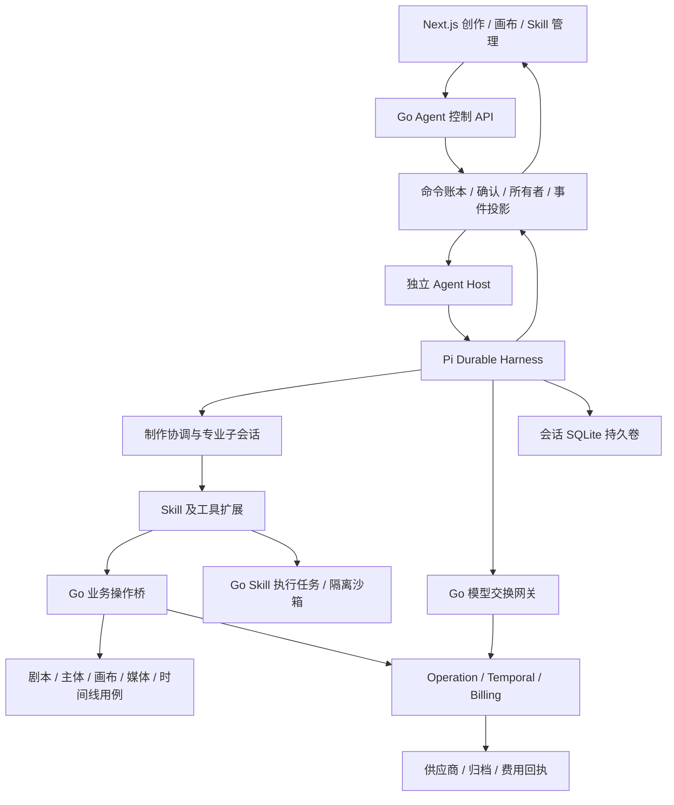

# 完整创作 Agent Harness、Skill 与多 Agent 架构设计

状态：评审稿；自建完整能力、成熟 Harness SDK + Go 业务服务已由用户确认。具体接口、限额、角色与部署合同为本稿的技术决策，尚不表示实现或产品接受。唯一需求来源：[需求19](../requirement/19-完整创作Agent与Skill多Agent需求.md)。能力分析：[Agent Harness 与 Skill 能力分析](../research/2026-11-01-AgentHarness与Skill能力分析.md)。

## 1. 摘要

引入独立 `agent-runtime/`，使用固定版本的 Pi Durable SDK 实现完整创作 Harness，覆盖模型循环、工具任务、持久会话、计划、上下文压缩、实际子 Agent 与可恢复执行。Go 的 `agent` 模块成为控制与业务网关，新增 `skill` 业务模块管理技能包；各领域仍拥有自己的业务事实。

新引擎不继承现有单图 Agent 的三阶段、20轮或最近4轮上下文限制。现有引擎只处理已有记录及在途任务的兼容恢复。完整目标包含短剧工程、Skill 生命周期、多 Agent 协作、受控脚本与成片交付，不能以运行时接通代替整体验收。

## 2. 参与者

创作者提交目标、审阅计划/资产/镜头并确认费用；团队协作者精修共享工程；团队管理者控制资源与共享 Skill；平台管理者治理可用模型、Skill 发布及紧急撤销。系统侧有制作协调 Agent、专业子 Agent、Harness Host、Go API/worker/relay、Temporal、媒体及对象存储。具体人员与排期不在本设计补造。

## 3. 背景

完整创作需要独立运行时、耐久会话、业务操作桥、固定 Skill 版本与上下文恢复。SDK 集成基线选 Pi `1.3.0`（对应上游提交 `71023aec1546d6d677a65669c5665c0927ce0dd0`），不是自动跟随 latest。Pi Durable 官方仍标为 experimental，必须通过固定版本合同、恢复与升级测试后才允许开放真实运行。

复用当前项目 Go、PostgreSQL、Temporal、outbox/inbox、Kafka/Redis 实时通道、对象存储、Yjs、Next.js 和生成 API 工具链。工程规则仍由 [PROJECT](../../PROJECT.md) 与 [AGENTS](../../AGENTS.md) 持有。除本文明确提出的新增运行边界外，不建设第二套身份、凭据、媒体或计费系统。

## 4. 目标

完整满足 AGH-001～024：一次目标可以形成持久计划，委派具备独立上下文的专业 Agent，使用固定 Skill 和受控工具，处理人工确认与异步任务，检查实际产物，并把工程留给用户继续编辑。每个模型尝试、工具副作用、批准与产物均可追溯；中断恢复不扩大权限或重新盲目收费。

性能目标以实测和配置预算验收，不承诺竞品效果或固定吞吐。单主机持久卷上的进程恢复属于目标；无共享存储的跨主机自动故障切换不伪装为 SDK 已有保证。

## 5. 使用场景

1. 上传长剧本，由解析 Agent 拆分、标记歧义并提出带来源定位的结构，用户采用后交给美术和分镜 Agent。
2. 协调 Agent 并行委派独立角色/场景任务；镜头 Agent 等待参考确认后提交视频；声音与剪辑 Agent 形成时间线与导出。
3. 创作者安装、启用并选择分镜 Skill；正文按需加载，包内参考和脚本按权限读取/运行，更新与回退不改写已运行版本。
4. 用户修改某镜头或角色版本，系统展示影响范围并只重做必要后代；协作者的并发修改触发冲突处理。
5. 浏览器关闭、Host 重启或子 Agent 失败后，恢复原运行；原请求未知时进入对账，用户可停止未来动作并查看未确认取消的任务。

## 6. 价值

把创作方法、工程事实和自动执行连接起来：方法用 Skill 复用，专业工作通过子 Agent 分工，媒体与费用仍走可核验的业务回执。用户能够接管任一阶段，复用成功素材并理解局部重做的代价，而不是在多个聊天窗口之间手工搬运提示词与产物。

## 7. 方案

### 7.1 架构选择与复用矩阵

选择 SDK + Go 的方案由 SRC-AGH-04 确认。纯 Go + Temporal 自建模型/上下文/子 Agent 循环会重复建设 Harness，作为已比较但未选择的方案。运行时通过明确的协议与现有业务服务接线，保持执行状态和业务事实各自的所有权。

| 组件                                      | 继续复用                                     | 必须新增/调整                                                                      |
| ----------------------------------------- | -------------------------------------------- | ---------------------------------------------------------------------------------- |
| `backend/internal/agent`                  | 会话私有权限、阶段回执和幂等经验；旧记录查询 | 新会话注册、Run 控制、委派授权、预算信封、宿主协议、事件投影；不复用旧三阶段调度器 |
| `catalog`                                 | 凭据加密、模型目录、能力与发布版本           | 对话/工具/视觉/上下文容量能力元数据，不复制密钥到 Host                             |
| `operation` / `billing`                   | 报价、确认、预留、提交/查询、未知保护、结算  | Harness 模型交换与工具业务回执；统一关联 Run/子 Agent，覆盖压缩费用                |
| `script` / `bible` / `subject` / `prompt` | 来源、分集、结构/主体版本、模板编译          | 解析提案、合并/采用与 Agent 工具小接口；模板不是 Skill 包服务                      |
| `canvas` / `canvas-collab`                | 应用命令、修订、Yjs 协作、导演台/时间线合同  | Agent 批量命令与采用版本影响图，不能绕过正式协作提交                               |
| `media` / `mediatool`                     | 上传归属、授权读取、归档、转写/处理/渲染     | 产物检查、工具回执及时间线/导出的 Agent 交付适配                                   |
| `infra`                                   | outbox/inbox、投递、实时授权与重放           | Harness 命令投递与业务事件类型；不用 Kafka 驱动第二套模型循环                      |
| 新 `backend/internal/skill`               | 对象存储、权限、审计及既有传输能力           | 包/版本/安装/激活/依赖/发布、资源与隔离执行合同                                    |
| 新 `agent-runtime/`                       | 上游 SDK                                     | Host、模型代理、业务工具桥、Skill 扩展、多 Agent、投影及单写者管理                 |

跨模块只通过消费方小接口，由 `backend/internal/app/agent`、`app/skill` 适配接线；领域/应用不直接调用其他模块应用服务或导入其数据库适配器。

### 7.2 执行拓扑与唯一所有者

| 状态/事实                                               | 唯一所有者                          | 另一侧允许做什么                                 |
| ------------------------------------------------------- | ----------------------------------- | ------------------------------------------------ |
| 会话目录、执行身份、授权、控制命令、预算批准            | Go/PostgreSQL                       | Host 验证后接收，不得模型覆盖                    |
| 模型循环、会话内容、工具顺序、子会话、计划和 SDK 检查点 | Pi Durable 会话存储                 | Go 保留映射与产品投影，不重建另一份可运行循环    |
| 物理模型请求、任务、媒体、业务修订、价格与费用          | Go 对应领域                         | Host 持有引用并观察回执，不自己判定已结算/已采用 |
| Skill 包与可执行版本、安装、启用、撤销                  | Go Skill                            | Host 缓存固定版本，激活前及恢复时重验            |
| 界面增量/事件                                           | Go 授权事件账本；SDK 快照为投影来源 | 前端丢帧后用快照续接，不驱动工作流               |

Temporal 继续推进外部生成、媒体和脚本业务任务，不执行或重放 Pi 的模型循环/子 Agent 调度。Go 的 dispatcher 只耐久投递控制命令；Host ACK 丢失时重投同一命令，不能创建第二个运行。

### 7.3 数据与身份合同

以下是逻辑结构；SQL 只在实现时加入唯一 `backend/db/schema.sql` 及存量增量文件。

| 对象                                   | 身份与主要字段                                                                                   | 不变量                                              |
| -------------------------------------- | ------------------------------------------------------------------------------------------------ | --------------------------------------------------- |
| AgentSession                           | UUID、project/actor、engine、runtime_session、revision                                           | engine 创建后不可改；会话默认账号私有               |
| Run                                    | UUID、session、root_conversation、goal、runtime/policy/definition pins、scope、status_projection | 一次目标的权威批准与根运行关联；投影不代替业务回执  |
| PlanRevision / Step                    | plan revision、step ID、依赖、输入版本、Agent、产物合同、required 标记                           | 修改产生新版本；有环/缺依赖拒绝，影响已有批准则失效 |
| AgentTask                              | delegation UUID、parent/root run、definition pin、child conversation、input/output refs、status  | 每次委派稳定身份；恢复查原子会话，不重新 spawn      |
| ToolInvocation                         | run/child/toolCall、tool version、参数摘要、policy、business receipt                             | 唯一键与冻结参数绑定；同键不同参数冲突              |
| Approval / Budget                      | ID、actor、scope、actions/plan/input revisions、金额上限、expires、consumed                      | 模型和 Skill 都不能签发；所有子任务共享根预算       |
| ModelExchange                          | logical model step、attempt、request hash、model release、status、usage/receipt                  | 物理请求未知时禁止派生新请求绕过对账                |
| ArtifactRef                            | 业务 ID、版本/hash、kind、source/tool/model、审核/采用事实                                       | URL 不是身份；内容/归属改变后旧检查不能复用         |
| SkillVersion / Install / ActiveContext | package/version/hash、scope、依赖锁、安装/启用、context revision                                 | 安装与激活分开，当前版本不能覆盖旧 pin              |
| RuntimeOwner / Command / Projection    | session、owner epoch/lease、request UUID、seq/hash                                               | fencing、幂等、单写者；任何一项失败均停止新副作用   |

Go 独立表保存命令/批准/工具和费用账本；运行序列在 Pi 存储。避免把长会话塞回现有 `agent.session.turns` JSON。Session 的 actor 不可由浏览器或模型工具参数传入；团队共享产物按对象权限重验。

### 7.4 外部与宿主 API

公开业务 API 经现有同站 BFF 与生成客户端；请求 ID 与 expected_revision 沿现有规范。旧 `/turns`、`/advance`、`/confirm`、`/stop` 合同保留给旧引擎；新引擎的运行接口如下。新会话服务端按已启用引擎创建，客户端不能把旧 engine 改成新 engine。

| API                                                  | 请求要点                                                                                       | 响应/冲突                                                                                              |
| ---------------------------------------------------- | ---------------------------------------------------------------------------------------------- | ------------------------------------------------------------------------------------------------------ |
| `POST /api/projects/:pid/agent-sessions/:sid/runs`   | request_id、expected_revision、goal、reference IDs、Skill Pins、model choices、budget proposal | 202 + run_id/command_id；先记命令后投递，不隐式批准费用                                                |
| `GET /api/projects/:pid/agent-runs/:rid`             | 当前身份                                                                                       | Run、计划、子任务、产物、未解决业务任务及快照游标                                                      |
| `POST …/agent-runs/:rid/commands`                    | request_id、expected_revision、action、typed payload                                           | plan.revise、approve、reject、pause、resume、stop、accept_partial、steer、rerun_step；动作权限分别检查 |
| `GET …/agent-runs/:rid/events?after_seq=N`           | 同一运行与授权                                                                                 | SSE/有界补读；游标过期返回 snapshot_required，不伪造完整重放                                           |
| `GET …/agent-runs/:rid/agents`                       | parent/run filter                                                                              | 子任务与交接结果；不能访问别人的私有会话                                                               |
| `POST /api/skills/installations` / `GET /api/skills` | source upload/commit、scope、pin、request_id                                                   | 安装校验/就绪/不支持原因；目录只含摘要，正文按授权读取                                                 |
| `POST /api/skills/:id/commands`                      | enable/disable/update/rollback/clone/export/submit、expected_revision、目标版本                | 不变包+可变安装指针；发布与采用分开确认                                                                |
| `GET /api/skills/:id/versions/:vid/files?path=…`     | pin/content hash、包内规范相对路径                                                             | 有界资源或明确拒绝；不把路径转为宿主任意读                                                             |

`steer` 先入持久化收件箱，在安全边界作为有来源的新输入处理；不修改已经提交的物理请求。没有直接 SDK 支持的动作由 Host 的应用状态实现，不伪称为 SDK 原生方法。

内部协议为 `glowloom.agent-runtime/v1`：Go→Host `/internal/v1/commands`、`/sessions/:id/snapshot`、`/owners/:id/drain`；Host→Go `/internal/agent/authorize`、`/tools/:name/invoke`、`/model-exchanges`、`/projections`。所有 envelope 包含 command/run/session、root/parent/child、actor capability、project/scope、owner_epoch、policy/definition pins、expires、payload_hash。使用短期受众限定 token，传输签名绑定 method/path/body；重放识别不代替当前权限检查。Host 不接受浏览器连接，不开放公网/宿主端口，不保存业务供应商 Key。

200/201/202 表示命令受理或事实就绪，不能混写为目标完成。400 schema；401/403 授权失效；404 隐藏不可见对象；409 修订/幂等/输入冲突；422 缺能力/不支持；429 配额；503 依赖不可用。超时返回可查询 command_id/receipt，不告诉用户重新创建任务。

**控制屏障：** Go接受pause/stop/revoke时，在同一事务递增 `control_revision` 并关闭根Run的新副作用准入，再写待投递命令。所有模型/工具/委派/脚本出口携带该revision并重新读取屏障，不能等Host收到消息才生效；重复命令不重复递增。事务提交前已准入的在途动作单独列出并请求取消，不能保证其立即撤销。只读查询、回执回收、取消与对账仍允许。resume仅对paused运行在重新校验授权/批准后CAS开放；stopped运行不可原地恢复为running，应新建目标或明确派生新Run。

### 7.5 状态、耐久推进与事件

Run 产品投影：`admitted → awaiting_approval(purpose=planning) → planning → awaiting_approval(purpose=execution) → running ↔ waiting_tasks`；执行可进入 `paused`、`needs_reconciliation`、`blocked_dependency`、`failed`、`partially_completed`、`completed` 或 `stopped`。暂停不取消供应商任务；停止阻止未来调度并请求取消已授权的在途任务。是否取消成功由业务回执决定，stopped 仍可带 outstanding_operations 并继续结算。首次规划也是计费动作，不能跳过planning批准。

`completed` 必须满足当前计划全部 required 步骤的已采用产物、必要检查和交付回执。部分子任务失败默认阻断依赖并保留成功结果；用户明确接受部分交付后才是 partially_completed，不能由总结模型自行降格验收。

跨边界的固定顺序：

1. Go 事务记控制命令和 outbox → 可信 dispatcher 至少一次投递。
2. Host 在 SDK commit 中按 request_id 准入/重放，冻结运行配置，再 ACK。
3. 工具意图和稳定调用键先持久化，Go 再事务记录 invocation、授权/预留及业务命令。
4. 业务提交成功而 SDK checkpoint 丢失时，恢复读取相同 invocation/operation，不创建新任务。
5. Host 观察业务终态并提交产物引用，形成有界投影；Go 幂等接纳后向 UI 发送事件。

业务事件含 `run_id, seq, event_id, kind, public_payload, snapshot_revision`。投影以 `(runtime_session, projection_seq)` 去重，seq/hash 冲突拒绝并对账；旧 epoch 不得投递新副作用或终态。SDK watch 是快照+变化，不保证逐 token replay；Host 丢失投影 ACK 后补发已提交投影，慢消费者直接快照。Go 业务事件保留策略由既有实时系统执行，过期游标必须补当前快照。

同一业务对象的并行写按领域修订串行化；批量工具先做全体准入，再按既有事务/Yjs命令合同提交。陈旧修订不得用“最新 revision”重试覆盖协作者；重新读取后形成计划修订/提案，必要时重新确认。

**计划与批准交接：** Host先在SDK commit中冻结完整PlanManifest，再以稳定命令将其canonical JSON/hash、输入版本、Agent/Skill/model pins及有限动作约束提交Go；Go校验并保存不可变的授权快照后才返回approval_candidate_id。前端只批准Go保存的candidate，ACK未到或只收到SDK流式计划时禁止批准。批准结果作为Go命令耐久投递Host；工具入口提交candidate_id、plan_hash、step_id、参数摘要与control_revision，Go与已保存快照/实际报价逐项核对。任何plan.revise/steer导致作用域或输入改变时，Go先使旧candidate不可继续准入，Host再生成新版本；投影延迟不能绕过旧批准失效。Go保存的是授权证据快照，不取得计划调度权。媒体生成默认仍逐个明确报价确认；只有批准manifest明确列出的有限批量规则才能批量执行。

**规划工具准入：** 上述PlanManifest规则适用于purpose=execution。首次免费预检由Go生成不可变 `GoalManifest/PlanningScope`，包含目标hash、授权输入版本、选中Skill Pins、规划模型、允许只读工具和规划预算；用户批准该planning candidate后，不需要尚未生成的plan/step身份。工具调用统一携带 `approval_context={purpose,candidate_id,manifest_hash,step_id?}`：planning只允许project.read、script.read、subject.read、artifact.read及skill.catalog/load/file等已列出的只读上下文工具，skill.load/file仅限GoalManifest内已选pin，不借加载改写安装或扩大活跃Skill。内部回执/缓存持久化不构成对用户业务对象的写许可。

planning禁止generation提交、skill.run、业务提案/采用写入及agent.delegate。专业script-parser在execution计划及对应预算批准后才创建子会话；用户仅要求解析时也使用一个有限的“解析/审阅”执行计划，而不把解析委派混入普通planning cap。execution调用必须带PlanManifest对应step_id；两种purpose的schema与工具白名单分别校验。规划读取无法访问所需来源时，返回缺失/越权而非由模型升级权限。

### 7.6 模型网关与费用

Host 使用 SDK 的受控 Provider 适配经 Go 模型交换网关访问供应商，禁止从环境自动发现用户或开发机 Key。ModelChoice 固定发布版本/协议/工具/视觉能力、参数及上下文容量。Go catalog 不能仅凭模型名称认定 tool-call 可用。

对话协议保存文本、多模态引用、tool_call ID/name/arguments、对应 tool_result、usage、finish/refusal/未知错误；不得把 native tool 消息压成单字符串。Go 的现有文本 Responses 驱动只作为协议基础，必须新增完整对话交换合同。`native_tools` 与严格 `json_action` 为明确模式；后者可用于兼容模型，但不得宣称其有原生工具/视觉能力。

每次模型、压缩和子 Agent 调用先取得根预算的子预留并记录 logical_model_step。固定Pi版本的GenerationHooks.beforeRequest提供HookApi.taskId与持久化memo；逻辑键明确为 `(runtime_session_id, conversation_id, SDK taskId, kind)`，kind为generation或compaction，不能只使用提示词哈希。工具轮后的下一generation有新taskId，重启/重试仍复用同taskId。Host在beforeRequest中用 `api.memo("glowloom.model-exchange/v1", candidate)` 固定exchange UUID、模型/参数/输入hash和规范化消息；memo提交后才准入Go网关。同taskId不同正文或配置拒绝，两个不同taskId即使正文相同也不去重。

每个子conversation的Go网关Provider闭包绑定自己的会话范围，并读取该会话当前已提交的exchange memo；没有匹配memo禁止物理请求，不能用进程全局“最近请求”推断归属。压缩使用CompactionHooks.beforeCompact的taskId/memo，调用同一Go网关并把返回摘要交回SDK，避免默认摘要器绕开控制；其usage记Go账本和Host任务文档，不依赖SDK自动累计该自供摘要的usage。

SDK 内部重启或重试不能通过新 attempt 绕过已有未知交换：网关对相同逻辑步骤先重放完成结果、查询在途结果或返回 needs_reconciliation。只有确定未提交/明确拒绝且策略允许时，创建新物理 attempt。SDK retry初始关闭；后台compaction与continuation均纳入相同边界。素材消息冻结业务引用/hash而非过期签名URL，网关按当前授权解析实际内容，变化则拒绝。

首次提交Run只做免费、确定性的输入/能力预检，进入planning确认；用户明确批准仅含规划/压缩的planning cap后才允许第一次模型交换。计划形成后再批准execution cap及具体媒体报价；两类批准区分用途，规划预算不能提交图/视频或脚本任务。界面可以同屏完成提交与规划确认，但后端仍保留两个有因果关系的原子命令及批准回执。

用户批准有限动作集或明确预算，批准绑定计划、Skill/AgentDefinition、模型及输入版本；修改扩大花费、对象或能力时失效。根预算聚合子 Agent/压缩/生成/脚本，原子预留避免并发透支；Go 价格事实结算，SDK usage 仅作可核对的执行记录。流中断缺 usage 不按0费用结算，未知请求不得释放全部预留再重发。真正对账仍无法确定时进入人工/供应商证据处理。

### 7.7 业务工具注册表

每个 ToolDescriptor 固定 name/version、输入输出 schema、业务 scope、只读/写入/外部副作用、费用类别、权限、deadline、取消和 replay policy。Go 是注册与授权事实来源，Host 只投影当前 Agent 可用工具。字段 actor/project/owner_epoch/invocation_id 由可信上下文注入；模型不能指定 URL、Key、价格或调用身份。

工具族：`project.read`、`script.read/parse.propose/structure.adopt`、`subject.read/propose/adopt`、`storyboard.propose/adopt`、`generation.quote/submit/status/cancel`、`canvas.read/apply`、`media.inspect/check`、`voice.generate`、`timeline.plan/apply/render`、`artifact.read`、`skill.catalog/load/file/run`、`agent.delegate/status/cancel`。这是目标注册表，具体工具只有应用用例与测试就绪后才启用。

只读工具可安全重放；写工具只有幂等桥与回执验收后才能声明 SDK replay-safe。外部脚本/供应商工具不因 SDK 标记 safe 就获得重试许可。受理回执输出 task/operation ID，完成回执必须带实际业务状态与产物。工具结构化输出传给下一 Agent；模型文本不得成为执行成功的唯一依据。

### 7.8 Skill 包、生命周期与接入

#### 包合同

采用 `SKILL.md` 作为入口，配合 `skill.json`（`glowloom.skill/v1`）描述机器能力；`references/`、`assets/`、`scripts/` 为包内资源。兼容只有标准 Markdown 元数据的技能：安装时生成本地 manifest、只授予说明/只读资源能力；不能自动执行包内代码或把外部工具名当作已安装。

manifest 包含 namespace/name、semver、description、entry、兼容 Harness ABI、required model capabilities、exact tool versions、runner/image digest、permissions、依赖 pin、输入/输出 schema。内容摘要按排序后的规范路径、字节长度和每文件 SHA-256 的规范 JSON 计算，排除自指 hash 字段；归档压缩元数据不影响包身份。版本身份为 `(skill_id, version_id, content_hash)`，依赖使用相同 exact pin，禁止解析 latest 后运行中漂移。

安装来源：本人创建/上传单 Markdown或ZIP、受支持来源目录、GitHub 固定 commit/subdir、平台审核 registry。GitHub branch/tag 必须先解析为 commit 并展示；下载只走受控源获取器。拒绝绝对路径、`..`、重复规范路径、symlink/hardlink、加密ZIP、压缩炸弹、越界依赖与循环。初始策略上限为解压总32MiB、1024文件、入口256KiB；这些是可调设计护栏，不是兼容所有第三方包的保证。

#### 生命周期

`importing → validating → ready | rejected` 管包版本；`installed/enabled/disabled` 管用户/团队安装；`active/released` 管本会话 SkillContext；`draft/submitted/approved/rejected/withdrawn` 管公开发布。私人修改创建新版本或 fork，不覆盖发布包；安装更新和历史回退只移动安装指针。检查更新不会自动升级，已开始的 Run 永远引用原 pin。

禁用安装影响未来激活；当前活跃上下文的释放/替换在安全边界以 CAS 命令生效，并使相关未用批准失效。紧急撤销是独立的 deny 事实，立即阻止新增模型/工具/脚本动作；保留可审计历史，不让撤销后的包继续以“已缓存”为由运行。

目录只给元数据、依赖/能力/权限和兼容原因。`skill.load` 按 pin 取正文，`skill.file` 只取授权包内文件；加载前做依赖闭包和兼容检查。按模型上下文预算分配正文与资源，超限给出实际原因；压缩后重新注入仍活跃 Skill 的固定正文/约束引用，不能只保留模型自写摘要。上下文修订、激活 Pin、hash 在恢复后重验。Skill 指令是方法数据，不是系统权限来源。

#### 脚本与扩展

不从 Skill 包直接 import JS extension，不安装通用 CodingTools，不开放宿主 `bash/read/write`。平台可信扩展随应用版本发布；第三方脚本必须调用 `skill.run`，由 Go Skill 业务创建幂等 SandboxJob 后交给隔离执行后端。

目标执行后端是受控 OCI Job：rootless/non-root、只读根、独立临时目录、无宿主目录/容器引擎socket、无云元数据访问、默认无网络；固定 runner image digest，argv 参数化，输入为授权素材快照和包文件。允许网络时必须有本次批准的域名/端口策略和可撤销代理，不给供应商 Key。初始每Job限制2 vCPU、512MiB、60秒、产物128MiB，策略收紧可立即生效，放宽需授权。依赖随受审核镜像/锁定资源提供，禁止运行时 npm/pip 安装生命周期脚本。

首个正式后端明确选为**专用Linux执行节点上的Docker Engine + gVisor runsc**。新增可信 `skill-sandbox` 内部服务，使用同一个Go二进制的 `glowloom sandbox serve` 子命令，消费受限Job协议，由独立平台凭据访问专用Engine的mTLS API；不得指向用户开发机或共享应用Docker daemon。Go Skill应用层持有SandboxDriver，创建/查询/取消幂等Job，sandbox服务负责固定镜像创建、输入注入、runsc/cgroups/网络策略、停止与产物有界取回；Host不持有Engine控制能力。沙箱容器本身绝不挂引擎socket或平台凭据。

内部Job API为 `POST /v1/jobs`（job_id、invocation_id、image_digest、entrypoint/argv、input_refs、policy_hash、deadline）、`GET /v1/jobs/:id`、`POST /v1/jobs/:id/cancel`、`GET /v1/jobs/:id/outputs`；service保存job→container身份与执行回执，先查原Job再决定是否创建。创建body中的镜像/argv/网络只能来自已安装pin与Go批准策略，不能接受任意Docker配置。 容器名称由job_id确定，创建冲突时核对既有容器的job/调用/策略标签后查询原回执，不能另起容器；是否runsc以可信Engine配置与容器元数据核对，不以Job内日志判断。隔离执行服务部署/镜像维护属于平台职责，应用开发负责Skill工作流与驱动，双方以同一验收合同交付。

唯一Compose增加内部skill-sandbox服务并配置专用执行节点地址/证书引用，Mac本地也连接该Linux执行节点，不以本地shell或无runsc容器降级。仅进程恢复的SDK测试可不依赖沙箱；AGH-012与完整Skill接受必须具备专用节点并实际验证。没有后端/镜像/权限时显示unavailable并阻止依赖步骤，不能当作全部完成。Job超时或失联保留未知结果，恢复查原Job；输出经过大小、媒体、内容与归属校验后正式归档。

### 7.9 实际多 Agent 与交接

AgentDefinition 为平台维护的固定版本对象，包含角色、输入/输出 schema、可用工具与 Skill、模型能力、scope 与预算上限、允许委派的角色。角色 prompt 不等于子 Agent；每次实际委派都创建 SDK 的独立 conversation 和 task ownership，有独立模型上下文与身份映射。

| Agent                  | 输入                              | 输出/采用条件                          | 特定工具边界                       |
| ---------------------- | --------------------------------- | -------------------------------------- | ---------------------------------- |
| production-coordinator | 用户目标、采用事实、预算/交付设置 | 版本化计划、委派、汇总、交付回执       | 可委派；不能替用户签批或直接改费用 |
| script-parser          | 固定剧本来源版本/范围             | script.parse/v1 提案、定位与歧义       | 读来源、写解析提案；不直接生成视频 |
| story-writer           | 目标、剧情约束、已采用结构        | 大纲/分集/对白提案与修改范围           | 内容提案；不得覆盖已确认版本       |
| art-designer           | 已确认角色/场景/风格、参考        | 主体/场景方案、图像任务与采用版本      | 仅授权的主体与图像工具             |
| storyboard-director    | 分集、主体/场景版本、镜头约束     | storyboard/v1、时长/机位/声音意图      | 分镜提案与预演；不越过媒体批准     |
| shot-producer          | 已采用分镜与参考、生成设置        | 镜头任务、版本与审核回执               | 报价/提交/查询；未知不得重新生成   |
| sound-designer         | 台词/时间信息、授权音色/音乐要求  | 配音/音乐/字幕及时间数据               | 遵守音色许可、单独费用批准         |
| editor                 | 已采用镜头/声音、比例/帧率        | timeline/v1 提案、正式时间线、导出回执 | 版本写入和渲染；不凭URL声明成片    |
| quality-reviewer       | 确定版本的实际媒体与检查规则      | 机器检查、视觉/听觉评估、人工待审项    | 只读检查，不能批准自己重拍费用     |

协调器使用 `agent.delegate`，交接 envelope 为 `agent.handoff/v1`：delegation_id、root/parent run、role_definition_pin、goal、authorized scope、输入ArtifactRefs、skill/model pins、output_schema、plan/step revision、预算/截止时间、required。Go 验证后冻结，Host 在 SDK commit 中按 delegation_id 查找或创建归属于同一委派工具任务的子会话。恢复必须找到同一 child/submission，不重复 spawn 或重复发送结果。

父 Agent 只接收经过 schema/来源校验的结果摘要与产物引用，不自动继承子 Agent 全部对话。子 Agent 的权限/预算为父信封与角色上限的交集；不能扩大项目、模型能力、Skill 权限或花费额度。默认前台拥有，不使用 SDK background 绕过父取消；需要独立后台工作时必须成为用户可见的新根任务并独立授权。

初始策略：委派深度最多2，根运行同时活跃子 Agent 最多4，所有后代与压缩合计最多64次模型物理请求、256次工具尝试。达到任一限制进入 paused/limit_reached，用户可在上限内改计划或显式批准扩展。独立读/不同对象提案可并行；同一对象采用/写入按CAS串行。fail-fast 用于没有有效后续结果的步骤，其他步骤 all-settled 保留成功结果；父终态必须解释 required 子任务未完成的原因。

### 7.10 剧本解析 Agent 的完整合同

复用 script 的来源/导入/Unicode标量坐标与结构规则。输入只收 `source_version_id, content_hash, scalar_range, target_schema, language/options`，源文件经正式导入得到文本后解析，不让模型任意访问文件路径。

长文本先按分集/段落边界分片，保留全局标量 offset、片段hash和有限重叠；每片输出场景、人物/别名、道具、台词/说话者、动作及 source spans。合并器确定性消重重叠项，保留同名异人/代词/场景跳转歧义，不静默猜身份。模型 confidence 只是提示，不能替代来源校验。

`script.parse/v1` 输出 proposal_id、source pin、episodes/scenes/entities/items、unresolved、schema_version；局部临时key在采用时由服务端映射正式ID。所有 span 必须落在冻结文本范围，逐项可定位；字段闭合schema与 script 领域约束不满足时受控修复，修复次数与费用入根预算。用户编辑/采用以来源版本及expected_revision CAS写入；源版本变化旧提案标 stale，提供重解析与比较，不自动覆盖。采用后才可交给美术/分镜，子Agent不能以“解析完成”直接创建收费视频。

### 7.11 工程与成片交付

Step 输入固定引用剧本/人物/场景/分镜/声音版本，记录依赖图。修改角色或镜头会使依赖后代 stale；原产物保留，可比较后采用新版本。工具只写正式应用命令与保存回执，不能直接写 Yjs 数据库或用前端“成功”作业务事实。

分镜和镜头对象是现有缺口，需增加明确业务所有者及版本合同，不能存成聊天Markdown或直接冒充画布节点。建议新 `storyboard` 模块持有镜头意图/版本/采用；画布是其编辑/投影入口，媒体依然归 media，生成任务归 operation。

检查分为确定性编码/尺寸/时长/音轨、授权媒体上的模型视觉/音频评价、人工创作接受。没有读取像素/音频的模型不能声称看过实际内容。导出等待 mediatool 正式终态、可用artifact和解码检查，链接过期可以重新授权读取，不能重新执行生成。分享/发布到第三方平台不包含在本次自动执行范围。

### 7.12 交互与可观察性

主入口为创作 Agent、短剧工程和画布助手，统一引用同一 Session/Run，私人会话范围保持明确。工作区展示目标、版本化计划、Agent 树、工具/费用状态、待确认项、产物与局部重做；手机用分区/抽屉保持提交、停止和错误恢复可达。原始prompt/模型参数只在有助决策时展示，正文不堆协议字段。

Skill管理包含目录、安装详情、权限/兼容检查、版本更新/回退、私人编辑和送审状态；脚本能力未就绪时清楚展示原因。SDK watch断线后先读取权威快照再接事件，前端渲染不调用 advance 推进服务。呈现行动理由、计划与工具结果，不展示或承诺读取模型内部隐含推理。

遥测按 root_run/child/step/tool/invocation/operation 关联，记录延迟、失败类别、重试、预算与使用量；不记录密钥、完整私人脚本/剧本正文或隐含推理。用户可查看自己的操作/产物依据，管理权限不自动赋予私人聊天读取权。Figma需先覆盖正常、空、缺模型、权限失效、等待确认、断线、部分失败、待对账、版本冲突、Skill不兼容与手机状态，再实现UI。

### 7.13 宿主、存储与部署

开发部署沿唯一 `docker-compose.yml` 增加内部 agent-runtime，Node具体补丁版本在引入时锁定并满足SDK基线；不增加宿主应用端口、额外Compose入口或开发机隐式配置。Go保留唯一二进制入口，Host是新增运行时服务，不把Go业务逻辑搬入Node。runtime image只包含锁定SDK和可信扩展。

Pi会话使用独立SQLite文件及持久卷，恢复沿同一runtime_session路径；UUID与tenant映射由Go签发，用户不能决定路径。一个Host持有会话的OS文件锁，Go RuntimeOwner持有递增epoch与租约；失租后暂停新模型/工具请求。**租约过期不等于可在另一Host同时打开存储**：先确认旧进程/文件锁释放，再转移卷并resume。所有Go出口再次检查epoch，拒绝失权旧写者。

SDK默认SQLite掉电语义不自动升级为强持久保证；实现须验证可支持的SQLite同步/一致备份方式，不改写上游内部表结构。使用SQLite备份API/一致快照保存状态及版本清单到对象存储，不热拷贝数据库文件。定期备份恢复须同时核对Go命令/工具/费用账本，发现检查点落后且已有副作用时进入storage_recovery_required，先重建引用/对账再恢复，不从旧快照盲目重跑。

本设计不声称无共享存储的任意副本可抢占会话。Host/磁盘丢失需受控存储恢复，未通过演练不可开放跨主机自动接管。健康检查区分进程存活、SDK版本/协议、会话存储、Go授权出口和业务依赖；依赖故障时停止新副作用但保留原请求。

### 7.14 切换与迁移

新建会话按 feature flag 使用 `pi-durable-v1`；旧 `image-agent-json-v1` 仅继续原在途操作与历史读取。旧画布助手也保留自身来源身份，不能把纯聊天历史导入为待执行命令。迁移可创建新会话并附有来源标签的已完成摘要/产物引用，必须重新校验访问；不复用旧批准或重放付费请求。

存量迁移添加engine/mapping/新账本，不重放全库schema；空库同步schema.sql。回退关闭新准入，drain新Host、保留其读/查询/对账和数据，不能把新运行交给旧引擎。SDK升级先备份、隔离副本演练和版本兼容检查；不支持降级的存储只能保留原版本只读查询/继续处理，禁止旧版本直接打开新存储。具体执行见Plan28。

## 8. 实施与验收

唯一产品接受与映射见[PRD19](../prd/19-完整创作Agent与Skill多Agent.md)，可执行任务/命令/退出条件见[Plan28](../plan/28-完整创作Agent与Skill多Agent实施计划.md)，调度只见BACKLOG。至少证明：

- SDK是真实固定依赖；模型/工具/子会话/压缩与重启均经过受控Host，Go仍掌握权限、模型费用与业务事实。
- Skill安装到激活/资源/恢复/更新/回退/撤销形成完整闭环；脚本真实隔离验证通过后才接受AGH-012。
- 剧本解析有源定位，至少两类专业子Agent有独立会话与真实交接；父取消、并发冲突、重复委派与共享预算可验证。
- 关闭页面与kill Host后恢复同一运行；杀在Go业务提交与SDK确认之间时不重复写入或收费。失租旧Host不能产生新副作用。
- 短剧案例能从剧本到时间线/可解码成片，能局部重做并保留成功产物；所有未实测供应商和故障语义明确记录。

评审通过只批准方案，不代表上述测试通过。本轮交付文档，不启动服务、安装SDK、迁移数据库、执行收费任务或发布。
