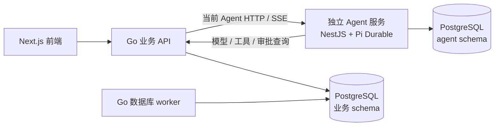
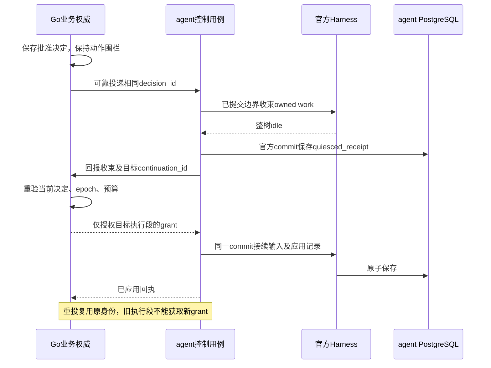

# 完整创作 Agent Harness、Skill 与多 Agent 架构设计

状态：按用户于 2026-11-04 确认的独立服务方案更新完整设计；HTTP 框架目标按[需求22](../requirement/22-Agent服务目录与TypeScript规范需求.md)调整为 NestJS；具体接口与数据合同为本稿设计决策，不代表代码已实现或产品已验收。已确认：同仓库独立 Agent 服务、TypeScript、官方 Pi Durable、PostgreSQL、Docker Compose 统一启动、不使用 Temporal、不保留旧实现或兼容处理。来源：[需求19 SRC-AGH-12](../requirement/19-完整创作Agent与Skill多Agent需求.md#src-agh-12)。产品接受见 [PRD19](../prd/19-完整创作Agent与Skill多Agent.md)，执行步骤见 [Plan28](../plan/28-完整创作Agent与Skill多Agent实施计划.md)，状态只见 [BACKLOG](../../BACKLOG.md#pi-durable-migration)。

## 1. 摘要

对话页面、首页/共享参考、全部消息历史及Stop/重试交互由[设计35](35-对话工作台与参考输入一致性设计.md)→PRD22→Plan31细化，扩展本设计的session/run公共合同，不更换执行引擎或Go业务权威；基础Harness迁移仍由本主链承接。

在当前仓库新建 agent，使用 TypeScript strict 与官方 Pi Durable，作为独立构建、测试、运行和关闭的 Node 服务。服务的会话、运行、计划、上下文压缩、工具循环、专业子 Agent 和恢复状态由它单独拥有。Go 不启动 Node，不保留 Agent 调度器，也不镜像维护 Pi 的执行状态。

Go 业务服务保留账号/团队权限、模型目录与调用网关、业务审批、预算与结算、正式工具命令和业务数据。普通生成/归档/导出/转写/复制/清理任务由数据库驱动的 Go worker 执行，项目移除全部 Temporal 依赖。

复用 PostgreSQL 实例，使用独立 agent schema 与受限角色；Agent 不读写 Go 业务表，Go 不读写 Agent 执行表。现有 docker-compose.yml 是唯一部署入口，新增内部 agent 服务；前端继续通过 Go API 访问，不开放 Agent 宿主端口。

## 2. 参与者

- 创作者：提交目标/剧本/参考、选择模型和 Skill，批准计划与费用，编辑和接管产物。
- 团队成员：按现有项目权限协作；项目共享不公开私人会话。
- 平台维护者：配置服务身份与既有资源，实施经审阅的数据变更和单次切换。
- 用户：已确认服务边界及技术方向；设计中的普通工程选择由实施方落实，不将参考方案冒称为完成证据。

## 3. 背景

### 3.1 当前事实与替代范围

1. 当前公开 Agent 入口由 Go 鉴权并代理独立 agent；会话、模型循环、专业子任务与恢复使用官方 Harness。
2. 普通生成/媒体/导出/复制/导入/声音与维护采用 PostgreSQL 工作记录和 Go taskruntime；旧工作流连接、SDK、schedule 命令与旧 Go 图不属于当前实现。
3. Compose 统一声明 frontend、backend、agent 与 canvas；agent 仅内部监听，Go 不启停 Node。
4. 当前空库结构为 schema.sql，已有库采用离线审阅 SQL，服务不自动 DDL；历史数据/在途任务不由源码迁移自动接管或删除。
5. 本文定义技术合同，实施与实际验证证据在 Plan28/BACKLOG 分别维护；不以历史测试或旧部署健康状态证明新架构接受。

源码入口：[公开 API](../../backend/internal/app/public_api.go)、[官方 Harness 接线](../../agent/src/sessions/runtime.ts)、[数据库任务](../../backend/internal/platform/taskruntime/worker.go)、[Compose](../../docker-compose.yml)。

### 3.2 一手依据与采用边界

- [Pi Durable README（固定源码）](https://github.com/earendil-works/pi/blob/676af1d777ef6f04b6bc8daf4cf3b9b1799cff4d/packages/durable/README.md)：官方声明 API 为实验性质；支持 Harness.open、提交去重、恢复、工具重放控制、子会话和自定义 Storage，不承诺外部副作用恰好一次。
- [官方 Storage 接口](https://github.com/earendil-works/pi/blob/676af1d777ef6f04b6bc8daf4cf3b9b1799cff4d/packages/durable/src/types.ts)：需实现原子提交、全局 ID、文档历史、扫描/游标与请求去重，并通过官方 registerStorageConformance。
- [官方包清单](https://github.com/earendil-works/pi/blob/676af1d777ef6f04b6bc8daf4cf3b9b1799cff4d/packages/durable/package.json)：本次核验已发布版本为 1.5.0，Node 最低 22.19.0；版本不是稳定性承诺。本稿固定已发布的 1.5.0 及配套依赖，提交 lockfile；实现必须核对发布包与固定源码，不跟随 main 或混搭版本。
- [参考宿主](https://github.com/glanderness/BeefTV/blob/4196de31fe92cb38f3f49b6f8094375e51062585/agent-host/durable-session-owner.mjs)：实际使用官方 Harness 与 SQLite；参考其会话所有者、请求身份和恢复方法，存储按本项目 PostgreSQL 约束适配，不复制产品实现。
- [参考任务运行时](https://github.com/glanderness/BeefTV/blob/4196de31fe92cb38f3f49b6f8094375e51062585/backend/internal/taskruntime/ports.go)：借鉴领取、租约、有界并发、取消与未知接单分类，不复制其桌面单用户授权假设。

SRC-AGH-12 确认独立 Agent 服务，替代纯 Go 引擎与 Go 托管 Node 子进程方案。原始确认保留在需求来源中，目标产品不保留这些实现。

HTTP 由 NestJS 承载，使用官方 Fastify 适配器。NestJS 负责路由、依赖装配、校验和生命周期，TypeBox 仅声明 Pi 工具参数。Agent 调度继续由 Pi Durable 负责。模块职责和迁移验收见[设计37](37-Agent服务目录与TypeScript规范设计.md)。

## 4. 目标

1. 产品入口实际调用独立服务中的官方 Harness，完成模型—工具—模型循环、恢复及真实子 Agent 委派。
2. 保留完整创作、Skill、剧本解析、人工审批、连续写链、现场差异、预算、媒体检查和可编辑交付。
3. Agent 运行状态单一归属；Go 只保存业务事实和授权回执，不保留另一套 Agent 状态机。
4. PostgreSQL 为唯一持久化源；角色/schema 隔离，官方 Storage 一致性及真实故障恢复可验证。
5. Agent 可单独构建和重启；普通 Go API 不因 Agent 未就绪而停止，双方都不设置互相等待的启动依赖。
6. 当前一套 API/配置/状态/执行合同一次性切换，无旧引擎、旧入口、别名、双轨、格式翻译或自动降级。
7. Temporal 的所有当前业务任务均有替代执行/取消/恢复路径；不引入另一个通用工作流平台。
8. 保留有效的账号、项目、素材与账务数据；旧运行在切换前清结/对账，删除数据须有精确审阅目标。

## 5. 使用场景

- 长剧本：制作人形成版本化计划，专业子 Agent 分析来源、生成提案、回收结果；并行受依赖和预算约束。
- 重大修改/生成：工具在 Go 写入提案后，同一 run 整棵 Agent 树暂停新动作，等待明确审批。
- 协同编辑：每次写入采用 Go 回执中的 revision，外部写入造成的真实冲突要求重读现场。
- 浏览器断线：只断开订阅；按相同会话与事件游标恢复，不取消后台工作。
- 独立服务重启：停止领取、保存已提交状态并释放所有权；重开原存储恢复同一提交及子任务，不重放外部收费。
- Go 暂时不可用：Agent 不发起未授权副作用，保存等待/失败状态；恢复后按原调用身份查询或重试。
- 发布切换：旧任务先清结或人工对账，再部署唯一的新合同；新服务不接管旧图或 Temporal 工作流。

## 6. 价值

独立 Agent 服务把 Pi 依赖、对话执行、资源限制与发布周期集中在 TypeScript 一侧，Go 保持业务领域职责。统一 Compose 保留单一操作入口，复用数据库而不增加持久化基础设施。明确新增成本为内部 HTTP/流式合同、服务身份、PostgreSQL Storage 和跨服务幂等；这些边界必须实际验证，不把拆目录或增加容器当作架构完成。

## 7. 方案

### 7.1 服务命名、技术选型与源码边界

#### 7.1.1 统一命名

| 对象                         | 唯一名称                                       |
| ---------------------------- | ---------------------------------------------- |
| 服务名称 / package.json name | agent（private: true）                         |
| 仓库目录                     | agent/                                         |
| Compose service / 内部 DNS   | agent / agent:4401                             |
| Docker 镜像仓库              | glowloom/agent                                 |
| 日志 | Pino 10.4.0，接入 Nest 和 HTTP 适配器 | 统一结构化日志、脱敏、请求与执行关联。 |
| PostgreSQL schema / 专用角色 | agent / glowloom_agent                         |
| 配置前缀                     | GLOWLOOM_AGENT_*                               |
| 入口 / 生产启动文件          | agent/src/server.ts / agent/dist/src/server.js |

不保留带 service 后缀的目录、包名或服务别名；不设计名称探测、旧配置别名或旧 schema 转译。schema 的命名属于新目标合同：现有同名 schema 中的旧 Go Agent 对象须在切换清单中逐表处理，角色只获授权的新表权限，不因同名继承旧表或整个 schema 的全表权限。不得把此设计变更当成执行删表/重建授权。

#### 7.1.2 已确定的技术栈与版本基线

下表是实施目标。Node、TypeScript、Pi 等沿用现有包基线。NestJS 新依赖已核对官方发布元数据的 Node、TypeScript 与 peer 范围。安装、运行和生成结果由实施验收验证，最终版本写入锁文件。

| 职责 | 技术选型与目标版本 |
| --- | --- |
| 运行时与镜像 | Node.js 24.22.2 LTS，`node:24.22.2-bookworm-slim`，固定镜像 digest。 |
| 语言与构建 | TypeScript 6.0.3，严格模式，原生 ESM / NodeNext，`tsc` 输出生产 JavaScript 与 Nest 装饰器元数据。开发与合同测试也验证编译产物。 |
| 包管理 | pnpm 12.4.2，Agent 独立 `pnpm-lock.yaml`，CI 冻结安装。 |
| 应用框架 | NestJS 12.3.3，`@nestjs/common`、`@nestjs/core`、`@nestjs/platform-fastify` 同版。使用 Module、Controller、Provider、Pipe、Exception Filter 和生命周期钩子。 |
| HTTP 传输 | 官方 `FastifyAdapter` 使用 Fastify 5.12.8。内部 JSON HTTP 与 SSE，使用 Node `fetch`、`AbortController`、`Readable`，保留背压与取消。 |
| DTO 和运行时元数据 | Nest `ValidationPipe`，`class-validator` 0.15.1，`class-transformer` 0.5.1，`reflect-metadata` 0.2.2，`rxjs` 7.8.2。 |
| Agent 执行 | 官方 Pi Durable 1.5.0，`@earendil-works/pi-durable`、`pi-ai`、`chord`、`pi-coding-agent` 同版。Pi 提供工具循环、子会话和持久化执行，宿主负责 Skill 装载与 PostgreSQL 租约，`pi-coding-agent` 仅使用受控资源 SDK。 |
| 数据与恢复 | 复用既有 PostgreSQL，CI 隔离库使用 PostgreSQL 18。Node 端 `pg` 8.23.1 与参数化 SQL 实现官方 Storage，使用独立 `agent` schema 和受限角色。事务、owner/epoch fencing、事件与消息投影共用该边界。 |
| Agent → Go 的接口生成 | Go 内部业务 Swagger 由 `swag` v1.16.6 从注解离线导出，`@umijs/openapi` 1.14.1 生成 Agent 的 TypeScript 请求与类型。 |
| Go → Agent 的接口生成 | `@nestjs/swagger` 12.1.0 从 Controller/DTO 生成 OpenAPI 3.0，使用 `oapi-codegen` v2.8.2 生成 Go 请求/响应模型与普通 HTTP 客户端。SSE 保留逐段读取。若开启内部 Swagger UI，使用 `@fastify/static` 10.1.10。 |
| 鉴权与业务出口 | 双向独立 Bearer token、audience、`node:crypto.timingSafeEqual`。Go 继续负责身份与 scope、run grant、审批、预算、计费、模型出站和业务工具。 |
| 日志与健康 | Pino 10.4.0 结构化脱敏日志，关联 request/session/run ID。使用 `/healthz` 和 `/readyz`，由进程有界停止与排空。 |
| 测试与代码规范 | Vitest 5.1.0、Fastify inject、真实 socket 与隔离 PostgreSQL、Pi 官方 Storage conformance。Google TypeScript Style Guide、ESLint 10.14.0、typescript-eslint 8.72.1、Prettier 3.9.9。 |
| 部署 | 同仓库独立 Docker 镜像，非 root 运行，Docker Compose 内部监听 `agent:4401`。发布同一版本的调用方和 Agent，由 Compose 管理进程。 |

版本依据见 [Nest Core 包元数据](https://registry.npmjs.org/@nestjs%2fcore/12.3.3)、[Fastify 适配器包元数据](https://registry.npmjs.org/@nestjs%2fplatform-fastify/12.3.3)、[Nest Swagger 包元数据](https://registry.npmjs.org/@nestjs%2fswagger/12.1.0)、[Pi 包元数据](https://registry.npmjs.org/@earendil-works%2fpi-durable/1.5.0)及 [oapi-codegen v2.8.2](https://github.com/oapi-codegen/oapi-codegen/releases/tag/v2.8.2)。

Agent 部署只有一套 NestJS 实现。切换同时移除独立 Fastify 应用、TypeBox HTTP 合同、旧 Swagger 生成脚本及其专用依赖。Fastify 作为 Nest 的 HTTP 适配器保留。生产请求只使用当前配置、路由、DTO 与执行定义。

#### 7.1.3 构建、合同与检查命令

保留 TypeScript 编译入口 `src/server.ts`、生产入口 `dist/src/server.js`、冻结锁文件及非 root 镜像。Controller 和 DTO 注解通过 `@nestjs/swagger` 导出内部 OpenAPI；独立测试装配可复用实际路由，无需监听端口或连接数据库和模型。双向客户端生成链见[设计37 §7.6](37-Agent服务目录与TypeScript规范设计.md#76-swagger-与-umi-接口生成)。

嵌套对象生成命名 Go DTO，保留 required、optional 与显式 nullable。只对明确允许 null 的字段生成可空类型。运行快照无待审批提案时允许省略 proposal，pending_proposal 的 null 按合同传递。生成文件由对应工具更新。

#### 7.1.4 目录与拓扑

Agent 是同仓库独立进程，由 Compose 管理。目标目录、模块所有权、HTTP/应用边界及文件迁移规则统一见[设计37 §7.2](37-Agent服务目录与TypeScript规范设计.md#72-目录与依赖)，代码风格见 [Agent 工程规范](../../agent/AGENTS.md)。

Agent 拥有会话、运行、子会话、执行恢复与 Durable 记录；Go 拥有身份和授权、预算、审批、模型出站、业务工具及业务数据。Agent 仅通过正式 HTTP 合同调用 Go，不直接访问业务 schema，也不复制其业务模型。Agent 的 `sessions/persistence` 与 Pi Durable Storage 虽共用受限 PostgreSQL 实例，但职责、表和授权边界分开。

### 7.2 唯一权威与数据所有权

| 事实                                                             | 唯一权威           | 另一侧的边界                                        |
| ---------------------------------------------------------------- | ------------------ | --------------------------------------------------- |
| session、run、计划、上下文、子会话、Pi task/submission、事件游标 | Agent 服务 / agent | Go 通过 API 转发/读取，不保存执行状态镜像           |
| 当前运行所有权、续租、Pi commit 序号                             | Agent Storage      | Go 仅校验该执行者的短效业务授权，不读写 runtime 表  |
| 用户/团队/项目权限、业务对象版本                                 | Go 业务服务        | Agent 从授权快照/工具回执获取，不自行推断权限       |
| 候选、报价、审批决定、预算预留/结算、provider 回执               | Go 业务服务        | Agent 只持引用与展示投影，Pi usage 不是实际财务账本 |
| Skill 包/版本/授权                                               | Go Skill 业务      | Agent 固定并加载获授权版本，保存本次上下文引用      |
| 导出/转写/归档/复制等任务与产物事实                              | 对应 Go 模块       | Agent 只发正式命令并查询，不另外执行或伪造终态      |

允许 Go 的业务授权账本记录 run 引用、scope、fencing epoch、到期时间、审批 revision 和工具幂等结果；不保存 Pi 的 planning/running 等执行状态。Agent 本地计划不能代替业务审批。双方均不跨 schema 直接修改对方表，不使用跨 schema 外键来强耦合运行记录。

### 7.3 内部 HTTP、认证与合同来源

Agent 在 Compose 内监听 agent:4401，仅 expose，不配置 host ports。Go 通过 GLOWLOOM_AGENT_ORIGIN 访问；Agent 通过 GLOWLOOM_AGENT_BUSINESS_ORIGIN 访问 Go。前端只访问现有同站 Go API，服务令牌和内部地址不进入浏览器。

两个方向使用不同的服务身份凭据：GLOWLOOM_AGENT_SERVICE_TOKEN（Go→Agent）、GLOWLOOM_AGENT_BUSINESS_TOKEN（Agent→Go）。双方显式校验服务身份、audience、请求身份和作用域；外部用户即使知道内部路径也不能取得服务权限。实际密钥在部署配置中提供，不写入文档/源码/日志。

Go 发给 Agent 的受理上下文包含 actor、org、project、canvas、request_id 与内容哈希；该上下文由已认证的 Go 入口建立，模型不能覆盖。Agent 的每个业务动作携带 Go 签发的当前 run grant，而不是把模型参数里的 user_id 当成授权。

| 边界               | 当前合同                                                                                                                                                                                               |
| ------------------ | ------------------------------------------------------------------------------------------------------------------------------------------------------------------------------------------------------ |
| 浏览器→Go          | 创建/读取会话，提交目标，approve/reject/pause/resume/stop，读取 SSE；沿用 Go 注解生成前端客户端的单一来源                                                                                              |
| Go→Agent           | /internal/agent/sessions、/sessions/:sid/runs、/runs/:rid/commands、/runs/:rid/events；明确 actor/scope、request_id、expected_execution_revision（输入）、authorization_revision（控制决定）及命令回执 |
| Agent→Go           | /internal/agent-business 下的执行授权、快照、工具发现/执行、Skill、提案/决定、模型流与业务结果查询                                                                                                     |
| Agent→PostgreSQL   | 受限角色的官方 Storage 操作；无业务表访问                                                                                                                                                              |
| Go→业务 PostgreSQL | 现有领域应用命令及授权/计费事务；无 runtime 表访问                                                                                                                                                     |

Agent 的目标 HTTP 合同由实际注册的 Nest Controller/DTO 维护并生成 OpenAPI 与 Go 客户端。CI 核对注册路由、规范、运行时校验和生成客户端的一致性。Go 继续定义业务工具、模型和公网 API 合同，分别维护各信任边界的规范。协议版本不符时返回明确错误。

HTTP 边界限制 body/frame、并发和等待队列，配置超时、取消、背压及统一问题响应；错误保留 request/run/tool call ID，脱敏记录。不得在数据库事务中等待对方 RPC。连接断开表示交付结果未知，不等于业务未发生。

### 7.4 PostgreSQL Storage、所有权与幂等

Agent 通过独立 GLOWLOOM_AGENT_DB_DSN 使用既有 PostgreSQL 实例中的 agent schema。Agent runtime role 无业务表权限；Go role 无 runtime 表权限。结构定义仍以 backend/db/schema.sql 为统一空库来源，单次增量 SQL 由实施审阅；两个服务启动均不建表或修补 schema。

Pi 没有本项目可直接采用的官方 PostgreSQL Storage。实现其当前公开 Storage 合同，不转换 SQLite SQL、不持久化 MemoryStorage 快照、不维护另一套 Harness。目标表承载 session/业务范围/租约、typed runtime records、commit seq、document history 和已提交事件投影；索引覆盖 request_id 去重、文档地址/历史与稳定扫描。

提交必须落实：有序原子批次、只在 COMMIT 确认后 receive、已提交前缀与拒绝语义、跨重启单调 ID、全局 ID/不可变记录约束、文档 incarnation/复制/退休、继承可见性、游标和对象值隔离。数据库 ID 的编码遵循官方接口；公共游标使用明确的字符串格式，禁止 JS 数值精度丢失。

一个业务 session 对应一个官方 Harness 及其 Storage 分区，包含根 conversation 和所有 owned child conversations；业务 root_run 可含多个 Pi submission，同一 session 同时只有一个活动 root_run。专业子 Agent 的独立上下文是该 Harness 内的子 conversation，不另开 Harness/租约。整棵运行树共用根 owner/epoch 与 root_run grant，子任务的工具/预算范围只能收窄；本版不独立分发子会话到其他 owner。

每个业务 session 对应的 Harness 只有一个活动 owner。领取/续租及所有 Storage 写入在事务内检查 owner epoch 与 lease_until；交接递增 epoch，旧写者不能提交。默认 Compose 单副本，仍测试失租约/迟到请求；不把这称作已具备多活。

跨服务副作用还有独立的 Go 授权围栏：Agent 取得/续租后，必须先向 Go 注册同一 epoch、绑定 root_run 下固定执行段的短效 grant，grant 到期时间不得晚于租约；Go 只提升 epoch，不降低，旧 grant 或过期 grant 拒绝。新 owner 注册成功前不执行工具/模型。Go 独立持久化 Stop、撤权、Pause 和审批禁止事实及 authorization_revision；领取、升 epoch、恢复、注册和续租都不能解除这些禁止事实。只有满足当前授权 revision 的显式批准/Resume 决定，经过 §7.6.5 的收束回执与新段 grant 握手后才能重新准入；Stop 对该 root_run 为终止决定，重新创作须新 run。Go 每次副作用在业务事务内校验当前授权 revision、epoch、有效期、scope 与预算，旧 grant 不能越过后来决定。该记录只是业务准入，不是第二套执行状态。注册中断时保留待授权状态，按原 epoch/请求身份核对，不启动不确定工作。

新 run/用户输入先在 Agent 持久化接受，再建立业务授权并调用官方 submit；此顺序不适用于批准、驳回、Pause、Resume 或 Stop 等业务控制决定，后者统一采用 §7.5 的 Go 决定→可靠投递→Agent inbox 合同。中断恢复查原 request_id/内容哈希，重复同键不同内容冲突。每个工具/模型调用具有 run + 执行段 submission/continuation_id + Pi task/call ID + 合同版本 + 参数哈希的稳定身份；grant 同时绑定执行段，旧段不能换领新段授权（§7.6.5）。Go 在自己的业务事务中提交副作用和幂等回执；Agent 收到已提交回执后再提交 Pi 结果。两端不存在跨服务原子事务。

业务提交后 Agent 未存回执就崩溃：重开后先查 Go 的原调用结果。供应商接单未知时只查询原 request/归档/结算，不重新生成新 ID 付费；只读或已有实测幂等回执的工具才声明 replay: safe。存储错误按官方语义关闭受影响 Harness，不自动换存储或无限重试。

### 7.5 模型、审批、写链与控制命令

Pi-ai 模型 provider 转接 Go 模型网关；供应商主密钥仅在 Go。规划、压缩、专业子 Agent 与生成均冻结模型/参数版本，并经过 Go 的预算/调用回执。Pi 的 token/usage 用于执行投影，实际预留、结算及缓存费用以 Go 和供应商证据为准。

提案只由 Go 正式业务命令创建，绑定候选哈希、画布/价格版本、范围和预算。受理提案的同一业务事务建立 run 级审批围栏，阻止同一父子树的新模型/写工具；Agent 按 §7.6.5 通过工具控制、出口校验与官方取消收束自主推进，不假设存在通用 interrupt/resume 按钮。并发提案由 Go 对 run 串行受理，先受理的生效，后续不同提案返回等待审批，重复调用重放原回执。其他独立 run 不受影响；已授权发出的外部请求仅收集原回执，不自动推进后续步骤。

批准、驳回、Pause、Resume、Stop 全部先在 Go 事务内提交业务决定与待投递记录，按 root_run 串行递增 authorization_revision；前端对需要乐观校验的决定提交 expected_authorization_revision。批准时重验身份、候选、画布/价格版本与预算。Go 有界投递循环发送相同 decision_id、authorization_revision 与内容哈希；Agent durable inbox 去重、核对当前 Go 决定后，将应用结果/已见授权 revision 和执行变更同一 Pi commit 存储，再返回回执，Go 才标为已交付。失去确认重投原决定，不重新批准。

Agent 的 execution_revision 独立递增，用于输入与执行快照的并发控制；不得与 Go authorization_revision 混用或要求两者相等。Agent 控制 inbox 单调采用授权 revision；较旧决定标为 superseded，发现间隙/不确定结果时查询 Go 当前决定后处理。迟到 approve/resume 不覆盖后来的 Stop。即使较旧命令先到，Go 已生效的新围栏仍会拒绝后续副作用。驳回/过期保持停止，需要显式重新规划/接续。

Stop 先在 Go 撤销业务 grant 并持久化终止决定，再通过相同可靠投递链向 Agent 发取消；Agent 调用官方取消并传播到同树子任务。收到已提交应用回执前显示取消已请求，不伪造已停止。

Pause 同样先在 Go 持久化禁止新动作，再投递 Agent，在安全边界结束当前自动推进并保存业务 run 的暂停状态；已发送的外部请求仅收集回执/对账。Resume 先持久化新的当前 Go 决定；按 §7.6.5 收束回执与执行段 grant 握手后才解除新段的动作禁止，在同一 session/root_run 创建 requestId 由 run+decision_id 派生的确定性 continuation submission；不重新打开已终止的官方 submission，也不重放旧工具/收费请求。进程崩溃恢复则按官方语义接续原未决 submission，区别于显式 Pause/Resume。

连续写工具只采用 Go 成功回执的真实 revision 更新写链。下一次模型请求前通过业务快照读取当前现场并注入差异；发生真实协作冲突时重读/重规划，不覆盖别人的写入。每次模型调用前从 Go 的 grant 校验响应读取 available_micros，单次预留上限为 frozen manifest.max_micros 与当前可用额度的较小值；该观察值不参与授权身份，Go 仍在事务中原子复验，未知原请求继续占用预留。单轮默认模型请求最多40次、工具步骤最多40次、模型流式空闲45秒，预算含压缩/子任务并跨重启保存；这些是执行限制，不是性能承诺。

### 7.6 Harness、专业 Agent、Skill 与事件流

#### 7.6.1 参考实现与本项目取舍

以下对比基于参考项目固定提交4196de31fe92cb38f3f49b6f8094375e51062585及官方 Pi 1.5.0 固定源码；参考项目使用1.3.0，不能据其测试推定目标1.5.0已验证。

| 边界      | 参考实现的实际做法                                                                | 本项目决定                                                                             |
| --------- | --------------------------------------------------------------------------------- | -------------------------------------------------------------------------------------- |
| Node 宿主 | JavaScript ESM、node:http，Go 管理本机 Node 子进程                                | 独立 agent；NestJS 负责服务边界，Pi 负责执行                                          |
| 执行内核  | 官方 Harness、registry、extension、tool、doc 与 owned conversation                | 直接复用同类官方能力，不再实现图引擎、SessionManager 或任务调度器                      |
| Pi SDK    | pi-durable、pi-ai、chord、pi-coding-agent 同版；coding-agent 提供包与扩展加载能力 | 四个直接依赖固定1.5.0；coding-agent 仅作受控资源 SDK，不启动 CLI 或另一套 AgentSession |
| 持久化    | 官方 SQLite Storage，本机会话锁                                                   | 自定义官方 Storage 的 PostgreSQL 实现，根 owner/epoch 及跨服务 grant                   |
| 工具      | Go operation descriptors 生成模型可见工具                                         | Go 工具合同唯一权威，转换为官方 defineTool，不在 Node 重写业务规则                     |
| 输出      | /chat 的 HTTP NDJSON；断开只移除监听                                              | 已提交事件投影及 SSE；不得把参考输出描述为 SSE                                         |
| 插件      | 官方包管理/扩展加载后适配为 Durable 工具                                          | 仅可信扩展进入进程；第三方 Skill 是声明式内容，脚本走 Go 隔离能力                      |

一手入口：[参考包清单](https://github.com/glanderness/BeefTV/blob/4196de31fe92cb38f3f49b6f8094375e51062585/agent-host/package.json)、[参考扩展](https://github.com/glanderness/BeefTV/blob/4196de31fe92cb38f3f49b6f8094375e51062585/agent-host/durable-extensions.mjs)、[参考插件加载](https://github.com/glanderness/BeefTV/blob/4196de31fe92cb38f3f49b6f8094375e51062585/agent-host/plugin-packages.mjs)、[参考工具桥](https://github.com/glanderness/BeefTV/blob/4196de31fe92cb38f3f49b6f8094375e51062585/agent-host/operation-bridge.mjs)、[参考 HTTP](https://github.com/glanderness/BeefTV/blob/4196de31fe92cb38f3f49b6f8094375e51062585/agent-host/server.mjs)。

#### 7.6.2 官方能力与宿主责任

| 能力       | 官方入口                                                         | agent 增补边界                                                                      |
| ---------- | ---------------------------------------------------------------- | ----------------------------------------------------------------------------------- |
| 会话与循环 | Harness.open、root.submit、submission.wait、resume、abort、close | 接受合同、owner、业务授权、生命周期；不另建模型—工具循环                            |
| 扩展注册   | createRegistry、defineExtension、defineTool、hook                | 组合有限的业务扩展、验证名称/版本及角色选择                                         |
| 应用状态   | defineDoc 与官方 commit                                          | 计划、采用关系、Skill 引用、控制应用记录及累计额度；不复制 Pi transcript/task/inbox |
| 专业委派   | task ownership、api.commit、createConversation、api.conversation | 专业输入、工具/预算收窄、委派深度和结果采用规则                                     |
| 压缩与检查 | 官方 CompactionTask、GenerationTask/ToolTask hooks、onReport     | 业务上下文准备、诊断及正式结果投影；不改写官方检查点协议                            |
| 存储       | 官方 Storage 接口与 registerStorageConformance                   | §7.4 PostgreSQL 实现及 fencing；不做 MemoryStorage 快照或 SQLite SQL 翻译           |

Nest Controller 只调用会话用例。Harness 扩展通过明确依赖使用业务客户端，传输对象仅在 HTTP 边界使用。不存在 Go→Node stdio 或通过 CLI/RPC 启动第二个执行内核。coding-agent 的 ModelRuntime、个人认证文件和 SessionManager 不作为本项目执行或凭据权威；pi-ai 的 Models/provider 适配直接经过 Go。

#### 7.6.3 扩展组合与冻结

内核只组合有明确职责的扩展：业务工具桥、计划与采用关系、Skill 内容读取、专业委派、现场上下文。计划变更是应用 doc 的提交；生成/覆盖提案必须调用 Go，不能以 plan_update 自行批准。业务工具读写效果在 Go，Skill 内容不会凭提示词获得额外工具。

会话创建时显式选择 extensions/tools；官方默认选择所有已注册扩展，本项目不依赖此默认值。根会话和每个子会话均按角色建立精确名单；同名工具不得靠官方“后注册覆盖前注册”规则解决，组合校验直接失败。嵌套 api.executeTool 同样经过工具适配器，不能成为绕过权限的第二入口。

每个业务 root_run 冻结 SDK 版本、扩展名称/定义版本/代码摘要、Go 工具合同版本、模型配置、Skill 版本/资源哈希及角色权限，形成执行 manifest。开始前持久化其引用；新子会话只选 manifest 的子集。官方 registry 可热更新不意味着产品应热换运行规则：活动 run 不执行 registry 替换、自动包更新或角色扩权。Skill 停用/权限撤销仍即时由 Go 拦截，冻结版本不是继续执行的授权。

崩溃后须以同一 manifest 重新构造 registry 再恢复。不匹配或缺失定义时保持待核对/明确失败，不静默采用新版、安装缺包或切换引擎。发布前清结依赖旧定义的活动 run，再统一发布当前版本；不在新服务内长期保留版本分支或迁移旧任务定义。保留官方任务版本元数据用于校验，不实现历史格式转换。

#### 7.6.4 会话生命周期与恢复

1. 内部命令先校验身份/scope/请求哈希，持久接受；取得 session 根 owner/epoch 后构造 Storage、manifest 与 registry。Harness.open 可能执行恢复记账，必须先持有有效所有权。
2. 核对 Go 当前授权 revision、审批/暂停/Stop 与业务 grant，才允许启动调度器。submit、wait 及部分会话操作也会启动调度，不能仅拦住 resume。
3. 新业务输入按 §7.4 接受和授权，再以确定性 requestId 调用官方 submit；重复输入复用原提交。只读查询通过一致性快照/事件读取；确需官方视图时使用 readOnly:true，禁止用可写 Harness.open 或 wait 暗中推进。
4. 进程崩溃恢复原未决 submission/owned task；显式 Pause、审批收束后的接续遵循 §7.5 和下节的 continuation 合同，禁止把两者混为“恢复”。
5. 失租约、Storage 故障、未知提交结果立即封闭该 Harness 的新执行窗口；停止续 grant，关闭/有界排空。重新领取并查询提交结果后才能重开，不在旧实例上盲重试。
6. onReport 区分 storage_failed、task_faulted/interrupted/outdated、extension_error 与 listener_error；持久展示可操作诊断。不得把所有异常吞成“继续生成”，或用无限重启消除失败状态。
7. 完成、暂停、等待批准及待核对达到安全静止后关闭 Harness 并释放 owner 租约；后续命令按原持久状态重开。控制接续若早于上一轮调度收尾，须在旧调度退出后唤醒已接受的新段，不能因旧 job 仍在内存中就永久丢失这次唤醒。

Pi 的调度、任务图和睡眠继续采用官方语义；宿主只有 session 所有权/唤醒与授权控制，不新增独立 DAG、抢占器或执行检查点状态机。

#### 7.6.5 模型/工具出口与审批收束

GenerationTask.beforeRequest 负责从 Go 读取现场、检查采用版本并构造有界差异摘要；ToolTask hooks 用于提示和结果整理。官方部分 hook 抛错后会报告并跳过，因此权限、预算、版本与审批强制检查不得只写在 hook。模型 provider 适配器、业务工具 execute 和 Go 接收端各自在真正发起请求前校验当前 grant/epoch/授权 revision；检查失败不得继续出站。必要上下文读取失败同样由模型出口拒绝请求，不复用过期现场假装完成校验。不修改 globalThis.fetch，不通过全局拦截隐式追加服务凭据。

工具由 Go descriptors 生成 defineTool，描述包含参数 schema、效果分类、合同版本与幂等能力。官方校验模型参数；适配器追加可信 scope、root_run、Pi task/call 身份，模型不能覆盖；Go 再执行业务校验。Agent HTTP DTO 与 Go 工具 schema 分属网络合同和业务合同，不能人工维护同一工具规则的两个副本。

工具 intent 由 Pi 先提交，随后 Go 以稳定调用身份提交业务结果/幂等回执，最后 Agent 提交 Pi 结果。readOnly 不自动等于可安全重放：仍需核实调用是否收费/有外部效果。默认 replay:unsafe，只有经故障测试证明同一身份可查询/重放原结果的工具才设 safe；unsafe 中断转待核对，不能“重试一次”重新创建。写工具按 root_run 写链串行；并行只允许显式批准的独立读取/专业分析，并服从同一预算与围栏。

提案受理在 Go 立即建立整树围栏。提案工具提交回执后返回 control:{terminate:true}；官方只有该轮所有工具结果都要求 terminate 才停止模型循环，所以适配器对围栏后的阻断结果也返回 terminate，并阻止下一模型请求/新增委派。该返回值不能单独停止已运行的兄弟会话：根控制用例在已提交回执边界通过官方 abort 收束剩余 owned work，记录 waiting_approval 及未完成计划；仍在途的业务请求只核对原回执。未达到安全收束前界面保持“正在等待停止”，不能提前宣称全树已暂停。

批准决定持久化不立即开放旧执行段：Go 保持围栏，先可靠投递决定。Agent 在当前 root_run 整树达到官方 idle、在途调用已登记对账后，提交 quiesced_receipt（root_run、围栏/决定 revision、owner epoch、唯一目标 continuation_id）；该回执是重新准入的业务凭证，不让 Go 镜像 Pi 任务状态。Agent 将其报告 Go，Go 在事务内重验当前决定/权限/预算及 epoch，仅为该 continuation_id 签发新 grant。Agent 取得 grant 后才在官方 commit 内接受确定性 continuation 并提交应用回执，Go 收到最终回执才将控制决定标为已交付。任一窗口崩溃均查原决定/收束回执/grant/continuation 身份重做同一步，不重新授权；后来 Stop/撤权使旧批准流程失效。若 Go 已提交 quiesced grant 而响应丢失，新 owner 先登记当前 epoch，再凭同一决定、收束证明与确定性 continuation 复查原 grant；不能换段、换决定或重新批准。

每个执行段的初始 submission/continuation_id 固定到任务调用上下文，grant 绑定这一执行段；旧任务不得刷新为新段 grant。回执核对可按原调用身份完成，但不能发起新动作。这样即使批准早到、旧 worker 延迟恢复或服务在收束确认后崩溃，旧任务也不能借新授权继续；审批前的 pending/steer/follow-up 输入不会自动转入新段，未采用输入明确保留待用户确认。

批准后依据 Go 当前决定，按 run+decision_id 创建唯一根 continuation submission，从已提交计划、采用关系及原业务结果继续。被 abort/terminate 的 submission、delegation task 或子会话不会原地复活；需要继续的专业工作以新委派身份建立子会话，输入引用既有已采用结果和未完成目标，不重发既有业务调用。仅崩溃留下仍未决的 owned task 恢复原子会话。Pause/Resume 同样遵守该区分，Stop 对业务 run 终止且不可接续。

付费模型出口按每个 Pi task 的稳定请求/尝试身份记账，涵盖规划、压缩及子会话。模型键由 root_run/固定执行段、task、已提交请求 checkpoint 边界与 attempt 组成，并绑定不可变的规范化请求哈希；请求边界及其调用映射在出站前持久化，重开复用，同一 task 的不同模型轮次不得误合并。同键不同内容明确冲突。官方公开 telemetry 的 task/phase/attempt 用于可信关联，不能把 span ID、进程计数器或仅 task+attempt 当作持久请求身份；关联缺失则出口拒绝，不能只依赖 generation hook 而漏掉压缩。请求 checkpoint 的类型和关联传播以固定版本公开合同及实际适配测试核对，不导入包私有路径或修改 SDK。

未知接单先核对已登记映射与 Go 原回执，再决定是否可继续，不能依赖 SDK 自动重发。初始 settings.retry.maxRetries=0，并禁用 provider 内部自动重发；明确失败后的业务重试另建受预算约束的显式请求。即使 close/reopen、上下文溢出压缩或官方恢复逻辑尝试新请求，Go 仍先处理原尝试的未知账务并重验授权；SDK 的默认恢复不是费用恰好一次承诺。maxRetries=0 时模型调用中崩溃可能使原 submission 以 interrupted 结束，必须报告该结果并核对原调用；不能承诺该模型请求会自动接续。

稳定关联依据见[官方遥测合同](https://github.com/earendil-works/pi/blob/676af1d777ef6f04b6bc8daf4cf3b9b1799cff4d/packages/durable/src/harness/telemetry.ts)与[官方 generation 实现](https://github.com/earendil-works/pi/blob/676af1d777ef6f04b6bc8daf4cf3b9b1799cff4d/packages/durable/src/harness/generation.ts)，后者用于核对语义，不作为可绕过公开 API 的导入面。

#### 7.6.6 真实专业子会话与上下文

制作人委派编剧、美术、分镜、镜头、声音、剪辑与质量检查 Agent。委派工具在 api.commit 中先按 ownerTaskId 查已有 child，再创建 ownership:{kind:"task",taskId:api.taskId} 的子 conversation；子输入 requestId 由该 task 身份确定。查找、创建与子配置在同一官方 commit 完成，崩溃重跑复用原 child/submission，禁止先创建子会话再异步登记关系。

官方新 child 默认继承父配置；必须在首次 submit 前显式收窄 extensions/tools、模型、输入来源与预算。默认禁止子级再次委派；需要层级委派的角色在 manifest 明确最大深度、并发数与总额度。子预算从根额度分配，不能各自拿一份完整额度；子会话与根共用 owner/epoch/grant，不能独立对外取得更大 scope。

委派结果保存来源/产物/采用状态及诊断，不能把任意文本“成功”当作业务完成。父级通过官方子任务等待和已提交结果回收，子任务失败后决定局部重做或人工处理。默认禁止 background:true 的脱离式子任务；父级 abort 沿官方 ownership 传播。执行面板从官方任务图和应用 doc 投影，不在 Go 重建任务树。

上下文压缩使用官方 CompactionTask/compact，保留原历史；不写第二套摘要检查点。应用 doc 保留目标、来源版本、计划/采用关系、未决提案、manifest 和预算引用，压缩后按引用重新注入必要约束。beforeCompact 可补充保留要求，但不能以摘要替代当前 Go 授权。压缩模型同样经 Go 校验并计费；失败明确展示，不能悄悄丢弃 Skill 或切换模型继续。

#### 7.6.7 Skill 与可信扩展加载

Go 负责 Skill 发现/导入/校验/安装/版本/启停/授权及资源目录。Agent 根据获准版本按需取正文/参考/资源，不维护另一套产品包管理账本。第三方 Skill 是声明式知识与能力需求；其中的脚本经正式 Go 隔离执行工具，不能直接导入 Node 或读取宿主环境/服务令牌。

第一方审阅并随镜像固定的 Pi 扩展才可在 agent 进程执行。复用 pi-coding-agent 的 SettingsManager.inMemory、DefaultPackageManager.resolveExtensionSources 与 discoverAndLoadExtensions；仅传入已存在、只读的本地固定包路径，拒绝 npm/git/URL、builtin 任意选择、未声明入口与根目录逃逸，不调用 install/update 或启动时下载。用官方解析/加载结果适配为 Durable defineExtension/defineTool，显式保留 replay、schema 与执行模式；不另造插件解析器或把整套 Coding Agent 事件循环搬进来。

discoverAndLoadExtensions 会扫描 cwd/.pi/extensions 及 agentDir/extensions，即使配置了显式路径也不会自动关闭扫描。本项目传入独立、受控、只读且这两个目录为空的 cwd/agentDir，禁止用户挂载或 Skill 包成为这两个根；装载前后验证空目录与入口 allowlist，发生任何额外发现/重复工具/加载错误则拒绝该 manifest。不得用用户 HOME、业务素材目录或上传包目录作为发现根，也不依赖一个不存在的“关闭自动发现”参数。

动态扩展加载器不是安全沙箱；其代码拥有进程权限。非可信扩展不得以“用户已安装 Skill”为由进入它。Go 隔离执行结果通过业务回执回传；缺隔离设施明确拒绝，不降级到默认 bash/read/write/edit 工具。加载、失败和撤销均记录确切版本/资源摘要，不把插件安装成功当作执行验收。

依据：[官方 SDK 导出](https://github.com/earendil-works/pi/blob/676af1d777ef6f04b6bc8daf4cf3b9b1799cff4d/packages/coding-agent/src/index.ts)、[官方加载器扫描行为](https://github.com/earendil-works/pi/blob/676af1d777ef6f04b6bc8daf4cf3b9b1799cff4d/packages/coding-agent/src/core/extensions/loader.ts)、[官方包资源解析](https://github.com/earendil-works/pi/blob/676af1d777ef6f04b6bc8daf4cf3b9b1799cff4d/packages/coding-agent/src/core/package-manager.ts)。这些加载能力不赋予租户代码进程内执行权限。

#### 7.6.8 已提交事件流

Agent Storage 在提交 Pi 批次的同一 PostgreSQL 事务内生成 runtime_events 投影，cursor 为该 session 的 commit_seq + event_ordinal 字符串；唯一约束防重复。原状态与事件一起提交/回滚，不依赖提交后 watchEvents/onReport observer 才补写，避免崩溃造成永久事件缺口。进程通知仅用于唤醒，SSE 始终从持久游标补读，丢通知也会轮询补齐。公开事件含运行状态、文本/供应商允许的推理摘要、工具通知、提案和产物引用；不暴露原始凭据或内部文档。图片字节只进入私有 Pi 上下文，不复制到公开事件或快照；模型请求与业务响应最多8MiB，SSE单帧最多1MiB，读取时即限制而非无界读完后判断。

Go SSE 代理只鉴权和转发，游标由 Agent 解释。重连携带 Last-Event-ID，在保留窗口内补读；过旧游标明确返回 snapshot_required。snapshot 在一个一致性读取事务中返回当前 Agent 状态与同一一致性点的 snapshot_cursor；整体最多4MiB，近期事件最多100条并在数据库按累计字节限额裁剪，完整历史仍从持久事件口读取；客户端从该 cursor 之后订阅，禁止先读无游标快照再从“最新”开始。Pi→事件事务和保留水位同样纳入恢复测试，不静默漏事件。订阅期间按事件批次重验会话/项目权限，撤权关闭流；慢客户端断开后可重连。客户端断开仅取消订阅，不调用 Agent abort。Stop 与后续新输入通过命令身份和 revision 区分。

### 7.7 普通任务替代 Temporal

生成、归档、导出、转写、复制、导入、声音与维护任务归 Go；Pi Durable 只编排 Agent 对它们的正式调用和等待。共享运行时代码只承担领取/租约/并发/排空，不定义第二套任意 DAG/脚本工作流。

| 当前任务                                      | 替代执行与持久化边界                                                                       |
| --------------------------------------------- | ------------------------------------------------------------------------------------------ |
| operation 单次/批次生成、控制、恢复、免费试用 | 原 operation/batch/provider binding 与回执；数据库记录待执行步骤，按原请求查询、归档、结算 |
| catalog 凭据测试、provider 队列               | 原测试记录与模型调用回执；有限重试、明确超时和状态                                         |
| media 归档/转存、删除/purge                   | 原 transfer/purge job；续租、断点/对象核对、引用保护与取消                                 |
| mediatool 导出、转写、深度任务                | 原 job/work ID；有界子进程、进度续租、取消与失败收尾                                       |
| workspace 项目复制、保留期清理                | 原复制/保留记录；分步幂等、引用锁、可恢复清理；内容删除默认不调度，须运维显式启用          |
| script 导入                                   | 原导入记录；源版本、解析产物和采用状态                                                     |
| subject 声音任务                              | 原 voice job、生成回执和素材入库，不删未完成迁移保护                                       |
| agent.codex 队列及既有 Codex 适配             | 移除 Temporal 队列接线；有效外部能力继续按既有调用合同执行，不能据此保留旧 Agent 调度引擎  |
| 报价过期、分区、outbox/inbox 等维护           | 到期时间与执行游标入库，Go 定时唤醒；重启补扫，跨进程领取防重复                            |

领取采用事务锁或条件更新，包含 owner/epoch、lease_until、attempt 与 next_run_at；只把等待时间落库，不用长时间持锁或占用 goroutine 睡眠。失租约不能再提交进度/终态。普通任务执行结束后由模块自己提交业务结果，调度器只确认执行窗口关闭。

任务准入与可领取事实在同一业务事务产生。Kafka 可保留审计/实时事件，任务恢复扫描不依赖 Kafka 消息再次到达；从事件唤醒也只查询原任务，不重复创建。只受理当前合同创建的任务。旧在途工作在切换前完成或人工对账，新 worker 不包含旧工作流接管逻辑。

普通复制/转存的显式失败重试保留逻辑 job/item/asset 身份；物理写入意图与输出事实按尝试追加，不覆盖旧尝试的目标位置、对象键或关闭证明。已取消/关闭的 work 不重新打开，已删除位置不重新绑定。初次尝试和后续尝试统一使用当前尝试事实，不从旧冻结目标补读；只有失败项新建尝试，已成功项保持原产物。未知写入仍按原尝试核对，未取得结束与删除证据前不能以新尝试绕过写入围栏。

### 7.8 Compose、健康与资源

目标 Compose 服务为 frontend、backend、agent、canvas；复用现有 PostgreSQL、Redis、Kafka和对象存储，不增建数据库容器。只使用当前 docker-compose.yml，命令仍为 docker compose up -d --build。agent 独立 Dockerfile/锁文件/构建缓存，以非 root 运行并设置 CPU/内存/连接池限制；准确值在隔离负载验证后确定。

| 配置/接口                      | 责任                                               |
| ------------------------------ | -------------------------------------------------- |
| GLOWLOOM_AGENT_ORIGIN          | Go 访问 Compose 内部 agent:4401                    |
| GLOWLOOM_AGENT_HTTP_ADDR       | Agent 内部监听地址                                 |
| GLOWLOOM_AGENT_DB_DSN          | Agent 受限 PostgreSQL 角色，禁止复用业务管理员 DSN |
| GLOWLOOM_AGENT_BUSINESS_ORIGIN | Agent 访问 Go 内部业务地址                         |
| 两个方向的服务凭据             | 分别配置与校验，不传到前端/模型                    |
| Agent /healthz                 | 进程存活，不调用 Go                                |
| Agent /readyz                  | 自有配置、schema 和 PG 可用性；不依赖 Go readyz    |
| 执行能力状态                   | 单独报告 Go 工具/模型授权可达性，不混入进程存活    |

Go 的普通 readiness 不依赖 Agent；Agent 的基础 readiness 不依赖 Go，Compose 不设置两者互相 service_healthy 等待。业务动作实际需要另一侧时返回明确的不可用或持久等待，禁止凭缺失授权继续。无需新增服务注册中心、共享文件锁、Redis 任务队列或 Kafka Agent 调度通道。

关闭信号由每个服务自行处理：Agent 停止受理/领取，关闭订阅、取消执行窗口并等待有界收尾，关闭 Harness/连接池并释放所有权；Go 不监督或回收它的进程。重启由 Compose 管理，进程重启不重置持久重试次数。数据库/模型/工具各有有界重试和未知结果分类，不用无限重启伪装恢复。

### 7.9 单次切换与删除清单

1. 先完成新服务、Storage、业务合同与全部普通 worker 的隔离验证；新实现只包含当前合同，不发布旧/新引擎可选版本。
2. 发布前离线盘点并清结旧 run、后台 work、provider request 和费用；未决接单/账务阻止切换。停止服务和终止远程任务须有相应授权，不由本稿推定。
3. 新 Agent 不读取/翻译旧图检查点，不接管 Temporal 或旧单图任务，不提供旧历史入口。仍有效的账号/项目/素材/账务沿其领域合同使用。
4. 删除 Go StateGraph/专业节点调度、旧单图 Agent 循环、Go→Node 子进程/stdio 桥、旧原型目录引用、Temporal SDK/连接/计划命令/配置/健康检查、废弃路由/DTO/别名/兼容分支及仅支撑它们的测试。
5. 同次更新前后端与内部生成客户端，移除 engine 选择、双读双写、影子字段和旧 schema 分支。新版本遇到旧输入或格式明确失败。
6. 被替代记录只在原库/经授权离线备份保留，不建设产品兼容读取器。旧表/列/文件/资源的物理删除独立列明审阅，不执行清库、重建或覆盖并行修改。
7. 数据变更一次性离线执行并验证，两个应用均不自动 DDL。失败停止切换并修复当前目标版本，禁止回退旧实现或其他存储；备份不变成状态互转层。

### 7.10 用户故事与来源追踪

| 故事                 | 设计边界                                         | 来源需求                        |
| -------------------- | ------------------------------------------------ | ------------------------------- |
| 提交目标到完整创作   | Agent 拥有计划/专业子会话，Go 提供正式工具与结果 | AGH-001/002/003/006/007/008/020 |
| 审批、预算与协作编辑 | Go 审批/财务权威，run 级围栏，幂等回执和写链     | AGH-004/013/014/015/018         |
| Skill 受控执行       | Go 管包/授权，Agent 固定版本加载和压缩           | AGH-009/010/011/012/029         |
| 服务重启/断线        | 官方 Storage、session owner、grant、事件游标     | AGH-005/017/022/023             |
| 单合同服务交付       | 独立 TypeScript 服务、Compose、无 Temporal/兼容  | AGH-021/024/025/026/027         |

## 8. 实施与验收

产品接受 ID 与场景以 PRD19 为准；Plan28 只从该 PRD 派生实施步骤，排程与实际证据状态只放 BACKLOG。以下是接受标准，不是通过记录：

| 接受点               | 必须观察的证据                                                                                           |
| -------------------- | -------------------------------------------------------------------------------------------------------- |
| 官方框架与产品接线   | 浏览器→Go→独立 Agent→Go 模型/工具→已提交结果，确认官方 Harness 实际运行                                  |
| 单一状态权威         | Go 不导入/执行旧图或维护 Pi 执行状态；双方 DB 角色无法越权读写对方 schema                                |
| PostgreSQL Storage   | 官方完整 conformance + 原子提交/拒绝前缀/文档历史/未知 COMMIT/断连/重开测试                              |
| 所有权及业务 grant   | 两 owner 争用、失租约、旧 epoch 延迟调用、grant 过期/撤销和注册结果未知均不会越权提交                    |
| 业务回执             | Go 提交后 Agent 回执前 kill，恢复命中原结果；模型未知接单不重发/重复预留                                 |
| 审批与控制           | 并发提案、重复批准、陈旧候选、撤权、整树暂停、命令投递丢失与 Stop/新输入竞态                             |
| 实际多 Agent / Skill | 至少两个官方子会话，独立上下文/工具/预算，恢复复用；Skill 固定与实际隔离执行                             |
| Harness 扩展与出口   | 显式名单/固定 manifest、禁止覆盖；hook 抛错仍不能越过授权；可信加载器无额外发现，第三方脚本不进入 Node   |
| 审批与恢复语义       | 多工具轮次与兄弟子会话全部收束；批准创建唯一 continuation；崩溃恢复原 child，终止后不复活旧 task         |
| SSE                  | 提交后可见、游标补读/过期、慢订阅/撤权，浏览器断开不停止任务                                             |
| Compose 与生命周期   | 单一 Compose 配置可构建独立服务；无 Agent 宿主端口/父子进程控制/相互启动等待；单服务重启不要求另一侧重启 |
| 移除 Temporal        | §7.7 全部任务正常/失败/取消/恢复与维护补扫；无 SDK/配置/命令/网络访问                                    |
| 无兼容与数据保护     | 无旧引擎/历史读取/格式翻译/双轨/回退；旧任务清结；数据不擅删                                             |
| 完整产品             | 长剧本至可编辑工程/成片；实际供应商、费用、媒体读取和完整创作另行接受，fixture 不替代真实接受            |

目标版本见 §7.1.2。镜像 digest、锁文件、Storage SQL/index、HTTP 合同与资源限额随实施验证；这些常规工程选择不重新打开已确认的独立服务、TypeScript/Pi Durable、PostgreSQL、Compose 与无兼容边界。用户已授权按该合同实施；工程验证、现有部署切换与真实供应商接受仍须分别留证，进度只记 BACKLOG。
