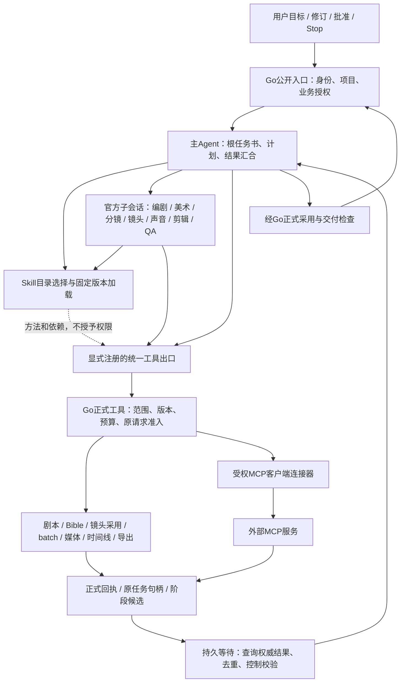
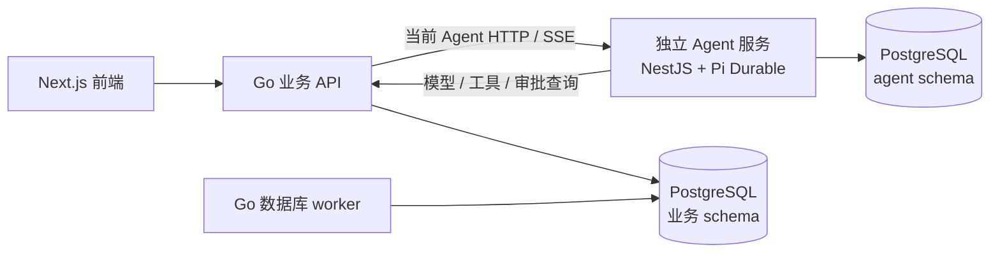
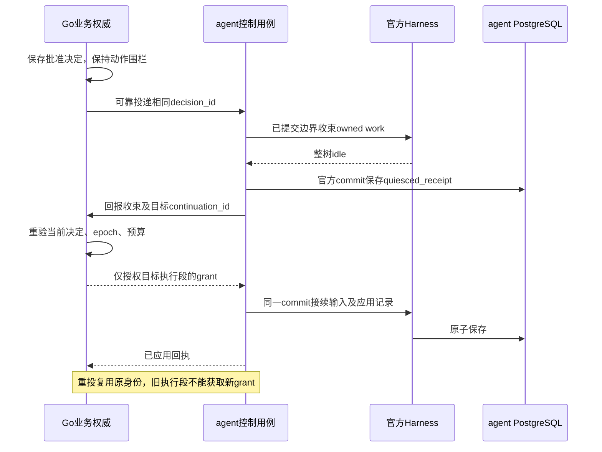
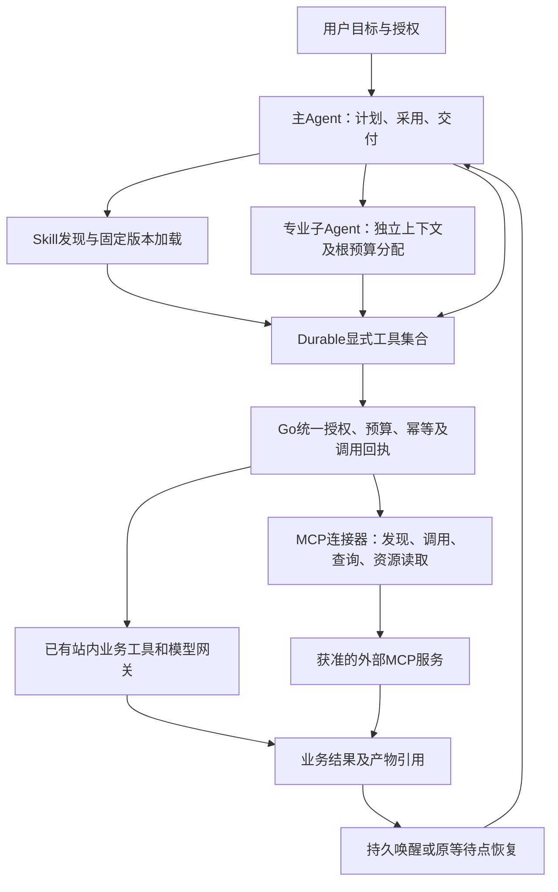

# 完整创作 Agent Harness、Skill 与多 Agent 架构设计

状态：按用户于 2026-11-04 确认的独立服务方案更新完整设计；HTTP 框架目标按[需求22](../requirement/22-Agent服务目录与TypeScript规范需求.md)调整为 NestJS；具体接口与数据合同为本稿设计决策，不代表代码已实现或产品已验收。已确认：同仓库独立 Agent 服务、TypeScript、官方 Pi Durable、PostgreSQL、Docker Compose 统一启动、不使用 Temporal、不保留旧实现或兼容处理。来源：[需求19 SRC-AGH-12](../requirement/19-完整创作Agent与Skill多Agent需求.md#src-agh-12)。产品接受见 [PRD19](../prd/19-完整创作Agent与Skill多Agent.md)，执行步骤见 [Plan28](../plan/28-完整创作Agent与Skill多Agent实施计划.md)，状态只见 [BACKLOG](../../BACKLOG.md#pi-durable-migration)。

2026-11-12按[需求19 SRC-AGH-16](../requirement/19-完整创作Agent与Skill多Agent需求.md#src-agh-16)细化主子协作、Skill自动选择、外部MCP、自动推进及稳定性：§7.0、§7.6.9～10、§7.11～15为本轮设计评审稿，对应PRD19新增接受条件。原有已确认技术路线继续有效；本轮不编写代码或执行部署、连接授权和付费验证。

## 1. 摘要

本次复核阅读入口（SRC-AGH-22）：已有/缺口与详细执行合同见§7.17；技术选择和目录评价见[设计37 §7.8～7.10](37-Agent服务目录与TypeScript规范设计.md#78-本次技术选型评价)；正式制作身份与阶段产物见[设计38 §7.11](38-短剧工作室一致性设计.md#711-源码复核后的制作闭环设计)。实施依赖分别在Plan28 §10和Plan33“本次复核实施依赖”。本轮仅文档，新增决策为评审建议，不重做已落地Nest迁移、原调用、资金或导出引擎。

对话页面、首页/共享参考、全部消息历史及Stop/重试交互由[设计35](35-对话工作台与参考输入一致性设计.md)→PRD22→Plan31细化，扩展本设计的session/run公共合同，不更换执行引擎或Go业务权威；基础Harness迁移仍由本主链承接。

执行体系由“主Agent决定下一项工作，子Agent承担专业任务，Skill提供方法及依赖，统一工具出口调用站内能力和外部MCP，Durable状态负责等待与恢复”组成。已授权范围内可自动推进，不要求用户手工逐次调用；权限、费用或输入变化需要决定时，保存等待点并按既有控制合同接续。稳定性由持久状态、单写者、原请求回执、有限重试及故障验证共同成立，不能仅靠prompt或SDK名称保证。

在当前仓库的独立 agent 服务中使用 TypeScript strict 与官方 Pi Durable，作为独立构建、测试、运行和关闭的 Node 服务。服务的会话、运行、计划、上下文压缩、工具循环、专业子 Agent 和恢复状态由它单独拥有。Go 不启动 Node，不保留 Agent 调度器，也不镜像维护 Pi 的执行状态。

Go 业务服务保留账号/团队权限、模型目录与调用网关、业务审批、预算与结算、正式工具命令和业务数据。普通生成/归档/导出/转写/复制/清理任务由数据库驱动的 Go worker 执行，项目移除全部 Temporal 依赖。

复用 PostgreSQL 实例，使用独立 agent schema 与受限角色；Agent 不读写 Go 业务表，Go 不读写 Agent 执行表。现有 docker-compose.yml 是唯一部署入口，新增内部 agent 服务；前端继续通过 Go API 访问，不开放 Agent 宿主端口。

## 2. 参与者

- 创作者：提交目标/剧本/参考、选择模型和 Skill，批准计划与费用，编辑和接管产物。
- 团队成员：按现有项目权限协作；项目共享不公开私人会话。
- 平台维护者：配置服务身份与既有资源，实施经审阅的数据变更和单次切换。
- 用户：已确认服务边界及技术方向；设计中的普通工程选择由实施方落实，不将参考方案冒称为完成证据。

## 3. 背景

### 3.1 当前事实与替代范围

1. 当前公开 Agent 入口由 Go 鉴权并代理独立 agent；会话、模型循环、专业子任务与恢复使用官方 Harness。
2. 普通生成/媒体/导出/复制/导入/声音与维护采用 PostgreSQL 工作记录和 Go taskruntime；旧工作流连接、SDK、schedule 命令与旧 Go 图不属于当前实现。
3. Compose 统一声明 frontend、backend、agent 与 canvas；agent 仅内部监听，Go 不启停 Node。
4. 当前空库结构为 schema.sql，已有库采用离线审阅 SQL，服务不自动 DDL；历史数据/在途任务不由源码迁移自动接管或删除。
5. 本文定义技术合同，实施与实际验证证据在 Plan28/BACKLOG 分别维护；不以历史测试或旧部署健康状态证明新架构接受。

源码入口：[公开 API](../../backend/internal/app/public_api.go)、[官方 Harness 接线](../../agent/src/sessions/runtime.ts)、[数据库任务](../../backend/internal/platform/taskruntime/worker.go)、[Compose](../../docker-compose.yml)。

### 3.2 一手依据与采用边界

- [Pi Durable README（固定源码）](https://github.com/earendil-works/pi/blob/676af1d777ef6f04b6bc8daf4cf3b9b1799cff4d/packages/durable/README.md)：官方声明 API 为实验性质；支持 Harness.open、提交去重、恢复、工具重放控制、子会话和自定义 Storage，不承诺外部副作用恰好一次。
- [官方 Storage 接口](https://github.com/earendil-works/pi/blob/676af1d777ef6f04b6bc8daf4cf3b9b1799cff4d/packages/durable/src/types.ts)：需实现原子提交、全局 ID、文档历史、扫描/游标与请求去重，并通过官方 registerStorageConformance。
- [官方包清单](https://github.com/earendil-works/pi/blob/676af1d777ef6f04b6bc8daf4cf3b9b1799cff4d/packages/durable/package.json)：本次核验已发布版本为 1.5.0，Node 最低 22.19.0；版本不是稳定性承诺。本稿固定已发布的 1.5.0 及配套依赖，提交 lockfile；实现必须核对发布包与固定源码，不跟随 main 或混搭版本。
- [参考宿主](https://github.com/glanderness/BeefTV/blob/4196de31fe92cb38f3f49b6f8094375e51062585/agent-host/durable-session-owner.mjs)：实际使用官方 Harness 与 SQLite；参考其会话所有者、请求身份和恢复方法，存储按本项目 PostgreSQL 约束适配，不复制产品实现。
- [参考任务运行时](https://github.com/glanderness/BeefTV/blob/4196de31fe92cb38f3f49b6f8094375e51062585/backend/internal/taskruntime/ports.go)：借鉴领取、租约、有界并发、取消与未知接单分类，不复制其桌面单用户授权假设。

SRC-AGH-12 确认独立 Agent 服务，替代纯 Go 引擎与 Go 托管 Node 子进程方案。原始确认保留在需求来源中，目标产品不保留这些实现。

HTTP 由 NestJS 承载，使用官方 Fastify 适配器。NestJS 负责路由、依赖装配、校验和生命周期，TypeBox 仅声明 Pi 工具参数。Agent 调度继续由 Pi Durable 负责。模块职责和迁移验收见[设计37](37-Agent服务目录与TypeScript规范设计.md)。

## 4. 目标

1. 产品入口实际调用独立服务中的官方 Harness，完成模型—工具—模型循环、恢复及真实子 Agent 委派。
2. 保留完整创作、Skill、剧本解析、人工审批、连续写链、现场差异、预算、媒体检查和可编辑交付。
3. Agent 运行状态单一归属；Go 只保存业务事实和授权回执，不保留另一套 Agent 状态机。
4. PostgreSQL 为唯一持久化源；角色/schema 隔离，官方 Storage 一致性及真实故障恢复可验证。
5. Agent 可单独构建和重启；普通 Go API 不因 Agent 未就绪而停止，双方都不设置互相等待的启动依赖。
6. 当前一套 API/配置/状态/执行合同一次性切换，无旧引擎、旧入口、别名、双轨、格式翻译或自动降级。
7. Temporal 的所有当前业务任务均有替代执行/取消/恢复路径；不引入另一个通用工作流平台。
8. 保留有效的账号、项目、素材与账务数据；旧运行在切换前清结/对账，删除数据须有精确审阅目标。

## 5. 使用场景

- 长剧本：制作人形成版本化计划，专业子 Agent 分析来源、生成提案、回收结果；并行受依赖和预算约束。
- 重大修改/生成：工具在 Go 写入提案后，同一 run 整棵 Agent 树暂停新动作，等待明确审批。
- 协同编辑：每次写入采用 Go 回执中的 revision，外部写入造成的真实冲突要求重读现场。
- 浏览器断线：只断开订阅；按相同会话与事件游标恢复，不取消后台工作。
- 独立服务重启：停止领取、保存已提交状态并释放所有权；重开原存储恢复同一提交及子任务，不重放外部收费。
- Go 暂时不可用：Agent 不发起未授权副作用，保存等待/失败状态；恢复后按原调用身份查询或重试。
- 发布切换：旧任务先清结或人工对账，再部署唯一的新合同；新服务不接管旧图或 Temporal 工作流。

## 6. 价值

独立 Agent 服务把 Pi 依赖、对话执行、资源限制与发布周期集中在 TypeScript 一侧，Go 保持业务领域职责。统一 Compose 保留单一操作入口，复用数据库而不增加持久化基础设施。明确新增成本为内部 HTTP/流式合同、服务身份、PostgreSQL Storage 和跨服务幂等；这些边界必须实际验证，不把拆目录或增加容器当作架构完成。

## 7. 方案

### 7.0 整体方案与完整调用路径

稳定性再评估与详细运行合同以§7.15为准，补充状态收敛、三类额度、背压、停机/灾后恢复和独立完成清单。

本节为[需求19 SRC-AGH-18](../requirement/19-完整创作Agent与Skill多Agent需求.md#src-agh-18)的完整方案阅读入口。沿已确认技术路线整合§7.1～7.14，不代表本节新增能力已落地。设计32拥有执行合同，设计38拥有短剧内容合同，两份组成同一方案，PRD/Plan保持各自唯一来源。

#### 7.0.1 总体取舍和阅读地图

选用“目标驱动主Agent + 受限专业子Agent + 正式业务操作”的组合：创作规划允许动态选择方法，稳定的提交/等待/交付流程用确定性工具；计划在已有Agent doc内记录，业务依赖在原领域记录，通过版本/回执关联。不把整剧写死为只能顺序走的工作流，也不把收费、采用与恢复交给自由聊天循环。前者不能表达局部修订和制作取舍，后者无法证明副作用与采用关系；本取舍为设计建议，技术边界已由既有用户决定。

| 阅读问题 | 唯一责任章节 |
| --- | --- |
| 主子调用、真实并行与Skill | 本节及§7.6.9～10 |
| 服务/数据权威、权限/费用/审批/停止 | §7.1～7.5、§7.6.5及§7.15.4～5 |
| 外部MCP发现/调用/异步/未知写入 | §7.11 |
| 自动推进/持久唤醒/任务完成后续跑 | §7.12、§7.14.3 |
| 故障处理/复合交付 | §7.13、§7.14.2及§7.15.8 |
| 稳定交付、额度、背压与灾后恢复 | §7.15 |
| 剧本至成片的阶段、版本及局部重做 | [设计38 §7.3～7.9](38-短剧工作室一致性设计.md#73-生产身份候选版本与采用关系) |
| 将来实施的依赖和退出条件 | Plan28、Plan33；当前建议顺序和状态只在BACKLOG |

#### 7.0.2 调用关系

Skill是方法资源，不是独立执行进程，也不需要每次开启子Agent。MCP是工具/上下文接入协议，不是专业Agent；资源和模板只作为不可信参考，不能扩大授权。已有站内正式工具直接调用原领域接口，不为了统一外观绕成MCP。主/子所有模型调用均经过Go模型网关，图中省略重复网关边；脚本只经已接受的隔离driver，缺driver时拒绝执行。

| 角色 | 作决定/允许动作 | 不能拥有的权威 |
| --- | --- | --- |
| 主Agent | 目标拆分、选Skill、发任务书、合并冲突、提出采用/重做与完成检查 | 不能自己批准新增费用、伪造业务成功或改资金记录 |
| 专业子Agent | 独立上下文内提出结构产物，调用白名单工具、汇报缺口与依据 | 不能扩大权限、改父计划、替其他分支采用或递归逃逸 |
| QA子Agent | 审查指定版本与已授予模态范围，返回问题/建议 | 无无限重做预算，不能凭“通过”自动替换作品 |
| Skill | 工作方法、参考与工具依赖，按需加载并冻结 | 不是授权；包内链接/脚本不能绕出口 |
| MCP连接器 | 用绑定身份发现/调用/查询/取消，规范化原回执 | 不持有Agent计划，不以协议成功替代业务完成 |
| Go领域/worker | 正式数据、引用、CAS、准入、资金、任务与产物 | 不复制Pi执行状态或启停Node |
| Pi/Agent存储 | 执行段、branch、manifest、等待点、消费记录 | 不直接写Go业务表或作为媒体/结算权威 |

#### 7.0.3 一次完整执行的控制点

1. **受理**：Go核对目标作用域和当前会话活动root；Agent持有有效owner后建立根任务书，固定授权/预算/截止、输入版本及完成清单。重复受理返回原身份。
2. **规划**：读取正式现场，主Agent形成带依赖的计划，显式Skill优先、方法固定；每分支任务书限定输入/输出、验收、工具与额度。缺信息挂起；普通只读和已授权动作不反复请求继续。
3. **委派**：Go以稳定root/branch意图原子预留业务预算和资源槽；Agent持久保存分支到官方子会话映射后启动。两个服务没有共享事务：任一方提交未知先查原意图，不先启动后补额度。独立子任务实际并行，依赖任务等待正式采用。
4. **执行**：模型提出动作→统一出口校验manifest/控制/权限→Go检查当前版本及费用→受理正式操作。审批提案触发整树停止新动作并收束；批准后唯一continuation继续。Skill/MCP/嵌套复合工具也遵循该合同。
5. **等待和汇合**：先登记原等待点再查询任务，收通知/到期重查后读取原回执；成功、真实归档、结构校验、正式采用逐项检查。失败隔离；外部提交未知只核对。结果汇合修订父计划，不能因流结束而宣告完成。
6. **交付或中止**：采用引用固定后做确定性交付与完整性检查。全部必需条件成立才完成；部分输出列缺项。Stop/撤权/失owner立即阻断新动作，按远端能力核对在途结果和费用，不删除已完成产物。

预算预留在Go事务内原子完成，Agent执行状态在Agent事务内原子完成；不能把两者写成“跨schema同一事务”。恢复根据稳定意图/回执收敛：预算已留而子会话未启动复用原额度，子会话注册结果未知核对原映射，未决外部调用仍占用费用/容量直至领域确认可释放。由各权威负责到期/取消收尾，不以Agent进程死亡直接退款。

分支额度是根预算内部划拨/子预留，不是又收一次费；模型、外部工具和供应商实际用量沿原调用/operation记一次，父子汇总只做归属统计。未决额度不释放，同一费用不能同时计入分支消费和根级新增消费。

#### 7.0.4 执行状态与生产状态分别投影

以下为业务语义，不要求机械新增同名枚举。root/step/child各自保留状态和原因；产品用一致快照/事件游标解释两条轴，不合并成万能status。

| 执行轴 | 进入/离开条件 | 生产轴仍需核对 |
| --- | --- | --- |
| 可运行/执行中 | 依赖、版本、权限、预算和owner均有效 | 正在做哪份候选、原operation及镜头范围 |
| 等外部结果 | 已有原句柄与持久等待点，到期重查/通知唤醒 | 供应商完成→媒体可用→绑定，不越过未完成环节 |
| 等人工决定 | 有明确问题/候选/预算/冲突与恢复点 | 拒绝、修订、批准分别处理；不能默认采用 |
| 可恢复故障/待核对 | 原请求可查询或副作用未知 | 有句柄安全查；不可查未知写入需人工核对，不盲重发 |
| 明确失败/受限退出 | 确认不可恢复、截止/预算/无进展上限 | 保留成功项和失败清单，新尝试另准入 |
| 已停止/完成 | 控制围栏或必需清单通过 | 已停止不等于远端取消；已完成必须对应实际交付版本 |

等待事实至少关联root/segment/step/branch、稳定call意图、领域任务/提案、输入版本、原因、绝对截止/next_wakeup_at、消费和控制修订。事件只带身份、版本、类型及可查询回执引用，不带可直接授予执行的指令；不复制原始私有文件或秘密。无通知也能补扫，过期游标可补快照。

原root终态为Stop或完成后不再续跑；后续局部修改新受理run并引用旧产物/采用关系，不继承已撤销grant。审批/暂停的新continuation与终态root的新run分别处理，恢复原未知业务回执不要求复活原root。

#### 7.0.5 默认策略、决策和完成边界

既定：独立NestJS/Pi Durable、PostgreSQL/Go领域、Compose、不使用Temporal/SQLite、不做兼容回退。以下为本稿建议默认值：子Agent深度一；同会话单活动root；候选显式采用；自动采用仅限事先确认的具体规则；模型审美QA不自动授权付费重做；部分素材可预览但必需镜头缺失不能报全集完成。

具体并发数/预算上限/超时和质量阈值经实施负载、供应商及作品接受确定；不在设计伪报数值或SLO。按角色选LLM、完整音频理解、第三方脚本隔离设施和事件/定时规则仍沿已有独立决策，任务内自动推进必须完整，但不以此默认启用周期后台消费。权限、自动采用/费用范围和缺项交付策略需要产品审阅；本轮整理不等于这些建议已获用户批准。

### 7.1 服务命名、技术选型与源码边界

#### 7.1.1 统一命名

| 对象                         | 唯一名称                                       |
| ---------------------------- | ---------------------------------------------- |
| 服务名称 / package.json name | agent（private: true）                         |
| 仓库目录                     | agent/                                         |
| Compose service / 内部 DNS   | agent / agent:4401                             |
| Docker 镜像仓库              | glowloom/agent                                 |
| PostgreSQL schema / 专用角色 | agent / glowloom_agent                         |
| 配置前缀                     | GLOWLOOM_AGENT_*                               |
| 入口 / 生产启动文件          | agent/src/server.ts / agent/dist/src/server.js |

不保留带 service 后缀的目录、包名或服务别名；不设计名称探测、旧配置别名或旧 schema 转译。schema 的命名属于新目标合同：现有同名 schema 中的旧 Go Agent 对象须在切换清单中逐表处理，角色只获授权的新表权限，不因同名继承旧表或整个 schema 的全表权限。不得把此设计变更当成执行删表/重建授权。

#### 7.1.2 已确定的技术栈与版本基线

下表是实施目标。Node、TypeScript、Pi 等沿用现有包基线。NestJS 新依赖已核对官方发布元数据的 Node、TypeScript 与 peer 范围。安装、运行和生成结果由实施验收验证，最终版本写入锁文件。

| 职责 | 技术选型与目标版本 |
| --- | --- |
| 运行时与镜像 | Node.js 24.22.2 LTS，`node:24.22.2-bookworm-slim`，固定镜像 digest。 |
| 语言与构建 | TypeScript 6.0.3，严格模式，原生 ESM / NodeNext，`tsc` 输出生产 JavaScript 与 Nest 装饰器元数据。开发与合同测试也验证编译产物。 |
| 包管理 | pnpm 12.4.2，Agent 独立 `pnpm-lock.yaml`，CI 冻结安装。 |
| 应用框架 | NestJS 12.3.3，`@nestjs/common`、`@nestjs/core`、`@nestjs/platform-fastify` 同版。使用 Module、Controller、Provider、Pipe、Exception Filter 和生命周期钩子。 |
| HTTP 传输 | 官方 `FastifyAdapter` 使用 Fastify 5.12.8。内部 JSON HTTP 与 SSE，使用 Node `fetch`、`AbortController`、`Readable`，保留背压与取消。 |
| DTO 和运行时元数据 | Nest `ValidationPipe`，`class-validator` 0.15.1，`class-transformer` 0.5.1，`reflect-metadata` 0.2.2，`rxjs` 7.8.2。 |
| Agent 执行 | 官方 Pi Durable 1.5.0，`@earendil-works/pi-durable`、`pi-ai`、`chord`、`pi-coding-agent` 同版。Pi 提供工具循环、子会话和持久化执行，宿主负责 Skill 装载与 PostgreSQL 租约，`pi-coding-agent` 仅使用受控资源 SDK。 |
| 数据与恢复 | 复用既有 PostgreSQL，CI 隔离库使用 PostgreSQL 18。Node 端 `pg` 8.23.1 与参数化 SQL 实现官方 Storage，使用独立 `agent` schema 和受限角色。事务、owner/epoch fencing、事件与消息投影共用该边界。 |
| Agent → Go 的接口生成 | Go 内部业务 Swagger 由 `swag` v1.16.6 从注解离线导出，`@umijs/openapi` 1.14.1 生成 Agent 的 TypeScript 请求与类型。 |
| Go → Agent 的接口生成 | `@nestjs/swagger` 12.1.0 从 Controller/DTO 生成 OpenAPI 3.0，使用 `oapi-codegen` v2.8.2 生成 Go 请求/响应模型与普通 HTTP 客户端。SSE 保留逐段读取。若开启内部 Swagger UI，使用 `@fastify/static` 10.1.10。 |
| 鉴权与业务出口 | 双向独立 Bearer token、audience、`node:crypto.timingSafeEqual`。Go 继续负责身份与 scope、run grant、审批、预算、计费、模型出站和业务工具。 |
| 日志与健康 | Pino 10.4.0 结构化脱敏日志，关联 request/session/run ID。使用 `/healthz` 和 `/readyz`，由进程有界停止与排空。 |
| 测试与代码规范 | Vitest 5.1.0、Fastify inject、真实 socket 与隔离 PostgreSQL、Pi 官方 Storage conformance。Google TypeScript Style Guide、ESLint 10.14.0、typescript-eslint 8.72.1、Prettier 3.9.9。 |
| 部署 | 同仓库独立 Docker 镜像，非 root 运行，Docker Compose 内部监听 `agent:4401`。发布同一版本的调用方和 Agent，由 Compose 管理进程。 |

版本依据见 [Nest Core 包元数据](https://registry.npmjs.org/@nestjs%2fcore/12.3.3)、[Fastify 适配器包元数据](https://registry.npmjs.org/@nestjs%2fplatform-fastify/12.3.3)、[Nest Swagger 包元数据](https://registry.npmjs.org/@nestjs%2fswagger/12.1.0)、[Pi 包元数据](https://registry.npmjs.org/@earendil-works%2fpi-durable/1.5.0)及 [oapi-codegen v2.8.2](https://github.com/oapi-codegen/oapi-codegen/releases/tag/v2.8.2)。

Agent 部署只有一套 NestJS 实现。切换同时移除独立 Fastify 应用、TypeBox HTTP 合同、旧 Swagger 生成脚本及其专用依赖。Fastify 作为 Nest 的 HTTP 适配器保留。生产请求只使用当前配置、路由、DTO 与执行定义。

#### 7.1.3 构建、合同与检查命令

保留 TypeScript 编译入口 `src/server.ts`、生产入口 `dist/src/server.js`、冻结锁文件及非 root 镜像。Controller 和 DTO 注解通过 `@nestjs/swagger` 导出内部 OpenAPI；独立测试装配可复用实际路由，无需监听端口或连接数据库和模型。双向客户端生成链见[设计37 §7.6](37-Agent服务目录与TypeScript规范设计.md#76-swagger-与-umi-接口生成)。

嵌套对象生成命名 Go DTO，保留 required、optional 与显式 nullable。只对明确允许 null 的字段生成可空类型。运行快照无待审批提案时允许省略 proposal，pending_proposal 的 null 按合同传递。生成文件由对应工具更新。

#### 7.1.4 目录与拓扑

Agent 是同仓库独立进程，由 Compose 管理。目标目录、模块所有权、HTTP/应用边界及文件迁移规则统一见[设计37 §7.2](37-Agent服务目录与TypeScript规范设计.md#72-目录与依赖)，代码风格见 [Agent 工程规范](../../agent/AGENTS.md)。

Agent 拥有会话、运行、子会话、执行恢复与 Durable 记录；Go 拥有身份和授权、预算、审批、模型出站、业务工具及业务数据。Agent 仅通过正式 HTTP 合同调用 Go，不直接访问业务 schema，也不复制其业务模型。Agent 的 `sessions/persistence` 与 Pi Durable Storage 虽共用受限 PostgreSQL 实例，但职责、表和授权边界分开。

### 7.2 唯一权威与数据所有权

| 事实                                                             | 唯一权威           | 另一侧的边界                                        |
| ---------------------------------------------------------------- | ------------------ | --------------------------------------------------- |
| session、run、计划、上下文、子会话、Pi task/submission、事件游标 | Agent 服务 / agent | Go 通过 API 转发/读取，不保存执行状态镜像           |
| 当前运行所有权、续租、Pi commit 序号                             | Agent Storage      | Go 仅校验该执行者的短效业务授权，不读写 runtime 表  |
| 用户/团队/项目权限、业务对象版本                                 | Go 业务服务        | Agent 从授权快照/工具回执获取，不自行推断权限       |
| 候选、报价、审批决定、预算预留/结算、provider 回执               | Go 业务服务        | Agent 只持引用与展示投影，Pi usage 不是实际财务账本 |
| Skill 包/版本/授权                                               | Go Skill 业务      | Agent 固定并加载获授权版本，保存本次上下文引用      |
| 导出/转写/归档/复制等任务与产物事实                              | 对应 Go 模块       | Agent 只发正式命令并查询，不另外执行或伪造终态      |

允许 Go 的业务授权账本记录 run 引用、scope、fencing epoch、到期时间、审批 revision 和工具幂等结果；不保存 Pi 的 planning/running 等执行状态。Agent 本地计划不能代替业务审批。双方均不跨 schema 直接修改对方表，不使用跨 schema 外键来强耦合运行记录。

### 7.3 内部 HTTP、认证与合同来源

Agent 在 Compose 内监听 agent:4401，仅 expose，不配置 host ports。Go 通过 GLOWLOOM_AGENT_ORIGIN 访问；Agent 通过 GLOWLOOM_AGENT_BUSINESS_ORIGIN 访问 Go。前端只访问现有同站 Go API，服务令牌和内部地址不进入浏览器。

两个方向使用不同的服务身份凭据：GLOWLOOM_AGENT_SERVICE_TOKEN（Go→Agent）、GLOWLOOM_AGENT_BUSINESS_TOKEN（Agent→Go）。双方显式校验服务身份、audience、请求身份和作用域；外部用户即使知道内部路径也不能取得服务权限。实际密钥在部署配置中提供，不写入文档/源码/日志。

Go 发给 Agent 的受理上下文包含 actor、org、project、canvas、request_id 与内容哈希；该上下文由已认证的 Go 入口建立，模型不能覆盖。Agent 的每个业务动作携带 Go 签发的当前 run grant，而不是把模型参数里的 user_id 当成授权。

| 边界               | 当前合同                                                                                                                                                                                               |
| ------------------ | ------------------------------------------------------------------------------------------------------------------------------------------------------------------------------------------------------ |
| 浏览器→Go          | 创建/读取会话，提交目标，approve/reject/pause/resume/stop，读取 SSE；沿用 Go 注解生成前端客户端的单一来源                                                                                              |
| Go→Agent           | /internal/agent/sessions、/sessions/:sid/runs、/runs/:rid/commands、/runs/:rid/events；明确 actor/scope、request_id、expected_execution_revision（输入）、authorization_revision（控制决定）及命令回执 |
| Agent→Go           | /internal/agent-business 下的执行授权、快照、工具发现/执行、Skill、提案/决定、模型流与业务结果查询                                                                                                     |
| Agent→PostgreSQL   | 受限角色的官方 Storage 操作；无业务表访问                                                                                                                                                              |
| Go→业务 PostgreSQL | 现有领域应用命令及授权/计费事务；无 runtime 表访问                                                                                                                                                     |

Agent 的目标 HTTP 合同由实际注册的 Nest Controller/DTO 维护并生成 OpenAPI 与 Go 客户端。CI 核对注册路由、规范、运行时校验和生成客户端的一致性。Go 继续定义业务工具、模型和公网 API 合同，分别维护各信任边界的规范。协议版本不符时返回明确错误。

HTTP 边界限制 body/frame、并发和等待队列，配置超时、取消、背压及统一问题响应；错误保留 request/run/tool call ID，脱敏记录。不得在数据库事务中等待对方 RPC。连接断开表示交付结果未知，不等于业务未发生。

### 7.4 PostgreSQL Storage、所有权与幂等

Agent 通过独立 GLOWLOOM_AGENT_DB_DSN 使用既有 PostgreSQL 实例中的 agent schema。Agent runtime role 无业务表权限；Go role 无 runtime 表权限。结构定义仍以 backend/db/schema.sql 为统一空库来源，单次增量 SQL 由实施审阅；两个服务启动均不建表或修补 schema。

Pi 没有本项目可直接采用的官方 PostgreSQL Storage。实现其当前公开 Storage 合同，不转换 SQLite SQL、不持久化 MemoryStorage 快照、不维护另一套 Harness。目标表承载 session/业务范围/租约、typed runtime records、commit seq、document history 和已提交事件投影；索引覆盖 request_id 去重、文档地址/历史与稳定扫描。

提交必须落实：有序原子批次、只在 COMMIT 确认后 receive、已提交前缀与拒绝语义、跨重启单调 ID、全局 ID/不可变记录约束、文档 incarnation/复制/退休、继承可见性、游标和对象值隔离。数据库 ID 的编码遵循官方接口；公共游标使用明确的字符串格式，禁止 JS 数值精度丢失。

一个业务 session 对应一个官方 Harness 及其 Storage 分区，包含根 conversation 和所有 owned child conversations；业务 root_run 可含多个 Pi submission，同一 session 同时只有一个活动 root_run。专业子 Agent 的独立上下文是该 Harness 内的子 conversation，不另开 Harness/租约。整棵运行树共用根 owner/epoch 与 root_run grant，子任务的工具/预算范围只能收窄；本版不独立分发子会话到其他 owner。

每个业务 session 对应的 Harness 只有一个活动 owner。领取/续租及所有 Storage 写入在事务内检查 owner epoch 与 lease_until；交接递增 epoch，旧写者不能提交。默认 Compose 单副本，仍测试失租约/迟到请求；不把这称作已具备多活。

跨服务副作用还有独立的 Go 授权围栏：Agent 取得/续租后，必须先向 Go 注册同一 epoch、绑定 root_run 下固定执行段的短效 grant，grant 到期时间不得晚于租约；Go 只提升 epoch，不降低，旧 grant 或过期 grant 拒绝。新 owner 注册成功前不执行工具/模型。Go 独立持久化 Stop、撤权、Pause 和审批禁止事实及 authorization_revision；领取、升 epoch、恢复、注册和续租都不能解除这些禁止事实。只有满足当前授权 revision 的显式批准/Resume 决定，经过 §7.6.5 的收束回执与新段 grant 握手后才能重新准入；Stop 对该 root_run 为终止决定，重新创作须新 run。Go 每次副作用在业务事务内校验当前授权 revision、epoch、有效期、scope 与预算，旧 grant 不能越过后来决定。该记录只是业务准入，不是第二套执行状态。注册中断时保留待授权状态，按原 epoch/请求身份核对，不启动不确定工作。

新 run/用户输入先在 Agent 持久化接受，再建立业务授权并调用官方 submit；此顺序不适用于批准、驳回、Pause、Resume 或 Stop 等业务控制决定，后者统一采用 §7.5 的 Go 决定→可靠投递→Agent inbox 合同。中断恢复查原 request_id/内容哈希，重复同键不同内容冲突。每个工具/模型调用具有 run + 执行段 submission/continuation_id + Pi task/call ID + 合同版本 + 参数哈希的稳定身份；grant 同时绑定执行段，旧段不能换领新段授权（§7.6.5）。Go 在自己的业务事务中提交副作用和幂等回执；Agent 收到已提交回执后再提交 Pi 结果。两端不存在跨服务原子事务。

业务提交后 Agent 未存回执就崩溃：重开后先查 Go 的原调用结果。供应商接单未知时只查询原 request/归档/结算，不重新生成新 ID 付费；只读或已有实测幂等回执的工具才声明 replay: safe。存储错误按官方语义关闭受影响 Harness，不自动换存储或无限重试。

### 7.5 模型、审批、写链与控制命令

Pi-ai 模型 provider 转接 Go 模型网关；供应商主密钥仅在 Go。规划、压缩、专业子 Agent 与生成均冻结模型/参数版本，并经过 Go 的预算/调用回执。Pi 的 token/usage 用于执行投影，实际预留、结算及缓存费用以 Go 和供应商证据为准。

提案只由 Go 正式业务命令创建，绑定候选哈希、画布/价格版本、范围和预算。受理提案的同一业务事务建立 run 级审批围栏，阻止同一父子树的新模型/写工具；Agent 按 §7.6.5 通过工具控制、出口校验与官方取消收束自主推进，不假设存在通用 interrupt/resume 按钮。并发提案由 Go 对 run 串行受理，先受理的生效，后续不同提案返回等待审批，重复调用重放原回执。其他独立 run 不受影响；已授权发出的外部请求仅收集原回执，不自动推进后续步骤。

批准、驳回、Pause、Resume、Stop 全部先在 Go 事务内提交业务决定与待投递记录，按 root_run 串行递增 authorization_revision；前端对需要乐观校验的决定提交 expected_authorization_revision。批准时重验身份、候选、画布/价格版本与预算。Go 有界投递循环发送相同 decision_id、authorization_revision 与内容哈希；Agent durable inbox 去重、核对当前 Go 决定后，将应用结果/已见授权 revision 和执行变更同一 Pi commit 存储，再返回回执，Go 才标为已交付。失去确认重投原决定，不重新批准。

Agent 的 execution_revision 独立递增，用于输入与执行快照的并发控制；不得与 Go authorization_revision 混用或要求两者相等。Agent 控制 inbox 单调采用授权 revision；较旧决定标为 superseded，发现间隙/不确定结果时查询 Go 当前决定后处理。迟到 approve/resume 不覆盖后来的 Stop。即使较旧命令先到，Go 已生效的新围栏仍会拒绝后续副作用。驳回/过期保持停止，需要显式重新规划/接续。

Stop 先在 Go 撤销业务 grant 并持久化终止决定，再通过相同可靠投递链向 Agent 发取消；Agent 调用官方取消并传播到同树子任务。收到已提交应用回执前显示取消已请求，不伪造已停止。

Pause 同样先在 Go 持久化禁止新动作，再投递 Agent，在安全边界结束当前自动推进并保存业务 run 的暂停状态；已发送的外部请求仅收集回执/对账。Resume 先持久化新的当前 Go 决定；按 §7.6.5 收束回执与执行段 grant 握手后才解除新段的动作禁止，在同一 session/root_run 创建 requestId 由 run+decision_id 派生的确定性 continuation submission；不重新打开已终止的官方 submission，也不重放旧工具/收费请求。进程崩溃恢复则按官方语义接续原未决 submission，区别于显式 Pause/Resume。

连续写工具只采用 Go 成功回执的真实 revision 更新写链。下一次模型请求前通过业务快照读取当前现场并注入差异；发生真实协作冲突时重读/重规划，不覆盖别人的写入。每次模型调用前从 Go 的 grant 校验响应读取 available_micros，单次预留上限为 frozen manifest.max_micros 与当前可用额度的较小值；该观察值不参与授权身份，Go 仍在事务中原子复验，未知原请求继续占用预留。单轮默认模型请求最多40次、工具步骤最多40次、模型流式空闲45秒，预算含压缩/子任务并跨重启保存；这些是执行限制，不是性能承诺。

### 7.6 Harness、专业 Agent、Skill 与事件流

#### 7.6.1 参考实现与本项目取舍

以下对比基于参考项目固定提交4196de31fe92cb38f3f49b6f8094375e51062585及官方 Pi 1.5.0 固定源码；参考项目使用1.3.0，不能据其测试推定目标1.5.0已验证。

| 边界      | 参考实现的实际做法                                                                | 本项目决定                                                                             |
| --------- | --------------------------------------------------------------------------------- | -------------------------------------------------------------------------------------- |
| Node 宿主 | JavaScript ESM、node:http，Go 管理本机 Node 子进程                                | 独立 agent；NestJS 负责服务边界，Pi 负责执行                                          |
| 执行内核  | 官方 Harness、registry、extension、tool、doc 与 owned conversation                | 直接复用同类官方能力，不再实现图引擎、SessionManager 或任务调度器                      |
| Pi SDK    | pi-durable、pi-ai、chord、pi-coding-agent 同版；coding-agent 提供包与扩展加载能力 | 四个直接依赖固定1.5.0；coding-agent 仅作受控资源 SDK，不启动 CLI 或另一套 AgentSession |
| 持久化    | 官方 SQLite Storage，本机会话锁                                                   | 自定义官方 Storage 的 PostgreSQL 实现，根 owner/epoch 及跨服务 grant                   |
| 工具      | Go operation descriptors 生成模型可见工具                                         | Go 工具合同唯一权威，转换为官方 defineTool，不在 Node 重写业务规则                     |
| 输出      | /chat 的 HTTP NDJSON；断开只移除监听                                              | 已提交事件投影及 SSE；不得把参考输出描述为 SSE                                         |
| 插件      | 官方包管理/扩展加载后适配为 Durable 工具                                          | 仅可信扩展进入进程；第三方 Skill 是声明式内容，脚本走 Go 隔离能力                      |

一手入口：[参考包清单](https://github.com/glanderness/BeefTV/blob/4196de31fe92cb38f3f49b6f8094375e51062585/agent-host/package.json)、[参考扩展](https://github.com/glanderness/BeefTV/blob/4196de31fe92cb38f3f49b6f8094375e51062585/agent-host/durable-extensions.mjs)、[参考插件加载](https://github.com/glanderness/BeefTV/blob/4196de31fe92cb38f3f49b6f8094375e51062585/agent-host/plugin-packages.mjs)、[参考工具桥](https://github.com/glanderness/BeefTV/blob/4196de31fe92cb38f3f49b6f8094375e51062585/agent-host/operation-bridge.mjs)、[参考 HTTP](https://github.com/glanderness/BeefTV/blob/4196de31fe92cb38f3f49b6f8094375e51062585/agent-host/server.mjs)。

#### 7.6.2 官方能力与宿主责任

| 能力       | 官方入口                                                         | agent 增补边界                                                                      |
| ---------- | ---------------------------------------------------------------- | ----------------------------------------------------------------------------------- |
| 会话与循环 | Harness.open、root.submit、submission.wait、resume、abort、close | 接受合同、owner、业务授权、生命周期；不另建模型—工具循环                            |
| 扩展注册   | createRegistry、defineExtension、defineTool、hook                | 组合有限的业务扩展、验证名称/版本及角色选择                                         |
| 应用状态   | defineDoc 与官方 commit                                          | 计划、采用关系、Skill 引用、控制应用记录及累计额度；不复制 Pi transcript/task/inbox |
| 专业委派   | task ownership、api.commit、createConversation、api.conversation | 专业输入、工具/预算收窄、委派深度和结果采用规则                                     |
| 压缩与检查 | 官方 CompactionTask、GenerationTask/ToolTask hooks、onReport     | 业务上下文准备、诊断及正式结果投影；不改写官方检查点协议                            |
| 存储       | 官方 Storage 接口与 registerStorageConformance                   | §7.4 PostgreSQL 实现及 fencing；不做 MemoryStorage 快照或 SQLite SQL 翻译           |

Nest Controller 只调用会话用例。Harness 扩展通过明确依赖使用业务客户端，传输对象仅在 HTTP 边界使用。不存在 Go→Node stdio 或通过 CLI/RPC 启动第二个执行内核。coding-agent 的 ModelRuntime、个人认证文件和 SessionManager 不作为本项目执行或凭据权威；pi-ai 的 Models/provider 适配直接经过 Go。

#### 7.6.3 扩展组合与冻结

内核只组合有明确职责的扩展：业务工具桥、计划与采用关系、Skill 内容读取、专业委派、现场上下文。计划变更是应用 doc 的提交；生成/覆盖提案必须调用 Go，不能以 plan_update 自行批准。业务工具读写效果在 Go，Skill 内容不会凭提示词获得额外工具。

会话创建时显式选择 extensions/tools；官方默认选择所有已注册扩展，本项目不依赖此默认值。根会话和每个子会话均按角色建立精确名单；同名工具不得靠官方“后注册覆盖前注册”规则解决，组合校验直接失败。嵌套 api.executeTool 同样经过工具适配器，不能成为绕过权限的第二入口。

每个业务 root_run 冻结 SDK 版本、扩展名称/定义版本/代码摘要、Go 工具合同版本、模型配置、Skill 版本/资源哈希及角色权限，形成执行 manifest。开始前持久化其引用；新子会话只选 manifest 的子集。官方 registry 可热更新不意味着产品应热换运行规则：活动 run 不执行 registry 替换、自动包更新或角色扩权。Skill 停用/权限撤销仍即时由 Go 拦截，冻结版本不是继续执行的授权。

崩溃后须以同一 manifest 重新构造 registry 再恢复。不匹配或缺失定义时保持待核对/明确失败，不静默采用新版、安装缺包或切换引擎。发布前清结依赖旧定义的活动 run，再统一发布当前版本；不在新服务内长期保留版本分支或迁移旧任务定义。保留官方任务版本元数据用于校验，不实现历史格式转换。

#### 7.6.4 会话生命周期与恢复

1. 内部命令先校验身份/scope/请求哈希，持久接受；取得 session 根 owner/epoch 后构造 Storage、manifest 与 registry。Harness.open 可能执行恢复记账，必须先持有有效所有权。
2. 核对 Go 当前授权 revision、审批/暂停/Stop 与业务 grant，才允许启动调度器。submit、wait 及部分会话操作也会启动调度，不能仅拦住 resume。
3. 新业务输入按 §7.4 接受和授权，再以确定性 requestId 调用官方 submit；重复输入复用原提交。只读查询通过一致性快照/事件读取；确需官方视图时使用 readOnly:true，禁止用可写 Harness.open 或 wait 暗中推进。
4. 进程崩溃恢复原未决 submission/owned task；显式 Pause、审批收束后的接续遵循 §7.5 和下节的 continuation 合同，禁止把两者混为“恢复”。
5. 失租约、Storage 故障、未知提交结果立即封闭该 Harness 的新执行窗口；停止续 grant，关闭/有界排空。重新领取并查询提交结果后才能重开，不在旧实例上盲重试。
6. onReport 区分 storage_failed、task_faulted/interrupted/outdated、extension_error 与 listener_error；持久展示可操作诊断。不得把所有异常吞成“继续生成”，或用无限重启消除失败状态。
7. 完成、暂停、等待批准及待核对达到安全静止后关闭 Harness 并释放 owner 租约；后续命令按原持久状态重开。控制接续若早于上一轮调度收尾，须在旧调度退出后唤醒已接受的新段，不能因旧 job 仍在内存中就永久丢失这次唤醒。

Pi 的调度、任务图和睡眠继续采用官方语义；宿主只有 session 所有权/唤醒与授权控制，不新增独立 DAG、抢占器或执行检查点状态机。

#### 7.6.5 模型/工具出口与审批收束

GenerationTask.beforeRequest 负责从 Go 读取现场、检查采用版本并构造有界差异摘要；ToolTask hooks 用于提示和结果整理。官方部分 hook 抛错后会报告并跳过，因此权限、预算、版本与审批强制检查不得只写在 hook。模型 provider 适配器、业务工具 execute 和 Go 接收端各自在真正发起请求前校验当前 grant/epoch/授权 revision；检查失败不得继续出站。必要上下文读取失败同样由模型出口拒绝请求，不复用过期现场假装完成校验。不修改 globalThis.fetch，不通过全局拦截隐式追加服务凭据。

工具由 Go descriptors 生成 defineTool，描述包含参数 schema、效果分类、合同版本与幂等能力。官方校验模型参数；适配器追加可信 scope、root_run、Pi task/call 身份，模型不能覆盖；Go 再执行业务校验。Agent HTTP DTO 与 Go 工具 schema 分属网络合同和业务合同，不能人工维护同一工具规则的两个副本。

工具 intent 由 Pi 先提交，随后 Go 以稳定调用身份提交业务结果/幂等回执，最后 Agent 提交 Pi 结果。readOnly 不自动等于可安全重放：仍需核实调用是否收费/有外部效果。默认 replay:unsafe，只有经故障测试证明同一身份可查询/重放原结果的工具才设 safe；unsafe 中断转待核对，不能“重试一次”重新创建。写工具按 root_run 写链串行；并行只允许显式批准的独立读取/专业分析，并服从同一预算与围栏。

提案受理在 Go 立即建立整树围栏。提案工具提交回执后返回 control:{terminate:true}；官方只有该轮所有工具结果都要求 terminate 才停止模型循环，所以适配器对围栏后的阻断结果也返回 terminate，并阻止下一模型请求/新增委派。该返回值不能单独停止已运行的兄弟会话：根控制用例在已提交回执边界通过官方 abort 收束剩余 owned work，记录 waiting_approval 及未完成计划；仍在途的业务请求只核对原回执。未达到安全收束前界面保持“正在等待停止”，不能提前宣称全树已暂停。

批准决定持久化不立即开放旧执行段：Go 保持围栏，先可靠投递决定。Agent 在当前 root_run 整树达到官方 idle、在途调用已登记对账后，提交 quiesced_receipt（root_run、围栏/决定 revision、owner epoch、唯一目标 continuation_id）；该回执是重新准入的业务凭证，不让 Go 镜像 Pi 任务状态。Agent 将其报告 Go，Go 在事务内重验当前决定/权限/预算及 epoch，仅为该 continuation_id 签发新 grant。Agent 取得 grant 后才在官方 commit 内接受确定性 continuation 并提交应用回执，Go 收到最终回执才将控制决定标为已交付。任一窗口崩溃均查原决定/收束回执/grant/continuation 身份重做同一步，不重新授权；后来 Stop/撤权使旧批准流程失效。若 Go 已提交 quiesced grant 而响应丢失，新 owner 先登记当前 epoch，再凭同一决定、收束证明与确定性 continuation 复查原 grant；不能换段、换决定或重新批准。

每个执行段的初始 submission/continuation_id 固定到任务调用上下文，grant 绑定这一执行段；旧任务不得刷新为新段 grant。回执核对可按原调用身份完成，但不能发起新动作。这样即使批准早到、旧 worker 延迟恢复或服务在收束确认后崩溃，旧任务也不能借新授权继续；审批前的 pending/steer/follow-up 输入不会自动转入新段，未采用输入明确保留待用户确认。

批准后依据 Go 当前决定，按 run+decision_id 创建唯一根 continuation submission，从已提交计划、采用关系及原业务结果继续。被 abort/terminate 的 submission、delegation task 或子会话不会原地复活；需要继续的专业工作以新委派身份建立子会话，输入引用既有已采用结果和未完成目标，不重发既有业务调用。仅崩溃留下仍未决的 owned task 恢复原子会话。Pause/Resume 同样遵守该区分，Stop 对业务 run 终止且不可接续。

付费模型出口按每个 Pi task 的稳定请求/尝试身份记账，涵盖规划、压缩及子会话。模型键由 root_run/固定执行段、task、已提交请求 checkpoint 边界与 attempt 组成，并绑定不可变的规范化请求哈希；请求边界及其调用映射在出站前持久化，重开复用，同一 task 的不同模型轮次不得误合并。同键不同内容明确冲突。官方公开 telemetry 的 task/phase/attempt 用于可信关联，不能把 span ID、进程计数器或仅 task+attempt 当作持久请求身份；关联缺失则出口拒绝，不能只依赖 generation hook 而漏掉压缩。请求 checkpoint 的类型和关联传播以固定版本公开合同及实际适配测试核对，不导入包私有路径或修改 SDK。

未知接单先核对已登记映射与 Go 原回执，再决定是否可继续，不能依赖 SDK 自动重发。初始 settings.retry.maxRetries=0，并禁用 provider 内部自动重发；明确失败后的业务重试另建受预算约束的显式请求。即使 close/reopen、上下文溢出压缩或官方恢复逻辑尝试新请求，Go 仍先处理原尝试的未知账务并重验授权；SDK 的默认恢复不是费用恰好一次承诺。maxRetries=0 时模型调用中崩溃可能使原 submission 以 interrupted 结束，必须报告该结果并核对原调用；不能承诺该模型请求会自动接续。

稳定关联依据见[官方遥测合同](https://github.com/earendil-works/pi/blob/676af1d777ef6f04b6bc8daf4cf3b9b1799cff4d/packages/durable/src/harness/telemetry.ts)与[官方 generation 实现](https://github.com/earendil-works/pi/blob/676af1d777ef6f04b6bc8daf4cf3b9b1799cff4d/packages/durable/src/harness/generation.ts)，后者用于核对语义，不作为可绕过公开 API 的导入面。

#### 7.6.6 真实专业子会话与上下文

制作人委派编剧、美术、分镜、镜头、声音、剪辑与质量检查 Agent。委派工具在 api.commit 中先按 ownerTaskId 与稳定 branch_key 查找已有 child，再创建 ownership:{kind:"task",taskId:api.taskId} 的子 conversation；子输入 requestId 由该 task 与 branch_key 身份确定。ownerTaskId 不能单独作为分支身份：当前顺序实现每次只登记一个 child，批量委派的分支映射按§7.6.9改造。查找、创建与子配置在同一官方 commit 完成，崩溃重跑按 branch_key 复用原 child/submission，禁止先创建子会话再异步登记关系。

官方新 child 默认继承父配置；必须在首次 submit 前显式收窄 extensions/tools、模型、输入来源与预算。默认禁止子级再次委派；需要层级委派的角色在 manifest 明确最大深度、并发数与总额度。子预算从根额度分配，不能各自拿一份完整额度；子会话与根共用 owner/epoch/grant，不能独立对外取得更大 scope。

委派结果保存来源/产物/采用状态及诊断，不能把任意文本“成功”当作业务完成。父级通过官方子任务等待和已提交结果回收，子任务失败后决定局部重做或人工处理。默认禁止 background:true 的脱离式子任务；父级 abort 沿官方 ownership 传播。执行面板从官方任务图和应用 doc 投影，不在 Go 重建任务树。

上下文压缩使用官方 CompactionTask/compact，保留原历史；不写第二套摘要检查点。应用 doc 保留目标、来源版本、计划/采用关系、未决提案、manifest 和预算引用，压缩后按引用重新注入必要约束。beforeCompact 可补充保留要求，但不能以摘要替代当前 Go 授权。压缩模型同样经 Go 校验并计费；失败明确展示，不能悄悄丢弃 Skill 或切换模型继续。

#### 7.6.7 Skill 与可信扩展加载

Go 负责 Skill 发现/导入/校验/安装/版本/启停/授权及资源目录。Agent 根据获准版本按需取正文/参考/资源，不维护另一套产品包管理账本。第三方 Skill 是声明式知识与能力需求；其中的脚本经正式 Go 隔离执行工具，不能直接导入 Node 或读取宿主环境/服务令牌。

第一方审阅并随镜像固定的 Pi 扩展才可在 agent 进程执行。复用 pi-coding-agent 的 SettingsManager.inMemory、DefaultPackageManager.resolveExtensionSources 与 discoverAndLoadExtensions；仅传入已存在、只读的本地固定包路径，拒绝 npm/git/URL、builtin 任意选择、未声明入口与根目录逃逸，不调用 install/update 或启动时下载。用官方解析/加载结果适配为 Durable defineExtension/defineTool，显式保留 replay、schema 与执行模式；不另造插件解析器或把整套 Coding Agent 事件循环搬进来。

discoverAndLoadExtensions 会扫描 cwd/.pi/extensions 及 agentDir/extensions，即使配置了显式路径也不会自动关闭扫描。本项目传入独立、受控、只读且这两个目录为空的 cwd/agentDir，禁止用户挂载或 Skill 包成为这两个根；装载前后验证空目录与入口 allowlist，发生任何额外发现/重复工具/加载错误则拒绝该 manifest。不得用用户 HOME、业务素材目录或上传包目录作为发现根，也不依赖一个不存在的“关闭自动发现”参数。

动态扩展加载器不是安全沙箱；其代码拥有进程权限。非可信扩展不得以“用户已安装 Skill”为由进入它。Go 隔离执行结果通过业务回执回传；缺隔离设施明确拒绝，不降级到默认 bash/read/write/edit 工具。加载、失败和撤销均记录确切版本/资源摘要，不把插件安装成功当作执行验收。

依据：[官方 SDK 导出](https://github.com/earendil-works/pi/blob/676af1d777ef6f04b6bc8daf4cf3b9b1799cff4d/packages/coding-agent/src/index.ts)、[官方加载器扫描行为](https://github.com/earendil-works/pi/blob/676af1d777ef6f04b6bc8daf4cf3b9b1799cff4d/packages/coding-agent/src/core/extensions/loader.ts)、[官方包资源解析](https://github.com/earendil-works/pi/blob/676af1d777ef6f04b6bc8daf4cf3b9b1799cff4d/packages/coding-agent/src/core/package-manager.ts)。这些加载能力不赋予租户代码进程内执行权限。

#### 7.6.8 已提交事件流

Agent Storage 在提交 Pi 批次的同一 PostgreSQL 事务内生成 runtime_events 投影，cursor 为该 session 的 commit_seq + event_ordinal 字符串；唯一约束防重复。原状态与事件一起提交/回滚，不依赖提交后 watchEvents/onReport observer 才补写，避免崩溃造成永久事件缺口。进程通知仅用于唤醒，SSE 始终从持久游标补读，丢通知也会轮询补齐。公开事件含运行状态、文本/供应商允许的推理摘要、工具通知、提案和产物引用；不暴露原始凭据或内部文档。图片字节只进入私有 Pi 上下文，不复制到公开事件或快照；模型请求与业务响应最多8MiB，SSE单帧最多1MiB，读取时即限制而非无界读完后判断。

Go SSE 代理只鉴权和转发，游标由 Agent 解释。重连携带 Last-Event-ID，在保留窗口内补读；过旧游标明确返回 snapshot_required。snapshot 在一个一致性读取事务中返回当前 Agent 状态与同一一致性点的 snapshot_cursor；整体最多4MiB，近期事件最多100条并在数据库按累计字节限额裁剪，完整历史仍从持久事件口读取；客户端从该 cursor 之后订阅，禁止先读无游标快照再从“最新”开始。Pi→事件事务和保留水位同样纳入恢复测试，不静默漏事件。订阅期间按事件批次重验会话/项目权限，撤权关闭流；慢客户端断开后可重连。客户端断开仅取消订阅，不调用 Agent abort。Stop 与后续新输入通过命令身份和 revision 区分。

#### 7.6.9 主Agent与专业子Agent的完整调用合同

本节细化AGH-030～032。主Agent是一个目标的执行责任者，负责澄清、计划、方法选择、委派、结果采用、质量复查和交付；无需为每种创作类型建立一个新的主Agent。专业角色使用已有script/art/storyboard/shot/voice/edit/qa，角色名称不能替代能力声明。

| 对象 | 输入与职责 | 产出及约束 |
| --- | --- | --- |
| 主Agent | 用户目标、输入来源、当前工作区、硬约束、授权/预算、可用角色与Skill目录 | 版本化计划、委派和采用决定、交付检查；不得通过文字宣称代替业务回执 |
| 子任务任务书 | branch/task身份、目标、采用来源及版本、验收条件、截止、Skill引用、工具白名单和根预算分配 | 不是完整父聊天副本；只得到完成该任务必需的上下文；同一任务书内容变更产生新修订 |
| 子Agent | 在受限上下文内规划和调用获准工具，必要时申请信息或产生提案 | 返回结构化产物、来源、检查结果、未完成项、用量及调用回执引用；不能改父计划或替兄弟任务采用结果 |
| 主Agent结果回收 | 验证任务书版本、输入是否仍有效、资源是否存在、质量条件与成本 | 明确采用/拒绝/需修订；只有采用的结果解锁下游。独立分支失败不自动终止其他成功工作 |

角色模型默认沿当前root规划模型；按角色配置不同LLM仍是[需求25 DEC-MAC-05](../requirement/25-多模态创作与Agent编排需求.md)的独立选择，不由专业角色存在而自动引入。子级默认深度一，不开放任意递归；升级层级须有显式角色/深度/总预算合同。子任务需要额外能力时把需求交回主Agent，不通过消息或Skill内容扩权。

计划就绪性是确定性校验：依赖已采用、输入版本有效、没有控制围栏、所需能力可用、预算/并发槽可预留。LLM负责提出下一步；执行入口再次校验，不让模型用“已就绪”绕过条件。依赖图拒绝环、缺失引用与重复分支身份；计划图保存在已有Agent文档中，不新建独立DAG引擎。

**实际并行方案**：当前registry委派是顺序等待，这不足以满足AGH-006。目标使用受控批量委派：一个已提交委派组有多个稳定branch_key，每个分支映射一个官方owned conversation及自己的submission；映射、配置和预算预留先持久化，再启动多个无依赖分支，最后通过官方等待/完成回执逐个回收。不能先await第一个完成再启动第二个，也不能只把全局toolExecution改成parallel使所有写工具并发。分支与子会话映射不得再假设一个父工具task只对应一个child。固定Pi版本是否支持所需公开API的真实并发、取消及恢复，必须以原型/合同测试证明，不调用私有SDK入口伪造支持。

并发槽按根任务、租户/执行资源及连接器限额共同约束；具体数值经负载验证确定。Go根预算预留与Go分支准入意图在Go同一事务；Agent分支映射另行持久提交并核对原意图，恢复复用原分配，未决调用占用不得提前释放。对同一画布/时间线的写入按正式业务版本串行受理或在明确独立资源上并行；共享材料采用在父级合并点完成。父级Stop/审批围栏立即阻止所有分支新动作，已有在途结果按§7.6.5收束，不启动脱离root的后台子Agent。

#### 7.6.10 Skill选择、加载与工具依赖

本节细化AGH-033/036。Skill不是一个需要另起LLM的Agent，也不是一个可以绕过工具授权执行的脚本。沿Go Skill业务维护包与版本，Agent只保存本次激活与上下文使用事实。

| 阶段 | 合同 |
| --- | --- |
| 发现 | 只检索当前已安装且可见的名称、用途、输入/输出与依赖摘要，分页/按需选择，避免把全部正文塞进每次模型上下文 |
| 匹配 | 用户显式指定优先；自动匹配根据当前任务、输入模态和所需交付物提出候选，记录选择理由。只在已授权目录内选择，无匹配时用已受权基础工具或提出缺口，不自动上网安装 |
| 准入与冻结 | Go验证包版本/资源哈希、脚本/MCP依赖及作用域；新增激活绑定当前任务书与manifest。初次运行冻结候选集合；任务中发现集合外依赖时走明确的manifest修订/新执行段，不能热改旧manifest |
| 加载 | 先取入口说明，再按需取确切参考/资源；依赖有版本及循环检查，路径和内容大小受限，资源身份与哈希留存 |
| 调用 | 指令指导Agent的工具选择；实际工具仍通过统一出口。声明脚本调用正式隔离工具；MCP依赖解析为已批准连接和工具身份，不从包内任意URL直接出站 |
| 完成与切换 | 记录实际采用的方法、调用与产物；下一步骤可选择其他已冻结Skill。压缩后保留当前方法、硬约束、依赖及采用关系，不保留不必要的整包正文 |
| 更新/撤销 | 更新供新运行采用，旧运行不静默替换；撤权或紧急停用立即阻止新调用。缺锁定版本时报告阻塞，不能自动用“最新版”重试 |

一个步骤可组合多个方法，但必须给出方法优先级及冲突处理；不能将冲突的硬约束一起交给模型自行忽略。有效工具权限来自用户/团队、当前run grant、角色、连接和本次动作的共同允许范围；Skill只能声明所需能力，不授予能力，也不把无关Skill依赖强加给所有步骤。

### 7.7 普通任务替代 Temporal

生成、归档、导出、转写、复制、导入、声音与维护任务归 Go；Pi Durable 只编排 Agent 对它们的正式调用和等待。共享运行时代码只承担领取/租约/并发/排空，不定义第二套任意 DAG/脚本工作流。

| 当前任务                                      | 替代执行与持久化边界                                                                       |
| --------------------------------------------- | ------------------------------------------------------------------------------------------ |
| operation 单次/批次生成、控制、恢复、免费试用 | 原 operation/batch/provider binding 与回执；数据库记录待执行步骤，按原请求查询、归档、结算 |
| catalog 凭据测试、provider 队列               | 原测试记录与模型调用回执；有限重试、明确超时和状态                                         |
| media 归档/转存、删除/purge                   | 原 transfer/purge job；续租、断点/对象核对、引用保护与取消                                 |
| mediatool 导出、转写、深度任务                | 原 job/work ID；有界子进程、进度续租、取消与失败收尾                                       |
| workspace 项目复制、保留期清理                | 原复制/保留记录；分步幂等、引用锁、可恢复清理；内容删除默认不调度，须运维显式启用          |
| script 导入                                   | 原导入记录；源版本、解析产物和采用状态                                                     |
| subject 声音任务                              | 原 voice job、生成回执和素材入库，不删未完成迁移保护                                       |
| agent.codex 队列及既有 Codex 适配             | 移除 Temporal 队列接线；有效外部能力继续按既有调用合同执行，不能据此保留旧 Agent 调度引擎  |
| 报价过期、分区、outbox/inbox 等维护           | 到期时间与执行游标入库，Go 定时唤醒；重启补扫，跨进程领取防重复                            |

领取采用事务锁或条件更新，包含 owner/epoch、lease_until、attempt 与 next_run_at；只把等待时间落库，不用长时间持锁或占用 goroutine 睡眠。失租约不能再提交进度/终态。普通任务执行结束后由模块自己提交业务结果，调度器只确认执行窗口关闭。

任务准入与可领取事实在同一业务事务产生。Kafka 可保留审计/实时事件，任务恢复扫描不依赖 Kafka 消息再次到达；从事件唤醒也只查询原任务，不重复创建。只受理当前合同创建的任务。旧在途工作在切换前完成或人工对账，新 worker 不包含旧工作流接管逻辑。

普通复制/转存的显式失败重试保留逻辑 job/item/asset 身份；物理写入意图与输出事实按尝试追加，不覆盖旧尝试的目标位置、对象键或关闭证明。已取消/关闭的 work 不重新打开，已删除位置不重新绑定。初次尝试和后续尝试统一使用当前尝试事实，不从旧冻结目标补读；只有失败项新建尝试，已成功项保持原产物。未知写入仍按原尝试核对，未取得结束与删除证据前不能以新尝试绕过写入围栏。

### 7.8 Compose、健康与资源

目标 Compose 服务为 frontend、backend、agent、canvas；复用现有 PostgreSQL、Redis、Kafka和对象存储，不增建数据库容器。只使用当前 docker-compose.yml，命令仍为 docker compose up -d --build。agent 独立 Dockerfile/锁文件/构建缓存，以非 root 运行并设置 CPU/内存/连接池限制；准确值在隔离负载验证后确定。

| 配置/接口                      | 责任                                               |
| ------------------------------ | -------------------------------------------------- |
| GLOWLOOM_AGENT_ORIGIN          | Go 访问 Compose 内部 agent:4401                    |
| GLOWLOOM_AGENT_HTTP_ADDR       | Agent 内部监听地址                                 |
| GLOWLOOM_AGENT_DB_DSN          | Agent 受限 PostgreSQL 角色，禁止复用业务管理员 DSN |
| GLOWLOOM_AGENT_BUSINESS_ORIGIN | Agent 访问 Go 内部业务地址                         |
| 两个方向的服务凭据             | 分别配置与校验，不传到前端/模型                    |
| Agent /healthz                 | 进程存活，不调用 Go                                |
| Agent /readyz                  | 自有配置、schema 和 PG 可用性；不依赖 Go readyz    |
| 执行能力状态                   | 单独报告 Go 工具/模型授权可达性，不混入进程存活    |

Go 的普通 readiness 不依赖 Agent；Agent 的基础 readiness 不依赖 Go，Compose 不设置两者互相 service_healthy 等待。业务动作实际需要另一侧时返回明确的不可用或持久等待，禁止凭缺失授权继续。无需新增服务注册中心、共享文件锁、Redis 任务队列或 Kafka Agent 调度通道。

关闭信号由每个服务自行处理：Agent 停止受理/领取，关闭订阅、取消执行窗口并等待有界收尾，关闭 Harness/连接池并释放所有权；Go 不监督或回收它的进程。重启由 Compose 管理，进程重启不重置持久重试次数。数据库/模型/工具各有有界重试和未知结果分类，不用无限重启伪装恢复。

### 7.9 单次切换与删除清单

1. 先完成新服务、Storage、业务合同与全部普通 worker 的隔离验证；新实现只包含当前合同，不发布旧/新引擎可选版本。
2. 发布前离线盘点并清结旧 run、后台 work、provider request 和费用；未决接单/账务阻止切换。停止服务和终止远程任务须有相应授权，不由本稿推定。
3. 新 Agent 不读取/翻译旧图检查点，不接管 Temporal 或旧单图任务，不提供旧历史入口。仍有效的账号/项目/素材/账务沿其领域合同使用。
4. 删除 Go StateGraph/专业节点调度、旧单图 Agent 循环、Go→Node 子进程/stdio 桥、旧原型目录引用、Temporal SDK/连接/计划命令/配置/健康检查、废弃路由/DTO/别名/兼容分支及仅支撑它们的测试。
5. 同次更新前后端与内部生成客户端，移除 engine 选择、双读双写、影子字段和旧 schema 分支。新版本遇到旧输入或格式明确失败。
6. 被替代记录只在原库/经授权离线备份保留，不建设产品兼容读取器。旧表/列/文件/资源的物理删除独立列明审阅，不执行清库、重建或覆盖并行修改。
7. 数据变更一次性离线执行并验证，两个应用均不自动 DDL。失败停止切换并修复当前目标版本，禁止回退旧实现或其他存储；备份不变成状态互转层。

### 7.10 用户故事与来源追踪

| 故事                 | 设计边界                                         | 来源需求                        |
| -------------------- | ------------------------------------------------ | ------------------------------- |
| 提交目标到完整创作   | Agent 拥有计划/专业子会话，Go 提供正式工具与结果 | AGH-001/002/003/006/007/008/020 |
| 审批、预算与协作编辑 | Go 审批/财务权威，run 级围栏，幂等回执和写链     | AGH-004/013/014/015/018         |
| Skill 受控执行       | Go 管包/授权，Agent 固定版本加载和压缩           | AGH-009/010/011/012/029         |
| 服务重启/断线        | 官方 Storage、session owner、grant、事件游标     | AGH-005/017/022/023             |
| 单合同服务交付       | 独立 TypeScript 服务、Compose、无 Temporal/兼容  | AGH-021/024/025/026/027         |
| 自动专业协作与方法选择 | 主任务书、真实并行、固定Skill及受权自动推进 | AGH-030/031/032/033/036 |
| 外部MCP接入与恢复 | 连接/发现/工具绑定、Go受权出口及原远端回执 | AGH-034/035/039/040/041 |
| 持久唤醒及触发规则 | 原等待点、补扫/去重、显式规则及故障检查 | AGH-037/038/042 |
| 稳定交付与运行恢复 | 版本化交付、三类额度、背压及停机/灾后恢复 | AGH-043/044/045/046 |

### 7.11 外部MCP服务接入与统一工具执行

#### 7.11.1 范围与协议依据

AGH-034/035要求Agent使用外部MCP服务。本节是Glowloom方案，不是即梦内部事实，也不是把Codex当前连接的MCP账户直接交给产品使用。产品需要自己的服务配置、授权及执行记录。

本轮核验的官方[2026-07-28规范](https://modelcontextprotocol.io/specification/2026-07-28)采用自包含请求和逐请求能力信息；[传输合同](https://modelcontextprotocol.io/specification/2026-07-28/basic/transports)列出stdio与Streamable HTTP。不能照旧版教程假定所有服务都有协议级session或initialize。目标接入显式声明已支持的协议修订和扩展，不声称任意版本兼容，不静默降级；SDK、具体服务及目标修订的互通证据在实施前固定。

[Tools规范](https://modelcontextprotocol.io/specification/2026-07-28/server/tools)定义工具发现、输入/可选输出schema及结构化结果；[HTTP授权规范](https://modelcontextprotocol.io/specification/2026-07-28/basic/authorization)规定资源范围和token目标。[Tasks扩展](https://tasks.extensions.modelcontextprotocol.io/)提供协商后的长任务句柄、查询、补充输入及取消；它是可选能力，不能据此认为每个MCP工具可查询、可取消或具有外部副作用幂等。MCP的resources/prompts为上下文与模板，不能代替Skill的本地生命周期和授权账本。

#### 7.11.2 连接、能力和责任边界

设计选择：在现有Go业务工具边界增加MCP连接器执行路径，不增加独立MCP微服务。Agent通过官方Durable工具调用Go的受权代理；Go管理外部连接/凭据及原调用回执。Agent仍拥有计划/子任务/等待点，Go只拥有外部调用事实，不镜像Agent调度状态。

| 对象 | 必须记录的合同；实际存储随实施设计细化 |
| --- | --- |
| 连接版本 | 稳定connection_id、名称、归属、操作者/使用者范围、端点或受控进程包、协议修订、认证方式、配置版本、启停与健康；秘密单独受保护保存 |
| 发现快照 | tools/resources/prompts及所支持扩展、发现时间/有效期/作用域；工具schema、描述及来源摘要。发现响应和本地采用快照分别保留 |
| 采用的工具绑定 | 本地不冲突工具名、connection_id/版本、远端工具名、schema摘要、角色可见范围、经核验的副作用及重试/取消/计费策略 |
| 一次调用 | root/segment、plan_step、delegation/branch、Skill引用、本地调用身份、输入摘要与资源来源、连接/工具版本、授权/预算引用、远端句柄、状态、结果引用及重试链 |

本地工具名使用稳定连接ID映射到合法且有长度限制的命名空间，不只依赖远端展示名；多个服务都提供search也不能覆盖站内或彼此工具。大目录按范围发现与分页选择；模型只见当前角色可用且与任务相关的显式工具集合，不接受万能“执行任意server/tool/JSON”出口。

远程连接以已审阅的Streamable HTTP端点为主要接入形态。stdio能力通过平台已审阅、版本锁定的隔离执行设施管理；不让租户提供任意宿主命令，也不让Go启动或托管Agent服务。长寿命连接/受控进程按认证主体和配置版本管理，不能为每个LLM轮次启动一份或跨用户共享认证上下文。当前没有隔离driver时该形态明确不可用，不能退回宿主shell。

连接生命周期区分未配置、待授权、发现中、可用、受限、不可用、停用；这是连接状态，不改变Agent核心状态机。可达不等于身份有效，身份有效不等于所有工具被允许。OAuth过期可按原授权刷新，scope扩大或新增目的地需新授权；Go服务token和模型凭据不转交远端。连接缓存按租户、认证主体、权限和配置版本分区，撤权后立即失效，避免工具列表或资源跨用户复用。

#### 7.11.3 发现、自动选择、执行与结果归一

1. 管理者配置连接，使用者完成该连接所需授权；发现能力后选择允许的工具/资源范围。连接配置不意味着自动允许全部未来新增工具。
2. 主Agent或子Agent按任务选择已发布工具；关联当前Skill/角色和连接快照，登记动作意图。命名、schema不合法的工具隔离并说明，不让一项坏schema导致所有无关能力不可用。
3. Go在每次调用前重验身份、run/segment/epoch、工具绑定、输入schema、资源权限、预算和必要确认；不是仅依赖模型hook。HTTP token只发往其目标资源，连接端点/重定向和资源URI按允许的出站范围检查。
4. Go先持久化原调用身份/输入摘要及预算占用，再发远端请求。JSON-RPC id仅为协议请求关联，不当成远端幂等键；只有服务确有业务去重合同才传入其幂等参数。
5. 正常结果保留content/structuredContent及来源，校验声明的输出schema；协议成功但isError仍是工具失败。资源链接不自动递归获取或执行；超量内容保存为受权资源并返回有限摘要，模型和界面按需读取。
6. 主Agent基于正式结果继续，媒体内容只有经过既有归档管线才成为平台资产。远端返回“已创建视频”文字不是媒体存在、入库或结算完成的证据。

工具注解中的只读/幂等/危险提示只作输入信息，不能自动成为重试及授权策略。外部描述、模板、资源正文和工具返回属于不可信数据，不能提升为系统指令、安装命令或新授权。MCP服务要求补充用户输入时转为明确等待点；不将服务请求视为用户批准，不自动答应新增权限或消费。未声明/未接受的服务端能力明确拒绝，不向其开放无界sampling模型出口。

工具目录变化使发现缓存失效；下一次发现不热换活跃manifest。已绑定工具schema/含义变化或消失时，原步骤阻塞并给出新版本选择；紧急撤权立即禁止新调用。连接器故障只影响依赖它的分支，站内生成及其他连接仍可用。

#### 7.11.4 长任务、断线、重试与计费

| 外部合同 | 恢复/重试策略 |
| --- | --- |
| 已核验的安全只读调用 | 有限退避重试，保留原逻辑调用与尝试链，受总截止及连接并发约束 |
| 明确未提交的写请求 | 在原授权与预算有效时按合同有限重试；必须有未提交依据，不能仅凭超时判断 |
| 写调用已有远端任务句柄 | 持久化句柄和认证主体；优先查询/获取原结果，不再tools/call创建一份 |
| 远端接受状态未知，无去重或查询能力 | 保留未知和预算占用，阻止自动重发该副作用；继续无依赖工作或等待用户/对账处理 |
| 支持Tasks扩展或已核验领域job合同 | 保存句柄/到期/轮询提示，Go按next_check_at调度查询，结果唤醒Agent；重启不丢句柄 |
| 不支持Tasks的同步长调用 | 在有界连接窗口接收结果；失联不能假造可恢复任务ID，也不承诺自动续传 |
| 请求取消 | 协议取消/断流与远端业务取消分别记录；Stop后只处理已授权在途结果，不宣称取消ACK即终态 |

Tasks句柄到期或查无结果不等于“原动作没执行”，仍应按原事实核对。服务要求中途输入时绑定原调用/输入请求身份，答复去重并重验授权；等待期间不占长事务或模型轮次。

外部收费工具在执行前须有平台能解释的上限/预留合同；未知费用不能填零，也不能沿通用自动调用授权无限消费。记录远端费用事实与平台模型/媒体费用的归属，避免将一个工具内部已包含的模型费用再估算收一遍。外部业务写入可能无法撤销，失败不自动反向删除已完成结果；必要补偿按具体业务工具与用户授权执行，不承诺通用回滚。

### 7.12 自动推进、持久等待与工作触发

#### 7.12.1 两层自动化

任务内自动化是AGH-030/036的目标：用户提交目标和授权范围后，主Agent自动匹配Skill、拆分/委派、调用工具、等待、回收、验证并继续，直到交付、预算/截止耗尽、必要人工决定或明确失败。资源读取、已授权委派和结果查询不重复询问“是否继续”。已有生成/重大修改提案合同继续有效；是否将多个精确动作预先授权，必须由原审批所有者明确绑定范围，不能用“自动模式”绕过。

规则触发是AGH-038的设计推导：用户可配置某业务事件发生或某计划时点到达后启动一个目标/工作模板；它不是打开聊天页就默认运行的后台代理。首先接通现有任务的完成事件唤醒；新增事件/定时规则需单独接受具体产品范围。本轮不创建Codex自动化、实际定时任务或外部订阅。

| 控制项 | 合同 |
| --- | --- |
| 自动执行范围 | 数据/工作区、允许动作与连接、Skill/工具版本、预算、截止、并发和自动采用规则在运行授权中可查 |
| 任务书/计划修订 | 用户修改后保存修订；正在执行的分支不热改输入，受影响结果重新核验，下游先停在依赖边界 |
| 自动采用 | 符合已明确规则的中间结果可自动采用并记录规则依据；需要审美选择/输入缺失或版本冲突时等待用户，不无限自问自答 |
| 有界复查 | 检查任务书中的可验证条件，限制修订次数/费用和无进展轮次；QA可建议重做，不拥有无上限重试授权 |
| 并发冲突 | 根内就绪分支按预算和资源槽运行；同一会话仍遵守一个活动业务root的既有合同，不能用触发器偷偷另起冲突root |
| 退出 | 全部必需交付条件达成才完成；部分成功明确列缺项；需要决定时持久挂起，不用终止整项目伪装成功 |

#### 7.12.2 不依赖长连接的唤醒

等待点在Agent已有应用doc中记录root/segment、step/branch、原因、原调用或提案引用、预期修订、截止与next_wakeup_at。它是执行状态，不在Go复制。Go只持有自己的job/MCP调用、审批或触发投递事实。跨服务不做伪分布式事务：Go业务终态及待投递事实同事务提交；Agent收到通知后读取权威回执，再以自身提交去重接受，双方用持久回执完成重投。

自动唤醒顺序：登记等待点 → 确认原调用实际状态 → 持久接收事件/到期重查 → 查原业务回执 → 校验段/修订/Stop → 提交一次可运行转换 → 由拥有当前owner的官方Harness继续。先登记后查询用于覆盖“结果先完成、通知先到”的竞态；即使通知丢失，按持久next_wakeup_at补扫仍可找到原事实。事件只唤醒查询，不直接授权写入或宣告成功。

唤醒去重键绑定来源身份、原调用/等待点和执行段，消费记录与可继续状态同事务。重复、乱序、迟到通知不得新建根任务、重复采用结果、重复出站或恢复已经Stop的旧段。普通外部等待在未终止的官方任务上恢复；若SDK submission已显式终止/中断，按§7.6.5核对原回执及必要的唯一continuation，不能把通知作为复活旧task的理由。审批仍先整树收束再接续，不能与普通工具完成事件混用。

就绪扫描是现有Agent服务的持久唤醒/恢复循环及Pi公开执行组合；Go普通任务仍由现有taskruntime处理。Redis/Kafka/进程通知可降低发现延迟，但不是任务存在与恢复的唯一依据。不用长时间占锁、无界轮询、模型持续询问“好了没”或前端setInterval维持执行。

#### 7.12.3 显式规则触发的约束

若接受规则功能，规则版本保存事件源/条件或时区/时点、模板和输入绑定、执行身份、授权/费用上限、有效期、并发及去重规则。事件触发键为规则版本与源事件身份；定时键为规则版本与逻辑计划时点。错过时点须配置跳过/合并一次/有界补齐，不能停机后无限补跑消费；停用或撤权阻止新触发，已经受理的工作按原控制策略处理。

触发只产生一次目标启动意图，Go校验当前权限与正式业务作用域，Agent按既有session/root准入接收；重复或接收结果未知查原受理身份。同会话已有活动root时按明确策略等待或拒绝，不破坏单root约束。规则修订作用于新触发，不静默更改在途任务；执行主体不能因为规则由管理员创建就得到管理员全部权限。

### 7.13 稳定性、资源边界与故障矩阵

稳定执行是以下不变量及可重复故障验证，不是“永不失败”的承诺：一个执行段只有有效owner能提交；所有副作用有原意图/回执；已终止或撤权不会自动复活；活跃版本与根预算不因恢复重置；只有正式产物和检验回执满足完成条件。MCP连接/任务/Skill/步骤有独立原因投影，不另造一个抹平所有领域状态的状态机。

| 故障窗口 | 必须采取的处理 | 产品可观察结果 |
| --- | --- | --- |
| child创建/配置/提交后进程崩溃 | 持久branch映射与官方提交身份复用 | 一个分支只有一份原子任务，不重复花费 |
| 预算分配后尚未启动子任务 | 恢复原分配再继续；确认没有未决副作用才释放 | 不丢额度也不重复预留 |
| 外部已接受，Agent未存结果 | Go原回执/远端句柄核对，禁止盲重发 | 显示等待或待核对，成功后关联原产物 |
| 通知早于等待登记或通知丢失 | 登记后查原状态，持久补扫 | 不永久卡住，不靠用户刷新重跑 |
| 两个owner争用或失租约旧owner迟到 | epoch围栏阻止提交/工具出站 | 不出现两个主Agent同时推进同一段 |
| MCP不可用/限流/权限失效 | 分支退避或待授权，连接并发/熔断隔离 | 无关分支及站内能力继续，原因可定位 |
| 工具schema变化或Skill版本缺失 | 原绑定阻塞，不热换或自动扩权 | 用户能看到缺哪项能力及受影响步骤 |
| 参数错误/明确可修复工具失败 | 有界修订产生可追踪新意图，重验授权/费用 | 不无限循环，不覆盖旧尝试 |
| Stop/撤权与完成/approve事件竞态 | Stop围栏优先于旧段推进；在途只核对 | 已成功结果保留，不启动迟到的新动作 |
| 输入/画布被人工修改 | 校验来源及revision，标识依赖失效 | 不覆盖人工变更，只重做受影响部分 |
| 服务关闭/数据库暂不可用 | 停领取，保存已提交状态，有界排空；恢复查原回执 | 运行可解释地等待/中断，不虚构终态 |
| 全部worker回答完成但缺真实交付 | 正式资产/工程/导出回执及任务书验收检查失败 | 列明缺项，不把流式回复结束当完整交付 |

每个模型、工具、连接及长任务分别有总截止、空闲/单次超时、尝试上限、退避/轮询间隔、并发与内容大小限制；未知写调用不参加一般重试。重试次数、next_wakeup_at及无进展计数持久化，重启不能刷新额度。连接失败率/限流、等待年龄、租约争用、未知调用、主子任务延迟、预算与产物缺失均可观测；具体SLO和阈值经负载及故障实验设定，不在文档伪报现有可用率。

可公开排障链包含run/step/branch、角色、Skill版本、连接名称/工具、调用状态、等待原因/下一次检查、真实费用和产物入口。秘密、完整私有正文和内部思考不进入公共事件。管理员重驱只重投原等待/查询或经明确授权创建新尝试，不能把“人工恢复”做成无审计的清状态/重复执行按钮。

### 7.14 结构阶段产物、确定性交付与批量后续

来源：需求19 SRC-AGH-17/AGH-043～045；[源码与发行物调研](../research/2026-11-12-短剧制作平台源码与发行包对照调研.md)。本节为2026-11-12补充评审稿，沿本轮仅文档边界。短剧具体内容及镜头/take/剪辑关联归[设计38 §7.3～7.6](38-短剧工作室一致性设计.md#73-生产身份候选版本与采用关系)，本节不维护第二份故事板/媒体业务数据。

#### 7.14.1 方法、产物与动作分别注册

Skill说明如何工作；阶段产物声明可验证结果；正式工具执行受权业务动作。三者分别识别并在manifest中关联，不能由Skill正文临时发明一个获得执行权限的工具。产物定义包含kind/schemaVersion、来源/范围/输入版本、字段与引用要求、写入/读取/采用工具绑定和检查规则。按实际领域逐项建立定义，不预建包罗所有业务的通用框架。

子Agent提交结构候选及来源，主Agent校验schema、范围/权限、完整性和冲突，再由Go正式操作写入候选/采用；已经存在的领域接口继续权威。schema通过不代表引用真实存在或业务已采用，必须检查正式回执；聊天文本和内部计划只是解释。分批候选有完整性清单，全部有效后按明确自动授权或人工决定采用；并发人工修改引发CAS冲突，不先清正式数据再写半批新数据。恢复可读取确切候选/采用版本，Skill升级不重解释旧结构。

#### 7.14.2 确定性复合交付

当依赖顺序已明确，复用正式工具组成确定性复合操作，减少模型逐步猜测。每阶段在执行前固定稳定身份与前置版本，执行后保存业务回执/任务句柄和产物；Pi嵌套执行key只用于恢复关联，外部动作仍需Go准入和原回执幂等。涉及新收费/权限的阶段仍经过原审批收束，不因处在复合工具内部绕过预算或Stop。

典型媒体交付阶段为时间线提交、渲染受理/等待、媒体归档与验证、绑定、工程/素材包导出和完整性检查。它们不是一个跨外部系统的大事务：渲染完成后绑定失败保留原素材，导出失败仅补原导出；前置版本变化明确冲突。成功回执本地提交未知时查询原业务，不盲目重做。父子停止后只核对已受理工作，禁止新阶段继续出站。

交付清单来自根任务书/领域需求，逐项核对真实媒体身份、可读性、引用/采用、输出格式与范围；解码/时长/音轨检查和人工创作接受分开。部分成功保留并列缺项，所有子Agent回复“完成”不替代该清单。具体探测和工程处理由现有媒体工具负责，不将原生shell或FFmpeg参数直接开放给Agent。

#### 7.14.3 批量终态到后续轮次

Go批次按冻结策略（全部成功、部分可用或必需项失败阻断）汇合，记录ready/blocked原因及采用版本；仅供应商完成而未归档绑定不算依赖就绪。在同一业务事务或可补扫的持久事实中登记后续请求，身份关联原batch/逻辑阶段/期望版本及root，不依赖SSE收件人。

Agent消费前查询原批次/采用状态，经§7.12的同一等待点或continuation准入：活动段可继续时唤醒原等待；执行段因崩溃或显式中断终止、且root未处于Stop/完成终态时，需要继续才创建唯一新continuation，禁止复活旧官方任务；root已Stop或已完成时不得创建continuation，只能由用户新输入新受理run。重复通知返回原接续身份；用户新输入已有活动root、审批/暂停、Stop/撤权/旧epoch时按既有控制排序延后、阻断或失效，不能强制插入第二个活动主任务。完成早于登记、通知丢失、消费后确认丢失均由原事实核对/补扫及去重回执收敛。

需要一次故障实验覆盖“渲染完成→绑定未完成”和“批次已终态→后续未登记/未投递/未确认”的每个提交边界。当前已有普通任务、导出工具和Pi组件不能替代此接受证据；继续使用Pi/PostgreSQL/Go，不引入Temporal、SQLite或第二套任务镜像。

### 7.15 稳定服务再评估与详细执行合同

本节对应[需求19 SRC-AGH-19](../requirement/19-完整创作Agent与Skill多Agent需求.md#src-agh-19)，是对完整方案的再评估及约束收紧；§7.0为阅读入口，本节作为执行可靠性的详细判定依据。保持当前技术路线和单一数据权威，不承诺“设计即保证可用”。只有后续故障、容量、恢复及实际制作接受成立，才可宣称具备对应服务能力。本轮不实现代码。

#### 7.15.1 再评估结果及架构收敛

| 风险/当前证据 | 评估与修订决定 | 实现责任 |
| --- | --- | --- |
| [runtime](../../agent/src/sessions/runtime.ts)已有官方Harness、Storage故障封闭、owner和grant；[ownership](../../agent/src/pi-durable/storage/ownership.ts)已有DB时钟/epoch | 复用并验证，不另造调度器；围栏阻止新受理，不能撤回已出站的外部请求 | Agent存储/Go准入 |
| [registry](../../agent/src/pi-durable/registry.ts)实际先提交一个child再等待；[delegation](../../agent/src/pi-durable/delegation.ts)目前有步数分配 | 步数额度不是货币预算，配置并发上限不是实际并行；新增分支映射/Go预算准入必须验证 | Agent委派/Go资金准入 |
| [reconciliation](../../agent/src/sessions/reconciliation.ts)可核对原调用，部分完成判断依最终模型回复及工具回执 | 该判断只能证明模型轮次收束，完整创作完成另需正式交付清单；不得原样上升为作品完成 | Agent公共投影/制作领域 |
| [service恢复循环](../../agent/src/sessions/service.ts)已有控制补读/过期owner扫描，部分异常被捕获 | 是恢复基础，不是完整等待调度；新增持久截止、失败分类、公平有界扫描和异常指标，不能静默卡住 | Agent恢复循环 |
| [Go worker](../../backend/internal/platform/taskruntime/worker.go)支持未来时点释放槽，[store](../../backend/internal/platform/taskruntime/store.go)已有重试后停放 | 复用数据库任务；框架重试只重新进入原业务步骤，绝不意味着供应商提交可重发。恢复时分类由业务适配器决定 | 原领域worker |
| 已有完整角色、阶段和MCP目标 | 简单任务直接用主Agent+正式工具；复杂且可独立验收时才委派；稳定交付固定顺序，避免每步额外LLM判断 | Agent计划/复合工具 |
| 根预算、分支、调用/生成存在多层“预留” | 拆分逻辑额度、资金占用和容量槽三类；仅资金服务结算，根/分支统计不能双计 | Go资金/容量，Agent执行计数 |
| 多服务故障、部署和备份尚非现有文档图能证明 | 明确停机排空、恢复开闸、兼容性拒绝及灾后核对，不把Compose单机恢复称为高可用 | 应用生命周期/运维接受 |

保留三个必要层次：Agent决定和保存执行进度；Go执行、保存业务/资金/外部回执；已有worker做有界业务步骤。外部MCP是同一Go出口的适配能力，Skill是方法资源，专业角色是同一Harness内的独立上下文。不得为角色分别部署服务、为每种阶段另建队列引擎，或由提示词维护第二份正式状态。

#### 7.15.2 身份与业务回执最小合同

下列是设计语义，不预设新增表名/路由。实现先映射现有记录；缺字段在原所有者内补足。各ID保留原精度，HTTP公共身份使用字符串。

| 身份/版本 | 负责区分的事情 | 不能混同 |
| --- | --- | --- |
| session/root_run/segment | 会话、一次用户目标、该目标内批准或暂停后的执行段 | 重连不是新run；Stop/完成后的新目标不是旧段恢复 |
| step/branch/branch_revision | 计划步骤、独立委派、确切任务书 | 不用角色名或镜号代替身份；同角色可有多份任务 |
| logical_call/attempt/input_hash | 同一动作意图、显式新尝试、参数内容 | HTTP重投/轮询不能增加attempt；新输入不能复用旧键 |
| operation/provider_request/job | 正式业务及上游受理/后台步骤 | Pi task完成不证明外部完成；job重领不新建供应商请求 |
| source/production/adoption/timeline revision | 原输入、计划及已采用素材、交付版本 | Agent execution revision与Go authorization revision各自递增，不做相等判断 |
| delivery/input_manifest/receipt | 对确切采用输入的交付、阶段回执和实际产物 | 聊天回复结束与历史已交付文件不能证明新版本完成 |

Go的每次受理回执至少可查询原意图、规范参数哈希、当前授权/生产版本、业务ID、外部句柄、当前处理原因、产物/费用回执引用。收到成功HTTP但缺身份/语义回执仍按未知核对。原键不同内容拒绝；变更动作生成新意图并重新授权。参数规范化在正式边界一致执行，不能靠客户端随机ID或临时URL推断幂等。

#### 7.15.3 动作生命周期与重试分类

| 领域动作所处位置 | 恢复允许做什么 | 明确禁止 |
| --- | --- | --- |
| 意图尚未持久化 | 以同身份受理并检查当前授权/版本 | 不登记先外呼 |
| 已登记/已预留，尚未提交外部 | 重新查询本地回执；当前版本仍有效才继续原受理 | 新建第二笔占用或因恢复扩大范围 |
| 已准备外呼，结果丢失/未知 | 优先上游幂等键/原请求查询；无法证明未受理时保持未知 | 以网络超时、连接错误或租约过期推断未收费并重发 |
| 已受理、处理中 | 保存原句柄和到期查询；释放短执行槽 | 持有DB事务、模型轮次或CPU槽等几分钟/几小时 |
| 上游成功、结果未入库 | 下载/重取原结果、校验归档，必要时补原签名URL | 重新生成视频/配音来代替下载恢复 |
| 归档完成、绑定/采用/导出未完成 | 查询原资源，按当前版本补对应阶段 | 自动采用过期版本或重渲染成功内容 |
| 明确业务失败/拒绝 | 保留原因，按规则局部修订并创建显式新尝试 | 把所有4xx/配置错误送通用无限重试 |
| 已取消/终态/未知待核对 | 仅核对原结果和结算；人工处理有依据，终态root新工作另run | 取消ACK当远端取消终态；清空状态后重跑 |

重试分四类：纯读取可退避；有已验证幂等的动作按原键重投；已受理异步只查原句柄；无去重/查询证据的未知写入停在待核对。429/5xx也不天然证明写入未发生。普通重试有持久attempt计数/绝对截止/next_wakeup_at和退避抖动，超限进入可见停放；供应商真实新业务尝试独立计数、报价和批准，不能由基础设施重试悄悄触发。

#### 7.15.4 领取、外呼与停机的收敛

正常顺序：短事务受理意图/预算→提交→按原call/attempt CAS持久取得一次发送资格并标记可能已发送→事务外外呼→短事务写原回执→后续推进。执行前核对owner/epoch/grant和生产版本；外呼返回后再次围栏写入。修订和正式新收费的竞争在Go准入串行化。围栏能防旧写者发布/开始新步骤，但取消不能保证已发送请求停止，必须继续原身份对账。

**发送资格窗口**：网络调用前提交原call/attempt的唯一发送资格及“可能已发送”事实；同键仅一个执行窗口可取得首次发送权。标记提交后即使进程尚未执行send就崩溃，也不能证明未发，新owner只查询或经实测幂等的同键重投；没有去重/查询能力则停在未知。未标记的本地prepared意图可在当前版本有效时继续，不能将已标记无回执误当prepared。该事实不是跨网络原子事务，也不承诺外部exactly-once。Stop不能撤回已准入并取得发送资格的在途请求，后续只核对，不再赋予第二次首次发送资格。

**迟到证据**：旧owner拿到原供应商句柄却不能发布进度时，可通过原领域受限证据接收路径追加与原call/attempt/参数身份匹配、不可变且可验证的回执；使用领域服务/供应商回调的身份校验，不开放浏览器伪造或跨schema写入。重复证据去重、冲突隔离。此处只接收事实，不刷新grant、不采用结果、不改当前计划、不启动后续；当前领域worker在有效围栏下核对再归档/结算。无法保留或验证句柄时明确待人工核对，不以“丢句柄”允许新付费重发。

Go worker按原claim/epoch提交进度；Agent同一session的根/子共用owner，不能各自重新领root。失租约立即封闭新动作，迟到结果交领域原请求核对；取消/恢复不改原请求参数。心跳使用短事务和独立调度容量，不能排在长模型/媒体调用后；数据库/授权不可验证时fail closed，仍能向用户展示已保存状态或明确服务暂不可读。

优雅停机：先停止受理新目标/分支/worker领取→撤下执行readiness→保存/核对已受理意图→有界取消执行窗口及排空→关闭订阅→安全释放owner（或保留待租约过期）→最后关闭数据库池。只有已禁止新提交并完成可证明排空才主动释放，排空未知时让租约自然过期，不能提前放给新owner并继续外呼。独立服务/进程退出不要求另一服务被重启；普通Go API继续按各自能力工作。

所有控制/owner/轮询截止以持久事实与DB时钟为准。租约续期必须留足失败封闭裕量，grant有效期不得超过已验证lease；具体周期/裕量在实际配置中满足正值、续租加故障处理小于租期、查询时限小于逻辑截止等关系。不得以本地时钟往后跳动重置逻辑截止；上游凭据有效期不因活动root一直存在而无限延长。

当前实现缺口（改造前不得据此宣称满足）：`runtime.close()` 在 Harness 关闭失败时仍会调用 `releaseSessionOwner`，未按上一段保留租约；`taskruntime` 的 Claim/Fence/retry 仍使用进程时钟。两项需分别改为“关闭失败不释放、由租约自然过期”和数据库时钟判定，并补故障测试。

#### 7.15.5 三种额度、容量隔离与背压

**执行步数**归Agent限制模型/工具/修订/无进展轮次；**货币预算**归Go实际资金和报价；**容量槽**表示当前资源在途能力。不能用40个模型步数代表40元，也不能把子任务数当作供应商并发数。

准入不变量：批准范围内可自动受理的新调用，其已确认支出加未决上界占用及本次最大费用不得超批准上限；分支额度总分配不超根可分配额度。分支额度是根内逻辑配额，不重复冻结钱包；执行调用将该配额转成唯一真实占用。若生成operation已通过原资金预冻结，Agent调用回执关联该预冻结，不再另冻一笔同费用。实际结算按模型调用/operation原资金身份唯一记录，最终金额/价格变化沿原资金规则，超出批准范围不新提交。未知外部费用继续占用，不能因超时、Stop或分支终态直接释放；释放/退款以正式领域/资金证据为准。

自动收费准入需要可信/可强制的最大费用界（具体模型输出上限、计费参数和供应商合同），不能只用均值预估冒充硬预算。缺费用上界时暂停该自动收费步骤并要求明确的专项范围/风险授权，不能在界面承诺硬上限。实际供应商账单超估/超批准时仍如实记录并对账、阻止新收费并提示；不为了守恒删减账单或自动追扣未经授权的余额，财务差异处置沿原资金政策。准入约束与真实结算分别接受，不能把供应商超额费用伪报不存在。

| 资源 | 持有期间 | 释放/等待规则 |
| --- | --- | --- |
| Agent活跃执行槽 | 短模型/工具调度窗口 | 等人工/异步业务时不占模型执行槽；恢复仍需重新准入，不越过root数限制 |
| Go短步骤worker槽 | 一次受理/查询/归档/更新步骤 | 返回持久下次时间后释放；等待不挂住goroutine/DB连接 |
| 供应商在途容量 | 上游已受理或提交未知 | 原任务终态/有证据的未受理后释放；不能以本地worker释放代替 |
| 渲染/下载/脚本资源 | 实际进程或IO步骤 | 各自CPU/内存/磁盘/字节/时间限额，队列满有界等待或明确拒绝 |
| 根/分支逻辑配额 | 批准任务范围及未决工作 | 未决成本保留；可回收未用额度必须确认无未决动作 |

Agent/Go已有进程内有界调度和数据库领取器承接这些规则，不新增通用资源管理微服务。按租户/root/连接隔离并发和排队，长整剧不能独占全部槽；扫描按就绪时间和稳定键分页、有界批次/每root配额，失败项退避后放回而非每轮抢占头部。控制/取消/对账拥有预留处理能力，不能被生成流量饿死。队列满在副作用前返回明确可重试/排队状态及原身份；已受理后保持原任务，不假报未发生。

每个活跃Harness必须有内存/上下文/事件限额，空闲等待可在官方支持的关闭/重开边界卸载，不能启动第二执行器；卸载可行性须以锁定Pi版本验证，缺证据时降低准入容量并明确上限，不无限缓存。媒体磁盘/下载字节、MCP响应、SSE慢客户端独立限额；慢订阅不阻塞正式业务提交。

#### 7.15.6 唤醒与异常任务管理

自动推进只使用§7.12原等待点和Go原领域事实，不另存第三份全局任务图。等待原因区分外部处理中、依赖未采用、人工决定、退避、未决费用、配置/权限缺失和明确停放。每项必须可见原任务、首次等待、绝对截止、下次查询及人工允许动作；没有可恢复依据不得展示“稍后自动恢复”。

Go事务提交结果和待通知事实；Agent收到后确认原业务、按唯一等待身份提交转换与消费回执。通知只用于加速，恢复扫描补早到/丢失；消费后ACK丢失重放原结果。控制revision优先，过期事件可登记已过时但不推进新版本。等待超过截止不将外部任务判失败或退款，转待核对/受限退出，保留原业务查询责任。

恢复循环的异常不能仅catch后丢弃：记录失败分类/次数/最近成功扫描/最老未处理年龄，有限重试后停放可见。停放是原任务的状态/原因，不是搬入一个会重新执行付费动作的新队列。管理员仅可重查原请求、重投原通知、补归档/导出；改变输入/重生另建有授权新尝试，均留审计、理由和原引用。

#### 7.15.7 完成清单独立于模型终态

必须分别保存并投影：官方submission的模型/工具执行结果、用户root目标的控制状态、各业务产物/交付的完成事实。模型答完或reconciliation找到最终文本，只证明该轮有可引用结果；只有根任务书的必需清单经正式资源/采用/导出及检查回执验证后，root才能完整完成。

对聊天/纯文本任务，清单可为已保存的指定结构/回复和引用；对整集制作，清单必须绑定制作/采用/时间线版本、必需镜头/声音/字幕范围、真实可读媒体、渲染/工程及检查。必需项未知或缺失时显示部分/待核对，不将“所有工具返回成功”作为充分条件。完成检查不再调用LLM猜测状态，硬条件确定性校验，审美接受另记人工/模型覆盖及结论。

作品交付历史保持不可变引用。完成root后发生新编辑，新版本建立新受理目标/交付记录并关联旧产物，不回写“原作品从未完成”或把旧文件冒充新成片。发布/删除/跨项目复制仍遵守原权限/引用规则，Agent自动交付不包含自动公开发布。

#### 7.15.8 部署、版本与灾后恢复

默认Compose单副本，无跨主机无损切换承诺。部署先对齐受限角色/实际schema/锁定Pi与manifest定义和业务协议；缺合同时Agent禁止新执行，普通API不随Agentreadiness级联失效。活动run固定包/工具/Skill定义，不能热换；不引入旧格式读取/双写/自动降级来掩盖不匹配。

版本发布采用停止新受理、盘点活动/未决调用、同合同可恢复性检查、必要排空后切换。活动定义不可用时明确阻断，不默认在旧run上升级；不能以“排空”解释为无授权强制结束收费任务。无法保持当前结构/定义兼容时，先完成离线审阅和在途清结/原回执核对，再执行新的单合同切换，禁止服务自动DDL或把切回旧镜像当通用安全回滚。

备份/恢复至少包含一致数据库快照（Agent与业务事实）、可追溯媒体对象及manifest/镜像/Skill资源身份。恢复旧快照可能丢失备份后已发生的上游受理/费用：恢复后默认关闭新副作用，依据未决请求/上游记录/资金和对象清单核对；恢复高水位之前不因本地“无记录”重新付费。恢复无法覆盖的时间窗明确待人工核对。只恢复agent schema或只恢复钱包不等于可重新放行生产。

灾后开闸前先隔离/停止全部旧Agent/worker的执行和出站能力，失效旧服务授权/签名材料，重新建立本次恢复的部署执行代际，再允许新owner/grant。部署代际必须不能仅从被回退的数据库epoch推导；具体承载在部署配置/授权签发边界核定，不引入新运行时。旧实例/旧grant即使携带恢复前数值也不能在新代际获准新动作；原代际已受理请求的合法回调可仅作为上述受限证据核对，不能续跑。无法证明旧执行器隔离时不得开放收费。

RPO/RTO、备份周期、保留期限及媒体存储容量需通过实际环境演练设定并记录，不在文档虚报达到。历史schema/definition错误的恢复策略是修复当前合同或离线审阅切换，不为本项目增加兼容引擎。

#### 7.15.9 可观察性、运行手册及放行条件

每条排障链关联session/root/segment/branch、production/adoption版本、call/attempt、operation/job/provider句柄、delivery/asset及资金回执；公开事件不包含秘密/私有原文/内部思考。指标至少覆盖：准入/拒绝、活动与等待数量/年龄、扫描最近成功/积压、失租约、未知提交/费用、外部延迟/失败/限流、CPU/内存/磁盘/DB池、分支配额和真实支出、归档/绑定/导出缺项、人工冲突及重复去重。高基数ID用于日志/追踪，不直接做指标label。

| 运行情形 | 运维动作 | 禁止动作 |
| --- | --- | --- |
| 供应商断网/限流 | 关闭该连接新准入、原请求到期查询、隔离其他能力 | 全部任务重生/无限提并发 |
| PostgreSQL故障/owner争用 | 封闭新出站、等待数据库恢复后核对epoch与回执 | 换内存/文件存储继续收费 |
| 下载/磁盘满 | 暂停相应IO准入，核对原资源并恢复归档 | 重生成掩盖保存失败 |
| 任务无进展/扫描失败 | 查最老等待/失败原因，审计重查/补投原事实 | 清状态/删除幂等记录后重跑 |
| deploy/restore | 按原清单核对在途/版本/费用，逐类恢复开闸 | 健康HTTP200就恢复全部收费 |

每类外部能力的开放以“原提交未知可处理、实际资源限额、取消语义、故障恢复、成本可追踪”作为门；没有远程幂等/查询的写工具仍可在明确风险范围内受理一次，但未知后必须等待核对，不能承诺自动恢复。真实子并行、外部MCP、隔离脚本分别有门禁，某一项不可用不伪装为全部已支持，也不阻塞已可安全运行的站内只读/单任务路径。实施依赖和顺序见Plan28/33及BACKLOG，未经容量与恢复演练不能声称生产稳定性已被验证。

### 7.16 首轮执行合同与能力复用

本节落实SRC-AGH-20/21，实施归Plan28，制作归设计38/Plan33。费用、审批、操作与媒体仍由Go权威拥有，Pi Durable只持久化执行状态，不新建费用或渲染引擎。

- 原调用查询必须携带完整CallIdentity，包括input_hash；HTTP、生成的客户端和内部重放使用同一合同。输入哈希不同返回冲突，已知未知态从原receipt恢复，不能新建供应商请求。
- 实际非负模型费用即使超过预留也必须入原回执并只结算一次。可支出余额下限为零；根超额后拒绝所有新模型准入，仍允许零费用查询、采用与提案。免费工具不得借MaxMicros获得付费资格。
- 项目级对话的画布报价从原operation.Source读取canvas/node/revision；批准及确认重验相同来源。报价在原事务内调用现有OperationStorageAdmission，绑定原输出存储目标，worker不得临时选择默认桶。
- Go快照分别投影已批准的交付义务和成功create的正式回执。批准后未创建、创建失败或产物不可用均不能解释为空聊天；普通聊天由有效的空交付集合表示。广告了制作工具的manifest缺失交付事实字段时按不可用处理。
- 模型submission结束与root交付分开：waiting_delivery持久化delivery_ids、first_wait_at、deadline_at、next_wakeup_at；只轮询原Go事实，不调用模型。默认轮询和绝对截止来自单一配置定义，支持DELIVERY_POLL_MS与DELIVERY_TIMEOUT_MS，截止在重启、暂停/恢复及故障期间不重置。
- 授权读取失败仍更新未来唤醒时间；达到原截止后进入needs_reconciliation。暂停恢复等待态只换控制代际/授权并查询原交付，不提交新的模型输入。Stop和迟到查询通过现有状态/segment围栏排序。
- 扫描以到期唤醒时间排序，使用现有owner/lease与四个运行槽；等待轮询后释放槽。失败或缺失事实不能长期保留已到期唤醒时间、挤占其他任务。
- 节点类型/动作/资源引用在canvas/domain常量中维护；Node.TextInput复用Prompt的冻结与编译合同。交付业务状态集中在agent/domain，Node边界以对应协议值验证，Harness状态与业务状态分别命名。

### 7.17 源码复核后的执行闭环设计

依据SRC-AGH-22与[七平台固定源码复核](../research/2026-11-12-AI短剧平台Agent与交付质量源码复核.md)。本节区分代码现状与待实施决策，收紧§7.0～7.16的接线和接受方法，不替换其权限、控制及数据权威。以下源码路径以仓库根为基准，行号对应本轮读取的工作树。

#### 7.17.1 现有能力与具体缺口

| 能力 | 当前源码事实 | 调整及复用落点 |
| --- | --- | --- |
| 独立服务/官方执行 | `agent/src/server.ts:27–94`、`agent/src/sessions/runtime.ts:119–177`已装配Nest、池、Harness；无第二个coding-agent会话 | 保留；技术/目录按设计37评价，不引入另一Agent或工作流框架 |
| 主子Agent | `agent/src/pi-durable/registry.ts:260–389`有task-owned子conversation、稳定submit、结果entry和显式采用；深度1，子工具不含delegate/plan | 当前delegate和整轮工具均串行；4个子任务上限不证明4路并行，批量分支须新增稳定映射 |
| Skill | `agent/src/pi-durable/skills.ts:6–33`、`agent/src/pi-durable/context.ts:8–45`已有版本/hash校验和压缩后提示；Go保存私有不可变版本 | 复用发现/授权/加载；自动匹配、依赖闭包与冲突求解尚缺，不能把目录发现算自动编排 |
| MCP | `agent/src/pi-durable/trusted-extensions.ts:140–147`拒绝SDK MCP注册；请求manifest不能指定任意扩展 | 这只是防线；正式连接/发现/调用/异步恢复未完成，沿Go出口补齐 |
| 原请求/费用 | `backend/internal/agent/adapter/postgres/calls.go:25–142,207–269`及`backend/internal/agent/adapter/modelgateway/gateway.go:277–410`已有原回执、unknown停车、实际超额记账及一次结算 | 保留；根额度混有实际收费/报价承诺，补分类投影和原operation终态收敛，不新建钱包 |
| 单镜交付 | `backend/internal/app/agent/shot_delivery.go:226–336`真实采用/Yjs/两个export及回执原子提交，query核对原job/资源/审阅 | 保留；仅无RowID的CanvasSource节点链，不代表正式叙事Shot/Take或浏览器单集已贯通 |
| 失败恢复 | `agent/src/sessions/delivery.ts:28–111`已有持久绝对截止；reconciliation只查原调用；Storage有owner/epoch | 扩展其他等待类型；补扫描吞错、停放诊断、公平性与关闭失败的租约策略 |
| 完成保护 | Go快照包含成功create及已批准未create义务；Node等待原交付，不再调模型 | 尚未覆盖“制作目标未形成交付提案”；须在制作受理时固定必需清单，保留纯聊天空集合 |

#### 7.17.2 主任务书、执行来源与正式完成义务

主Agent负责规划、选择方法、有限委派、结果汇合和解释，不能自行签发预算、批准候选或宣布正式媒体ready。执行任务书留在现有StateDoc；制作必需清单归Go，双方只以稳定引用连接，不复制完整任务图。

受理端区分`chat`与`production`目标（拟新增合同字段，非现状）：普通对话无需作品；用户明确要求单镜/整集交付时，Go在现有run授权业务边界保存目标及清单引用，再交给Agent。制作结构尚待拆分时保存“待形成并确认制作清单”的必需义务，不能用尚未知道镜头数作为空清单完成。歧义输入可以形成待决定候选，但不能靠模型最终文本消除该义务。新增必需项只在正式批准/修订事务更新；用户取消作品目标要有明确控制决定。

跨服务不做分布式事务。现有公开 Start 已用 `RootRunID(session_id,request_id)` 确定稳定 root，并在调用 Node 前通过 `AdmitRun` 保存原业务授权。制作义务直接扩展该 `run_authorization.goal_contract`，随原 scope、输入及内容 hash 冻结；Go 覆盖转发 manifest 的 goal_contract，Node 按原 request/root 幂等受理，无额外 goal_admission 表或首次 grant 二次绑定。原受理重放仍校验当前项目权限及不可变输入，但不重新要求来源当前仍存在，也不把审批后可变的当前 submission_id 当作初始身份。仅新受理校验来源存在/版本。GoalContract 的 chat/production、required_deliveries、可选来源及交付规格与 Go GoalCompletion 匹配 hash；没有明确来源时保留规划义务，当前 root 的正式审批和 create/reuse 回执形成交付范围。别的 root 的旧成功或仅批准未 create 不能满足本 root。

| 合同对象 | 必需字段/归属 | 约束 |
| --- | --- | --- |
| 根任务书 | Agent：goal、goal_kind、输入来源及版本、范围、plan_revision、必需清单引用、停止条件、execution_policy引用 | 模型计划完成仅为执行事实；不能覆盖Go目标或批准 |
| 制作义务 | Go：root/production_manifest_id及revision、required_items、质量策略、允许缺项的显式决定 | 必需项可为待规划、镜头、音轨、字幕、成片/工程；未声明不自动视为可省略 |
| 分支任务书 | Agent：branch_key、任务书hash、角色、输入及采用来源、工具/Skill/模型绑定、执行步数与额度引用、结果schema | 重启复用；同branch异参冲突；结果是候选 |
| 采用记录 | 执行来源采用归Agent；Take/镜头/时间线采用归Go | `plan_update.adopt`不能代替业务Take采用或资源审核 |
| 完成检查 | Go返回清单revision、逐项当前事实、缺失/冲突/审阅状态；Agent保存引用和等待点 | 制作缺清单、清单变化未重验、缺资源/必需审阅均不能completed |

主任务自动推进规则为：正式依赖满足→按当前授权启动一项或一组独立工作→持久登记等待→读取原结果→验证/采用→检查清单。失败/取消也是批次终态，但不自动解锁依赖；纯文本回复不能充当制作清单或采用结果。root终态后的新要求建立新run，保留历史交付，不复活旧root。

#### 7.17.3 真实并行子Agent与模型准入

保留当前单子任务、单模型路径；不为所有简单步骤强制委派。批量委派通过**一个受控Durable工具的多个task-owned会话**扩展，根业务写链继续串行。不能只把`executionMode`改成parallel：当前实现按ownerTaskId扫描首个会话，会使多个分支错误共享child。

新增分支集合在官方commit中一次校验依赖/来源并预留逻辑步数，保存`branch_key → conversation_id → submission_request_id`与任务书hash。每个分支使用独立输入、明确角色和结果schema；创建/提交任一边界中断后，从映射续查同一child，同branch不重复创建。已安装Pi公开`commit/createConversation/conversation/submit/wait`支持这些组合，运行语义仍须受控双分支和SIGKILL验证，不自写模型循环。

当前顺序执行切片仅使用原根费用事实，allocated_unused=0、unallocated=remaining。BudgetAllocation 随 R4 的真实消费者一起实现，不提前建立无人消费的划拨接口；不能因此提前开放实际收费并行。

涉及分支货币额度时先以`root/plan_revision/branch_key/任务书hash`形成稳定意图，由Go在原授权边界返回`BudgetAllocation`回执，再在Agent事务绑定child。该回执固定额度/单位及授权revision，属于业务准入，不记录子Agent执行状态；同键异参拒绝，响应丢失查原回执。模型/付费工具调用携带allocation引用及原CallIdentity，Go校验归属和未决占用。Go已分配而Node尚未绑定的窗口通过原意图收敛，不再次划拨；回收必须证明无未决call，不能因子会话没出现就释放未知费用。

并发分支只处理独立分析、候选制作或审查；依赖分支等正式采用后再执行。分支逐个保存结果，失败保留兄弟结果，回收未使用额度之前证明没有未决调用。恢复复用原branch不是新redo；改变输入或重新收费才建立新branch/业务attempt，并引用原失败/候选。

当前主子共用`manifest.model_key`，保持为可用默认。需要差异化模型时新增角色模型绑定，必须固定model/release/参数/输出上限及价格依据，并由Go目录/授权核验；不能由子Agent临时切到未批准模型。QA与制作可用独立上下文，但不因此获得独立钱包或更宽工具权限。

当前Go `calls.go:87–95`在根存在in_flight/unknown模型时阻止其他新模型，形成实际收费串行。**批量会话并行与付费模型并行分别开放**：先完成§7.17.5的分支承诺上界、原回执与容量，再将准入改为短事务原子预留各调用上界。无法核验费用上界的连接保留保守串行/未知阻断；有不确定费用且不能隔离额度时阻断根的新收费。绝不能只删除现有检查来“支持并发”。

#### 7.17.4 Skill与MCP的调用合同

Skill复用现有Go skill_version、版本/hash及授权读取，增加与内容一起版本化的输入/输出类型、适用角色、依赖、冲突和所需正式工具元数据。选择顺序：用户显式指定→已批准范围内按任务/产物匹配→求受权依赖闭包→验证冲突/循环/工具可用→冻结集合→按需加载。选择依据可见，未匹配时使用已有工具而非虚构Skill；集合外依赖、工具/费用扩张进入新授权及唯一continuation，不热改活跃manifest。第三方脚本仍走既有Go隔离driver，缺driver就不可用；Skill文本不授予权限。

MCP采用§7.11的Go受控客户端方案，复用scope、正式工具描述、call_receipt、预算、工作记录和媒体归档；Node只收到已批准的稳定工具绑定。选型建议为官方Go SDK **v1.7.0基线**：已核对[SDK官方版本支持表](https://github.com/modelcontextprotocol/go-sdk#version-compatibility)及[v1.7.0 go.mod](https://github.com/modelcontextprotocol/go-sdk/blob/v1.7.0/go.mod)，最低Go1.25与当前backend Go1.26主线相容；这仅是语言下限判断，依赖安装、协议互通和运行接受尚未执行。实施时锁版本/校验和，不因为SDK可用而同步升级Pi。官方[SDK目录](https://modelcontextprotocol.io/docs/2026-07-28/sdk)列出Go实现；协议以双方协商、冻结且实测的能力为准，不能把2026-07-28文档里的能力推给旧服务。

每个连接固定租户/认证主体、配置revision、协议/能力、出站端点与凭据引用；每个工具固定本地名、远端名、schema hash、角色、effect、replay和费用/查询/取消政策。首次先接受控Streamable HTTP只读服务；写工具须具备一次受理/未知停车的真实协议测试才开放。stdio保留隔离driver门，不启用任意宿主命令。发现的resources/prompts不自动变成可执行工具，远端sampling/中途权限请求不自动放行。

同步返回也须持久原调用；超时后按安全只读/原幂等/原job可查/完全未知分类。支持Tasks或领域job才保存该类句柄并查询；不支持时不能伪造长任务接口。协议成功但isError或schema错误不能作为有效产物。外部URL只有经过原媒体归档才能被正式采用。连接停用立即阻止新调用；schema变化使旧绑定阻塞，不覆盖当前manifest。站内单镜能力不依赖全部MCP服务上线。

#### 7.17.5 费用合同的语义与收敛

沿用run_authorization/call_receipt、operation/provider_call及billing reservation/settlement。当前模型回执CostMicros来自实际ChargeMicros；operation_confirm回执CostMicros来自QuoteMicros，并增加root reserved。后者是逻辑承诺，不意味着工具又扣了一次钱包；未找到媒体最终结算向根额度回流的完整接线，必须补齐，不能直接把reserved显示为实际账单。

| 数值 | 权威与使用方式 |
| --- | --- |
| 批准额度与逻辑承诺 | Go根授权：批准上限、逐call/operation的未决上界、分支内划拨。仅用于准入，分支划拨不再冻结钱包 |
| 用户实际收费 | 既有billing原settlement/credit事实；模型与媒体均按原资金身份归集，不能叠加工具报价和其实际settlement |
| 供应商采购成本 | 既有provider/资金成本证据；与用户收费分开，含币种/单位/价格版本，不能跨币种直接加总或用root额度倒推 |

拟新增根费用投影通过稳定`root → call → operation → reservation/settlement`关联，在原operation资金终态提交后可靠归集，并由定期对账补漏。准入使用“已确定计入根的实际收费 + 尚未结清的承诺上界 + 本次上界 ≤ 批准额度”；一次操作从承诺转实际而非两份相加，部分结算/退款按原资金事实释放差额。重复通知、原结果恢复和跨子Agent查询不再次扣费。根投影不可用时禁止新收费，原免费查回/归档收尾仍按已有权限执行。

分支划拨的未用部分与该分支已转成call承诺/实际的部分互斥计入根可分配额：不能把“整个allocation + 其中每个call”再加一遍。Go在原根行锁/分配记录下原子执行划拨、转换、退回，记录allocation到原call/operation的关联；Node只保存分配回执，不决定钱包释放。模型/媒体对根的使用和对分支的使用是同一费用的两个视图，不是两次资金占用。

根快照还须区分`allocated_unused`与`unallocated`：总剩余可为前者加后者，新的分支/无分支调用只能使用unallocated；分支call只能从本分支unused转换成pending，不能抢占兄弟已分配额度。根并发准入同时满足实际+pending+allocated_unused不超上限，超额真实结算则如实记账并封闭新收费；钱包可用余额仍由billing再次校验。allocation/production引用进入原受理身份摘要，同call不能改挂另一额度或制作版本。

原调用身份继续使用CallIdentity全量字段及input_hash；生产输入、模型/价格/存储、审批revision属于同一冻结合同。基础设施重试不改变业务attempt。unknown继续占用；无上界不能承诺硬预算。实际超额如实入账，剩余可支出钳0、阻新收费，不能截断账单或擅自追扣。Stop、cancel ACK、分支结束和本地超时不代表退款/供应商容量释放。

#### 7.17.6 恢复与自动推进的统一接线

复用已有delivery持久字段与恢复pump，将等待类型扩展为原调用核对、业务job、分支汇合、审批、重试退避、输入/配置缺失；每项保存稳定wait_id、原引用、控制/计划revision、first_wait_at、deadline_at、next_wakeup_at、attempt及原因。先登记再查当前事实，通知只加速，补扫处理早到/丢失/重复。每次转换按wait/control revision去重，查询后释放执行槽和连接；不通过模型轮询进度。

| 故障窗口 | 当前可复用事实 / 需要的处理 |
| --- | --- |
| 原模型结果已落ManagedResult但未结算 | Recover同一operation继续原结算/回执，不重复模型 |
| 供应商可能已收聊天请求但本地无结果 | 当前Recover没有通用上游chat查询；保持unknown，只有原供应商确有查询协议才增加适配，否则可见待核对 |
| 媒体已生成但下载/归档失败 | 查询原operation/provider句柄，恢复对象归档；不能新生成 |
| 采用/时间线与导出受理失败 | 复用现有原子create及原delivery身份；查原事务是否提交，只补原失败阶段 |
| 单个分支失败或旧revision迟到 | 原结果保留为候选，阻塞其依赖；无关分支可收尾，旧段不能采用或新收费 |
| 授权/数据库/连接不可用 | fail closed；保留原deadline并前移下次查询，不能每轮保留过期唤醒点占满扫描 |
| Stop/失owner/关闭失败 | 当前close已先清grant、停止新动作；Harness.close失败须可见且不提前释放可被新owner领取的lease，依自然过期及原Go回执核对 |

修复`service.ts:414,441`静默catch，保存分类原因、重试次数、最近成功扫描、最老等待年龄和停车理由。进程root槽与单root子槽是不同限额；单副本默认仍有效，多租户公平/多实例容量要有独立准入证据才宣称支持。保留§7.15的DB时钟、背压及灾后闭出站要求，不新增平行恢复队列。

#### 7.17.7 完成和质量判定

独立投影`submission结果`、`root控制/目标`、`业务产物`、`审片接受`。聊天允许合法空交付；production必须有非空且范围闭合的必需清单或明确待规划义务。镜头计划、batch终态、子Agent回答与当前shot_deliveries全成功，都不能单独证明整集完成。

Go完成检查关联当前制作/采用/时间线版本，验证必需镜头/音轨/字幕、ready资产和冻结最终导出；不同版本不能借旧完成回执。当前ObjectLocation.Readable是定位/身份条件，不等于getter已读取完整字节。最终文件核验由原worker/验证任务实际读取和检查，回执固定对象版本/hash、最终视频规格/解码、所需音轨/字幕和工程校验；完成放行再作有界对象存在性复核，存储未知继续等待、明确缺失为incomplete。不把完整视频读取塞进每次进度轮询。

QA子Agent提供带媒体版本/时间窗/覆盖范围的观察候选；正式质量策略决定哪些硬失败阻断、哪些需人工。修复是新的受限制作尝试，必须有范围、次数、费用和停止条件。未审阅、检查覆盖不足或失败未处理不能贴“质量通过”；审美/故事接受与确定性文件有效性分开。详细制作阶段和质量合同见设计38 §7.11。

## 8. 实施与验收

产品接受 ID 与场景以 PRD19 为准；Plan28 只从该 PRD 派生实施步骤，排程与实际证据状态只放 BACKLOG。以下是接受标准，不是通过记录：

| 接受点               | 必须观察的证据                                                                                           |
| -------------------- | -------------------------------------------------------------------------------------------------------- |
| 官方框架与产品接线   | 浏览器→Go→独立 Agent→Go 模型/工具→已提交结果，确认官方 Harness 实际运行                                  |
| 单一状态权威         | Go 不导入/执行旧图或维护 Pi 执行状态；双方 DB 角色无法越权读写对方 schema                                |
| PostgreSQL Storage   | 官方完整 conformance + 原子提交/拒绝前缀/文档历史/未知 COMMIT/断连/重开测试                              |
| 所有权及业务 grant   | 两 owner 争用、失租约、旧 epoch 延迟调用、grant 过期/撤销和注册结果未知均不会越权提交                    |
| 业务回执             | Go 提交后 Agent 回执前 kill，恢复命中原结果；模型未知接单不重发/重复预留                                 |
| 审批与控制           | 并发提案、重复批准、陈旧候选、撤权、整树暂停、命令投递丢失与 Stop/新输入竞态                             |
| 实际多 Agent / Skill | 至少两个官方子会话，独立上下文/工具/预算，恢复复用；Skill 固定与实际隔离执行                             |
| Harness 扩展与出口   | 显式名单/固定 manifest、禁止覆盖；hook 抛错仍不能越过授权；可信加载器无额外发现，第三方脚本不进入 Node   |
| 审批与恢复语义       | 多工具轮次与兄弟子会话全部收束；批准创建唯一 continuation；崩溃恢复原 child，终止后不复活旧 task         |
| SSE                  | 提交后可见、游标补读/过期、慢订阅/撤权，浏览器断开不停止任务                                             |
| Compose 与生命周期   | 单一 Compose 配置可构建独立服务；无 Agent 宿主端口/父子进程控制/相互启动等待；单服务重启不要求另一侧重启 |
| 移除 Temporal        | §7.7 全部任务正常/失败/取消/恢复与维护补扫；无 SDK/配置/命令/网络访问                                    |
| 无兼容与数据保护     | 无旧引擎/历史读取/格式翻译/双轨/回退；旧任务清结；数据不擅删                                             |
| 完整产品             | 长剧本至可编辑工程/成片；实际供应商、费用、媒体读取和完整创作另行接受，fixture 不替代真实接受            |
| 自动推进与Skill选择 | 授权内自动委派/调用/回收/验证，显式Skill优先、版本固定、依赖/冲突处理；不逐步等待无必要继续确认 |
| 外部MCP | 受控真实协议服务验证发现/调用/认证隔离、schema/命名、异步/中途输入/取消和未知副作用，不能用函数mock冒称互通 |
| 持久唤醒与故障 | 早到/丢失/重复通知、原句柄、到期补扫、失owner/Stop及故障窗口；实际双分支并行/恢复，不无限重试 |
| 显式规则（若接受） | 源事件/计划时点去重、时区与错过策略、启停/撤权和单root准入，不默认启动后台消费 |

目标版本见 §7.1.2。镜像 digest、锁文件、Storage SQL/index、HTTP 合同与资源限额随实施验证；这些常规工程选择不重新打开已确认的独立服务、TypeScript/Pi Durable、PostgreSQL、Compose 与无兼容边界。此前迁移具有原范围实施授权；2026-11-12新增执行体系细化继续按本轮仅文档要求处理，不由旧授权推定可开始代码、MCP连接或消费。工程验证、现有部署切换与真实供应商接受分别留证，进度只记 BACKLOG。
