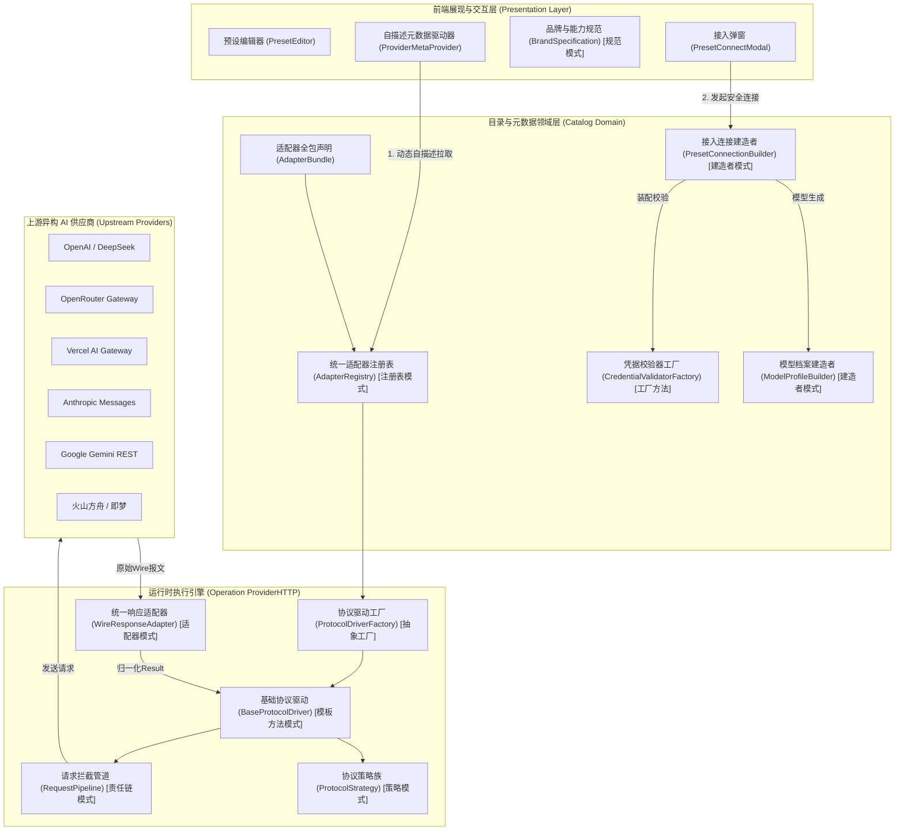
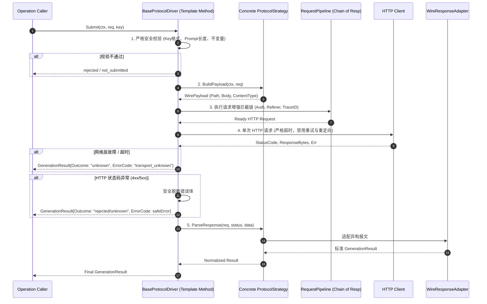
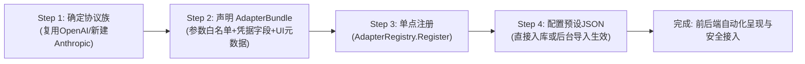

# 多设计模式驱动的模型与供应商接入扩展体系设计

## 1. 摘要与背景

在当前的织光（Glowloom）系统中，AI 模型供应商与预设接入涉及多个业务场景：包括火山方舟、BytePlus、豆包语音、火山音乐、即梦数字人、OpenAI、DeepSeek、OpenRouter、Vercel，以及未来拟接入的 Anthropic Direct、Google Gemini Direct、Grok (xAI) Direct、Mistral、Bedrock 等。

在现有的快速迭代过程中，系统接入逻辑暴露出明显的**耦合严重、职责混杂、硬编码散落**等代码坏味道：
1. **开闭原则破坏（OCP Violation）**：每新增一个模型供应商或调整预设支持，需要同时修改 `adapter_spec.go`、`credentialschema/registry.go`、`driver_openai.go`、`client.go`、`provider-label.ts`、`provider-logo.tsx`、`preset-connect.tsx` 等 7~8 个分散在前后端各层级的文件。
2. **单一职责原则破坏（SRP Violation）**：`driver_openai.go` 等核心驱动既要处理 OpenAI 标准聊天/生图，又要处理 GPT-6.1 Responses API 分支，还要处理 OpenRouter 的路由参数、异步视频任务轮询、Vercel 图像端点，并内嵌多能力探针扫描，代码膨胀且逻辑嵌套深。
3. **元数据与契约分散**：凭据要求（如 API Key vs AK/SK）、端点校验、参数白名单、品牌分类规则散布在各处的 `switch` 语句中，系统缺乏统一的自描述契约（Self-Describing Contract）。

本设计方案旨在引入经典设计模式群（**策略模式、模板方法模式、抽象工厂与工厂方法模式、注册表模式、责任链模式、建造者模式、适配器模式、规范模式**），建立**低耦合、高内聚、声明式、可插拔**的模型与供应商接入扩展体系，使未来接入新协议只需实现独立策略，接入同协议供应商仅需纯配置或自描述声明，前端完全由元数据动态驱动。

---

## 2. 参与者与核心边界

### 2.1 参与者
- **平台系统管理员**：在管理后台动态维护供应商预设、导入/导出预设模版、配置候选模型与自定义候选模型。
- **项目/团队创作者**：在项目空间选择可用预设并接入 AI 服务，使用经发布授权的模型进行剧本、图像、视频、音频的生成。
- **协议执行引擎（Operation ProviderHTTP Engine）**：承接底层原子生成请求，通过解耦的协议驱动与网络客户端执行单次安全提交。
- **目录服务（Catalog Service）**：负责供应商、模型档案、预设版本、安全凭据契约的管理与生命周期维护。

### 2.2 不可妥协的安全与质量不变量
1. **写凭据安全不变量（Write-Only Credentials）**：无论如何重构或扩展，API Key 及密钥只能通过安全管道写入加密存储，绝不在任何策略、拦截器、建造者、元数据 API 或调试日志中回显或反序列化出明文。
2. **零自动重试原则（Zero Automatic Retries on Paid Requests）**：对于已扣费或已提交至上游付费端点的生成请求，任何网络波动或未知响应必须严格标记为 `unknown` 并落盘等待状态核查，模板方法驱动层绝对禁止静默重发。
3. **不可变版本快照（Immutable Versioned Presets）**：预设配置修改必须派生新版本，已有接入连接强引用创建时的版本快照，不得受预设后续修改影响。

---

## 3. 总体架构拓扑与设计模式映射

系统重构后的总体分层与设计模式映射如下：



### 设计模式落地矩阵

| 设计模式 | 解决的核心坏味道 | 对应组件与接口 | 预期达成收益 |
| :--- | :--- | :--- | :--- |
| **1. 策略模式 (Strategy Pattern)** | `driver_openai.go` 内部按厂商和能力分支过多、嵌套深 | `ProtocolStrategy` 及其各厂商/协议实现类 | 将报文打包、路径计算、Header 注入与响应拆解彻底解耦，增改协议零交叉污染。 |
| **2. 模板方法模式 (Template Method)** | 生成流程、凭据探针流程各协议重复编写校验、错误处理和防重试逻辑 | `BaseProtocolDriver.Submit()` / `Probe()` | 固化不可妥协的防重试、状态码守卫和日志脱敏等核心骨架，子类仅填充差异化钩子。 |
| **3. 抽象工厂与工厂方法 (Factory)** | 驱动实例与凭据校验器的手工散落实例化 | `ProtocolDriverFactory`, `CredentialValidatorFactory` | 按适配器标识声明动态组装所需策略与校验器，解耦对象的创建与消费。 |
| **4. 注册表模式 (Registry Pattern)** | 散落多处的 `switch adapterKey`；扩展厂商需要修改核心常量文件 | `AdapterRegistry` (管理 `AdapterBundle`) | 集中声明适配器规范、凭据模型、协议策略与 UI 元数据，一处注册、全系统生效。 |
| **5. 责任链模式 (Chain of Responsibility)** | OpenRouter Attribution、路由 Tag、认证头、跟踪 ID 穿插在 HTTP 客户端中 | `RequestPipeline` 与 `RequestInterceptor` | 跨厂商的横切关注点（审计、认证、Header 增强）模块化，自由插拔。 |
| **6. 建造者模式 (Builder Pattern)** | 接入连接与模型实例化的参数拼装、候选合并、版本关联过程冗长难测 | `PresetConnectionBuilder` | 流畅 API 装配复杂对象，保证事务内模型、版本与规则原子构建。 |
| **7. 适配器模式 (Adapter Pattern)** | 上游不同厂商的返回格式（OpenAI/Anthropic/Gemini/火山）各不相同 | `WireResponseAdapter` | 将异构上游响应映射至系统标准 `application.GenerationResult`，屏蔽异构报文差异。 |
| **8. 规范模式 (Specification Pattern)** | 前端对多品牌模型识别规则（ChatGPT/Claude/Gemini/Grok）硬编码 | `BrandSpecification` 与 `CapabilitySpecification` | 规则对象化，支持复合匹配规则并可由后端元数据驱动，提升前端纯粹性。 |

---

## 4. 详细技术方案设计

### 4.1 策略模式与模板方法模式：协议运行时解耦

#### 4.1.1 协议策略契约 (`ProtocolStrategy`)
```go
package providerhttp

import (
	"context"
	"net/http"

	catalogdomain "github.com/StephenQiu30/glowloom-server/backend/internal/catalog/domain"
	"github.com/StephenQiu30/glowloom-server/backend/internal/operation/application"
)

// WirePayload 表示准备发往上游的结构化报文或二进制流
type WirePayload struct {
	Body        any
	ContentType string
	PathSuffix  string
}

// ProtocolStrategy 封装具体协议族的报文构建、路径路由与报文解析策略
type ProtocolStrategy interface {
	// ProtocolName 协议唯一标识，如 "openai_standard", "openai_responses", "anthropic_messages", "gemini_rest"
	ProtocolName() string

	// BuildPayload 根据生成请求构建发往上游的具体报文结构与路径
	BuildPayload(ctx context.Context, req application.GenerationRequest) (WirePayload, error)

	// EnrichHeaders 为当前特定协议注入专有 Header（如 Anthropic-Version）
	EnrichHeaders(req application.GenerationRequest, header http.Header)

	// ParseResponse 将上游原始响应字节码解析为标准生成结果
	ParseResponse(req application.GenerationRequest, statusCode int, data []byte) (application.GenerationResult, bool)

	// SupportsQuery 是否支持异步轮询查询
	SupportsQuery(config catalogdomain.ProviderConfig) bool

	// BuildQueryRequest 构建异步轮询的 GET 请求信息
	BuildQueryRequest(config catalogdomain.ProviderConfig, taskID string) (path string, err error)

	// ParseQueryResponse 解析异步轮询状态
	ParseQueryResponse(config catalogdomain.ProviderConfig, taskID string, statusCode int, data []byte) (application.GenerationResult, error)

	// ProbeModelDefaultParams 返回该协议用于探针验证的默认基线参数
	ProbeModelDefaultParams(capability string) map[string]any
}
```

#### 4.1.2 模板方法基类 (`BaseProtocolDriver`)
`BaseProtocolDriver` 继承自 `ProtocolDriver`，固化了以下不可妥协的安全执行骨架：


### 4.2 责任链模式：请求增强与安全管道 (`RequestPipeline`)

将所有请求发出前的横切逻辑（认证注入、OpenRouter 溯源、路由约束、租户安全审计）抽离为独立的拦截器：

```go
type RequestInterceptor interface {
	Name() string
	Intercept(ctx context.Context, req *http.Request, config catalogdomain.ProviderConfig, key string) error
}

// 典型拦截器实现：
// 1. BearerAuthInterceptor: 标准 Authorization 注入
// 2. OpenRouterAttributionInterceptor: 注入 HTTP-Referer 与 X-Title
// 3. RoutingConstraintInterceptor: 当存在 EndpointTag 时注入上游厂商锁定规则
// 4. TraceAndAuditInterceptor: 注入 X-Request-ID 并计算入站哈希
```

责任链模式彻底消除了在 `Client.request()` 中通过 `if config.AdapterKey == "openrouter"` 硬编码注入 Header 的做法。

### 4.3 注册表模式与抽象工厂模式：统一适配器全包 (`AdapterBundle`)

过去，适配器元数据定义在 `catalog/domain/adapter_spec.go`，凭据字段定义在 `credentialschema/registry.go`，驱动注册在 `providerhttp/driver.go`，前端图标写在 `provider-logo.tsx`。

现在通过 **`AdapterBundle`** 实现单一来源（Single Source of Truth）：

```go
package domain

// AdapterBundle 是一个完整 AI 提供商适配器的全景声明包
type AdapterBundle struct {
	// 基础规范
	Key             string             `json:"key"`
	DisplayName     string             `json:"display_name"`
	AllowedBaseURL  string             `json:"allowed_base_url"`
	AllowedRegion   Region             `json:"allowed_region"`
	Capabilities    []string           `json:"capabilities"`
	IsManagedCloud  bool               `json:"is_managed_cloud"`
	ParameterFields map[string][]string `json:"parameter_fields"`

	// 凭据规范 (抽象工厂)
	CredentialSchema CredentialSchema `json:"credential_schema"`

	// 协议与驱动绑定 (抽象工厂)
	DefaultProtocol string `json:"default_protocol"`

	// 前端自描述元数据
	UIMetadata AdapterUIMetadata `json:"ui_metadata"`
}

type AdapterUIMetadata struct {
	LogoKey        string   `json:"logo_key"`
	ConsoleURL     string   `json:"console_url"`
	IsMultiBrand   bool     `json:"is_multi_brand"`
	SupportedBrands []string `json:"supported_brands,omitempty"`
	CategoryTag    string   `json:"category_tag"` // "global_gateway" | "direct_provider" | "specialized"
}

// AdapterRegistry 提供线程安全的单例注册中心
type AdapterRegistry struct {
	mu      sync.RWMutex
	bundles map[string]AdapterBundle
}
```

系统启动时，任何适配器（包括火山、OpenRouter、Vercel 以及未来的 Anthropic）仅需通过一个 `RegisterBundle(bundle)` 完成注册。后端暴露：
`GET /api/v1/meta/provider-adapters`
前端直接读取该接口完成品牌呈现与配置校验，不再硬编码适配器字典。

### 4.4 建造者模式：预设连接与模型装配 (`PresetConnectionBuilder`)

在接入预设创建连接时，逻辑涵盖：输入校验、版本锁定、候选模型筛选、自定义候选实例化、模板参数合并、快照落库、发布绑定与审计事件。
使用建造者模式封装该复杂装配过程：

```go
type PresetConnectionBuilder struct {
	document       domain.PresetDocument
	versionID      uuid.UUID
	actor          identityapp.Principal
	connectionName string
	candidateKeys  []string
	customModels   []domain.ModelCandidatePreset
	directUse      bool
	requestID      uuid.UUID
}

func NewPresetConnectionBuilder(doc domain.PresetDocument, versionID uuid.UUID) *PresetConnectionBuilder {
	return &PresetConnectionBuilder{document: doc, versionID: versionID}
}

func (b *PresetConnectionBuilder) WithActor(actor identityapp.Principal) *PresetConnectionBuilder {
	b.actor = actor
	return b
}

func (b *PresetConnectionBuilder) WithName(name string) *PresetConnectionBuilder {
	b.connectionName = name
	return b
}

func (b *PresetConnectionBuilder) WithCandidates(keys []string, customs []domain.ModelCandidatePreset) *PresetConnectionBuilder {
	b.candidateKeys = keys
	b.customModels = customs
	return b
}

func (b *PresetConnectionBuilder) WithDirectUse(directUse bool) *PresetConnectionBuilder {
	b.directUse = directUse
	return b
}

func (b *PresetConnectionBuilder) Build(ctx context.Context, tx *gorm.DB) (application.PresetConnection, error) {
	// 1. 严格校验 Document 与版本
	// 2. 合并预设模板与自定义候选模型
	// 3. 构建 Provider 实体
	// 4. 构建 ProviderConfigVersion 不可变快照
	// 5. 实例化 ModelProfile 实体列表
	// 6. DirectUse 场景下发布版本并写入价格规则
	// 7. 发送 Audit Outbox 审计事件
}
```

### 4.5 适配器模式：上游异构报文归一化 (`WireResponseAdapter`)

对于上游返回的各异结构：
- OpenAI / DeepSeek: `choices[0].message.content`
- Anthropic Claude: `content[0].text`
- Google Gemini: `candidates[0].content.parts[0].text`
- Seedream / 图像模型: `data[0].b64_json` 或 `data[0].url`
- 视频异步任务: `task_id`

定义统一适配器接口：
```go
type WireResponseAdapter interface {
	AdaptText(body []byte) (content string, usage application.UsageStats, ok bool)
	AdaptImage(body []byte) (urls []string, ok bool)
	AdaptAsyncAccepted(body []byte) (taskID string, ok bool)
}
```
通过适配器模式，上游 JSON 报文格式变动（如字段嵌套改动）仅影响单个适配器，核心状态机与工作流不受丝毫波及。

### 4.6 规范模式与前端自描述驱动

在前端（[provider-label.ts](file:///Users/stephenqiu/Desktop/StephenQiu/Glowloom/glowloom-server/frontend/src/app/providers/_components/provider-label.ts) 等），现存的 `getCandidateBrand` 和 `canConnectPreset` 散落着大量条件与正则判断。
重构为**规范模式（Specification Pattern）**：

```typescript
export interface ModelCandidate {
  provider_model_id?: string;
  display_name?: string;
  key?: string;
}

export interface BrandSpecification {
  readonly brand: ModelBrand;
  isSatisfiedBy(candidate: ModelCandidate): boolean;
}

export class RegexBrandSpecification implements BrandSpecification {
  constructor(
    public readonly brand: ModelBrand,
    private readonly patterns: RegExp[]
  ) {}

  isSatisfiedBy(candidate: ModelCandidate): boolean {
    const target = `${candidate.provider_model_id ?? ""} ${candidate.display_name ?? ""} ${candidate.key ?? ""}`.toLowerCase();
    return this.patterns.some((pattern) => pattern.test(target));
  }
}

// 组合规约 (Composite Specification)
export class CompositeBrandClassifier {
  constructor(private readonly specs: BrandSpecification[]) {}

  classify(candidate: ModelCandidate): ModelBrand | undefined {
    for (const spec of this.specs) {
      if (spec.isSatisfiedBy(candidate)) {
        return spec.brand;
      }
    }
    return undefined;
  }
}
```

结合后端 `AdapterUIMetadata`，前端可在接收到后端模型目录时，通过规范对象执行纯净的分类过滤，新增品牌（如 Mistral、Qwen）仅需在规约列表中挂载一条规则。

---

## 5. 新增供应商与模型预设的标准接入流水线

通过上述设计模式重构后，当平台需要接入一种全新的模型供应商时，开发者的标准工作流程为：



1. **协议判定**：
   - 若上游兼容 OpenAI 协议（如 Mistral、Together AI、Groq、Ollama），**无需编写任何协议代码**，直接复用 `OpenAIStandardStrategy`。
   - 若上游为全新私有协议（如 Anthropic 原生协议），只需新增一个实现 `ProtocolStrategy` 的类（例如 `AnthropicMessagesStrategy`），重点实现其 `BuildPayload` 和 `ParseResponse`。
2. **声明 `AdapterBundle`**：
   - 填写 BaseURL、允许的 Region、模态能力（Text/Image/Video）、生成参数白名单、凭据校验规则以及 UI 元数据。
3. **注册注入**：
   - 在初始化模块调用 `RegisterBundle(bundle)`，系统自动绑定驱动工厂与凭据工厂。
4. **即刻生效**：
   - 前端动态拉取适配器元数据，自动展示对应图标、标签、控制台入口及接入表单。
   - 管理员在后台直接通过可视化界面添加该提供商预设及模型，创作者即可完成无缝连接。

---

## 6. 演进与落地计划

为确保系统在重构过程中保持 100% 稳定与零回归，采用**渐进式演进（Strangler Fig Pattern）**：

- **阶段一：协议策略抽象与驱动重构（Strategy & Template Method）**
  - 在 `backend/internal/operation/adapter/providerhttp` 中引入 `ProtocolStrategy` 与 `BaseProtocolDriver`。
  - 将现有的 `driver_openai.go` 内部拆分为 `OpenAIStrategy`、`OpenRouterStrategy`、`VercelStrategy`。
  - 保证现有 73 个前端测试与全部 Go 单元测试完全通过。
- **阶段二：统一适配器全包与注册表重构（Registry & Factory）**
  - 在 `catalog/domain` 建立 `AdapterBundle` 与统一 `AdapterRegistry`。
  - 迁移 `credentialschema/registry.go` 的凭据字段声明至 Bundle 中，消除 `switch` 语句。
  - 提供 `/api/v1/meta/provider-adapters` 端点。
- **阶段三：接入建造者重构（Builder）**
  - 引入 `PresetConnectionBuilder`，重构 `postgres/provider_presets.go` 中的 `ConnectPreset` 方法。
  - 提升模型模板与自定义候选模型装配的可测试性。
- **阶段四：前端元数据驱动与规范模式改造（Specification & Dynamic UI）**
  - 前端引入 `BrandSpecification` 替换硬编码的字符串比较。
  - 前端适配器标签与 Logo 改为由后端元数据优先驱动，保留离线默认降级保护。

---

## 7. 验收与验证标准

1. **模式纯洁性与架构指标**：
   - 核心协议提交流程代码圈复杂度（Cyclomatic Complexity）降低 50% 以上，消除嵌套多重 `switch (adapterKey)`。
   - 新增一个兼容 OpenAI 的供应商预设时，**Go 代码修改行数为 0**，仅需数据库/JSON 配置预设即可在前端完成展示、凭据验证、模型探针与连接接入。
2. **安全不变量检验**：
   - 任何策略与管道中均不得记录敏感 Secret；日志脱敏与网络错误防重试单元测试必须 100% 覆盖。
3. **回归验证**：
   - 现有的四大核心品牌（ChatGPT, Anthropic, Gemini, Grok）在 OpenRouter、Vercel、火山方舟上的连接、模型试用与探针功能持续正常运作。
