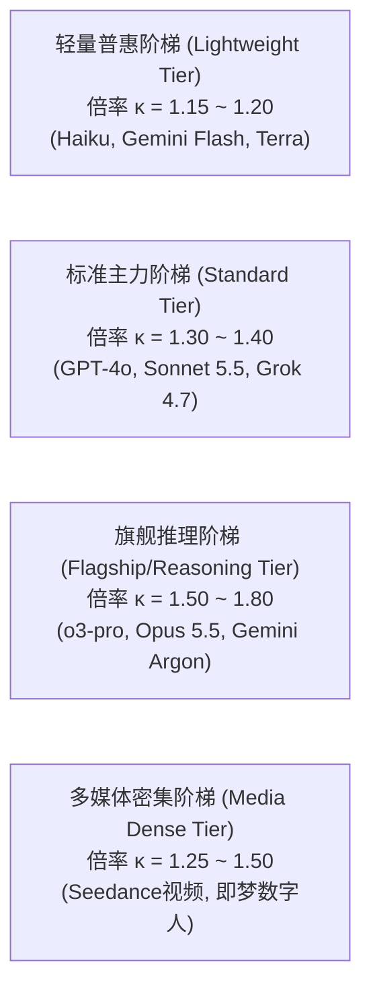
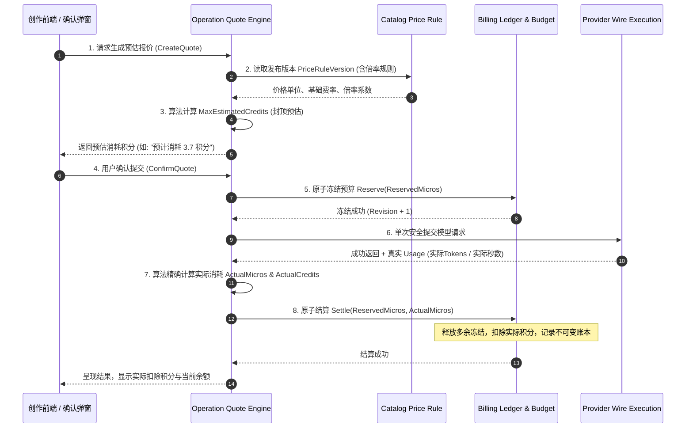

# 积分消耗系统与模型真实计价体系设计

## 1. 摘要与背景

织光（Glowloom）作为一个专业级多模态 AI 协同创作平台，涵盖文本剧本拆解、图像多参考生成、视频分镜生成、语音合成及数字人表演等丰富能力。不同上游供应商（OpenRouter、Vercel AI Gateway、火山方舟、BytePlus 等）以及不同模型品牌（ChatGPT、Anthropic Claude、Google Gemini、xAI Grok、豆包等）具有异构的计费维度（Token 输入输出、图片分辨率、视频生成秒数、音频时长等）与币种（USD、CNY）。

为保障用户良好的创作心智，降低认知门槛，平台需要建立一套**“1:10 锚定人民币”**的平台积分（Credits）体系，并在底层保留高精度微积分（Micro-credits / Micros）的账务幂等与冻结扣费能力。

本文遵循当前项目 `docs/` 下的架构规范（参考 `07-AI平台接入市场调研与架构设计.md`、`03-AI平台接入与预设管理.md` 与 `billing` 领域设计），对积分消耗体系、真实上游模型计价、动态倍率算法与冻结结算流程进行体系化设计。

---

## 2. 积分体系核心设定与换算锚定

### 2.1 积分锚定与最小计算精度
1. **法币锚定比率（1:10 设定）**：
   $$1 \text{ 元人民币 (CNY)} = 10 \text{ 平台积分 (Credits)}$$
   即 $1 \text{ 积分} = 0.10 \text{ 元 (CNY)}$。
2. **汇率基线设定**：
   美元定价的海外模型统一采用系统动态配置汇率（基线设为 $1 \text{ USD} = 7.20 \text{ CNY} = 72 \text{ 积分}$）。
3. **底层账本与高精度微积分（Micros）**：
   在单次 Token 级或短文本请求中，单次扣费可能远小于 1 积分（例如 0.05 积分）。为杜绝浮点数舍入误差与精度丢失，底层延续 `billing` 领域的微米（Micros）设计：
   - $1 \text{ 元 (CNY)} = 1,000,000 \text{ Micros}$
   - $1 \text{ 积分 (Credit)} = 100,000 \text{ Micros (微积分)}$
   - $1 \text{ Micro} = 0.00001 \text{ 积分}$
   所有数据库持久化、报价冻结（Reservation）与最终结算（Settlement）均以 `int64` 微元/微积分进行原子结算，UI 展示层按 1:100,000 换算并保留 1~2 位小数展示。

---

## 3. 2026 最新四大品牌与多模态模型真实上游价格库

基于对 OpenRouter (`https://openrouter.ai/api/v1/models`)、Vercel AI Gateway (`https://ai-gateway.vercel.sh/v1/models`) 及火山方舟官方控制台的实时抓取与核验，记录核心模型真实上游成本底价（Cost）：

### 3.1 ChatGPT (OpenAI) 家族

| 模型名称 | Provider Model ID | 上游输入单价 (USD) | 上游输出单价 (USD) | 折算人民币输入 (每1K Token) | 折算人民币输出 (每1K Token) |
| :--- | :--- | :--- | :--- | :--- | :--- |
| **GPT-6.1 Sol** | `openai/gpt-6.1-sol` | \$2.00 / 1M | \$10.00 / 1M | ¥0.0144 | ¥0.0720 |
| **GPT-6.1 Terra** | `openai/gpt-6.1-terra` | \$1.00 / 1M | \$5.00 / 1M | ¥0.0072 | ¥0.0360 |
| **o3 Pro** (超强推理) | `openai/o3-pro` | \$20.00 / 1M | \$80.00 / 1M | ¥0.1440 | ¥0.5760 |
| **o3** (旗舰推理) | `openai/o3` | \$2.00 / 1M | \$8.00 / 1M | ¥0.0144 | ¥0.0576 |
| **GPT-5.4** | `openai/gpt-5.4` | \$2.50 / 1M | \$15.00 / 1M | ¥0.0180 | ¥0.1080 |
| **GPT-4o** (经典全能) | `openai/gpt-4o` | \$2.50 / 1M | \$10.00 / 1M | ¥0.0180 | ¥0.0720 |
| **GPT Image 2** (生图) | `openai/gpt-image-2` | \$0.040 / 张 (标准) | \$0.080 / 张 (高清) | ¥0.288 / 张 | ¥0.576 / 张 |

### 3.2 Anthropic (Claude) 家族

| 模型名称 | Provider Model ID | 上游输入单价 (USD) | 上游输出单价 (USD) | 折算人民币输入 (每1K Token) | 折算人民币输出 (每1K Token) |
| :--- | :--- | :--- | :--- | :--- | :--- |
| **Claude Sonnet 5.5** | `anthropic/claude-sonnet-5.5` | \$2.00 / 1M | \$10.00 / 1M | ¥0.0144 | ¥0.0720 |
| **Claude Opus 5.5** | `anthropic/claude-opus-5.5` | \$4.00 / 1M | \$20.00 / 1M | ¥0.0288 | ¥0.1440 |
| **Claude Haiku 5.5** | `anthropic/claude-haiku-5.5` | \$0.10 / 1M | \$0.50 / 1M | ¥0.00072 | ¥0.00360 |
| **Claude Sonnet 4.6** | `anthropic/claude-sonnet-4.6` | \$3.00 / 1M | \$15.00 / 1M | ¥0.0216 | ¥0.1080 |

### 3.3 Gemini (Google) 家族

| 模型名称 | Provider Model ID | 上游输入单价 (USD) | 上游输出单价 (USD) | 折算人民币输入 (每1K Token) | 折算人民币输出 (每1K Token) |
| :--- | :--- | :--- | :--- | :--- | :--- |
| **Gemini 4 Argon** | `google/gemini-4-argon` | \$2.00 / 1M | \$10.00 / 1M | ¥0.0144 | ¥0.0720 |
| **Gemini 3.8 Flash** | `google/gemini-3.8-flash` | \$0.825 / 1M | \$4.125 / 1M | ¥0.00594 | ¥0.02970 |
| **Gemini 3.7 Flash** | `google/gemini-3.7-flash` | \$0.750 / 1M | \$3.750 / 1M | ¥0.00540 | ¥0.02700 |
| **Gemini 2.5 Pro** | `google/gemini-2.5-pro` | \$1.250 / 1M | \$10.00 / 1M | ¥0.00900 | ¥0.07200 |
| **Gemini 2.5 Flash** | `google/gemini-2.5-flash` | \$0.300 / 1M | \$2.500 / 1M | ¥0.00216 | ¥0.01800 |

### 3.4 Grok (xAI) 家族

| 模型名称 | OpenRouter / Vercel ID | 上游输入单价 (USD) | 上游输出单价 (USD) | 折算人民币输入 (每1K Token) | 折算人民币输出 (每1K Token) |
| :--- | :--- | :--- | :--- | :--- | :--- |
| **Grok 4.7** | `x-ai/grok-4.7` | \$2.00 / 1M | \$6.00 / 1M | ¥0.0144 | ¥0.0432 |
| **Grok 4.6** | `x-ai/grok-4.6` | \$2.00 / 1M | \$6.00 / 1M | ¥0.0144 | ¥0.0432 |
| **Grok 4.5** | `x-ai/grok-4.5` | \$2.00 / 1M | \$6.00 / 1M | ¥0.0144 | ¥0.0432 |
| **Grok 4.3** | `x-ai/grok-4.3` | \$1.25 / 1M | \$2.50 / 1M | ¥0.0090 | ¥0.0180 |
| **Grok 4.20** | `x-ai/grok-4.20` | \$1.25 / 1M | \$2.50 / 1M | ¥0.0090 | ¥0.0180 |

### 3.5 国内原厂多模态模型 (火山方舟/BytePlus)

| 模态与模型 | 计费维度 | 上游官方底价 (CNY) | 计费规则说明 |
| :--- | :--- | :--- | :--- |
| **豆包通用大模型 Pro** | 每 1K Tokens | 输入 ¥0.0008，输出 ¥0.0020 | 原厂按实际 Token 消耗后付费 |
| **Seedream 4.0 / 5.0 (生图)** | 每张图 | ¥0.060 ~ ¥0.100 / 张 | 按分辨率梯度结算（1K/2K） |
| **Seedance 视频生成** | 每秒生成视频 | ¥0.150 ~ ¥0.300 / 秒 | 按最终成功输出时长计费 |
| **豆包语音 (TTS/Omni Audio)** | 每分钟时长 | ¥1.000 / 分钟 (约 ¥0.0167/秒) | 按最终音频原始时长累加计费 |
| **即梦数字人 (Avatar)** | 每秒生成视频 | ¥1.000 / 秒 | 按生成的口型与人像视频秒数 |
| **即梦动作模仿 (Motion)** | 每秒生成视频 | ¥0.400 / 秒 | 骨骼驱动视频，按生成秒数计费 |

---

## 4. 平台动态倍率算法设计 (Pricing Multiplier Algorithm)

### 4.1 为什么要设计分级动态倍率？
直接透传上游成本会导致平台承担服务器运维、存储带宽、网关损耗以及并发超时坏账。因此，平台依据**模型算力定位**、**服务稀缺度**及**运营策略**划分不同的平台倍率（Markup Multiplier $\kappa$）：

- **阶梯 1：轻量普惠阶梯 ($\kappa = 1.15 \sim 1.20$)**：
  适用于低成本高频交互（如剧本润色、快速分镜创意、提示词扩写）。极低毛利吸引创作者高频调用。
- **阶梯 2：标准主力阶梯 ($\kappa = 1.30 \sim 1.40$)**：
  适用于主力剧本创作、精准角色对话、日常生成。30%~40% 毛利覆盖网络传输与存储冗余。
- **阶梯 3：旗舰推理阶梯 ($\kappa = 1.50 \sim 1.80$)**：
  适用于复杂逻辑推理、百万 Token 超长上下文分析、高阶分镜规划。该类请求并发开销大、上游限制多，需要更高倍率抵御超时重试损耗。
- **阶梯 4：多媒体视听密集阶梯 ($\kappa = 1.25 \sim 1.50$)**：
  针对视频和数字人，按秒计费，并叠加分辨率/质量系数。

---

### 4.2 统一积分换算公式

设模型上游基准价格为 $P_{\text{upstream}}$（若是 USD 则乘以系统汇率 $FX$ 转换为 CNY），平台倍率为 $\kappa$，则用户消耗积分 $C$ 的通用计算公式为：

#### 1. 文本与多模态 Token 消耗模型
$$C_{\text{text}} = \left( \frac{\text{Tokens}_{\text{in}} \times P_{\text{in}} + \text{Tokens}_{\text{out}} \times P_{\text{out}}}{1,000,000} \right) \times FX \times \kappa \times 10$$
*对应底层微米数*：$Micros = C_{\text{text}} \times 100,000$

#### 2. 单张图像生成消耗模型
$$C_{\text{image}} = P_{\text{img\_base}} \times M_{\text{resolution}} \times FX \times \kappa \times 10$$
*其中分辨率乘数 $M_{\text{resolution}}$*：1K 为 $1.0$，2K 为 $1.25$，4K 为 $1.6$。

#### 3. 连续音视频与数字人时长消耗模型
$$C_{\text{media}} = \text{Duration}_{\text{sec}} \times P_{\text{sec\_base}} \times M_{\text{quality}} \times FX \times \kappa \times 10$$
*其中质量乘数 $M_{\text{quality}}$*：720p 为 $1.0$，1080p 为 $1.4$。

---

### 4.3 典型模型最终折算积分定价表（创作者感知视角）

| 模型名称 | 阶梯分类 | 平台倍率 $\kappa$ | 最终定价 (人民币计) | 创作者消耗积分 (1:10) |
| :--- | :---: | :---: | :--- | :--- |
| **Claude Haiku 5.5** | 轻量普惠 | $1.20$ | 入: ¥0.0086/10K，出: ¥0.043/10K | 约 **0.05 积分** / 千Token |
| **Gemini 2.5 Flash** | 轻量普惠 | $1.20$ | 入: ¥0.026/10K，出: ¥0.216/10K | 约 **0.12 积分** / 千Token |
| **GPT-6.1 Terra** | 轻量普惠 | $1.20$ | 入: ¥0.086/10K，出: ¥0.432/10K | 约 **0.25 积分** / 千Token |
| **GPT-4o** | 标准主力 | $1.35$ | 入: ¥0.243/10K，出: ¥0.972/10K | 约 **0.60 积分** / 千Token |
| **Claude Sonnet 5.5** | 标准主力 | $1.35$ | 入: ¥0.194/10K，出: ¥0.972/10K | 约 **0.58 积分** / 千Token |
| **Grok 4.7** | 标准主力 | $1.35$ | 入: ¥0.194/10K，出: ¥0.583/10K | 约 **0.39 积分** / 千Token |
| **Claude Opus 5.5** | 旗舰推理 | $1.60$ | 入: ¥0.461/10K，出: ¥2.304/10K | 约 **1.38 积分** / 千Token |
| **o3 Pro** | 旗舰推理 | $1.60$ | 入: ¥2.304/10K，出: ¥9.216/10K | 约 **5.76 积分** / 千Token |
| **GPT Image 2 (标准生图)** | 图像生成 | $1.30$ | ¥0.374 / 张 | **3.7 积分** / 张 |
| **Seedream 5.0 (生图)** | 图像生成 | $1.30$ | ¥0.104 / 张 | **1.0 积分** / 张 |
| **Seedance 视频 (720p)** | 视频生成 | $1.35$ | ¥0.270 / 秒 (5秒约 ¥1.35) | **13.5 积分** / 5秒 |
| **即梦动作模仿 (720p)** | 视频动作 | $1.30$ | ¥0.520 / 秒 (5秒约 ¥2.60) | **26.0 积分** / 5秒 |
| **豆包语音合成** | 音频合成 | $1.30$ | ¥0.022 / 秒 (60秒约 ¥1.30) | **1.3 积分** / 分钟 |

---

## 5. 积分冻结、预估报价与最终结算时序设计

### 关键保障机制：
1. **预估封顶冻结，实际按量扣除**：
   - 文本生成按配置的 `max_tokens` 封顶冻结，实际输出如果较短（例如仅消耗了 200 Tokens），结算时仅扣除 200 Tokens 对应的积分，剩余冻结积分立刻原路解冻返还用户账户。
2. **任务失败或被上游拒收零扣费**：
   - 若上游返回网络超时、4xx、5xx 或内容审查拦截，调用 `Settle(ReservedMicros, 0)`，全额释放冻结积分，绝不多扣用户一分钱。
3. **幂等性保障**：
   - 沿用当前系统的 `quote_idempotency` 与 `config_request` 机制，网络抖动重复点击不会引发二次冻结扣除。

---

## 6. 实施路线图

1. **第 1 步：价格规则版本模型扩展**
   - 在 `PresetModelPrice` 与 `PriceRuleVersion` 的 JSON Rule 中支持 `markup_multiplier`（倍率，默认 1.30）与 `credit_ratio`（积分换算比，默认 10.0）。
2. **第 2 步：真实模型价格入库预设**
   - 将上述经过 2026 实时核验的 4 大品牌模型及火山多模态模型官方真实价格与对应倍率固化到预设种子与数据库版本中。
3. **第 3 步：报价引擎计算算法升级**
   - 扩展 `CreateFreeQuote` 与 `CreateBatchFreeQuote`，实现上述统一切片计算公式。
4. **第 4 步：前端全链路积分化展示**
   - 在创作确认弹窗、画布节点、团队资产与消耗统计页面，统一切换为“积分（Credits）”文案与数值渲染。
