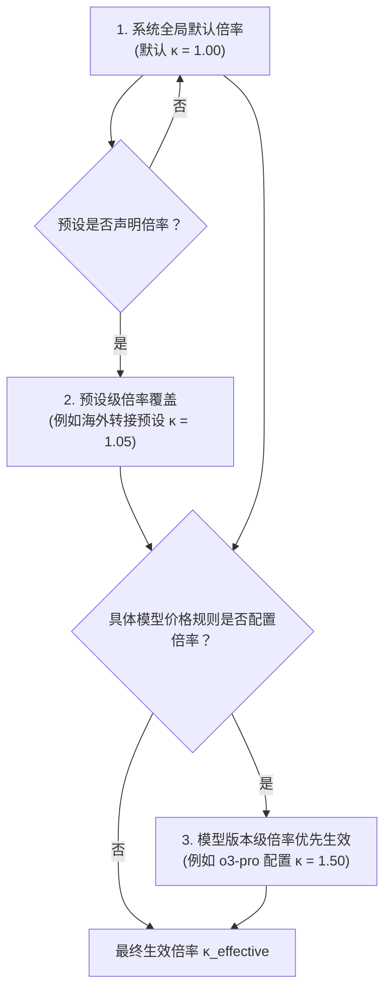
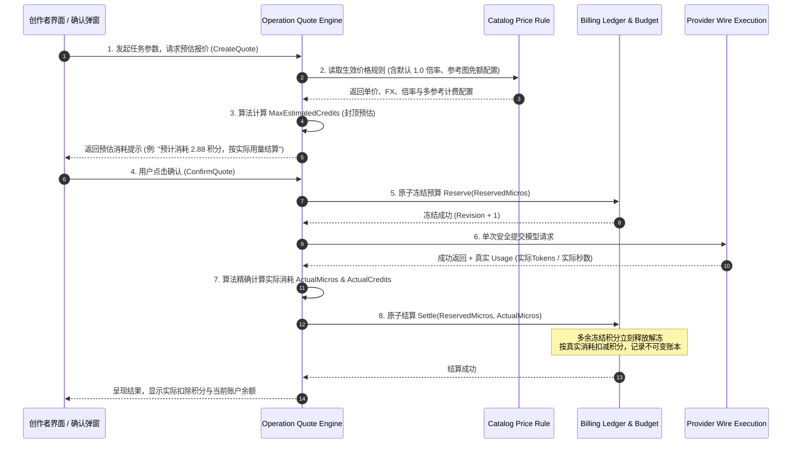

# 积分消耗系统与模型真实计价体系设计

## 1. 摘要与背景

织光（Glowloom）作为一个专业级多模态 AI 协同创作平台，涵盖文本剧本拆解、图像多参考生成、视频分镜生成、语音合成及数字人表演等丰富能力。不同上游供应商（OpenRouter、Vercel AI Gateway、火山方舟、BytePlus 等）以及不同模型品牌（ChatGPT、Anthropic Claude、Google Gemini、xAI Grok、豆包等）具有异构的计费维度（Token 输入输出、图片分辨率、视频生成秒数、音频时长等）与币种（USD、CNY）。

为保障用户良好的创作心智，降低认知门槛，平台建立**“1:10 锚定人民币”**的平台积分（Credits）体系，并在底层保留高精度微积分（Micro-credits / Micros）的账务幂等与冻结扣费能力。

依据业务最新决策：**平台默认采用 1.0 倍率（即零加价直接透传上游官方成本价），同时倍率全面支持多级动态可调**。此外，深度参考并整理开源创作引擎 [BeefTV](https://github.com/glanderness/BeefTV) 的商业化计费、多参考图配额、美元账单预留折算与异步结算状态机设计，制定一套兼顾工业级精度与创作易用性的计价体系。

---

## 2. 积分体系核心设定与换算锚定

### 2.1 积分锚定与最小计算精度
1. **法币锚定比率（1:10 设定）**：
   $$1 \text{ 元人民币 (CNY)} = 10 \text{ 平台积分 (Credits)}$$
   即 $1 \text{ 积分} = 0.10 \text{ 元人民币 (CNY)}$。
2. **汇率基线设定**：
   美元定价的海外模型统一采用系统动态配置汇率（基线设为 $1 \text{ USD} = 7.20 \text{ CNY} = 72 \text{ 积分}$）。
3. **底层账本与高精度微积分（Micros）**：
   在单次 Token 级或短文本请求中，单次扣费可能远小于 1 积分（例如 0.05 积分）。为杜绝浮点数舍入误差与精度丢失，底层延续 `billing` 领域的微米（Micros）设计：
   - $1 \text{ 元 (CNY)} = 1,000,000 \text{ Micros}$
   - $1 \text{ 积分 (Credit)} = 100,000 \text{ Micros (微积分)}$
   - $1 \text{ Micro} = 0.00001 \text{ 积分}$
   所有数据库持久化、报价冻结（Reservation）与最终结算（Settlement）均以 `int64` 微元/微积分进行原子结算，UI 展示层按 1:100,000 换算，展示格式支持保留 1~2 位小数展示。

---

## 3. 2026 最新四大品牌与多模态模型真实上游价格库

基于对 OpenRouter (`https://openrouter.ai/api/v1/models`)、Vercel AI Gateway (`https://ai-gateway.vercel.sh/v1/models`) 及火山方舟官方控制台的实时抓取与核验，记录核心模型真实上游成本底价（Cost）：

### 3.1 ChatGPT (OpenAI) 家族

| 模型名称 | Provider Model ID | 上游输入单价 (USD) | 上游输出单价 (USD) | 折算人民币输入 (每1K Token) | 折算人民币输出 (每1K Token) |
| :--- | :--- | :--- | :--- | :--- | :--- |
| **GPT-6.1 Sol** | `openai/gpt-6.1-sol` | \$2.00 / 1M | \$10.00 / 1M | ¥0.0144 | ¥0.0720 |
| **GPT-6.1 Terra** | `openai/gpt-6.1-terra` | \$1.00 / 1M | \$5.00 / 1M | ¥0.0072 | ¥0.0360 |
| **o3 Pro** (超强推理) | `openai/o3-pro` | \$20.00 / 1M | \$80.00 / 1M | ¥0.1440 | ¥0.5760 |
| **o3** (旗舰推理) | `openai/o3` | \$2.00 / 1M | \$8.00 / 1M | ¥0.0144 | ¥0.0576 |
| **GPT-5.4** | `openai/gpt-5.4` | \$2.50 / 1M | \$15.00 / 1M | ¥0.0180 | ¥0.1080 |
| **GPT-4o** (经典全能) | `openai/gpt-4o` | \$2.50 / 1M | \$10.00 / 1M | ¥0.0180 | ¥0.0720 |
| **GPT Image 2** (生图) | `openai/gpt-image-2` | \$0.040 / 张 (标准) | \$0.080 / 张 (高清) | ¥0.288 / 张 | ¥0.576 / 张 |

### 3.2 Anthropic (Claude) 家族

| 模型名称 | Provider Model ID | 上游输入单价 (USD) | 上游输出单价 (USD) | 折算人民币输入 (每1K Token) | 折算人民币输出 (每1K Token) |
| :--- | :--- | :--- | :--- | :--- | :--- |
| **Claude Sonnet 5.5** | `anthropic/claude-sonnet-5.5` | \$2.00 / 1M | \$10.00 / 1M | ¥0.0144 | ¥0.0720 |
| **Claude Opus 5.5** | `anthropic/claude-opus-5.5` | \$4.00 / 1M | \$20.00 / 1M | ¥0.0288 | ¥0.1440 |
| **Claude Haiku 5.5** | `anthropic/claude-haiku-5.5` | \$0.10 / 1M | \$0.50 / 1M | ¥0.00072 | ¥0.00360 |
| **Claude Sonnet 4.6** | `anthropic/claude-sonnet-4.6` | \$3.00 / 1M | \$15.00 / 1M | ¥0.0216 | ¥0.1080 |

### 3.3 Gemini (Google) 家族

| 模型名称 | Provider Model ID | 上游输入单价 (USD) | 上游输出单价 (USD) | 折算人民币输入 (每1K Token) | 折算人民币输出 (每1K Token) |
| :--- | :--- | :--- | :--- | :--- | :--- |
| **Gemini 4 Argon** | `google/gemini-4-argon` | \$2.00 / 1M | \$10.00 / 1M | ¥0.0144 | ¥0.0720 |
| **Gemini 3.8 Flash** | `google/gemini-3.8-flash` | \$0.825 / 1M | \$4.125 / 1M | ¥0.00594 | ¥0.02970 |
| **Gemini 3.7 Flash** | `google/gemini-3.7-flash` | \$0.750 / 1M | \$3.750 / 1M | ¥0.00540 | ¥0.02700 |
| **Gemini 2.5 Pro** | `google/gemini-2.5-pro` | \$1.250 / 1M | \$10.00 / 1M | ¥0.00900 | ¥0.07200 |
| **Gemini 2.5 Flash** | `google/gemini-2.5-flash` | \$0.300 / 1M | \$2.500 / 1M | ¥0.00216 | ¥0.01800 |

### 3.4 Grok (xAI) 家族

| 模型名称 | OpenRouter / Vercel ID | 上游输入单价 (USD) | 上游输出单价 (USD) | 折算人民币输入 (每1K Token) | 折算人民币输出 (每1K Token) |
| :--- | :--- | :--- | :--- | :--- | :--- |
| **Grok 4.7** | `x-ai/grok-4.7` | \$2.00 / 1M | \$6.00 / 1M | ¥0.0144 | ¥0.0432 |
| **Grok 4.6** | `x-ai/grok-4.6` | \$2.00 / 1M | \$6.00 / 1M | ¥0.0144 | ¥0.0432 |
| **Grok 4.5** | `x-ai/grok-4.5` | \$2.00 / 1M | \$6.00 / 1M | ¥0.0144 | ¥0.0432 |
| **Grok 4.3** | `x-ai/grok-4.3` | \$1.25 / 1M | \$2.50 / 1M | ¥0.0090 | ¥0.0180 |
| **Grok 4.20** | `x-ai/grok-4.20` | \$1.25 / 1M | \$2.50 / 1M | ¥0.0090 | ¥0.0180 |

### 3.5 国内原厂多模态模型 (火山方舟/BytePlus)

| 模态与模型 | 计费维度 | 上游官方底价 (CNY) | 计费规则说明 |
| :--- | :--- | :--- | :--- |
| **豆包通用大模型 Pro** | 每 1K Tokens | 输入 ¥0.0008，输出 ¥0.0020 | 原厂按实际 Token 消耗后付费 |
| **Seedream 4.0 / 5.0 (生图)** | 每张图 | ¥0.060 ~ ¥0.100 / 张 | 按分辨率梯度结算（1K/2K） |
| **Seedance 视频生成** | 每秒生成视频 | ¥0.150 ~ ¥0.300 / 秒 | 按最终成功输出时长计费 |
| **豆包语音 (TTS/Omni Audio)** | 每分钟时长 | ¥1.000 / 分钟 (约 ¥0.0167/秒) | 按最终音频原始时长累加计费 |
| **即梦数字人 (Avatar)** | 每秒生成视频 | ¥1.000 / 秒 | 按生成的口型与人像视频秒数 |
| **即梦动作模仿 (Motion)** | 每秒生成视频 | ¥0.400 / 秒 | 骨骼驱动视频，按生成秒数计费 |

---

## 4. 默认 1.0 倍率与多级可调倍率体系设计

### 4.1 核心原则：默认 1.0 倍率直接透传
根据最新指示：
- **默认倍率设定**：$\kappa = 1.00$。即系统默认不做任何溢价加成，上游多少成本，系统精准按汇率折算为 1:10 的积分进行真实消耗。
- **可调架构（Configurable Multiplier Hierarchy）**：
  为赋予管理员灵活应对未来汇率变动、网络回国专线成本或运营促销的能力，系统设计三级倍率覆盖机制（按优先级从高到低）：
  1. **模型版本级倍率（Model Version Multiplier）**：在模型的 `PriceRuleVersion.Rule` JSON 中配置 `{"markup_multiplier": 1.20}`，用于对特定算力紧张或超高并发模型微调。
  2. **预设/渠道级倍率（Preset Multiplier）**：在 `ProviderPreset` 的配置中设定，用于整体调整某一供应商（如特定转接网关）的综合服务费率。
  3. **系统全局默认倍率（Platform Default Multiplier）**：全局缺省值，系统强制保底为 `1.00`。



---

## 5. 借鉴开源 BeefTV 项目的计费设计与工程实践

通过对 [BeefTV (glanderness/BeefTV)](https://github.com/glanderness/BeefTV) 仓库进行深入逆向与架构检索，整理出其在模型计费、多参考图、外币折算与异步结算领域的 5 大关键设计，并在织光平台中深度吸纳与融合：

### 5.1 双轨计费模式划分 (`tokens` vs `seconds/images`)
在 BeefTV 的 [`VideoPriceQuote`](https://github.com/glanderness/BeefTV/blob/main/web/src/lib/seedance-portrait.ts#L1) 合同中，明确区隔了两种生成计价模式：
1. **`mode: "tokens"`**：按生成的百万视频/文本 Token 计价（区分无视频输入与含参考视频输入单价）。
2. **`mode: "seconds"`**：按视频最终成片秒数直接计费（单价精确到小数点后 4 位）。
**织光融合落地**：在 `PriceUnit` 领域枚举中严格承接 `PricePer1KTokens` 与 `PricePerSecond`、`PricePerImage`，统一将不同供应商的报价规则标准化。

### 5.2 多分辨率梯度定价矩阵 (Resolution Rate Matrix)
BeefTV 支持针对不同清晰度设定精确速率表：
```typescript
rates: {
  "720p":  { output: 0.20, reference_video: 0.00 },
  "1080p": { output: 0.35, reference_video: 0.00 },
  "2k":    { output: 0.50, reference_video: 0.00 },
  "4k":    { output: 0.80, reference_video: 0.00 }
}
```
**织光融合落地**：在价格规则的 `by_resolution` 系数中直接支持该矩阵，720p 设为基准单价，高分辨率通过梯度自动倍率加权。

### 5.3 多参考图免费额度与超量计价 (`free_reference_images`)
BeefTV 原创了精细的参考图分级计费机制：
- `free_reference_images`: 例如前 2 张参考图免费。
- `reference_image`: 超出免费数量后，每额外增加 1 张参考图收取 ¥0.05 或额外 Token。
**织光融合落地**：在角色多参考、分镜同款等复杂生成场景下，允许管理员配置模型模板的免费参考图数，避免多参考图片引发用户对隐形扣费的顾虑。

### 5.4 外币账单动态汇率与预留出账结算 (`reference_invoice`)
BeefTV 对于调用海外美元账单的模型，采用如下优雅模式：
- 规则中声明：`reference_invoice: { usd_cny: 7.20, reserve_usd: 1.5 }`
- 预估展示：`“预计费用：参考生成预留 ¥15.00（实际美元账单 × 7.20 × 1.0，出账后多退少补）”`
**织光融合落地**：在异步任务和海外模型中，以 `reserve_usd` 换算为微积分进行封顶冻结，上游实际出账回传实际 usage 后触发精确释放与扣款。

### 5.5 任务结果与结算事实解耦 (`beef_billing_state`)
BeefTV 在数据库设计中（[backend-database.mdx](https://github.com/glanderness/BeefTV/blob/main/docs/content/docs/backend/backend-database.mdx#L46)）坚持：
- `tasks.beef_usage_state` / `tasks.beef_billing_state` / `tasks.beef_reconcile_deadline`
- 明确原则：**“字段为 NULL 表示尚未读到结算事实，与明确的空值不同；生成完成不等于计费完成”**。
**织光融合落地**：在任务状态机中将 `status: succeeded` 与账单结算解耦，避免网络延迟导致结果已呈现但未结算时误判为免费，保障平台与用户双方账务的一致性与严密性。

### 5.6 规范化配额错误分类法 (Quota Error Taxonomy)
BeefTV 规范了四级配额错误，避免将所有欠费混为一谈：
- `quota_user`: 用户个人账户积分不足，提示充值。
- `quota_upstream`: 平台在供应商处欠费或达到硬顶，提示系统管理员处理。
- `quota_limit`: 超出当前项目的单次预算上限。
- `quota_unknown`: 上游报错模糊时的安全兜底。

---

## 6. 默认 1.0 倍率下的真实积分价目表（创作者感知视角）

基于 **1:10 兑换比率** 与 **默认 1.0 倍率**，各大真实前沿模型的标准消耗积分如下表：

| 模型名称 | 品牌/模态 | 默认倍率 $\kappa$ | 最终折合人民币单价 | 创作者消耗积分 (1:10) |
| :--- | :--- | :---: | :--- | :--- |
| **Claude Haiku 5.5** | Anthropic 文本 | 1.00 | 入 ¥0.00072/1K，出 ¥0.0036/1K | 约 **0.04 积分** / 千Token |
| **Gemini 2.5 Flash** | Google 文本 | 1.00 | 入 ¥0.00216/1K，出 ¥0.0180/1K | 约 **0.10 积分** / 千Token |
| **GPT-6.1 Terra** | OpenAI 文本 | 1.00 | 入 ¥0.0072/1K，出 ¥0.0360/1K | 约 **0.22 积分** / 千Token |
| **Grok 4.3** | xAI 文本 | 1.00 | 入 ¥0.0090/1K，出 ¥0.0180/1K | 约 **0.14 积分** / 千Token |
| **Grok 4.7** | xAI 文本 | 1.00 | 入 ¥0.0144/1K，出 ¥0.0432/1K | 约 **0.29 积分** / 千Token |
| **Claude Sonnet 5.5** | Anthropic 文本 | 1.00 | 入 ¥0.0144/1K，出 ¥0.0720/1K | 约 **0.43 积分** / 千Token |
| **GPT-4o** | OpenAI 文本 | 1.00 | 入 ¥0.0180/1K，出 ¥0.0720/1K | 约 **0.45 积分** / 千Token |
| **Claude Opus 5.5** | Anthropic 文本 | 1.00 | 入 ¥0.0288/1K，出 ¥0.1440/1K | 约 **0.86 积分** / 千Token |
| **o3 Pro** | OpenAI 旗舰推理 | 1.00 | 入 ¥0.1440/1K，出 ¥0.5760/1K | 约 **3.60 积分** / 千Token |
| **GPT Image 2 (标准生图)** | OpenAI 图像 | 1.00 | ¥0.288 / 张 | **2.88 积分** / 张 |
| **Seedream 5.0 (生图)** | 火山原厂生图 | 1.00 | ¥0.080 / 张 | **0.80 积分** / 张 |
| **Seedance 视频 (720p)** | 火山原厂视频 | 1.00 | ¥0.200 / 秒 (5秒约 ¥1.00) | **10.0 积分** / 5秒 |
| **即梦动作模仿 (720p)** | 火山原厂视频 | 1.00 | ¥0.400 / 秒 (5秒约 ¥2.00) | **20.0 积分** / 5秒 |
| **豆包语音合成** | 火山原厂音频 | 1.00 | ¥1.000 / 分钟 (约 ¥0.0167/秒) | **10.0 积分** / 分钟 (约 0.17 积分/秒) |

---

## 7. 积分冻结、预估报价与最终结算时序设计



### 关键保障机制：
1. **预估封顶冻结，实际按量扣除**：
   - 文本生成按配置的 `max_tokens` 封顶冻结，实际输出若仅消耗了 200 Tokens，结算时仅扣除 200 Tokens 对应的积分，剩余冻结积分原路立刻释放解冻。
2. **任务失败或被上游拒收零扣费**：
   - 若上游发生网络故障、4xx 拒绝或安全拦截，调用 `Settle(ReservedMicros, 0)`，全额释放冻结积分，绝不多扣用户一分钱。
3. **幂等性保障**：
   - 沿用当前系统的 `quote_idempotency` 与 `config_request` 机制，网络抖动重复点击不会引发二次冻结扣除。

---

## 8. 实施路线图

1. **第 1 步：价格规则版本模型扩展**
   - 在 `PresetModelPrice` 与 `PriceRuleVersion` 的 JSON Rule 中支持 `markup_multiplier`（倍率，默认 1.00，管理员可调）与 `credit_ratio`（积分换算比，默认 10.0），支持 `free_reference_images`。
2. **第 2 步：真实模型价格入库预设**
   - 将上述经过 2026 实时核验的 4 大品牌模型及火山多模态模型官方真实价格入库，设定默认 1.0x 倍率。
3. **第 3 步：报价引擎计算算法升级**
   - 扩展 `CreateFreeQuote` 与 `CreateBatchFreeQuote`，实现上述统一切片计算公式，支持根据参考素材数量动态增补报价。
4. **第 4 步：前端全链路积分化与明细展示**
   - 借鉴 BeefTV 交互，在创作确认弹窗展示：基础单价、参考图免额信息、预计预留积分与出账结算说明。
