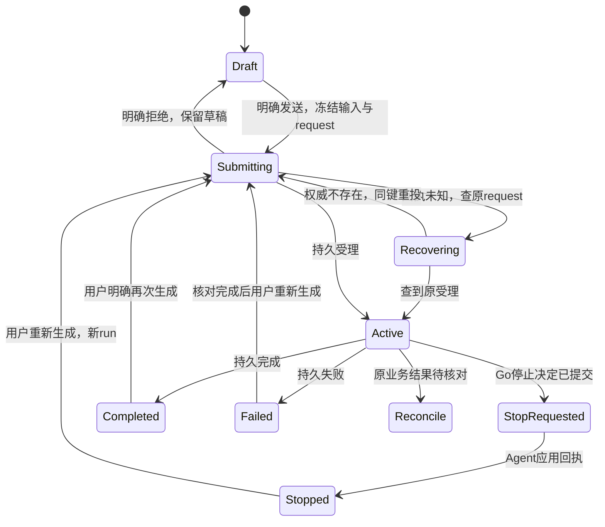

# 对话工作台与参考输入一致性设计

## 1. 摘要

来源为[需求20](../requirement/20-对话工作台与参考输入一致性需求.md)，唯一产品承接为[PRD22](../prd/22-对话工作台与参考输入一致性.md)。将已核对的首页→参考输入→发送→对话→停止/重试→历史重开落实为真实产品链。选用现有共享Tiptap输入、独立`agent`会话和Go业务授权，不新增聊天引擎。实施选择由本文明确，用户确认原文仍归需求20；实施状态仅归[BACKLOG](../../BACKLOG.md#conversation-workspace)。

## 2. 参与者

创作者管理自己的私有会话和输入；项目/空间授权由现有身份体系决定；模型管理员维护能力和版本；Go负责引用授权、消费及控制决定；`agent`负责持久执行、公开事件和历史。Figma是视觉和交互对照，开发者负责工程验证，用户负责产品接受。

## 3. 背景

### 3.1 证据与差距

[即梦对话功能与需求基线](../research/2026-11-05-即梦对话功能与需求基线.md)先独立记录竞品流程。[前序研究](../research/2026-11-04-即梦对话流程与设计基线.md)保留此前原型及早期实现证据。当前织光已有独立对话路由、共享输入、本人项目内分页历史、持久 run 快照与公开消息、恢复和控制回执。2026-11-05 源码对照见第 7.10 节。

### 3.2 既有领域权威

- [设计32](32-完整创作AgentHarness与Skill多Agent架构设计.md)：独立TypeScript/Pi Durable服务、执行单一所有权、Go授权/预算/可靠控制、提交后事件流；本设计不改引擎、grant或owner协议。
- [设计06](06-多参考提示词编辑器调研与设计.md)：PromptDraft、ComposerSession、referenceId/编号、上传、撤销、服务端引用解析；新增的紧凑参考外观由§7.2补充，不替换其数据语义。
- [设计09](09-统一顶栏与阶段入口设计.md)、[设计29](29-创作一致性与公共组件设计.md)：共享导航、首页类型草稿与模式；本设计只替换Agent入口及共享参考表面，不改变其他生成模式的业务合同。
- [设计25](25-统一主体库与创作引用设计.md)、[设计34](34-积分消耗系统与模型真实计价体系设计.md)：主体版本和费用/原任务恢复，不复制一套校验或计价。

## 4. 目标

首页和对话使用同一个输入语义与参考组件；真实已受理输入、全部消息与尝试可重开；Stop和重试有可观察回执；文本、提案和媒体结果不混淆；320/390/768及桌面均可操作。以PRD22验收ID衡量，不以动画、截图或接口200代替接受。

2026-11-05 改版新增历史管理与对话内检索需求，沿第 7.10 节定义的边界。跨项目搜索、分享和消息分支编辑仍沿原范围。反目标包括丢失引用、把断线显示成停止、覆盖旧尝试、用新请求补买未知结果、展示私有推理、把原型固定图和模拟完成带进产品。

## 5. 使用场景

1. 从首页Agent模式添加真实素材/主体和文字，在有权限的项目及可用规划模型下发送，受理后进入对话并在侧栏出现记录。
2. 无文字而有可读图片时表达输入，上传中或模型不支持时保留素材并解释阻塞；移除末图实时更新发送资格。
3. 查看公开进度、文本和图片结果；等待审批时核对提案与费用；断线后查原运行继续显示。
4. 停止当前run，等待可靠控制回执；保留旧输出。失败/停止后明确重新生成，追加新run，旧记录可回看。
5. 刷新、重开、切换会话/空间或移动端返回后恢复授权范围内的历史和服务端已保存草稿；页面内切换保留尚未保存的草稿，不把迟到请求写进另一个上下文。

## 6. 价值

用户可以知道发出了什么、现在做到哪一步、停止是否生效以及再次执行是否产生新尝试。实施复用已投资的编辑器、模型网关与持久执行，避免视觉一致但真实数据链分裂。验收把费用未知、引用失权和网络异常放在同一条完整链中。

## 7. 方案

### 7.1 路径、所有权与方案取舍

采用“独立可路由对话页＋共享输入组件＋扩展现有会话合同”。仅给嵌入面板换皮不能提供刷新后全部历史；另建聊天服务会重复执行与授权权威，因此都不采用。这是基于既有架构的实施选择。

新增`/conversations?projectId=<uuid>`空态和`/conversations/<sessionId>?projectId=<uuid>`详情；Go API仍以项目作用域校验，URL不是授权。入口只使用真实已选项目；缺项目展示选择器，不自动新建项目。分享链接缺项目时要求选择/返回入口，不猜测跨项目归属。无权与不存在的详情给统一不可访问界面。未登录保留可编辑草稿，发送引导既有登录流程；不能先请求私有历史。

复用ProductNavigation/ProductSider。侧栏为当前项目的本人会话，显示项目上下文，按置顶、最近受理输入时间及ID倒序，初次20条，按游标加载；加载、空、失败、重试和选中独立。新建只进入新草稿，首次发送才创建session；标题取首条新文字前60个Unicode码点，图片输入标题为“图片创作”，无额外模型标题调用。会话切换不发送Stop，终态后也不丢历史。原AgentWorkspace的有效命令逻辑迁入共享对话模块，移除旧独立Textarea入口，不长期双轨。

**对话历史操作。** 行尾更多菜单按「置顶／取消置顶」「重命名」「删除」排列。重命名在原行选中已有标题，Enter 保存、Esc 取消。删除先确认，移除当前会话后回到同项目的新建对话。Go 校验当前项目写权限，Agent 按用户、组织、空间和项目更新元数据。置顶与改名不推进执行版本；删除以归档标记隐藏会话，与运行受理共用会话行锁，拒绝仍在运行或待核对的会话，保留运行、资产和费用记录。前端收到回执后重新读取列表。数据库游标保留 PostgreSQL 微秒精度。

### 7.2 共享输入与参考外观

`PromptEditor`、`ComposerSession`、`PromptDraft`继续是唯一编辑内核。新增共享`ReferenceStack`展示原有ReferenceControls的绑定和动作，不复制上传、主体搜索和权限逻辑。首页图片模式、首页Agent、对话和展开面板都消费同一组件；布局差异只由宿主插槽决定。其他模式的输入限制与“发送后保留提示词”沿原合同。

| 属性/状态 | 规范                                                                                                                |
| --------- | ------------------------------------------------------------------------------------------------------------------- |
| 外壳      | 语义token、Geist、Lucide及既有shadcn；内边距16、圆角24、边框1；桌面发送/停止36圆形，移动命中至少44                  |
| 空参考    | 48×64视觉、固定64×84占位、−8°；16加号；白色8%填充、hover12%、点状4%、无阴影；浅色主题用对应语义token                |
| 单/多参考 | 保留真实缩略图、白色0.8边；右下28圆形加号；22直立移除图标仅hover/focus可见；以referenceId操作，不能按数组位置删错图 |
| 展开      | 144边界的绝对浮层，固定占位不变；正文起点64+12=76；不裁卡片、不覆盖相邻输入命中，长列表滚动在浮层内                 |
| 触控/键盘 | 点击/Enter可展开，不要求hover；Escape关闭并还原焦点；可聚焦卡片和具名删除按钮，手机用现有Sheet呈现全部引用          |
| 上传/错误 | 真实进度或等待文字；失败可重试原上传；取消选择不变草稿；失权撤去缩略图，保留可修复占位；无虚构封面/进度             |

**创作类型。** 输入工具栏从左侧打开同一菜单，依次显示 Agent 模式、图片生成、视频生成、音乐生成、音频生成、数字人和动作模仿。空态和历史页切换输入区，保持当前路由。文字草稿按身份、项目、对话及类型隔离。已进入项目的直接创作复用现有生成编辑器、模型目录和报价流程；编辑器有未保存内容或提交状态未决时，按原有保护阻止切换。类型切换本身不提交生成。已受理直接生成结果进入混合对话时间线属于独立合同。

Tiptap行内引用保留现有原子节点、编号和整体撤销语义；移除卡片与全部对应提及为一个事务。上传回执必须匹配actor/scope/project、draft、referenceId、bindingGeneration和attempt，移除后的迟到上传不得复活。展开/悬停只改展示，不创建编辑历史、不重建Editor实例。跨路由用完整草稿持久化/交接，不承诺React卸载后同一Editor实例仍存在。

### 7.3 输入资格、草稿与引用快照

客户端`canSubmitConversation`同时检查：有新输入文字或至少一个可用且被规划模型支持的媒体/主体参考、没有待上传/失效绑定、规划模型可用、项目可写、有效预算、无未决提交/活动run。纯历史引用没有新文字/媒体时禁用。`引用`显示正文上方独立可移除、不可编辑的引用卡，**不插入PromptDocument**；`quoted_from={run_id,message_id}`仅允许当前session的公开助手消息。Go经Agent只读合同查源文及当前访问权，冻结`quote={run_id,message_id,text,content_hash}`；不信客户端引用正文。正文新键入文字独立判断，“转为文字”须显式操作并将文本写入草稿，随后按普通新文字处理。引用内容不是系统指令，不以HTML渲染。初版支持文字及授权图片/主体；视频/音频由当前规划模型能力决定，缺能力明确阻塞，不能偷偷只发送文件名。规则服务端复验。

首页类型草稿保持隔离；切换图片→Agent不把图片生成modelVersion误当规划模型。规划模型、媒体生成模型和预算/Skill配置分别展示于既有创作设置，摘要可见；不显示Pi、grant等实现术语。Skill选择仅接受已授权并可冻结的版本，不能把`/`文本伪装成已加载技能。

沿需求03于2026-10-24确认的存储合同：未受理命令、未保存草稿和恢复键只保留当前页面内存，不使用IndexedDB/localStorage/sessionStorage保存业务记录。页面内路由交接可由持续挂载的内存所有者完成；需跨刷新恢复的草稿显式保存到现有服务器草稿，不把浏览器缓存当权威。刷新只恢复服务器已接受内容，不能承诺恢复尚未到达服务器的文字或上传文件。若刷新丢失本地request键，先发现服务端最近受理/活动run及未决业务结果供用户核对，禁止自动造新键重发。

发送冻结`request_id`、完整输入和设置。只有收到持久受理回执才清除该版本草稿并进入详情；受理后读run失败仍保留“已受理/正在恢复”及原request身份，不能恢复为可重新发送的新草稿。明确拒绝保留原输入和修复提示。网络未知先按原request查询；用户修改草稿不覆盖冻结提交。运行中允许编辑下一条草稿，发送按钮位置为当前run的停止按钮，下一条不能并发提交；切换会话各自保存草稿。草稿键绑定actor/scope/project/session或new，切账号/空间立即清空当前私有投影，迟到响应不得填入新键。

### 7.4 API与数据增量合同

以下为目标合同，内部 Agent 合同按[设计37](37-Agent服务目录与TypeScript规范设计.md)由 Nest Controller/DTO 生成，Go 公共 DTO 继续生成前端 API。禁止手改`frontend/src/api`。当前内部前缀`/internal/agent`、公共前缀`/api/projects/:pid/agent`保持不变，Go代理补完整session/run/actor/org/scope校验。

| 操作                                            | 目标输入/输出与约束                                                                                                                                                                                                                                          |
| ----------------------------------------------- | ------------------------------------------------------------------------------------------------------------------------------------------------------------------------------------------------------------------------------------------------------------ |
| `GET /sessions`                                 | `{limit:20..50,cursor?}`→`{items:SessionSummary[],next_cursor?}`；summary含id/title/created_at/last_input_at/latest_run摘要，不逐条查询完整run；稳定快照游标绑定身份/项目及排序上界，新输入更新由显式刷新合并                                                |
| `GET /sessions/:sid`                            | 保留SessionView和最新run；用于身份、revision、当前活动run与初始snapshot_cursor，不代替全部历史                                                                                                                                                               |
| `GET /sessions/:sid/runs`                       | `{limit:20..50,before?}`→`{items:RunSummary[],next_cursor?}`；首次最近20个，返回页内按accepted_revision升序；summary只含身份、revision、时间、状态、240码点输入摘要及retry关联。输入/消息按可见run懒读快照，避免20份大快照超限；向上加载按run_id去重         |
| `POST /sessions/:sid/runs`                      | `{request_id,expected_execution_revision,input:PromptDraft,quoted_from?,retry_of_run_id?,manifest,budget_micros}`；`goal`由Go从输入导出，不再允许客户端goal/完整input两套冲突真值                                                                            |
| `GET /sessions/:sid/submissions/:requestId`     | 找回原受理→相同AcceptedRun；权威不存在→404可在同键同内容下重投；超时/503不能当不存在。不同内容同键409；只允许本人同项目查找                                                                                                                                  |
| `GET /sessions/:sid/submissions/current`        | 无本地恢复键时返回`{latest_accepted?,active_run?,unresolved_run_ids}`；Agent提供已接受输入/run事实，Go按既有业务权威附未决收费标识，不缓存执行状态。用于发现/核对，不自动提交、推断未受理或生成新request                                                     |
| `GET /sessions/:sid/runs/:rid`                  | 返回完整不可变输入、尝试关联、公开消息/活动/产物、状态和原子snapshot_cursor；必须核对rid属于sid                                                                                                                                                              |
| `GET /sessions/:sid/runs/:rid/messages`         | `{limit:50..100,before?,through}`→`MessagePage{items,next_cursor?,through}`；through为快照截止cursor，before只向更旧序列分页。源消息引用查询用同scope只读`GET /runs/:rid/messages/:messageId`，引用卡取完整逻辑消息，不引用局部chunk                         |
| `POST /sessions/:sid/runs/:rid/commands`        | 复用Go可靠控制决定；返回decision_id/authorization_revision/delivery状态，前端追踪应用回执；不新建UI专用stop接口                                                                                                                                              |
| `GET /sessions/:sid/runs/:rid/commands/current` | Go本人作用域只读`{current_decision?,delivery_status,application_receipt?}`，可用`request_id`找回原决定；当前决定与原请求回执分字段返回，不能把旧决定当当前决定。delivery为pending/applied/superseded，Agent暂不可用时仍可读Go已提交决定，不镜像Agent运行状态 |
| `GET /sessions/:sid/runs/:rid/events`           | 已提交事件SSE；Last-Event-ID恢复、去重、作用域绑定、过期显式错误并重读快照；断开只退订                                                                                                                                                                       |

会话/run分页默认20、最大50；消息分页默认50、最大100。cursor为不透明受校验编码，不含秘密，伪造/跨scope/过期拒绝。公共提交体最大2MiB、PromptDraft仍最大1MiB；内部 Agent HTTP 使用 8 MiB 边界容纳同一输入的文档、纯文本与模型提示词投影，公共输入限制不放宽。媒体字节不经过此提交体。run快照内含`messages_page`最新一页及through/next_cursor，输入、状态、消息页与snapshot_cursor在同一REPEATABLE READ快照内读取。消息页目标上限1MiB，单段公开文本按UTF-8不超过16KiB拆为稳定`message_id+part_index`片段，共享逻辑message_id，保证一项可装入一页；不得静默丢弃旧文本。现有最近100事件窗口仅作事件读取批次限制，不能当完整消息历史。

每条公开消息有稳定`message_id`、`run_id`、`conversation_id`、`sequence`与`kind`，SSE有提交事件ID和相同消息/分段身份。消息投影在Agent同一Storage commit事务由公开事件派生，历史分页按through固定上界；SSE从snapshot_cursor之后补新提交，旧页与实时事件按消息分段身份去重。不可用数组index或文本做身份。若状态先到，仍读完同次commit的消息批次才停止订阅；重读快照也能补齐。超大输入加消息仍小于8MiB公共代理上限。

Go通过注入的Prompt输入应用端口严格DecodeDraft并复验**ready=true**来源；不能直接调用当前`ValidateFragment`充当发送校验，它允许待上传。媒体必须当前可读且版本/状态匹配，主体从当前权威解析描述与media绑定，客户端预览URL和ready声明一律不信。冻结`AuthorizedConversationInput{schema_version:1,draft,input_hash,plain_text,prompt,media_pins,quote?}`：不存signed URL、文件字节、Key或客户端伪造权限。hash涵盖有序绑定、主体版本、引用范围和正文；权限在读取/执行时仍可撤销。

内部快照实际携带冻结`quote`而非客户端`quoted_from`，后者只属于公共输入；源逻辑消息最大64KiB UTF-8可引用，超限明确提示改为自行摘取文字，不静默截取。Go公共读取重新检查引用访问，失权绑定的私有名称、描述、封面和主体展开信息被替换为不可访问占位；保留的服务器审计快照不直接无差别透传给客户端。

Agent在`agent.service_runs`保存不可变input快照及`retry_of_run_id`，session仅增`last_input_at`/排序索引，新增`agent.public_messages`作同commit只读投影及索引；run的创建、幂等回执、输入与session revision更新同事务。Go不存第二份执行历史，仅保留现有业务授权/费用/引用权威。目标公共合同一次切换，所有仓内调用方同步更新，不加旧goal适配别名。既有纯文本run只读展示其持久goal，标记没有引用快照；不伪造或回填参考，停止/费用记录继续可查。增量投影回填只从保留的公开事件确定性派生，缺失的事件明确标为历史不完整，不能虚构。数据库完整定义见 `backend/db/schema.sql`。已有库在部署前核对实际结构与权限。

### 7.5 模型上下文与公开投影

每次实际模型调用前，Agent按session读取截至当前run的已接受来源，通过Go内部`/input-sources/validate`使用当前grant的权威scope逐份复验ready=true，包含历史图片与主体。Resume不重复submit或解码旧输入，仍必须做来源授权复验。失权阻止出站，并提示核对权限或新建对话。

同一session使用现有官方Harness累积上下文，用户新输入按当次已受理快照提交；重试不得重新导入整段历史造成重复上下文。Go媒体读取工具按冻结pin重新校验范围并返回受控内容，由既有多模态transcript适配器送给模型；不能只把URL/文件名当“已看图”。图片only输入使用系统可区分的素材输入说明，不伪造用户键入文字。模型不支持、媒体解码失败/超限时有结构化错误，原草稿/快照可修复，不降级成忽略图片。

公开消息投影仅包含用户已受理输入、可公开助手文本、工具活动摘要、审批提案与正式产物/operation引用。专业子Agent内部消息不平铺到主回复；主回复只投影root conversation公开文本，子任务仅有角色/状态/已采用产物。隐藏模型推理、system prompt、工具原参、凭据和内部堆栈。当前事件源是commit后的文本块，不承诺尚未提交的token实时可恢复；重放与实时读取使用相同消息ID，不重复追加。

助手文本用现有安全Markdown展示，禁止raw HTML和危险链接；代码/列表/长词正确换行。结果卡引用真实asset/version与operation，按现有媒体预览服务重新授权/续签；支持图片预览和已有下载/继续创作动作，权限不足不泄露缩略图。生成中/排队/失败显示真实业务任务状态，不能把run.completed当图片已归档，也不能把媒体成功当run已完成。结果不可读或被撤权时保留消息位置和解释，不能虚构替代图。费用读Go实际预留/结算/核查；缺失显示“费用待核对”。

对话结果提供显式“预览结果”与“下载原件”：预览复用项目媒体授权接口和现有Dialog，关闭后焦点回到入口；原件复用下载组件与正式下载接口，不下载预览URL。仅正式任务completed且输出审核通过时提供原件下载，实际权限仍由下载服务判定；参考撤权后清除相关结果动作。参数复用只回填草稿，不能自动创建收费尝试。

### 7.6 发送、停止、重试与状态机

以上是UI状态，不能替代设计32的run状态。waiting_approval展示审批；paused显示暂停和继续，**暂停继续属于原run的continuation，不是重新生成**。停止按钮只对当前有权限活动run生效；点击后禁重复、显示“正在停止”，保留全部消息；Go受理后尚未投递完成继续等待/核查，不能乐观写stopped。Stop失败且明确未受理可用原键重试，结果未知查`commands/current?request_id`，不生成新批准/停止身份。刷新时先读Go当前决定及Agent快照，Go已有Stop且未applied则恢复“正在停止”；Agent不可用时显示执行状态待同步并保留Go已受理事实。`applied`必须有匹配decision_id和revision的已提交应用回执；superseded按最新决定显示。迟到完成或Stop竞争以当前权威revision与回执为准；不在前端覆盖终态。execution_revision与authorization_revision不得混用。

重新生成使用原已受理input，**不覆盖当前编辑中的草稿**；`retry_of_run_id`指向原run，新request及新root_run，服务端验证同session、原run终态、无活动run且不存在未决收费结果。原请求结果待核对时只显示“核对原任务”，拒绝新尝试；客户端隐藏按钮不是唯一保护。模型/权限失效先引导重新选择并回填为草稿，不偷偷替换原冻结设置；用户改过输入后发送属于新消息，不冒称原样重试。新尝试再次停止保留原失败、旧暂停和最新尝试。双击、超时重传始终同键；只有用户明确新尝试才新键。

### 7.7 Agent与媒体队列取消

Agent自主调用生成仍经原Go工具、提案及预算。媒体operation/task状态单独呈现：queued/running/succeeded/failed/cancel_requested/cancelled/unknown；实际名称由生成合同适配，不让模型口头回复设置终态。Stop撤销run后续动作，不保证已派发外部任务取消或退款。

若正式operation响应提供当前用户可取消能力，则卡片显示取消，走已有正式命令并等持久回执；排队/执行及未知分别判断。没有能力则给出当前状态及可核对入口，不显示假的取消按钮。取消已请求仍可能竞态完成，以业务回执呈现实际产物和费用。前序即梦队列观察不能证明本项目取消能力缺失，也不能证明取消成功。所有真实取消与收费接受在另获运行授权后补证，本轮仅非收费工程验证。

### 7.8 恢复、响应式与设计核对

SSE先读原子快照及cursor再订阅；每个session/run有独立AbortController和代次。作用域变化立即撤去私有内容，取消请求只是取消本地监听。重连从最后已应用cursor接续；终态事件也合并最终消息，不能收到状态后提前丢尾部文本。cursor过期重读快照，按稳定ID替换/合并；连续失败有恢复提示及手动重试，不无限制造新执行。

消息列表默认贴近底部，用户向上阅读后新内容不强制滚回；显示“回到底部”，顶部加载历史保持视觉锚点。工具/状态通过节制的live region播报，不逐字打断读屏。固定底部composer考虑safe-area及软键盘，内容区留真实高度；手机参考操作、模型设置、停止和重试均可触达；IME组合Enter不发送，快捷键沿PromptEditor原合同。

空输入提示由共享PromptEditor的placeholder属性呈现，覆盖首页Agent与独立对话页，发送后恢复提示。异步结果卡、图片与容器尺寸变化也纳入底部跟随；布局触发的scroll事件不得误判为用户向上阅读，读取旧消息时保持其位置。

Figma基线入口见研究记录。对照空输入、单图、多图、展开、移除末图、有文字、发送受理、运行、停止请求、已停止、失败、追加重试、结果、历史与移动状态；工程新增的受理未知/控制投递中/撤权必须补对应设计状态。Figma模拟“思考”改为可公开“执行进度”，不能展示私有推理。公共参考§7.2数值是本轮紧凑外观的权威；其他编辑器文档的候选尺寸不覆盖本轮已核对表面。

### 7.9 追踪与建设者可决事项

| 用户故事                                  | 来源需求         | 技术规则            |
| ----------------------------------------- | ---------------- | ------------------- |
| ST-CONV-01 从首页开始并重开私有会话       | FR-CONV-01/03/08 | §7.1、7.3、7.4、7.8 |
| ST-CONV-02 添加、预览、移除参考并安全发送 | FR-CONV-02/03    | §7.2～7.5           |
| ST-CONV-03 看懂回复、进度、审批与结果     | FR-CONV-04/07    | §7.5、7.7           |
| ST-CONV-04 停止、原任务恢复与追加新尝试   | FR-CONV-05/06/07 | §7.6～7.8           |
| ST-CONV-05 在不同屏幕和网络条件下继续创作 | FR-CONV-08/09    | §7.8                |

路由、分页大小、无文字标题及输入合同为本轮设计选择；实现者可按既有组件结构决定小文件拆分、缓存库和动画细节，不得改变权限、回执、计费与上述交互。任何新增产品范围先更新本链，不能默认为用户确认。

### 7.10 即梦对话改版

[新版 Figma 对话设计](https://www.figma.com/design/uLqmeRWuQuzfrp9xOYg6FT?node-id=3494-92778)覆盖新建、历史管理、活动展开与折叠、混合结果、设置、技能、停止和等待确认。设置、技能入口及活动折叠有原型跳转。既有参考输入与停止原型继续作为细节验证来源。

| 对照基线 | 现有代码与差距 | 改版规则 |
| --- | --- | --- |
| JM-CONV-01、02 | `ConversationHistory` 有项目内历史、分页、当前选中和新建，条目只读；`ConversationPage` 详情顶部为「创作对话」。 | 独立页统一为「对话」，空草稿为「新建对话」。历史条目管理需先有持久的置顶、标题修改和删除合同。仅本人可修改，更新时核对版本。删除优先从历史移除会话并保留独立媒体和审计记录，活动 run 的处理以正式控制回执为准。 |
| JM-CONV-03、08 | `ConversationThread` 按 Agent run 渲染，`ConversationResults` 由公开 operation 读取任务详情。直接生成入口和对话未共用时间线。 | 时间线按服务端接受顺序容纳 Agent 回合和直接任务。每项以自身持久 ID、类型、参数快照及状态呈现。更名为「重新编辑」的动作仅回填，直接任务「再次生成」与 Agent「重新生成」走各自提交合同。 |
| JM-CONV-04、05、06 | `ConversationComposer` 共享编辑器，能选择对话模型、预算和已有技能；独立页 Agent 标识带静态下拉箭头。技能选择缺少检索；创作设置没有可持久的媒体偏好。 | 技能按名称、描述检索且保留已选版本。对话模型使用项目文本模型目录。图片、视频设置按各自的可用版本、比例和清晰度约束写入快照；实现前只提供实际可用入口。 |
| JM-CONV-07、10 | `ConversationThread` 有 run 状态、方案、结果、重试和可展开的公开计划。状态出现在回复下方，操作分散。 | 把 run 状态和可展开的公开活动放到回复上方。成功称「已完成」，媒体及费用继续显示各自的权威状态。回复下方标明 AI 生成并保留引用与复制。每个 run 的重试为独立尝试。 |
| JM-CONV-09 | 具备历史位置保护和「回到底部」，尚无当前对话搜索和过滤。 | 检索按用户、项目、对话作用域检索持久记录及关联的正式任务，保持游标及结果类型。过滤不应把未加载的消息误报为无结果。 |

新建对话正文沿[有历史空态](https://www.figma.com/design/uLqmeRWuQuzfrp9xOYg6FT?node-id=3494-92779)和[首次使用空态](https://www.figma.com/design/uLqmeRWuQuzfrp9xOYg6FT?node-id=3506-94236)。问候、推荐区与底部共享输入使用同一条 800px 内容栏。固定三张创作推荐使用设计稿对应封面。目录存在同名可用技能时显示「热门技能」，「试一试」选用精确版本；其余显示「创作灵感」，点击在草稿中加入可编辑示例提示词。两种动作均聚焦输入、保留已有草稿和技能，发送仍按原合同受理。项目选择入口位于创作设置，也可在无项目时由发送入口唤起。历史列表独立于新对话正文；已有历史和从未使用共用一个正文布局。

「对话」和「对话模型」是面向用户的名词。`conversation` 表达产品容器，`session`、`run` 和 `operation` 分别保留现有持久合同的技术含义。此命名不要求更换路由、API 或数据库标识。

媒体参数、同一时间线的跨类型提交、管理操作、权限与搜索分别做跨边界验收。预算、确认、重试和模型选择保留服务端约束。Figma 示例只表达界面状态，显示的数据为设计样例。

## 8. 实施与验收

设计补充：[Figma 工程状态合同](https://www.figma.com/design/uLqmeRWuQuzfrp9xOYg6FT?node-id=3491-92778)明确受理未知、停止投递中和参考撤权；既有原型说明同步有效输入和清理条件。首页Agent项目入口保持挂载以便首次选择，预算设置内不重复挂载项目选择器。服务器同时比较原、新冻结manifest的canonical hash，模型发布、参数、技能及预算等设置变化不能标为原样重试。

产品范围及验收唯见PRD22，实施文件、顺序和测试见Plan31。本设计接受的技术证明包括：Go引用ready复验与越权反例；真实隔离PostgreSQL中快照/幂等/全部历史/分页及停止竞争；SSE重复/断线/过期和尾事件；组件及浏览器中共享参考、草稿、连续停止重试和移动可达。

不能用Figma模拟、mock模型、进程健康或单一200响应声明真实供应商/费用/完整创作接受。执行前复核并行Agent迁移的当前合同；不回退其逻辑来迁就本计划，不修改现有业务库、不触发真实收费。上线采用先增量结构、后统一合同/调用方切换；在途未决run和operation先盘点。发生异常停新输入并保留读取/对账，不回滚抹除新run或重放旧收费调用。
