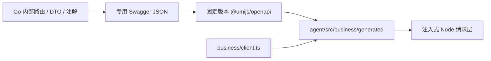

# Agent 服务目录与 TypeScript 规范设计

2026-11-06 确认并进入实施。来源为[需求22](../requirement/22-Agent服务目录与TypeScript规范需求.md)。NestJS、Google TypeScript、注解生成 Swagger 与 Umi 生成接口是已确认方向。本文件定义适配器、模块、校验、生命周期及生成链的实施方案。业务权威与持久化合同见[设计32](32-完整创作AgentHarness与Skill多Agent架构设计.md)，对话语义见[设计35](35-对话工作台与参考输入一致性设计.md)。

## 1. 摘要

独立 `agent/` 使用 NestJS 装配依赖并承载内部 HTTP/SSE，选择官方 `FastifyAdapter`，复用现有 HTTP 配置与流式响应能力。会话应用仍调用官方 Pi Durable，PostgreSQL 保留既有 schema、角色和执行记录。Go 继续通过现有内部 HTTP 合同访问 Agent，并持有业务权威。

## 2. 参与者

| 参与者 | 职责 |
| --- | --- |
| Go API 与 worker | 建立可信作用域和 run grant，处理业务读写、审批、计费、模型出站及 SSE 代理。 |
| Agent 服务 | 管理会话、run、控制、只读投影、执行恢复及内部协议。 |
| 工程维护者 | 维护 Nest 边界、生成接口、验证当前合同并执行单版本切换。 |

## 3. 背景

生产入口为 `agent/src/server.ts`。进程装配 Nest 应用、连接池、Go 客户端与会话服务，在监听后启动恢复循环。HTTP 装配位于 `src/http/`，会话 Controller/DTO 位于同一 HTTP 边界。`pnpm api:schema` 从实际 Nest 路由离线导出 OpenAPI，Go 内部业务 Swagger 独立生成。迁移前的原生 Fastify 路由与 TypeBox 规范仅作为差分验收基线。

当前已采用 FastifyAdapter。Nest 现还提供 ExpressAdapter 和 NodeAdapter；切换引擎需重验解析、hook、静态资源、SSE和错误边界。本轮没有测得需要更换适配器的瓶颈，继续使用现有Fastify实现，具体评价见§7.8。官方依据见 [Nest HTTP 适配器](https://docs.nestjs.com/techniques/performance)、[模块](https://docs.nestjs.com/modules)、[自定义 Provider](https://docs.nestjs.com/fundamentals/custom-providers)、[Swagger](https://docs.nestjs.com/openapi/introduction)、[校验](https://docs.nestjs.com/techniques/validation)、[生命周期](https://docs.nestjs.com/fundamentals/lifecycle-events)。

## 4. 目标

1. 通过唯一 Nest 应用组合 HTTP、配置、会话服务、连接池和恢复生命周期。
2. 按模块职责组织源码，保持 NodeNext ESM 与严格类型，取消独立 `contracts/`、`scripts/` 和多层空目录。
3. 从实际注册的 Controller/DTO 生成 OpenAPI 和客户端。验证请求、响应、错误和 SSE 与现有消费者一致。
4. 单版本切换，交付唯一 HTTP 合同、配置与执行入口。验证新版本恢复、租约隔离和副作用幂等。

## 5. 使用场景

| 场景 | 预期 |
| --- | --- |
| 新增会话接口 | 在会话 HTTP 边界同时描述路由、校验和 OpenAPI，再生成 Go 客户端。 |
| Go 代理重连 | 相同 `Last-Event-ID` 补读已提交事件，连接关闭只取消订阅。 |
| 导出规范与生成客户端 | 在隔离装配中导出 Agent 规范，Go 内部规范独立生成，均可在无业务网络的 CI 中核对。 |
| 停机、重启和切换 | 停止受理与领取，完成有界收尾，按冻结定义和 owner/epoch 恢复同一运行。 |

## 6. 价值

模块与依赖注册表集中在 Nest 组合层。控制器可通过替换应用端口测试，Pi 执行代码和 PostgreSQL Storage 可沿原测试路径独立验证。Go 和前端继续消费已有网络边界，接口生成从对应服务的注册路由出发。

## 7. 方案

### 7.1 框架与构建

- `server.ts` 是唯一进程入口。保留 `dist/src/server.js`、服务名、Compose 内部地址和现有配置。沿用 pnpm、tsc、Vitest 与 NodeNext ESM。Nest 的运行时装饰器采用 TypeScript legacy decorator 语义，启用 `experimentalDecorators` 和 `emitDecoratorMetadata`，在加载装饰类前初始化 `reflect-metadata`。
- 采用 `@nestjs/common`、`@nestjs/core`、`@nestjs/platform-fastify`、`@nestjs/swagger` 和实际所需的运行时 peer。Nest 核心包采用同一发布版本。版本锁定以[设计32 §7.1.2](32-完整创作AgentHarness与Skill多Agent架构设计.md#712-已确定的技术栈与版本基线)为准。须用锁定依赖验证 tsc、开发入口、Vitest 和生产 JS 入口的模块加载、装饰器元数据、DI 与 DTO 校验。
- 本地开发也运行 tsc 编译产物。现有 `tsx watch src/server.ts` 所用 esbuild 不生成 `emitDecoratorMetadata` 所需元数据。HTTP 和 Swagger 合同测试对同一 tsc 编译产物执行，纯业务测试可继续由 Vitest 直接加载 TypeScript。参见 [esbuild TypeScript 支持](https://esbuild.github.io/content-types/#typescript)。
- 生产与测试共用实际的模块和路由注册，通过显式 Provider 替换生产依赖。规范导出复用该测试装配，构建文档后关闭应用。生成逻辑由现有包命令、生成器配置和合同测试承载。生产镜像只包含运行所需依赖和编译产物，启动时无需代码生成或数据迁移。

### 7.2 目录与依赖

```text
agent/
  src/
    server.ts          进程入口，拥有连接池、监听、信号及有界退出
    config.ts          环境配置解析和校验
    http/              Nest 装配、Controller、DTO、鉴权、错误映射、SSE 与 Swagger
    sessions/          会话、run、控制、恢复和应用接口
      persistence/     会话与运行记录、分页及公开消息投影
    pi-durable/        Pi Harness、工具、扩展和事件
      storage/         Pi 原子批次、记录编码、租约与 owner fencing
    business/          Go 客户端、请求传输和模型请求转换
      generated/       从 Go 内部 Swagger 生成的 TypeScript 请求和类型
  tests/               单元、合同、Storage 与恢复测试
```

- Nest 模块随 `http/app.ts` 装配，在边界注册会话应用与 HTTP 生命周期。健康探针随应用装配。会话应用由进程创建，经一个端口注入控制器。
- `http/` 持有全部入站协议。Controller 调用 `sessions/` 的应用端口，后者协调持久化、Pi 和 Go 客户端。应用与存储层只依赖普通 TypeScript 类型。
- HTTP 生命周期停止接单并关闭订阅，随后等待会话应用退出。连接池由 `server.ts` 在 HTTP 关闭后释放。Pi Storage 和会话持久化分别拥有执行记录与业务投影。
- Go 请求生成物随 Go 客户端归入 `business/generated/`，用于请求、类型和可重复生成检查。

### 7.3 HTTP 合同、校验与 Swagger

- 使用唯一的 `/internal/agent` 内部合同与 OpenAPI 3.0。已确定的路径、operationId、鉴权、状态和错误语义直接由 Nest 实现。调用方按目标规范同次重新生成及更新。Controller 显式声明状态和 operationId。DTO 同处维护运行时校验与 Swagger 装饰器。用 `SwaggerModule.createDocument()` 从实际 Nest 应用生成规范。
- 采用 Nest `ValidationPipe`、`class-validator` 与 `class-transformer`，使用可在 tsc 和测试环境执行的显式装饰器。Swagger 注解提供描述元数据，运行时由校验规则执行。显式描述 required、optional、nullable、嵌套 DTO 和分支。保留当前各 DTO 的未知字段政策、字段默认值及转换边界。关闭宽泛隐式转换，针对当前协议需要的查询字段显式转换，验证数字、布尔值、数组及 null。出站在序列化前执行等价的合同校验，生成规范与校验规则由正反例和差分测试约束。
- 内部认证保持请求解析前执行。用适配器的 `onRequest` 对内部路径集中校验现有 Bearer token 和 audience，避免把解析失败或超限请求提前暴露给未认证调用方。Nest Exception Filter 映射应用 `AgentError` 与 Pipe 错误，适配器解析错误沿同一公开格式映射。核对授权失败响应、request ID、8 MiB 请求体上限和当前 HTTP 超时配置。健康探针沿用各自边界。
- 默认通过离线生成供 Go 和 CI 消费。若启用交互式查看，设计采用显式开启的内部 `/docs` 与 `/openapi.json`，连同静态资源受服务身份校验。生产默认关闭，Go 公网代理和宿主端口均无此路由。生成 JSON 写入临时目录或构建缓存，交给锁定的 Go 生成工具。

### 7.4 SSE 与进程生命周期

- Controller 在发送响应头前完成服务身份、作用域和首次游标检查。复用基于 `Readable` 的按需推流，由 Fastify 处理写入背压。保留事件 `id/event/data`、心跳、代理缓冲控制和当前游标错误格式。客户端断线或停机关闭仅中止该订阅的读取、等待与连接。通过实际 HTTP socket 验证慢读、断连、续读及 Go 代理的行为。
- `server.ts` 在 Nest 应用成功监听后启动唯一 recovery pump。readiness 依赖本地配置、schema、PG 与启动状态。离线导出和测试默认装配替身端口，避免真实连接、恢复领取或外部请求。
- SIGTERM/SIGINT 由同一进程入口有界处理，统一调用一次 `app.close()`，并覆盖启动失败的清理。关闭先将 readiness 置为不可用并停止新受理和领取，在适配器等待 HTTP 关闭前中止订阅。随后等待在途执行收尾并释放租约，关闭 Harness 和数据库池。Nest 关闭钩子用于资源收尾，由进程入口在所有消费者退出后关闭池。测试重复信号、长连接和关闭超时，确保有界退出并由原持久状态恢复。

### 7.5 执行状态与切换

- 保留数据库 schema、角色、run ID、幂等键、业务回执、事件与消息的事务边界及 owner/epoch fencing。框架迁移不需要结构变更。
- `DEFINITION_HASH` 受参与文件的文件名和内容影响。比较当前生产构建与候选构建的冻结定义。对参与文件的重命名、导入改写和格式化重算，开发 `.ts` 的结果与生产 `.js` 分别记录。
- 切换前停止旧版本新受理，继续在旧版本处理既有控制、读取及回执核对。盘点所有仍可接续的 run、冻结 manifest、等待审批或暂停的运行、未决子会话、控制 inbox 与未知接单。候选构建不能读取的状态由原构建按既有控制协议先收束。缺少合法收束路径则延后切换。单次切换后由新构建拥有运行，保持稳定业务键。禁止修改存量指纹或重派未知收费请求来规避门禁。
- 切换后仅运行 NestJS。移除旧应用、TypeBox HTTP schema、旧生成链及旧配置入口。禁止双轨、别名、双读双写、协议转换、旧定义加载器和新旧实现回退。切换验证失败时停止发布并修复目标版本。

### 7.6 Swagger 与 Umi 接口生成

采用 SRC-ATS-03 的生成方式。区分生成方向，避免将服务提供的 schema 当成自己消费的接口：

| 调用方向                | 规范来源                                                              | 生成工具与目标                                                        |
| ----------------------- | --------------------------------------------------------------------- | --------------------------------------------------------------------- |
| Agent → Go 内部业务 API | Go 内部 `/internal/agent-business` 路由、DTO 与 `swag` 注解导出的专用 Swagger | `@umijs/openapi` → `agent/src/business/generated/` 请求函数及类型        |
| Go → Agent              | Agent 的 NestJS Controller/DTO 注解生成的 OpenAPI                                 | `oapi-codegen` v2.8.2 → `backend/internal/agent/adapter/runtimeclient` |
| 浏览器 → Go 公网 API    | Go 公网 Swagger                                                       | 既有 Umi 链 → `frontend/src/api/`                                     |

Agent 消费 Go 内部业务 API 时使用 `@umijs/openapi` 1.14.1，与前端使用同一版本。实施时核对该版本的选项与实际产物。参见 [OpenAPI Generator for TypeScript](https://github.com/chenshuai2144/openapi2typescript#usage)。




- 先补齐 Go 内部路由的请求、响应、错误、鉴权、稳定且唯一的 operationId 与 tag，再导出专用规范。覆盖实际注册的方法与路径，包括授权、决定、回执、工具、模型、Skill 和输入来源校验。公共 Swagger 与内部 Swagger 隔离，缺失路径即失败，不能以空生成目录算成功。
- 生成输入采用离线导出的 `agent/node_modules/.cache/openapi/go-business.swagger.json`。Swagger 指机器可读规范，不要求新增在线 Swagger UI 或在 CI 中依赖运行中的业务服务。现有公网 Swagger 不足以替代内部规范。
- `agent/openapi2ts.config.ts` 只描述生成参数。`schemaPath` 指向专用规范，`serversPath` 指向 `src/business/generated`，`namespace` 使用 `AgentBusinessApi`。函数名取自 operationId，分组文件名保持稳定。
- requestLibPath 通过具名导入接入 `src/business/request.ts`，使用输出运行时的 `.js` 相对路径。不依赖 Umi/React 运行时，不复用浏览器请求拦截器或用户登录态。
- `request.ts` 保留当前服务身份、audience、禁用重定向、有界读取、按操作超时和 AbortSignal 传播。依赖由 `BusinessClient` 实例通过请求 options 显式传入，生成函数未获得传输依赖时拒绝执行，不从全局环境或 service locator 取凭据。凭据不写入配置或生成文件。
- `src/business/generated/` 只含可重生成产物，不手改。`client.ts` 只保留 grant、回执查询、404 到未找到等实际业务转换，调用生成函数。不继续手写路径、请求函数或维护第二份 wire DTO。`BusinessTool` 等协议类型从生成类型引用，需要内部模型时显式转换。
- 生成响应类型不等于运行时校验。保留既有业务语义校验，并在请求边界补齐所需的响应形状校验。当前 `BusinessClient.request<T>()` 解析 JSON 后直接断言为 T，尚不具备通用成功响应校验，不能把接入目标当成现有保证。保留模型/工具流式语义。对流式端点使用同一 Swagger 生成的请求路径和类型，并验证原始流、取消和错误处理。
- 官方1.14.1模板会产生命名空间、聚合入口及其默认导出、lint 注释及 `@ts-ignore`，对**可验证重生成的 `src/business/generated/`** 明确列为生成工具例外。不向手写业务代码推广。生成物继续参与严格 tsc 和生产构建，不使用 `@ts-nocheck` 掩盖接入错误。普通项目检查跳过依赖声明，因此通过 `pnpm api:typecheck` 在 NodeNext 和 `skipLibCheck=false` 下独立检查生成的声明与传输层。其类型命名与请求文件布局服从生成器，手写文件继续遵循 Google 与项目规范。
- 如果模板产生无扩展名的相对 import/re-export，仅在生成链按固定规则补齐 `.js`，不改写工具模板或业务语义。规范、固定版本生成器、配置、该确定性处理和 Prettier 共同决定产物，检查链必须重复同一流程。

Go 端通过锁定的 `go tool oapi-codegen` 生成当前模型和普通 HTTP 客户端。同步更新调用方使用生成 API，保留业务授权转换、请求超时与流式消费边界。SSE 从原始响应逐段读取，避免使用会整体缓冲响应的生成方法。使用当前 OpenAPI 与 Go 合同测试核对嵌套模型、必填/可空及 Go 公网 DTO 的序列化。旧 TypeBox 驱动的生成器随本次切换移除。[oapi-codegen v2.8.2](https://github.com/oapi-codegen/oapi-codegen/releases/tag/v2.8.2)

生成及校验命令各自承担以下职责。

| 命令                  | 职责                                                                                                     |
| --------------------- | -------------------------------------------------------------------------------------------------------- |
| `api:schema`          | 在隔离测试装配中生成 Agent OpenAPI，供 Go 消费                                                                  |
| `api:business-schema` | 从 Go 内部注解离线导出专用 Swagger 至忽略缓存。完整命令及元信息入口在接入实施时落实                      |
| `api:generate-go`     | 重新导出 Agent OpenAPI，通过锁定的 oapi-codegen 生成 Go 客户端。 |
| `api:generate`        | 先导出专用 Swagger，再运行官方 openapi2ts、固定 NodeNext 处理与 Prettier，写入 src/business/generated       |
| `api:check`           | 保留自身合同/Go 客户端检查，并在独立临时目录重生成 Umi 客户端，逐文件比较及核对 operationId/内部路由覆盖 |

独立检查不覆盖已有生成文件，不复制当前产物充当预期。须识别手改、缺失和额外文件，并验证严格 NodeNext 编译。生成器 CLI 的退出码不能代替产物、覆盖率和文件比较检查。

### 7.7 Google TypeScript 实施约定

以 [Google TypeScript Style Guide](https://google.github.io/styleguide/tsguide.html) 为手写代码基线。NodeNext 相对 `.js` 路径、`node:` 前缀、Nest 装饰器元数据、格式化配置和生成物例外由 [Agent 工程规范](../../agent/AGENTS.md) 定义。运行时反射需要的 DTO、注入 token 和类使用值导入，纯类型使用 `import type`。跨网络数据以 `unknown` 进入校验边界，业务错误保持独立的类型与因果链。

### 7.8 本次技术选型评价

依据SRC-ATS-10 / SRC-AGH-22，区分“技术路线合理”“当前能构建”和“生产/产品已接受”。结论：**保留现有技术组合及目录，不再次迁移框架**。技术版本仍以设计32 §7.1.2与实际package/lockfile为唯一基线，本节不复制另一份版本表。

| 选择 | 合理性、已有落点 | 使用边界和备选取舍 |
| --- | --- | --- |
| 独立Node/TypeScript服务 | Pi与资源SDK原生TS，独立构建/池/进程，Go只管业务权威 | 不改为Go托管子进程、不按七个角色拆微服务；新增HTTP/授权/恢复边界继续实测 |
| NestJS + FastifyAdapter | `http/app.ts`已集中Module/Provider/Pipe/Filter、认证hook及DTO，应用与Storage保持普通类 | 官方当前推荐的NodeAdapter是可评估备选，不是已测迁移收益；现有Fastify插件/请求hook/SSE已接线，保留可减少非目标变更；不宣称本项目已做引擎性能比较 |
| 官方Pi Durable 1.5.0同版包 | 已有Harness、task-owned会话、压缩、事务doc、恢复和官方Storage适配 | 官方API仍属实验性质；锁版本、生产定义及公开API，不自动升级，不再叠加LangGraph/自写循环 |
| pg + PostgreSQL Storage | 复用现有基础设施与受限schema，owner/epoch与事件投影同事务；不引入第二个ORM | 自定义Storage是项目维护责任，需官方conformance/未知COMMIT/跨进程测试；不把PG可连接当恢复通过 |
| Go数据库worker | 原operation/media/mediatool及taskruntime已承载提交、查询、归档、渲染 | 不重引Temporal、BullMQ或第二套DAG；长等待释放短worker槽，外部在途容量另计 |
| Swagger/Umi/oapi-codegen | 双向生成及临时重生成比对已存在，关键grant/receipt有运行校验 | 不从零再建接口生成；类型不是深层语义验证，响应分支、空值、金额和状态仍在各边界校验 |
| Pino / Vitest / tsc / Compose | 已有脱敏、生产编译、隔离测试定义、独立非root镜像和内部端口 | 运行日志需要补wait/branch/call/operation关联与扫描诊断；测试定义、历史CI、容器健康不等于本轮作品接受 |
| 官方Go MCP SDK | 拟在Go业务出口接入v1.7.0基线，语言下限与本项目相容，见设计32 §7.17.4 | 当前尚未安装/接通；真实协议互通后锁定，能力协商逐项开放；不是在Node trusted扩展中绕过业务准入 |

本轮工程检查：宿主Node **24.19.0**、pnpm **12.4.2**；在`agent/`执行`pnpm typecheck`与`pnpm build`均退出0，证明现有手写/生成代码可类型检查和生产编译。Dockerfile仍固定Node24.22.2/digest，本轮没有构建该镜像、启动生产JS、执行完整PG/恢复测试或容量测试，不将宿主编译结果写成容器/生产验证。

### 7.9 当前目录评价与最小调整

§7.2目录已与当前源码基本一致，合理且可继续使用；不存在必须先搬成`services/`或全局Controller/Service/DAO结构的依据。保持`http → sessions → Pi/持久化/Go端口`依赖，`business/generated`只放可重生成产物；HTTP类型不进入Pi Storage，Node不导入Go数据库模型。

只有承接实际能力时才细分下列职责；这里是设计位置，不预建空文件/目录：

| 现有位置 | 有行为增量时的最小整理 |
| --- | --- |
| `pi-durable/registry.ts` | 保留注册组合；批量委派及branch映射收敛到已有`delegation.ts`，避免继续向431行注册文件堆完整编排 |
| `pi-durable/` | 增加`policy.ts`拥有执行步数、委派深度/默认分支分配等策略类型与默认值；实际策略在manifest冻结，不建立通用constants包 |
| `sessions/runtime.ts` | 保持官方Harness生命周期/授权出口；已有delivery.ts继续拥有交付判定，其他持久等待按真实需要抽到`waits.ts`，不另造运行时 |
| `sessions/service.ts` | 会话/控制用例与recovery pump职责过载时将扫描抽到`recovery.ts`；端口/注入保持普通TS，停机和资源所有权仍唯一 |
| `pi-durable/storage/`、`sessions/persistence/` | 前者官方执行批次、owner/epoch；后者会话/消息投影；不合并成可跨越业务schema的全局repository |
| Go `app/agent/` | 仅组合现有正式工具及事务；制作核心随真正交付下沉`production`领域，MCP连接/外部调用随真正接入落`mcp`领域，均遵循adapter→application→domain |

未来Go production领域拥有Shot/Revision/生成覆盖/Take/采用/影响集，复用script/Bible/operation/media/canvas/mediatool消费端口；mcp领域拥有连接版本、受权绑定和远端调用事实，资金及业务动作仍沿原Agent/operation/billing出口。两者不是新微服务、Agent状态副本或独立调度器。新增表只进入`backend/db/schema.sql`完整定义，已有库精确离线变更，禁止启动DDL或新增migrations目录。

### 7.10 策略常量、执行定义与生成链收紧

`pi-durable/policy.ts`集中模型/工具40步、默认分配8步、子角色4个/深度1及自动制作接续4次，版本1整体冻结到manifest；schema上限、上下文提醒和实际预算检查消费同一策略，拒绝请求覆盖策略。root执行槽另归config，Go货币上限另归业务授权；这三类限制不合并。后续可调策略须在启动边界校验并冻结，不热改活跃run。

节点/动作/媒体引用复用所属Go domain常量；正式工具名、candidate kind、effect/replay/role和DeliveryStatus通过业务描述/DTO/生成合同消费，SQL过滤复用所属常量，跨语言wire值用合同测试或生成约束。移除根据工具名称前缀推断权限的隐含规则，未声明角色的写工具默认拒绝；不把任意新工具名自动赋予producer以外角色。纯Agent计划/委派协议常量留Pi职责目录，不建全局字符串仓库。

`definitions.ts`摘要完整可执行src树（开发为.ts、生产为.js，排除声明文件），规范化相对路径、排序并纳入pnpm-lock.yaml字节身份；Docker运行镜像携带该锁文件。开发与生产摘要分别记录，不假定相同。运行参数/租户数据不混入构建摘要，而由manifest独立冻结；新增行为文件不依赖手工8文件白名单。

新增测试必须证明：任何行为文件改变会改变摘要，相同输入构建摘要稳定，角色/工具/Skill/模型策略变化改变manifest。恢复扫描包含不兼容definition并登记原root的停车原因，不能让其从诊断视图消失；`agent.recovery_backoff`仅记录现有run/control的退避元数据，不建立第二任务执行器。执行可用标识只表达当前定义及原输入是否存在；临时停车单独展示，通过原pause/resume控制恢复，Go确认有效resume回执后仅清该root的Run退避，保持原预算、未知费用及调用计数。发布前同定义核对或原版本收束；不修改存量指纹、不增加历史定义加载器/双轨回退。

双向生成链保持§7.6：改Go内部业务合同先更新专用Swagger，经Umi重生成；改Node入站DTO先从实际Nest路由导出，再重生成Go客户端。`api:typecheck`继续单独检查生成声明；禁止手改generated文件。新增制作义务、费用投影、MCP描述字段均必须同时覆盖运行验证、路由/operationId、可重生成差分及消费方语义测试，不能只增加DTO字段。

## 8. 实施与验收

| ID | 必须验证的结果 |
| --- | --- |
| ATS-AC-01 | 单一 Nest 入口，模块依赖无环。旧启动路径、TypeBox HTTP 合同、配置别名、协议转换和回退路径均已移除。 |
| ATS-AC-02 | 离线用实际路由装配生成 OpenAPI，无真实连接。与现有生成物比较方法、operationId、鉴权、状态码、必填/可空、DTO 与已声明的流端点，重新生成 Go 客户端并通过其合同测试。 |
| ATS-AC-03 | HTTP 正反例覆盖未授权、非法 JSON、体积超限、未知字段、嵌套校验、可空语义、错误格式及非法出站数据。 |
| ATS-AC-04 | 实际 socket 与 Go 代理验证 SSE 首读错误、重连补读、慢订阅背压、心跳及断连后 run 持续。 |
| ATS-AC-05 | 官方 Storage conformance、真实隔离 PG、原子投影、控制去重、租约隔离、真实进程中断和重启恢复通过。 |
| ATS-AC-06 | 新生产构建的指纹、存量 run 清单与准入结果可核对。不能直接接续的运行在切换前收束，新版无旧定义加载分支。 |
| ATS-AC-07 | 冻结锁文件安装、严格类型、lint、格式、测试、API 检查与构建通过。测试装配和生产镜像验证装饰器元数据、启动失败、信号关闭及连接池释放。 |
| ATS-AC-08 | Umi 客户端独立重生成零差异，核对内部路由覆盖、NodeNext 声明检查、服务身份、取消、超时、大小限制和实际流式语义。 |

执行步骤见 [Plan28](../plan/28-完整创作Agent与Skill多Agent实施计划.md)，对话验收继续沿 [Plan31](../plan/31-对话工作台与参考输入一致性实施计划.md)。进度见 [BACKLOG](../../BACKLOG.md#agent-nestjs-migration)。
