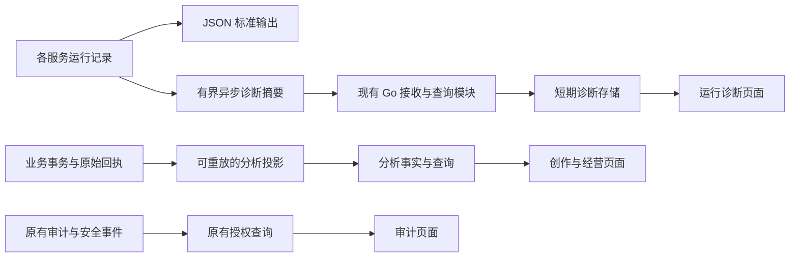

# 日志与创作经营分析设计

2026-11-13 · 评审稿。来源：[需求27 SRC-LOG-01、02](../requirement/27-日志与创作经营分析需求.md)。完整分析范围已确认，下文技术选择与指标细则为建议，未作为已实现能力。

## 1. 摘要

围绕四类问题建立最小闭环：服务为何出错、谁做了什么、创作在哪一步产生价值、业务是否产生可核对的收益。复用现有 Go 模块、PostgreSQL、Node 服务与页面体系，不拆独立日志微服务，不让日志承担账本或创作事实来源的职责。

## 2. 参与者

值班/研发读取运行诊断；创作者和团队管理者读取获授权的创作统计；平台运营读取平台汇总；获经营核查授权者读取现金、成本与贡献明细。具体人员未指定。管理身份不自动授予私有内容访问或财务读取权。

## 3. 背景

2026-11-13 对当前工作区源码的只读核对（基线 `475dc96f`），不代表运行环境验收：

| 当前事实与源码                                                                                                                                                                                                                                               | 对设计的影响                                                                   |
| ------------------------------------------------------------------------------------------------------------------------------------------------------------------------------------------------------------------------------------------------------------ | ------------------------------------------------------------------------------ |
| [Go logger](../../backend/internal/platform/log/log.go) 使用 Zap；生产 JSON、本地 console                                                                                                                                                                    | 保留日志库，统一字段和输出策略，无需更换工具链                                 |
| [HTTP logger](../../backend/internal/app/router.go) 当前以 Debug 记录 method/path/status 和可用 trace ID；[HTTP 协议](../../backend/internal/platform/httpapi/protocol.go) 维护 request ID 与公开错误                                                        | 需要明确补充耗时、错误分类及跨服务关联；不能靠调高生产日志量代替设计           |
| [OTel](../../backend/internal/platform/otelconn/otelconn.go) 可选导出 traces；HTTP/DB metrics 当前禁用，[DB](../../backend/internal/platform/db/db.go) 隐藏查询变量和 SQL 正文                                                                               | 已有追踪基础不等于已有指标平台；保留 SQL 脱敏，不新增全量参数记录              |
| [Agent](../../agent/src/server.ts) 有 Pino 脱敏及恢复告警；[PhaseTelemetry](../../agent/src/pi-durable/telemetry.ts) 用于模型阶段关联，并非完整追踪后端                                                                                                      | 统一字段须覆盖真实请求/业务身份，不能把类名当完整遥测证据                      |
| [Canvas HTTP](../../canvas/src/http/app.ts) 关闭 Nest logger；[统计页](../../frontend/src/app/analytics/page.tsx) 明确未开放                                                                                                                                 | 采集覆盖和分析页面均须补验，不能直接宣称具备全站分析                           |
| [审计页](../../frontend/src/app/audit/_components/audit-events.tsx) 读取平台安全事件；[audit 模块](../../backend/internal/audit/application/read_query.go) 有组织授权分页；[schema](../../backend/db/schema.sql) 有 append-only audit、operation、钱包等事实 | 安全事件、组织审计和业务事实并非一个通用日志表；继续由各来源控制权限和写入规则 |

知识库依据由需求27 §2集中维护。当前请求量、数据规模、访问频次与历史完整性尚未实测；不承诺吞吐、查询 P95 或收益提升。

## 4. 目标

请求/任务 ID 能定位获授权的诊断链；图表能回到同口径事实；重复与迟到事件不扩大业务数量或金额；数据缺失可见。日志采集故障不阻塞创作，审计及财务事实仍按所属领域的事务合同保证。

验收以固定数据集的精确计数、权限反例、故障演练和真实来源核对为准。历史不可重建的观察只从实际采集起点统计，不生成“过去已采用”等伪事实。

## 5. 使用场景

1. 用户反馈视频卡住：值班用 request/operation ID 关联 Agent、供应商尝试和归档记录，看到原任务待核对；查询过程不发起重试。
2. 创作者比较一周产出：查看生成、采用和交付，定位未采用候选、失败导出与资源复用；团队切换后所有结果重新授权。
3. 运营检查注册后的首次创作、付费与再次创作，按入口和模态比较；缺少页面访问事实时不显示访问转化率。
4. 经营核查者比较模型/渠道的消费、采购与实际现金分摊；缺账单或分摊时显示覆盖率及待核对，不能得到一个虚假的利润数。

## 6. 价值

值班减少跨容器拼接记录；创作者能区分“生成很多”和“实际采用/交付”；运营和经营核查使用同一套业务身份，避免重复任务、赠分或未知费用把转化与利润抬高。实现成本通过复用当前运行时和数据源控制。

## 7. 方案

### 7.1 取舍与模块职责

| 方案                                                      | 收益与代价                                       | 评审建议                                   |
| --------------------------------------------------------- | ------------------------------------------------ | ------------------------------------------ |
| 仅标准输出与容器日志，分析直查业务表                      | 运维最轻，但缺跨服务有界检索，历史状态变化难统计 | 保留作基础与故障回退，不能单独满足完整需求 |
| 现有 Go 后端内增加诊断查询和分析投影模块，复用 PostgreSQL | 有统一入口和权限；需控制写放大、查询负载与保留   | 推荐；按真实容量验证决定是否适用           |
| 专用日志检索栈加分析仓库                                  | 适合已证明的大规模需求，增加采集、存储和运维职责 | 尚无规模证据，暂不引入                     |

推荐方案是本稿提案，并非用户已选定技术。`platform/log` 只负责结构化输出；`observability` 负责短期诊断接收/查询与采集健康；`analytics` 负责指标字典、分析投影及查询。模块均在现有 Go 进程内，按 `adapter → application → domain`，不为目录建立空接口。审计、identity、operation、media、Agent、计费继续拥有原事实。

### 7.2 日志字段、请求与错误

统一字段为 `timestamp`（UTC）、`level`、`service`、`role`、`environment`、`release`、`event_name`、安全摘要 `message`。请求完成另有 `request_id`、可用 `trace_id/span_id`、method、**路由模板**、status、`duration_ms`、`error_code`；业务关联按实际存在附 `operation_id/run_id/call_id/attempt_id/job_id` 及授权范围引用，不强填不存在的 ID。

`request_id` 标识一次 HTTP 请求，重试产生新请求 ID；业务幂等键、operation/call/attempt 保持各自含义，不能复用一个字段。边界校验传入 ID 格式与长度；内部转发保留可用关联，trace 上下文与业务 ID 均不作为授权依据。前端错误反馈显示可复制 request ID。外部输入不得直接成为日志字段名或任意标签。

系统启动/停止为 Info；预期输入错误、权限拒绝、用户取消保留分类和请求摘要，不默认当 Error；可恢复依赖异常为 Warn；未处理异常、panic 和失败后台执行为 Error。每次请求只写一条完成摘要，异常在负责处理的边界记一份脱敏诊断，不层层重复打印堆栈。SSE 记录首响应及关闭原因/持续时间，WebSocket 记录连接关闭摘要与异常，不逐帧记录；连接耗时不能混入普通 HTTP 延迟。

日志字段采用白名单，禁止 headers/body/query 全量序列化、原始 URL、完整提示词、聊天正文、SQL 参数、令牌、Cookie、连接串、私有素材地址和内部思考。错误只保留安全码、组件及裁剪后的受控堆栈；嵌套异常与第三方错误同样处理。用户/组织引用仅在授权诊断确需时采集，不记录邮箱与完整 IP 作为通用字段。健康探针和高频成功轮询默认不入逐条检索，仍进入运行计数；Debug 默认关闭。

### 7.3 采集、存储与降级

全服务保留 JSON 标准输出。可检索数据仅接收请求完成、错误和关键生命周期的安全摘要，Go 本进程有界批写，Agent/Canvas/前端服务端经窄范围内部批量接收接口上报；不写其他服务的数据库。接收权限绑定服务身份与环境，不复用浏览器身份或把业务令牌扩大为任意日志写入权。浏览器只向同站、限流的白名单行为入口上报，登录行为绑定当前身份；匿名行为仅允许下节的站内短期会话。浏览器不能向内部诊断接收口写日志。

短期诊断记录包含 `event_id`、字段版本、事件时间及接收时间；按事件 ID 去重，索引只覆盖时间/服务/等级、request ID 与确需的业务 ID，不建任意正文全文检索。默认按时间和 ID 倒序游标分页（50条、最多100条），默认最近1小时，单次查询最多7天。保留7天为待确认建议，不作用于审计、分析事实或财务数据。

每进程设固定内存队列、单条/批次大小、发送超时和有限重试；满额优先保留错误，但允许丢失并累计丢弃数，不承诺零丢失。关闭时有限刷出，不能无限等待。接收端限流与容量保护；达到阈值后拒绝诊断批次，不挤占账务和创作连接池预算。stdout 也须配置轮转/容量限制，不能把磁盘写满当可靠性方案。

运行质量计数按服务实例与进程代际发送去重的时间桶摘要，独立于逐条日志筛选；延迟用统一直方图桶合并，禁止平均各实例的 P95。发送失败、丢弃或部署实例缺报时标记不完整；无法证明完整则只展示已观测请求数，不标为精确全站流量。桶、队列与批次上限在 Plan37 的容量步骤固定，未测量前不宣称性能达标。业务、账本和审计使用可恢复事实，不能走此尽力上报通道。

### 7.4 创作与经营的数据来源

| 来源                                       | 进入分析的事实                                      | 采集与限制                                                                                                           |
| ------------------------------------------ | --------------------------------------------------- | -------------------------------------------------------------------------------------------------------------------- |
| identity / workspace                       | 注册验证、账号状态、成员与团队、项目创建            | 来自已提交事实；平台统计沿 FR-USER-24，不把多团队成员算多个自然人                                                    |
| operation / 供应商尝试                     | 业务受理、终态、用量、路由/尝试、费用引用           | 原 operation 只计一次，attempt 另计；未知状态保留；HTTP200 不证明业务成功                                            |
| Agent / script / media / timeline / export | run、阶段、资产引用、候选、采用、交付及版本         | Go 业务回执优先；Agent 自有运行事实经既有服务边界发布，不让 Go 跨读 Agent 私有表；普通编辑不当完成，导出受理不当交付 |
| billing / 支付与采购回执                   | 充值、退款、积分批次/冻结/核销/释放、实际采购、更正 | 读取原账本和已核验凭证，不从报价、目录价、日志或播放时长推算实收/成本                                                |
| 白名单产品行为                             | 入口访问、明确来源分类与必要导航                    | 仅补服务端不知道的观察；按登录用户或获准的短期会话分别去重、限流且不收私有内容；无采集依据不建立游客跨站身份         |

**注册前访问的设计建议：** 在采集用途与期限获确认后，由同站服务端签发随机短期会话，使用HttpOnly/Secure/SameSite Cookie，建议24小时到期、不滚动续期；只记白名单入口、服务端时间和获准来源分类，不记设备指纹、完整referrer、正文或跨站标识。注册验证成功时由服务端把当前会话关联该注册回执，同一会话只计一次转化；已有账号登录不计新注册。拒绝/缺少该采集时仍可正常注册，但不进入可关联访问分母，报表注明覆盖范围。匿名会话原始关联建议最多保留7天，批准后按用途清理；不进入用户/团队明细或导出。期限沿DEC-LOG-02/04评审，默认关闭，不能把本设计当已获准采集。

先用受限只读查询得到当前可证明的快照。需要历史状态变化的指标才建立最小 `analytics` 事实投影：来源/来源 ID/版本、事实类型、发生/接收时间、范围、规范关联 ID、白名单维度、原权威金额/币种/单位及口径版本。不复制业务正文，不新建通用属性仓库。

业务变更复用所属事务已有 Outbox/回执；缺少的稳定统计事实在原提交边界补充，再由现有 worker 幂等投影。投影以来源+事实类型+来源版本唯一去重；更正引用原事实，日报重算受影响桶，不覆盖财务原记录。当前快照不得当历史事件回补；分页扫描有游标、水位、数量/金额校验和暂停能力。起步不建额外数仓、流处理或多级缓存，只有容量证据表明需要时再加按日汇总。

### 7.5 初始指标字典（评审建议）

接口保留范围、时区、口径版本、`as_of`、数据水位与覆盖/缺失状态。页面仅保留必要范围和数据状态，时区放在时间筛选内提示，口径细节不作为常驻长句。存 UTC，首版报表统一按 Asia/Shanghai 分日，窗口为左闭右开；人民币与积分、不同币种分列。零分母为“不适用”，未接入为“未接入”，待核对不补0。

| ID / 指标组           | 明确口径                                                                                                                                                                                                     | 来源与维度                                                                                               |
| --------------------- | ------------------------------------------------------------------------------------------------------------------------------------------------------------------------------------------------------------ | -------------------------------------------------------------------------------------------------------- |
| MET-LOG-01 请求质量   | HTTP5xx率=5xx完成数/全部已观测业务HTTP完成数；另列4xx/429与中断；延迟分普通HTTP、SSE、WS，样本不足不显示P95                                                                                                  | 时间桶摘要；服务/路由模板/版本；标完整性，健康探针排除                                                   |
| MET-LOG-02 任务与恢复 | 终态成功率=成功operation/(成功+失败+取消operation)，部分完成另列不并入分母；等待/未知为时点存量，显示最老年龄、最近恢复扫描成功；attempt失败率另算                                                           | operation/attempt/Agent恢复事实；模态/模型/渠道，不用请求数充当任务数                                    |
| MET-ANA-01 活跃与留存 | 创作活跃用户=窗口内提交获受理创作操作或提交有效编辑/采用的去重user；Agent按发起用户计、自动重试不增加活跃。D1/D7=首次有效创作同期群中在第1/7个自然日再次有效创作人数/已走完观察窗的人数                      | 身份与创作事实；user维度跨团队去重；系统/测试账号排除，规则版本可见                                      |
| MET-ANA-02 创作转化   | 注册验证→首个有效创作→首个成功产物→首次采用→首次交付，默认注册后7天内按先后且同一用户关联；同时提供项目内生成→采用→交付漏斗。纯手工项目单列编辑→交付路径                                                     | 服务端回执优先；转化人数与项目数分列；访问→注册只在合法访问事实完整时开放；未成熟同期群单列              |
| MET-ANA-03 产出与复用 | 业务数、attempt数、成功产物数分别展示；采用率=在指定生成同期群内、7天内至少被有效采用的去重产物数/该群可采用成功产物数。交付按原导出任务+产物版本去重，不按下载点击计；复用按源资产×目标项目的有效引用对去重 | operation/asset/adoption/export；入口/模态/模型/Agent阶段/项目；窗口未满标未成熟，无权威采用事实则不可算 |
| MET-ANA-04 用户与团队 | 账号状态、验证与团队人数沿 FR-USER-24；创作人数、付款空间数、活跃团队数分列。团队活跃=存在有效创作活动的去重团队；个人空间不算团队                                                                           | identity/workspace/创作事实；历史按事件发生时归属，当前权限决定能否读取                                  |
| MET-ANA-05 付费与复购 | 7日首付转化=注册验证同期群中7日内首次核验现金支付用户/已满7日用户；复购率=首付同期群中30日内完成第二笔核验现金支付的付款空间/已满30日的首付空间。充值与订阅分列，冲正剔除；退款另列                          | 支付与付款空间；团队付款不归为每个成员付费。缺支付来源时不以消费积分代替付费                             |
| MET-ANA-06 资金与权益 | 现金实收、现金退款、净现金流分别列；按原账本显示购买/会员/赠送批次、核销/释放/补偿、余额与冻结时点存量。现金与积分不相加，冻结/释放不当销售                                                                  | billing及支付回执；币种/批次/付款范围，会员指标仅在权威权益数据接入后开放                                |
| MET-ANA-07 成本与贡献 | 实际采购含失败/重试，未知单和未知金额单列；已知成本覆盖率=成本已核对业务单/应核对业务单。贡献利润沿设计36：已分摊净收入−采购−可变平台成本；收入为0时利润率不适用，任一关键成本缺失则整体贡献未知             | 原采购/分摊回执；模型/渠道/项目；销售面值减已知采购只能标“面值价差”，不得标真实毛利/净利润               |

访问→注册单独按会话算：首个入口访问同期群中、会话到期前注册验证成功的会话数/已到期的获准观测会话数；未到期单列。展示名为“可观测访问会话转化率”，不称真实访客人数或全站转化率；后续创作漏斗从注册用户重新起算，不把会话与用户混为同一分母。跨设备、Cookie丢失和未关联注册归入未归因，不推断补齐。

运行资源补充指标 **MET-LOG-03**：服务可用性、进程CPU/内存、工作目录磁盘余量、DB池占用/等待及恢复扫描新鲜度，由各服务/部署健康摘要提供；仅保留服务/角色/实例等有界维度，高基数业务ID只进诊断。无法提供的资源项标未接入，不用HTTP200推断全部健康；不为此引入完整主机监控平台。

完整产品分析还应能钻取 Agent/短剧各阶段的完成、等待与返工，素材上传/引用、作品交付、会员与补贴的使用；使用上述业务事实与维度，不为每个图新增一种事件。来源归因仅限获准的分类；不把默认注册来源等同真实营销归因。支付/采用等数据源尚缺时保留该指标在完整范围内，明确显示缺失依赖。资产复用或多次采用不重复分配原采购金额，成本分摊只读取原领域的核定结果。

### 7.6 页面、权限与查询合同

运行诊断使用管理区入口，包含概览和记录列表，错误详情用侧栏；审计沿用 `/audit`，明确平台安全事件与组织审计来源。`/analytics` 沿用现有入口，分“创作”“经营”两页签，个人/团队仅展示授权创作及自身用量，平台获授权者看全局；经营明细逐项授权。复用 DESIGN、shadcn、现有筛选和表格，不制作独立 BI 工作台。

首版仅提供固定指标、时间窗、范围及必要维度；默认7天、查询最多31天，留存/复购计算包含完整观察窗，不能只查图表显示区间。长历史按获批回补与容量条件逐步开放。图表提供趋势、Top错误/模型/阶段和同口径明细，加载、无数据、缺权限、未接入、部分数据和查询失败分别呈现；颜色之外提供文本/表格和键盘操作。趋势缺数据留空，不绘为零。

接口语义为诊断批次接收、运行概览/日志分页、分析概览/序列/明细和受控导出；具体路径与 DTO 在实施合同中固定，Swagger/生成客户端同步。服务器白名单校验 metric、维度、时间与游标，禁止任意 SQL、任意字段和任意路径搜索。游标绑定用户、范围、筛选、口径版本及快照；迟到更正后的新版快照与旧快照分开，过期要求刷新。

所有查询/明细/关联/导出均重查当前权限；URL里的org/project/user ID不是授权。缓存如有须绑定范围和授权版本；撤权后旧游标、导出链接与缓存不能继续读。采用/费用的跨范围链接只返回有权元数据；平台统计不包含私有正文。日志读取与分析导出留下既有审计摘要，不把每次自动图表刷新写成一条审计。

CSV导出复用用户系统的复验、审计、10,000行和下载重授权规则，导出的是当前口径的安全字段；超限缩小范围，不临时搭建大文件任务平台。原始运行日志批量导出暂不开放，复制单条诊断编号即可。

### 7.7 故障与数据生命周期

诊断接收不可用时本地有界输出，页面标采集缺口；分析投影失败保留水位与可重放来源，业务不停但统计显示陈旧，业务提交不能被图表查询占满连接。审计写入失败按原领域合同处理，不因“日志可丢”放宽。所有统计查询只读，不能产生供应商提交、恢复命令、退款或余额变更。

短期诊断可在获批期限内轮转；分析投影按源事实及批准保留用途维护，删除投影不删除审计/账本。注销、团队移除、资产删除沿原领域规则；失去访问后不可通过历史明细恢复私有内容。新保留策略未经确认不自动触发历史清理，支持只校验数量的演练。详细待决见需求27 DEC-LOG-01～04。

### 7.8 页面详细设计与Figma交付

来源：[SRC-LOG-03](../requirement/27-日志与创作经营分析需求.md#src-log-03)。[完整设计区](https://www.figma.com/design/uLqmeRWuQuzfrp9xOYg6FT?node-id=3980-123290)在现有「最终设计稿」中，30个原生画板：13个桌面流程、12个手机流程、个人权限视图、1024平板、320短屏、状态矩阵和交付规范。均为评审稿、固定示例数据；图表为可编辑向量和文本，未用整页图片代替图层。

| 页面与流程               | 桌面                                                                                                                                                                                                                                           | 手机                                                                                 | 范围与关键行为                                                                                                                                    |
| ------------------------ | ---------------------------------------------------------------------------------------------------------------------------------------------------------------------------------------------------------------------------------------------- | ------------------------------------------------------------------------------------ | ------------------------------------------------------------------------------------------------------------------------------------------------- |
| 运行概览、日志、关联详情 | [D01](https://www.figma.com/design/uLqmeRWuQuzfrp9xOYg6FT?node-id=3981-123278)、[D02](https://www.figma.com/design/uLqmeRWuQuzfrp9xOYg6FT?node-id=3984-116665)、[D03](https://www.figma.com/design/uLqmeRWuQuzfrp9xOYg6FT?node-id=3986-117738) | M01～M03                                                                             | HTTP/业务/尝试分开；右侧Sheet或手机详情只读；[D13原任务](https://www.figma.com/design/uLqmeRWuQuzfrp9xOYg6FT?node-id=3987-119085)不提供补发或退款 |
| 审计列表与变更           | [D04](https://www.figma.com/design/uLqmeRWuQuzfrp9xOYg6FT?node-id=3984-116974)、D05                                                                                                                                                            | M04、M09                                                                             | 当前授权范围、安全摘要、脱敏前后值；无编辑、删除或回滚操作                                                                                        |
| 创作概览、转化与留存     | [D06](https://www.figma.com/design/uLqmeRWuQuzfrp9xOYg6FT?node-id=3984-117269)、[D07](https://www.figma.com/design/uLqmeRWuQuzfrp9xOYg6FT?node-id=3985-117195)                                                                                 | [M05](https://www.figma.com/design/uLqmeRWuQuzfrp9xOYg6FT?node-id=3989-118926)、M10  | 示例聚合视图明确为平台汇总；采用率使用成熟生成同期群，用户漏斗、匿名会话及手工路径不混分母                                                        |
| 经营概览与成本明细       | [D08](https://www.figma.com/design/uLqmeRWuQuzfrp9xOYg6FT?node-id=3985-117517)、[D09](https://www.figma.com/design/uLqmeRWuQuzfrp9xOYg6FT?node-id=3985-117803)                                                                                 | [M06](https://www.figma.com/design/uLqmeRWuQuzfrp9xOYg6FT?node-id=3989-119037)、M11  | 独立经营授权；实收、退款、核销面值、采购分列；分摊/成本缺失时贡献为待核对                                                                         |
| 日志筛选与导出           | D11；D10复验→D12就绪                                                                                                                                                                                                                           | M07；M08复验→M12就绪                                                                 | 条件显式提交；安全CSV、10,000行上限、下载重授权；原型不生成真实文件                                                                               |
| 角色及响应式             | [R01个人视图](https://www.figma.com/design/uLqmeRWuQuzfrp9xOYg6FT?node-id=3993-119616)、R02平板                                                                                                                                                | [R03窄短屏](https://www.figma.com/design/uLqmeRWuQuzfrp9xOYg6FT?node-id=3993-120100) | 普通成员只见本人创作与用量；经营、全站诊断、管理导出按权限隐藏；隐藏入口不代替服务端授权                                                          |

**共享样式。** 沿[DESIGN](../../DESIGN.md)及现有Geist/Neutral/shadcn Radix Nova：桌面1460×1040、侧栏240、顶栏预留80、正文水平32及15px滚动槽；手机390×844、水平16；320×568短屏保持内容滚动。页标题24/32、正文14/22、辅助12/18、数值28/40；技术编号使用Geist Mono。桌面沿原控件规格，手机按钮44px、间距至少8px。浅色由既有变量维护，本轮只交深色页面，未做逐页浅色截图接受。

复用本地Button、TabsTrigger、SelectTrigger、Input、Skeleton、Empty、Separator、Feedback/Alert、侧栏及公共账号组件。新增[3个业务展示组件](https://www.figma.com/design/uLqmeRWuQuzfrp9xOYg6FT?node-id=3980-123278)：Metric、PanelHeader、手机RecordSummary；使用实例及原语义变量，不另建主题。页面不叠加装饰边框，错误保留destructive语义；正常图表使用中性色、直接标签和明细表，不只靠颜色区分。

**状态与操作。** [S01～S12状态矩阵](https://www.figma.com/design/uLqmeRWuQuzfrp9xOYg6FT?node-id=3992-119555)区分加载、尚无数据、筛选无结果、无权限、读取失败、未接入、采集不完整、陈旧、零分母、同期群未成熟、费用未知、导出超限。普通结果用既有Sonner，持续异常用共享Alert，加载用Skeleton；未知不填0，缺报不连线补齐。桌面详情Sheet与手机全屏详情关闭后恢复原焦点和滚动；刷新保留已读内容；菜单、Tabs、Escape及减少动态效果沿现有组件行为。

[交付规范H01](https://www.figma.com/design/uLqmeRWuQuzfrp9xOYg6FT?node-id=3992-119719)记录权限、筛选、加载、导出和交互边界。已写入156条跨画板导航，覆盖主要入口、日志详情/原任务、审计详情、创作留存、经营明细及导出示例；当前页签不做自跳转。条件值编辑、实时查询、键盘/读屏、复验和CSV生成尚未运行，不以连线写入代替原型运行或真实服务接受。

**依据与检查。** 使用shadcn CLI核对现有Radix Nova、Geist、Neutral与已安装组件，并参考官方[Chart](https://ui.shadcn.com/docs/components/radix/chart)、[Table](https://ui.shadcn.com/docs/components/radix/table)、[Sheet](https://ui.shadcn.com/docs/components/radix/sheet)组合。Chart尚未安装，本轮只做原生设计；实现时按项目包管理器另行接入。Vercel[Next.js加载与Suspense文档](https://vercel.com/docs/frameworks/full-stack/nextjs)用于外壳保留和分区加载；ui-ux-pro-max检索采用趋势线、文字标记与表格备选建议，视觉以既有项目基线为准。

结构读取核对1550个文本节点，字体仅Geist/Geist Mono，正文子块无水平越界；保留的空字符计数节点不作为正文。现有语义色的前景/背景对比16.00、辅助文字/卡片6.60、错误文字/背景6.46；未改变全局色值。截图复核运行概览、创作/经营、手机与窄短屏、日志抽屉；其余画板做结构核对，不宣称全部逐页视觉或无障碍运行验收。

### 7.9 当前页面实施合同（SRC-LOG-04）

呈现遵循[SRC-LOG-05](../requirement/27-日志与创作经营分析需求.md#src-log-05)：删除范围/日期/时区整行、重复指标副文案、图表口径和多层缺项解释；范围仅保留“我的创作／平台汇总”，时区只在筛选内提示。权限、部分覆盖、未知及恢复提示保持简短。

以下是本轮页面接入的实际来源边界；前述完整方案继续保留，不将当前快照视为完整分析投影。

| 入口 / GET接口                                                         | 当前来源与可用结果                                                                                                                                        | 明确限制                                                                                                                                   |
| ---------------------------------------------------------------------- | --------------------------------------------------------------------------------------------------------------------------------------------------------- | ------------------------------------------------------------------------------------------------------------------------------------------ |
| `/health`；`/api/platform/diagnostics/overview`、`/logs`、`/logs/{id}` | Go API请求完成安全摘要，现有平台session与epoch逐次复核；概览、筛选、签名游标及详情                                                                        | 单进程内存4096条/24小时，先到上限生效；每副本独立、重启丢失；只覆盖backend，不代表跨服务SLA或生命周期/后台异常全覆盖                       |
| `/audit`；既有`/api/platform/audit-events`                             | 原identity安全事件及原授权；仅补公开筛选合同                                                                                                              | 不以诊断替代审计，无修改/删除/回滚；新诊断读取审计尚未接入                                                                                 |
| `/analytics`创作；`/api/analytics/creation`                            | `operation.id/confirmed_at/confirmed_by`受理事实、当前状态；实际已派发submit的去重attempt；`operation_output.id`已登记产物；上海时区日趋势和模型/入口分布 | 本人确认且当前可读；平台汇总另查平台权限；团队独立汇总未开放。不是活跃人数、成功归档资产、采用或交付；最多10000个operation，超出标部分覆盖 |
| `/analytics`经营；`/api/analytics/business`                            | 仅返回不可用能力元数据                                                                                                                                    | 独立财务授权、核验支付/会员与采购分摊未接入，金额为null；平台治理不授予财务权限。导出服务未接通，按钮保持不可用，不模拟复验或下载          |

所有新接口仅GET、`no-store`，未知/重复筛选拒绝；诊断范围最多7天、创作最多31天，半开时间窗；时间与筛选绑定快照。诊断与审计返回签名首页游标，后退重新核验原快照，过期或刷新重开；详情401/403同步清除父列表。可空字段通过Swagger明确生成`| null`。诊断只记录匹配路由模板、状态、耗时、请求/追踪编号和安全分类，不存原始URL、查询、正文、IP或异常字符串。已发送200后panic保留真实HTTP状态，另计panic错误，不伪造HTTP500。

创作日趋势表示**受理同期群的当前结果**，不是历史日状态回放；带产物但未完成的任务单列部分完成，不进入终态成功率分母。所有金额保留精确字符串类型且当前为null，报价、积分面值与可变供应商摘要不冒充经营实账。查询使用受限只读事务与3秒预算；尚无生产量级容量证据。诊断使用有界环形内存以避免提前引入存储和采集设施；持久化、跨服务摘要、成熟采用/留存、经营与受控导出继续按Plan37实施。

## 8. 实施与验收

| 用户故事                   | 来源与价值                        | 技术确认条件与追踪                                                                  |
| -------------------------- | --------------------------------- | ----------------------------------------------------------------------------------- |
| US-LOG-01 值班查原请求     | FR-LOG-01～04，减少跨服务拼接     | 正常/错误/重试链可关联；非法ID被规范处理；缺报和敏感数据反例通过；AC-LOG-01～03、09 |
| US-LOG-02 管理者查操作     | FR-LOG-05、12，保留治理事实       | 审计不可修改，降权即时拒绝；运行日志故障不改变事务；AC-LOG-04、08                   |
| US-LOG-03 创作者看全流程   | FR-LOG-06、07，比较有效产出       | 同期群、采用和交付准确；未知及手工路径不被挤成失败；缺数据有解释；AC-LOG-05、06、10 |
| US-LOG-04 运营与经营核查   | FR-LOG-08、09、11，解释转化与收益 | 成熟用户/付款空间分别去重；实收、积分与贡献正确；迟到更正可重算；AC-LOG-07、10、11  |
| US-LOG-05 使用者钻取与导出 | FR-LOG-10、12，同口径取数         | 筛选快照一致，跨范围/撤权/超限拒绝，CSV无公式注入；AC-LOG-08、12                    |

PRD 的唯一来源为本设计，具体产品场景见 [PRD28](../prd/28-日志与创作经营分析.md)，执行与证据见 [Plan37](../plan/37-日志与创作经营分析执行计划.md)。当前页面切片与来源边界见§7.9，专项测试与浏览器证据见Plan37 §4.2；完整容量、实账与生产联合接受尚未完成，状态统一见 [BACKLOG](../../BACKLOG.md#logs-analytics-20261113)。
