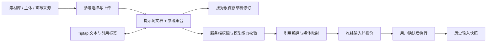

# 多参考提示词编辑器调研与设计

调研日期：2026-10-14。方法：使用 pm-market-research 的 competitor-analysis 工作流，对 Tiptap 及五个替代编辑器进行官方资料比较，再检查织光现有代码。本文区分“公开事实”“方案判断”“待实测”；产品行为唯一来源是[多参考提示词编辑器需求](../requirement/02-多参考提示词编辑器需求.md)。本文技术设计为候选，尚未安装依赖或实现。

## 1. 结论与研究范围

推荐采用 **Tiptap 开源 Editor + 自定义 Reference 节点 + Suggestion 候选交互 + 现有 shadcn/Radix 组件**，构建织光多参考提示词编辑器。决定性因素是行内语义节点、可控 UI、JSON 持久化和现有 React/Next.js 体系的匹配；不是因为产品名称中有 AI。

市场范围是可嵌入创作产品的 Web 编辑器组件，不是办公文档 SaaS。使用者分为创作者与负责集成的工程团队；选择成功与否主要取决于引用身份正确性、输入法/剪贴板、扩展成本、授权方式和数据可控性。本次没有可信市场规模、份额、融资或用户留存数据，这些信息也不决定当前组件选型，因此不作估算。竞争定位与开发成本均为基于文档的定性判断，不是基准测试结果。

即梦是项目既定交互方向；本轮没有登录操作即梦或核验其所有界面细节。场景依据使用火山方舟官方参考生成文档，而不把模型 API、即梦消费端 UI 与织光现有能力混为一谈。官方指南强调对不同素材及其元素明确指代，并区分参考、编辑与延长的表达，这支持“正文引用必须与具体输入一一对应”的需求。[Seedance 提示词指南](https://docs.volcengine.com/docs/ark/seedance-2-0-prompt-guide?lang=zh&redirect=1)

## 2. 组件竞争比较

Tiptap 为首选基准，以下五项是同一嵌入式编辑任务的替代方案。全部都能扩展，并非只有 Tiptap 能实现引用。

| 方案与定位                       | 官方已证实能力                                                                                                                                            | 对织光的优势与限制（判断）                                                                     | 授权/商业模式                                                                                               | 结论                   |
| -------------------------------- | --------------------------------------------------------------------------------------------------------------------------------------------------------- | ---------------------------------------------------------------------------------------------- | ----------------------------------------------------------------------------------------------------------- | ---------------------- |
| Tiptap：无预设 UI 的扩展式编辑器 | Mention、Suggestion、自定义 NodeView、JSON；[产品](https://tiptap.dev/product/editor)、[Mention](https://tiptap.dev/docs/editor/extensions/nodes/mention) | 适合引用标签和项目既有 UI；业务引用、上传、权限仍要自建，需掌握 ProseMirror 事务               | 开源仓库 [MIT](https://github.com/ueberdosis/tiptap/blob/main/LICENSE.md)；平台/高级能力另收费              | 首选                   |
| Lexical：可扩展编辑器框架        | 自定义 TextNode/DecoratorNode 与序列化；[节点](https://lexical.dev/docs/concepts/nodes)                                                                   | 可构建轻量提示词输入；要自行组合搜索、引用菜单及业务节点行为，当前没有足够收益推翻 Tiptap 偏好 | 核心 [MIT](https://github.com/facebook/lexical/blob/main/LICENSE)，框架不是托管业务服务                     | 首要备选               |
| Slate：高度可定制的编辑框架      | inline/void 与 Mention 建模；[Element](https://docs.slatejs.org/api/nodes/element)                                                                        | React 自定义自由度高；需负责更多规范化、选区与边界行为，收益依赖团队经验                       | 核心 [MIT](https://github.com/ianstormtaylor/slate/blob/main/License.md)                                    | 有 Slate 积累时可选    |
| BlockNote：块式文档编辑器        | 自定义行内内容与 Mention 示例；[Inline Content](https://www.blocknotejs.org/docs/features/custom-schemas/custom-inline-content)                           | 适合长文档与块操作；紧凑提示词区不需要其主要块式交互，要调整默认体验                           | 核心 MPL-2.0，XL 功能另有 GPL/商业许可；[价格与许可说明](https://www.blocknotejs.org/pricing)               | 更适合后续剧本文档场景 |
| CKEditor 5：完整商业文档编辑器   | Mention feed、候选渲染和转换扩展；[Mentions](https://ckeditor.com/docs/ckeditor5/latest/features/mentions.html)                                           | 完整文档功能与商业支持较匹配办公需求；织光仍须自建媒体引用语义，当前功能重心不匹配             | GPL 2+ 或商业许可；Free Plan 属商业许可；[官方许可](https://ckeditor.com/legal/ckeditor-licensing-options/) | 本轮不选               |
| Quill：模块化富文本编辑器        | Parchment/Blot 内容扩展与自定义模块；[Customization](https://quilljs.com/docs/customization)                                                              | 常规富文本输入可用；复杂引用节点、React 交互和业务序列化需额外集成                             | [BSD 三条款许可](https://github.com/slab/quill/blob/main/LICENSE)，社区核心                                 | 本轮不选               |

开源框架主要通过开发者文档和包生态采用；Tiptap、BlockNote、CKEditor 的付费产品增加托管、高级功能或支持。成本比较应计入节点开发、跨浏览器维护和供应商适配，不能仅按软件订阅费衡量。未实际测量包体或开发时间，不给虚构性能排名。

Tiptap 官网价格页本次显示平台月付 Start $49、Team $149、Business $999，Enterprise 询价；这是平台方案报价，并不等于开源 Editor 的使用费，也不保证这些方案包含所有附加能力。本需求推荐只用开源能力，不采购平台。未来需要协同、评论、导出或 AI Toolkit 时，重新核对对应包许可与当时价格。[官方价格](https://tiptap.dev/pricing)

织光的差异化应放在“引用可解释、不同模型可验证、历史可回放”，而不是重复实现通用富文本工具栏。未来 12～18 个月的主要技术风险是模型输入合同变化、编辑器扩展升级和自定义节点格式锁定；用版本化业务数据、确定性编译与往返测试控制，现阶段不引入第二个编辑器抽象或双引擎兼容层。

## 3. Tiptap 能力与缺口

| 需求能力         | 可采用的机制与证据                                                                                                                        | 必须由织光补齐                                                |
| ---------------- | ----------------------------------------------------------------------------------------------------------------------------------------- | ------------------------------------------------------------- |
| `@` 与候选选择   | [Mention](https://tiptap.dev/docs/editor/extensions/nodes/mention)、[Suggestion](https://tiptap.dev/docs/editor/api/utilities/suggestion) | 项目/主体检索、权限、过滤、错误态、候选可访问性与光标恢复     |
| 带状态的行内标签 | [React NodeView](https://tiptap.dev/docs/editor/extensions/custom-extensions/node-views/react)                                            | 稳定 referenceId、类型/名称/失效态、删除/替换/定位行为        |
| 文档保存和恢复   | [JSON/HTML 输出](https://tiptap.dev/docs/guides/output-json-html)                                                                         | 版本、引用集合、原子修订、冲突处理和历史快照                  |
| 文件拖入/粘贴    | [FileHandler](https://tiptap.dev/docs/editor/extensions/functionality/filehandler) 仅处理事件，不提供服务器上传                           | 现有媒体上传链路、进度/重试、校验、临时引用替换与迟到回执治理 |
| Next.js 集成     | [Next.js 官方集成示例](https://tiptap.dev/docs/editor/getting-started/install/nextjs) 建议 `immediatelyRender: false`                     | 客户端编辑边界、加载占位、当前 React/Next.js 版本的集成验证   |
| 模型输入         | 以上文档没有提供织光供应商输入合同                                                                                                        | 业务编译、媒体排序、角色映射、报价绑定、权限和幂等执行        |

Suggestion 当前在线文档包含异步候选和取消机制，但不能假定任意旧包都有同样 API。实施时锁定同一兼容版本的 Tiptap 包，检查对应发布版本，不照抄在线最新示例。NodeView 是编辑器内渲染机制，不自动定义复制到外部的文本/HTML或供应商序列化。

建议自定义 `reference` 行内原子节点，并复用 Suggestion 的触发与候选基础机制；Mention 用于验证交互和实现参考，不直接把“用户提及”的默认字段当作完整媒体合同。仅注册 Document、Paragraph、Text、HardBreak、撤销重做、Placeholder 和业务引用等所需能力；具体包名、版本和最低集合在技术验证中确定，不直接安装全功能模板。

## 4. 当前仓库事实

以下为 2026-10-14 只读源码检查，不是运行验收。仓库当时位于 `main`，有大量已有文档整理与其他修改；本次不回滚这些内容。

| 位置                                                                                   | 观察                                                                                | 与目标差异                                                                          |
| -------------------------------------------------------------------------------------- | ----------------------------------------------------------------------------------- | ----------------------------------------------------------------------------------- |
| [package.json](../../frontend/package.json)                                            | Next.js 16.3.6、React 19.2.8，未声明 Tiptap                                         | 尚无编辑器依赖或兼容性验证                                                          |
| [GenerationComposer](../../frontend/src/components/generation/generation-composer.tsx) | 字符串状态与 InputGroupTextarea；`@` 按钮进入主体选择                               | 没有正文行内引用，提交入口以非空文本判断                                            |
| [GenerationDialog](../../frontend/src/components/generation/generation-dialog.tsx)     | 提示词字符串和 `media_inputs` 分开维护；主体描述拼入文本、参考图加入媒体集合        | 有参考输入基础，但没有结构化正文绑定；`key={mode}` 重建表单需特别审查切换时草稿保持 |
| [画布草稿](../../frontend/src/app/canvas/_components/editor-state.ts)                  | Draft 保存 prompt、negative_prompt、aspect_ratio、candidate_count                   | 需要扩展草稿序列化与修订检查，不能只替换可见输入框                                  |
| [报价 HTTP 合同](../../backend/internal/operation/adapter/http/handler.go)             | `QuoteItemRequest` 接收 prompt 与有序 role/media_asset_id；包含独立 prompt_template | 没有多参考编辑文档、绑定表与编译版本字段                                            |
| [提示词准备](../../backend/internal/operation/application/quote_prompt.go)             | 已有模板编译与准备证据绑定                                                          | 新引用编译应明确与模板处理顺序，复用现有业务边界，不能绕开或重复建立提交入口        |

现有媒体列表与有序合同不是“完全不支持参考”；缺口在于正文身份、草稿持久化与实际提交的一致性。本轮未查询模型配置、账号开通状态或数据库，不声称当前服务可运行全能参考。

## 5. 候选组件与模块边界



| 组件职责（候选名称） | 输入/输出与边界                                                                          |
| -------------------- | ---------------------------------------------------------------------------------------- |
| PromptEditor         | 编辑结构化正文，发出事务；不负责上传、查询所有素材或直接调用生成                         |
| ReferenceToken       | 展示并定位绑定；由当前可访问状态渲染；不自行保存 URL 或加载播放器                        |
| ReferencePicker      | 当前范围内素材/主体候选、搜索、类型过滤和选择；复用已有媒体/主体合同                     |
| ReferenceTray        | 本次参考卡片、顺序、具名槽位、状态、替换与移除                                           |
| ReferencePreview     | 授权后的预览，视频/音频按需加载并可停止                                                  |
| ComposerDraft        | 同一草稿修订内协调正文、绑定表、模式和参数；管理保存与恢复                               |
| 引用编译职责         | 由现有后端 prompt/operation 业务边界承载；按能力快照解析引用并冻结执行输入，不新建微服务 |

共享实现位置优先落在现有 `frontend/src/components/generation/`，页面专用接入留在页面目录；只有真实复用需求出现时再拆更小 feature。shadcn/Radix 提供 Dialog/Popover/Button/列表等 UI 原语；不把 cmdk 或第三方完整编辑器模板当作必装依赖。候选弹层与编辑器选区需共同验证，直接复用 Popover 不代表焦点行为天然正确。

## 6. 候选数据合同

需求对应 DR-REF-01～07。下列字段表达设计意图，不是已经存在的 API、数据库字段或迁移脚本。

| 对象         | 候选字段                                                                                               | 关键约束                                                   |
| ------------ | ------------------------------------------------------------------------------------------------------ | ---------------------------------------------------------- |
| 草稿         | schemaVersion、revision、scope、modelVersion、mode、document、references、params                       | scope 含所属空间/项目/创作对象，服务端从身份与对象重新核验 |
| 正文引用节点 | type=reference，attrs.referenceId                                                                      | referenceId 关联绑定；名称与序号由绑定派生，不存成资源身份 |
| 引用绑定     | id、sourceKind、sourceId、sourceVersion、mediaKind、role、displayLabel、order                          | 稳定身份；异步状态是可刷新的业务状态，不由文档自行证明有效 |
| 主体展开     | subjectId/version、选定描述、实际媒体版本列表、来源映射                                                | 确定性展开、权限检查、底层输入去重与数量核验               |
| 冻结输入     | 原文档、绑定快照、compiledPrompt、orderedMediaInputs、referenceMap、compilerVersion、capabilityVersion | 与本次报价绑定，既可重放也可解释实际发送内容               |

正文示意：

```json
{
  "type": "doc",
  "content": [
    {
      "type": "paragraph",
      "content": [
        { "type": "text", "text": "让" },
        { "type": "reference", "attrs": { "referenceId": "ref-person" } },
        { "type": "text", "text": "走进" },
        { "type": "reference", "attrs": { "referenceId": "ref-scene" } }
      ]
    }
  ]
}
```

这里的 ID 是示例。文档允许出现多处相同 referenceId；素材集合按绑定去重，供应商输出再按“媒体版本 + 输入角色”及其合同判断是否可合并。不同首尾帧槽位即使使用同一底图也保留角色；主体展开与直接引用共用同一底图时，保留多来源到同一物理输入的映射。

显示序号可以稀疏而保持稳定，例如删除图片1后仍有图片2；供应商可能要求连续编号。必须遍历结构化节点生成实际文字，并把图片2绑定转换成对应供应商槽位，同时更新输入摘要映射。不能对全文做字符串替换，避免修改用户手写“图片2”或误改普通数字。

## 7. 编译、保存与接口方向

编译次序建议为：校验文档结构与修订 → 验证引用和来源权限 → 冻结主体展开 → 获取模型/模式能力 → 校验所有启用参考和组合 → 按稳定顺序生成实际媒体列表与映射 → 遍历节点生成文本 → 完成最终长度/角色/模板一致性校验 → 冻结报价输入。

供应商适配器决定实际指代语法、媒体顺序和角色；界面中的 `@图片1` 不是通用 API 语法。已有模板编译必须在语义引用仍可追踪时处理，或在编译后验证映射完整；不能让模板二次修改已冻结文本。首尾帧槽位始终独立映射，不能从自然语言推断。

服务端应成为最终编译权威；前端生成的摘要只是预览，报价返回服务端确认的输入供用户检查。优先扩展现有草稿、报价与历史合同：新请求携带版本化文档与参考集合，旧纯文本请求保持明确的读取/过渡路径。新旧字段同时出现却不一致时拒绝，不能随意选一个。具体字段和迁移在设计接受后定义，不手改生成的前端 API 文件。

保存正文与参考集合使用同一草稿修订；媒体处理回执先验证所属草稿及临时绑定仍存在，再应用事务。将引用增删、媒体集合变更和撤销视为同一用户操作；只依赖编辑器自身文字 history，不能保证外部卡片同步撤销。网络上传本身不被撤销“回滚”，撤销的是本次引用关系，已上传原件按素材生命周期处理。

历史旧文档按版本读取，不运行文本正则自动找引用；读取失败不自动写回空文档。现有数据库增量更新、草稿版本迁移和纯文本兼容路径另行审阅，不能重放 Schema 或批量改写旧业务数据。

## 8. 风险与验证安排

| 风险                               | 设计措施                                       | 必须取得的证据                                                    |
| ---------------------------------- | ---------------------------------------------- | ----------------------------------------------------------------- |
| 中文输入法、原子节点边界与手机选区 | composition 期间抑制业务快捷键；明确整节点操作 | Chromium/Firefox/Safari、iOS/Android 实际输入与粘贴；AC-REF-01/13 |
| 弹层夺焦点、画布快捷键冲突         | 保存/恢复选区，编辑焦点内隔离画布操作          | 弹窗、画布浮层、软键盘与短屏验证                                  |
| 异步回执导致引用串稿               | 草稿身份、修订与取消/过期结果检查              | AC-REF-02/08/10 的确定性竞态用例                                  |
| 卡片和正文两份状态失配             | 原子事务、统一绑定表、跨状态撤销               | AC-REF-03/04/05；保存往返与连续撤销                               |
| 显示引用和实际模型输入不一致       | 服务端结构化编译、映射表、冻结报价             | AC-REF-07/11/14；不以文本快照单测替代供应商验收                   |
| 未知节点/跨项目粘贴导致误读        | 版本校验、属性白名单、服务端对象权限           | AC-REF-09/10，包括伪造 ID、旧 schema 和撤权                       |
| React NodeView 数量导致重渲染      | 按需加载编辑器，缩小订阅，预览不常驻标签       | 规定负载下记录输入延迟与包体，不先宣称轻量                        |
| 模型或库升级改变行为               | 包版本和能力版本固定，升级执行往返/编译回归    | 实际锁定版本的兼容性与升级测试                                    |

后续顺序建议：先对本文设计评审；再用最小技术验证完成中文输入、多个引用、删除撤销、JSON 往返和映射；验证通过后接入草稿与服务端报价；最后覆盖入口、响应式与真实供应商。该顺序不削减需求，也不预先承诺工期。本轮已完成官方资料核验和源码检查；未进行性能、浏览器、数据库或真实生成验收。
