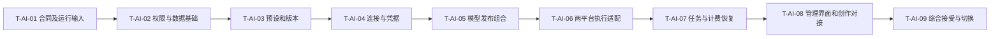

# AI 平台接入与预设管理实施计划

更新：2026-10-18。用户已授权实现；T-AI-02～T-AI-08 主要代码已落地并完成分层本地验证，T-AI-01 的账号/模型/预算及 T-AI-09 的真实供应商接受和发布仍未完成。供应商 Key 只由用户在网页配置。证据、部署步骤和限制见[实施验证与上线手册](11-AI平台接入实施验证与上线手册.md)。

上游：[需求04](../requirement/04-AI平台接入与预设管理需求.md) → [设计07](../design/07-AI平台接入市场调研与架构设计.md) → [PRD03](../prd/03-AI平台接入与预设管理.md)。用户已确认首轮平台管理员统一配置 Key，接入火山引擎及 OpenRouter。本计划不再将 BYOK 或 BytePlus 列为待定首轮范围。

## 1. 迭代规划与交付基线（2026-10-20）

| 规划项     | 本文结论                                                                                                                                      |
| ---------- | --------------------------------------------------------------------------------------------------------------------------------------------- |
| 目标       | 平台管理员从预设配置连接、模型与发布，创作者只使用经过验证且可恢复结算的真实能力。                                                            |
| 适用范围   | 火山方舟与OpenRouter首轮接入；T-AI-02～T-AI-08既有实现保留，T-AI-01实际账号输入与T-AI-09真实接受仍需补齐。                                    |
| 周期与容量 | 未提供已确认迭代周期、人员可用性、最近三轮速率及故事估算；本次不新增时间或容量承诺。共用[容量与就绪口径](00-Plan导航.md#容量与故事就绪口径)。 |
| 缓冲与剩余 | 15%～20%仅为模板建议，未确定本轮比例；可承诺容量、故事总估算及未分配量尚不可计算。                                                            |
| 责任与状态 | 未新增或推定负责人；下表是对既有范围的故事归组，历史实现及接受仍以原任务和证据为准，不是已确认的新迭代承诺。                                  |

### 1.1 故事、范围与任务承接

| 故事     | 用户可验收的结果                                 | 原任务或证据落点         | 依赖及就绪限制                                     |
| -------- | ------------------------------------------------ | ------------------------ | -------------------------------------------------- |
| ST-AI-01 | 管理员安全维护预设和连接，网页Key可轮换且不泄漏  | T-AI-02～T-AI-04         | T-AI-01协议、平台权限及版本数据                    |
| ST-AI-02 | 真实模型、价格与发布组合经逐模式验证后启用       | T-AI-05、T-AI-06         | ST-AI-01、实际账号权限与供应商合同                 |
| ST-AI-03 | 创作者执行和恢复使用原绑定，结果转存与账单可追踪 | T-AI-07、T-AI-08         | ST-AI-02、媒体及预算合同                           |
| ST-AI-04 | 真实供应商及业务历史完成接受，切换可回退         | T-AI-01运行输入、T-AI-09 | T-AI-02～T-AI-08、实际模型/样本/预算、迁移恢复条件 |

故事优先级沿来源需求和原任务依赖，不因本次排列重新定级。接受条件沿原任务引用的 AC／QA；现有工程实现不因容量数据缺失被回退为未实现，但缺估算、责任或外部条件的剩余范围不自动列入新承诺。实际选入时先核对就绪条件，再从高优先级故事选择，达到容量停止；未选范围留待办，不重复计入跨计划的同一工作。

### 1.2 顺序、关键依赖与风险

沿原T-AI-01 → T-AI-02 → T-AI-03 → T-AI-04 → T-AI-05 → T-AI-06 → T-AI-07 → T-AI-08 → T-AI-09；协议开发可用fixture，但T-AI-09真实接受的路径不能被fixture跳过。

上述为依赖链与候选关键路径；缺少工时和资源日历，不能据此计算最长工期。外部依赖负责人和关键知识备份未在原记录明确的，纳入迭代前落实，不臆造人员。

| 风险与触发条件             | 对用户或交付的影响 | 应对及承接位置                                                 |
| -------------------------- | ------------------ | -------------------------------------------------------------- |
| 账号模型、价单或预算未具备 | 真实执行故事未就绪 | T-AI-01明确实际输入与授权样本；不为测Key发收费生成             |
| 结果未知、缺用量或Key撤销  | 重复派发或错误结算 | T-AI-07使用原绑定恢复，未知保留核对；T-AI-09验证实际依赖与账单 |

### 1.3 完成标准、证据与待决

完成标准仍是对应故事的 AC／QA 和原任务退出条件。工程、模拟、真实数据库、浏览器、真实第三方、产品接受及发布逐层记录；本次只整理文档，没有重新执行历史验证、迁移或真实调用。

证据入口：本文件任务状态表、第6节与计划11实施手册；模拟浏览器、协议契约及真实供应商接受不相互替代。

剩余规划缺口：迭代周期、实际成员/可用性、可比历史速率或理想工时估算、缓冲预算、故事负责人及逐条就绪结论。由实际规划与交付职责在选入迭代前补齐；无资料时保留未知，不填零或虚构“已承诺”。下文“当前”“本轮”“未提交”等沿用原记录时点，不能用作本次Git或运行状态证明。

## 2. 依赖与顺序

可先用明确标识的 fixture 开发管理界面，但必须等真实合同就绪后联调；fixture 不作为 T-AI-06/T-AI-09 完成证据。不要求创建独立工作线程或使用多代理。本模块依赖用户系统的平台管理员能力、既有素材授权/转存和预算事务；与编辑器共享模型能力及报价合同，禁止重建第二套引用/提交协议。

| 任务    | 交付结果                             | 依赖                         | 状态                                |
| ------- | ------------------------------------ | ---------------------------- | ----------------------------------- |
| T-AI-01 | 精确协议/模型/价格/执行端输入清单    | 已确认产品范围               | 协议/执行端已实现；真实账号输入待补 |
| T-AI-02 | 平台权限、增量数据和迁移兼容         | T-AI-01、用户系统权限合同    | 代码及隔离迁移通过；业务历史待演练  |
| T-AI-03 | 内置/自定义预设版本管理              | T-AI-02                      | 代码及隔离测试通过                  |
| T-AI-04 | 可恢复连接、Key 与分项检查           | T-AI-03                      | 代码及隔离测试通过；真实 Key 待配置 |
| T-AI-05 | 模型/价格/验证/上线发布组合          | T-AI-04                      | 代码及隔离测试通过                  |
| T-AI-06 | 火山视频与 OpenRouter 三类协议执行   | T-AI-05、确认的活动执行端    | 协议契约通过；真实调用待验收        |
| T-AI-07 | 冻结、派发、未知恢复、转存与结算     | T-AI-06                      | 隔离用例通过；完整媒体依赖待验收    |
| T-AI-08 | 完整管理 UI、默认模型及创作安全目录  | T-AI-03～T-AI-07、编辑器合同 | 页面/合同/模拟浏览器通过            |
| T-AI-09 | 隔离库/浏览器/真实链路接受和切换回退 | T-AI-02～T-AI-08             | 本地验证部分完成；未发布            |

## 3. 任务定义

以下保留原任务与退出条件，不将代码完成改写成产品接受。原设计中标“拟新增”的路径，以本轮手册列出的实际实现为准。

### 3.1 T-AI-01：固定协议与运行输入

目标：把平台名称转换为可执行、可验收的合同，不凭预设展示就宣称接入。

- 阅读/复核：设计07第3、4节；[活动合同](../../backend/internal/operation/adapter/workflow/provider_contract.go)、[凭据注册表](../../backend/internal/catalog/adapter/credentialschema/registry.go)、[worker](../../backend/internal/app/worker.go)、[Wire 入口](../../backend/internal/app/wire.go)。核实实际 provider 活动由哪个仓库/进程注册、队列、构建版本和网络环境；本仓库未发现完整实现不能推定不存在外部 worker。
- 明确四条基线：火山 Seedance 视频、OpenRouter 文本/图像/视频。每条填写实际 model ID、模式、端点、鉴权、请求/响应/状态/错误、取消/回调/幂等证据、媒体结果处理及计费单位；模型 ID 是实际运行输入，不能在模板用占位值伪装可用。
- 固定真实接受样本与预算上限、上游价单/平台价规则、账号区域；Key 通过平台安全界面录入，不写进文档或 fixture。免费探测合同不明确就用 unsupported；不为检查 Key 发收费生成。
- 补充受控合同样本（拟新增测试 fixture，不含秘密）：同步文本、同步图片、异步视频 accepted/query、取消不生效、超时未知、认证/额度/频率错误；公开能力目录不作为账号权限证据。

验证/退出：逐条对照官方一手文档和账号开通信息，未知项目有明确关闭策略；执行端归属和新增代码落点已固定。若某能力不可开通，记录阻断并保持该项未完成，不修改首轮目标假装已完成。对应 FR-AI-02/06/07/15/16。

### 3.2 T-AI-02：平台权限、版本数据与迁移基础

落点：[catalog domain](../../backend/internal/catalog/domain/provider.go)、[model registry](../../backend/internal/catalog/domain/model_registry.go)、[存储](../../backend/internal/catalog/adapter/postgres/store.go)、[管理员校验](../../backend/internal/catalog/adapter/postgres/set_credential.go)、[schema.sql](../../backend/db/schema.sql)；拟新增 catalog 内预设/配置版本/release/检查记录存储及独立审阅增量 SQL。与正在进行的身份迁移协调编号，不覆盖其他迁移。

先写失败用例：团队管理员调用平台管理被拒；事务前管理员撤权后写入被拒；初始 disabled 连接可保存；跨连接版本引用被拒；并发回填/重跑不重复建版本；历史任务外键保持。

实施步骤：

1. 接入用户系统的平台管理权限，在 application 与事务内复核；审计采用新的平台作用域合同，不伪造用户 org。
2. 按设计07第6.2节建立预设版本、连接配置版本、检查/候选/验证、release/default；保留既有 Provider/Model/Price ID，补唯一键、外键、状态与 revision 约束。
3. 明确锁序、幂等回执和安全错误合同；Key 写入回执不含秘密。后续各任务沿用同一机制。
4. 隔离库演练增量与 legacy 回填、重复运行、回退读取；不将历史连接自动命名成火山/OpenRouter 或伪造验证状态。

退出：权限矩阵与数据约束测试通过，迁移报告证明关联/历史未丢失；现有程序与新 worker 的兼容边界写明。对应 AC-AI-12/14/20，DR-AI-01～DR-AI-04。

### 3.3 T-AI-03：预设库与版本管理

落点：catalog 内拟新增 `domain/provider_preset.go`、application 预设命令/查询、postgres 存储；扩展 [admin Handler](../../backend/internal/catalog/adapter/http/admin.go)，新增两份经过审核的内置非秘密预设。测试进入 [tests/catalog](../../backend/tests/catalog)。

先写失败用例：内置原件修改、重复 slug、未知协议/脚本、恶意 URL、含秘密导出、发布旧草稿 hash、并发升级覆盖、引用对象硬删、导入旧预览均被拒。

实施步骤：

1. CRUD 草稿、派生复制、不可变版本发布；官方火山/OpenRouter 模板只含已支持协议。
2. 三方差异计算（旧预设/新预设/本地覆盖），preview 哈希绑定目标与 revision；应用重新校验并创建新配置版本。
3. 归档、紧急停用与恢复分别处理；归档只阻止新采用，紧急停用由 T-AI-07 在派发边界执行。
4. 导入预览、提交与无秘密导出；schema version、大小/数量限制、重复键和未知字段校验；单次导入事务原子完成，不留下半份预设。

退出：保存读回与版本差异可核对；已有连接不被模板更新改写，导出内容审计通过。对应 AC-AI-01/04/05/18。

### 3.4 T-AI-04：连接、Key 轮换与非生成检查

落点：现有 create/update_provider、set/disable_credential、[credential schema](../../backend/internal/catalog/adapter/credentialschema/registry.go)、[credential workflow](../../backend/internal/catalog/adapter/workflow/workflow.go)、[credential seal](../../backend/internal/catalog/adapter/credentialseal/sealer.go)及 postgres/HTTP；拟新增配置请求回执、检查结果及发现候选查询。

先写失败用例：丢创建回执再试产生第二连接、丢 Key 回执再次轮换、disabled 连接无法测试、旧检查覆盖新 Key 健康、Key 跨新域名自动发送、只有目录成功便认定鉴权成功、非平台管理员发现模型。

实施步骤：

1. 连接创建保持 disabled，保存精确配置快照；只读详情返回可恢复的向导进度和安全 Key 摘要。
2. 正常轮换旧版变 draining，新版 active；撤销旧版 disabled。现有唯一 active 索引保留语义，补 draining 与绑定恢复入口。
3. 免费检查分项返回 adapter/auth/discovery 结果；OpenRouter 当前 Key 与目录分开调用；火山采用 T-AI-01 确认的安全探测或 unsupported。
4. 结果绑定配置/credential ID，旧结果保留记录但不覆盖新配置状态；测试/发现支持 GET 进度与超时，限并发，遵守 Retry-After。
5. 非秘密请求回执支撑刷新/响应未知恢复；创建与 Key 写入分步。跨端点变更重新录 Key，拒绝复用旧秘密。

退出：从内置预设到未启用连接/模型候选可完成并恢复；日志、缓存、回执、导出、浏览器本地存储无 Key。对应 AC-AI-02/03/06/07/13/17。

### 3.5 T-AI-05：模型配置、价格与上线发布组合

落点：现有 create_model、publish_model_version、publish_price_rule、set_model_status、[参数校验](../../backend/internal/catalog/adapter/paramvalidation/validator.go)、[价格校验](../../backend/internal/catalog/adapter/pricevalidation/validator.go)、目录查询；拟新增 model_release、validation 与 capability_default 消费方命令。

先写失败用例：保存 v2 影响 active v1；不同连接的 model/config 拼成 release；默认值超限、未声明参数、端点能力并集误用；价格币种/单位不匹配；缺验证激活；已停用模型仍成为默认；同时激活两个版本覆盖。

实施步骤：

1. 候选模型人工确认后建立 disabled ModelProfile；映射现有 ParamSchema 数组及 Limits，显式声明角色、媒体种类、数量/组合/尺寸/时长。
2. 模型/价格版本保存与上线解耦；release 原子绑定 model/config/price 及验证模式，公开目录只读 active release。
3. 试运行报价针对未上线候选，限定平台管理员、合法素材与预算；确认进入既有 operation，不暴露普通用户绕过发布的入口。
4. 激活检查执行器、凭据状态、价格和验证覆盖；当前默认项变化显式提交，不自动取“最新模型+最新价格”。
5. 新参数或协议版本使对应验证失效，价格变动重新报价；名称改动不强制重新付费试运行。

退出：完整候选→验证→启用→下架/回退可核对；无“保存即切换”；默认项和公开目录不泄露连接秘密。对应 AC-AI-07/08/09/14/15/16/19/20。

### 3.6 T-AI-06：两平台适配器与协议契约

落点：T-AI-01 确定的实际执行端。若本仓库承担执行，在 `backend/internal/operation/adapter/` 下按已存在模块边界新增火山和 OpenRouter 协议实现并显式注入；若已有外部 worker，则修改其真实拥有者并在本仓库维护合同。不要在两端各写一份转换器；T-AI-01 未确定前不预建目录。消费方接口与注册表遵循设计第5节。

先写失败用例：把视频响应当文本；将 OpenRouter 图片 base64 当 URL；错误使用目录并集；不支持的取消返回成功；POST 超时自动重试；上游 200 内含失败；下载重定向泄露鉴权头；异常图片类型/体积绕过检查。

实施步骤：

1. 火山视频：校验引用与参数→提交→任务 ID→查询/状态映射→结果获取；按 T-AI-01 合同实现有限取消；模型/模式约束不写死在 UI。
2. OpenRouter 文本：实现已核验 Chat Completions 非流式合同、错误与 token/费用记录；不引入新聊天页面或工具调用执行系统。
3. OpenRouter 图像：按专用 Image API 转换和解码，校验媒体格式/大小，形成受控结果/回执；复核既有 image_calls.go 的回执语义，不伪装为 Codex 图片收费。
4. OpenRouter 视频：独立提交/查询/content 下载；凭据只发合法原站，结果跨域下载不携带该 Key；未证实取消能力关闭。
5. 注册 adapter+capability 协议，运行时报告可执行版本。健康检查不可单凭配置注册表存在而成功。

退出：四套脱敏协议 fixture、错误矩阵与安全网络用例通过；证据只能称契约适配，真实账号接受在 T-AI-09。对应 AC-AI-02/06/08/11/15/16。

### 3.7 T-AI-07：派发、恢复、转存与结算

落点：[provider calls](../../backend/internal/operation/adapter/workflow/provider_calls.go)、[image calls](../../backend/internal/operation/adapter/workflow/image_calls.go)、[dispatch](../../backend/internal/operation/adapter/postgres/provider_dispatch.go)、quote_catalog/工作流加载、既有 media 转存与 billing 预留/结算；与编辑器计划 T-REF-05 的报价/确认合同协调。

先写失败用例：停用与确认竞态；上游已接收但丢回执被再次提交；两个回调重复扣费；轮换后历史任务失去查询；draining Key 被新任务使用；未知任务因自动超时退款后重新生成；转存失败再次收费。

实施步骤：

1. quote/confirm 冻结 release/config/model/price；提交准备绑定 active credential。资格检查与派发许可在短事务内一致，停用先完成则不派发。
2. provider.submit 返回确定的 accepted/completed/rejected/not_submitted/unknown，按同步/异步分别处理；未知响应不自动重试或换平台。
3. 任务绑定恢复可以使用 draining 凭据，撤销则停止所有调用；查询依据原任务 ID/账号配置，不根据当前默认连接重建目标。
4. 回调验签、时效/任务绑定、幂等；未核实签名的回调仅触发主动查询。首轮可先用轮询完成可靠接受，不把无验证的回调当终态。
5. 成功结果转存失败只重试转存；记录已产生的上游成本，产品结果完成与供应商成功分开。取消未知/失败按最终事实结算。
6. 非流式文本与同步图片补齐 durable receipt；数据库记录失败后保持不确定，不能仅因内存里有成功结果就再次提交。

退出：隔离依赖故障注入证明同一意图不多派发/多结算，历史任务配置不漂移，禁用/撤销权限有效。对应 AC-AI-03/05/10/11/14/16～19。

### 3.8 T-AI-08：后台管理 UI 与创作接入

落点：[providers 页面](../../frontend/src/app/providers/page.tsx)、[models 页面](../../frontend/src/app/models/page.tsx)、对应拟新增 `_components/` 与详情路由；[创作生成合同目录](../../frontend/src/api)、现有模型选择/报价消费者。遵循 frontend/AGENTS，生成调用不手改。

先写失败用例：无权限页面仍请求秘密摘要；向导刷新重复创建；Key 被自动保存；旧检查回执把新配置显示为通过；切模型丢参考；停用默认项后静默换模型；冲突覆盖编辑内容。

实施步骤：

1. 实现连接/预设页签与模型页的列表、详情、向导、差异预览、导入/导出和错误状态；取数、草稿和 Key 输入状态分开。
2. 模型表单按设计07第7.3节展示输入模式、约束、价格、验证覆盖和上线差异；不要求基础接入用户手写 JSON。
3. 明确“验证连接”不收费与“试运行”会收费；展示预算、未知回执、结果与安全账单摘要，不自动触发试运行。
4. 服务端授权后恢复向导，保留非秘密请求 ID；禁用/轮换/下架/升级展示受影响对象和原子操作结果。
5. 创作者目录只显示可用组合，切换按编辑器既有事务确认；显示不能报价/不可用原因。四类执行可通过现有入口或管理员试运行接受，不为文本接入增设聊天产品。

退出：浏览器验证 390/768/1440 像素宽及 1024×600 短屏，明暗主题、键盘/焦点、刷新、网络延迟、无权限与冲突；没有假数据冒充已接入。对应 AC-AI-01～AC-AI-09、12～16、18～20。

### 3.9 T-AI-09：综合接受、灰度与回退

准备：T-AI-01 模型/模式、合法样本、平台账号、预算与环境已落实，平台管理员身份可用。文档编写结束不代表获得本次收费或发布执行指令。

1. 先在隔离库演练 legacy 回填、部分失败、重复执行和旧任务恢复；核对配置/凭据/模型/默认/任务/账单的引用及数量，不触碰业务数据库。
2. 按第4节逐项执行 AC-AI-01～AC-AI-20，记录版本、输入摘要、预期/实际和未决项；必须使用真实浏览器读回及服务端证据，不能只截图。
3. 四条真实链路各跑一个开通型号的基线模式；声明开放的额外模式另测。核对实际请求/结果类型、媒体转存、账单与平台扣费，收集未知/取消/轮换的可复现证据。
4. 逐连接和 release 灰度启用，先管理员验证，再开放模型目录及默认；错误/费用异常则停新提交，保持任务恢复。监控未知提交、转存失败、权限错误和成本差异。
5. 回退恢复可用旧 release/default；保留数据及兼容 worker。新增状态不兼容旧程序时不得直接回滚进程。恢复不复活撤销 Key，不删账单或正在恢复的任务。

退出：全部 AC 有证据，四条链路实际通过；缺失任何一项明确标未完成。执行人员与用户记录产品接受后方能称完成，不以 CI 绿灯替代。

## 4. 需求到任务与证据追踪

| 需求/接受条件       | 任务                                        | 必要证据                                |
| ------------------- | ------------------------------------------- | --------------------------------------- |
| FR-AI-01 / AC-AI-01 | T-AI-03、T-AI-08                            | 搜索/筛选/未部署状态与权限              |
| FR-AI-02 / AC-AI-02 | T-AI-01、T-AI-04、T-AI-06、T-AI-08、T-AI-09 | 两平台仅填 Key 的正常配置路径及真实能力 |
| FR-AI-03 / AC-AI-03 | T-AI-04、T-AI-07、T-AI-08                   | 同平台多连接隔离、原账号恢复            |
| FR-AI-04 / AC-AI-04 | T-AI-03、T-AI-08                            | CRUD、派生、无秘密导入导出              |
| FR-AI-05 / AC-AI-05 | T-AI-03、T-AI-07、T-AI-08                   | 差异升级/回退/冲突、运行快照不变        |
| FR-AI-06 / AC-AI-06 | T-AI-01、T-AI-04、T-AI-06、T-AI-08          | 分项诊断、普通检查无生成调用            |
| FR-AI-07 / AC-AI-07 | T-AI-04、T-AI-05、T-AI-08                   | 发现候选、手动 ID、未验证不开放         |
| FR-AI-08 / AC-AI-08 | T-AI-05、T-AI-06、T-AI-08                   | 切模型引用/参数检查、准确映射           |
| FR-AI-09 / AC-AI-09 | T-AI-05、T-AI-08                            | 能力默认与固定选择，无静默替换          |
| FR-AI-10 / AC-AI-10 | T-AI-07、T-AI-09                            | 停用/升级/轮换后的原任务恢复            |
| FR-AI-11 / AC-AI-11 | T-AI-06、T-AI-07、T-AI-09                   | 上游已收但响应丢失，不重复派发/结算     |
| FR-AI-12 / AC-AI-12 | T-AI-02、T-AI-04、T-AI-08、T-AI-09          | 越权拒绝、日志/导出安全、指标区分       |
| FR-AI-13 / AC-AI-13 | T-AI-04、T-AI-08                            | 创建与 Key 写入响应丢失后的刷新恢复     |
| FR-AI-14 / AC-AI-14 | T-AI-02、T-AI-05、T-AI-07                   | 保存与启用分离、组合一致与并发控制      |
| FR-AI-15 / AC-AI-15 | T-AI-01、T-AI-05、T-AI-06、T-AI-08          | 参数/引用/端点约束及前置拒绝            |
| FR-AI-16 / AC-AI-16 | T-AI-01、T-AI-05、T-AI-06、T-AI-07、T-AI-09 | 显式确认、预算、候选测试权限、真实费用  |
| FR-AI-17 / AC-AI-17 | T-AI-04、T-AI-07                            | draining/撤销、新旧任务区分             |
| FR-AI-18 / AC-AI-18 | T-AI-03、T-AI-07、T-AI-08                   | 归档与紧急停用的不同后果                |
| FR-AI-19 / AC-AI-19 | T-AI-05、T-AI-07、T-AI-08                   | 默认变更、旧报价确认竞态和费用重新确认  |
| FR-AI-20 / AC-AI-20 | T-AI-02、T-AI-05、T-AI-08、T-AI-09          | 平台/团队管理隔离、公开安全目录         |

BR-AI-01～BR-AI-09分别在状态矩阵、发布与恢复用例中覆盖；DR-AI-01～DR-AI-04在T-AI-02/T-AI-05/T-AI-07核对引用和版本；NFR-AI-01～NFR-AI-05在T-AI-02～T-AI-09验证幂等、限流、网络边界、UI与安全回执。不得通过缩减测试数据将未支持模式标为已接受。

## 5. 检查命令与证据层级

实现与后续变更时：在 `backend/` 对受影响模块运行针对性测试，再执行项目要求的 `go test -race ./...`、`go vet ./...`、`golangci-lint run`、`govulncheck ./...`，并检查 gofmt/goimports。隔离数据库/Temporal等集成测试必须真实配置并确认未跳过；缺依赖时报告未执行。

在 `frontend/` 运行 `pnpm exec eslint .`、`pnpm exec prettier --check .`、`pnpm exec next typegen`、`pnpm exec tsc --noEmit`、`pnpm exec vitest run`、`pnpm exec next build`；按仓库固定 swag/@umijs/openapi 入口重新生成合同并检查路由一致。具体生成命令实施前读取当前工具入口，不新增替代脚本。UI 检查另按 T-AI-08 做真实浏览器验证。

本轮实际执行结果见实施验证与上线手册；缺依赖跳过的集成测试不能算作通过，模拟供应商不作为真实平台证据。

证据层级：文档核验 → 单元/契约 fixture → 隔离存储及工作流 → 浏览器 → 真实供应商与账单 → 产品接受。每层分别记录状态与限制，不能相互替代。

## 6. 2026-10-18 文档与实现复核

修正任务：预设结构化编辑与搜索；可选模型/价格模板的严格校验、原子实例化与幂等；只选预设填Key的分步恢复；平台管理员导航；无权限不发管理请求；文档过时状态。复用现有catalog/operation权限、版本、价格、试运行与回执合同，不新建网关或第二套凭据持久化。

针对性验证覆盖：模板导入拒绝秘密/错误协议或价格；同一请求不生成重复模型；失败事务无残留；新连接不继承验证/启用/默认；连接保存部分失败与未知回执恢复；基础表单不要求URL/slug/JSON；管理员编辑模板及普通账号不可见入口。浏览器使用明确标识的fixture验证，无真实Key、不做收费调用。完成情况与限制追加到手册11。

## 7. 2026-10-18 页面实现补充

按设计07 §12 与 Figma R9 将 `/providers` 重组为连接/预设 Tabs、接入 Dialog、连接详情和预设编辑 Sheet；复用共享 BasicLayout 与顶栏 Command 搜索。桌面使用 Table，手机使用 Item；空态、加载、确认操作与 Key 显隐使用官方 shadcn 原语。连接创建、Key 加密写入、原请求回执、检查轮询、版本预览和权限沿用既有 API，不引入供应商 Key 的浏览器持久化。连接模型入口在模型页标明当前连接的已加载范围，保留现有分页合同。

验收范围为页面交互和原请求恢复回归；真实供应商费用、模型权限、业务库迁移和生产发布仍按计划11分别接受，不因 UI 完成改写其状态。
