# 文件上传与对象存储接入 Implementation Plan

> 执行说明：保留原技术任务与验证步骤；本次按模板补齐规划内容，不要求调用特定技能或改变已约定的执行方式。

**Goal:** 使用三平台官方 SDK、默认 MinIO，沿现有代理上传实现配置切换，保持历史对象与在途任务位置正确。

**Architecture:** 工厂装配薄 SDK 适配器，消费方以小接口和显式 ObjectRef 操作。Postgres 持久保存资源身份、对象位置、接单目标和已激活路由，上传在读 multipart 前固定位置。所有旧读/写/清理路径迁移完成、旧程序排空后才能切换默认。

**Tech Stack:** 现有 Go 1.26.0 / toolchain 1.26.9、Gin、GORM/pgx、Viper、Wire、Temporal；MinIO SDK v7.0.98、COS SDK v0.7.75、TOS SDK v2.9.10；项目现有 OpenAPI/前端工具链仅在接口/交互变化时使用。

**Spec:** [已确认设计08](../design/08-文件上传服务调研与架构设计.md#1-本次先明确的具体设计)，产品边界见 [PRD04](../prd/04-文件上传与对象存储接入.md)，接受条件见 [需求05](../requirement/05-文件上传与对象存储接入需求.md#7-验收矩阵)。更新：2026-10-15。设计已获用户确认，本计划已形成并自审，用户已要求先提交推送本任务文档，随后展开实现，并再次授权提交推送实现检查点；当前进度见第8节。

## 1. 迭代规划与交付基线（2026-10-20）

| 规划项     | 本文结论                                                                                                                                      |
| ---------- | --------------------------------------------------------------------------------------------------------------------------------------------- |
| 目标       | 创作者沿现有代理链路跨MinIO/COS/TOS上传和读取文件，切换配置不改变历史对象或在途任务的位置。                                                   |
| 适用范围   | 首轮T-UP-01～T-UP-08；T-UP-09～T-UP-11直传、容量与上传会话属于后续候选，保持原接受边界和关闭状态。                                            |
| 周期与容量 | 未提供已确认迭代周期、人员可用性、最近三轮速率及故事估算；本次不新增时间或容量承诺。共用[容量与就绪口径](00-Plan导航.md#容量与故事就绪口径)。 |
| 缓冲与剩余 | 15%～20%仅为模板建议，未确定本轮比例；可承诺容量、故事总估算及未分配量尚不可计算。                                                            |
| 责任与状态 | 未新增或推定负责人；下表是对既有范围的故事归组，历史实现及接受仍以原任务和证据为准，不是已确认的新迭代承诺。                                  |

### 1.1 故事、范围与任务承接

| 故事     | 用户可验收的结果                                     | 原任务或证据落点 | 依赖及就绪限制                                 |
| -------- | ---------------------------------------------------- | ---------------- | ---------------------------------------------- |
| ST-UP-01 | 上传开始就固定目标，三平台使用同一可靠定位与错误语义 | T-UP-01～T-UP-04 | 官方SDK、严格配置与位置数据约束                |
| ST-UP-02 | 历史下载、快照、输出、复制与补偿仍找到原对象         | T-UP-05、T-UP-06 | ST-UP-01及全部对象消费者盘点                   |
| ST-UP-03 | 路由只在就绪时激活，真实云和历史数据能切换回退       | T-UP-07、T-UP-08 | ST-UP-02、存量位置回填、旧进程排空及实际云条件 |
| ST-UP-04 | 后续受控直传、分片、容量与会话UI可单独接受           | T-UP-09～T-UP-11 | T-UP-08基线接受与独立范围确认；不计首轮承诺    |

故事优先级沿来源需求和原任务依赖，不因本次排列重新定级。接受条件沿原任务引用的 AC／QA；现有工程实现不因容量数据缺失被回退为未实现，但缺估算、责任或外部条件的剩余范围不自动列入新承诺。实际选入时先核对就绪条件，再从高优先级故事选择，达到容量停止；未选范围留待办，不重复计入跨计划的同一工作。

### 1.2 顺序、关键依赖与风险

沿原T-UP-01 → T-UP-02 → T-UP-03 → T-UP-04 → T-UP-05 → T-UP-06 → T-UP-07 → T-UP-08；T-UP-09 → T-UP-10 → T-UP-11仅后续候选。T-UP-07生产激活必须等待T-UP-08要求的对应就绪/迁移证据，开发任务完成不等于已激活。

上述为依赖链与候选关键路径；缺少工时和资源日历，不能据此计算最长工期。外部依赖负责人和关键知识备份未在原记录明确的，纳入迭代前落实，不臆造人员。

| 风险与触发条件                           | 对用户或交付的影响      | 应对及承接位置                                          |
| ---------------------------------------- | ----------------------- | ------------------------------------------------------- |
| 剩余对象消费者、最终约束或历史回填未覆盖 | 切换后读错位置或误清理  | 按T-UP-05～T-UP-08逐模块盘点，激活继续fail-closed       |
| 真实云/身份上传与并发回退未执行          | SDK与隔离测试被错算上线 | T-UP-08分别关闭真实接受缺口；不自动启用T-UP-09～T-UP-11 |

### 1.3 完成标准、证据与待决

完成标准仍是对应故事的 AC／QA 和原任务退出条件。工程、模拟、真实数据库、浏览器、真实第三方、产品接受及发布逐层记录；本次只整理文档，没有重新执行历史验证、迁移或真实调用。

证据入口：第8节2026-10-15连续实施记录及T-UP-08退出条件；原CI失败、业务库/激活未执行限制保留。

剩余规划缺口：迭代周期、实际成员/可用性、可比历史速率或理想工时估算、缓冲预算、故事负责人及逐条就绪结论。由实际规划与交付职责在选入迭代前补齐；无资料时保留未知，不填零或虚构“已承诺”。下文“当前”“本轮”“未提交”等沿用原记录时点，不能用作本次Git或运行状态证明。

## 2. Global Constraints

- 三平台均使用官方 SDK，初始默认为 `minio-main`；配置选择无效时失败，不静默回落 MinIO 或其他云。
- 沿现有模块和 `adapter → application → domain`；构造函数注入、小接口，不建立独立服务、全局可变 Client 或 Context 内隐藏路由。
- 保留个人/项目代理入口、现有大小/内容/规范化/声明及永久幂等合同。
- 每个对象固定 profile/bucket/key；原件、派生、历史快照和清理各自定位；profile 不可改义，同物理桶不重复起别名。
- 上传在读 multipart 前固定目标；其他输出任务在意图创建时固定。网络调用在事务外执行。
- YAML schema_version=1；默认配置 `mode=relay`。新增配置拒绝未知字段/来源冲突，Key 仅 secret 引用。
- 图像/文档 20 MiB、视频 500 MiB、音频 100 MiB、模型 64 MiB；现有结构、媒体时长和处理限制保持。
- 短签名最大 15 分钟；preview 建议 5 分钟，上传建议 10 分钟；会话 24 小时、分片阈值 32 MiB、分片 8 MiB/并发 3、暂存 48 小时为后续待接受参数，不自动启用。
- 基线私有、扁平、标准且从未开启版本控制的桶；原子写与分片差异分别验证，禁止先 HEAD 后 PUT 模拟原子性。
- 不读取/打印无关凭据，不连接或修改生产资源，不自动提交/推送。每项以 diff 审查代替 skill 默认的自动 commit 步骤，遵循 AGENTS。
- 迁移计划暂用 `008_object_storage_profiles.sql`；执行前重新核对编号，遇并行占用则顺延并同步本计划，不覆盖文件。

## 3. Review Focus

1. 上传正在读取 500 MiB 文件时激活新配置：接单先固定旧 profile，原件/派生/补偿不漂移；由 T-UP-04/T-UP-07 验证。
2. schema 裸 object_key 之外的 Temporal/JSON receipt：旧 payload 正确指向已证明原资源；由 T-UP-03/T-UP-06/T-UP-08 验证，未知不能按默认猜。
3. 相同 object_key 在两个平台：引用、唯一性及物理用量按完整位置区分；由 T-UP-03/T-UP-05 验证，不能保留隐含全局 key 唯一性。
4. Delete 或数据库提交响应丢失后重试：已接受对象不被误删，403 不伪装 missing；由 T-UP-02/T-UP-04/T-UP-06 验证。
5. 旧 profile 被禁用、secret 轮换或滚动部署不齐：有引用/在途/债务时阻止危险激活，不重新绑定当前桶；由 T-UP-01/T-UP-07/T-UP-08 验证。

---

## 4. 依赖与任务边界

```mermaid
flowchart LR
  S0[T-UP-01 配置与协议基线] --> S1[T-UP-02 官方 SDK 与统一合同]
  S1 --> S2[T-UP-03 位置与增量迁移]
  S2 --> S3[T-UP-04 接单固定与代理上传]
  S3 --> S4[T-UP-05 历史读取及占用]
  S4 --> S5[T-UP-06 输出任务与补偿]
  S5 --> S6[T-UP-07 装配 诊断 激活 回退]
  S6 --> S7[T-UP-08 三平台综合接受]
  S7 --> S8[T-UP-09 直传和分片]
  S8 --> S9[T-UP-10 容量预留]
  S9 --> S10[T-UP-11 上传 UI 完整接受]
```

T-UP-01～T-UP-08 交付本次现有代理链路三平台接入；T-UP-09～T-UP-11 保留完整需求扩展的独立任务与接受，未完成前 direct/硬容量限制保持关闭。本计划不把全部 UP-AC 归到一个不具体的“最后验收”。

| 文件组                                            | 责任与改动                                                           |
| ------------------------------------------------- | -------------------------------------------------------------------- |
| platform/config、platform/objectstorage           | YAML/secret 配置、官方 SDK 构造、传输/元数据/错误；不持有租户权限    |
| media/domain、media/application                   | ObjectRef/上传目标、消费方小接口、接单和接受/补偿协调                |
| media/adapter/postgres 与 db 增量                 | 资源/路由/位置、权限事务内接单、回执、历史绑定和约束                 |
| media/adapter/http、workflow、objectstorage       | 保持代理 API，定位映射、媒体执行与业务错误                           |
| operation/script/mediatool/workspace 的对象消费者 | 输出、暂存、复制/转移、脚本、模型、导出、快照和清理固定位置          |
| app 与 cmd/lanverse                               | 各角色装配及受控运维命令，统一激活版本                               |
| backend/tests 与后续 frontend                     | 合同、状态、隔离迁移、切换与真实接受；后续会话和 UI 才触及新前端流程 |

## 5. 主交付任务

### 5.1 T-UP-01：固定 SDK 协议与严格配置

**Files:** 修改 `backend/internal/platform/config/config.go`；新增 `backend/internal/platform/config/object_storage.go`、`backend/tests/config/object_storage_test.go`；修改 `backend/tests/config/config_test.go`、`backend/go.mod`/`go.sum`（依赖安装在计划接受后才执行）；新增无 secret 的 `backend/config/object-storage.example.yaml`。

**Interfaces:** 新增 `config.ObjectStorageConfig`（SchemaVersion/Revision/DefaultWriteProfile/Profiles/Upload/Access/Limits）、`config.StorageProfile` 与 `config.StorageCredentialsRef`；`LoadObjectStorage(path string, env string) (ObjectStorageConfig, error)`；Config 增加 ObjectStorage 字段。SDK 工厂消费该结构，secret 的实际值不进入其可日志化表示。

- [x] 写失败测试 `TestObjectStorageDefaultsToMinIO`：有效 minio-main 且省略默认值时选择它；显式不存在的 COS 默认目标必须失败。
- [x] 写 `TestObjectStorageRejectsUnknownFieldsAndMixedSources`、`TestObjectStorageRejectsDuplicateResourceAlias`、`TestObjectStorageRedactsSecretErrors`：未知字段、YAML 与旧字段同时生效、同桶别名、非法 URI 和错误消息秘密均拒绝；仅声明 MinIO 不要求 COS/TOS Key。
- [x] 运行 `go test ./tests/config -run ObjectStorage -count=1`，确认失败来自未实现的配置行为。
- [x] 实现严格 YAML 和指定 env/file secret 引用，兼容无 YAML 的旧 MinIO 单桶资源身份；固定 COS v0.7.75/TOS v2.9.10，保留 MinIO v7.0.98。明确版本、region、桶域名、token/expiry、HTTPS 和分片预算校验，不求值任意表达式。
- [x] 运行上述测试及 `go test ./tests/config -count=1`；审查 diff，不提交。退出条件：配置错误可定位且不泄密，示例不是已部署资源。

### 5.2 T-UP-02：三套 SDK 与统一定位/错误合同

**Files:** 保留/扩展 `backend/internal/platform/objectstorage/objectstorage.go`、`inventory.go`、`project_copy.go`；新增 `ref.go`、`registry.go`、`minio.go`、`cos.go`、`tos.go`、`errors.go`；新增 `backend/tests/objectstorage/providers_test.go`、`provider_contract_test.go`；修改现有 objectstorage tests 适应显式位置。

**Interfaces:** 传输层新增 `objectstorage.Ref{ProfileID, Bucket, Key}`；`OpenProfiles(config.ObjectStorageConfig) (*Registry, error)`。Registry 提供 `PutIfAbsent(context.Context, Ref, io.Reader, int64, string, string) error`、`Stat(context.Context, Ref) (ObjectInfo,error)`、`Get(context.Context, Ref) (io.ReadCloser,error)`、`Remove(context.Context, Ref) error`、`PresignGet(context.Context, Ref, time.Duration) (AccessGrant,error)`、`ListMetadata(ctx context.Context, profileID, bucket, prefix string, maxItems int) ([]ObjectMetadata,error)`。AccessGrant 为 URL string / ExpiresAt time.Time，消费方显式转换成应用访问授权结构。ObjectMetadata 含完整 Ref；统一 ErrObjectMissing/ErrObjectExists/ErrAccessDenied/ErrUnsupportedCapability/ErrOutcomeUnknown，保留错误链。

迁移期间现有 Open/Client 仅服务明确原 MinIO 的单桶模式，不允许其通过新默认解释裸 key；新多平台流用 Registry/Ref。后续 T-UP-05～T-UP-07 完成所有生产消费者迁移后，启动检查阻止遗漏的裸 key 多平台路径。

- [x] 写 fixture 合同测试：每个平台 SDK 发出正确 method、Host、region/签名头、实际长度、Content-Type、服务端 sha metadata、禁止覆盖；大小写映射一致，ETag 不当摘要。
- [x] 写 `TestProvidersRejectWrongProfileBucket`、`TestProviderErrorMappingDoesNotTreat403AsMissing`、`TestProviderGetMapsDeferredReadErrors`、`TestProviderInventoryRejectsPartialListing`：错误 profile/桶拒绝；403/超时不作 404；Read 时错误可判定；分页或上限失败不返回假完整清单。
- [x] 运行 `go test ./tests/objectstorage -run 'Providers|Provider' -count=1`，确认行为失败；传输层另以 TestProviderZeroLengthControlObject 保留现有脚本控制对象的零长度合同，用户上传空文件仍由 T-UP-04 拒绝。
- [ ] MinIO 沿 SDK 条件写；COS 使用原生 Object.Put/Head/Get/Delete/GetPresignedURL，通过 ObjectPutHeaderOptions.XOptionHeader 设置 x-cos-forbid-overwrite；TOS 使用 PutObjectV2/HeadObjectV2/GetObjectV2/DeleteObjectV2/PreSignedURL，将 ForbidOverwrite 与 metadata 正确映射。SDK 分片使用显式初始化/完成并测试禁止覆盖传播，不手写签名。
- [ ] 运行 `go test ./tests/objectstorage -count=1`，检查取消、reader 关闭和可重放流；真实原子性由 T-UP-08 证明，fixture 不代表实际桶。退出：三 SDK 合同一致，未验证能力不能被诊断报告为生产可用。

### 5.3 T-UP-03：持久位置、约束与隔离增量迁移

**Files:** 新增 `backend/internal/media/domain/object_ref.go`、`backend/internal/media/application/storage_route.go`、`backend/internal/media/adapter/postgres/storage_route.go`、`object_locations.go`、`storage_inventory.go`、`backend/db/migrations/008_object_storage_profiles.sql`（重查编号）；增量更新 `backend/db/schema.sql`，保留其并行编辑。新增 `backend/tests/media/storage_route_integration_test.go`、`storage_migration_integration_test.go`。

**Interfaces:** domain.ObjectRef.Validate() error；应用 `StorageRoute{ProfileID,Revision}`、`ObjectLocation{ID,Ref,Facts,State}`；路由仓库 `ReadActive(ctx context.Context) (StorageRoute,error)`、`Activate(ctx context.Context, expectedRevision, newRevision, profileID string) (StorageRoute,error)`；位置仓库 `ReserveLocation(ctx context.Context, ref domain.ObjectRef) (ObjectLocation,error)`、`ReadLocation(ctx context.Context, id uuid.UUID) (ObjectLocation,error)`。CAS 必须在数据库事务完成，不靠进程 mutex。

- [ ] 写迁移用例：增量重复运行不重复注册；原 profile 不可改义，同资源/桶不同别名拒绝；同 key/不同 profile 允许独立位置；未知历史来源使切换预检失败。
- [ ] 核对全部对象列：media.media_asset/rendition/package_object/project_copy_object/purge_object/transfer_object、mediatool.depth_object、script.object_intent/object_state；源/目标各自定位，并清点 Temporal/JSON receipt 的非列对象引用。
- [ ] 在测试隔离库先跑失败用例 `go test ./tests/media -run 'StorageRoute|StorageMigration' -count=1`；没有隔离条件就保留未验证，不连业务库替代。
- [ ] 创建 storage_profile（唯一资源/桶）、storage_route、object_location 及关联字段；迁移阶段允许未回填，未知位置明确不可用。把依赖裸 key 的唯一键/外键迁到位置合同，保留业务幂等关系；不猜旧资源或批量改键字符串。
- [ ] 对已证明的原 MinIO 注册 minio-main 并逐对象回填，核对数量、引用、摘要/大小与未知列表；完全迁移后才收紧非空/外键及最终态 schema。测试隔离升级/重复运行/回退读取，禁止生产执行。

### 5.4 T-UP-04：multipart 读取前接单固定与代理接受

**Files:** 修改 `media/application/upload.go`、`upload_personal.go`、`media/adapter/http/upload.go`、`media/adapter/postgres/upload.go`、`upload_personal.go`、`media/domain/asset.go`；新增 `media/application/upload_admission.go`、`media/adapter/postgres/upload_admission.go`；扩充 `media/adapter/objectstorage` 上传映射。修改 `tests/media/upload_http_test.go`、`upload_personal_http_integration_test.go`、`upload_personal_fault_integration_test.go`；新增 `upload_switch_integration_test.go`，同步构造器调用和相关 fixture。

**Interfaces:** `UploadTarget{SessionID uuid.UUID, ProfileID string, Bucket string, ConfigRevision string}`；`UploadAdmission.PinUpload(ctx context.Context, actor identityapp.Principal, scope domain.LibraryScope, requestKey uuid.UUID) (UploadTarget,error)`；`UploadService.BeginUpload(ctx context.Context, actor identityapp.Principal, scope domain.LibraryScope, requestKey uuid.UUID) (UploadTarget,error)`。UploadInput 增加内部 Target（json:"-"）；UploadService 构造函数显式注入 admission，个人/项目共用现有 upload。消费 ObjectStore 改为 domain.ObjectRef 参数，adapter 显式转换为传输 Ref；原件和 Rendition 保存位置 ID/Ref。

- [x] 写 `TestUploadPinsBeforeReadingBody`：阻塞 multipart reader，在请求接单后切路由，解除阻塞，原件/所有派生/补偿仍到旧目标，下一请求到新目标。
- [ ] 写 `TestUploadReplayKeepsOriginalLocation`、`TestUploadCommitUnknownDoesNotDeleteAcceptedObject`、`TestUploadRevokedBeforeCommitIsRejected`：不同字节同键冲突；回执重放不改位置；未知提交保留且可查回执；完成时当前权限复核。
- [ ] 运行 `go test ./tests/media -run 'UploadPins|UploadSwitch|UploadReplay|UploadCommitUnknown' -count=1` 证明失败。
- [ ] 在当前身份/范围权限、槽位、幂等键通过后且 readMultipartUpload 前持久 PinUpload；锁序沿当前 actor/scope，再 route/session，短事务结束后才读文件。原长度/MIME/SHA 校验后绑定同意图，必要对象和回执在接受事务关联位置。
- [ ] 扩充持久清理意图和提交对账，取消 context 不误删未知接受；运行所有 Upload/Normalize/PersonalUpload 回归及跨模块调用编译。代理响应继续原 DTO，不要求旧客户端传云参数或摘要。

### 5.5 T-UP-05：历史读取、下载、快照及多位置占用

**Files:** 修改 `media/application/query.go`、`library_media.go`、`storage_usage.go`、`media/adapter/postgres` 的查询/派生/来源/容量文件、`media/adapter/objectstorage/storage_usage.go`，以及 `script/adapter/objects/objects.go`、`mediatool/adapter/workflow/objects.go`、`depth_objects.go`、`media/adapter/staged/reader.go`；修改相应 media/script/mediatool tests；新增 `tests/media/multi_profile_read_integration_test.go`。

**Interfaces:** `ObjectSigner.PresignGet(context.Context, domain.ObjectRef, time.Duration) (AccessGrant,error)`（应用 AccessGrant 与 T-UP-02 的传输结构显式转换）；StorageUsageInventory/StorageUsageObject 携带 Ref，去重按完整物理位置。资产/派生/冻结快照查询返回其位置，不读取默认路由决定历史位置；Reader.Get/Stat/Remove 均消费对应 Ref。内层无 minio.ErrorResponse，adapter 统一 missing/conflict 链。

- [x] 写同 key/不同 profile 的图片及派生读取用例；一个平台缺对象或 403 不读取另一平台同名内容。
- [ ] 写历史签名/Range/下载名、撤权后停止新签名、旧签名最大 15 分钟测试；实际 URL/Range 由 T-UP-08 补真实服务。
- [ ] 写占用用例：两平台物理副本独立计数；保留回收站/未清理对象；任一必需分页失败/超过 50,000 项返回 unavailable，不显示零或部分完整值。
- [ ] 更新所有来源和引用 DAL 携带 location；按明确历史 profile 列表有界读取，保留 snapshot 的固定位置。消除脚本/媒体工具在 Read 阶段的 MinIO 专有错误依赖。
- [ ] 运行 `go test ./tests/media ./tests/script ./tests/mediatool -count=1` 中适用用例、编译全部包；原“只统计占用”语义保持，不提前实现硬预留。

### 5.6 T-UP-06：在途输出、复制/转移/导出与补偿

**Files:** 修改 `operation/application/provider_stage.go`、`workflow.go` 和 receipt/dispatch 定义、`operation/adapter/staging/objects.go`、`operation/adapter/managed/ingest.go`、相关 postgres 快照/任务写入；修改 `media/application/ingest.go`、`private_transfer.go`、`project_copy_transfer.go`、`package_import.go` 和导出/清理用例；修改 `script`、`mediatool` 与 `workspace` 的实际对象意图/执行及相关测试。

**Interfaces:** 持久操作/输出意图新增 WriteProfileID/ConfigRevision，对象结果和 ProviderReceipt/StagedSource 返回完整 Ref；旧 Temporal payload 通过已证明 legacy 绑定解析，未知拒绝执行。PrivateTransfer 使用 SourceRef/TargetRef，不重新选择默认；清理意图有精确 Ref、归属、租约/fence 和未知状态。

- [ ] 写生成在切换前提交、切换后返回并重启 worker 的测试：暂存/最终/派生仍到固定目标，重放不改变位置。
- [ ] 写复制/转移源旧云、目标新云、其中一步失败/取消/提交未知的用例：只清理本任务未接受目标，源和已引用对象保留。
- [ ] 写旧 receipt/Temporal payload、导出包、脚本导入、深度/音频工具恢复及账号清理的固定位置测试；未携位置且无法证明旧身份时拒绝。
- [ ] 在创建业务意图时持久保存目标，把 ObjectRef 贯穿源/目标快照和回执；旧活动协议采用版本兼容路径，不把未迁移旧任务写向新默认。外部写前有 intent，网络后 CAS 回写。
- [ ] 运行 operation/media/workspace/script/mediatool/bible 相关集成与故障回归；核对所有 minio 错误依赖和裸 key 调用点，记录遗漏为切换阻断。

### 5.7 T-UP-07：统一装配与 validate/probe/activate

**Files:** 修改 `app/wiring.go`、`provider_wiring.go`、`roles_wiring.go`、`public_api.go`、所有对象服务 wiring、`wire.go` 并生成 `wire_gen.go`；修改 `cmd/lanverse/main.go`；新增 `app/storageoperator/operator.go`、`operator_test.go`、`tests/app/storage_wiring_test.go`。共享文件只编辑本任务必要片段，生成前核对并行 wiring 修改。

**Interfaces:** `storageoperator.Run(args []string) error`；目标命令 `lanverse storage validate --config <path>`、`storage probe --config <path> --profile <id>`、`storage activate --config <path> --expected-revision <rev>`。activate 消费 T-UP-03 的 CAS，目标来自已校验 YAML，不能逐字段临时改默认。

- [ ] 写旧/新 revision 两实例、缺旧 profile、同资源改义、引用未清/旧程序未排空/未证实能力、CAS 冲突和启动自动改路由的拒绝测试。
- [ ] 写激活与接单并发用例，判定切换线性化；新增 TestStorageActivateUnknownReplayRetainsRoute，激活回执丢失且当前 revision/目标已等于本次期望时返回幂等成功，其他 CAS 不匹配明确冲突。回退只改未来操作，不改历史位置。阻止有在途写入时撤掉所需写权限，有引用/债务时禁用。
- [ ] 实现全角色显式 Registry/位置仓库/admission 注入，不因只加载新平台而丢旧平台；validate 只读，probe 精确拥有测试键并记录清理，readiness 不持续写对象。
- [ ] 实现角色 revision/必需能力就绪检查与激活门禁；先配置分发后单次 CAS，不让各实例启动竞争激活。配置与日志不序列化 secret。
- [ ] 运行 `go test ./internal/app/storageoperator ./tests/app ./tests/config -count=1` 和 Wire/全包编译；命令和启动错误稳定，禁止执行真实生产 activate。

### 5.8 T-UP-08：三平台综合接受、迁移和回退证据

**Files:** 扩充 `tests/objectstorage/objectstorage_integration_test.go` 或新增 `provider_integration_test.go`；新增 `tests/media/storage_cutover_integration_test.go`；本计划和设计中更新真实结果/未执行项，不另造重复交付日志。

- [ ] 在隔离数据库和 MinIO/COS/TOS 独立桶运行同一合同：条件并发写、实际内容 hash、Stat、Get、签名/Range、分页、删除、期限、token/凭据更新及错误。参数只通过测试环境注入，不打印凭据和签名 URL。
- [ ] 演练 MinIO→COS→TOS→MinIO，保留历史对象及主文件/派生、在途读取/上传/生成/复制、回执、导出和清理；包含切换响应丢失、旧 worker 和回退。
- [ ] 在隔离业务库副本核对增量、旧任务、对象列/JSON、唯一键/外键与未知清单；没有真实副本不能报告迁移接受。
- [ ] 运行适用 gofmt、goimports、go vet、golangci-lint、go test -race、govulncheck、API 生成一致性；有接口变化按 PROJECT 执行 api:check，真实浏览器回归现有上传/引用/下载。
- [ ] 对 PRD 主阶段逐项签署接受证据；真实桶/浏览器/业务副本不可用则明确保留 T-UP-08 未完成，未接受的平台不得开放生产写入；未发布、未自动 Git 提交。

## 6. 完整需求扩展任务

### 6.1 T-UP-09：受控直传、分片与恢复

**Files:** 扩充 T-UP-03 的 upload_session/part 持久状态，新增 `media/application/upload_session.go`、`media/adapter/http/upload_session.go`、`media/adapter/postgres/upload_session.go`、相应 tests；在平台 Registry 增加实际消费者需要的 multipart/signer 小接口。

**Interfaces:** `UploadSessions.Create/Get/SignUpload/SignParts/ListParts/Complete/Cancel` 以应用输入/输出 DTO 为边界；按设计第9节相对路由生成 API。multipart 的 Initiate/Complete/Abort 仅服务端执行，签名指令包含 method/url/required_headers/expires_at/part_number。

- [ ] 写 staging 重写、metadata/摘要伪造、续签撤权、片号/长度/乱序/缺片、complete/abort 竞态、初始化/合并回执丢失及进程恢复的失败测试。
- [ ] 实现签名期限与凭据/会话寿命取最小值、精确 staging 授权、平台权威 ListParts，完成后读回固定文件并复用 T-UP-04 接受；最终对象不直接对浏览器开放写入。
- [ ] 三平台真实浏览器验证 CORS/ETag/签名头，500 MiB 断网刷新恢复，取消/过期/晚到写复查；按 AC-UP-09～AC-UP-12/21/25 出证后才开放 direct。

### 6.2 T-UP-10：容量预留与暂存预算

**Files:** 新增 `media/application/storage_reservation.go`、`media/adapter/postgres/storage_reservation.go`、增量（执行时确定未占用编号）、`tests/media/storage_reservation_integration_test.go`；更新 storage_usage 和会话/写任务接受。

**Interfaces:** `Reserve/Accept/Release/Reconcile` 输入范围与 session/job ID，返回幂等状态；事务内比较已接受/保留占用、清理债务、未用预留和本次预算。

- [ ] 写并发超卖、派生产物超预算、未知提交保留预留、失败但对象未清理、去重重放及多平台复制占用的失败测试。
- [ ] 在明确额度启用时实施预算与账本，默认 null 不臆造套餐；未确认物理清理转 cleanup debt，不凭失败归零。暂存权限可能不能硬限制声明长度，补平台侧与应用侧实际可证明预算。
- [ ] 故障及隔离并发验收 AC-UP-16/17/24；现有占用页面不是费用账单，未验收保持硬限制关闭。

### 6.3 T-UP-11：上传会话 UI 与完整产品接受

**Files:** 按 PROJECT 生成 `frontend/src/api`；修改现有 `frontend/src/components/media/upload-dialog.tsx` 及素材/引用接点；新增相应 UI tests，具体页面文件按当前实现盘点，不预建新路由。

- [ ] 写准备摘要/传输/处理/可用、签名续发、刷新重选同文件、暂停恢复、取消、权限变化和错误状态的交互测试。
- [ ] 控制 API 用生成客户端和同站请求层；对象 PUT 独立传输、credentials omit，不带织光 Cookie/Authorization，不持久缓存 URL；分块摘要避免整文件内存。
- [ ] 执行适用前端门禁及明暗主题、手机/短屏、键盘和三平台实际浏览器验证，逐项接受 AC-UP-06/27，再核对完整 AC-UP-01～AC-UP-27 未完成项。

## 7. FR → 任务 → AC 追踪

| 需求           | 任务                                                  | 接受条件           |
| -------------- | ----------------------------------------------------- | ------------------ |
| FR-UP-01/02/03 | T-UP-01/T-UP-02/T-UP-07/T-UP-08                       | AC-UP-01～AC-UP-05 |
| FR-UP-04/05/06 | T-UP-04/T-UP-08，T-UP-09/T-UP-11 扩展                 | AC-UP-06～AC-UP-08 |
| FR-UP-07/08    | T-UP-09                                               | AC-UP-09～AC-UP-12 |
| FR-UP-09/10/11 | T-UP-02/T-UP-04/T-UP-06/T-UP-08，T-UP-09 扩展         | AC-UP-10/13/14/15  |
| FR-UP-12       | T-UP-10                                               | AC-UP-16           |
| FR-UP-13       | T-UP-03/T-UP-05/T-UP-08/T-UP-10                       | AC-UP-17           |
| FR-UP-14       | T-UP-05/T-UP-08                                       | AC-UP-18/19        |
| FR-UP-15/20    | T-UP-03/T-UP-05/T-UP-06/T-UP-08                       | AC-UP-20/26        |
| FR-UP-16/17    | T-UP-04/T-UP-06/T-UP-07/T-UP-08，T-UP-09 扩展         | AC-UP-13/21/22/23  |
| FR-UP-18/19/21 | T-UP-01/T-UP-02/T-UP-07/T-UP-08，T-UP-09/T-UP-10 扩展 | AC-UP-04/16/24/25  |
| FR-UP-22       | T-UP-08 保持既有 UI，T-UP-11 扩展                     | AC-UP-06/27        |

## 8. 计划自审与执行交接

已自审设计覆盖、类型/字段命名、五类 Review Focus 和 FR/AC 追踪：主交付 T-UP-01～T-UP-08 不提前宣称直传/配额完成，扩展 T-UP-09～T-UP-11 保留明确任务；所有关键副作用都有持久位置和未知结果处理。固定 SDK 源码确认了 COS 自定义禁止覆盖头入口、TOS 普通/分片参数字段，但实际原子性仍以 T-UP-08 真实服务为门禁。

用户已确认具体设计，并在计划形成后明确要求先提交推送本任务文档、随后展开实现。按此指令采用当前会话主代理逐项执行，使用 executing-plans 和 TDD；不再重复请求实现授权。位置、SDK、存量引用和任务协议相互依赖，共享工作区已有其他修改，须连续维护合同并保留并行工作。

执行记录（2026-10-15）：六份上传文档已单独提交并推送 `fe83ed51`，T-UP-01/T-UP-02/T-UP-04 与 T-UP-03 扩展基础已按用户后续授权单独提交推送 `418838a7` 至 `origin/main`；其他并行修改保留。检查点以独立干净目录验证，未包含共享文件中的权限重构。此后新增的 T-UP-05 读取改动尚未提交。

- T-UP-01 已实现严格 YAML、默认 MinIO、指定 env/file 凭据引用、源冲突与脱敏；三家官方 SDK 版本已固定。配置测试与 Race 已通过。
- T-UP-02 已实现显式 Ref 的 Registry 和 MinIO/COS/TOS 官方 SDK 适配、单次条件 PUT、元数据/读取/删除/完整分页及有界访问授权。fixture 验证了禁止覆盖头、零长度控制对象、403、延迟读取错误、分页中断、凭据轮换和 STS token/期限。代理阶段采用单次 PUT（最多 5 GiB），现有上传及导出上限均在此范围；multipart 初始化/完成禁止覆盖的独立验收仍未完成，不能启用 SDK 自动分片。
- T-UP-03 已有物理身份、路由 CAS/激活回执、对象位置与 11 组关联列的扩展迁移 `008`。独立 PostgreSQL 18 验证重复执行、不可变身份/归属、同 key 跨 profile、CAS 冲突和响应丢失重试。`007_media_scope.sql` 属于并行任务，保留其编号与内容。旧全局 key 约束暂保留；历史来源证明、回填、JSON/Temporal 审计及最终约束收紧仍未完成。
- T-UP-04 已在现有代理管线增加显式 Routed 构造和读 multipart 前持久接单；原件/派生/策略保存固定目标，接受事务关联位置并核对用户/范围/幂等键。提交未知保留对象；写入未知保留待核对债务。阻塞请求体并切路由、重放、补偿保护等已有 fixture/隔离库验证。权限测试使用显式 scope stub，仅证明路由事务；不作为真实身份/团队验收。
- 公共 API/worker 仍沿原 MinIO 装配，尚未开放新配置的生产切换。T-UP-05/T-UP-06/T-UP-07 的历史读取、生成/复制/转移/导出、完整清理恢复与全角色装配/激活门禁必须继续完成；不得将以上基础实现解释为三云上线完成。
- T-UP-08 真实三平台桶、业务副本迁移、浏览器及云服务切换验收尚未执行；没有读取生产凭据、修改业务数据库、激活路由或发布服务。T-UP-09～T-UP-11 扩展继续保留。

独立审查补充：COS 桶域名必须匹配 bucket/region，已知原生别名统一资源身份；对应配置与隔离库失败测试已先复现。路由测试的顺序依赖按验证可靠性提升为必须修复，改为每项显式初始化所需路由，单项/打乱顺序均单独验证。后续范围仍是 T-UP-03 存量与 T-UP-05～T-UP-08，不以此次检查点替代完整接受。

本次检查点验证：新建隔离 PostgreSQL 18 的 schema 初始化及 008 重复迁移通过；单项路由测试及乱序两次通过；`go test -race ./tests/config ./tests/objectstorage ./tests/media -shuffle=on -count=1` 三包通过（未配置的真实外部集成项仍跳过）。本任务 Go 文件 goimports 通过，相关七个实现包的 golangci-lint 为 0 问题、go vet 通过；govulncheck 未发现调用或导入包漏洞，报告 1 项未涉及调用/导入包的依赖模块公告。全仓 compile/vet/lint 在稍后的共享树检查中被并行 catalog/operation 接口改动阻塞，未报告为当前全仓通过。

T-UP-05 后续执行（`418838a7` 之后，尚未提交）：

- 增加应用 ObjectSigner/ObjectReader、AccessGrant 及显式 Routed 读取构造；资产/素材库的原件和派生保留各自 SDK 实际到期时间，拒绝无效/超长授权。旧构造遇到已经持久定位的对象即失败，不回到原 MinIO。
- 查询在原权限事务内解析位置 FK，资产、派生、素材库、新/冻结引用和文档来源保留保存的位置；未解析的 FK 显式保留为不完整位置，使遗漏迁移的读取失败。素材目录 DTO 仍只含安全元数据。
- 新容量来源按已保存位置与显式可读历史桶建立清单，区分同 key 的两份物理副本，保留回收站/已授权输出意图；任一必需桶失败、位置未证明或超过全局 50,000 项上限不返回部分数字。其他模块意图通过明确的 Ref 接口接入，尚未启用配额。
- 隔离库 RED 复现资产查询丢失位置，修复后原件/两缩略图/素材库/冻结引用、路由切换后历史读取通过。应用用例覆盖三 profile、missing/403 无回退、签名实际期限、撤权拒发和冻结文档/图片引用校验。
- 这批仅为 T-UP-05 读取基础；复制/转移/导出、脚本/媒体工具全部结果意图及旧快照兼容仍由 T-UP-03/T-UP-06 连续完成。尚无新配置的生产装配或可执行 activate，仍不能按上线完成接受。
- 验证：当前共享树 `go test ./...`、`go vet ./...` 通过，相关七个实现包 lint 0 问题；隔离 PostgreSQL + config/objectstorage/media/script 的乱序 Race 通过（media 32.062s）。真实云、浏览器、业务库副本依赖仍未提供；fixture 和隔离 SQL 证据不替代 T-UP-08。

T-UP-05 审查修复：补充签名网络等待期间撤权的两条 RED→GREEN 用例，Routed 预览在返回前再次核对权限、版本和位置；旧容量来源丢弃位置 ID 的问题经隔离库 RED 复现，现保留位置并对旧路径失败关闭，避免静默查询原桶。跨平台清单 25,000+25,001 项超过总上限的用例验证在 Stat 前拒绝。

T-UP-05 独立审查：Critical/Important 无未解决项；短租约在最终权限复核期间到期的 Minor 已 RED 复现，返回前重新检查原件和所有派生期限。审查未接受 T-UP-03/T-UP-06/T-UP-07/T-UP-08 的未完成项，也未将外部权限 stub 视为身份接受。

Git/CI 补充：`76ab4b7d` 单独修正旧 CI 的“只允许 schema.sql”规则，允许已编号的增量 SQL，继续拒绝其他完整结构副本；5 个可执行目录 fixture 通过。`418838a7` 的远端 CI 被已有前端两处 Prettier 和身份模块测试目录门禁阻断，三处文件不在上传提交内；没有将 CI 报告为通过。

最终审查后回归：共享树 `go test ./...` 通过（31 个测试包），`go vet ./...` 通过；相关七包 lint 为 0 问题；隔离库的 config/objectstorage/media/script 乱序 Race 全部通过（media 42.175s）。本批 goimports 和 diff 检查通过。主分支及远端已核对到 `76ab4b7d`，T-UP-05 后续 26 项文件改动保持未暂存；其他并行修改保留，未执行服务发布或业务库迁移。

验证时序补充：上述全仓测试/vet 通过后，共享 app 的 `project_copy_bible_media.go` 与 `project_copy_bible_scopes.go` 出现并行未使用 pgworkspace 导入，全仓 govulncheck 因加载失败未完成；未修改这些无关文件，也不将稍后的共享树描述为全仓门禁已通过。`76ab4b7d` 的远端 CI 仍失败，见 run 38676203997；T-UP-05 后续尚未推送。

### 8.1 2026-10-15：推送 T-UP-05 后的 T-UP-03/T-UP-06/T-UP-07 连续实施

用户要求先提交推送再继续：T-UP-05 独立检查点 `2801caa72e820f3085ec4c5e2452a1b514055e32` 已推送到 main，只包含本批 26 个上传文件，其他并行修改未纳入该提交。此后共享目录被并行任务提交为 `3d45d1f4`，其中已包含部分继续实现的基础文件；没有重置其提交、索引或工作树。以下新增实现不代表完整交付。

| 范围                   | 当前实现与证据                                                                                                                                                                                                                                                                                                        | 尚未完成的出口                                                                                                                                                    |
| ---------------------- | --------------------------------------------------------------------------------------------------------------------------------------------------------------------------------------------------------------------------------------------------------------------------------------------------------------------- | ----------------------------------------------------------------------------------------------------------------------------------------------------------------- |
| T-UP-03 历史来源与回填 | `010` 保存原 MinIO 明确资源/审阅证据、实际字节摘要与大小、逐对象完整 owning-row 指纹 CAS、不可变绑定和可恢复回执。先选有限 key 再收集该 key 全部引用，50001 条引用可从 batch=1 开始。已删除且确认 missing 的文件还须所有 owner 已退休，单独记录 tombstone，不虚构字节事实。                                           | 全部 JSON/Temporal 和新增并行模块物理对象清单、业务副本演练、最终 NOT NULL/位置唯一约束迁移仍未接受。                                                             |
| T-UP-06 已接单任务     | `storage_work_intent` 固定接单目标；operation quote 事务提供显式 admission port；provider/managed staging 以旧 intent 恢复，原 receipt 字节不改。旧 operation 仅能在首次 guarded activation 前、原 MinIO 绑定和明确 drain 时间证据内回填。真实 COS SDK 本地 HTTP + PostgreSQL fixture 验证切换后旧目标写入/重启恢复。 | 复制/转移目前仅完成应用层完整 Ref 和回读/目标清理合同；其仓库接单、输出注册及脚本、导出、媒体工具、最终入库的全路径和生产装配仍未完成。                           |
| T-UP-06 清理           | `013` 保存不可回退的 write_until；执行超时从 reservation 前开始，写前再确认 open 所属意图。cancel 后排空并逐位置清理，Delete 后必须确认 missing；403/未知结果保留债务。`reconcile-work` 可恢复取消任务债务，本地 SDK/PG fixture 验证 live deadline 阻止清理、排空后清理及暂停 worker 不能重启写入。                   | 全角色生产调度、其他模块各自的业务 fence、已接受输出与所有旧债务接入仍待完成；不能据此发布多平台 worker。                                                         |
| T-UP-07 配置和门禁     | 离线配置摘要与 active upload policy/sessionTTL 固定；持有路由行锁后再检查需求，阻止检查后并发接单失去旧写权限。要求明确旧程序 drain 证据、每个实际角色的有限期配置/能力租约、历史可读/在途可写、有限探针和独立桶基线证明；CAS 丢回复可幂等恢复。                                                                      | 目前没有真实角色上报这些完整能力，不能用测试报告替代实际装配。`activate` 还在同一事务持表锁检查最终约束，当前扩展 schema 必须拒绝，禁止为了过门禁提前收紧业务库。 |
| T-UP-07 探针           | `014` 在任何诊断写入前保存两个精确键；失败/未知保留原归属，`probe-cleanup` 只清理已排空的失败意图，确认 missing 后结束；read_only probe 不拥有旧 sentinel。成功 sentinel 明确保留为后续只读证明。                                                                                                                     | 对象功能探针不能证明私有/扁平/从未版本控制/标准存储；`accept-bucket` 单独登记绑定实际资源和配置的审阅证明。真实桶审阅及三云实际专项验收仍属于 T-UP-08。           |

独立审查发现并修复：门禁检查与接单竞态；暂停 worker 在清理后才开始 SDK 超时；全局 50000 引用上限导致无法开始回填；旧 operation 未保存新 intent 时不能恢复；功能探针误当桶准入；失败探针丢失精确对象归属。另有 routed transfer worker 在进入持久 admission 前误拒绝 physical port，回归 RED 后修复。所有修复只在隔离资源验证。

运维命令通过 `lanverse storage <command> --config <path> [--env local|staging|production]` 调用。`validate` 不读凭据、不连数据库、不访问云。其他命令要求单独明确设置 `LV_STORAGE_MAINTENANCE_DSN`，不会自动使用普通业务 DSN，不打印 DSN/凭据/签名 URL，不自动跑 SQL、不建桶、不改桶策略或 YAML。

- `register`：登记不可变公共资源身份；不激活。
- `bind-legacy --profile minio-main --evidence-sha256 <reviewed-sha256>`：明确证明原 MinIO，不按当前默认猜测。
- `record-deployment --evidence-sha256 <reviewed-drain-sha256>`：记录外部审阅的旧程序排空证明，心跳不能替代。
- `backfill --batch 100`：实际字节校验后逐对象 CAS；失败时输出已完成/剩余进度并保留先前回执，可重试。
- `backfill-work --batch 100`：首次 guarded activation 前回填原有 operation 接单目标；普通 worker 不执行迟到 pin。
- `probe --profile <id> [--read-key <retained-sentinel>]`：显式功能写探针或只读 sentinel 验证；成功输出公共回执，失败仍保存 ProbeID/精确键。
- `accept-bucket --profile <id> --evidence-sha256 <reviewed-bucket-sha256>`：独立审阅实际桶的私有、扁平、从未版本控制、标准存储及最小权限基线；不是探针自动批准。
- `probe-cleanup --probe-id <id>`、`reconcile-work --batch 100`：按持久归属清理，不能清理成功保留的探针 sentinel 或已接受资产。
- `activate --expected-revision <current-revision>`：在最终约束和全部迁移/就绪/资源门禁满足后单次 CAS，只影响未来接单。首次初始化必须显式传空 expected revision；目前不具备生产开放条件。

T-UP-08 真实云、真实身份/浏览器上传、业务副本迁移、全模块并发切换与回退验收均未执行；T-UP-09～T-UP-11 仍保持关闭。本机没有读取生产凭据、修改业务数据库、激活路由或发布服务。

本次验证记录：共享树全仓 `go test ./...`、`go vet ./...` 通过；相关模块 lint 为 0 问题；配置/SDK/media/operation/script 五组打乱顺序 race 通过，最新资源身份和最终约束修复另跑了相关 race。当前 canonical schema 可在全新隔离 PostgreSQL 初始化，`013/014` 重复执行通过；原 MinIO→新目标并发接单门禁另用空库、跨连接 race 验证。最终 schema 锁由 ACCESS SHARE 升为 SHARE UPDATE EXCLUSIVE，跨连接并发建唯一索引先 RED 后 GREEN。govulncheck 未发现调用或导入包漏洞，保留一个未调用的依赖模块提示。独立审查范围内 Critical/Important 无未解决项，已知全模块实施出口仍未接受。上传检查点的远端 CI run `38676757863` 仍失败在已有 backend 测试目录与 frontend Prettier 门禁，不能描述为 CI 已通过。
