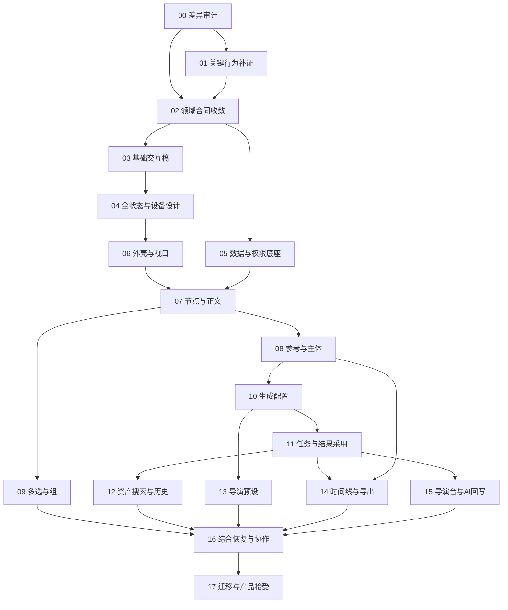

# 无限画布一致性改造实施计划

唯一来源 PRD：[PRD14—无限画布一致性改造](../prd/14-无限画布一致性改造.md)。技术合同沿该 PRD 的唯一来源[设计27](../design/27-无限画布一致性改造设计.md)及其显式依赖展开。

本文件定义执行任务、依赖、验证和退出条件，不记录任务调度。当前状态、优先级、容量、估算、阻塞及下一步统一见 [BACKLOG](../../BACKLOG.md)。任务定义不代表代码缺失或已实现；所有实际验收须绑定代码版本和环境。

## 1. 执行目标与工作边界

将60项竞品基线转为可检查的设计与产品行为，沿既有画布、主体、素材、模型、任务及协作合同落实。执行入口为正式画布，不建立只能演示的并行产品入口。

本轮文档工作不读取应用实现、不修改 Figma、不启动服务、不迁移数据库或执行收费生成。这些是下列执行任务的具体活动，不因计划写成就视为完成。

不重复建设主体库、资产总页、模型接入或Yjs核心。主体/资产相关并行工作通过已有设计25/26及计划21/22衔接；交付重叠处先明确所有者和合入基线。

## 2. 开工条件与交付约定

### 2.1 每项任务的进入条件

1. 已定位需求 JC、产品故事、AC与负责设计章节。
2. 已确认目标仓库/分支、工作区和运行版本，记录既有修改；文件范围不覆盖并行任务。
3. 影响业务含义的未知有明确决策或证据；不影响本任务的未知可保留在对应任务。
4. UI任务有对应 FIG-CJC 状态、即梦实页测量、可用组件和交互说明；原稿与REQ-JC-007冲突时先纠正原稿。领域任务有更新后的所有者合同。
5. 能用明确输入及结果验证成功，知道失败/取消/只读行为，准备可撤销测试数据。

### 2.2 每项任务的完成定义

- 目标行为在正式路径可运行；复用项也附运行证据。
- 正常、边界、失败、权限、持久化及协作影响按风险验证。
- 必要文档、Figma实际链接、生成API和测试与变更同步。视觉任务在相同观察条件下进行实页→设计→实现三方检查，逐项记录几何、字体、颜色、透明度、圆角、图标和状态差异；原生图层或结构通过不替代视觉接受。
- 业务状态不依赖虚构结果；未执行检查列出环境限制及对应未关闭项。
- diff仅包含本任务，未覆盖原有工作；不把模拟数据验收记为真实供应商验收。

实现默认采用业务行为 Red → Green → Refactor。纯视觉调整用对应浏览器状态与截图检查，不为常量或样式写同构测试。

### 2.3 任务证据表

每个任务在受版本管理的计划证据段或现有证据目录登记：任务ID、JC/AC、代码提交或工作树摘要、接口/schema版本、Figma真实链接、测试身份/权限、数据条件、步骤、命令、结果、截图/回执/产物路径、覆盖限制。凭据、原始个人文件和访问链接不进入报告。

## 3. 任务依赖

依赖为逻辑前置，不意味着不同责任域必须等待整批结束。T01按受影响能力补证；T03/T04可按已确定功能集合交付，相关集合完成后对应实现任务才能进入。T05与交互稿可独立开展，但字段与行为冲突先收敛。完整交付的主依赖链经过合同、设计、生成闭环和综合验收；时间线/导演台证据缺口可能成为独立限制条件，不给未经估算的单一工期。

## 4. 工作包与实施步骤

### 4.1 证据、合同与设计

| ID / 主责                          | 输入及前置                       | 操作与具体产物                                                                                                                                  | 退出条件                                                                                           |
| ---------------------------------- | -------------------------------- | ----------------------------------------------------------------------------------------------------------------------------------------------- | -------------------------------------------------------------------------------------------------- |
| T-CJC-00 差异审计；产品+前后端     | 研究10、设计27；工作区和运行基线 | 逐条检查60项当前运行行为及责任代码；记录“复用/行为/视觉/缺失/合同/待证据”矩阵；圈定文件和并行改动                                               | 60项均有处置及证据，不能仅填有/无组件；识别影响主体、资产和协作的冲突                              |
| T-CJC-01 关键补证；产品+质量       | T00确定的未知集合                | 按Q01～Q06检查完整连接、非空参考、任务结果、时间线、导演台/AI、焦点与设备；保留来源和限制                                                       | 每个实施所需未知已观察或形成明确项目设计决策；真实收费没有授权则保留该验证未执行，不阻塞其他独立项 |
| T-CJC-02 合同收敛；产品+领域工程   | T00、相关T01                     | 更新唯一所有者设计的字段、命令、状态、权限、兼容性和引用生命周期；明确复用/扩展/新增API；划定高级工具真实边界                                   | 无两份互相冲突的规则；前后端使用同一能力矩阵；Q07有可执行升级方案                                  |
| T-CJC-03 基础交互稿；交互设计      | T02中的稳定主流程                | 在既有Figma按即梦实测重做FIG01～08，纠正统一44px桌面控件和常显八角控制点；定义单选/多选/编辑、焦点、遮挡、空态、错误、引用与参数联动；映射JC/AC | 有可编辑原生组件、真实节点链接和可演示主流程；未观察内容标成项目决策                               |
| T-CJC-04 全状态设计；交互设计+质量 | T03及对应高级能力合同            | 完成FIG09～16，桌面/窄窗口/390/320、只读、加载、失败、断线和未知结果；检查全局token与正文无边框                                                 | 每个故事与AC有设计归属；没有仅画正常态或拿旧稿当新稿的空项；输出交互验收清单                       |

T00的差异表必须包括：JC、证据级别、当前运行结果、当前版本、代码责任点、目标设计、差异类型、处理决定、FIG实际链接、AC、任务。它是实施判断依据，不反向污染研究10的独立竞品事实。

### 4.2 业务与界面实现

| ID / 主责                             | 依赖与范围                                         | 操作与产物                                                                                                                                                                      | 验证与退出条件                                                                           |
| ------------------------------------- | -------------------------------------------------- | ------------------------------------------------------------------------------------------------------------------------------------------------------------------------------- | ---------------------------------------------------------------------------------------- |
| T-CJC-05 数据与权限底座；后端+协作    | T02；JC-018、025～030、046、057、059               | 只扩展确有缺口的节点/组/引用/配置/任务绑定；统一schema、授权、幂等和回执；按所有者合同生成API；升级在隔离副本演练                                                               | 非法/越权/旧schema拒绝，复合动作原子接受；旧内容不丢，候选拒绝不污染Yjs权威状态          |
| T-CJC-06 外壳与视口；前端             | 对应T04；JC-001～009                               | 正式入口统一顶栏、统计、菜单、左栏、缩放、适配、小地图与响应布局；保留个人视口隔离                                                                                              | AC01/02/24对应浏览器检查；缩放不改节点内容；关键控件在窄高/窄宽可达                      |
| T-CJC-07 节点与正文；前端+画布域      | T05、T06、对应T04；JC-010～013、018～024           | 各类型空/就绪/失败节点、命名、尺寸、富文本、标签背景、复制/副本/粘贴/删除/跨画布保存与下载；正确编辑焦点与撤销域；沿现有媒体自然尺寸规则                                        | AC03/04/05；真实保存重开、IME、迟到尺寸、只读；无正文外壳描边回归                        |
| T-CJC-08 参考与主体；画布+主体+媒体   | T07、设计25服务满足消费合同；JC-025～030、046～047 | 三种参考来源、前后创建、完整兼容矩阵、稳定标签、失效反馈；按设计27 §7.4.4接入subject/resource配置、固定版本UUID解析与目标项目授权；空态、原子导入、清除、复制与未变绑定重新授权 | AC07/08/16；空主体不能当有效素材；删除/失权/重复提及及两端编号一致；节点+边撤销完整      |
| T-CJC-09 多选与组；前端+画布域        | T07；JC-014～018                                   | Shift/框选集合、普通/分镜组、堆叠、宫格/智能布局、批量标签；按收敛合同实现成员与撤销                                                                                            | AC06/05；混选、49/50、嵌套和组删除边界；并发更改不留下非法成员                           |
| T-CJC-10 生成配置；前端+模型域        | T08；JC-024、031～041                              | 共用内联/展开会话，文本/图片/视频/音频/音乐参数适配；模型/模式/参考能力联动；输入资格、价格和套餐真实展示                                                                       | AC09/10/11/14；切模型失效项可见可修正；无真实报价不使用样例，未接模式不伪造可提交        |
| T-CJC-11 任务与结果；任务+媒体+画布域 | T10、真实服务合同；JC-024、031～041、056、059      | 固定输入提交、幂等任务、查询/取消/未知查证、正式结果资源、显式采用、失败重试                                                                                                    | AC12/13/22；双击提交、失ACK、迟到结果、换节点/项目及目标删除；真实生成和模拟故障分列     |
| T-CJC-12 资产搜索与历史；前端+查询域  | T08、T11、设计26接口满足消费合同；JC-052～056      | 资产选择器正确分层，过滤/计数/分页，画布搜索定位，真实任务历史及回填                                                                                                            | AC19/20；本人发起范围、错误非空态、异步旧查询回包、选择保留与历史不可变                  |
| T-CJC-13 导演预设；前端+模型域        | T10、对应T04；JC-042～045                          | 相机/配色/风格/运镜独立选择、预览、应用、取消，保存可撤销配置；映射真实模型输入                                                                                                 | AC15；取消无变更、应用回读、媒体/模型不兼容、引用和参数组合；不导入无来源专有预设素材    |
| T-CJC-14 时间线与导出；媒体工程+前端  | T11、T08、Q04闭合、FIG13；JC-048～050              | 实际轨道/剪辑时间模型、导入/排序/分割/删除/静音/全屏；按格式输出真实产物及失败反馈                                                                                              | AC17；空/单/多剪辑、画面音轨与时长；MP4与工程交换格式分别解析/播放验证，菜单存在不算通过 |
| T-CJC-15 导演台与AI；相关领域+前端    | T11、Q05闭合、FIG14；JC-051、058                   | 先落实已确定输入/输出和返回合同，再接实际执行、取消、会话与回写；无能力入口真实说明并保留未交付项                                                                               | AC18；非空真实任务往返、失败、切项目及迟到结果；若需新引擎，回到范围决策，不能另造假演示 |

T05不是全部后台完成后才做前端的“大底座工程”。只处理已识别且为各链路必需的合同，按业务任务增量验收；不预建将来框架。

### 4.3 综合接受与交付

| ID / 主责                               | 依赖                       | 操作与产物                                                                                               | 退出条件                                                                                          |
| --------------------------------------- | -------------------------- | -------------------------------------------------------------------------------------------------------- | ------------------------------------------------------------------------------------------------- |
| T-CJC-16 综合恢复与协作；前后端+质量    | 对应T09/T12～T15完成的能力 | 双账号三客户端、IME、删除/撤销、断线/未知结果、撤权/换账号、老画布、窄屏键盘、容量测量；收敛所有联动缺口 | AC21～24及其上游AC无静默数据丢失、越权、重复任务、错误保存；高级未完项保持未完                    |
| T-CJC-17 迁移与产品接受；产品+工程+质量 | T16及完整范围所需任务      | 核对60项处置、24项AC、16组Figma；隔离升级和回退演练；复核差异、产物与真实服务证据；形成交付说明          | 完整范围全部满足才宣称一致性完成；受限发布明确未开放项、不得勾选完整通过；提交/发布按实际授权执行 |

## 5. 文件责任与契约管理

以下是责任区域，不是已审计文件清单。T00填入具体路径与实际拥有者，避免按猜测全仓搜索替换。

| 区域                                               | 允许处理的职责                                | 不应混入                                        |
| -------------------------------------------------- | --------------------------------------------- | ----------------------------------------------- |
| `frontend/src/components/canvas/`及正式画布宿主    | 节点、工具、手势、焦点、面板与协作会话接入    | 独立假画布入口、自建业务API客户端、局部主题体系 |
| 已有共享提示词/生成/主体/资产组件                  | 复用编辑会话、引用、选择器、模型配置          | 复制第二套主体库或生成历史所有权                |
| `backend/internal/canvas/`与现有生成/媒体/主体职责 | 业务校验、读取/命令、授权、幂等与正式资源绑定 | 客户端自报就绪、凭URL授权、任意整图覆盖         |
| `canvas-collab/`和既有协作接线                     | 新字段schema、投影、接受与个人撤销所需增量    | 第二并发算法、绕过Go校验的浏览器直连            |
| `frontend/src/api/`                                | 从后端注解生成并核对                          | 手工改生成文件或组件目录请求函数                |
| `backend/tests/`、`frontend/tests/`                | 对应行为、契约、故障、真实集成与浏览器证据    | 在生产目录放测试、削弱既有断言来过门禁          |
| 既有Figma和docs所有者                              | 实际设计节点、域合同、AC/证据映射             | 假链接、复制失效规范、覆盖他人未提交设计        |

目录仅依据当前工程规范和设计文档；准确调用链、待改函数、依赖版本由T00检查后决定。需要技术API文档时按项目实际安装版本核验官方资料。

## 6. 可执行验收场景

下表定义执行方法，实际执行状态只在BACKLOG维护；研究10中的竞品观察只作来源。角色默认“具备画布写权限的创作者”，特例明确标注。每行以给定前置、动作和可见结果执行并留下证据。

| 场景 / AC          | 前置                                                                       | 步骤与可观察结果                                                                                                                                        | 例外与失败判定                                                                                                |
| ------------------ | -------------------------------------------------------------------------- | ------------------------------------------------------------------------------------------------------------------------------------------------------- | ------------------------------------------------------------------------------------------------------------- |
| CASE-CJC-01 / AC01 | 已授权画布、已知节点集合；同视口/浏览器缩放/画布缩放/内容/选中态的即梦参照 | 逐项对比外壳、文本节点、透明热区、操作条、生成器与浮层的几何/颜色/字体/图标/状态；再打开/改标题/创建节点，核对真实标题、统计和保存                      | 长标题不挡操作；字体替代或状态未测须记录差异，不能称完全一致；失败不可显示已保存；只读不可改                  |
| CASE-CJC-02 / AC02 | 两端同一画布，视口不同                                                     | 一端平移/输入比例/适配/开关小地图与连线；另一端视口不动，节点数据不变                                                                                   | 非法比例有界处理；断线时获授权视图操作仍可用                                                                  |
| CASE-CJC-03 / AC03 | 空画布及合法不同尺寸素材                                                   | 各类型创建→命名→移动/缩放→复制/副本/粘贴→删除/撤销→跨画布保存→下载→重开；文本依次选择六种背景、恢复无颜色并刷新回读；新身份、内容、引用及几何按合同一致 | 媒体迟到解码不移动已保存位置；目标无写权限/素材不可转移/下载失败须明确反馈；源画布保留；只读禁写              |
| CASE-CJC-04 / AC04 | 文本与生成草稿，含引用                                                     | 输入中文IME/emoji/多段格式→切内联/全屏→关闭后焦点回全屏入口→下载.md→重开；核对下载文件内容、可读引用、H1～H3/列表/引用/对齐/字体格式及正文保存          | 组合输入期间Escape/Enter不误触；只读及菜单打开后失权不可写；下载不得泄露素材预览URL或内部绑定ID；长文不被截断 |
| CASE-CJC-05 / AC05 | 两人分别编辑不同节点                                                       | 创建目标节点+边→撤销→重做；本人的复合动作完整，他人修改保留；正文撤销只处理正文                                                                         | 结果未知先查证；并发删除导致不允许恢复时明确说明                                                              |
| CASE-CJC-06 / AC06 | 49张和50张图片集合、文本+视频混选                                          | Shift/框选→编组→布局→撤销；纯图片49可按合同编组，50和混选有原因禁用                                                                                     | 非图片/嵌套/删除成员不得留下非法组；批量部分失败不提示全部成功                                                |
| CASE-CJC-07 / AC07 | 完整来源×目标矩阵测试数据                                                  | 对每格执行前接/后接/连接；边方向及可选性与合同一致                                                                                                      | 自连、重复、环、删除端点分别验；合法标注环不得错拒                                                            |
| CASE-CJC-08 / AC08 | 空、就绪、失权、已删除来源                                                 | 添加参考/重复提及→修改来源→切模型→提交；标签稳定，已提交版本不改变                                                                                      | 空边不等于有效素材；越权及失效阻止提交并保留修正入口                                                          |
| CASE-CJC-09 / AC09 | 文本/图片/视频/音频含多参考和长提示词草稿                                  | 展开/折叠/切面板→关闭最上层；草稿、参考、参数及焦点保留                                                                                                 | Escape不顺带取消节点；取消模态不提交；触屏关闭入口可达                                                        |
| CASE-CJC-10 / AC10 | 两个能力不同的实际模型                                                     | 配置模型A后切B；合法值保留，非法值和不支持参考逐项提示                                                                                                  | 不默认抄即梦范围；套餐含义不明确时不得自称可用                                                                |
| CASE-CJC-11 / AC11 | 有效/无效输入，已知或未知计费                                              | 检查提交按钮及费用说明→提交合法样本；费用来自真实合同                                                                                                   | 空输入/无能力/不可解释计费不得提交；不能显示固定示例积分                                                      |
| CASE-CJC-12 / AC12 | 可执行模型和可控网络故障                                                   | 提交→丢失响应→查证→重连；只得到同一任务事实；再请求取消并核对终态                                                                                       | 禁止未知结果直接建新任务；取消请求不伪装已取消；失败不虚报完成                                                |
| CASE-CJC-13 / AC13 | 任务执行中，随后编辑/删除目标                                              | 等结果→查看历史→显式采用；正式资源与原输入可追溯，较新内容不被覆盖                                                                                      | 切项目不串写；目标删除仍有授权历史；采用失败保留结果                                                          |
| CASE-CJC-14 / AC14 | 实际支持的语音/音乐模式与音色                                              | 分别配置、提交、播放结果；文本/音色/模式正确，结果可回读                                                                                                | 不支持模式明确不可用；真实音频与静态夹具分列证据                                                              |
| CASE-CJC-15 / AC15 | 图片与视频节点、支持的预设                                                 | 选择→取消，核对无变化；再次选择→确认→重开→撤销，配置按合同变化                                                                                          | 配色/相机/风格/运镜上下文正确；不兼容模型有原因；资源许可可追溯                                               |
| CASE-CJC-16 / AC16 | 同空间主体、另一空间主体及音色                                             | 空主体保存→零/单/多选→原子导入→引用→清除/撤销→刷新；固定版本UUID和主辅媒体正确；复制保留固定身份并重新授权                                              | 未选择不可确认；跨空间/删除/失权拒绝；不能顺带浏览源个人库                                                    |
| CASE-CJC-17 / AC17 | 有视觉片段和音轨的时间线                                                   | 导入→排序→分割→删除→静音→导出；逐项核对时长、帧/音频、文件可播放或被目标软件解析                                                                        | 空时间线禁用相关导出；取消/失败有反馈；每种格式独立记录，不以MP4通过替代所有格式                              |
| CASE-CJC-18 / AC18 | 已收敛导演台/AI流程及真实服务                                              | 传入上下文→执行→返回→回写原对象；结果及来源可追溯                                                                                                       | 内部流程未定义即不能计通过；切项目/失败/取消/迟到结果均不得串写                                               |
| CASE-CJC-19 / AC19 | 多类型、分页、空集及失败查询样本                                           | 切来源/分类→搜索筛选→翻页→多选确认；计数、结果与范围一致                                                                                                | 旧请求迟到不覆盖新筛选；失败显示重试而非空库；部分导入失败保留明细                                            |
| CASE-CJC-20 / AC20 | 节点名称/正文/标签样本和本人/他人任务                                      | 查找命中并定位→历史筛选→回填；定位真实对象，回填新草稿                                                                                                  | 搜索范围按收敛合同；不可见任务不返回；历史任务不因回填而变化                                                  |
| CASE-CJC-21 / AC21 | 可写/只读/无权限三角色                                                     | 查看分享菜单不改权→尝试各操作→撤权/换账号；服务端拒绝越权，私人缓存正确清理                                                                             | 不凭UI隐藏授权；下载/导出也核验；无权不泄露对象细节                                                           |
| CASE-CJC-22 / AC22 | 待确认编辑、上传与延迟旧ACK                                                | 连续编辑→收到旧ACK→最终接受→重开；新输入未接受时不得已保存，最终内容回读一致                                                                            | 数据库/依赖失败保留本页输入；刷新前风险提示不冒充已保存                                                       |
| CASE-CJC-23 / AC23 | 双账号三客户端，真实持久化                                                 | 同段富文本/引用并发、拖动、删除、撤销、断线重连；按Yjs与权威合同收敛                                                                                    | 结果未知、拒绝、旧epoch、撤权分别验证；不能通过简单整图覆盖“修复”                                             |
| CASE-CJC-24 / AC24 | 约定设备、键盘/触摸、规模样本                                              | 逐FIG状态检查与核心流程走查；各入口可达、焦点合理；60项映射无漏项                                                                                       | 390/320不丢必要功能；性能预算基于实测；不可用能力不得算完整交付                                               |

CASE-CJC-18执行合同补充（来源PRD14 AC-CJC-18）：并发绑定同一草稿到两个会话只能成功一个；同一绑定重试返回原轮次；其他用户、其他项目及已删除画布均拒绝读取。对当前轮报价、执行中、未知、已完成与已关闭submission分别重开，已结束后才创建下一轮。采用文字与媒体分别复核正式结果身份/审核、媒体版本、画布epoch；模拟保存未知和恢复epoch，确认无重复节点或迟到回写。另逐项验收七技能专业模式，不能以普通文字生成替代。

CASE-CJC-03/06 标签补充：先验证非法颜色/重复/null拒绝，再验证单选增删、混选批量应用与清空、投影回读和一次撤销；浏览器以同一节点背景保持不变为对照，刷新后检查五色集合。

T-CJC-08 局部主体补验：验证项目上传/资产选择/直接画布点选到主辅媒体，音色添加、替换、删除与局部说明；固定库pin首次编辑物化且库内容不变。服务端保存独立subject input快照并覆盖改名、移动、删除撤销、恢复与项目复制媒体重映射。智能配音复用正式voice job及personal→project媒体转移，补成功、未知结果、失败原任务重试、失权与跨epoch迟到回写；单元/PG通过不能代替真实供应商与浏览器保存刷新验收。

CASE-CJC-17 工程产物补验：先核对源菜单和第一手XML规范，明确source XML/剪映/各NLE待证项；在独立editproject适配器实现媒体包、FCPXML1.10与xmeml-v5序列化及解析往返，再复用原冻结、授权、幂等、outbox/Temporal与attempt fence贯通export_artifact。隔离PG演练精确增量migration与旧video/audio兼容，验证ZIP条目字节/SHA、相对媒体路径、安全边界、取消/重试/失权、revision与artifact读回。真实devDB迁移只执行review后的增量SQL，不reset。最后分别在目标软件导入，记录具体版本与在线媒体；格式单测通过不能把JC-050标完成。

CASE-CJC-03/05 右键补充：分别验证空白/节点/连线菜单、复制不变节点数、副本新增、粘贴后撤销重做、只读禁写与关闭焦点；真实浏览器确认保存刷新。跨画布和主体回存独立验收，不由基础菜单测试替代。

T-CJC-12/13补验JC-055/060：由正式TopBar进入锚定搜索按钮的独立Popover，测试七类+组/其他/全部计数、同名/空名称/未知类型、名称匹配与清空、动态新增改名删除、只读定位、Enter/Escape及关闭焦点；不修改CanvasSidePanel资产管理。节点DOM回归检查group名称/描述、选中与权限变化、媒体已知状态计数和绑定未核验，防止将URL或pin误报ready。E23没有正文/标签匹配或实际定位证据；无浏览器/读屏证据时仅记录源码和组件测试。

CASE-CJC-18补充：助手400px紧凑呈现须保持prompt_draft owner；在模型/参数弹层完成选择，经费用确认发送。空会话打开自动绑定，已有空会话重复打开不得新增；仅报价仍视为空会话，accepted与已确认结果后允许新建，并发两次创建只允许一次成功。菜单/快捷请求写入同一草稿后刷新恢复；布局截图不替代七技能执行结果验收。

T-CJC-15：为CinemaKit闭合类型、相机4组枚举、27配色/10风格/20运镜、custom palette边界建立反例测试；先实现typed节点/图约束，再将有效设置冻结进input snapshot/hash，验证上游变更与拆边使下游input_revision递增、布局变化不递增。输入读取与实际operation编译必须消费同一设置，错误模型能力拒绝；前端四picker通过正式Yjs graph owner保存，目录和上下文chip复用同一合同。验证创建→后接→修改→保存→刷新→清除→撤销，记录替代视觉与未执行的provider验收。

CASE-CJC-03 补验：构造含内外节点引用的时间线选区，先断言复制的内部node_id重映射、外部node_id及asset_id保留，原时间线不变，再通过正式投影保存和浏览器重开验证。

JC-014～016 容器验证补充：先对typed container配置、同父/跨父选区、嵌套选区、解除、平移、删除恢复、背景与复制写red tests，再接Yjs保存和组/堆叠呈现；后端严格拒绝错误kind/版本/颜色/非group附加container与循环父关系。用实际保存/新服务回读/浏览器刷新确认container类型；堆叠隐藏节点不得丢失拓扑，画廊不改图。单组工具栏、布局、六色、拖动/解除、嵌套复制与undo分别验收；source分镜ready-image成功态维持待证。

时间线媒体预览补验：使用可控时钟覆盖到期前刷新、刷新失败后明确重试、刷新挂起时到期清空、身份切换取消和迟到响应、素材删除与卸载定时器清理；再以真实签名地址进行长期开页/恢复网络验收。

T-CJC-08 主体连线验收补充：使用正式subject/reference_subjects端口与NODE_VALUE边连接image/video/audio。领域层从权威图派生固定引用并冻结node_input，先推进主体版本再冻结下游；quote/confirm使用统一主体owner复核。覆盖空边无引用、前端保存重开、目标在源之前的数组顺序、库head不替换固定版本、主辅音色局部版本、删除撤销、失权拒绝，以及与导演工具箱同时接入时双方配置保留。界面摘要不将本地候选当授权成功，浏览器闭环和真实供应商生成分别验收。

T-CJC-03/05 后接创建：先覆盖来源左右端口、键盘激活、拖拽空白与空图片尺寸红例，再改工厂和宿主；实测保存刷新后的节点位置，保留未知自动避让边界。

T-CJC-05/06 多选后接：先测试两文本→1图片2边和第二来源不兼容时无部分变更，再将完整结果只提交一次；实屏验证一次撤销/重做和刷新。批量下载单独检验全选原件授权与失败反馈，不用发起下载等同下载完成。

创建交互补充：打开生成器只等待节点已保存，不自动建立空输入或多占一个撤销步骤；空输入仅在报价前显式物化。来源节点批量后接产生单目标、多条边，接受后一次撤销与重做整体恢复。服务器显示编号回写不能误触协作者保护，真实他人字段/新入出边/新子成员仍保留；验收必须包括正式回执后再撤销及刷新读回。

## 7. 验证层级与工程检查

| 层级            | 证明什么                                   | 不证明什么                       |
| --------------- | ------------------------------------------ | -------------------------------- |
| 文档/设计       | 来源、范围、状态覆盖、交互规范及可追踪性   | 应用可运行或接口已存在           |
| 单元/组件       | 合法性、状态转换、焦点、字段联动及故障处理 | 第三方模型、实际数据库或跨端成功 |
| 受控浏览器      | 正式交互、布局、键盘/IME、空/失败/权限显示 | 夹具响应不等于真实业务完成       |
| 真实存储/API    | 授权、幂等、资源身份、接受回执与重开回读   | 供应商音画质量与跨软件导出兼容   |
| 真实供应商/文件 | 提交、输出、播放、下载与具体导出格式       | 大规模协作与生产容量             |
| 多人/恢复       | 双账号三端并发、断线、拒绝、撤权与未知查证 | 未测规模或所有设备均通过         |

按 [PROJECT质量门禁](../../PROJECT.md)执行，不以文档计划更改现有CI：

- 前端相关任务：在 `frontend` 运行 `pnpm exec eslint .`、`pnpm exec prettier --check .`、`pnpm exec next typegen`、`pnpm exec tsc --noEmit`、`pnpm exec vitest run --maxWorkers=2`、`pnpm exec next build`；交互补浏览器验证。必要时先跑受影响测试定位，再跑规定门禁。
- Go相关任务：受影响文件格式/goimports、对应包 `go vet`、`golangci-lint`、`go test -race`、`govulncheck`；交付范围按PROJECT及既有CI执行。包路径由审计确定，不编造成功命令。
- 接口变化：`pnpm api:generate`后检查`pnpm api:check`，核对operationId和生成范围；不得手改生成文件。
- 数据/协作：隔离PostgreSQL、实际Yjs和正式路由验证；缺少配置不能以跳过记通过。外部依赖的适用集成单独记录。
- 纯文档任务：格式、路径/锚点、唯一来源、ID覆盖、依赖图和证据表述；不启动服务或运行无关业务套件。

验证结果至少标记通过、失败、未执行、环境受限四类。任何一次构建或原型验收均不能覆盖其他层级。

## 8. 迁移、发布与回退

1. 用脱敏的存量画布样例建立升级前清单：节点数、类型、正文、组、边、素材身份、引用版本、参数、任务绑定和保存版本。
2. 在隔离数据副本演练字段/schema升级与旧客户端拒写/只读；数据合同由设计14/17持有。保留可回读备份和身份对应，不清理未识别内容。
3. 升级后重开核对内容、引用及Yjs二进制接受事实；每个样例能解释差异。对已接受新写不能通过删除新字段或恢复旧快照回退。
4. 回退优先为兼容程序版本或停止新能力写入并保留读取；若旧程序不能理解新schema，只读保全并执行经演练的数据处理。禁止双写旧协议或回到OT。
5. 测试数据与生成任务明确归属，清理只作用于本任务创建且可恢复的对象；不碰用户既有媒体和并行改动。
6. 发布接受检查：需求/设计/代码版本一致、24项AC证据、实际支持能力清单、已知限制、迁移/回退方法、无越权/数据丢失/重复任务风险。受限发布不能代表全量一致完成。
7. 服务启动、实际迁移、真实收费、公开分享、Git提交/推送与发布分别依照任务授权；本计划本身不新增这些授权。

## 9. 文档交付验证记录

2026-10-28初始文档阶段仅产出设计、PRD、任务与场景定义；以下为该阶段历史记录。文档格式、相对链接、唯一来源、60项覆盖、24项AC/CASE映射与18个任务依赖检查在交付时记录到本地检查产物；应用实现、Figma修改、真实供应商、多端与迁移场景均未执行。检查产物是文档校验，不是产品接受证明。

[设计27](../design/27-无限画布一致性改造设计.md) · [PRD14](../prd/14-无限画布一致性改造.md) · [Plan导航](00-Plan导航.md)

## 10. 基础工作区执行证据

[2026-10-28首批核查与Figma证据](../research/evidence/2026-10-28-canvas-implementation/foundation-audit.md)记录源码责任点、实际设计节点、结构/截图检查及未执行的浏览器与服务验证。该记录不替代T00的60项完整审计或T03/T04的全部设计验收；任务状态仅见BACKLOG。

CASE-CJC-03/08 同项目跨画布补验：构造两个真实canvas及局部/库主体、生成草稿和内部边，执行选择目标→正式Yjs接受→新服务读回→源未变→目标生成源固定→目标删除undo。覆盖空主体、权限撤销、跨项目拒绝、外部活动节点依赖、内存会话隔离、未知保存复用身份，以及显式参考与连线派生参考各自的版本语义。跨项目新增来源须先做PG红绿和worker回执重放，不移除IsDraft守卫来伪造支持。

JC-052～054查询验证：先写多页筛选/错误来源/空维度/比例/分辨率/时间半开边界red tests，再扩展media/library参数与SQL筛选；restricted PG覆盖count与page同过滤、跨项目拒绝；前端以迟到请求/跨页选择/切换筛选/确认版本拒绝测试验证。subject与canvas各调用正式所有者，API统一生成后再类型检查；真实非空浏览器素材查询与添加单独取证，未支持功能保留明确缺口。

JC-002执行补充：按设计27 §7.4.15、PRD14 AC-CJC-01补节点统计与正式项目信息，验证跨空间拒绝、完整节点计数、实扣与预留隔离、分页、关闭取消/错误重试。更新原生Figma并读回，浏览器/PG/单元证据分别登记。

CASE-CJC-03/08 工具箱来源回归：复制相机→图片及手工配色，比较目标GenerationInput来源新ID、相同设置hash和值、原图不变；分别注入node-config Sources及draft-composer CinemaKit，验证ValidateGraph和ProjectCopy均拒绝。

JC-054规格多选实施验证：先以Checkbox多选/取消/计数/分组清空测试取得red，再将picker filter改为数组并以闭合逗号参数发送；真实ProjectAssetDialog测试切媒体类型后参数清除及第一页重读。既有跨页选择、授权确认与epoch防护继续回归；原生Figma使用同组件体系描述多选/清空/非图片状态，不将未实现能力画为可用。

CASE-CJC-03 流星连线验证：先固定创建预览连续线、输出→输入方向、生成且选中仍保留流星及独立点击热区的回归测试；按设计27 §7.8统一预览与已连接渲染，使用共享WebGL层和动画时钟。先采集源端资源身份/公式、无损连续帧、路径及父层合成；独立复算周期和弧长。测试短/中/长尾长、颜色纹理、共享相位、64/16采样、MAX合成、资源清理。浏览器核对真实WebGL绘制、无白头/无CSS虚线、菜单取消、缩放线宽、减少动态效果、隐藏卸载及同相位颜色/亮度误差；Figma原ID更新并读回0/650/1300/1950/2600ms关键帧。静态代码、模拟生命周期、真实GPU及正式画布分别记录。

CASE-CJC-03 连接入口补充：先记录源资源SHA、端口/伪元素几何和实际移动，再固定局部坐标、缩放下限、80ms步进/限幅/snap测试；接入单RAF、取消/卸载及减少动态效果。真实浏览器验证未选节点外侧直接进入、左右跟随、点击/拖到空白菜单、严格1px阈值、侧边锚点和Escape；设计原生六态与既有连线端口实例同步读回。不得以hover截图代替动态或持久连接验收。

CASE-CJC-03/08 多选与保存执行补充：

1. 先按白名单提交入口代码/设计并推送main，记录SHA与终态CI；不纳入并行任务。
2. 实测即梦双来源创建、已有目标拖入、重复整批拒绝、撤销/重做、刷新；静态证据只补充快照/anchor/预算/准入公式。
3. 红绿覆盖lower-median锚点、全部来源冻结、批量重复/成环、整图admission拒绝无半图、聚合geometry及body38%磁吸。
4. 本地独立验收画布执行2n1e→3n3e→undo2n1e→redo3n3e；再4n4e→批量drag4n6e，测试部分重复保持4n4e、成环保持4n6e、拖拽后焦点与快捷键。
5. 采集脱敏yjs_ack(status=accepted)、snapshot commitSeq/graphHash/节点边身份，刷新和新tab重开对照；不以缓存呈现替代服务器确认。
6. 原多选Figma板原位修改并读回；证据、实测结果、剩余差异收录[专项验收](../research/evidence/2026-10-29-multi-connection/validation.md)。共享工作区全量测试失败逐项归因，相关回归不得跳过。

T-CJC-08/14/16 高级组合与异常保存执行补充（REQ-JC-012，设计27 §7.11）：

1. 先在原多选板表达空图片、资源就绪、上传中、领域组合及异常保存状态；逐项标注源页面、源静态或本项目待验，读回尺寸、文本和可编辑结构。源端未知文案不得猜测。
2. 为主体和时间线分别构造领域候选，冻结完整来源身份、解析权威素材，验证绑定、容量、重复和回路；全部来源和目标通过后一次发布、一次撤销。覆盖既有目标、新目标、混合合法/非法来源及历史绑定，禁止裸边冒充领域接入。
3. 对异步素材解析设置可控延迟，逐项插入来源删除/改写、目标删除/改写、写权限撤销、范围或epoch切换；断言零失效提交、零半图、保留无关编辑。发布前通过完整保存准入，上传中引用及服务图投影失败不得被部分过滤。
4. 在独立真实画布执行就绪图片→主体、就绪图片→时间线和多来源领域组合；核对完整绑定与剪辑、一次undo/redo、accepted回执、服务器snapshot及刷新/重开身份。将高级结构测试、领域单测、真实浏览器与服务接受分别归档。
5. 分别注入等待ACK、丢ACK/超时、明确拒绝、重连、失写权、失读权及epoch变化；查证始终使用原身份，拒绝后无半批关系，迟到响应不得跨会话恢复旧图。异常后的undo/redo与后继操作再验一次。
6. 核对普通画布业务恢复的实际存储与所有者隔离边界；跨刷新未确认输入、journal容量及独占owner没有真实证据时保持未验，不以本页内存或其他领域恢复稿替代。证据归档到[高级连接目录](../research/evidence/2026-10-29-advanced-connection/)，优先级、实施状态和剩余差异统一维护于[BACKLOG](../../BACKLOG.md)。

验收门禁补充：按固定manifest执行关联测试、全局TypeScript、限定ESLint及项目实际Next生产构建，记录命令、退出码与被验证文件摘要；不将关联集合称为全仓测试。主体/时间线领域数据使用独立真实PostgreSQL和授权Yjs fixture核验。浏览器对同一视频＋音频来源同时采集菜单七项和目标结果，已接受回执的commitSeq/revision/graphHash与刷新后快照逐项比对。UNKNOWN注入必须有实际状态证据；另覆盖15秒确认等待超时但inFlight未结束，断言原身份查证且仅一次submit。源端重做若被write_scope_denied拒绝，单独记录本地重做与未持久化，不能从创建或undo通过推定redo通过。

恢复与音频门禁补验：先执行journal/session的身份保持、配额阻断、NOT_FOUND、403、跨epoch和租约用例，再以真实Chrome验证当前生产helper保存/刷新/读取及actor隔离；随后另在真实登录业务验证断线跨重登原身份resolve及明确恢复意图。音频菜单与确认接同一新鲜目录，验证稳定默认、已有草稿pin、IME保护、固定主体缓存隔离及全部来源类型覆盖。最后变更重新执行固定清单并记录源码摘要；不得复用旧门禁结果覆盖后续修改。页面重开可见与权威snapshot采集分别记录，opening/会话错误不视为hash回读通过。
