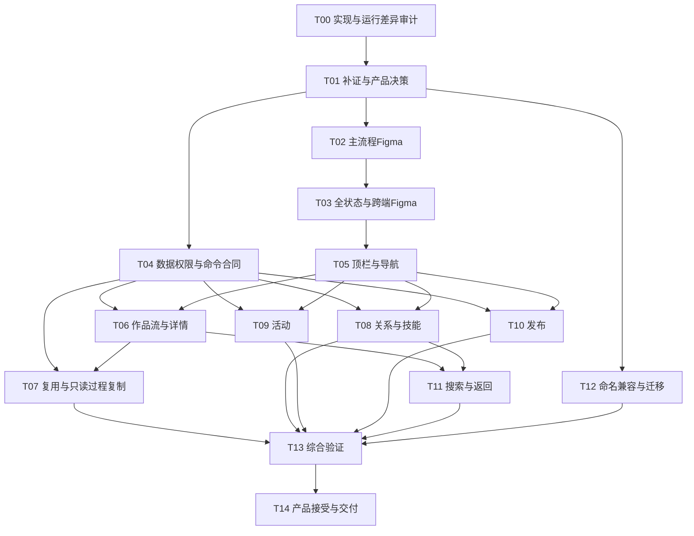

# 探索一致性改造 Agent 执行计划

唯一来源 PRD：[PRD15：探索发现与创作转化](../prd/15-探索发现与创作转化.md)。技术规则沿其唯一来源[设计28](../design/28-探索发现与创作转化设计.md)及显式领域依赖展开；外部事实仍由调研11持有。任务状态、优先级、估算、认领和后续动作只在 [BACKLOG](../../BACKLOG.md)维护。

## 1. 目标与执行边界

把PRD的50项来源要求和22项产品接受条件转为可分工、可审查、可回退的工作包。执行顺序为：**审计当前实现 → 收敛差异与领域合同 → 更新对应Figma状态 → 实现 → 分层验证 → 产品接受**。

本文是未来执行指令，本轮只编写文档。不能把任务描述当作已发生的代码审计、Figma修改、服务运行或业务通过证据。需要真实生成、公开发布、修改共享权限或生产数据时，沿用户已有授权范围执行，不能因计划列出步骤就扩大授权。

## 2. 每个 Agent 的启动与交付合同

### 2.1 启动清单

1. 读取本任务所需的AGENTS、PRD故事、设计规则、决策和验收，不重复加载全库无关历史。
2. 核实仓库根、分支、HEAD、未提交/未跟踪文件、运行服务版本与任务附件；本计划不授权创建或推送新分支/PR。
3. 记录所认领的工作包、实际可改文件和共享文件所有者。文件尚未审计时先做T00，不按本文的概念名猜路径。
4. 核对前置产物是否真实存在。只有受影响的依赖未满足时暂停对应实现，继续不依赖它的工作；“已有按钮/接口名”不是契约可用证据。
5. 业务逻辑遵循Red→Green→Refactor；纯布局和文案使用针对性的组件/浏览器验收，不添加只复述实现的测试。

### 2.2 交付回执

每个工作包回执必须包含：任务ID、基线版本/环境、实际修改清单、来源FR/NFR、故事/AC、决定及偏差、测试命令/结果、Figma真实链接（适用时）、真实服务与mock的分界、未验证事项、迁移/回退影响、Git状态。回执可在版本化实施证据中维护，Plan只链接必要证据，不追加重复过程日志。

完成定义：输入可核对、改动限定在认领范围、产物可以复用、退出条件逐项有证据。不能用“已完成开发”“测试通过”而不写对象、环境和结果。

## 3. 依赖与文件所有权



图中实现任务还统一依赖其对应FIG集合完成及相关决策关闭，不要求无关FIG全部完成后才工作。T04可与设计稿并行，但不能先定一套与设计冲突的字段。T08→T11表示技能搜索依赖技能查询合同可用，不要求收藏/关注全部验收后才能编写搜索。T12的映射设计可提前做，真正迁移演练必须基于T04稳定合同及目标实现版本。

| 责任区                                     | 工作包                     | 写入约束                                                                            |
| ------------------------------------------ | -------------------------- | ----------------------------------------------------------------------------------- |
| 产品事实来源、导航、BACKLOG                | T00/01/14                  | 指定一个文档整合者，同一段共享规范不多人覆盖                                        |
| 共享顶栏/页面壳/搜索入口                   | T05，T11消费               | 与现有顶栏/资产/主体任务核对；只有壳层所有者写公共槽和快捷键，页面Agent不复制账号组 |
| 公开目录、作品、关系、技能、活动、发布合同 | T04统筹，T06～11按领域扩展 | 同一schema/生成API只设一个写入者，客户端不得手改生成代码                            |
| 编辑器/媒体/项目/画布                      | T07消费既有领域            | 变更领域合同先回写其所有者设计；不为探索重建协作或媒体授权                          |
| Figma共享组件与探索画板                    | T02/03                     | 先读节点身份并圈定集合；共享组件由指定设计所有者修改                                |
| 数据映射与兼容                             | T12                        | 不改资源ID和用户正文；迁移只写已核定增量，先隔离副本演练                            |

多个执行者只能在依赖稳定且文件集合不重叠时并行。是否启用多个Agent由届时用户授权和协作规则决定；本计划不自动创建聊天、派发任务或启动后台执行。

## 4. 工作包

### 4.1 研究、合同与设计

| ID / 主责                               | 输入与前置                              | 步骤与产物                                                                                                                            | 验证与退出条件                                                                                                 |
| --------------------------------------- | --------------------------------------- | ------------------------------------------------------------------------------------------------------------------------------------- | -------------------------------------------------------------------------------------------------------------- |
| T-EX-00 差异审计 / 产品+工程            | PRD15、设计28、研究证据；仓库与运行基线 | 逐项核对40FR+10NFR的页面、责任代码、服务与数据；记录命名、现有Figma定位、并行修改、复用/更改/缺失/冲突/未证据处置                     | 50项都有证据或明确未知原因；形成文件责任表与合同清单，不以目录存在判完成；只读审计不改业务                     |
| T-EX-01 补证和产品决策 / 产品+质量      | T00差异、设计D01～08                    | 对影响实现的未知做最小补证；确认搜索/分页范围、视觉差异、技能目标、分类映射、发布、复制、设备和指标；回写唯一所有者设计               | 每项相关决策有依据、采用规则和受影响范围；剩余未知明确阻止哪些任务，不伪造服务能力；可独立事项继续             |
| T-EX-02 主流程设计 / 交互设计           | T01稳定规则，核对实际Figma文件和节点    | 重做FIG01～09正常主流程；标注分类与头像同行、内容模型、动作含义、信息层级；连通详情、返回和创作交接                                   | 可编辑原生组件、实际节点链接、正常路径原型实点；每个ST有设计归属，不用截图拼贴替代设计                         |
| T-EX-03 完整状态设计 / 交互+质量        | 对应T02；D02/D07                        | 补齐FIG01～10的空/错/加载/未知/失权、已有草稿、游客、1280溢出、320/390及短屏/键盘状态                                                 | 22项AC均有设计覆盖或明确非视觉契约归属；同条件竞品测量差异表完成；不能只画成功态                               |
| T-EX-04 数据、授权与命令合同 / 领域工程 | T01、各领域已有合同，相关设计规则       | 明确查询组合、稳定分页顺序、对象能力、公开/私有字段、关系和技能目标、复制/发布状态及幂等查询；只扩展必要缺口，更新OpenAPI并生成客户端 | 合同测试覆盖合法/非法、越权、重复/未知及稳定读取；真实后端职责可定位；数据库表和接口路径有依据，无客户端假成功 |

T00产物最小字段：来源ID｜观察/建议级别｜当前版本与环境｜运行结果｜责任文件/接口｜差异类型｜处置｜决策D｜设计FIG实际节点｜故事/AC｜工作包。研究文档不接收本地差异，保持外部事实独立。

### 4.2 用户闭环实现

| ID / 主责                                       | 输入与前置                                       | 步骤与产物                                                                                                           | 验证与退出条件                                                                                                |
| ----------------------------------------------- | ------------------------------------------------ | -------------------------------------------------------------------------------------------------------------------- | ------------------------------------------------------------------------------------------------------------- |
| T-EX-05 共享顶栏与导航 / 壳层+前端              | T01 D01/D02、FIG01/10、设计09；FR01～08          | 页面状态接navigation槽；账号公共组保持共享；一级局部滚动、二级场景与发布能力、搜索形态和快捷键、游客/登录与移动顺序  | CASE01/02/03/17/19/21；不新增第二个头像/搜索响应者；桌面同排、场景重置、手机无整页溢出                        |
| T-EX-06 作品流与详情 / 查询域+前端              | T04/05、FIG02/03；FR09～13、20                   | 接真实目录；网格/瀑布流按媒体能力；追加加载去重、详情前后项、深链/返回；公开字段和关系按合同读取                     | CASE04/05/06/14/18；空态需成功空响应，旧请求不能覆盖，图片尺寸预留，私有字段不泄露                            |
| T-EX-07 复用、短片与过程复制 / 编辑器+项目+前端 | T04/06、D06、FIG03/04；FR14～18                  | 分别实现做同款与参考追加，处理已有草稿和能力映射；播放器与作品切换；只读过程；显式目标选择和独立副本读回             | CASE07/08/09/18；不自动生成、源项目不变、目标无权拒绝、复制失败/未知可查证；无真实模型只计交接及诚实降级      |
| T-EX-08 收藏关注与技能 / 关系/技能域+前端       | T04/05、D03、FIG05/06；FR19、21～25              | 建立身份隔离的关系读写；技能分类、详情与正文；添加关系及目标创作选择器读回；重复、失败、未知恢复                     | CASE10/11/19/20；列表详情一致，计数不重复，技能版本可辨，添加不执行；必须分别交付关系与技能两份验收回执       |
| T-EX-09 活动 / 活动域+前端                      | T04/05、FIG07、D05/D07；FR26～30                 | 活动与历史、状态/倒计时/时区、详情与规则、全部/获奖及时间/热度查询；可参与动作按真实状态开放                         | CASE12/14/18；冻结时间验证截止边界，排序稳定；不替用户投稿，不将失效外链视作成功                              |
| T-EX-10 发布短片 / 发布+媒体+前端               | T04/05、D04/D05、FIG09；FR35～40                 | 视频上传、封面取帧/上传、统一字段限制、分类≤核定上限、下载许可；提交幂等、受理/审核/公开结果查询；失败保留恢复上下文 | CASE15/16/18/19；真实隔离环境上传/发布/读回，超限和越权拒绝；不能用mock通过代替发布闭环，不使用即梦作品做种子 |
| T-EX-11 搜索与上下文 / 查询域+前端              | T04/05/06及T08技能查询合同，D01、FIG08；FR31～34 | 关键词与三种结果类型、入口上下文默认、URL往返、清空、无结果/失败、详情返回；复用各内容卡片与动作                     | CASE13/14/17；查询与类型对应，结果不是本地示例过滤；旧请求隔离、深链和返回可恢复；需对应内容查询可用          |

T08含两个可独立验证的子闭环；T07的草稿交接与项目复制、T10的上传与发布也应分别认领证据。父任务只有全部必要子闭环通过才满足退出条件，不因最容易的一段完成就关闭。

### 4.3 兼容与综合接受

| ID / 主责                                     | 输入与前置                              | 步骤与产物                                                                                                | 验证与退出条件                                                                                      |
| --------------------------------------------- | --------------------------------------- | --------------------------------------------------------------------------------------------------------- | --------------------------------------------------------------------------------------------------- |
| T-EX-12 命名与存量兼容 / 数据+领域工程        | T00库存、T01 D04、T04合同、相应目标版本 | 建立旧文案/路由/枚举/字段/事件/图层名映射；只迁移真实需要的项；演练升级、重复执行、旧链接与新增写入回退   | CASE22；身份、归属、关系、用户正文不变；无迁移需求给出审计依据，不为“改名完整”强造迁移              |
| T-EX-13 综合验证 / 质量+领域负责人            | T05～12相应闭环与FIG10                  | 执行22个场景、跨账号/权限、请求竞争、异常恢复、真实数据、桌面/移动/键盘；按D08验证指标事件成功口径与去重  | 每项记录版本、环境、实际结果及证据层级；失败回原责任任务修复；不混用不同HEAD的测试报告              |
| T-EX-14 产品接受与文档收敛 / 产品+质量+整合者 | T13完整记录、T12回退方案                | 复核50项处置、22项接受、FIG真实链接、命名映射；清理受本专项替代的旧规则并保留历史事实；汇总风险与交付差异 | 无空白追踪、无假成功、无未处置重大冲突；输出可审阅差异及未通过项；接受不等于Git提交、部署或生产发布 |

## 5. 执行场景

场景编号与同号 `EX-AC-*` 一一对应；下表的“结果”是期望，不是实际通过记录。**当前全部场景未执行**，执行后将版本化证据链接到对应行或统一证据索引，不能仅改状态词。

| 场景 / 故事                | 前置、角色与步骤                                               | 可观察结果及例外                                                                                                                                    | 必需证据                                             |
| -------------------------- | -------------------------------------------------------------- | --------------------------------------------------------------------------------------------------------------------------------------------------- | ---------------------------------------------------- |
| CASE-EX-01 / ST01          | 游客及登录账号；1869桌面打开探索、切不同频道                   | 头像/登录区与一级中心线差≤1px，二级独立；滚动保留导航并可回到顶部                                                                                   | DOM几何、含完整顶栏截图，两身份各一组                |
| CASE-EX-02 / ST01          | 1280桌面；展开搜索，向左/右到分类两端                          | 账号可操作、选中项可达、整页无横向溢出                                                                                                              | 两端截图、宽度与滚动探针、点击结果                   |
| CASE-EX-03 / ST01          | 选择影视视觉设定、切短剧、选漫剧、重选短剧分类                 | 跨分类重置首场景，重选保留有效场景                                                                                                                  | 请求条件及选中态记录                                 |
| CASE-EX-04 / ST02/10       | 测试环境控制请求A慢于B；切分类后先回B再回A                     | A不覆盖B的结果、游标和状态，取消后可继续查                                                                                                          | 受控响应测试和浏览器记录，注明fixture层级            |
| CASE-EX-05 / ST02          | 有合法短剧、图片、缺封面样本；浏览并追加                       | 布局与比例正确、无重复、缺封面有退路，无假作者统计                                                                                                  | 真实目录响应、截图、列表ID去重记录                   |
| CASE-EX-06 / ST03          | 多个公开图片；首/末项、详情深链、返回                          | 作者/日期/AI标识/提示词/参考/参数按权限同步，边界禁用；字段缺失不编造，下架/不存在有返回入口                                                        | 路由与详情响应、浏览器往返                           |
| CASE-EX-07 / ST03          | 可写草稿已有文字；支持/不支持模型各一例；做同款                | 参数交接可见可改，不静默覆盖，不产生生成任务                                                                                                        | 草稿前后快照、相关任务计数/请求核验                  |
| CASE-EX-08 / ST03          | 已有参考与正文；追加、重复、超限、失权                         | 合法追加保留原文，其余按合同拒绝/提示                                                                                                               | 编辑器状态和服务端授权负例                           |
| CASE-EX-09 / ST04          | 合法公开短片/过程及可写目标；播放切换、查看、复制、刷新        | 逐项验证播放/暂停、进度、音量、可用清晰度、清屏、切换及更多菜单；不自动有声播放，离屏停止，播放失败可恢复；只读原过程、可读回独立副本，无权目标拒绝 | 源/副本ID、归属、内容摘要、读取结果，原对象无改动    |
| CASE-EX-10 / ST05          | 合成账号A；收藏/取消、关注/取消、列表详情往返及刷新            | 关系读回一致，失败恢复，计数不过度增减                                                                                                              | 真实关系接口及浏览器证据，不只截图按钮颜色           |
| CASE-EX-11 / ST06          | 可添加技能、下架技能；添加、到目标选择器、重复添加             | 卡片/详情真实字段与统计完整，正文可读；收藏和添加分开，真实技能及版本可查，重复结果确定，下架不可用                                                 | 添加回执、目标读回、无执行任务证据                   |
| CASE-EX-12 / ST07          | 活动覆盖进行中/评奖/历史、获奖/空；冻结时间跨截止点            | 历史可展开/收起并回到顶部，规则/链接/排序正确、状态边界正确、非法投稿不可提交                                                                       | 真实查询+时间边界测试，外部链接仅核对不提交          |
| CASE-EX-13 / ST08          | 三类内容各有可检索样本；关键词提交、类型切换、深链、返回       | 正确类型结果、关键词及上下文保持，空白输入处理确定；搜索卡片复用动作与详情一致，组内容查看全部按D07核定合同验证                                     | 请求参数/响应、URL往返、结果身份核对                 |
| CASE-EX-14 / ST02/08/10    | 空数据、首屏失败、追加失败分别触发，点击重试                   | 空错分离，重试恢复，已加载内容保留                                                                                                                  | 故障注入记录、截图、重试请求；不称真实第三方故障实测 |
| CASE-EX-15 / ST09          | 合法视频与超限/缺字段/无权媒体；填写并提交                     | 前后端一致拒绝非法输入，合法表单可提交，无不完整公开记录                                                                                            | 字段边界测试、真实隔离服务响应与存储读回             |
| CASE-EX-16 / ST09          | 同一发布意图连点、丢响应、恢复查询、上传失败                   | 单次受理、未知可查，失败保留输入；受理不冒充公开                                                                                                    | 幂等键/回执的脱敏标识、受理数量、恢复日志            |
| CASE-EX-17 / ST01/03/08/10 | 键盘操作分类、滚动箭头、详情与关闭，触发项被移除               | 无陷阱，焦点可见且恢复到合理入口                                                                                                                    | 实际按键路径及焦点目标，不只静态ARIA检查             |
| CASE-EX-18 / ST03/04/10    | 下架作品、失权参考、无权目标、不可用模型；UI及直接请求访问     | 服务端拒绝越权；界面提示与能力一致，无私有数据泄露                                                                                                  | 真实授权负例、响应字段核验及前端退路                 |
| CASE-EX-19 / ST01/05/10    | 游客浏览→受保护动作→登录→退出→换账号B                          | 公开浏览不被不必要阻断，恢复意图但不自动生成/发布，B无A私有状态                                                                                     | 两合成账号、请求记录、缓存/界面读回                  |
| CASE-EX-20 / ST05/06/10    | 关系/技能写入已受理但响应丢失；查询并重试                      | 同一意图不重复写，状态/计数一致；确定失败可恢复                                                                                                     | 真实存储计数+故障注入，明确模拟与真实边界            |
| CASE-EX-21 / ST10          | 320/390宽及短高窗口；触屏等价动作、输入弹层、滚动              | 无整体溢出，≥44px触控目标，主操作不被遮挡                                                                                                           | 几何、截图、实际点击；恢复临时视口设置               |
| CASE-EX-22 / ST10          | 隔离副本含旧链接/关系/草稿及新版本新增记录；升级/重复执行/回退 | 身份归属和正文保留，旧链接可访问，新写入有兼容去向                                                                                                  | 迁移前后摘要、重跑与回退日志；不在原业务库试验       |

## 6. 验证方法与门禁

1. **文档与设计**：核对来源链、50项映射、22项场景、实际Figma节点、交互连线和命名。未创建的节点不能填虚构链接。
2. **组件与领域**：按改动跑现有测试入口；前端遵循本仓AGENTS指定的React/Next规则；Go按规定执行格式、静态、Race与漏洞门禁。具体命令从当时PROJECT和包配置读取，不在此猜工具版本。
3. **合同与数据**：真实隔离数据库/媒体存储验证查询、关系、授权、幂等、发布与复制；受控API只证明前端状态处理。
4. **浏览器**：验证实际入口、鼠标/键盘/触屏、1869/1280/390/320、深浅主题及短屏；保存截图、几何和操作结果，避免仅凭DOM存在判断可用。
5. **真实业务**：本专项必需的草稿交接、技能添加、独立副本及发布受理按22项场景验证。真实供应商生成、技能执行、生产公开发布、真实活动投稿是相邻能力或后续发布验证，分别记录，不擅自扩大本PRD范围；没有适用授权或条件时标记未执行，不能冒用隔离环境或mock结果。
6. **整体验证**：测试通过后只对新增风险或失败扩展检查；记录未执行项，最终核对diff、未跟踪文件、共享文件和版本一致性。

只读调研、Figma原型、前端mock、真实隔离服务、真实第三方、产品接受、发布七种证据分开记录。阶段交付可以完成，完整范围不得在必需场景仍未通过时标完成。

## 7. 命名迁移与回退

命名映射至少覆盖：导航/标题/按钮、分类与场景、发布分类、路由参数、接口字段/枚举、事件、组件与Figma图层、帮助文案。机器身份与用户自定义名称不因中文文案统一而改变。

执行前备份/快照需按目标环境的既有规则准备；先在隔离副本验证兼容读取和增量写入。若涉及分类持久值，使用显式映射及幂等迁移；无法无损映射的值保留原身份并给出处理规则，不静默删除或归到“其他”。

回退分三层：界面回退到仍兼容已存数据的版本；合同保留读取已接受新记录的能力；数据迁移仅在验证可逆时反向执行。不可逆状态通过前向修复恢复，不能恢复旧备份覆盖期间新增作品、关系或发布回执。关闭入口只阻止新操作，不撤销已受理任务；结果未知先查询。

## 8. 可直接交给 Agent 的任务指令模板

```text
执行 Plan24 的 {T-EX-ID}，唯一来源为PRD15，技术规则沿设计28及其领域依赖。
先核对仓库/HEAD/运行版本/并行修改；读取任务的故事、AC、决策和前置产物。
列出本任务实际可改文件及共享文件所有者，保持任务范围，不覆盖无关工作。
只实现本工作包已经收敛的规则；涉及未知先补证并回写唯一设计来源。
按对应FIG设计落实正常、异常、权限与恢复状态；不把原型、mock或入口存在当真实成功。
运行本任务CASE及适用工程门禁；输出版本、修改、证据、未测项和回退影响。
更新BACKLOG中本工作包状态，不自行提交、推送、部署或启动未授权外部写入。
```

T00首个可派发指令：只读核对50项来源要求，形成差异矩阵、实际文件责任表、现有API与数据能力清单、D01～08影响清单；不修改Figma或业务代码。后续派发只需替换任务ID并提供真实前置产物链接，不能把整份计划作为一次无限范围“全部重写”指令。

[Plan导航](00-Plan导航.md) · [PRD15](../prd/15-探索发现与创作转化.md) · [BACKLOG](../../BACKLOG.md)
