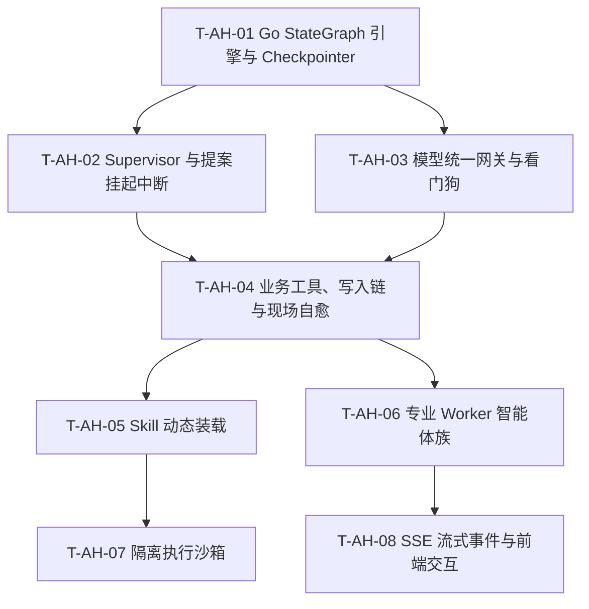

# 完整创作 Agent、Skill 与多 Agent 实施计划

唯一来源PRD：[PRD19](../prd/19-完整创作Agent与Skill多Agent.md)。**目标：** 按PRD在 Go 后端内部统一实现创作 Agent Harness、多 Agent 协作服务与完整 Skill 接入，交付可恢复、可编辑的短剧工程与成片。**架构：** Go 进程内原生 LangGraph (StateGraph) 状态图引擎，吸收开源 [BeefTV](https://github.com/glanderness/BeefTV) 工业级 Harness 规则（提案截断中断 `Proposal Yield`、连续写链 `WriteChain`、现场快照自愈 `StudioDigest` 及单轮步数看门狗）；状态持久化直接采用 PostgreSQL 关系型 Checkpointer，彻底废弃独立的 Node.js 宿主过度设计。

Spec由PRD19唯一来源的设计32持有，本文通过PRD追溯，不建立第二来源。任务按 Red → Green → Refactor 顺序执行。状态、调度、优先级与阻塞只在 [BACKLOG](../../BACKLOG.md) 维护。

## 1. 全局约束与依赖

- **单一二进制进程**：严格遵循 `PROJECT.md`“后端只有一个进程入口 `backend/cmd/glowloom`”原则，所有 Agent Harness 与多 Agent 逻辑收敛在 `backend/internal/agent/`，不引入 Node 独立进程或外部端口。
- **成熟开源模式**：采用业界成熟的 LangGraph（StateGraph + Checkpointer + Interrupt）状态图编排思想，不手写死循环调度；吸收 BeefTV 验证的工业级 Harness 状态机控制。
- **Go 整洁架构**：严格遵循 `adapter → application → domain` 单向依赖，跨模块通过消费方小接口在 `internal/app/agent` 接线。
- **测试布局规范**：所有 Go 测试放在 `backend/tests/agent/` 与 `tests/skill/`，生产源码目录不留测试文件。
- **安全与预算**：任何产生费用或生成动作必须通过提案中断（Interrupt）挂起，由用户显式批准；设置单轮最大 40 步看门狗硬性熔断。

## 2. 文件责任与构建关系

| 责任             | 主要创建/修改位置                                                                                                                              | 所有者/边界                                      |
| ---------------- | ---------------------------------------------------------------------------------------------------------------------------------------------- | ------------------------------------------------ |
| StateGraph 引擎  | `backend/internal/agent/domain/graph/`、`application/graph/`                                                                                   | 图拓扑、节点调度、条件边路由、State 定义         |
| 检查点持久化     | `backend/internal/agent/adapter/postgres/checkpointer.go`、`backend/db/agent_checkpoint.sql`                                                   | PostgreSQL 关系型状态保存与断点恢复              |
| 控制账本与审批   | `backend/internal/agent/domain/{run,manifest,approval}.go`、`application/control.go`、`adapter/postgres/control.go`                           | Run 状态机、候选哈希、中断挂起与恢复审批         |
| 模型网关与看门狗 | `backend/internal/agent/application/model_gateway.go`、`operation/application/model_dialogue.go`                                              | 模型参数冻结、SSE 空闲超时看门狗、单轮步数控制   |
| 业务工具与写入链 | `backend/internal/agent/application/{tools,write_chain}.go`、`internal/app/agent/tools_wiring.go`                                             | 工具执行、CAS 链头自增、`Proposal Yield` 截断   |
| 现场快照自愈     | `backend/internal/agent/application/studio_digest.go`                                                                                          | 比对最新差异 `<canvas_changes>` 注入上下文       |
| 专业 Worker 族   | `backend/internal/agent/domain/workers/`、`application/workers/{script,storyboard,shot,audio}.go`                                              | 制作人 Supervisor 与各专业智能体专属 Prompt/工具 |
| Skill 业务与沙箱 | `backend/internal/skill/`、`cmd/glowloom/sandbox.go`                                                                                           | 包生命周期、动态装载（skill_load）与 gVisor 沙箱  |
| 前端与事件流     | `frontend/src/components/agent/`、`backend/internal/agent/adapter/http/`                                                                       | SSE 流式事件推送、待审批卡片交互                |

## 3. 实施任务

### T-AH-01 Go LangGraph StateGraph 核心引擎与 Checkpointer 持久化
- **产出**：
  - `domain/graph/state.go`：定义强类型的 `AgentState`、`Node`、`Edge`、`ConditionalEdge`。
  - `application/graph/engine.go`：状态图编译与调度器，支持执行、单步驱动与挂起中断（Interrupt）。
  - `adapter/postgres/checkpointer.go`：PostgreSQL 关系型 Checkpointer，保存 State 快照。
- **测试**：`tests/agent/graph_engine_test.go`、`tests/agent/checkpointer_integration_test.go`。
- **退出条件**：成功在 Go 中编译并运行循环状态图；人工中断时状态落库，重启可成功 Resume。

### T-AH-02 Supervisor 统筹编排与提案挂起控制（Proposal Yield）
- **产出**：
  - `application/workers/supervisor.go`：统筹制作人节点，分解目标，管理 `plan_update`。
  - `application/control.go`：打通图 Interrupt 与 Go 两阶段用户审批（`approve`/`reject`）。
- **测试**：`tests/agent/supervisor_test.go`、`tests/agent/proposal_interrupt_test.go`。
- **退出条件**：模型调用提案工具时触发 Interrupt 挂起图执行，审批通过前绝不发起后续推理。

### T-AH-03 模型统一网关、流式看门狗与费用结算
- **产出**：
  - `application/model_gateway.go`：直连 Go catalog 统一模型适配层。
  - `model_stream_watchdog.go`：SSE 分块空闲超时检测（45 秒）。
  - `turn_budget.go`：单轮最大 40 步请求 / 40 步工具调用硬熔断。
- **测试**：`tests/agent/model_gateway_test.go`、`tests/agent/turn_budget_watchdog_test.go`。
- **退出条件**：流式假死自动探测中断；死循环被看门狗硬性拦截，费用原子预留与出账结算正确。

### T-AH-04 业务工具注册、写入链 CAS 与现场快照自愈
- **产出**：
  - `application/tools.go`：注册业务工具（剧本、画布、分镜、生成等）。
  - `application/write_chain.go`：单轮内多步写工具 CAS 链头（`extendWriteChain`）自动递增。
  - `application/studio_digest.go`：每次请求前计算差异注入 `<canvas_changes>`。
- **测试**：`tests/agent/write_chain_test.go`、`tests/agent/studio_digest_test.go`。
- **退出条件**：连续调用 3 个写工具版本自动累加无冲突；协同编辑变动能被模型自动感知自愈。

### T-AH-05 Skill 包生命周期与动态装载（skill_load）
- **产出**：
  - `internal/skill/`：Skill 包导入、校验、版本固定、发布管理。
  - `skill_load` 工具：按需向上下文展开 `SKILL.md`，并在独立任务时重置上下文。
- **测试**：`tests/skill/skill_lifecycle_test.go`。
- **退出条件**：技能正文按需动态装载，恶意脚本与越界路径被严格拦截。

### T-AH-06 专业 Worker 智能体族（剧本、分镜、导演、剪辑）
- **产出**：
  - `application/workers/script_worker.go`（长剧本拆解与歧义标记）
  - `application/workers/storyboard_worker.go`（分镜与机位设定）
  - `application/workers/shot_worker.go`（视频镜头提示词与生成提案）
  - `application/workers/audio_worker.go`（配音、音效与时间线对齐）
- **测试**：`tests/agent/multi_agent_handoff_test.go`。
- **退出条件**：多 Worker 遵循 Supervisor 规划顺序完成分工与成果接力。

### T-AH-07 专用 Linux 沙箱与安全脚本执行
- **产出**：`glowloom sandbox serve` 子命令与 gVisor runsc 隔离执行驱动。
- **测试**：`tests/skill/sandbox_integration_test.go`。
- **退出条件**：第三方脚本在只读根、无网络、无元数据的受限容器内执行并有界回收。

### T-AH-08 SSE 实时流式事件与前端卡片交互
- **产出**：
  - `adapter/http/stream_handler.go`：统一输出 `thinking`、`tool_call`、`proposal`、`turn_end` 的 SSE 协议。
  - Next.js 前端提案审批卡片与断点接续支持。
- **测试**：`tests/agent/sse_stream_test.go`。
- **退出条件**：前端能实时看到深度思维链分段流，并在提案出现时弹出审批弹窗。

## 4. 任务依赖图

