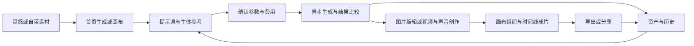

# 即梦对标与完整需求草案

调研日期：2026-10-13。状态：完整范围候选，待审阅，尚未确定首期取舍、实施计划或新技术架构。

## 1. 本轮结论与决策边界

织光应围绕“发现灵感 → 多模态生成 → 画布编辑与组织 → 主体和资产复用 → 成片与交付”定义完整产品，而不是继续以现有后台模块和影视项目表单决定用户流程。

本轮采用用户最新决定：**先完整覆盖即梦主要功能，再决定首期取舍；产品功能、页面布局和主要交互路径尽量参考即梦，整体视觉以 Vercel/Geist 为唯一标准；深色为主、黑白灰统一、少量蓝色状态点缀，组件继续采用 shadcn，保留织光品牌。** 即梦实测的色值、字体和圆角只作为竞品观察，不能覆盖当前视觉决定；旧 BeefTV 外观与历史导航尺寸也不因恢复 Geist 方向而恢复。

本稿完成主要能力域和需求场景覆盖，不声称完成即梦所有灰度功能、付费套餐、真实模型效果或隐藏交互的验证。全部候选需求暂不标 P0/P1，不把完整目录等同于一次性全量开发承诺。

当前 Figma R5/R5.1 作为问题定位材料保留，不能因组件结构检查通过就视为主题、尺寸或业务流程验收通过。本轮先明确范围，不修改实现代码，也不继续堆叠页面补丁。

### 证据分级

| 标记 | 含义 | 能支持的结论 |
| --- | --- | --- |
| U | 本轮在即梦登录态网页实际查看 | 页面、入口、字段、选项、当前布局可见；不等于后端操作成功 |
| O | 官方产品页、说明或发布资料 | 官方公开能力；不同版本、账号和地区可能不同 |
| R | 织光仓库与当前设计材料 | 本项目现状，不能反向定义用户需求 |
| H | 基于场景的需求提案或推断 | 需要产品评审或用户验证，不冒充即梦已有行为 |
| Q | 尚未核实 | 不用于声称功能已完整复刻或实现 |

未提交收费生成、上传私人素材、发布作品、购买会员或删除即梦项目。未开展真实用户访谈、留存分析或模型效果对比。

## 2. 市场与竞品：对标什么，为什么

研究范围为同时提供 AI 图像/视频创作、编辑和内容组织的创作工具。面对的场景包括个人内容、营销电商、设计和影视叙事；本轮不提前选定唯一首期客群。

| 产品 | 已核验能力与定位依据 | 商业模式证据 | 对织光的启示与边界 |
| --- | --- | --- | --- |
| 即梦 | 图像、视频、智能画布与社区；当前界面还展示 Agent、音乐、音频、数字人、动作模仿、主体、时间线、导演台。U/O，S1–S4 | 页面可见积分、会员与商城；具体价格、地区条件、退款规则 Q | 首要产品布局和交互参考；视觉统一采用 Geist。新旧画布入口、账号可用性仍需分别核实 |
| 可灵 Kling | 官方 3.0 公告涵盖文生/图生/参考生视频、视频编辑、一致性和多镜头控制。O，S5 | 官方既有资料披露个人会员和企业 API；当前套餐价格 Q，S6 | 参考输入语义、主体一致性是核心能力；不能只复制一组模型下拉菜单 |
| Runway | 官方产品页覆盖图像/视频/音频、Agent、编辑工具及工作流。O，S7 | 免费入口、订阅额度与额外积分；年付/月付不同，S8 | 生成、迭代、资产和费用是一个流程。实际模型质量、国内可用性未测试 |
| Freepik Spaces / 当前跳转 Magnific | 节点画布、上传/文本/生成/增强节点、模板及实时协作。O，S9 | 免费额度与付费方案；生成消耗积分，S9–S10 | 是创作画布和工作流的直接参照；实时协作不是即梦同等能力已核验的证据 |
| Krea | 实时图像创作、图像/视频编辑增强、资产管理，另有 3D 与训练能力。O，S11 | 免费每日计算额度、付费计算额度/订阅，S12 | 快速试错和媒体复用值得借鉴；3D、训练属于相邻扩展，不能自动塞入即梦复刻范围 |

上述五款在部分创作任务上直接竞争，能力边界并不相同。官网宣称的效果、用户量不作为市场份额或满意度证据。未获得可比较的一手市场规模、增长率、留存率、创始/融资数据；本轮不据此估算 TAM 或给厂商排名。

**优势与局限的判断：** 即梦在本轮观察中把中文输入、参考素材和画布组织放在同一工作环境；可灵强调可控生成；Runway 覆盖生成后编辑；Spaces 明确表达节点工作流；Krea 强调实时迭代。后四者的用户学习成本、中文体验、服务可达性和失败恢复均未做实测，不能写成已证实的竞品缺陷。

**合理推断 H：** 仅有相似首页不能形成可持续替代；用户迁移成本更可能来自主体、历史结果、参考关系与工作流程。织光可验证的差异化方向是：中文创作过程易理解、每次生成的输入/费用/结果可追溯、跨工具复用不丢上下文。它们是待验证假设，并非已证明的市场空白。未来 12–18 个月的主要风险是多模态模型快速变化、Agent 与画布入口进一步合并，以及模型价格和能力变化让静态 UI 规格过期。

## 3. 当前即梦实测清单

| 位置 | 本轮观察 U | 未核验 Q |
| --- | --- | --- |
| 首页 | 创作、探索、资产、主体；对话/画布历史；生成/画布双入口；近期项目、上新与案例分类 | 首页推荐策略、完整搜索结果、所有运营活动 |
| 生成类型 | Agent、图片、视频、音乐、音频、数字人、动作模仿七种类型 | 各类型真实成功率和收费结算 |
| 图片 | 提示词、参考图、主体引用；模型；比例、分辨率、数量、宽高；当前模型显示智能及常见比例、1.5K/2K/4K、1–4 张 | 不同模型的完整能力矩阵、自定义尺寸限制 |
| 视频 | 图/文/音/视频参考；当前入口提示最多 12 个参考素材；模型、比例、分辨率、数量、时长 | 12 个是当前模式提示，不是全平台固定限制 |
| 视频模式 | 全能参考、首尾帧、智能多帧、智能编辑、超长视频 | 子模式参数、付费限制及实际结果 |
| 音乐与音频 | 音乐提示词、模型、智能时长；音频可输入台词、描述声音、上传参考、引用音色及按时间戳编排；音色库入口 | 音色授权、克隆细则、音乐歌词/分段编辑支持程度 |
| 数字人与动作模仿 | 数字人角色、音色、说话内容、可选动作描述、上传音频；动作模仿角色与动作输入、模式选择 | 素材约束、时长限制、真实口型/动作效果 |
| 资产 | 生成历史/画布范围；图片、视频、音频、文档；搜索、筛选、时间、排序、批量操作、去剪映剪辑 | 回收站、批量导出格式、剪映交接的实际数据合同 |
| 主体 | 新建主体弹窗；本地/资产主图、必填名称、描述、保存；空内容时保存禁用 | 多视角图上限、分类、更新后历史引用行为 |
| 新画布 | 文本、图片、视频、音频、时间线、主体、导演台、资产库、上传；搜索、生成历史、分享；连线显隐、缩放/小地图、AI 侧栏；空画布显示保存和连接状态 | 本轮未执行节点增删、分享提交、时间线合成与导演台生成 |
| AI 侧栏 | 可调整宽度；本地/画布/资产引用；技能含视频反解、创作分镜、全流程广告片导演、剧本开发、剧情短片 | 多步执行的预算、取消、回滚、用户确认规则 |
| 探索 | 首页分类和查看创作过程入口可见；官网有社区同款入口 | 本轮“探索”点击未取得独立结果页，社区详情与互动待核验 |

官方旧版“智能画布”的局部重绘、扩图、消除、抠图、多图层拼合可由 S1 核实；本轮新画布实际呈现的是节点、连线和 Agent。**两类画布能力都进入范围核对，但不能将旧官网图片直接当作新版节点画布的交互规格。**

## 4. 人群与完整用户旅程

以下为场景假设 H，不是访谈结论；用于检查覆盖面，不代表首期优先级。

| 场景角色 | 想完成的工作 | 判断成功的用户结果 |
| --- | --- | --- |
| 社媒/内容创作者 | 从想法或案例迅速做出封面、短视频、配音 | 找得到历史参数，可快速改一版并导出 |
| 电商/品牌设计师 | 保持商品主体，批量尝试背景、画幅和广告方案 | 商品特征稳定、候选能比较、交付尺寸正确 |
| 叙事/短片创作者 | 从剧本与人物到分镜、镜头、声音和成片 | 主体连续，镜头顺序清楚，局部返工不破坏其余内容 |
| 团队创意负责人 | 组织素材与过程，评审候选，交接项目 | 谁能看/改/生成明确，版本和采用结果可追溯 |

以“营销创作者制作同一商品的多版短片”为旅程样本，情绪为假设，不是用户测量。

| 阶段/触点 | 行为与疑问 | 预期情绪与流失风险 H | 应支持的体验 |
| --- | --- | --- | --- |
| 发现：案例/分享页 | 看作品和过程：我能做出类似的吗？ | 兴奋；只有成片却看不到制作路径会犹豫 | 预览、创作过程、同款/模板入口、所需输入说明 |
| 评估：模型与费用 | 比较效果、等待时间和价格 | 担心花费；只显示积分却不解释消耗 | 能力说明、费用预估、不可用原因 |
| 进入：首页/登录 | 输入想法或选择画布，不想先填大量项目字段 | 期待；强制多层建项目造成中断 | 就地保存草稿，登录后恢复上下文 |
| 初次创作：生成器 | 加商品图/主体，选比例与数量，提交 | 等待焦虑；无状态或失败丢输入 | 参数可见、进度真实、取消/重试边界明确 |
| 迭代：结果/画布 | 选候选、局部改背景、尝试不同构图 | 成就感；找不到编辑器、误覆盖原图会挫败 | 非破坏编辑、候选比较、节点与引用清晰 |
| 扩展：视频/声音/时间线 | 让采用图片动起来，配音并排列镜头 | 掌控感；每个工具重新上传打断流程 | 跨媒体引用、主体复用、片段组织、局部重做 |
| 交付：导出/分享 | 下载正确规格或给同事审阅 | 紧张；导出失败、权限错误导致放弃 | 导出状态、失败恢复、可撤销分享、项目可继续编辑 |
| 回访/推荐：历史/模板 | 再做一版，复用品牌素材和流程 | 信任；历史丢失或模型失效阻碍复用 | 搜索、版本、参数沿用、失效解释、可复用模板 |

首次价值时刻：用户以自己的参考得到可用候选，并能继续改而不必从头再来。关键决策点：首次付费生成、第一次失败恢复、首次导出、第二次复用。研究优先验证费用理解、结果可控性和恢复可信度；这是验证顺序，不是产品首期裁剪。

## 5. 完整需求目录

JM 编号用于本次对标追踪，避免与旧模块 FR 编号冲突。这里定义用户结果与验收方向，尚未指定数据库、API、画布引擎或供应商。

| ID | 能力域与候选需求 | 核心验收场景（定义，未执行） | 证据 |
| --- | --- | --- | --- |
| JM-01 | 首页双入口、近期项目、对话/画布历史、搜索与继续创作 | 返回首页后能准确继续原对象；切模式不静默丢草稿 | U/H |
| JM-02 | 首页活动与推荐内容、灵感分类、搜索、作品详情、创作过程、同款/模板 | 从案例进入编辑时说明哪些素材/参数可复用；原作品不被修改 | U/O/H |
| JM-03 | Agent 对话、技能发现、引用和多步创作 | 展示计划、当前步骤、引用与产物；不可用技能给原因 | U/H |
| JM-04 | 文生图、参考生图、主体引用、多图输入 | 生成记录可追溯到实际输入与模型；输入失效先提示 | U/O/H |
| JM-05 | 模型能力驱动的比例/尺寸/清晰度/数量参数 | 切换模型时标明失效参数，不静默改变成本或丢参考 | U/H |
| JM-06 | 图像局部重绘、扩图、消除、抠图、增强与多图融合 | 保留原图，可比较编辑结果；失败保留蒙版和输入 | O/H；增强细项 Q |
| JM-07 | 图层/画面编辑：移动、裁切、变换、排列、蒙版与组合 | 画面编辑与工作流连线明确区分；撤销不破坏原素材 | O/H；具体工具 Q |
| JM-08 | 文生视频、图生视频、首尾帧与多帧参考 | 显示参考角色与顺序；错误输入不进入收费提交 | U/O/H |
| JM-09 | 多模态视频参考、运镜/动作控制、视频编辑与延展 | 每份参考用途明确；局部修改保留原视频和新版本 | U/O/H；参数 Q |
| JM-10 | 视频质量/时长/比例/数量、结果播放和帧参考复用 | 预览失败与生成失败区分；导出可核对真实尺寸/时长 | U/H |
| JM-11 | 音乐生成、描述/风格/时长及后续复用 | 可试听、停止、比较、保存并用于项目；歌词能力单独核实 | U/H/Q |
| JM-12 | 台词、音色库、参考音频、多音色与配乐/音效编排 | 音色引用清楚，时间编排可理解；失败输入仍在 | U/H |
| JM-13 | 数字人、角色/声音/台词/动作输入、口型成片 | 缺少角色或音频时提示；输出和授权来源可追踪 | U/H |
| JM-14 | 动作模仿：角色与动作参考、可用模式 | 角色输入与动作输入不混淆；不支持的素材说明限制 | U/H |
| JM-15 | 无限画布：导航、节点创建/选择/移动/缩放/多选/分组/快捷键 | 空白、密集、离屏、缩放和多选场景均可操作 | U/H；具体行为 Q |
| JM-16 | 引用与连线：创建/断开/查看来源、合法输入验证 | 能解释每条边的用途；布局连线不被误当成已经执行 | U/H |
| JM-17 | 节点编辑器：提示词、参数、引用、结果候选和避让 | 面板不遮关键内容、始终可达；节点切换不串草稿 | 用户要求/H |
| JM-18 | 画布 AI 助手：上下文引用、技能、执行反馈 | 引用范围明确；中止后展示已完成内容与未执行步骤 | U/H |
| JM-19 | 时间线/片段编排、音画组合、预览、成片导出 | 顺序、时长与声音可核对；导出失败不丢工程 | U 入口/H；详细能力 Q |
| JM-20 | 导演台、剧本到分镜/镜头、叙事主体连续性 | 计划、素材与产物相互可定位；单镜头可返工 | U 入口与技能/H |
| JM-21 | 资产库：上传、来源、预览、搜索/筛选/排序、批量、引用 | 同一素材跨生成/画布复用；失效或无权限不伪装为空 | U/H |
| JM-22 | 主体库：建立、命名、描述、引用、更新 | 主体是可复用对象；更新不静默篡改历史生成证据 | U/H |
| JM-23 | 对话/画布/项目管理：创建、命名、搜索、复制、删除恢复 | 原项目与副本隔离；删除前解释影响；恢复能力明示 | U/H；删除规则 Q |
| JM-24 | 生成任务：队列、进度、取消、重试、部分成功、恢复 | 重复点击不重复建同一任务；刷新后找回真实状态 | U 部分状态/H |
| JM-25 | 结果历史：输入快照、候选比较、采用与再生成 | 迟到结果不覆盖已采用内容；再生成明确是否再次收费 | U/H |
| JM-26 | 下载/导出：单个媒体、批量、成片、交接剪辑工具 | 规格、文件名、错误与重试清楚；可继续编辑原工程 | U 交接入口/H/Q |
| JM-27 | 分享与协作：私密链接、权限、撤销、评论/共同编辑 | 先区分仅查看、复制与编辑；多用户冲突不能静默覆盖 | U 分享入口/H；协作细项 Q |
| JM-28 | 社区发布、收藏/互动、模板发布和作品管理 | 私有素材不会随同款意外公开；发布范围可预览 | O 社区/H；动作 Q |
| JM-29 | 账号、登录恢复、偏好、消息/任务通知 | 会话失效保留输入；通知定位真实任务；主题跨页一致 | U 入口/R/H |
| JM-30 | 会员/积分/额度、生成前费用、明细、失败与取消结算 | 用户在提交前知道预计消耗；状态未知时不诱导重复付款 | U 入口/H；商业方案 Q |
| JM-31 | 服务支撑：模型能力、供应商状态、内容处理规则、权限和审计 | 不可用模型解释原因；普通创作者不承担后台配置流程 | R/H |
| JM-32 | 通用质量：自动保存、断线恢复、跨设备、性能、可访问性 | 保存状态真实；核心动作可键盘完成；失败可恢复 | U 部分状态/R/H |

不要因即梦存在入口就把相同模型名、额度、素材限制或内部机制写死。能力开放以实际服务合同为依据，UI 要表达支持与不支持的原因。

## 6. 无限画布的详细体验合同（候选）

### 布局与空间

画布使用独立编辑工作区。首页的宽侧栏与画布的窄工具条承担不同职责，不要求同宽；一致性是相同角色的组件、颜色、字体和状态一致，而不是把所有页面强制成一种布局。

| 区域 | 用户职责 | 布局规则 H |
| --- | --- | --- |
| 顶部项目区 | 返回、名称、保存状态、搜索、历史、分享、账号 | 固定屏幕坐标；不随画布缩放；长标题截断但可查看全名 |
| 左侧工具条 | 文本/媒体/主体/导演台/资产/上传 | 工具尺寸固定；选中、悬停、禁用、提示和快捷键齐全 |
| 世界内容区 | 节点、分组、媒体和连接 | 节点位置随视口变换；媒体缩放不能带着表单字号缩放 |
| 节点编辑器 | 编辑当前节点输入及参数 | 屏幕坐标浮层；与节点保持归属关系；切换节点保留草稿 |
| AI 侧栏 | 对话、引用和执行进度 | 可收起/调整宽度；占据真实可用区域，参与编辑器避让 |
| 视口控制区 | 平移/选择、缩放、适应内容、小地图、连线显隐 | 固定屏幕区域；空画布/禁用项有解释，不能吞掉表单滚轮 |
| 时间线/导演台 | 片段编排与叙事创作 | 打开后的占用空间也参与避让；详细布局需后续实测 |

### 节点编辑器避让

1. 计算节点的屏幕包围盒以及可用矩形：扣除顶部工具、左工具条、AI 侧栏、底部时间线/控制区域和安全间距。不能只按浏览器宽高居中。
2. 优先放在节点下方；放不下尝试上方，再按可用空间选择侧方。候选位置不能遮住选中节点的主要预览、工具或提交按钮。
3. 四向都放不下时使用受限区域内的停靠面板；表单内部滚动，标题和提交区保持可达，不让整块面板掉出屏幕。
4. 编辑器保持固定文字和控件尺寸；画布缩放影响锚点位置，不缩放表单本身。画布拖动时平滑更新位置，避免跨边界反复跳动。
5. 节点完全离屏时仍能保存/取消编辑，并显示“定位节点”；不擅自持续移动视口打断用户操作。主动定位后为节点与面板一起留出空间。
6. AI 侧栏伸缩、窗口缩小、参数展开、长文本、系统字体放大均触发重新布局；多选时进入批量操作面板，不能沿用某一个节点的单体编辑状态。
7. 菜单/弹窗/提示保持清晰层级；Esc 优先关闭最上层浮层，再退出编辑。焦点返回触发器；输入时快捷键不触发画布删除或平移。

这是织光拟采用的完整行为合同 H，不声称已逐条实测即梦的定位算法。

### 交互状态与验收矩阵

| 状态 | 画面必须表达 | 用户动作/恢复 | 验收重点 |
| --- | --- | --- | --- |
| 空画布 | 创建与导入入口、真实保存状态 | 添加节点或引用已有素材 | 禁用控件可解释，不展示虚假生成成果 |
| 默认/悬停/选中 | 一致边框、表面、工具和标题 | 选择/取消选择 | 状态不只靠颜色，焦点可见 |
| 拖动/框选/多选 | 选择范围、对齐反馈、可执行批量动作 | 完成或取消 | 坐标转换正确，不误拖工具栏 |
| 编辑草稿 | 当前节点、输入、参数与引用 | 保存、关闭、切换 | 切换后不丢失、不串到其他节点 |
| 连接中/有效/无效 | 端口用途、目标兼容性和拒绝原因 | 建立/取消/删除引用 | 不合法连接不进入提交；是否支持环需设计决定 |
| 提交/排队/运行 | 当前任务、可用取消动作、实际进度证据 | 等待/查看详情/取消 | 没有进度数据时不用假百分比 |
| 部分成功/失败 | 已产生结果与失败项分开 | 采用成功项、只重试失败项 | 重试范围和新增费用明确 |
| 取消请求中/已取消 | 是否已停止、是否已有产物 | 查看结果/结算 | 不把“请求取消”当成供应商已停止 |
| 状态未知/断线 | 保存与生成分别提示 | 重连/查询，不盲目再提交 | 恢复后按真实状态收敛 |
| 成功/已采用 | 候选与采用版本有区别 | 比较、采用、编辑、再生成 | 迟到结果不覆盖采用版本 |
| 未保存/保存中/已保存/失败 | 明确当前保存状态 | 重试、保留草稿 | 刷新恢复与保存标识一致 |
| 冲突/只读/权限丢失 | 不可编辑原因与自己的草稿 | 刷新、复制授权内容或恢复权限 | 不自动覆盖别人更新，不越权提交 |
| 编辑器上翻/侧移/停靠/离屏 | 节点归属与返回入口 | 正常编辑和定位 | 1280×720、1440×900、短高度窗口都能操作 |
| 放大/缩小/适应内容 | 缩放反馈与小地图一致 | 定位节点/恢复视野 | 编辑器字体不跟着缩放 |
| 导出中/失败/完成 | 目标规格和任务状态 | 重试、下载、返回编辑 | 输出可播放/打开且工程未受损 |

撤销/重做应覆盖布局与可逆内容编辑；撤销不能承诺逆转已经发生的收费或对外发布。保存、生成、导出分别有状态，禁止用单一“成功”提示代替三个事实。

## 7. 主题、尺寸、组件与图标的统一方法

### 已测数据，不是全局硬编码

| 样本 | 本轮 DOM 测量 U | 用途与限制 |
| --- | --- | --- |
| 首页侧栏 | 240px；背景 rgb(23,23,23) | 首页视口高度 828px；不能沿用旧 72px 主导航 |
| 首页导航项 | 216×36px；圆角 8px；字 14px；选中为白色 8% 透明叠加 | 对照默认/选中状态，不据此推导所有按钮均高 36px |
| 首页标题 | 30px / 38px 行高 | 首页标题角色；不是画布节点标题字号 |
| 画布底色 | rgb(18,18,18)，视口 1460×772 | 与首页表面分工不同，需统一为有角色的 token |
| 画布工具条 | 48×398px；背景 rgb(32,32,32)；圆角 12px | 9 个工具的当前样本，高度依工具数量而变 |
| 工具按钮 | 40×40px；圆角 8px | 命中区域与内部图标尺寸分别定义 |
| AI 侧栏 | 400px 宽；圆角 20px；距上下各 12px；背景 rgb(32,32,32) / 80% | 此次展开状态；宽度可调整，不能固化成唯一宽度 |
| 字体 | 首页样式声明 CapCut Sans/中文系统回退，标题有 FZYaShiHeiS；画布声明中文系统字体 | 声明不证明实际字形加载；不能将专有字体直接复制为织光资产 |

统一步骤：先锁定相同视口、浏览器缩放、主题与功能状态的参考样本，再抽取语义 token 和角色尺寸，最后让各页面引用同一套变量/组件。不同画板高度下的视觉对照不能直接判定比例失真或一致。

| 规范对象 | 新版约束 H |
| --- | --- |
| 颜色 | background、sidebar、surface、popover、selected、border、foreground、muted、focus、success/warning/destructive 等角色统一；画布与页面可有明确角色差异，禁止各页面手写相近灰色 |
| 强调色 | Vercel/Geist 深色黑白灰为主；少量蓝色用于焦点、选择与信息反馈，成功/警告/失败使用独立语义色；不以蓝色装饰整页 |
| 字体 | 全站正文采用同一合法可用中文字体与明确回退，标题按角色统一；实际 Figma 和运行字体需同字重/行高比对，不保留来源不明的混搭字体 |
| 尺寸 | 分别定义导航项、普通按钮、紧凑参数、画布工具、输入框、菜单、卡片与大型编辑器；同角色跨页相同，差异必须有命名 variant |
| 圆角 | 建立 control/menu/card/editor 等角色变量；不把 8/12/20px 当作随意逐页取值，也不对所有组件套一个圆角 |
| 主题 | 先完成 Vercel/Geist 暗色基准；旧需求中的浅色/跟随系统是否仍交付待审阅。保留工程现状，不在本轮默默删除已有主题能力 |
| 响应式 | 桌面完整创作、窄屏停靠规则、移动端可用范围分别定义；390px 是否提供完整画布还是轻量查看/生成待决定 |
| 图标 | 项目配置为 Lucide；Figma 使用同源可编辑向量组件，代码用 lucide-react。尺寸/线宽由组件规范统一，禁止截图图标、emoji 代替操作图标、放大图片模拟向量 |
| 媒体 | 作品缩略图、真实图片和视频帧允许位图；它们不属于 UI 图标整改对象 |

### JM-02 补充：首页活动与推荐内容（2026-10-13 用户决定）

**已确认：** 产品以复刻即梦主要能力为目标，首页活动与推荐模块保留位置、卡片比例和横向浏览结构；当前设计可以占位，真实内容接入后续实现。不得擅自替换为新的创作引导产品方案。

**后续需求与验收提案：**

- 展示真实已发布的活动/精选内容，包括封面、标题、必要说明、排序与有效目标页；内容来源及维护方式在实施设计中明确，本轮不预定后台架构。
- 进入活动详情、作品详情或关联创作入口时，明确目标与可复用内容；没有有效目标的占位卡不制造成功跳转。
- 区分加载、无内容、获取失败与可重试状态；静态“敬请期待”占位不是持续加载，也不等于真实运营内容已接入。
- 当前 Figma 六个首页状态共用同一活动占位 Card 组件。后续上线须以真实内容展示和目标页可达性验收；首期是否交付仍随完整范围评审决定。

### shadcn 组件映射

当前 `frontend/components.json` 为 `radix-nova`、`neutral`、`lucide`。保留组件底座，通过统一主题和明确 variants 表达 Geist 视觉，保留即梦式布局和交互，不逐页覆盖组件颜色/字号；本轮不切换 preset、不安装或重写组件。

| 产品内容 | shadcn 组合与约束 |
| --- | --- |
| 导航和页面切换 | Sidebar、Tabs；选中/当前路由语义明确 |
| 创作输入与参数 | InputGroup、Textarea、Field/FieldGroup、Select、Combobox、ToggleGroup、Slider；错误与禁用状态完整 |
| 工具与图标 | Button variants + Tooltip + Lucide；仅图标按钮仍有可访问名称 |
| 模型/引用/菜单 | Popover、Command、DropdownMenu、ContextMenu；键盘导航与焦点返回统一 |
| 资产/主体/项目弹窗 | Dialog、Sheet、ScrollArea、Card、Input；标题、滚动区与提交区齐全 |
| 反馈 | Skeleton、Empty、Alert、Progress/Spinner、Badge、Sonner；成功与失败用真实业务状态驱动 |
| 画布节点/编辑器/时间线 | 是业务组合组件，内部复用上述基础件；shadcn 本身不提供无限画布、图编辑引擎或时间线执行能力 |

Figma 中使用母组件和状态 variants，节点编辑器采用 Auto Layout 与明确最小/最大宽度。所谓“全部组件使用 shadcn”是基础控件和语义体系一致，不是假定一个 Figma 矩形能直接证明代码已采用 shadcn。

下一轮视觉验收必须同时提交：首页与画布同视口对照、主题 token 表、尺寸/圆角表、所有交互状态、向量图标审计、组件实例审计。结构审计、截图对比、浏览器交互、真实生成验收分别记录。

## 8. 与旧需求和历史实现的关系

| 旧内容 | 对应新范围 | 处理建议 |
| --- | --- | --- |
| 用户、项目、素材、生成、画布 | JM-01、15–18、21、23–25、29 | 保留真实业务成果与可靠性经验，按新用户流程重新映射，不从旧代码推导 UI |
| 剧本、设定、镜头、故事板 | JM-20、22、19 | 作为导演台/叙事工作流的候选能力；不再默认是所有用户必须经过的主导航 |
| 供应商、模型、审计、健康 | JM-31 | 放在服务支撑和管理范围，创作页只暴露模型能力和可理解状态 |
| 分析 | 项目/任务信息的候选补充 | 未证明需要独立主入口；不能用固定图表占位定义需求 |
| 旧排除：时间线、导演台、支付、协作等 | JM-19、20、27、30 | 在完整对标中重新评估；旧排除项不再自动成立，也不表示现在全部已获实施批准 |
| R5/R5.1 | 视觉与节点编辑器探索材料 | 保留定位和比较价值，统一主题前不作为通过验收的设计基线 |

### 清理清单与当前处理结果

本轮文件修改前工作区有 76 个状态条目，包含真实认证/项目/画布工作、测试、文档和未跟踪文件；工作区也可能有并行编辑。不能把全部未提交项当成“历史废稿”。以下是具体目标清单，**不是本轮已删除的文件**。

| 对象/精确路径范围 | 已发现依据 | 处理与依赖 |
| --- | --- | --- |
| 根 `DESIGN.md` 的 Geist 颜色/72px 导航与 BeefTV 外观段落 | 旧色值、导航和 BeefTV 外观与当前布局要求冲突；Geist 视觉方向已由用户重新确认 | 本轮增加最新方向与历史边界说明，旧段保留为追溯材料；统一尺寸稿接受后替换正文 |
| `docs/requirement/01-需求总览.md`、`docs/README.md` 的旧顺序入口 | 项目/影视模块导向，与本轮完整对标范围不同 | 本轮加入本稿入口并标明旧顺序不代表本轮首期决定 |
| `frontend/src/app/shot/`、`frontend/src/app/storyboard/`、`frontend/src/components/storyboard/mock-shots.ts` | 发现演示候选、演示任务与共享 mock | 候选替换范围；先确定导演台/时间线归属，再连同引用和专属测试成组退役 |
| `frontend/src/app/bible/`、`frontend/src/app/analytics/` | 旧设定/分析页面；设定仍有试听与授权演示 | 候选重构或退役；主体复用不能随旧页面一并丢失，分析入口须先决定 |
| `frontend/src/components/layout/product-shell.tsx`、`frontend/src/components/layout/routes.ts` | 承载旧导航和共享壳 | 新 IA 接受后替换；先盘点所有页面依赖，不能直接删除导致全站断路 |
| `frontend/src/app/assets/`、`providers/`、`models/`、`health/`、`audit/`、`users/` | 多处演示导入/连接/检查/导出/创建 | 区分应实现的业务与纯演示行为；不以删除页面代替需求覆盖 |
| `frontend/src/app/canvas/`、`frontend/src/components/projects/`、`backend/internal/canvas/`、`backend/internal/workspace/` 及对应 tests | 大量现有未提交/未跟踪工作，涉及保存和项目入口 | 本轮保留。清理必须逐文件区分可复用逻辑、待替换视觉和用户已有修改 |
| `backend/internal/` 其他模块、`backend/db/schema.sql` | 旧业务与当前服务共存，Schema 已修改 | 本轮只盘点、不删除；需要依赖、数据和迁移清单，不能整库重置 |
| `frontend/public/THIRD_PARTY_NOTICES.md`、`frontend/public/licenses/`、`frontend/src/app/licenses/page.tsx` | 仍有派生实现的许可来源 | 使用相关实现时保留；“不再采用其视觉”不是删除许可文件的理由 |
| Figma 历史页面/画板 | 本轮没有重新逐项列出旧版节点清单 | 暂不删除，下一轮先列出保留/归档/替换节点；避免删除仍需比较的 R5 状态 |

用户允许清理历史实现，但尚未精确指定哪些现有修改可以抛弃。[AGENTS](../../AGENTS.md) 要求“破坏性操作必须有明确授权和精确目标；保留用户已有修改，不擅自回滚、覆盖或清理”。因此本轮清理的是文档依据冲突，未删除实现、数据库、素材或历史 Figma。后续按照获接受的新范围，把上述候选收敛为逐文件清单再执行，不使用 `git reset --hard` 或 `git clean` 清空工作区。

## 9. 验收、缺口与下一步决策

### 完整覆盖的检查标准

每个 JM 能力都有：入口、主要任务、输入/参数、输出、异常/恢复、费用影响、权限范围、跨功能复用和验收场景。缺失任一项就保留缺口，而不是给一个静态画板便标记完成。

下一轮优先补齐的调研证据：新版时间线/导演台真实编辑、旧智能画布与新画布关系、社区详情/同款、分享权限与协作、会员费用及取消退款、导出/剪映交接、音乐/数字人/动作模仿约束。这是证据缺口清单，不是新增开发排期。

质量验收至少覆盖 1280×720、1440×900 和短高度窗口；若保留完整移动创作再增加 390px。画布验收组合包括边缘节点、AI 面板展开、长提示词、展开参数、多选、离屏、缩放和断线。建议测量交互响应、首次可用时间、保存延迟与导出成功率；节点数、媒体体积、耗时阈值和成功率目标待容量与供应商验证，不捏造 SLA。

### 需要审阅的决策

1. 是否接受本稿 32 组能力作为“完整对标目录”，包括声音、数字人、动作模仿、导演台、时间线、社区、分享和商业能力，但暂不决定首期全做。
2. 双入口首页 + 独立画布是否作为新 IA 方向；剧本/镜头/设定纳入叙事工作流，而非所有创作者必经主流程。
3. 即梦暗色作为先行对照；浅色/跟随系统和移动端完整画布的交付范围另作明确决定。
4. 商业交付形态：个人自用/私有部署、对外 SaaS 或两者；决定账号、额度、计费、分享与运维的真实合同。此项不影响先覆盖完整目录。

接受整体 Design 后再细化首期需求与验收。首期取舍依据应是目标用户任务、实际可接入模型、端到端依赖、成本和可验证性；不依据“旧代码已经写了多少”或“Figma 画板已经有多少”。

### 来源与证据入口

- S1：[即梦官方产品介绍](https://jimeng.jianying.com/)；本轮读取，支持图片/视频/智能画布/社区的公开能力。
- S2：[即梦首页](https://jimeng.jianying.com/ai-tool/home/)；本轮登录态实测七种生成类型、图片参数、视频模式、技能与首页导航。型号、优惠与配额仅作为观察，不写入固定需求。
- S3：[即梦资产](https://jimeng.jianying.com/ai-tool/asset)、[主体库](https://jimeng.jianying.com/ai-tool/elements)；本轮查看列表与主体弹窗，未创建或删除主体。
- S4：从首页现有画布进入的新画布，2026-10-13 实测工具条、AI 侧栏、保存/连接提示及 DOM 尺寸；不在公开文档暴露私人项目标识。
- S5：[快手官方 Kling 3.0 发布资料](https://ir.kuaishou.com/node/11216/pdf)，2026-02-05；说明多模态、参考、编辑和多镜头能力，不证明今日所有账号均已开放。
- S6：[快手官方多图参考与会员/API 说明](https://ir.kuaishou.com/news-releases/news-release-details/kuaishou-kling-ai-unveils-multi-image-reference-feature-further)，2025-01-23；仅用于能力演进与商业形态，不作为最新价格依据。
- S7：[Runway 产品页](https://runway.com/product)；S8：[Runway 价格说明](https://runway.com/pricing)，本轮读取。
- S9：[Spaces 官方页](https://www.magnific.com/spaces)（从 Freepik 官方地址跳转）；S10：[官方入门说明](https://www.freepik.com/ai/docs/quickstart)。原 `/ai/docs/spaces` 本轮读取失败，未将失败页面当作证据。
- S11：[Krea 官方产品页](https://www.krea.ai/)；S12：[Krea 价格说明](https://www.krea.ai/pricing)，本轮读取。
- R1：[当前项目事实](../../PROJECT.md)、[原需求总览](01-需求总览.md)、[原界面要求](05-界面与交互需求.md)、[组件配置](../../frontend/components.json)。它们用于识别冲突与复用范围，不覆盖用户最新决定。

本稿使用 pm-market-research 的 competitor-analysis 和 customer-journey-map 方法；组件约束依据用户指定 shadcn 技能及项目配置。未把竞品公开营销材料、样例数字或研究假设当作已验收业务事实。
