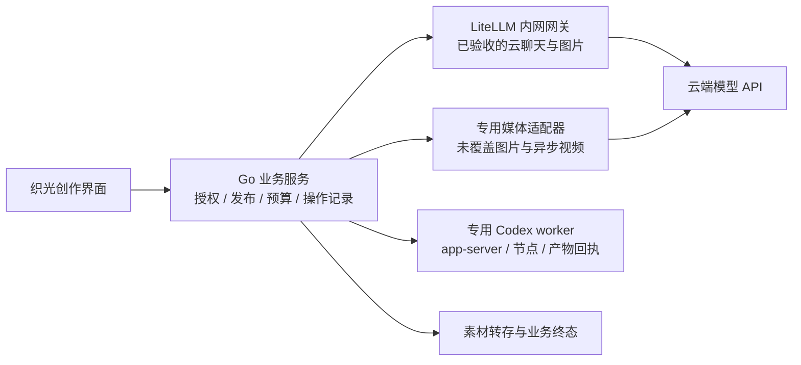

# AI 网关市场调研与 LiteLLM 选型分析

| 项目       | 内容                                                                                                                                                                                                        |
| ---------- | ----------------------------------------------------------------------------------------------------------------------------------------------------------------------------------------------------------- |
| 版本与更新 | 范围修正 v0.2；2026-10-21                                                                                                                                                                                   |
| 文档状态   | 完成公开文档、GitHub 源码和本仓库静态核对；依据用户明确的 Seedream、视频生成和本地 Codex 范围，当前不引入 LiteLLM；未运行 PoC 或部署                                                                        |
| 维护与评审 | 产品战略、AI 接入工程与运行职责；具体评审人未指定                                                                                                                                                           |
| 适用范围   | 多供应商 AI 网关的自研/采购取舍；云端聊天、图片、视频与本地 Codex 的分工                                                                                                                                    |
| 上游基线   | [需求04](../requirement/04-AI平台接入与预设管理需求.md) 的 FR-AI-21～28、BR-AI-10～13；[设计07](../design/07-AI平台接入市场调研与架构设计.md#31-文首来源与范围)；[PRD03](../prd/03-AI平台接入与预设管理.md) |
| 下游关联   | [计划10](../plan/10-AI平台接入与预设管理实施计划.md) 网关评估任务；现有供应商接受仍见[手册11](../plan/11-AI平台接入实施验证与上线手册.md)                                                                   |

## 1. 研究问题、现状与约束

**当前不建议接入 LiteLLM，网关 PoC 暂缓。用户进一步明确实际所需只有 Seedream、视频生成和本地 Codex，多家通用云端聊天并非当前目标。** 在这一范围内，专用媒体和本地运行适配仍需保留，引入网关却增加服务运行、版本升级、凭据投影和故障恢复验证；尚无证据说明其维护节省能覆盖新增成本。此前“云端聊天优先引入”的建议依赖一个不成立的范围假设，现予以修正。

本文属于 research，记录研究证据、候选比较与建议；其中架构和验证内容是待证假设，不是已接受的 design。用户本轮要求评估成熟网关，未要求立即安装、改造生产流量或购买企业版。

### 1.1 产品问题和当前源码事实

| 现状或约束                                                  | 本轮依据                                                                       | 对选型的影响                                                                      |
| ----------------------------------------------------------- | ------------------------------------------------------------------------------ | --------------------------------------------------------------------------------- |
| 当前聚焦 Seedream、视频生成和本地 Codex；原多云聊天扩展暂缓 | 需求04 FR-AI-21～27                                                            | 按端点、模式、账号验证，不能用供应商总数代替覆盖率                                |
| 平台接入管理仅向平台管理员开放                              | 需求04 页面调整、PRD03；providers 页面边界                                     | 网关控制台留在内部运行面，创作者沿用织光界面                                      |
| Go 后端已有预设、发布组合、凭据与收费任务合同               | `catalog/domain/provider_preset.go`、`operation/adapter/managed/activities.go` | 接入 HTTP Proxy 即可，不必在 Go 进程嵌入 Python SDK；不得平行建设第二套业务控制面 |
| 现有云端提交一次收费 POST，传输异常返回 unknown             | `operation/adapter/providerhttp/client.go` 的 Submit                           | 默认重试、跨模型回退和多部署随机选择必须显式约束                                  |
| ProviderConfig 固定供应商域名、区域和参数白名单             | `catalog/domain/provider_preset.go` 的 Validate                                | 不能仅把现有 BaseURL 换成内网网关地址；供应商身份与网关执行路径需分别建模         |
| Codex 使用 app-server RPC、能力探测和产物回执               | `operation/adapter/codex/chat.go`、`app/codexruntime/worker.go`                | 需要保留节点、运行身份、thread/turn、产物转存与费用终态合同                       |

以上为工作区源码事实，不证明真实供应商、生产迁移或用户接受。此前页面测试和协议夹具也不能证明 LiteLLM 的运行效果。

### 1.2 调研口径

使用 `pm-product-strategy:product-strategy` 组织战略取舍，使用 `pm-market-research:competitor-analysis` 比较五个替代产品；通过 GitHub 插件读取仓库/发布/源码、Context7 定位文档，再与官方网页和固定版本源码交叉核对。

- 发布基线：GitHub `releases/latest` 返回 **v1.106.1**，发布时间 **2026-10-20 18:58:28 UTC**，tag 指向 commit `978b4d1e4e91cdaaab2e16fbd02d855439e143c1`。[发布记录](https://github.com/BerriAI/litellm/releases/tag/v1.106.1)、[tag 引用](https://api.github.com/repos/BerriAI/litellm/git/ref/tags/v1.106.1)支持这一快照，不表示已完成供应链验收。
- 主分支对照：`8d9b9926d1658df27fd560264f017a1497b81e7a`。主分支、在线文档、Context7 索引与发布镜像可能不同步；GitHub 代码搜索返回的其他 commit 仅作线索。
- “支持”分三层：文档声明、固定版本实现、织光账号/场景实测。本轮达到前两层的部分核对，**未运行网关、未发收费推理、未做性能测试**。
- 未找到可比的付费客户数、市场份额和独立性能测量，不引用星标、供应商宣传延迟或总模型数来推断质量与市场领先程度。

## 2. 市场比较与选型建议

### 2.1 产品战略：按实际能力范围控制接入成本

| 战略要素   | 本产品的判断与取舍                                                                                                                           |
| ---------- | -------------------------------------------------------------------------------------------------------------------------------------------- |
| 愿景       | 创作者在同一项目中得到可继续编辑、保存和采用的 AI 结果；接入基础设施服务这一目标                                                             |
| 用户细分   | 管理员需要快速接入和排错；创作者需要稳定结果、明确模型和费用；运行人员需要控制凭据、故障和成本                                               |
| 相对成本   | 减少重复编写协议转换，但承担网关运行、升级和剩余适配成本；当前没有工时/流量基线，不能承诺节省比例                                            |
| 价值主张   | 管理员从逐平台研发变为配置与验证；创作者保留统一流程；替代方案是继续逐平台自研、使用供应商聚合服务或采购托管网关                             |
| 取舍       | 当前专注 Seedream、视频生成与本地 Codex，复用已有适配和业务合同；云端通用聊天和独立网关暂缓，避免为假设的供应商规模扩展基础设施              |
| 指标       | 产品指标建议关注可保存并被采用的有效结果；本专项首要指标建议为“通过验收的新增模型接入时间”，同时看失败恢复、维护工时与费用差异；均待建立基线 |
| 增长       | 根据真实需求扩展提供商，验证后复用配置；支持一百家供应商不是本阶段业务目标                                                                   |
| 能力配置   | 内部保留项目授权、素材、模型发布和交易一致性；复用外部网关的协议、流式事件、错误转换与基础观测                                               |
| 可持续优势 | 业务工作流、素材与结果一致性及创作体验更接近产品差异；通用 HTTP 适配不是明显壁垒。这是战略判断，需用交付速度和用户采用验证                   |

### 2.2 市场范围与五个替代产品

比较的是可自托管的多模型网关及相邻 LLMOps 产品，不是基础模型厂商。OpenRouter 同时是本项目要接入的聚合供应商，保留在需求覆盖表；它不能直接替代国内直连和本地 Codex 的全部需求。

| 候选                                    | 已核验的定位与优势                                                                             | 成本、局限与项目匹配                                                                                                                                | 本轮判断与来源                                                                                                                                                                |
| --------------------------------------- | ---------------------------------------------------------------------------------------------- | --------------------------------------------------------------------------------------------------------------------------------------------------- | ----------------------------------------------------------------------------------------------------------------------------------------------------------------------------- |
| **LiteLLM Proxy**                       | HTTP 统一接入；多供应商转换、流式接口、虚拟 Key、基础预算与观测                                | 运营和版本验证仍需承担；媒体端点不齐；部分治理能力属企业版；与现有业务策略重叠                                                                      | **当前不引入**；广泛云端聊天成为真实需求后再评估。[README](https://github.com/BerriAI/litellm/blob/v1.106.1/README.md)、[企业版边界](https://docs.litellm.ai/docs/enterprise) |
| **Bifrost**                             | Go 网关/SDK；官方逐提供商列出聊天、Responses、图片等接口，支持 DeepSeek/OpenRouter；Apache-2.0 | 官方表未直接列出本项目火山/BytePlus；自定义提供商仍需验证；集群和部分治理为企业功能。Go 技术栈便利不能替代覆盖验证                                  | 后续备选；触发重新评估时再比较维护与运行开销。[仓库](https://github.com/maximhq/bifrost)、[覆盖表](https://docs.getbifrost.ai/providers/supported-providers/overview)         |
| **Portkey Gateway**                     | MIT 开源网关，路由、重试与多模态；托管产品提供运行与观测能力                                   | 托管和 OSS/企业私有部署范围不同；README 标记 2.0 分支为预发布。官方定价页列托管 Production $49/月及额外日志费用，不等于本项目私有部署报价或模型费用 | 可作为**采购方案**对照；先核对发行与治理边界。[仓库](https://github.com/Portkey-AI/gateway)、[定价](https://portkey.ai/pricing)                                               |
| **Agent Router（原 Envoy AI Gateway）** | Apache-2.0；基于 Envoy 的流量控制、模型与工具接入，项目已更名/迁移                             | 更贴近已有 Envoy/Kubernetes 平台团队；织光当前 Compose 与业务应用需要额外基础设施集成；媒体与 Codex 覆盖未验证                                      | 后续平台规模化候选，非首轮优先。[官方更名及架构](https://theagentrouter.ai/)、[新仓库](https://github.com/theagentrouter/agent-router)                                        |
| **New API**                             | Go 多模型聚合与分发，管理界面、渠道、计价和异步任务扩展；国内服务管理值得对照                  | 账号、渠道、价格与账务会与织光现有控制面大面积重叠；AGPL-3.0，网络服务/修改与分发的适用义务需按部署方案评估，不能假定拆成服务就免除义务             | 若做独立 API 分发平台更相关；本产品不优先整体引入。[仓库与许可](https://github.com/QuantumNous/new-api)                                                                       |
| **TensorZero**                          | Apache-2.0；网关、观测、评估、优化与实验；Rust                                                 | GitHub API 在本轮返回 `archived: true`，需先查清后续维护主体；图像/文件输入不等于生图；评估系统并非当前接入瓶颈                                     | 暂停进入正式候选，维护状态先过门槛。[仓库元数据](https://api.github.com/repos/tensorzero/tensorzero)、[官方范围](https://www.tensorzero.com/docs/)                            |

开源版本没有供应商授权费用不等于零总成本；企业报价未取得，统一标为待询价。不据归档或近期提交次数推断项目质量或商业失败。

### 2.3 按织光真实需求核验 LiteLLM

| 需求                     | v1.106.1 固定版本证据                                                                                                              | 建议接入方式与限制                                                                                                                      |
| ------------------------ | ---------------------------------------------------------------------------------------------------------------------------------- | --------------------------------------------------------------------------------------------------------------------------------------- |
| DeepSeek 文本聊天/流式   | 能力表列 `deepseek`；标准聊天实现存在，文档说明支持                                                                                | 原广泛接入场景的候选，当前暂缓。具体账号模型、推理字段和流式用量另验；不增加生图能力                                                    |
| OpenRouter 文本聊天      | 能力表列 `openrouter`，原生适配目录存在                                                                                            | 原广泛接入场景的候选，当前暂缓；保留显式供应商和模型选择，约束聚合供应商内部路由                                                        |
| 火山方舟文本聊天         | `VolcEngineChatConfig` 实现和 `volcengine/` 前缀；固定官方端点与参数转换                                                           | 原广泛接入场景的候选，当前暂缓；模型/endpoint ID 按账号核验，不照搬 OpenRouter ID                                                       |
| BytePlus 文本聊天        | 本轮核验的提供商能力表没有独立 `byteplus` 条目；有 OpenAI 兼容通道可供评估                                                         | **待兼容 PoC**。单独固定海外 base URL、凭据与区域，不能因协议相近声明已支持                                                             |
| OpenRouter 生图/参考编辑 | 固定版本含 `image_generation`、`image_edit` 转换及调度入口；但 `provider_endpoints_support.json` 的 `image_generations` 仍为 false | **实现与登记不一致**。已有代码将图片请求转为 chat completions，不等于织光现行专用图片链路。每个型号、输入、输出、参数和计价验收后再迁移 |
| 火山/BytePlus Seedream   | 固定版本的火山目录未见专用图片适配，能力表也未声明生图；BytePlus 无独立条目                                                        | 当前保留直连适配；可评估通用 OpenAI 图片透传或贡献上游，但这部分工程成本仍存在                                                          |
| 火山/BytePlus 视频       | 固定版本火山目录没有 `videos`；核验主分支已出现该目录，在线文档也给出 Seedance/BytePlus 用法                                       | **区分已发布和主分支**。本轮不把新视频代码当发布版本能力；异步任务、下载、参数映射和计费逐项验证                                        |
| OpenRouter 视频          | 固定版本 OpenRouter 目录未见专用视频适配，登记表未声明                                                                             | 现有异步直连保留。普通透传不能自动补齐任务恢复合同                                                                                      |
| 本地 Codex 聊天与生图    | 已有 Codex harness，但其源码为 `codex exec --json`、每轮进程及定制模型提供商；不是织光的 app-server 协议                           | 保留专用节点与 app-server。没有证据证明 harness 可直接满足当前 imageGeneration、持久回执和素材结算要求                                  |

关键固定来源：[能力登记表](https://github.com/BerriAI/litellm/blob/978b4d1e4e91cdaaab2e16fbd02d855439e143c1/provider_endpoints_support.json)、[火山目录](https://github.com/BerriAI/litellm/tree/978b4d1e4e91cdaaab2e16fbd02d855439e143c1/litellm/llms/volcengine)、[OpenRouter 图片实现](https://github.com/BerriAI/litellm/blob/978b4d1e4e91cdaaab2e16fbd02d855439e143c1/litellm/llms/openrouter/image_generation/transformation.py)、[图片调度入口](https://github.com/BerriAI/litellm/blob/978b4d1e4e91cdaaab2e16fbd02d855439e143c1/litellm/utils.py)、[Codex harness](https://github.com/BerriAI/litellm/blob/978b4d1e4e91cdaaab2e16fbd02d855439e143c1/litellm/llms/codex/harness/transformation.py)。主分支新视频代码见[固定对照](https://github.com/BerriAI/litellm/tree/8d9b9926d1658df27fd560264f017a1497b81e7a/litellm/llms/volcengine/videos)。

### 2.4 三种“Codex 支持”必须区分

1. **Codex CLI/Desktop → LiteLLM → 模型 API**：把 LiteLLM 配成 Codex 的模型提供商，调用方向是 Codex 消费网关；不能据此证明网关能复用本地登录的聊天和生图。
2. **`chatgpt/` OAuth → ChatGPT backend**：LiteLLM 已提供订阅账号接入，文档声明 Responses 和桥接 Chat Completions。其账号共享、token 刷新、成本和授权模型不同；文档明确同一代理使用同一账号，不能把虚拟 Key 当多账号隔离。能力表未声明图片端点。
3. **`litellm.agent(Harness.CODEX)`**：beta Agent harness 驱动 CLI，固定版本源码使用 `exec --json` 并把模型调用导向定制提供商。不是现有 app-server 的无缝替代，也不是已验收的图片服务。

依据：[Codex 客户端配置](https://docs.litellm.ai/docs/proxy/client_setup/codex_cli)、[ChatGPT 订阅接入](https://docs.litellm.ai/docs/providers/chatgpt)、[Agent harness beta](https://docs.litellm.ai/docs/harness)。ChatGPT 订阅文档还说明成本表缺价时记录 spend 为零；这不能用来确认织光用户费用或绕过预算。本轮不导入个人登录文件，不采用这一链路替换本地运行节点。

### 2.5 总成本与决策门槛

按同一评估周期比较：**引入收益 = 避免的适配/回归工时与故障损失 − 网关迁移、运行、升级、剩余桥接、许可和退出成本**。这些量当前未测得；模型调用费用另算，不能算成网关开源带来的节省。

单实例静态配置 PoC 可先不引入完整虚拟 Key/账务数据库。正式使用这些功能时核对 Postgres、密钥加密、备份和迁移；多实例的共享限流/路由状态按官方要求评估 Redis，使用独立逻辑库/权限，不能把网关表并入业务唯一 schema。当前基础设施已有 Postgres/Redis也不代表新增运行成本为零。[生产部署依据](https://docs.litellm.ai/docs/proxy/prod)

通过条件是覆盖计划中的高频链路、重试与恢复合同可控、升级成本低于继续自研，并具备明确维护人和回退路径。若业务主要负载是当前未覆盖的 Seedream/视频/Codex，引入收益可能较小；应只采用聊天子集，或延期全面引入。

## 3. 用户价值与场景影响

当前用户结果是 Seedream 产图、视频生成及本地 Codex 聊天/生图的真实交付；优先完成现有适配、素材转存、费用和任务恢复，不为通用云端聊天增加网关。下表仅记录未来采用网关时需保留的交互合同。

管理员继续在 `/providers` 选平台、配置凭据和模型，再完成真实验证和发布；网关部署由内部工程/运行职责管理。页面沿用设计07第56节的精简管理员界面，本轮无新增界面或原型。

| 场景                   | 调用方行为                                             | 可见反馈与恢复                           | 追踪           |
| ---------------------- | ------------------------------------------------------ | ---------------------------------------- | -------------- |
| 尚未部署对应网关能力   | 不发布执行组合，保留候选/草稿                          | 待配置或不可用                           | FR-AI-22/23/28 |
| 经过验收的网关聊天     | 服务端绑定项目权限、模型发布与执行配置，再调用内网网关 | 正常文本/流式状态与真实来源              | FR-AI-24/27    |
| 网关超时或流式断开     | 保存同一操作与不确定状态                               | 结果待确认；恢复同一轮，不能重新收费生成 | FR-AI-26       |
| 供应商鉴权失败         | 拒绝并给管理员可处理的安全错误                         | 修复对应连接的凭据                       | BR-AI-11/12    |
| 非平台管理员打开管理页 | 不加载管理数据，后端拒绝管理请求                       | 无权访问；创作仅使用已发布安全投影       | 原权限合同     |

## 4. 接入边界与架构假设

### 4.1 扩展场景的候选架构与职责

以下网关架构只供未来广泛接入场景复用，当前不实施。当前设计继续使用 Go 业务服务、现有媒体适配与专用 Codex worker。

这是目标分工图，当前代码尚无 LiteLLM 执行路径。云端结果实际须经现有业务接收与转存合同；箭头不代表供应商能直接写入织光素材库。

| 能力                                                  | 权威归属/建议实现                                        |
| ----------------------------------------------------- | -------------------------------------------------------- |
| 项目、账号权限、平台管理员能力                        | 织光，前后端统一校验                                     |
| 候选目录、预设、模型模式、价格、验证和发布组合        | 织光；LiteLLM 模型目录只作为资料来源，不能自动发布       |
| 供应商协议、标准流式转换与传输错误                    | 已覆盖链路交给 LiteLLM；未覆盖链路仍用专用适配器         |
| 任务受理、unknown、取消、预算预留/扣减/释放、结果采用 | 织光；网关用量/成本仅作运营与对账输入                    |
| 素材持久化、下载重试与输出数量                        | 织光；不能由网关请求成功直接判定业务完成                 |
| 自动路由、fallback、缓存、健康探测                    | 首期关闭或限制；功能配置必须通过合同测试，不继承默认策略 |
| 网关管理 UI、MCP/Agent 管理能力                       | 内部维护，不向创作者开放，也不因安装网关扩展当前产品范围 |

### 4.2 接入合同建议

采用独立 HTTP Proxy，Go 通过现有消费方接口接入，不嵌入 Python SDK。供应商配置与执行路径分离：保留真实 supplier、区域、release/config/credential 版本；内部另绑定固定网关部署、映射版本和镜像摘要。**不是把当前供应商 BaseURL 直接替换成网关地址。**

每个已发布执行组合映射到唯一受控 deployment/别名，别名发布后不改写；只有一个后端供应商配置，不使用同名随机多部署。请求记录模型、网关映射版本、operation/attempt 身份及安全的上游回执，响应再次核对实际部署。不要让浏览器提交 api_base、api_key、retry/fallback 或部署覆盖字段。

OpenRouter 自身仍可能具有供应商路由策略；网关只有一个 OpenRouter deployment 并不冻结其内部路由。项目要求保留/固定的上游来源、数据处理条件和 fallback 参数须另行核验。

## 5. 数据与一致性影响

| 对象                       | 唯一事实来源               | 网关侧如何使用                                            |
| -------------------------- | -------------------------- | --------------------------------------------------------- |
| 平台连接及凭据版本         | 织光当前加密与生命周期合同 | 生成受限执行投影；网关副本不是第二个编辑入口              |
| 模型发布、配置、价格、验证 | 织光不可变发布组合         | 创建版本化部署映射，发布前后不静默修改                    |
| 操作/轮次和供应商任务 ID   | 织光操作记录与回执         | 关联网关请求 ID/实际部署与上游回执；未知状态查询原请求    |
| 用户应付、预留和结算       | 织光版本化规则与业务账本   | 网关成本字段是证据，不充当用户交易账本；缺用量/缺价不填零 |
| 网关运行配置/缓存/日志     | 派生配置和运行面           | 独立命名空间、最小权限和保留期，不直接修改业务 schema     |

凭据承接还需选定实现：保持织光唯一写入入口，向网关投影经版本绑定的最小配置，或在所选版本证明支持后使用逐请求上游凭据传递。两种方式都要验证敏感字段不入日志、旧凭据 draining 可恢复及撤销生效；本轮未声称任意供应商都支持动态传 Key。不要同时允许两套控制台独立轮换同一连接。

本轮仅调研，不新增数据库字段或迁移。正式接口与表结构在 PoC 结果基础上细化，沿用现有存量迁移规则。

## 6. 风险与待证假设

| 风险                               | 对项目的影响                                      | 采用前必须满足的合同                                                                                                                                                   |
| ---------------------------------- | ------------------------------------------------- | ---------------------------------------------------------------------------------------------------------------------------------------------------------------------- |
| 隐式重试与多级 fallback            | 一个操作可能产生多次上游请求或切换已确认模型      | 所有收费 POST 默认一次；核对 router、SDK、HTTP client、请求头/请求体覆盖、deployment 和 retry_policy；禁用 hedging/自动跨部署、模型 fallback；故障注入统计真实请求次数 |
| 只配置 `num_retries: 0` 就认为安全 | header/body、策略或上游 SDK 仍可能改变行为        | 配置只是起点；Go 只发允许字段、边界过滤策略覆盖；固定版本逐端点证明，不复制通用示例作为验收                                                                            |
| 健康检查触发推理                   | 后台探测可能持续产生费用和数据                    | 默认关闭模型生成型健康检查；只测网关 liveness/readiness 与经过审阅的只读接口；收费验证由管理员明确发起并记录                                                           |
| 成本登记为零或估算与账单不同       | 预算失效、用户错误扣费                            | 费用状态区分未知/估计/实际；沿用织光预算与人工终态；核对供应商账单                                                                                                     |
| Prompt、参考图片或响应进入网关日志 | 新增数据副本与访问范围                            | 核验日志/回调默认值，最小化正文保留，配置脱敏与访问权限；数据发往供应商仍须遵守原区域合同                                                                              |
| 请求被接收但响应丢失               | 重试可能重复生成、重复付费                        | 保存 unknown，不将 5xx/超时一律当作未提交；仅对可查询原任务进行协调，无法确认时人工处理                                                                                |
| SSE 部分输出或取消                 | 用户已有片段，供应商仍可能计费                    | 区分临时增量与完成；取消意图和上游取消结果分开，不能收到客户端断开就退款                                                                                               |
| 网关停机、升级或 DB 故障           | 新依赖成为故障点；错误的 fail-open 配置可绕过限制 | 按单条执行链路失败处理；不自动直连补发；评审升级、备份、就绪和 fail-closed 边界                                                                                        |

源码和官方文档明确提供多级重试及 fallback：[固定 Router](https://github.com/BerriAI/litellm/blob/978b4d1e4e91cdaaab2e16fbd02d855439e143c1/litellm/router.py)、[路由重试优先级](https://docs.litellm.ai/docs/routing)、[fallback](https://docs.litellm.ai/docs/proxy/reliability)。在线火山视频文档还明确提示模型健康检查会创建收费视频；这是后续视频迁移的直接风险依据，不能因当前发布版本未含该代码而忽略升级后的行为。[官方说明](https://docs.litellm.ai/docs/providers/volcano)

许可按固定版本[LICENSE](https://github.com/BerriAI/litellm/blob/978b4d1e4e91cdaaab2e16fbd02d855439e143c1/LICENSE)区分：声明非 enterprise 限制范围的内容为 MIT；企业功能不能据此认定全部免费。官方企业页将 SSO/SCIM、审计、部分组织治理、Secret Manager、支持等列入付费范围。织光已有业务授权和审计仍由自身负责；需要付费功能时先确认报价、部署包与适用许可，不通过复制相关实现规避许可。

## 7. 未来触发后的验证方案

本节保留研究结果，当前不安排网关 PoC。仅当出现多个有明确需求的云端聊天提供商、持续适配工时成为已测量瓶颈，或现有结构无法经济地满足治理要求时，重新评估收益并决定是否执行。供应商数量本身不是触发条件。

### 7.1 最小 PoC 与采用门槛

| 验证包                | 方法与范围                                                                                                                                | 通过证据与失败时的决定                                                                 |
| --------------------- | ----------------------------------------------------------------------------------------------------------------------------------------- | -------------------------------------------------------------------------------------- |
| P0 固定发行和配置     | v1.106.1 仅是调研基线；PoC 前重新核对正式版本、源代码与镜像 digest/签名，做依赖与公告检查                                                 | 产物、配置、范围和许可可复现；有阻断项即换版本或暂停                                   |
| P1 无费用合同         | 隔离网关+受控假上游；四家聊天请求映射、非法参数、401/429/5xx/断流/接受后断连/重启等                                                       | 每个收费请求最多一次上游 POST；部署和凭据身份不变，unknown 不补发；不满足则阻断该链路  |
| P2 已有管理与账务边界 | 用隔离数据验证无权限、撤权、发布草稿、价格缺失、旧 Key 恢复、网关日志与用量缺失                                                           | 绕不过织光业务校验；无错计费、无明文泄露；网关统计不覆盖业务账本                       |
| P3 真实聊天接受       | 有授权账号及预算后，对 DeepSeek/OpenRouter/火山各一条文本和流式链路；BytePlus 单列兼容验证                                                | 保存请求/完成/用量/错误及账单证据，账号/模型/区域逐项通过，不以一个模型通过覆盖全部    |
| P4 图片模式           | 固定模型验证 OpenRouter 文生图/参考图、实际张数、参数、内容类型与转存；Seedream 另立兼容测试                                              | 与当前业务合同等价才迁移；不通过继续专用适配，禁止隐藏降级到其他协议/模型              |
| P5 运行与经济性       | 在同一网络/模型/请求条件下比较直连、LiteLLM；如有必要加 Bifrost。测请求成功率、TTFT、P50/P95额外延迟、资源、取消/重启恢复、接入与升级工时 | 先建立需求基线再定阈值；未测不引用供应商自报 benchmark。维护收益不足则只采用子集或延期 |

建议给 PoC 设置容量上限和一次评审点，按可用工程人数与真实账号安排；当前没有团队容量、调用量或工时数据，不承诺具体工期。禁止将生产请求镜像到真实收费生成接口做“双跑”对照；对照须用假上游或独立明确预算的测试。

### 7.2 需求与验收追踪

| 上游要求                   | 本文承接                                     | 下游接受                                |
| -------------------------- | -------------------------------------------- | --------------------------------------- |
| FR-AI-21/24 多云聊天与图片 | 第2.3、4节的端点覆盖及执行分工               | 原 AC-AI-22/25，新增 AC-AI-29；P1/P3/P4 |
| FR-AI-22/23/27 候选与发布  | 第4～5节，目录不能自动上线、别名不能隐藏路由 | AC-AI-23/24/28；P2                      |
| FR-AI-25/26 本地与收费恢复 | 第2.4、5～6节，专用节点和未知操作不重复      | AC-AI-26/27；网关不能替代原 Codex 接受  |
| FR-AI-28 成熟网关选型      | 第2节替代品/经济性、第7节门槛与第8节发布     | AC-AI-29；计划10 T-AI-17                |

本轮实际完成：公开来源读取、源码/目录/版本比对、现有合同盘点与建议文档。上述 P0～P5 **均未作为运行 PoC 执行**；未取得延迟、成功率、成本节省或真实账号覆盖率。

## 8. 结论适用范围与待决事项

当前保持专用接入，优先完成 Seedream、视频与本地 Codex 的真实接受。只有第7节重评条件成立，才考虑网关 PoC 和新发布组合灰度。现有模型、在途任务、历史配置/凭据和 Codex 继续按原冻结身份恢复。

回退应是停止新流量进入问题映射，再为新操作显式选择经过验证的旧执行路径；**对正在执行或结果未知的请求不能自动改走直连**。原适配器至少保留到历史回执和任务生命周期结束。

| 待决事项                           | 建议与责任职责                                               | 关闭条件                                         |
| ---------------------------------- | ------------------------------------------------------------ | ------------------------------------------------ |
| 是否采用 LiteLLM、首期覆盖哪些链路 | 产品+AI 工程；当前暂不引入；优先完成三个核心能力             | P1/P2满足硬门槛，P3/P5证明覆盖及维护收益后接受   |
| 凭据在网关的承接与历史恢复         | AI 工程+运行；织光唯一写入源，版本化投影或经过证明的动态传递 | 固定版本端到端证明轮换、撤销、draining与日志边界 |
| OSS/企业版和基础设施投入           | 运行+采购职责；不预设需要企业版                              | 确定使用功能、部署成本、维护人和必要报价         |
| BytePlus/Seedream/视频缺口         | AI 工程；优先复用现有适配，评估通用协议或上游贡献            | 对每条模式有真实接受与剩余维护成本估算           |
| Codex 正式开放、费用与部署         | 原 PRD03 的产品/运行决定继续单独跟踪                         | 本轮网关建议不替代已有未决项                     |

评审状态：2026-10-21 范围修正 v0.2，按用户最新范围修正为当前不引入，未来重评仍需单独决定；未运行 PoC，未改变业务代码、数据库、Compose 或部署。
