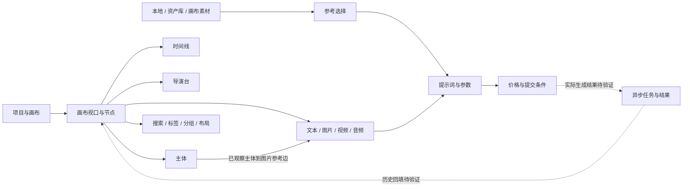

# 即梦无限画布需求基线

观察日期：2026-10-28（Asia/Shanghai）。来源需求：[无限画布对齐即梦](../requirement/14-无限画布对齐即梦需求.md)。

本报告先独立分析即梦，不读取 Glowloom 功能实现，不宣称任何当前实现差异。研究覆盖桌面画布主要入口、各类型空节点、参数菜单、文本编辑、多选、连接创建和撤销。真实生成结果、非空资源处理、多人协作和异常恢复尚无完整行为证据。

## 1. 来源、证据与可信边界

目标是用户已打开的即梦画布「一致性调研-202610221」，位于 `jimeng.jianying.com/ai-tool/ai-canvas/`。初始有三个文本节点、一个视频节点、一个导演台外部节点；文本3选中，缩放60%，小地图关闭，连线显示开启，积分66。

采用用户指定的 reverse-engineer-anything 的分阶段、问题清单和证据分级方法。REA 工具已注册，但本机检查未发现 Chrome 的可用监听调试端口；没有改动调试配置、重启浏览器或创建另一登录环境。实际检查使用已连接的 Chrome 浏览器工具，**没有产生 REA Evidence ID，也没有采集网络请求、源码、凭据或存储内容**。

证据在 [本次证据目录](evidence/2026-10-28-jimeng-canvas/README.md)。编号 `E02…E50` 对应文件名前缀，属于本报告本地编号，不是 REA ID。证据分为完整 AX 快照、截图和本会话工具返回内容的人工整理摘录。早期重复 AX 读取只返回“无变化”，已改为如实整理首次返回的观察，不将其伪装为完整快照。

采用三个覆盖等级：

- **行为观察**：实际执行动作并看到结果；只证明该条件下的行为。
- **界面观察**：菜单、控件、文案或空态可见；不证明端到端能力。
- **待验证 / 建议**：没有实测，或是面向重建设计的分析规则。

所有模型及价格只代表本次界面。`Room connected` 和“已保存”只证明页面状态显示，不证明服务端落库、离线恢复、多人一致性。模型文案中的能力声明不等于实测。

## 2. 产品结构与核心工作流

画布同时承载内容组织、素材引用、生成配置和后续编辑。节点并非全部都是同一种卡片：文本是富文本编辑载体；图片、视频、音频关联生成器；主体组织主媒体、辅助媒体与音色；时间线有轨道、剪辑与导出；导演台是外部创作入口。

关键事实：

1. 选中节点决定操作条和生成面板，多选切换为集合操作。
2. 连线存在类型限制，不能把任意节点连接都当作合法参考。
3. 创建连接可一次新增目标节点与边；一次撤销同时移除二者（本次主体→图片样本）。
4. 空主体可以建立参考边，但本次图片生成器没有因此获得可用参考素材项。
5. 图片与视频的生成器各有导演工具箱；相机与运镜属于不同媒体上下文。
6. 搜索、生成历史、资产库、主体选择和 AI 对话具有不同的信息范围，不宜合并成一个泛用列表。

## 3. 可追踪的功能与交互需求

以下为竞品需求基线及候选验收，不是 Glowloom 缺陷清单。表中“验收要点”说明后续重建应验证什么；含未测行为的部分不能标记通过。

### 3.1 项目外壳、视口与节点组织

| ID     | 已观察的入口或规则                                                               | 覆盖 / 证据                             | 验收要点                                             |
| ------ | -------------------------------------------------------------------------------- | --------------------------------------- | ---------------------------------------------------- |
| JC-001 | 顶栏包含返回首页、标题、项目菜单、节点数、保存状态                               | 界面；E50                               | 区分项目操作、画布操作与节点操作；标题和保存状态清晰 |
| JC-002 | 节点统计按图片、视频、文本、音频、主体、时间线、外部分项；可查看项目信息         | 界面；E27                               | 分项与总数一致；组是否计入需补查                     |
| JC-003 | 顶栏右侧搜索、生成历史、分享、更多、积分会员及用户入口                           | 界面；E50                               | 全局入口与选中节点无关，面板焦点可返回               |
| JC-004 | 左侧竖栏：文本、图片、视频、音频、时间线、主体、导演工具箱、导演台、资产库、上传 | 行为/界面；E06、E11、E15、E18、E20、E50 | 各入口行为分别定义；资产库不是直接创建同名节点       |
| JC-005 | 点阵暗色画布、左下视口工具、右下 AI 对话                                         | 界面；E50 PNG                           | 主画布保持连续空间，浮层不混入节点坐标内容           |
| JC-006 | 缩放菜单含放大、缩小、适配画布、缩放至选中项及50/100/200%                        | 界面与适配实测；E02                     | 适配内容；比例输入回车生效；滚轮锚点、边界另测       |
| JC-007 | 缩放百分比可输入；已恢复为60%                                                    | 行为；E02、E50                          | 可编辑值、展示值与实际视口一致；非法值需补查         |
| JC-008 | 小地图开关可显示/隐藏缩略视图                                                    | 行为；E49                               | 开关有状态；小地图拖动导航、缩放范围待测             |
| JC-009 | 选择工具和显示连线开关位于视口工具组                                             | 界面；E50                               | 连线可见性不应被误写为引用删除；实际切换语义待测     |
| JC-010 | 单击选择；空白取消；Shift追加选择得到2个节点                                     | 行为；E45、E46                          | 单选、追加、取消和编辑状态互不混淆                   |
| JC-011 | 工具栏创建视频/图片/音频/时间线/主体时新增编号节点并选中                         | 行为；E06、E11、E15、E18、E20           | 默认空态、命名编号、落点、避免重叠分别验证           |
| JC-012 | 右键空白提供新建节点子菜单、粘贴、撤销、重做                                     | 界面；E29                               | 菜单与键盘入口结果一致；具体快捷键以证据为准         |
| JC-013 | 节点右键提供复制、副本、粘贴、保存到其他画布、撤销、删除等上下文操作             | 界面；E28                               | 复制、跨画布和删除的内容/引用语义需逐项验证          |
| JC-014 | 多选工具条显示节点数、堆叠、编组、布局、下载、标签和后接入口                     | 行为；E46                               | 多选不展示单节点生成器；批量动作定义适用集合         |
| JC-015 | 编组有普通组、分镜组；混合文本和视频时分镜组禁用，提示仅图片且最多49个           | 界面；E48                               | 类型与数量校验；49/50边界、嵌套与解组待测            |
| JC-016 | 布局菜单有宫格布局、智能布局                                                     | 界面；E47                               | 实际排列、不同尺寸、组内/组外和撤销待测              |
| JC-017 | 标签面板提供五种颜色与全部清空，可在多选下打开                                   | 界面；E44、E46                          | 标签不同于节点背景色；单选/批量读写及清空待测        |
| JC-018 | 本次连接创建可用⌘Z原子撤销；创建的六个临时节点最终全部撤销                       | 行为；E31、E35、E37–E41                 | 复合操作撤销粒度、重做及跨编辑器历史需分别测试       |

### 3.2 文本与参考连接

| ID     | 已观察的入口或规则                                                                       | 覆盖 / 证据    | 验收要点                                             |
| ------ | ---------------------------------------------------------------------------------------- | -------------- | ---------------------------------------------------- |
| JC-019 | 文本单选呈八方向尺寸手柄，边中点部分提示Enter重置该维度                                  | 界面；E50      | 最小尺寸、拖动、自动高度、维度重置另测               |
| JC-020 | 文本节点上方可重命名、加标签，操作条有背景色、全屏、下载                                 | 界面；E50      | 标题不混为正文；全屏退出、导出格式待测               |
| JC-021 | 双击文本进入编辑器，操作条切为富文本工具                                                 | 行为；E42      | 编辑态与生成态、节点快捷键互相隔离                   |
| JC-022 | 正文、H1/H2/H3；无序/有序列表、引用、段落对齐、粗体、删除线、斜体、下划线、编辑撤销/重做 | 界面；E42、E43 | 混合格式、粘贴、长文、IME与导出一致性待测            |
| JC-023 | 文本背景为无颜色及青绿/靛蓝/紫/橙/黄                                                     | 界面；E05      | 背景色与标签独立保存与渲染                           |
| JC-024 | 文本生成有参考区、提示词、展开入口；空提示词时生成禁用，并有重试提示                     | 界面；E03、E50 | 不将初始错误归因于空输入；错误来源、可恢复路径待验证 |
| JC-025 | 添加参考有本地上传、资产库、画布选择三种来源                                             | 界面；E03      | 导入、选择、取消、重复选择和移除分别定义             |
| JC-026 | 节点前后各有连接创建入口                                                                 | 界面；E04、E50 | 前/后方向、落点与边方向需区分，不能只改按钮位置      |
| JC-027 | 文本后接允许文本/图片/视频，禁止音频/时间线/主体/导演台                                  | 界面；E04      | 禁用项保持可见并有原因；完整矩阵见下表               |
| JC-028 | 主体后接允许图片/视频/音频，禁止文本/时间线/主体/导演台                                  | 界面；E30      | 该结论仅适用本次空主体的后接菜单                     |
| JC-029 | 空主体后接图片新增一节点、一参考边；边上有来源标签                                       | 行为；E31      | 边、节点、来源标识应一致更新，撤销不留悬空边         |
| JC-030 | 空主体有边但没有可用参考素材项                                                           | 行为；E31      | 分开定义拓扑合法性、素材可用性、生成可提交性         |

本次已观察的**后接创建矩阵**（✓可选，×禁用，?未测）：

| 来源→目标                               | 文本 | 图片 | 视频 | 音频 | 时间线 | 主体 | 导演台 |
| --------------------------------------- | ---- | ---- | ---- | ---- | ------ | ---- | ------ |
| 文本                                    | ✓    | ✓    | ✓    | ×    | ×      | ×    | ×      |
| 空主体                                  | ×    | ✓    | ✓    | ✓    | ×      | ×    | ×      |
| 图片 / 视频 / 音频 / 时间线 / 外部 / 组 | ?    | ?    | ?    | ?    | ?      | ?    | ?      |

自连、环路、重复边、重连、删除来源、前接矩阵和多选连接均未验证。不可从两行菜单推导完整 DAG 规则。

### 3.3 图片、视频、音频与导演工具箱

| ID     | 已观察的入口或规则                                                                       | 覆盖 / 证据    | 验收要点                                                         |
| ------ | ---------------------------------------------------------------------------------------- | -------------- | ---------------------------------------------------------------- |
| JC-031 | 图片空节点选中后出现参考、提示词、模型、尺寸/数量、价格和生成按钮                        | 行为/界面；E11 | 节点选中与编辑器绑定正确；空输入禁用有理由                       |
| JC-032 | 图片当前默认Seedream 5.0 Lite，1:1、2K、1张，界面价格3/张                                | 界面；E11      | 默认来自当前能力配置，不固定为永久合同                           |
| JC-033 | 图片比例8种，分辨率2K/4K，数量1–8                                                        | 界面；E12      | 选项、模型、权限限制联动（套餐含义待验证）；切换后不能遗留非法值 |
| JC-034 | 图片模型菜单有9个可见条目及能力描述，部分带 Standard-only model 标记，具体套餐含义待验证 | 界面；E13      | 标签、描述、选中态、禁用原因与真实服务可用性分开                 |
| JC-035 | 图片生成器可展开为模态；参考区按全部/图片/文本过滤；提供宽度调节控件                     | 行为/界面；E32 | 展开/折叠应保留草稿；宽度上下限和窄屏待测                        |
| JC-036 | 视频默认Seedance 2.0 VIP，16:9、720P、1个、全能参考、4秒；界面价格56                     | 界面；E06      | 参数与报价对应当前模型组合；费用不可据UI推断已扣款               |
| JC-037 | 视频比例6种，分辨率720P/1080P/4K，数量1–4                                                | 界面；E08      | 不复用图片的完整参数集合；模型间差异需逐一校验                   |
| JC-038 | 视频模式为首尾帧/全能参考；时长有滑块与数值输入                                          | 界面；E09、E10 | 模式切换槽位与素材保留、时长范围和步长待测                       |
| JC-039 | 当前全能参考模式下Seedance 1.0 Fast禁用并说明不支持该模式                                | 界面；E07      | 不支持的模型需明确原因；能力文案与实际接口分开验收               |
| JC-040 | 音频有音频生成/音乐生成；音频生成有全能配音/文本朗读                                     | 界面；E15–E17  | 不将音乐和朗读当同一种提示词表单；音乐细节待测                   |
| JC-041 | 当前SeedAudio 1.0、音色库入口；显示现价12、原价24、积分5折和折扣详情                     | 界面；E15      | 价格语义、单位、折扣详情与扣费状态需分别定义                     |
| JC-042 | 图片导演工具箱有相机/配色/风格；视频有配色/风格/运镜                                     | 界面；E06、E11 | 上下文相关，不将相机与运镜混为一组通用控件                       |
| JC-043 | 相机弹窗按相机/镜头/焦距/光圈分组轮播，含自动及确认                                      | 界面；E14      | 预览、选择、确认、取消独立；应用如何影响提示词待测               |
| JC-044 | 配色为多组选择控件，无选择时确认禁用；风格有预览轮播与确认                               | 界面；E33、E34 | 已有配色名称；选择反馈、应用及组合上限需补查                     |
| JC-045 | 运镜弹窗显示20个可见预设，无选择时确认禁用                                               | 界面；E40      | 选择数量、应用、清除及模型兼容性待测                             |

当前参数明细：

| 媒体 | 可见比例                                  | 分辨率          | 数量 | 其他                                          |
| ---- | ----------------------------------------- | --------------- | ---- | --------------------------------------------- |
| 图片 | 21:9、16:9、3:2、4:3、1:1、3:4、2:3、9:16 | 2K、4K          | 1–8  | 4K带 Standard-only model 标记，套餐含义待验证 |
| 视频 | 21:9、16:9、4:3、1:1、3:4、9:16           | 720P、1080P、4K | 1–4  | 当前默认4秒；时长上下界未知                   |

本次记录的可见模型名称及部分能力文案摘要在 E07、E13。它们是菜单观察摘录，不能证明接口现已开放或所有组合可用。

### 3.4 主体、时间线、资产与画布级面板

| ID     | 已观察的入口或规则                                                                      | 覆盖 / 证据         | 验收要点                                             |
| ------ | --------------------------------------------------------------------------------------- | ------------------- | ---------------------------------------------------- |
| JC-046 | 主体空态区分主媒体、辅助媒体、音色；支持说明编辑和多种导入入口                          | 界面；E20           | 主体不是单张图片；引用时需保存主体语义               |
| JC-047 | 导入主体为独立选择器，含搜索、筛选、收藏、选择数量和确认                                | 界面；E21           | 零选择禁用；选择/取消、跨来源与导入结果待测          |
| JC-048 | 时间线空态有visual/audio轨道计数、时长、分割/删除、静音、全屏和尺寸调整                 | 行为/界面；E18      | 空态与有剪辑态操作不同；时长计算和轨道规则待测       |
| JC-049 | 时间线素材来源为本地、资产库、画布；AX说明支持拖动与Shift方向键排序                     | 界面；E19、E18      | 接收媒体类型、插入位置、排序与撤销需实测             |
| JC-050 | 导出含MP4、批量素材、剪映、XML、DaVinci、Premiere、Final Cut；空时间线MP4与批量素材禁用 | 界面；E36           | 可见入口不证明已能导出；格式、编解码、文件有效性待测 |
| JC-051 | 导演台节点描述3D空间角色、机位与镜头                                                    | 界面；E50           | 内部3D编辑未进入，不能宣称完整导演台需求已覆盖       |
| JC-052 | 资产库一级资产/主体/画布；资产二级图片/视频/音频/文档                                   | 界面；E22           | 来源分层与类型过滤不同；跨页选择与多选限制待测       |
| JC-053 | 资产库有搜索、时间、筛选、选中数量、确认；空集合显示空态                                | 界面；E22           | 搜索与筛选组合、清空、加载及失败态待测               |
| JC-054 | 图片资产筛选有收藏、超清、分辨率、比例                                                  | 界面；E22           | 不将图片筛选强加给其他类型；具体集合见证据           |
| JC-055 | 画布搜索按节点类型分类计数，结果显示名称及类型                                          | 界面；E23           | 搜索范围、标签/正文匹配、命中定位尚未实测            |
| JC-056 | 生成历史有全部/图片/视频/音频及积分明细；当前为空                                       | 界面；E24           | 非空任务、处理中、失败、重试、历史回填待测           |
| JC-057 | 当前画布分享范围为仅自己，另有获得链接的任何人；可复制链接、创建团队                    | 界面；E25           | 链接访问范围、复制、协作角色与撤销权限不能混淆       |
| JC-058 | AI对话侧栏提供宽度调节控件，有会话、参考、/技能、@主体与发送入口                        | 界面；E26           | 所选主体可带入参考；多会话、任务执行和写回待测       |
| JC-059 | 操作后页面出现保存状态，撤销后显示已保存                                                | 界面；E37–E41、E50  | UI反馈不等于落库；刷新、断线、并发、失败必须独立测试 |
| JC-060 | AX提供节点类型、资源状态、选中状态、按钮名及部分键盘提示                                | 界面；E42、E46、E50 | 配色控件已有名称；键盘操作、读屏体验与焦点管理需验证 |

## 4. 状态与数据语义分析

以下是为需求拆分而建立的**分析模型**，不是从即梦源码或服务端读出的数据结构。

| 概念     | 应分别表达的内容                       | 本次证据与限制                                 |
| -------- | -------------------------------------- | ---------------------------------------------- |
| 节点     | 类型、名称、内容、几何、标签、选择状态 | 名称/空态/选择已观察；几何存储、唯一ID策略未知 |
| 参考关系 | 来源、目标、方向、兼容性、来源可用性   | 参考边与两种后接菜单已观察；执行调度语义未知   |
| 资源     | 原始素材、处理状态、可用结果、失败原因 | AX有ready/processing/failed计数；当前均为0     |
| 生成草稿 | 提示词、参考项、模型、参数、导演设置   | 表单已观察；切换节点/刷新后的持久化未知        |
| 生成任务 | 提交快照、排队、运行、结果、失败、取消 | 仅入口与空历史；生命周期待验证                 |
| 主体     | 名称/说明、主媒体、辅助媒体、音色      | 空主体结构已观察；版本/复制/绑定语义未知       |
| 时间线   | 轨道、剪辑、顺序、区间、音量、导出配置 | 空轨道与操作已观察；非空状态待验证             |
| 组       | 成员、普通/分镜类型、布局              | 菜单已观察；嵌套、删除、移动语义未知           |
| 视口     | 平移、缩放、小地图、连线显示           | 缩放与小地图已观察；是否跨设备保存未知         |
| 权限     | 访问范围、编辑能力、协作成员           | 当前自有画布可编辑；分享不等于协作角色         |

状态至少应按相互独立的维度分析，避免用一个“加载中”覆盖所有过程：

- 交互：未选中、单选、多选、文本编辑、全屏/展开。
- 资源：空、可用、处理中、失败。后三项只有AX字段，实际资源尚未验证。
- 生成：输入不足、可提交、提交中、排队、运行、成功、失败、取消。仅输入不足已观察，其余是补证清单。
- 保存连接：保存中、已保存、失败、断线、重连。后面三种待测。
- 引用：无引用、合法拓扑但空素材、有效素材、失效素材。后两种待测。

重点组合：引用源被删除时是否保留快照；模型切换使参数非法时如何处理；生成中换节点/关闭页面时任务去向；多选不同媒体时允许哪些集合操作；文本编辑中的撤销是否泄漏到画布历史。

## 5. 视觉与设计稿覆盖要求

这里提炼可观察的布局关系，**不是已经修改的 Figma，也不是测量后的精确像素规格**。后续设计应补齐尺寸、间距、滚动、焦点和响应式约束。

| 区域            | 已观察的视觉关系                                     | 设计必须表达的状态                 |
| --------------- | ---------------------------------------------------- | ---------------------------------- |
| 画布底层        | 近黑背景、低对比点阵，节点浮于其上                   | 空画布、大画布、缩放、视口边缘     |
| 顶栏            | 左项目身份/数量/保存；右全局操作与账户               | 保存中/失败、不同权限、长标题      |
| 左工具栏        | 圆角竖向图标条，创作类型与资源入口分段               | hover、焦点、禁用说明、空间不足    |
| 节点标题        | 节点外上方类型标识与名称；选中时出现标签/连接点      | 单选、多选、长名称、重命名         |
| 选中节点        | 轮廓、尺寸手柄或类型操作、左右连接入口               | 缩放后的点击区、边缘遮挡、编辑态   |
| 浮动操作条      | 靠近选中内容上方；随类型和多选改变                   | 文本、媒体、主体、时间线、混选     |
| 内联生成器      | 当前选中内容附近，宽于小节点；参考、提示词、参数分层 | 空参考、多参考、长提示、报价与错误 |
| 展开生成器      | 遮罩模态，参考分类、折叠与宽度调整                   | 宽/窄窗口、焦点约束、草稿保持      |
| 资产/主体选择器 | 遮罩容器，顶部导航/搜索，下方列表，底部计数确认      | 加载、空、选中、多选、筛选、失败   |
| 搜索/历史       | 画布内独立功能面板，按类别筛选                       | 空结果、长列表、定位、任务状态     |
| AI对话          | 右侧可调整宽度的侧栏                                 | 无会话、草稿、参考、执行、错误     |

Figma 至少按以下画板/变体集合设计，而不是只画一个主页面：

1. 空画布、已有节点、项目/统计/缩放菜单、小地图。
2. 文本展示、单选、编辑、全屏、背景与标签菜单、长文本。
3. 图片/视频/音频的空节点、选中、有效结果、处理与失败。
4. 三类生成器的内联/展开、参考选择、模型/参数、空输入与非法组合。
5. 文本→目标、主体→目标、非法连接、多参考和引用失效。
6. 多选操作、普通组、分镜组类型/数量限制、布局与堆叠。
7. 主体空态/有主媒体/有辅助与音色、导入选择器、引用展示。
8. 时间线空态/有剪辑、选择/分割/删除/排序、音轨、全屏和导出。
9. 相机、配色、风格、运镜的选择/确认/取消。
10. 资产分类、搜索/筛选、选择计数、加载/空/错误；画布搜索与生成历史。
11. 分享范围、只读与协作状态；AI对话侧栏及宽度边界。
12. 保存失败、断线恢复、资源失效、模型不可用、权限不足及窄窗口。

第3项的非空资源、第8项的实际剪辑、第11/12项的部分状态仍需补证。不能为了补齐设计画板而把设计选择包装成即梦实测事实。

## 6. 候选验收场景

这些场景用于后续 PRD/设计验收编排。观察列仅描述即梦研究样本，不代表 Glowloom 通过。

| CASE       | 前置与操作                         | 可观察结果 / 检查重点                                | 本次覆盖                     |
| ---------- | ---------------------------------- | ---------------------------------------------------- | ---------------------------- |
| CASE-JC-01 | 空闲画布点击视频、图片、音频等入口 | 各新增一种对应节点、选中且出现正确上下文             | 五种创建已观察               |
| CASE-JC-02 | 选文本，再Shift选视频              | 2个选中，工具条变为多选操作                          | 已观察                       |
| CASE-JC-03 | 文本与视频混选，打开编组           | 普通组可选；分镜组禁用并说明图片/49限制              | 菜单已观察                   |
| CASE-JC-04 | 单选文本并双击                     | 进入富文本，生成器与编辑工具分离                     | 进入与菜单已观察；未写内容   |
| CASE-JC-05 | 文本后接菜单查看音频等类型         | 不兼容项禁用并解释原因                               | 已观察                       |
| CASE-JC-06 | 空主体后接图片，再撤销             | +1节点/+1边；一次撤销同时恢复                        | 已观察                       |
| CASE-JC-07 | 空主体有参考边时查看图片生成器     | 边可存在；不能凭此判定有可用素材或可提交             | 已观察                       |
| CASE-JC-08 | 全能参考下打开视频模型菜单         | 不支持模型禁用且说明模式原因                         | 已观察                       |
| CASE-JC-09 | 图片参数菜单查看比例/分辨率/数量   | 与当前模型的可见集合一致，不使用视频集合             | 菜单已观察                   |
| CASE-JC-10 | 展开再折叠生成器                   | 展开参考分类、有宽度调节控件；草稿保持及调节效果待测 | 空草稿展开已观察；持久化未测 |
| CASE-JC-11 | 时间线为空时打开导出               | MP4及批量素材禁用，给出原因                          | 已观察                       |
| CASE-JC-12 | 资产选择器零选择                   | 确认禁用、显示0和选择提示                            | 已观察                       |
| CASE-JC-13 | 打开分享并展开访问范围             | 当前仅自己；查看其他范围不应改变权限                 | 菜单已观察；外部访问未测     |
| CASE-JC-14 | 缩放输入60并回车；开启关闭小地图   | 比例值正确；地图显示状态改变                         | 已观察                       |
| CASE-JC-15 | 空生成提示词提交条件               | 图片/视频/音频禁用并要求输入                         | 已观察；文本有不同初始提示   |
| CASE-JC-16 | 有素材执行真实生成并刷新           | 任务可追踪、结果回到目标、费用与状态一致             | 未执行                       |
| CASE-JC-17 | 同时两端编辑同一节点并断线恢复     | 冲突策略明确、权限有效、内容无静默丢失               | 未执行                       |
| CASE-JC-18 | 非空时间线分割排序导出             | 时长/音轨正确；产物可播放且格式有效                  | 未执行                       |
| CASE-JC-19 | 引用源修改/删除，切换不兼容模型    | 引用和参数有明确反馈及可恢复路径                     | 未执行                       |
| CASE-JC-20 | 49/50张图片、混合媒体、嵌套组      | 边界与禁用原因一致，撤销恢复完整                     | 未执行                       |

## 7. 证据缺口与避免误判

| 未解决问题           | 当前边界                                 | 所需证据                                                    |
| -------------------- | ---------------------------------------- | ----------------------------------------------------------- |
| 有效资源与生成闭环   | 当前媒体节点为空，未花费积分             | 合法参考、真实提交、排队/成功/失败/取消、结果下载及费用明细 |
| 文本持久化和复杂编辑 | 进入编辑但未写入                         | 多段富文本、IME、粘贴、保存/刷新/导出回读                   |
| 完整连接合同         | 只有文本/主体后接菜单和一次主体→图片操作 | 各类型前后向、重连、自连、环路、多选、删除来源              |
| 主体完整对象         | 只检查空对象和导入入口                   | 主/辅媒体与音色添加、删除、引用、复制、库同步               |
| 剪辑与导出           | 时间线为空，仅入口可见                   | 非空视觉/音轨、剪辑区间、音量、各格式导出文件               |
| 导演台内部流程       | 只见3D入口                               | 进入后角色/机位/镜头编辑、输出与画布回写                    |
| 模型切换与报价       | 只观察菜单和默认组合                     | 参数失效处理、参考数量上限、切换后的价格、实际支付语义      |
| 上传边界             | 未打开文件选择或上传                     | 类型/大小/时长、重复、取消、进度、失败与重试                |
| 搜索匹配与定位       | 只看默认列表和分类                       | 名称/正文/标签匹配、无结果、结果跳转、清空                  |
| 历史与会话           | 历史为空；AI未发送                       | 非空任务详情、历史回填、会话恢复与Agent写回                 |
| 保存与协作           | 单账号单标签页面显示已保存/已连接        | 服务端回读、刷新、双端冲突、权限变更、离线重连              |
| 视口与性能           | 桌面少量节点，无压力测试                 | 滚轮/触控板、拖动锚点、大规模、内存、低帧率                 |
| 无障碍与快捷键       | Shift多选与撤销有效；⌘A样本没有得到全选  | 正确焦点下重测全选；Tab、读屏、拖拽替代、模态焦点           |
| 响应式               | 仅当前桌面视口                           | 窄窗口/手机、面板遮挡、输入法与虚拟键盘                     |

两个值得复测的观察：在视频模型菜单中按Escape后，本次发生节点取消选中；在标签焦点及一次空白画布尝试⌘A，没有出现全部节点选中，截图还出现浏览器文字选择。它们可能与焦点和事件处理有关，不能直接定性为即梦缺陷，更不能列为要复制的行为。

调研新增过视频2、图片1、音频1、时间线1、主体1，以及主体后接生成的图片2。通过逐次撤销恢复原5节点和0边，最终文本3选中、缩放60%、小地图关闭、连线显示开启，积分仍66（E50）。未验证视口平移精确恢复到最初像素；撤销/重做历史因调研而发生变化。没有改变分享权限、发送AI消息或执行生成。

## 8. 对照、设计和实现的使用规则

本报告提供可对照的范围，不填写当前实现“有/无”。第二步的每一行应使用以下字段：

| 需求ID | 即梦证据    | 当前运行行为证据 | 当前代码责任点 | 差异类别                              | 设计稿节点       | 验收场景  | 实际验证层级          |
| ------ | ----------- | ---------------- | -------------- | ------------------------------------- | ---------------- | --------- | --------------------- |
| JC-*   | E* / 待补证 | 第二步采集       | 第二步检查     | 缺失/行为/视觉/状态/引用语义/证据不足 | 后续实际节点链接 | CASE-JC-* | UI/模拟/真实服务/协作 |

职责映射仅用于组织后续核对，不假设现有模块结构：画布壳与视口、节点呈现与编辑、选择/分组/布局、引用关系、生成与任务、资产与主体、时间线/导演能力、搜索与历史、分享与协作、保存恢复及无障碍。

设计重做必须先覆盖已观察的主流程和状态，再为待验证项补证或明确标为产品设计决策。模型/费用等动态能力应由真实服务合同约束；即梦品牌、会员文案和专有素材不作为直接复制资产。保持用户操作和反馈的一致性，不以竞争产品内部技术猜测替换本项目已接受的架构。

纯界面检查、单元测试、模拟任务、真实生成与多人验收应分栏记录。不得以“菜单齐全”“Figma已画”或“构建通过”宣布完整一致性达成。后续状态与安排统一在 BACKLOG 维护。

[原始需求](../requirement/14-无限画布对齐即梦需求.md) · [证据索引](evidence/2026-10-28-jimeng-canvas/README.md) · [调研导航](00-调研导航.md)
