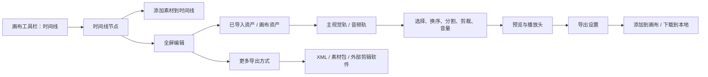
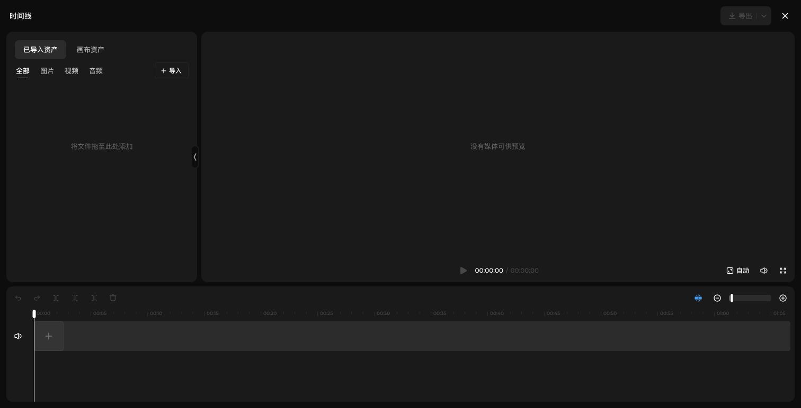
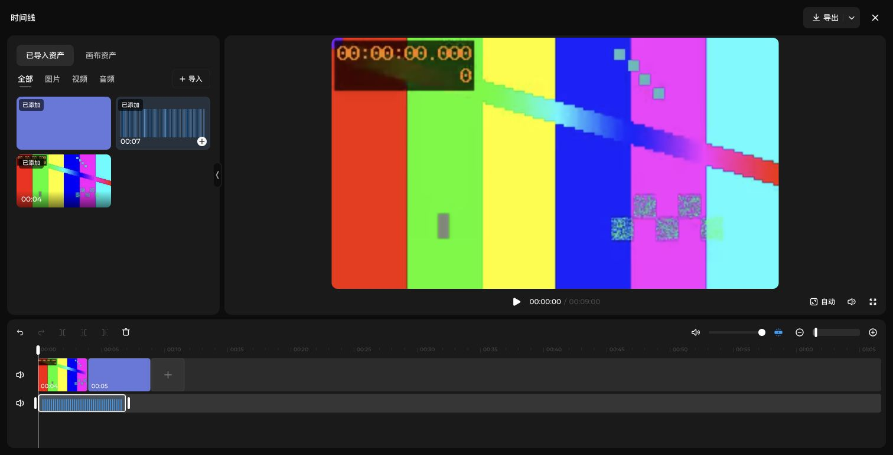
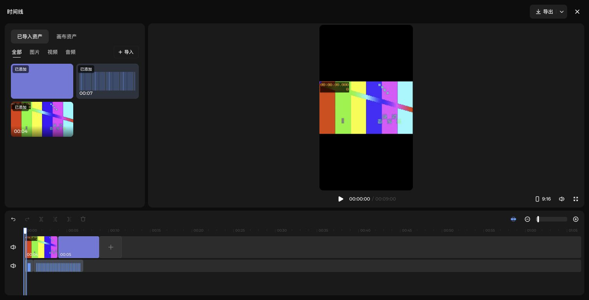
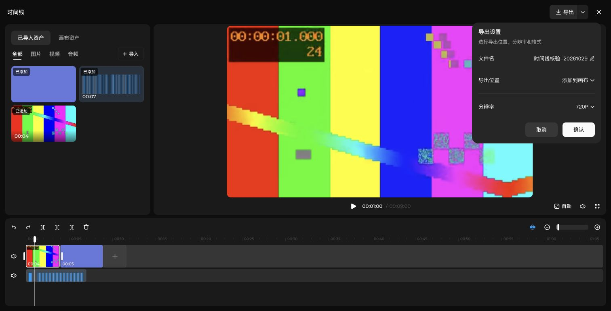

# 即梦画布时间线需求分析

日期：2026-10-29（Asia/Shanghai）。来源：[TL-R001～TL-R007](../requirement/18-时间线即梦一致性需求.md)。这是第一阶段独立需求基线，不是 Glowloom 实现差异审计，也不是设计稿或代码完成声明。

## 1. 结论与调查边界

时间线是画布中的可编辑节点，并有全屏剪辑工作区。两种视图共同表达同一组素材、片段、轨道和输出；节点适合快速编排，全屏工作区承担素材浏览、精细剪辑和预览。应统一产品名称为“时间线”，不能用“视频拼接器”“合成面板”等近义入口替代。

已通过合成素材实际检查：导入与加入轨道的区别、图视频混排、图片默认时长、音频独立轨道、分割、左右剪裁、删除、撤销/重做、鼠标/键盘换序、播放到末尾、比例、导出设置和取消。实际输出文件、外部工程兼容性等仍未得到成功证据，不能宣称全功能已经核验。

产品只对齐即梦。现有实现的差异与更正依据由[专项设计](../design/31-时间线即梦一致性设计.md)维护。

### 证据分级

| 标记 | 含义 | 不能据此推出 |
| --- | --- | --- |
| R | 在用户指定页面实际操作并观察到结果 | 其他账号、版本、长媒体、并发与生产验收也通过 |
| U | 当前 UI/DOM 显示入口、状态或文案 | 对应后台工作一定可完成 |
| S | 从该页面引用的发布 JS 中提取的静态文本/设计 token | 代码一定执行、功能一定对该账号开放 |
| D | 为 Glowloom 提出的产品/工程建议 | 即梦内部实现就是如此 |
| ? | 未完成或未覆盖的核验 | 功能不存在或可以省略 |

调查页面为用户指定的 `jimeng.jianying.com/ai-tool/ai-canvas/284cfd4e-5e10-4f6e-8fc9-2dbe7097381e`。使用原标签页，创建独立节点“时间线核验-20261029”；保留原有空节点“时间线 1”。测试文件为本地生成的 4 秒、24fps、320×180 视频（含正弦音），7 秒正弦音频和 320×180 纯色图片，不包含用户私人素材。

REA 的 loopback CDP 发现未包含该页面，不能把它的空结果当作即梦功能不存在。实际操作由 Chrome 插件完成。REA 对页面引用的发布资源做静态分析：

- locale Evidence：`ev_d42e7f3c3dbda0470568c9505390f6a85a6c90e9d28f6b893569d0a1d647eb08`。
- canvas-view Evidence：`ev_ca7b0053ee913cdd44e37d9d9ce48f4414caa55704548d8de5a8c8911030af87`。
- [来源与哈希](evidence/2026-10-29-timeline/source-identity.json)。locale 语义未知 7 项；canvas-view 为选定文件的部分分析，语义未知记录触达容量限制。它们不能证明完整应用语义。
- 完整 REA ledger 保留在工作区 `output/timeline-research-20261029/rea-evidence-complete.json`，约 42.7 MB；第三方 bundle 只作本地证据，不复制进产品实现。

## 2. 信息架构与用户流程

“导入”把文件放入编辑器资产列表；点击素材卡片的添加按钮才把它变成时间线片段。素材与片段是一对多关系，同一素材可重复加入。播放头、选中片段、素材选项卡、轨道开关是不同状态，不能用一个选中 ID 混代。

## 3. 画布节点规格

| ID | 要求 | 证据/结论 |
| --- | --- | --- |
| TL-01 | 工具栏入口“时间线”，创建空节点并自动编号 | R：从 6 个节点增加为 7 个，新增“时间线 2” |
| TL-02 | 标题在节点上方，可重命名；支持标签入口和连接入口 | R/U：双击标题进入 Node title 输入框，Enter 保存；普通单击未进入编辑 |
| TL-03 | 空态一条主视觉轨、零音轨、零片段；显示“添加素材到时间线” | U：原始节点摘要及截图 |
| TL-04 | 节点头部显示分割/删除、播放与当前/总时间、导出、全屏编辑 | U：无片段时分割和删除禁用 |
| TL-05 | 节点内具有时间标尺、轨道静音、缩略图片段和播放头 | U；节点模式的完整播放/音轨显示仍需专门回归 |
| TL-06 | 选中态边框、片段选中态和 resize 把手分别表达不同选择 | U：节点 Resize timeline 初始值 1200，画布视口为 66%；不是要求屏幕上固定 1200px |
| TL-07 | 画布内快速编辑和全屏编辑应读写同一时间线 | R：全屏编辑后画布摘要同步为 1 visual track、1 audio track、4 clips |

节点态不应常驻完整资产库、导出设置或大型参数表。画布缩放与时间线的秒/像素比例必须分开计算，避免嵌套缩放造成拖动距离错误。

## 4. 全屏工作区与素材输入

### 布局基线

当前浏览器内容区截图为 1512×774。顶部约 60px，左资产栏约 360px；右预览区占剩余宽度；底部时间线横跨两区，初始高度约 218px。外边距约 12px，面板间距约 8px。左栏和时间线高度均有 resize separator；资产栏可隐藏/展开。这些是该窗口的测量参考，不应写死为所有窗口的唯一尺寸。

视觉为低对比深色面板、紧凑图标工具栏、清晰片段选中描边、细白播放头、蓝色吸附开启态。默认主视觉片段高约 56px，音轨较矮。发布 token 中出现节点表面圆角 8px、工作区 12px、预览 10px、片段 4px；静态 token 有不同属性分组，同名键不能脱离所在属性直接当全局样式。

### 素材与输入

| ID | 要求/状态 | 证据/结论 |
| --- | --- | --- |
| TL-08 | 两个来源页签：“已导入资产”“画布资产” | U，初始选中已导入资产 |
| TL-09 | 两个来源各提供“全部／图片／视频／音频”分类 | U，过滤应只改变显示，不删除片段 |
| TL-10 | 导入菜单：“本地上传”“从资产库添加” | U/R：三个文件批量上传成功 |
| TL-11 | 空资产区显示“将文件拖至此处添加” | U；拖入文件的端到端路径未单独执行 |
| TL-12 | 上传准备态 → 可添加卡片；失败/大小/类型/策略异常需有反馈 | R：Preparing → Add…；错误文案为 S，未造失败请求 |
| TL-13 | 素材导入成功不自动生成轨道片段；点击卡片添加后标记“已添加” | R，视频 00:04、音频 00:07 的时长标识可见 |
| TL-14 | 素材可重复添加；“已添加”不是禁用态 | R：同一音频再次加入；在现有音轨末尾追加，使总长由 9 秒变为 14 秒 |
| TL-15 | 资产库弹层含图片/视频/音频、搜索、时间、筛选、选择数与确认 | U；该账号图片与视频均为空，未完成从库加入的正向路径 |
| TL-16 | 画布资产应区分可用、处理中、失效和只读，不把占位节点当素材 | S；原画布只有空文本/视频/外部节点，非空画布素材路径待测 |
| TL-17 | 批量上传上限提示 50 个；可部分成功并反馈跳过项 | S：来自发布文案，未做 50/51 文件边界实测，精确大小限制未知 |

来源菜单随入口不同可能不同。本轮全屏“导入”和主轨“添加素材到时间线”实际均显示本地上传、从资产库添加；“从画布选择”在发布文案存在，不能据此给所有菜单强加第三项。

## 5. 轨道、编辑与播放语义

| ID | 行为契约 | 实测或边界 |
| --- | --- | --- |
| TL-18 | 图片与视频共用主视觉轨，按顺序连续编排 | R：4 秒视频后加入 5 秒图片，合计 9 秒 |
| TL-19 | 图片默认片段时长 5 秒；视频采用媒体实际时长 | R：本次单图/视频样本。图片延长上限与最小值待测 |
| TL-20 | 音频进入独立音轨；同轨片段不得重叠 | R：独立音轨及追加；禁止重叠规则有 S，精确拖动拒绝/回弹逻辑待测 |
| TL-21 | 支持多音轨的工作区语义 | U：编辑器说明为 multiple audio tracks；本轮未成功创建第二音轨，创建/移轨触发方式为 ? |
| TL-22 | 总时长取最长轨道的结束位置，不只取主视觉轨 | R：视频右裁到 1 秒，加 5 秒图片共 6 秒，但 7 秒音频使总长显示 7 秒 |
| TL-23 | 分割必须在有效片段内部；边界禁用并提示 | R：7 秒音频在 1 秒处分为 1+6 秒；新切点恰为边界后按钮禁用 |
| TL-24 | 选中片段与播放头共同决定编辑目标；没有选中时可能使用播放头所在片段 | R：选择视频后剪裁作用于视频；删除选中片段后剪裁仍可能可用，具体目标优先级须追加测试 |
| TL-25 | “向左剪裁”移除片段播放头之前内容，“向右剪裁”移除之后内容 | R：4 秒视频在 1 秒处左剪变 3 秒；撤销后右剪变 1 秒 |
| TL-26 | 主视觉轨剪短后，后续视觉片段向前闭合 | R：左剪后总长 8 秒；右剪后视觉结束 6 秒；音轨未随主轨一起缩短 |
| TL-27 | 片段两侧把手支持连续裁剪；手柄与工具栏操作是不同入口 | U：向左/右裁剪把手约 8px；手柄极限/吸附/一次撤销粒度待测 |
| TL-28 | 鼠标拖动与 Shift+左右键支持视觉片段换序，保持总时长 | R：图片移到视频前，再鼠标拖回视频后，仍 9 秒 |
| TL-29 | 删除选中片段会更新时长与选择；不删除素材卡片 | R：删除末尾追加的音频，14 → 9 秒，素材仍可再次添加 |
| TL-30 | 撤销/重做恢复片段结构、入点及选择规则；新编辑清空 redo 分支 | R：1+6 秒音频撤销回 7 秒，重做恢复；新的剪裁使重做禁用。源入点需输出验收 |
| TL-31 | 默认自动吸附开启，可切换；缩小/滑块/放大控制时间尺度 | U：开启时按钮名称为“关闭自动吸附”；阈值、候选点和优先级为 ? |
| TL-32 | 播放头可寻址；Home 到起点，ArrowRight 本次推进 1 秒 | R：slider 0 → 120000 对应显示 00:01:00。内部单位只是观察，不要求 Glowloom 照搬 |
| TL-33 | 播放/暂停同步更新播放头；末尾停止 | R：播放过程 00:00:13，结束显示 00:09:00 且恢复播放按钮；混音正确性未听感/信号验证 |
| TL-34 | 时间码和内部时间要显式换算 | R：约 0.136 秒时 UI 显示 00:00:13，不能直接把第三段当 24fps 帧号；具体舍入和全时长格式仍待测 |
| TL-35 | 全局预览原声/音量、主轨静音、音轨静音、选中音频片段音量分开 | U：选中音频后出现 Mute clip、Clip volume；静音的实际混音结果和保存范围待测 |
| TL-36 | 比例：自动、2.35:1、21:9、1.85:1、16:9、3:2、4:3、1:1、3:4、2:3、9:16 | U/R：切 9:16 后横视频 contain 显示并上下留黑边；无证据支持默认 cover 裁切 |
| TL-37 | 预览播放器全屏与时间线全屏编辑是两个不同操作 | U；不能用一个“全屏”状态混代 |

本轮将音频片段拖向空白下方未产生第二音轨；从素材栏拖向底部也表现为已有音轨末尾追加。这仅记录两次具体动作的结果，不足以判定多音轨不支持。

## 6. 导出与交付

| ID | 要求 | 证据与限制 |
| --- | --- | --- |
| TL-38 | 空时间线不可导出；处理中防止重复提交 | U/R：空态禁用；第一次本地导出进行时主导出和更多导出禁用 |
| TL-39 | 主导出打开“导出设置”：文件名、导出位置、分辨率、取消、确认 | R/U：文件名初值为节点名；当前未显示独立格式选择器，不能凭描述补造 |
| TL-40 | 默认位置“添加到画布”，另有“下载到本地” | U；已切本地执行一次，未执行添加到画布结果回流 |
| TL-41 | 分辨率 480P、720P、1080P、2K、4K；本次默认 720P | U；选择 480P 发起测试，无输出文件证明实际编码尺寸 |
| TL-42 | 进行中反馈和取消；取消后恢复可提交 | R：显示“下载中...”及取消；取消后按钮恢复。未得到下载完成事件或可探测文件 |
| TL-43 | 更多导出：XML、批量导出时间线素材、剪映、DaVinci Resolve、Premiere、Final Cut Pro | U，保存了完整菜单 DOM |
| TL-44 | 批量素材导出是独立交付流程 | R：点击后直接进入“下载中...”，本轮未出现勾选对话框，随后取消；包结构与去重规则为 ? |
| TL-45 | 工程格式必须被对应软件接受，保留媒体引用、源入点、顺序与时长 | D/验收要求；本轮未下载 XML、未唤起剪映、未执行其他软件导入 |
| TL-46 | 长时长、浏览器不支持、占位/处理中/失效媒体、源范围越界、失败/取消都需要明确反馈 | S；精确触发条件、长时长阈值及恢复行为为 ? |

本地导出尝试超过 20 秒未捕获到 download，后续页面仍停留“下载中...”，手动取消。批量素材导出也只观察到进行中与取消。不能将其推断成固定网络错误、永久功能失败或已经成功下载；没有重试循环或凭空创建成功文件。

“导出为 MP4”“云端渲染”“资源准备中...”及 AI 标识文案在发布资源中存在，但不代表当前主导出一定走本地/云端某一种实现。Glowloom 可以使用不同渲染基础设施，只需输出语义和用户流程满足验收。

## 7. 命名规范与状态设计

### 产品命名

| 对象/操作 | 对齐用语 | 处理说明 |
| --- | --- | --- |
| 功能/节点/全屏标题 | 时间线 | 不把导演台的“时间轴”混入本功能 |
| 默认节点名 | 时间线 1、时间线 2… | 用户改名后所有标题/文件名联动 |
| 进入编辑器 | 全屏编辑 | 与播放器全屏区分 |
| 素材来源 | 已导入资产、画布资产、从资产库添加、本地上传 | “资产”指可引用媒体；“片段”指时间线实例 |
| 轨道添加 | 添加素材到时间线 | 不混写为新建镜头或生成视频 |
| 工具栏 | 撤销、重做、分割、向左剪裁、向右剪裁、删除 | 当前实际工具栏用“剪裁” |
| 裁剪手柄/快捷键 | 向左裁剪、向右裁剪 | 当前源界面存在“剪裁/裁剪”字序差异；先按位置记录，不能宣称已统一 |
| 轨道开关 | 静音 | 可访问名称应带轨道范围，避免多个同名按钮无法区分 |
| 预览音频 | 开启原声 | 保留操作语义；开关状态需单独表达 |
| 吸附 | 开启自动吸附、关闭自动吸附 | 文案表达点击后的动作，pressed 表达当前状态 |
| 预览 | 画面比例、没有媒体可供预览、正在准备预览、无法加载预览 | 后两项为静态候选，待异常实测 |
| 主导出 | 导出、导出设置、文件名、导出位置、分辨率、确认、取消 | 本次文件名随节点名 |
| 交付位置 | 添加到画布、下载到本地 | 不与“保存工程”混为一项 |

内部类型可采用 `TimelineDocument / TimelineTrack / TimelineClip / TimelineAssetRef / TimelinePlaybackState / TimelineExportJob` 等清晰名称，但这些是建议。第二阶段先核对持久化和接口合同，再决定是否迁移；产品命名更新不等于直接批量替换数据库字段或协议键。

### 状态必须分别建模

| 领域 | 状态 | 用户反馈/不变量 |
| --- | --- | --- |
| 素材 | 待处理、可用、失败、失效、元数据未就绪 | 卡片状态与加入结果区分；失败项不得静默变成有效 clip |
| 选择 | 未选、节点选中、片段选中、播放头所在片段 | 删除对象明确；按钮可用条件一致 |
| 手势 | idle、拖动预览、提交、取消 | D：一次手势一个历史项；鼠标释放/失焦有明确结束 |
| 播放 | 空、就绪、播放、暂停、结束、加载、失败 | UI 时钟、视频、独立音轨和导出时间定义一致 |
| 保存 | dirty、保存中、已保存、失败、只读 | 用户编辑不能被失败保存或远程快照静默覆盖 |
| 导出 | 校验、准备、执行、取消中、取消、成功、失败、交付失败 | D：任务完成与文件可用/画布写入成功分别确认 |

刷新补充核验：节点名、1 条视觉轨、1 条音轨及 4 个片段保留；全屏重开后三个已导入素材恢复为“已添加”，预览加载后可播放，9:16 比例保留；撤销和重做均禁用。刷新时先出现权限/媒体加载状态，随后恢复可编辑，不能将这个瞬态当成只读账号验收。[重开证据](evidence/2026-10-29-timeline/reopened-dom.txt)。

只读、多人协作和失败恢复是后续实现必须核对的合同，当前没有实测即梦所有行为。复制时间线、撤销全屏外的操作、非零播放头的刷新恢复和音量持久化仍不能由本轮局部试验推断。

## 8. 第二阶段设计稿必须覆盖的视图

本节是重画清单，不是已经修改 Figma 的声明。所有画板应标注来源 TL-ID、状态、入口/退出和交互约束；只读/异常画板保留“待实测”标记。

| 画板组 | 必须画的内容 |
| --- | --- |
| 节点 | 未选空态、选中空态、有素材、片段选中、多个音轨、裁剪/换序、resize |
| 全屏 | 空态、混合素材、资产栏折叠、调整栏宽/轨道高度、小窗口布局 |
| 素材 | 来源/类型切换、导入菜单、上传准备/失败/部分成功、已添加/失效卡片、资产库弹层 |
| 轨道 | 主视觉轨、独立音轨、多音轨、选中音频的音量、禁用工具及解释、拖动预览/目标插入位置 |
| 播放 | 视频、图片、长音频超出视觉范围、加载/失败、9:16 留边、结束 |
| 导出 | 设置默认态、位置与分辨率菜单、更多方式、进行中/取消/失败/成功、回流画布 |
| 约束 | 只读、无元数据、媒体缺失、源范围越界、保存失败、协作冲突 |

设计稿需重新组织图层/组件命名及可复用组件关系，不只是新增截图盖住旧设计。第二阶段应核对现有画板引用后原位替换或明确废弃关系，避免留下两套相互冲突的时间线规格。

## 9. 项目集成合同

时间线只对齐即梦，技术复用不构成另一套产品目标。当前工程、保存、媒体与任务架构由[时间线专项设计](../design/31-时间线即梦一致性设计.md)统一定义，核心是连续主视觉轨、独立导入资产、多音轨同步及真实导出交付。外部源码调查保留在工作区历史证据中；必要许可声明独立维护。

## 10. 覆盖检查与剩余问题

| 原问题 | 当前状态 | 剩余证据 |
| --- | --- | --- |
| 时间线入口、节点、全屏布局、素材来源 | 已回答主体，部分路径未完成 | 非空画布资产、库素材加入、只读 |
| 图视频和音频编排、基本剪辑 | 已回答主体 | 裁剪最小/最大边界、跨轨/多选、目标优先级 |
| 拖排、快捷键、历史 | 已回答基本流程 | 手势取消、一次入栈、全部快捷键、跨模式历史 |
| 播放与声音 | 部分回答 | 实际多音轨混音、seek 精度、音量/静音持久化、缓冲错误 |
| 吸附与视图 | 部分回答 | 阈值/优先级、缩放范围和锚点、小窗口/触摸 |
| 导出设置与取消 | 已回答 | 成功文件、尺寸/时长/声音、画布结果回流 |
| XML/外部工程/素材包 | 仅确认入口 | 实际包结构、目标软件导入、媒体去重与路径重连 |
| Glowloom 当前差异 | 按第一阶段边界未检查 | 下一阶段逐项对照，不使用旧审计结论当现状 |
| 设计稿重画/代码集成 | 后续阶段 | 需求基线 → 现状矩阵 → 设计 → 实施 → 真实验收 |

这些未决项都有明确核验对象。[验收场景](2026-10-29-时间线验收场景.md)提供下一阶段的逐项检查入口。不要在关闭未知项前宣称“与即梦完全一致”。
