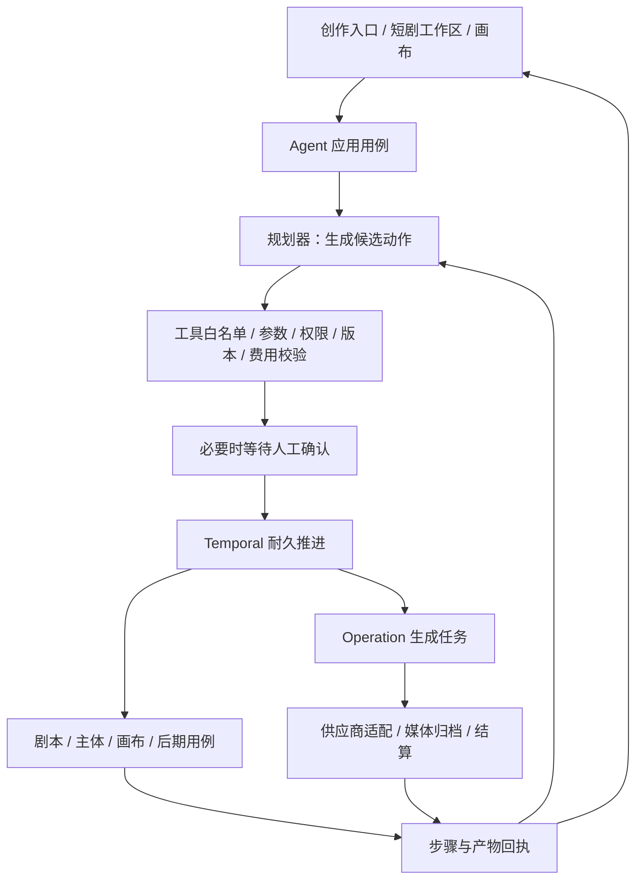

# 短剧 Agent 能力与服务边界调研

> 本文的竞品观察仍为独立证据；其中原Go内扩展/暂不独立宿主/先以Skill表示角色的建议已由用户后续确认替代。完整目标与当前架构以[需求19](../requirement/19-完整创作Agent与Skill多Agent需求.md)和[设计32](../design/32-完整创作AgentHarness与Skill多Agent架构设计.md)为准，采用成熟Harness SDK＋Go业务服务及实际多Agent。

观察日期：2026-11-01（Asia/Shanghai）。源码基线：`65ba1e64200a5541498e1e6aaf63c82d55347a58`，`main`，包含既有未提交修改。使用 pm-market-research 的 competitor-analysis 技能及 REA。本文交付调研与架构建议，不代表正式设计批准、产品实现或真实供应商验收。

## 1. 结论与用户目标

用户要求研究完整 Agent 能力、目录组织，以及即梦短剧工作室和 LibTV 的 Agent / AI 服务；随后明确选择：**织光自建完整创作 Agent**。

**建议扩展现有 `backend/internal/agent`，复用 Go 后端、Temporal 和业务模块；当前不新增仓库根目录 `agent/`，也不另起 Python/Node 微服务。** 项目已经存在 Agent 目录，缺的是工具与短剧业务的执行闭环。把目录独立出来不会自动获得规划、记忆、工具调用或恢复能力。

当前已实现的是有边界的图片 Agent：`plan → image → summary`，规划器只能选择 `reply` 或 `generate_image`，每轮最多一张图。它有真实会话与阶段回执，不能称为任意工具 Agent，也不能据此认定完整短剧生产已经具备。

目标应分为三层：

| 层次       | 要解决的问题                                                               | 建议所有者                                                                    |
| ---------- | -------------------------------------------------------------------------- | ----------------------------------------------------------------------------- |
| 短剧业务   | 剧本、分集、人物/场景/道具、分镜、视频、配音、时间线与成片的版本关系       | 现有 script、subject、bible、canvas、mediatool 等领域；新增领域按实际职责评审 |
| Agent 执行 | 理解目标、拟定计划、选择工具、等待确认、执行与观察结果、修改计划、恢复任务 | 现有 agent 模块                                                               |
| 模型服务   | 凭据、模型目录、能力参数、报价、提交/查询/取消、结果归档和结算             | 现有 catalog、operation、billing、media 模块                                  |

外部 MCP/CLI 是让其他 Agent 调用织光的接口方式，属于可选的后续开放面；本次确认的核心目标是织光自己的创作 Agent。

## 2. 市场范围与五个参照产品

研究范围是面向短剧创作者、小型工作室和影视/广告团队的 AI 创作工作台。主要比较可编辑项目、跨镜头一致性和长任务控制，而非单个模型的视频效果。未获得可靠市场规模、份额或留存数据，不提供推算数字；未登录购买或实测竞品付费生成。

| 产品与定位                                 | 一手可核验能力                                                                         | 商业模式/渠道观察                                                        | 对织光有用的参照及证据限制                                                                                                                                                             |
| ------------------------------------------ | -------------------------------------------------------------------------------------- | ------------------------------------------------------------------------ | -------------------------------------------------------------------------------------------------------------------------------------------------------------------------------------- |
| 即梦短剧工作室；短剧项目创作               | REA 实际观察到剧本上传、剧本创作、转绘、短剧画布，以及风格/选题/比例/市场/集数配置     | 官网创作入口、模板与作品入口；页面有积分/会员促销，具体生成成本未核验    | 学习短剧业务对象与阶段协作；公共页面存在不等于后台能力已实测。[工作室](https://jimeng.jianying.com/ai-tool/novel)                                                                      |
| LibTV；画布与 Agent 双入口的视频工作台     | 首页有 Agent BETA；公共 Skill 区及 Plugin 页；公开仓库提供会话 OpenAPI 与远程 MCP 配置 | 官网、技能内容与外部 Agent 插件分发；有会员/积分入口，未核验套餐完整价格 | 学习可编辑资产与工具执行的连接方式；公共接口代码不证明账号权限或实际效果。[首页](https://www.liblib.tv/)、[Skill](https://www.liblib.tv/skill)、[Plugin](https://www.liblib.tv/plugin) |
| TapNow；多模态创作工作台                   | 官网表述统一调度文本、图像、音频、视频模型                                             | 官网提供免费开始与 App 入口；本次未取得可复查的完整价格表                | 参照统一工作区；未观察其运行协议和失败恢复，不能作技术实现证明。[官网](https://tapnow.media/zh)                                                                                        |
| LTX Studio；影视/广告制作套件              | 官方展示从剧本生成场景/故事板、Elements、时间线与声音设计                              | 面向影视与广告团队；定价页包含免费及按月积分套餐，商业许可与协作权益分级 | 参照跨镜头元素与人工精修；缺少本次独立生成验证。[产品](https://website.ltx.studio/)、[定价](https://website.ltx.studio/studio/pricing)                                                 |
| RunningHub；工作流、AI 应用与模型 API 平台 | 官网区分 ComfyUI 工作流、AI App、Model API、Workflow API 和 rhTV 画布                  | 工作流/应用社区与开发者 API；应用页出现按实际用量计费                    | 参照把工具与工作流作为可调用产品；工作流不自动等于自主 Agent。[官网](https://www.runninghub.ai/)、[示例应用](https://www.runninghub.ai/ai-detail/1991011723471724545)                  |

以上不足以给竞品做全局优劣排名。对织光的差异化建议是：**同一份可编辑工程贯穿自动创作和人工精修，用户能只替换一个镜头，并能查清生成依据、版本与费用。** 这是建议定位，并非声称竞品缺少这些能力。模型目录和价格容易被追平；工程资产、可恢复执行与稳定引用更值得持续核验。

## 3. 即梦短剧工作室的可见能力拆解

REA 使用独立无登录 Chromium 打开首页，再根据首页已下发的入口配置访问 `/ai-tool/novel`，等待页面水合后采集可访问树。工作室 Evidence：`ev_02443dde915acd73e18ed2ba51baa508efb2b13bb0a0a3e451f031be7cebc9f0`。摘录见 [工作室可访问树](evidence/2026-11-01-agent-research/jimeng-studio-ax.txt)。

| 观察到的事实                                                         | 可推导的产品职责                                       | 不能据此证明的内容                                   |
| -------------------------------------------------------------------- | ------------------------------------------------------ | ---------------------------------------------------- |
| 三个入口：上传剧本、剧本创作、转绘                                   | 既有文本解析、想法到剧本、已有视频改编应有不同输入合同 | 三条后台链路的准确率、实现方式与开放 API             |
| 文本框提示拆解人物、结构与情节；参考素材、风格、选题、比例、生成设置 | 生产目标必须结构化，不能只保存一段 prompt              | 模型实际调用链和内部提示词                           |
| 当前选中面板显示单文件不超过 200MB、最多 30 张图片/10 个视频         | 不同入口有素材接纳与归属规则                           | 所有账号/模式都适用这些上限；不建议直接复制到织光    |
| 生成设置显示 DreamScript、中国市场、10 集                            | 语言/市场/分集目标属于项目上下文                       | DreamScript 的模型实现、公开可购买性和 API 合同      |
| 短剧画布、模板、作品与亮点功能入口                                   | 产物需要形成可回访、可编辑的项目                       | 模板是否包含完整真实执行；未登录区域不能当作私人项目 |
| 导演台、智能预演、片段重拍、转绘、超分、视频拉片的功能入口           | 任务会跨文本、空间、视频和后期处理                     | 各入口已经逐一进入或完成执行                         |

即梦[公开短剧创作说明](https://jimeng.jianying.com/tools/ai-short-drama)强调剧本/分镜、角色参考、逐镜生成与后期组织，且该介绍页不承诺一次生成整部多集短剧。该页与工作室是不同页面，不能把说明页的限制直接套用给工作室，也不能用宣传报道证明工作室内部架构。

首页还实际显示 Agent 模式、自动、技能与主体引用。它们支持“通用创作 Agent 与短剧业务工作台相互连接”的产品推断，不证明其后端是多 Agent 系统。[首页证据](evidence/2026-11-01-agent-research/jimeng-home-ax.txt)

## 4. LibTV 的服务、工具与会话拆解

### 4.1 公开集成合同

通过官网 Plugin 页链接核对公开仓库，并固定版本读取：

- `liblib-ai/marketplace@4ac581c3cbdaa53d0d42df85c6bf62e45600bc5f`：[README](https://github.com/liblib-ai/marketplace/blob/4ac581c3cbdaa53d0d42df85c6bf62e45600bc5f/README.md)、[MCP 配置](https://github.com/liblib-ai/marketplace/blob/4ac581c3cbdaa53d0d42df85c6bf62e45600bc5f/plugins/libtv/.mcp.json)。配置为 HTTP Remote MCP，地址 `https://mcp.liblib.tv/mcp`；README 描述 OAuth 接入，插件不包含本地服务。这说明“具备 Agent 开放能力”不要求在客户端再建一个运行服务。
- `libtv-labs/libtv-skills@c609246c1eca69f6bc129bcbb5d64c36734e4a4a`：[公共 API 封装](https://github.com/libtv-labs/libtv-skills/blob/c609246c1eca69f6bc129bcbb5d64c36734e4a4a/skills/libtv-skill/scripts/_common.py)。代码使用 Bearer Access Key，区分创建/续接会话、查询消息及切换绑定项目。

| 公开代码中的接口                                                    | 表达的能力                                 | 对织光的启发                                                 |
| ------------------------------------------------------------------- | ------------------------------------------ | ------------------------------------------------------------ |
| `POST /openapi/session`，可带 sessionId/message，返回项目与会话标识 | 把自然语言任务交给会话服务，任务归属可定位 | 目标、会话、执行和项目应有明确身份                           |
| `GET /openapi/session/{sessionId}?afterSeq=N`                       | 增量读取会话消息                           | 前端重连后接续事件，避免整段会话反复加载                     |
| `POST /openapi/session/change-project`                              | 切换 Access Key 当前绑定项目               | 织光应优先使用显式 projectID，避免隐式当前项目导致并发串项目 |

两种集成方式不是同一套鉴权；公开 Python 脚本也不是 LibTV 后端 Agent 的源码。未安装插件、授权账号或调用上述接口，MCP 当前工具清单及真实行为仍未知。

### 4.2 REA 与公开发行脚本

REA 实际采集 LibTV 公共首页，Evidence：`ev_dde7c33dd27021355209caa43329fbc2f8e09dd3dfa4ec931323115a2c830bfb`。从页面引用取得 84 个公开脚本，解压 HTTP gzip 内容后建立 SHA-256 清单；只将 3 个相关文件送入 REA 静态分析，共 204,471 UTF-8 字节，3 个解析成功、0 个解析失败。其余 81 个文件不在 REA 分析范围。

REA parent Evidence：`ev_6e951b7285b2ac9f2fde3c369d001353f7b085c91945dda20ae0f5cf37ac98da`；摘要 Evidence：`ev_56a58b69fce78e62b63789bf3c872846715c1d8457d031db3b3cd58085f50543`。**应用图为 partial，语义图触及节点上限而截断；不能把分析成功写成完整还原。** `afterSeq` 图追踪没有匹配，不能解释成该能力不存在。下列结论另外通过原始发行文本逐项定位，索引包含脚本 URL、摘要与偏移。[静态证据索引](evidence/2026-11-01-agent-research/libtv-static-claims.json)

| 静态观察                                                              | 解释范围                                                      |
| --------------------------------------------------------------------- | ------------------------------------------------------------- |
| API 注册表声明会话创建/列表/删除/改名/停止，以及 approval-mode/update | 存在前端接口声明；不能据此判断后台持久化、审批规则或实际返回  |
| 消息读取调用组合 projectId、sessionId、afterSeq                       | 有增量消息读取逻辑；不是消息不丢失的实测证明                  |
| `fe_tool_call`、`fe_tool_cancel`、`fe_tool_receipt`、`fe_tool_result` | 存在前端工具调用与回执协议形态                                |
| 工具未注册返回 unsupported；使用 AbortController、超时与会话抢占检查  | 前端工具执行有注册、取消与会话约束；不证明服务端 exactly-once |
| `RUN_STARTED`、`RUN_FINISHED`、`RUN_ERROR` 与 TOOL_CALL 类事件        | 界面消费结构化运行事件；事件命名不证明使用哪一种后台框架      |

可借鉴的机制是：**会话 + 运行事件 + 有限工具执行 + 编辑器结果回执**。不照搬私有接口、竞品业务代码、前端包或凭据。全部原始脚本只留在本地临时研究目录，未加入产品。

## 5. Glowloom 当前能力与缺口

下表来自当前源码读取；不以旧调研或 BACKLOG 文字代替现状。未重新启动服务或调用真实供应商；并行未提交的 OpenAI/服务测试改动只作为当前工作区事实。

| 能力           | 当前代码事实                                                                                                                                                                                                      | 距完整创作 Agent 的差距                                                                                                                         |
| -------------- | ----------------------------------------------------------------------------------------------------------------------------------------------------------------------------------------------------------------- | ----------------------------------------------------------------------------------------------------------------------------------------------- |
| Agent 领域边界 | 已有 [domain/session.go](../../backend/internal/agent/domain/session.go)、application、HTTP、PostgreSQL 分层                                                                                                      | 不需要再创建同名根目录                                                                                                                          |
| 规划与动作     | Policy 为 image-agent-json-v1；Plan 严格限定 reply/generate_image；TurnInput 只选文本和图片模型                                                                                                                   | 没有在本模块发现通用工具目录、多步计划、分镜/视频/音频工具执行协议                                                                              |
| 会话与上下文   | 私有项目会话、修订和请求幂等；最多 20 轮；规划仅取最近 4 个已完成轮次的截断文字                                                                                                                                   | 需要项目事实引用、素材/版本上下文与上下文容量管理，而非仅扩大聊天长度                                                                           |
| 运行与确认     | [application/service.go](../../backend/internal/agent/application/service.go) 按阶段报价/确认/读取 operation；未知结果进入 needs_reconciliation；Stop 阻止后续步骤                                                | 需要运行级计划/步骤/工具调用/审批模型与停止传播；当前 Stop 不等于供应商撤销                                                                     |
| 自动推进       | [agent-workspace.tsx](../../frontend/src/components/generation/agent-workspace.tsx) 通过轮询调用 advance；HTTP 是可见的阶段推进入口                                                                               | 已提交的 operation 可以由后台执行，但未发现独立 Agent run worker；需要验证离开页面后跨步骤仍可推进                                              |
| 耐久任务与批量 | operation 中已有 [OperationWorkflow](../../backend/internal/operation/adapter/workflow/workflow.go) 和 [BatchWorkflow](../../backend/internal/operation/adapter/workflow/batch.go)，后者会启动 operation 子工作流 | 是可复用底座，不是短剧的动态任务图；OperationWorkflow 显式拒绝 target_type=agent_session                                                        |
| 模型接入       | catalog/providerhttp 已有供应商与媒体适配；当前工作区的 [openai_responses.go](../../backend/internal/operation/adapter/providerhttp/openai_responses.go) 做单次无状态文本生成                                     | 当前 Responses 请求只有文字 input，未传工具 schema，结果仅消费文本；不能称为完整工具循环。原生 function calling 也不是获得 Agent 能力的唯一办法 |
| 剧本与主体     | script 已有导入、分集、结构和版本用例；subject/bible 有现有领域                                                                                                                                                   | 需要通过小接口暴露给 Agent，并保留正式采用/冲突规则；不能直接让模型任意改表                                                                     |
| 分镜与镜头     | [storyboard 页面](../../frontend/src/app/storyboard/page.tsx)、[shot 页面](../../frontend/src/app/shot/page.tsx) 明确暂未开放                                                                                     | 不是增加提示词即可补齐；需要镜头对象、引用/版本、审阅和业务写入合同                                                                             |
| 后期与产物     | canvas/media/mediatool 已有画布、归档、转写、导出相关代码                                                                                                                                                         | 尚未证明由 Agent 贯穿镜头→时间线→可播放成片；需逐工具验证输入输出和异步回执                                                                     |
| 对外 Agent API | 本次在 backend/internal 的 Go 文件搜索未发现 MCP 实现                                                                                                                                                             | 这只说明本次搜索范围未发现；本次自建站内 Agent 不以 MCP 作为前置条件                                                                            |

特别注意：现有会话是**项目内、当前账号私有**。完整制作任务可能操作团队共享资产，但不能因此把私人对话开放给项目所有成员。共享产物、私有对话和执行身份需要分别授权。

## 6. 建议的服务与目录组织

以下为建议，尚未创建目录或更改正式架构。保持项目 `adapter → application → domain` 的依赖方向。

```text
backend/internal/agent/            已存在，扩展站内 Agent
  domain/                         运行、计划、步骤、工具调用、审批、事件的规则
  application/                    规划/执行循环；消费方定义的业务工具小接口
  adapter/http/                   目标提交、运行查询、确认、停止、事件续接
  adapter/postgres/               运行与回执持久化
  adapter/workflow/               建议：接入既有 Temporal worker
  adapter/…                       仅在实际需要时增加模型规划或业务工具适配

backend/internal/operation/        继续拥有生成任务与供应商执行
backend/internal/catalog/          继续拥有模型目录、凭据与发布能力
backend/internal/billing/          继续拥有报价/预留/结算规则
backend/internal/script/…          各领域继续拥有各自业务事实
```

Agent 通过显式注入的小接口消费现有应用用例，不直接依赖各模块的数据库适配器。供应商调用仍经过 operation，不为 Agent 复制 Key 管理、计费、任务重试或资产归档。前端目录按实际界面组织，不能用“新增 agent 页面”代替服务。

建议运行关系：



Temporal 工作流内只编排确定性步骤；模型推理和外部副作用放在 Activity/既有任务边界。发生未知供应商结果时先对账，不能因工作流重试而盲目重复计费请求。耐久推进不能自动保证外部调用不重复，需要稳定调用身份、持久化回执和供应商能力配合。

同一套 agent 代码可以由现有后端 worker 角色执行。只有出现可测量的独立扩缩容、依赖/资源隔离或独立发布需求时，再评估独立进程/服务；那时也可以先拆 worker 部署，不必立即拆语言、仓库与数据库。

## 7. 完整能力合同建议

### 7.1 执行对象与工具

建议区分 Session（交互上下文）、Run（一次目标执行）、PlanRevision（计划版本）、Step（步骤依赖）、ToolCall（具体工具尝试）、Approval（绑定明确动作/版本/预算的确认）与 ArtifactRef（产物及来源版本）。这些是待设计的职责模型，不是已批准的表结构。

每个工具至少定义名称/版本、输入输出 schema、读写范围、所需权限、费用性质、超时/取消语义、幂等身份和异步回执。模型只能提出调用，服务端校验并执行；结构化 JSON 规划与供应商原生 function calling 都可实现这个边界。

短剧所需的工具族包括：读取项目与素材、解析/提案剧本、拆分分集、提取主体、提出分镜、创建图片/视频生成任务、生成配音/音乐、读取任务、写入画布、组织时间线、导出与检查产物。**每项都应对应可验证的业务用例，未实现的工具不得注册为可执行。** 草拟与正式采用分开；例如模型提出角色合并，不应直接覆盖用户已经确认的角色版本。

“编剧、美术、分镜、配音、剪辑”可先作为有版本的 Skill/领域策略，共享一个运行时。只有确实需要独立上下文、并行或权限时才引入子 Agent。角色数量不能作为完整度指标。用户安装给 Codex 的开发 Skill 与织光产品自己的创作 Skill 也应分别管理。

### 7.2 状态、上下文与权限

建议运行至少表达规划中、等待确认、执行中、等待异步结果、待对账、部分完成、失败、停止和完成。必须区分停止后续调度、请求取消已提交任务，以及供应商确认取消，不能将三者合成一个“停止成功”。

项目上下文以获授权的剧本/主体/场景/镜头版本为依据；语义检索或向量库可按召回问题再引入。跨镜头一致性需要固定角色、服饰、场景、参考图和采用版本；单纯把人物说明写进 system prompt 不能保证一致。

人工确认应绑定动作、输入摘要、计划版本、资源修订和费用边界。可以研究“授权一批明确镜头及预算”的交互，减少逐次确认，但须先更新既有阶段确认合同，不能静默继承为无限生成权限。执行前重新验证当前身份与对象权限，处理协作者已经改动工程的冲突。

若后续需要画布前端工具，服务端不能把浏览器一句“成功”当成业务提交依据；命令须绑定会话/画布/修订，并通过正式保存回执确认。LibTV 的 fe_tool 协议只是研究参照，不是可直接采用的信任合同。

### 7.3 可验证的创作闭环

建议用一个受控短剧案例验证完整性：一场戏、少量固定角色、若干明确镜头，完成剧本与角色确认、分镜提案、图片/视频生成、配音、时间线与导出；用户能修改某个镜头并只重做受影响步骤。具体镜头数量、时长、供应商和费用由正式设计确定。

同一闭环应覆盖以下结果：

- 浏览器关闭、worker 重启后，通过原运行身份接续；同一命令重放不多创建任务或重复扣费。
- 某镜头失败时保留已成功镜头，只重试允许重试的部分；未知结果进入对账。
- 用户拒绝提案、改变角色版本、撤销权限或耗尽预算后，后续步骤正确停止或重新确认。
- 每个最终媒体能追溯到输入版本、引用、工具、模型与费用回执；成片实际可解码、声音与画面对应。
- 自动检查区分编码/时长等确定性检查、模型辅助视觉判断与人工审阅，不把模型自评写成质量保证。

这组验收才能支持“完整创作 Agent”的表述。仅聊天成功、收到供应商 taskID、通过 mock 或生成单张图片都不足以证明目标已完成。

### 7.4 长上下文成本治理：Prompt Caching 与工程级总预算天花板

短剧多 Agent（制作统筹、剧本解析、分镜排布、镜头导演、音频剪辑）在执行过程中，涉及长剧本原文、人物/场景设定集（Bible）、历史分镜清单等海量文本在各 Worker 间频繁流转。若不加治理，极易引发严重 Token 膨胀：

1. **Prompt Caching（上下文缓存折扣）策略**：
   - 当前主流前沿模型（Claude 3.5/5.5、DeepSeek V3/R1、OpenAI GPT-4o/5.4、Gemini 2.5/3.8）均已支持提示词前缀缓存，命中缓存可降低 50%~90% 的输入成本；
   - 系统提示词与角色圣经（Character Bible）必须严格置于上下文最前端作为不变前缀（Static Prefix），易变的分镜动态和单轮用户输入置于尾部，确保多 Worker 级联调用时最大化命中缓存。
2. **工程级总预算天花板（Project Budget Cap）**：
   - 现有的 `turn_budget` 仅限制单轮最大 40 步，无法限制整部短剧多轮自动推进下的累加消耗；
   - 必须建立项目/剧本级的总预算天花板（`MaxProjectCredits`），当累计消耗达到预警线（如 80%）时触发主动提示，达到上限时强制挂起并要求用户确认追加预算，彻底杜绝后台静默跑光用户余额。

## 8. 证据边界与交付状态

本次新增本文及 [精简证据目录](evidence/2026-11-01-agent-research/)。公开页面的 AX 摘录、静态脚本来源与 SHA-256、REA 摘要、公开仓库固定版本清单可复查。原始 REA 导出约 59MB，仅存 `/tmp/glowloom-agent-research-20261101/rea-evidence-bundle.json`，可能被系统清理；未把竞品代码或完整网络记录加入仓库。

有意义的限制：首次即梦首页采集仅得到未水合文档，随后等待 6 秒重新采集成功；LibTV 网络窗口结束时有未完成请求，不能报告完整网络覆盖。REA 静态语义图 partial/truncated；图追踪无匹配及不适用的 API-surface 查询均未计作验证成功。公开代码中的接口未做鉴权/真实请求验证，也未验证竞品内部规划、记忆、并发或服务端技术栈。

本次完成公开资料核验、无登录页面观察、限定静态拆解与当前源码对照；没有修改运行代码、创建空服务、安装竞品插件、提交生成任务、运行产品测试、变更 Figma、提交或推送 Git。现有供应商测试、接入、预算及证据清理等并行修改保留。

文档验证：13 个本地链接均可解析，5 份 JSON 均可读取，13 条静态定位与原文件摘要/偏移一致，10 份源码审计对象在复核时摘要未漂移；Prettier 检查通过，导航 diff 无空白错误。这些检查仅验证调研材料的一致性，不是产品测试。

正式实现需要将本次已确认的自建目标写入需求，再依据现有[创作设计29](../design/29-创作一致性与公共组件设计.md)的单图合同补充完整 Agent 设计、PRD 和 Plan；界面继续遵循已有 Figma 先行约定。本文给出可评审的建议，不自动批准新运行协议、预算策略或开放接口。实施状态与调度仍只归 BACKLOG。
