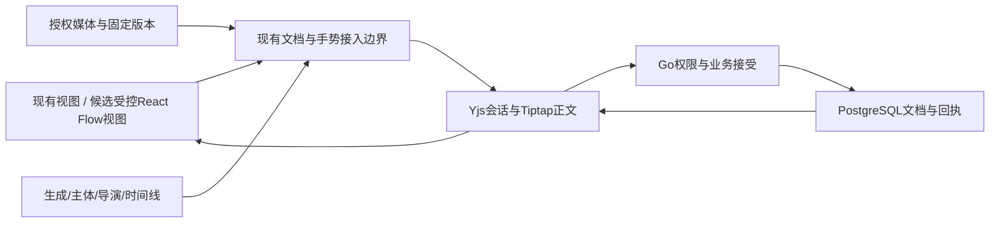

# 画布组件复用与完整接入评估

日期：2026-11-07。性质：GitHub 固定版本源码与官方文档评估，结论区分事实、工程判断和未验证条件。对应用户原始要求 SRC-CAN-15；本报告不表示已接入任何新框架，也不替代正式浏览器、数据库或性能验收。

## 1. 结论和对象身份

**建议采用“通用能力优先复用、业务规则由织光掌握”的方式。当前保留正式画布主线；React Flow 是通用节点交互层的首选验证候选，尚不能据此直接决定替换。BeefTV 与 Infinite Canvas 不作为整仓依赖接入。**

这不是因为已有实现必须保留，而是当前公开证据只证明候选的接口和功能存在，没有证明其在织光的富文本、媒体、协作拒绝恢复、组合节点和容量负载下能降低总体维护成本。验证后可以替换相应层；若功能回归或形成两套持久化/撤销权威，局部复用或继续定制更合适。

用户最初提到“beeftv infiata canvas”，随后于2026-11-07确认“Infinite Canvas 就是这个项目”。本报告的两个指定对象因此确定为 **glanderness/BeefTV 与 basketikun/infinite-canvas**。BeefTV 的 NOTICE 也明确列出后者为其上游。另比较可嵌入的 React Flow、tldraw 和 Excalidraw，避免把完整应用与组件库混为一类。对象确认不代表已批准接入或已完成运行验收。[B2]

采用判定不按 Star 数或演示截图打分。依次核对：许可范围 → 实际需要的交互 → 已有合同能否承接 → 旧数据可逆转换 → 性能与维护的实证。总体成本包含授权、样式与输入适配、业务接线、数据迁移、升级维护和回归验证；本轮没有编造人日、FPS、节省比例或采购价格。

## 2. 固定来源与读取范围

| 对象 | 本次固定提交 | 核验范围 |
| --- | --- | --- |
| glanderness/BeefTV | `f05b8ebafed45e933e5343870a08dea6ac22799f` | LICENSE、NOTICE、web/package.json、本地优先架构、渲染模型与视口控制器 |
| basketikun/infinite-canvas | `9cd3deacbcc598361807afc16c059a80dd18b6f9` | LICENSE、README、web/package.json、数据结构文档、画布视口与持久化 store |
| xyflow/xyflow | `1bc405cd113618c17fd181b931a9fe573bec9fee` | MIT LICENSE、React 包清单、公开组件导出、节点类型、受控变更/拖动/连线/删除 API |
| tldraw/tldraw | `616a7c49576f139dc5d091e0621cb589c48a80d8` | 当前根 LICENSE.md；自定义 Shape 与许可官方文档 |
| excalidraw/excalidraw | `701b901a0f1ba3d0b390d9cdf63d112e25abac4b` | MIT LICENSE、README 中 SDK 与线上应用的功能边界、SDK 官方 API |
| Glowloom | `ad1cf640fd2e4e89d9c56f21d4ff3266f1f00768` + 本轮只读工作区 | frontend/package.json、CanvasDocumentIntegration、文档适配、正式接线、空间索引、手势/显示层和 Go 接受合同 |

GitHub 当前分支只用于取得 SHA，具体代码按 SHA 读取。Infinite Canvas 的根 package.json 首次请求返回404；仓库实际应用包是 web/package.json，已改用该文件核验。未运行、安装第三方项目或其脚本；未取得 React Flow 付费示例源码。官方网页为本日读取的动态文档，不冒称与所有固定提交逐字一致。

BeefTV 当前提交的日期为2026-11-07；Infinite Canvas 元数据记录最后 push 为2026-10-25，未归档。近期 push 不证明维护承诺、升级兼容或缺陷响应；没有基于这两个时间戳给维护可靠性打分。

## 3. 织光已有的复用与不能丢掉的合同

| 当前事实 | 源码依据 | 对选型的影响 |
| --- | --- | --- |
| 已有 React 19.2.8 / Next 16.3.6、Radix、cmdk、shadcn、TanStack Table、Tiptap 3.32.0、Yjs 13.6.33、Three、Mediabunny | [frontend/package.json](../../frontend/package.json) | 常规菜单、弹窗、命令框、富文本和媒体已有依赖，应先复用；不为一个控件引入第二整套 UI/播放器/编辑器 |
| 正式画布由统一 CanvasDocumentIntegration 接入宿主 | [integration 类型](../../frontend/src/components/canvas/types/canvas-document-integration.ts)、[正式接线](../../frontend/src/components/canvas/yjs-workspace.tsx) | 它已有 frozen、admit、onChange(state, stable)、textBinding、媒体上下文、业务连线、生成面板和撤销等接口，可评估让新视图接这些接口，不绕过它们 |
| 节点与连线保留服务端 documentData；素材须固定文件引用；连线须有业务端口/绑定 | [文档适配](../../frontend/src/components/canvas/lib/canvas-document-adapter.ts) | 不能把 SDK 的 nodes/edges 或临时 URL 整包当成持久文档 |
| Yjs 本地编辑、提交、回执、恢复和个人撤销已有职责 | [会话](../../frontend/src/components/canvas/yjs-live-session.ts)、[Go命令接受](../../backend/internal/canvas/application/yjs_commands.go) | 新渲染组件不等于新的协作后端；同步成功和保存成功仍分开 |
| 当前已有空间网格索引、可见节点查询、保留选中/编辑/拖动节点挂载 | [空间索引](../../frontend/src/components/canvas/lib/canvas-spatial-index.ts)、[编辑器](../../frontend/src/components/canvas/editor/canvas-editor.tsx) | 不把“候选有虚拟化”当作织光没有这项能力；应比较相同负载下的正确性、挂载与交互数据 |
| 空间索引及模式菜单已保留 BeefTV 历史 MIT 来源 | [来源声明](../../frontend/EDITOR-THIRD-PARTY-NOTICES.md)、[历史MIT版本][B7] | 已有局部复用，不是全部从零自研；本轮不替换或删除这些来源声明 |
| 导演、时间线、主体与生成有宿主渲染入口 | [正式接线](../../frontend/src/components/canvas/yjs-workspace.tsx) | 通用画布不提供这些业务模块；新框架必须能承载，而不是只实现文本、图片的演示 |

当前 editor 的空间索引和媒体裁剪路径是已存在的优化机制，不是本轮浏览器性能通过证据。正式图容量2000节点/4000边来自需求06，是协议边界，不是任何候选已达到的流畅容量。

## 4. 五类方案逐项比较

| 方案 | 可核验的价值 | 完整接入的主要缺口 | 本轮工程判断 |
| --- | --- | --- | --- |
| **BeefTV** | 与媒体创作场景接近；含节点、媒体、工作流、导演/时间线；渲染代码有空间索引、LOD、缩略图与视口预览/提交分离 | private 应用包；React/Vite、Wails、Go loopback、SQLite/本地素材体系；当前新增原创代码分范围许可；不能直接替换 SaaS 的会话、权限、文件版本、Yjs 与账务 | **参考交互和性能分层；仅对来源清晰、许可适用的小模块考虑复用。当前不整仓搬入。** 当前许可或历史来源可合法使用的具体范围须逐文件/版本核对 [B1]、[B2]、[B3]、[B4]、[B5]、[B6] |
| **basketikun/infinite-canvas（用户已确认）** | MIT；React19；媒体节点、参考图、助手、提示词库等可作为创作交互参考；独立视口组件有传入视口与回调接口 | web 应用 private=true；默认 Zustand persist + localForage，媒体与项目数据依赖本地存储；README 明示开发期不保证历史数据兼容；外壳/数据/助手并非织光合同 | **MIT 模块可抽取评估；不接其整套 store、媒体身份和持久化。** 指定调研对象已确认，具体模块采用仍按完整接入条件验证 [I1]、[I2]、[I3]、[I4]、[I5] |
| **React Flow / @xyflow/react** | 可发布库；MIT；自定义 React 节点、Handle、MiniMap、Controls、NodeResizer、NodeToolbar、Background；受控 nodes/edges 回调及只读开关可检查 | 不提供织光业务接受、固定媒体、生成、导演/时间线和个人撤销语义；分组位置相对父节点；官方多人示例另为 Pro；需要受控适配而不是另建业务 store | **通用节点交互层最值得验证的候选。** 降低手写拖动、缩放、端口与小地图维护的可能性较明确；是否实际更省维护、更快仍须完整集成原型对照 [R1]、[R2]、[R3]、[R4]、[R5] |
| **tldraw** | 自定义 ShapeUtil、命中、选择、相机、分组、吸附及可定制 UI；适合需要完整白板工具体系的产品方向 | 需映射其 store/history、Shape 与织光文档、Tiptap/Yjs/回执；当前 SDK 默认许可只允许开发，商用生产要相应许可；不能把其 sync 直接当织光持久通道 | **有商业许可与白板产品需求时仍是有效候选，不是技术上不能用。** 当前没有依据为既有媒体节点工作台默认承担整套转换与许可 [T1]、[T2]、[T3] |
| **Excalidraw** | MIT、可嵌入 npm 包；手绘、形状、箭头、图片、缩放、撤销与 PNG/SVG 输出 | 草图元素模型与织光媒体/生成/端口合同不同；README 把线上应用的协作、本地自动保存与 npm 编辑器分别列出；不能把线上能力当包内已完整接通 | **更适合批注、遮罩说明或分镜草图的独立编辑模块。** 若此需求成立，应把场景及输出作为有版本资产接回现有媒体链，而非替换主画布 [E1]、[E2]、[E3] |

BeefTV 与 Infinite Canvas 共享来源，不能把二者对相近功能的实现算作两份独立验证。BeefTV 代码中50k等规模注释、README宣传或其他项目 demo 均不作为织光容量实测结果。

### 4.1 许可具体影响

- BeefTV 当前 LICENSE 的 Part A 仅覆盖可由相应作者许可的新增原创内容；其条文对向第三方提供免费或收费托管功能设置单独书面授权条件。Part B 保留历史 MIT，第三方材料各有许可。**不能把当前整个仓库叫“MIT开源组件”，也不能把某次历史 MIT 授权延伸到之后全部新增代码。** 历史版本可评估，但不能以此声称后续维护更新自动可用。[B1]、[B2]、[B7]
- Infinite Canvas 根许可为 MIT；README 另要求保留作者信息/前端标识，集成前应核对拟取文件及素材的通知和归属，不把代码许可自动延伸到模型、字体、样例图或品牌素材。[I1]、[I2]
- React Flow 核心是 MIT；官方 Collaborative 示例的页面明确列 xyflow Pro License，且使用 Yjs/y-websocket。这是**组件核心许可与示例许可不同**，不能因示例收费就断言基础协作适配也必须付费，也不能复制未获授权的示例。[R1]、[R5]
- tldraw 当前 SDK 生产使用需适用的 trial/commercial/hobby key；商业项目不能按 hobby 使用。费用和授权范围未询价，本轮未启动试用、采购或联系维护者。[T1]、[T2]
- 上述为固定版本条文与工程接入条件摘述，不构成整个项目/全部依赖的许可兼容性审计。

## 5. React Flow 完整接入需要核对什么

以下为**候选适配方案与验收条件，尚未实现/通过**，不是安装一个包的操作清单。优先复用已有 CanvasDocumentIntegration；不预建第二个画布服务、数据仓库或通用插件框架。

| 接入点 | 适配约束与可复用部分 | 需要证实的结果 |
| --- | --- | --- |
| 节点身份/字段 | 现有 id 不变；SDK data 放 UI 投影；原服务端字段与版本通过已有适配器保留 | 打开→编辑→保存→重开不丢字段；不支持对象保留且受限，不静默过滤 |
| 分组坐标 | 织光现有选择/容器移动使用世界坐标；React Flow parentId 子节点使用父相对坐标 | 明确双向转换，父先于子；多层分组、移入/移出/解组不跳位，不能简单复制 position [R4] |
| 拖动/缩放/多选 | 高频变化仅本页预览，稳定结束沿 onChange(state, stable)；尺寸限制和素材宽高比仍用业务规则 | 一次完整手势形成一次可撤销编辑；Escape/失焦/撤权/卸载取消不提交中间状态 |
| 端口和边 | SDK onConnect 只形成待校验意图；接已有 connectDomain/admitConnectionGraph | 端口、关系、引用版本合法；布局线不能当执行依赖，普通连线绝不自动计费 |
| 文本编辑/快捷键 | 复用 Tiptap/Yjs 的 textBinding；节点内部输入、选择、播放器配置 nodrag/nopan/nowheel 等事件隔离 | 中文IME、光标、文本选择与正文撤销不被画布快捷键/拖动抢走；不能仅证明英文输入 |
| 撤销/历史 | 由现有个人 Yjs 历史与领域检查决定；不再叠加一份 SDK 快照撤销 | 拖动后撤销、正文撤销、远端并发、被他人引用对象的删除限制仍正确 |
| 同步/接受/恢复 | SDK 不是共享权威；接现有 frozen、writable、不可变提交与回执路径 | 双账号+Agent修改；拒绝、迟到ACK、重连、断线留页输入、切账号不串内容 |
| 媒体与资源 | 复用授权文件、固定版本、播放器与预览生命周期；选择内层内容组件，避免套上原节点拖动外壳又加 SDK 拖动 | 保存确认不闪占位；换文件/撤权不继承旧预览；离屏解码、请求与播放器可回收 |
| 复合节点 | renderToolNode/renderGenerationPanel 仍承载导演、时间线、主体与生成 | 不只验一个 text/image demo；弹层、3D手势、时间线拖动不触发主画布操作 |
| 个人视图与只读 | SDK viewport.zoom 与现有 k 转换；按用户/空间/项目/画布隔离；已有偏好白名单仍适用 | 只读可浏览/缩放/搜索，写入/端口/生成受限；换账号不继承旧视口/数据 |
| 样式与无障碍 | 复用既有 shadcn/Radix、主题和 Figma；世界坐标正文与屏幕尺寸工具条分开 | 桌面/手机不使用默认 SDK 皮肤冒充还原；320/390/768/1440、短屏、焦点与键盘实际验收 |
| 性能与发布 | React Flow 包在固定SHA声明 React >=17，**不等于已在本项目React19.2.8/Next16.3.6验收**；其内部Zustand依赖与宿主版本分开核对 | 客户端懒加载、CSS/Portal、hydration、包体和重复依赖检查；同负载对照交互、内存、挂载及保存，不以空图FPS代替 |

React Flow 的节点可见性选项存在不保证正在编辑的离屏文本/媒体被正确保留；当前 pinned 编辑器行为必须在新视图重验。官方也明确频繁 nodes/edges 订阅和过度重渲染会造成性能问题，不能据此假定换库自然解决媒体抖动。[R2]、[R3]、[R6]

## 6. 哪些应该复用，哪些仍需定制

| 能力层 | 建议 | 与现有设计的关系 |
| --- | --- | --- |
| 菜单、弹窗、Tooltip、Popover、头像、Command、Tab | 使用当前 Radix/shadcn/cmdk 等现有组件与正确语义，按 Figma 调整尺寸、间距和主题 | 不把换库默认外观当成视觉优化；焦点、Esc与嵌套弹层沿现有约定 |
| 富文本、选区、IME、协作文本 | 继续复用 Tiptap/ProseMirror/Yjs | 不自研一份contenteditable和文本合并，也不为了新画布切换第二种富文本模型 |
| 节点交互与视口 | 现有层与 React Flow 候选作受控对照；可替换组件职责，不以替换整个应用为前提 | 保持原入口、节点内容与 Figma 行为，框架自带工具条按实际需要选用 |
| 空间查询与渲染裁剪 | 当前已有可追溯的历史MIT模块；先看实际查询/重建与媒体生命周期瓶颈 | 没有测量就不叠加第二套空间索引/裁剪系统，也不把2000/4000协议上限当流畅指标 |
| 草图/批注 | 需求确认后可独立评估 Excalidraw | 输出和可编辑源场景一起接现有素材版本；不把白板 scene 写入主图当新的保存事实 |
| 媒体播放、容器处理、3D | 先使用现有 Mediabunny、Three 和宿主播放器职责；专项缺口再查适配组件 | 此处仅依据现有依赖提出复用原则，本轮未重新完成这些库的许可/性能选型 |
| 生成、费用确认、文件授权、工作流语义、团队权限、持久回执 | 保持织光领域实现与已有服务 | 通用库没有这些领域规则；不要套用完整应用的本地钱包、任务/媒体身份或账号体系 |

设计优化应降低重复实现并保留使用体验；可采用通用控件实现既有设计，也可将更合适的交互作为独立建议。**未经证据支持，不把新库自带的新按钮/页面扩成用户已确认的产品功能。** 本轮未改 Figma 视觉，也未将尚未选择的 SDK 作为设计稿已实现的底层。

## 7. 接入判定与对照验收

| 编号 | 判定条件 | 本轮证据状态 |
| --- | --- | --- |
| OSS-CAN-01 | 拟取版本、文件、素材与直接/传递依赖许可可追溯 | 五类根许可/关键来源已核验；全部传递依赖兼容性未完成 |
| OSS-CAN-02 | 能适配真实节点、分组、边和输入规则 | 接口与源码支持点已确认；本项目集成未执行 |
| OSS-CAN-03 | 旧数据往返、未知对象、素材身份与读回无损 | 适配约束已列；候选迁移验证未执行 |
| OSS-CAN-04 | 一次手势一次历史、取消、只读、中文输入、嵌套弹层成立 | 现有合同与候选回调已核对；候选浏览器验收未执行 |
| OSS-CAN-05 | 双账号/Agent、拒绝、回执、断线恢复不回退 | 当前业务接点已核对；候选完整链路未执行 |
| OSS-CAN-06 | 同设备/视口/素材下对照50、200、2000节点及最多4000边，兼顾稀疏与密集图 | 仅定义验证样本；无性能结果 |
| OSS-CAN-07 | 包体、依赖、升级、缺陷处理和回归负担可接受 | 包清单/部分API和来源可核对；无项目集成包体和长期维护实测 |

原型应从同一份匿名化、可复现的真实结构样本分别打开现有视图与候选视图。测量关键交互的p50/p95耗时、主线程长任务、峰值/稳定内存、视频解码器及DOM挂载数、授权资源请求量、重开一致性；记录硬件、浏览器、数据与服务状态。性能目标以织光已确认合同及同样本基线确定，不临时编造“60FPS”作为全部通过门槛。

**正式采用**需要关键功能无回退且复用收益有对照证据；**局部采用**适用于通用模块可以独立解耦而业务正确性仍由宿主掌握；**暂不采用**适用于许可不适用、侵入存储/撤销权威或关键交互/数据回归。若候选不能降低现有相应层的总体负担，继续维护现有定制层是有效结论；反之不因“已经写了”拒绝替换。

## 8. 当前边界与未决事项

- 已完成 GitHub 身份核验、固定版本关键源码和许可读取、本地接入点对照、五类候选比较、完整接入/验收矩阵与复用原则。
- 用户所指Infinite Canvas已确认为basketikun/infinite-canvas，对象身份不再是未决项。完整维护策略、全依赖许可、商业授权报价和真实设备性能仍未知。
- 本轮只修改需求、设计中的复用原则及调研资料；未安装依赖、替换主画布、改变协议/数据或执行付费生成，未把文档评审当成产品验收。
- 实施状态与排期只在BACKLOG维护；本研究没有生成未经批准的采购、排期或完整迁移承诺。

本轮文件范围：新增本报告，修改需求06、设计10和调研导航。文档本地链接、来源引用、代码围栏及稳定ID核对通过，所改已跟踪文件的git diff --check通过；未运行应用测试，文档检查不表示候选已接入。

以下为任务开始前已存在的工作区修改，本轮逐项保留：

- frontend/src/app/short-drama/drama-project.tsx
- frontend/src/app/short-drama/script-panel.tsx
- frontend/src/app/short-drama/studio.tsx
- frontend/src/app/short-drama/video-panel.tsx
- frontend/src/components/layout/product-sider.tsx
- frontend/tests/unit/components/layout/basic-layout.test.tsx
- frontend/src/app/short-drama/studio-composer.tsx
- frontend/src/app/short-drama/studio-input.ts
- frontend/src/app/short-drama/studio.module.css
- docs/research/2026-11-07-全站工具位置逐项核对.csv
- docs/research/2026-11-07-即梦页面功能与交互逐项核对.md
- docs/research/2026-11-07-织光页面与Figma还原核对.md

本评估编写阶段未提交、推送或发布；后续集成状态以BACKLOG与Git实际记录为准。

[B1]: https://github.com/glanderness/BeefTV/blob/f05b8ebafed45e933e5343870a08dea6ac22799f/LICENSE
[B2]: https://github.com/glanderness/BeefTV/blob/f05b8ebafed45e933e5343870a08dea6ac22799f/NOTICE
[B3]: https://github.com/glanderness/BeefTV/blob/f05b8ebafed45e933e5343870a08dea6ac22799f/web/package.json
[B4]: https://github.com/glanderness/BeefTV/blob/f05b8ebafed45e933e5343870a08dea6ac22799f/docs/local-first-architecture.md
[B5]: https://github.com/glanderness/BeefTV/blob/f05b8ebafed45e933e5343870a08dea6ac22799f/web/src/pages/canvas/use-canvas-render-model.ts
[B6]: https://github.com/glanderness/BeefTV/blob/f05b8ebafed45e933e5343870a08dea6ac22799f/web/src/pages/canvas/use-canvas-viewport-controller.ts
[B7]: https://github.com/glanderness/BeefTV/blob/2327ee2d80282b10dd8bef0f26b48990d46f5c3b/LICENSE
[I1]: https://github.com/basketikun/infinite-canvas/blob/9cd3deacbcc598361807afc16c059a80dd18b6f9/LICENSE
[I2]: https://github.com/basketikun/infinite-canvas/blob/9cd3deacbcc598361807afc16c059a80dd18b6f9/README.md
[I3]: https://github.com/basketikun/infinite-canvas/blob/9cd3deacbcc598361807afc16c059a80dd18b6f9/web/package.json
[I4]: https://github.com/basketikun/infinite-canvas/blob/9cd3deacbcc598361807afc16c059a80dd18b6f9/web/src/stores/canvas/use-canvas-store.ts
[I5]: https://github.com/basketikun/infinite-canvas/blob/9cd3deacbcc598361807afc16c059a80dd18b6f9/docs/content/docs/development/canvas-data-structure.mdx
[R1]: https://github.com/xyflow/xyflow/blob/1bc405cd113618c17fd181b931a9fe573bec9fee/LICENSE
[R2]: https://github.com/xyflow/xyflow/blob/1bc405cd113618c17fd181b931a9fe573bec9fee/packages/react/src/types/component-props.ts
[R3]: https://reactflow.dev/learn/customization/custom-nodes
[R4]: https://reactflow.dev/learn/layouting/sub-flows
[R5]: https://reactflow.dev/examples/interaction/collaborative
[R6]: https://reactflow.dev/learn/advanced-use/performance
[T1]: https://github.com/tldraw/tldraw/blob/616a7c49576f139dc5d091e0621cb589c48a80d8/LICENSE.md
[T2]: https://tldraw.dev/community/license
[T3]: https://tldraw.dev/docs/shapes
[E1]: https://github.com/excalidraw/excalidraw/blob/701b901a0f1ba3d0b390d9cdf63d112e25abac4b/LICENSE
[E2]: https://github.com/excalidraw/excalidraw/blob/701b901a0f1ba3d0b390d9cdf63d112e25abac4b/README.md
[E3]: https://plus.excalidraw.com/docs/sdk/excalidraw/api
