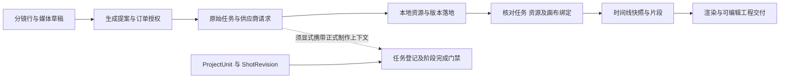

# AI 短剧平台：Agent 调用、制作闭环与交付质量源码复核

调查日期：2026-11-12。公开 CI 状态采集截止：14:38:12（UTC+8）。

本轮回答“BeefTV 等平台实际上如何完成短剧制作”，暂不选择 Glowloom 的 Agent 架构，不改业务代码，也不将竞品机制直接写成已确认需求。结论来自七个固定提交的源码调用链、测试定义和 GitHub Actions 记录；没有运行上游应用、测试、真实供应商生成或剪辑器导入。**源码调查可以完成，实际影片质量和服务稳定性仍须运行证据，不能由本报告保证。**

本报告补充此前的[源码与发行包对照调研](2026-11-12-短剧制作平台源码与发行包对照调研.md)。其中 BeefTV 从旧快照 `888108a` 更新到本轮 `d339ab1`；Toonflow、waoowaoo、Huobao 的固定提交未变，新增的是调用链复核与证据边界。旧报告中的设计映射不作为本轮结论前提。

## 1. 调研方法、范围与证据等级

通过 GitHub 插件检索仓库、读取固定提交文件、核对提交与工作流，再用对应源码快照追踪入口、权限、状态、外部调用、结果写回与导出。采用 reverse-engineer-anything 的版本固定、执行链拆解和证据边界方法；该技能明确要求完整源码架构分析使用仓库工具，因此本轮没有把源码分析包装成二进制逆向，也没有重复进行 REA 环境安装或就绪检查。

证据分为四类：

- **源码事实**：在所列提交和路径中找到调用、校验或写入；不等于已在生产环境验证。
- **测试/CI 事实**：测试覆盖哪些条件、公开工作流运行了什么；本轮未执行这些测试，fixture 不代表真实供应商。
- **作者声明/提示词纪律**：README、Skill、角色说明、产品截图。可说明意图，不能替代机器执行证据。
- **有界未发现/未验证**：明确搜索目录、入口和版本；不据此断言所有版本、外部插件或托管服务都没有该功能。

七个样本覆盖不同实现形态：BeefTV 的统一操作与制作模型，Toonflow 的真实委派，waoowaoo 的单主 Agent 持久任务，Huobao 的专业工序 Agent，CineGen 的浏览器工作台，Printfilm 的助手与 DAG，Frametell 的多会话导演和实际质量工具。Frametell 主要制作页面动画讲解片，用于比较编排与质量执行，不能替代真人感短剧的表演质量样本。样本不是整个市场的穷举，也不按星数评选优胜者。

| 平台 / 固定提交 | 提交日期（UTC+8） | 当前源码形态与许可事实 |
| --- | --- | --- |
| [BeefTV](https://github.com/glanderness/BeefTV/tree/d339ab127daa6ca57125e50e9e022dcdeeff3a4b) `d339ab1` | 11-12 | Go 业务后端、Pi Durable host、画布/正式制作模型；新覆盖材料 Source Available 1.0，历史 MIT 材料保留原许可，不能称整仓 MIT |
| [Toonflow](https://github.com/HBAI-Ltd/Toonflow-app/tree/6086cdffceb704a632eca143dd16cd461a78cdac) `6086cdf` | 11-05 | Pi 主运行、委派/Team、媒体任务与工具；MIT |
| [waoowaoo](https://github.com/waooAI/waoowaoo/tree/dfec20e32298ed675050329e4a41477024148399) `dfec20e` | 09-21 | Codex app-server、内部 MCP、Temporal、版本资源；Elastic License 2.0 |
| [Huobao](https://github.com/chatfire-AI/huobao-drama/tree/b48e6b2312166e25b1ff141832d2e82e5d63c142) `b48e6b2` | 11-05 | v4.0.11 为 Node/Hono/Mastra/Drizzle/SQLite，不能套用旧 Go 介绍；CC BY-NC-SA 4.0 |
| [CineGen](https://github.com/UllrAI/CineGen-ShortDrama/tree/f823501fc9c9f0daace80c8018db39b1acef94c3) `f823501` | 09-25 | React/Vite、浏览器直调 Gemini/Veo、IndexedDB；自定义 AniKuku Community License，不能称 MIT |
| [Printfilm](https://github.com/yi1108/printfilm/tree/9c41796d8ae4ee0a903c44a0911f29d57f69836b) `9c41796` | 11-12 | Python 助手、Studio DAG、底层任务调度与 FFmpeg；根及所核对的四个内嵌 Skill 为 MIT |
| [Frametell](https://github.com/sitor-ai/frametell/tree/dbd7802a04984bac587e5c655cbea042fc808639) `dbd7802` | 11-09 | 确定性 Director、多 AgentSession、页面渲染/审查/导出；根与 Agent 包 AGPL-3.0 |

许可名称仅记录固定源码文本，不推导具体复用方式的授权结论。完整许可路径、逐项调用和搜索范围见四份证据附录：

1. [BeefTV 源码复核](evidence/2026-11-12-short-drama-platforms/01-BeefTV源码复核.md)。
2. [Toonflow 与 waoowaoo 源码复核](evidence/2026-11-12-short-drama-platforms/02-Toonflow与waoowaoo源码复核.md)。
3. [Huobao 与 CineGen 源码复核](evidence/2026-11-12-short-drama-platforms/03-Huobao与CineGen源码复核.md)。
4. [Printfilm 与 Frametell 源码复核](evidence/2026-11-12-short-drama-platforms/04-Printfilm与Frametell源码复核.md)。

## 2. 主 Agent、子 Agent、Skill、MCP：实际不是同一种架构

这里把“子 Agent”限定为有独立会话/执行状态的模型工作者；多个专业名称、并行媒体任务、几个提示词文件不自动算子 Agent。Skill 是知识/工作纪律及工具使用说明；能否强制状态与权限，要另查服务端。MCP 还须区分向外暴露业务工具、接入任意外部服务器，以及外部 Agent 经 MCP 调用本产品。

| 平台 | 主运行与委派 | Skill 的实际作用 | MCP 的实际边界 |
| --- | --- | --- | --- |
| BeefTV | 内置 Pi Durable 会话；所选生产 host 未见内建 spawn/fork。外部 DSH 是另一层消费者，不能据此断言整个产品没有子 Agent | 版本 ID、内容 hash 固定，正文/包校验，压缩恢复时补回活跃技能 | 同一 Operation 注册表生成工具/API/CLI/MCP；外部调用按身份和权限准入，不是内置助手任意调用所有操作 |
| Toonflow | 主 Pi Agent 可并行 subAgent，独立会话、结果汇总；Team 可限制工具、知识和委派对象 | 目录发现和读取，Team 私有知识；完整制作纪律有一部分仍在 Skill 文本中 | 真正的外部 MCP 客户端：发现工具、schema、重名处理、错误/取消、调用前检查启用及配置版本 |
| waoowaoo | 明确单主 Agent；配置禁用 agents，子 Agent 事件按协议错误处理 | 六个专业领域是 Skill；输出 schema 与实际 Operation 映射落到代码 | 内部 Wao MCP 是业务能力边界；Turn/owner token 限制写入与过期执行，不等于任意外部 MCP 接入 |
| Huobao | 四个专业 Agent 由 `/agent/:type/chat` 选择；未见主 Agent 动态委派闭环 | 按专业前缀/语言发现 SKILL.md 并注入；工具实际写库 | 在所选服务入口未找到同等级 MCP 接入链 |
| CineGen | 四阶段 UI 和模型函数；未发现 Agent 执行框架或子会话 | 未见 Skill 注册/加载体系 | 未见 MCP 客户端/服务执行链 |
| Printfilm | 单助手最多 12 轮 JSON 工具调用；另有确定性 DAG，异步工作任务不能算子 Agent | 任务标签和用户选择拼入有长度限制的上下文 | 在 Studio 与 services/agent 的有界检索未见同等级 MCP/委派实现 |
| Frametell | Director 编排 planner、script、page lanes、reviewer 独立 AgentSession；属于受控多会话协作 | 专业说明与阶段工具由宿主编排；reviewer 新会话且无工具 | 在所选 runtime/core 未发现任意外部 MCP 注册链；不推断所用 SDK 的全部潜在能力 |

对照关键源码：[Toonflow 并行委派][T-sub]、[waoowaoo 禁用 agents][W-single]、[子 Agent 事件处理][W-event]、[Frametell 会话接口][F-session]。**多 Agent 数量与稳定性没有直接等价关系**：Toonflow 的媒体任务可恢复，但活跃 Agent run 在进程退出后不恢复；waoowaoo 没有子 Agent，却把媒体终态、批次计数和下一轮唤醒持久化。两者解决的层次不同。

## 3. BeefTV：两条制作链必须分别看

### 3.1 内置助手、业务后端与外部宿主

内置 Pi Durable 负责会话与工具交互，Go Operation 负责业务准入与状态。工具调用有稳定调用身份及 payload 约束；权限先于回放检查。自动重试受到费用副作用限制，不能理解为任意工具失败就让模型重新购买一次。

外部 DSH 经 CLI `mcp serve` 连接；固定 DSH 插件入口另核对 `glanderness/BeefTV-DSH@5ffda0b`。BeefTV 仓库内连接代码注册 `approvalMode=caller` 的 agent-client。当前 `task.cancel`、生成订单读取及外部写入/撤回等操作含 ExternalOnly 限制，后端拒绝内置 Assistant 身份，不能把工具目录里存在某项能力等同于内置助手已经拥有。[连接代码][B-dsh] 与附录 1 记录了身份及唤醒条件。

DSH 的 awaiting 状态来自真实工具结果中的 taskIds，包含去重/撤回和工作区身份校验；离线完成提示不等于重新在线后自动发起新的生成。内置计划续跑默认最多六次，用户新输入、停止、待审批或 needs_user/blocked 都会阻止推进。

### 3.2 通用画布的单镜与交付链

`canvas.script.prepare` 是规划入口；生成提案/订单约束审批、模型、输入和画布版本。任务按原始生产身份提交；成功还必须完成本地资源落地，以 taskId/outputIndex 等稳定关系绑定结果。`await-business-tasks` 要核对 ready、资源 ID、无落地错误和画布绑定；它不是只见供应商 success 就返回交付。

时间线使用快照和明确资源。确定性交付工具执行时间线刷新、渲染、结果节点创建/绑定与可编辑工程 ZIP；局部失败返回 incomplete、已有成功凭据和原任务 ID，避免把整条链重新当成新生成。[等待条件][B-wait]、[确定性交付][B-delivery]。

### 3.3 正式制作模型存在，但不能把自动接线补想出来

后端有 ProjectUnit → Shot → ShotRevision → ShotArtifact / ProductionTaskLink。登记要求真实工作流步骤、当前镜头修订、成功任务、本地 ready 资源和对应媒体类型；多输出须明确选择。旧修订输出可以保留，但会 stale、selected=false。阶段门禁检查**当前单元所有已登记镜头**的当前修订是否有 selected+ready 的对应预演/视频；这能防登记镜头缺产物，不证明原剧本没有漏拆剧情。[修订处理与完成门禁][B-gate]。

自动登记还依赖任务输入已有 workflowStepId 等上下文，缺少时直接返回。本轮在 web/src 精确搜索正式 production-context / register API，只找到客户端声明；所选 host/operations 未发现自动补齐 workflowStepId/shotRevisionId 的完整调用。**因此只能确认模型、API、事务和条件登记存在，不能确认通用画布助手已经自动跑通正式单元/镜头全流程。**搜索边界与文件位置见附录 1。

### 3.4 恢复、重做、审片与费用

- 恢复优先处理原任务：已成功但未交付则继续本地落地；未知、运行中、可取回或结算中不随意释放生成绑定。后台查询与手动恢复不同：仅特定“原请求未被接收”的手动恢复分支可按原 key/body 补交，不能笼统描述成永不 POST 或自动重购。
- 取消有条件更新、单发送者和 lease fencing；迟到 worker 不能按旧租约覆盖新状态。供应商取消、业务取消与退款是三个事实。
- 局部重做限制在已证明可重提的终局失败；成功镜头另做候选时新建节点，再针对性更新时间线。没有证据表明默认存在无限自动重抽直到审片满意。
- `media.review` 是一次有界多模态观察，指定媒体版本、时间窗（最长 15 秒）和问题，无工具和业务写入；readonly 也可能收费并被标记 ReplayUnsafe。它不等同于完整专业审片子 Agent。
- `generation.estimate` 读取已保存价格目录，最多 200 个目标，不联网、不建任务、不记账。本轮未审计完整托管财务及所有供应商合同，不从本地防重推导端到端收费 exactly-once。

## 4. 其他平台究竟怎么制作

| 平台 | 源码可追踪的制作过程与阶段产物 | 自动执行的边界 |
| --- | --- | --- |
| Toonflow | 专业知识/Skill → 调用媒体与资产/制作工具 → 持久媒体检查点 → 原任务恢复 → FFmpeg 工具；Skill 明确候选、修订、采用和交付纪律 | 真实子 Agent 并行；媒体任务恢复与主 Agent 运行恢复分离。Skill 在缺等待工具时要求用户反馈，没有伪造后台自动唤醒 |
| waoowaoo | 专业 Skill → 严格资源输出 schema → Operation → 固定输入 ResourceVersion → Temporal 媒体任务 → 批次终态唤醒 → 后续 Turn；冻结剪辑合同后 FFmpeg 合成 | all-terminal 包括失败/取消，唤醒只表示可以汇总处理，不能解释成全员成功；最终 merged.mp4 在所查处理器没有再走同样完整规格检查 |
| Huobao | 工序 Agent/工具 → 剧本、角色/场景、storyboard 数据库行 → 生图/视频任务 → 原视频恢复/下载 → FFmpeg 合并 | 分镜中的 8–15 秒、内部 2–4 镜等是提示词纪律，不全是 schema；替换分镜存在先删除、逐项写入路径，未发现整批事务保证 |
| CineGen | 剧本按场景解析 → 角色/场景与变体参考 → 单镜首尾关键帧 → Veo 视频 URL → 导出页面 | 前端页面编排；失败场景可变空列表继续。所选版本的 Master/EDL/XML 导出按钮无处理器，未形成真实导出产物 |
| Printfilm | 助手建立资产/镜头计划 → 用户阶段确认；Studio DAG 另做报价快照 → 依赖校验 → 并发任务/媒体 URL → 合成；另有短视频 pipeline | Studio 默认开关关闭，不能据源码存在宣称部署已启用。DAG 失败停止放行后继，但收尾已经开始的并行任务；心跳过期标失败，非完整 LLM 自动恢复 |
| Frametell | 研究/分镜 → 宿主审批 → 脚本/TTS/素材 → 页面 Agent lanes → lint/截图/审查 → 可预览 → 用户另行导出 MP4 | 真正执行质量工具且修复轮次有上限；ready 只是预览就绪。导出完成事件之后异步 film-gate，不能称最终审片阻断门禁 |

完整路径与对应固定链接见附录 2–4。这些词在平台间不一一对应：Huobao 的一个生成段可含内部多个镜头；BeefTV 的 ShotRevision 是制作版本身份；waoowaoo 的 ResourceVersion 是资源输入版本；Frametell 的 page 是动画画面单元。**不能用统一的“镜头数/任务数/Agent 数”直接比较交付完整性。**

## 5. 自动推进、失败恢复和局部重做对照

### 5.1 哪些状态真正跨故障保存

| 平台 | 已找到的恢复事实 | 未被该事实覆盖的问题 |
| --- | --- | --- |
| BeefTV | Durable 会话、原工具调用凭据、原任务取回/本地落地、取消与租约栅栏 | 所查 await 函数每次入口重算 20 分钟 deadline，不能当成跨重启绝对期限；桌面/本机机制不证明集群 SaaS 所有故障语义 |
| Toonflow | 媒体检查点保存 taskId、供应商状态/路由、chargeId、结果 URL/hash；恢复查原任务，缺凭据停车 | activeSessions/activeRuns 在内存，源码明确进程退出不恢复活跃 Agent；MCP timeout 不能证明外部副作用未发生 |
| waoowaoo | provider 提交检查点、输入指纹、固定描述；outcome_unknown 禁止自动重提；批次 CAS 到 ready 后交接下一 Turn | 本地防重与测试不证明所有供应商财务精确一次；显式拒绝/授权恢复与网络断连不能混用 |
| Huobao | 视频原供应商/配置/任务 ID/URL 固定；无 ID 的 submission_unknown 停车；过期 URL 重查，下载恢复不重新购买 | 视频新任务 ID 栅栏不等于正式采用版本；生图、Agent 和整集合成没有同等级完整恢复证明 |
| CineGen | IndexedDB 保存项目；页面内 SDK operation 轮询 | operation ID 未入项目状态；关闭/刷新后无持久原任务查询链；保存请求成功不等于事务完成 |
| Printfilm | DB lease、SKIP LOCKED、孤儿任务恢复；已知 provider ID 的视频下载可重试；DAG/助手有心跳 | Agent 心跳过期转失败、保留部分结果，非续跑所有模型步骤；未完整证明无 ID 提交不明路径的收费安全 |
| Frametell | 项目文件、阶段状态、会话引用；按目标页面重做，清 exported 标志；音频可独立处理/复用缓存 | 状态 writeFileSync 不等于已证明原子持久化；fake runtime 测试不等于供应商故障恢复通过 |

恢复必须具体到阶段：尚未提交、提交回执不明、供应商运行中、结果可查但下载失败、本地文件落地失败、采用/剪辑写回失败、导出失败，各平台覆盖不同。通用 retry 按钮不能说明这些都安全。

### 5.2 局部修改会不会污染已采用结果

BeefTV 的正式 ShotRevision/Artifact 能拒绝旧修订作为当前采用产物；waoowaoo 固定 ResourceVersion 输入并提供有限目标重试。二者仍不能由一处版本表推导出“整剧所有上游修改自动失效”已完成。Toonflow 有详尽采用纪律，但本轮未证明全部落为服务端不可绕过的状态约束。

Huobao 视频结果有新任务 ID 栅栏，生图写回未找到同等级修订栅栏；覆盖分镜的整批原子性也存在边界。CineGen 改关键帧或角色变体时保留旧 interval.videoUrl，没有明确 stale/采用快照。Frametell 对页面目标与导出失效有实际处理，但不代表拥有短剧角色、对白、动作段依赖图。这些区别决定“单镜重做”是否只是改字段，还是确实有隔离旧结果、采用和下游更新的闭环。

### 5.3 报价、授权、执行和账务不能合并

BeefTV 可见估价、订单与 caller/ask/auto 授权边界；waoowaoo 可见输入 hash、计划快照、审批与执行 fence；Printfilm DAG 有持久报价、文档版本/余额复核和项目锁。Toonflow 媒体记录 chargeId，Huobao 保留供应商配置/请求身份。它们提供不同层的证据，不能互相补全缺失账务。

本轮未证明任一平台在所有上游故障下都实现“恰好收一次费、退款准确、取消即零成本”。没有另行发起付费测试。外部 MCP 工具也需单独判断副作用与授权，工具被列出来或正常返回并不构成财务合同。

## 6. 交付质量：在哪一步检查，是否真的阻断

应逐层判断事实，不能只有一个 success：计划/引用合法 → 原请求可追踪 → 本地资源完整 → 当前采用版本 → 全部制作义务覆盖 → 实际最终媒体有效 → 剧情与视听合格。以下是调查维度，不是对 Glowloom 新增的实现承诺。

| 检查层次 | 找到的实际机制 | 质量边界与反例 |
| --- | --- | --- |
| 参数、引用与权限 | Beef Operation/订单；wao schema/Turn fence；Toon Team/MCP 白名单与配置复核 | 引用合法不等于角色外观、动作或对白符合故事 |
| 提交与结果落地 | Beef ready+资源绑定；Toon/Huobao 原任务/URL 恢复；wao 未知提交停车 | 任务终态不必然有可长期使用的本地文件；单纯下载头部检查不代表媒体能完整解码 |
| 版本与采用 | Beef 当前 ShotRevision 的 selected+ready；wao 固定输入版本；Frametell 页面变更清导出标记 | 存在版本结构不证明每个入口都接入；提示词要求采用不等于后端强制采用 |
| 全剧义务完整 | Beef 正式阶段检查所有已登记镜头 | 不检查漏拆剧情；CineGen 场景失败返回空列表；Huobao 合并过滤无 URL 镜头且有一个可用片段即可；Printfilm 缺视频可退到图片，再缺失则用纯色片段 |
| 实际最终文件 | Beef 有渲染/工程交付；Huobao/Printfilm/wao 有 FFmpeg；Frametell 有真实渲染/MP4 | CineGen 导出 UI 无动作；wao 所查时长/尺寸校验针对 stitched.mp4 中间产物，混音后最终 merged.mp4 未再同样探测 |
| 审查与放行顺序 | Frametell lint/截图确实执行，部分运行错误会阻断；reviewer 有限轮；Beef media.review 返回一次观察 | Frametell 导出完成后才异步 film-gate，异常被忽略；Printfilm AUDITING 后直接 DONE，所查片段未读审核结论；不能用状态名证明审片通过 |
| 叙事与视听 | 参考图、角色变体、专业 Skill、旁白配置、有限模型审查 | 本轮没有实片证据证明角色/音色连续、逐字对白、口型、动作、字幕可读、声画节奏和剧情覆盖全部达标 |

最容易影响交付判断的固定源码：

- [Huobao 实际合并逻辑][H-merge]：缺少视频 URL 的项被过滤；合成存在与整集齐备是两项事实。
- [CineGen 导出页面][C-export]：按钮无处理器，不能列为已实现的 Master/EDL/XML 交付。
- [Printfilm 缺媒体的占位回退][P-placeholder]、[AUDITING → DONE][P-audit]：需要把可播放文件与合格影片分开。
- [Frametell 先交付再异步 gate][F-export]：最终 gate 可报告问题，但此入口不以它阻断交付。
- [waoowaoo 合成与探测顺序][W-merge]：探测对象、混音和最终上传顺序不能省略。

因此没有足够证据把任何一个样本描述为“已经自动保证整部短剧质量”。这不是否认它们已有的实际生产能力，而是把明确实现与尚无运行证据的质量承诺分开。

## 7. 测试与公开 CI：结果及其边界

下表固定到上述提交，并记录采集时状态。公开 Actions 无记录只表示该 SHA 的查询返回 0，不推断其他分支、外部 CI 或人工发布从未存在。

| 平台 | 本次核验的公开结果 | 可以支持什么 / 不能支持什么 |
| --- | --- | --- |
| BeefTV | [Quality checks 43168029091](https://github.com/glanderness/BeefTV/actions/runs/43168029091) success；5 个 job 成功、2 个按需 job 跳过；[容器发布 43168029183](https://github.com/glanderness/BeefTV/actions/runs/43168029183) 采集时 in_progress | 覆盖后端、host、Web 等工作流；不能宣称跳过项、真实付费生成或容器发布已通过 |
| Toonflow | [Release 41990625476](https://github.com/HBAI-Ltd/Toonflow-app/actions/runs/41990625476) success | 发布构建成功，不能描述成全面测试或恢复验收 |
| waoowaoo | [Verify 35589902169](https://github.com/waooAI/waoowaoo/actions/runs/35589902169) 与 [Docker 35589902085](https://github.com/waooAI/waoowaoo/actions/runs/35589902085) success | 有测试/构建证据；测试环境与用户自带 key/账务关闭等条件须区分，不证明托管收费实片验收 |
| Huobao | 所选 SHA 公开 runs 为 0；已读视频恢复测试 | SQLite/本地 HTTP 等测试定义可解释恢复分支；本轮没运行，不代表供应商真实恢复通过 |
| CineGen | 所选 SHA 公开 runs 为 0；所查 24 文件中未发现测试/工作流，package 无 test 脚本 | 有界源树事实，不能扩展到其他托管代码 |
| Printfilm | 所选 SHA 公开 runs 为 0；已读 DAG 故障/并行收尾测试 | 测试使用 SQLite/monkeypatch，不能证明真实付费服务与最终审片 |
| Frametell | [CI 42576923919](https://github.com/sitor-ai/frametell/actions/runs/42576923919) failure；已读 pnpm test 日志 | 多个 benchmark 测试出现 Unexpected end of JSON input，另有失败/超时；尚未复现定位，不能归因单一根因或断言产品全部不可用 |

上游有真实生成评估脚本、演示视频或 prompt 评分，也只能分别记录为测试能力/样例/作者评价。本轮没有把这些换算为平台成功率、长剧合格率或稳定性排名。

## 8. 已回答的问题与仍需实证的问题

本轮已完成：七个样本的固定版本核对；主/子 Agent、Skill、MCP 的角色拆分；制作入口、阶段数据、原任务恢复、局部修改、导出和质量检查位置；关键测试定义与公开 CI 结果。对 BeefTV 进一步区分了画布单镜交付链与正式镜头模型，定位自动接线证据缺口。

部分回答：各平台未公开的托管服务、外部宿主的全部调度、所有供应商的提交/计费协议、整剧依赖失效、最终质量强制覆盖范围。源码缺少连接证据或实现不完整处已逐项标明，不以建议填补事实。

在把任一竞品能力转化为“我们可以承诺的交付质量”前，仍需明确样本和授权条件，拿到以下运行证据；这些是调研留下的验证问题，不是本轮已经通过的验收，也不是实施排期：

| 场景 | 需要观察的事实 |
| --- | --- |
| 提交已受理但回执丢失；等待期间服务重启 | 是否查回同一原请求；是否再次购买；任务、订单、账单能否对上 |
| Agent 进程退出、MCP 超时或工具配置改变 | 哪个执行点能恢复；是否有过期写入；外部副作用是否被错误重放 |
| 镜头 A 重做或取消后旧请求迟到 | 旧结果保存在哪里；能否覆盖当前采用版本；是否影响其他镜头 |
| 一场剧本解析失败、一个镜头缺失、媒体 URL 失效 | 缺失义务是否保留；是否暂停整集交付；是否静默跳过或输出占位片段 |
| 修改角色/台词/关键帧/音轨后局部重做 | 精确影响哪些候选、采用资源、剪辑片段和导出；已完成无关镜头是否保留 |
| 资源完成但采用/时间线/工程保存失败 | 是否继续本地写回与导出；是否保留原任务和已成功产物，而非全流程重购 |
| 完整最终 MP4 与可编辑工程 | 最终文件能否全片解码、音轨/字幕/时长正确；工程能否实际导入指定剪辑器并重连素材 |
| 故事与表演合格 | 按固定剧本核对剧情覆盖、人物/音色一致、对白/口型、动作、黑帧、字幕和节奏；评审结论是否真的阻断放行 |
| 审查不通过和持续修复 | 修复轮次、费用与停止条件是否生效；是否只重做指定范围并保留审查证据 |
| 多租户、多 worker 与账务 | 任务归属、租约、审批撤销、并发容量、供应商费用与用户扣费是否可核对；本机正确不能代替该项 |

本报告停留在事实调研层。后续如重新评估现有方案，应先逐项指出它依赖了哪些已证实机制、哪些仅是提示词纪律或未验证假设，再讨论是否采纳；不能从“参考项目拥有某个类/接口/状态名”直接推出闭环已经完成。

## 固定源码索引

[T-sub]: https://github.com/HBAI-Ltd/Toonflow-app/blob/6086cdffceb704a632eca143dd16cd461a78cdac/apps/server/src/agent/tools/subAgent.ts#L10-L66
[W-single]: https://github.com/waooAI/waoowaoo/blob/dfec20e32298ed675050329e4a41477024148399/src/lib/creative-skills/runtime-skills.ts#L128-L196
[W-event]: https://github.com/waooAI/waoowaoo/blob/dfec20e32298ed675050329e4a41477024148399/src/lib/assistant-runtime/event-projector.ts#L535-L541
[F-session]: https://github.com/sitor-ai/frametell/blob/dbd7802a04984bac587e5c655cbea042fc808639/packages/agent/src/director.ts#L27-L69
[B-dsh]: https://github.com/glanderness/BeefTV/blob/d339ab127daa6ca57125e50e9e022dcdeeff3a4b/plugins/deepseek-harness/connection.js#L190-L230
[B-wait]: https://github.com/glanderness/BeefTV/blob/d339ab127daa6ca57125e50e9e022dcdeeff3a4b/agent-host/await-business-tasks.mjs#L20-L101
[B-delivery]: https://github.com/glanderness/BeefTV/blob/d339ab127daa6ca57125e50e9e022dcdeeff3a4b/agent-host/timeline-delivery.mjs#L34-L120
[B-gate]: https://github.com/glanderness/BeefTV/blob/d339ab127daa6ca57125e50e9e022dcdeeff3a4b/backend/internal/project/workflow.go#L322-L497
[H-merge]: https://github.com/chatfire-AI/huobao-drama/blob/b48e6b2312166e25b1ff141832d2e82e5d63c142/backend/src/services/ffmpeg-merge.ts#L26-L147
[C-export]: https://github.com/UllrAI/CineGen-ShortDrama/blob/f823501fc9c9f0daace80c8018db39b1acef94c3/components/StageExport.tsx#L122-L164
[P-placeholder]: https://github.com/yi1108/printfilm/blob/9c41796d8ae4ee0a903c44a0911f29d57f69836b/backend/app/services/ffmpeg_compose.py#L1204-L1238
[P-audit]: https://github.com/yi1108/printfilm/blob/9c41796d8ae4ee0a903c44a0911f29d57f69836b/backend/app/services/pipeline.py#L1499-L1532
[F-export]: https://github.com/sitor-ai/frametell/blob/dbd7802a04984bac587e5c655cbea042fc808639/packages/agent/src/director.ts#L1769-L1798
[W-merge]: https://github.com/waooAI/waoowaoo/blob/dfec20e32298ed675050329e4a41477024148399/src/lib/task/execution/handlers/workspace-resource-video-merge.ts#L66-L205
