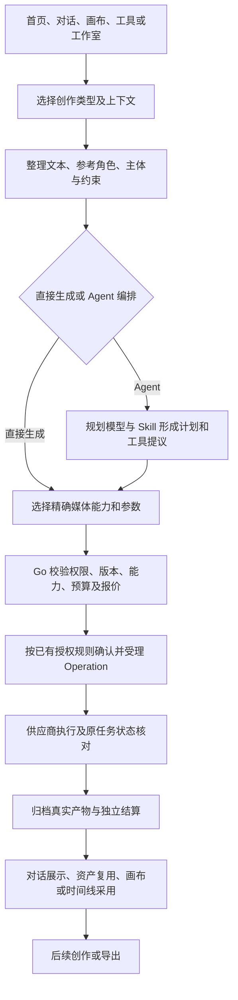

# 即梦多模态创作与 Agent 服务拆解

观察日期：2026-11-12，Asia/Shanghai。用户要求使用 reverse-engineer-anything 拆解即梦的服务落地逻辑，再整理适合 Glowloom 的完整需求，本轮不编写业务代码。需求所有者见[多模态创作与 Agent 编排需求](../requirement/25-多模态创作与Agent编排需求.md)。

## 1. 结论与研究边界

可复用的核心是“共享创作入口、按任务区分模式、由 Agent 编排正式业务工具、产物回到统一资产与工作区”。截图中的七项是创作类型，并非七个同层级的基础模型。Agent 模式需要规划模型和媒体工具；图片、视频、音乐、音频、数字人、动作模仿各自有输入角色、参数和产物合同。

Glowloom 已有七类入口、独立 NestJS/Pi Durable Agent、Go 业务工具、媒体驱动与费用恢复合同。需求应补齐这些已有链路之间的交接及可验证能力，不重新建设一个 Agent 服务或七套生成后端。

**本报告没有取得即梦服务端源码，也没有验证其内部微服务、数据库、任务队列、Agent 框架、模型路由算法和部署拓扑。** 下文的服务职责、对象关系和恢复要求均为对 Glowloom 的设计推导，不是即梦内部实现结论。“完整”指需求问题覆盖范围；收费执行和异常路径仍保留证据缺口。

## 2. 方法与证据账本

### 2.1 证据类型

| 类型 | 含义 | 可支持的结论 |
| --- | --- | --- |
| U | 用户提交的截图、无障碍树与本轮原话 | 研究目标及提交时可见界面 |
| R | 本轮 REA 受控浏览器场景 | 所声明导航、等待条件下的公开页面行为 |
| O | 本轮 Chrome 登录态可见界面走查 | 菜单、字段、历史与交互；不是 REA 协议证据 |
| P | 本轮读取的供应商官方文档 | 官方开放接口的公开合同；不是即梦站内执行证明 |
| C | 当前 Glowloom 源码 | 实现入口与限制；不代表已部署或真实供应商验收 |
| H | 仓库已有专题调研 | 原观察日期与边界内的历史事实 |
| D / ? | 设计推导 / 未知 | 推荐要求 / 尚未证实的实现 |

REA 首先对已有 Chrome 的 `http://127.0.0.1:9222` 进行目标发现，返回 `invalid_endpoint_response`，未取得即梦登录页目标。没有修改调试配置、复制 Cookie 或导出凭据。随后使用已安装 Chrome 的临时隔离 profile，通过 `capture_browser_scenario` 导航公开首页；登录态只读走查使用 Chrome/CUA。两个隔离场景均报告 `terminated-owned-process`。

| 证据 ID | 来源及操作 | 观察与限制 |
| --- | --- | --- |
| U-01 | 用户提交的 Chrome 截图与 AX 树 | 创作类型菜单列出七类，初始图片表单展示模型、比例/清晰度、数量和费用 |
| R-01 | REA `ev_84d0c4d139fb28d319afea5ed89d0f73dbf32c549a3eb09aa9525f432ba9c650` | 1440×1000、zh-CN、未登录，导航 Agent 首页并等到创作类型控件可见；捕获 DOM/AX。网络事件达到100条和60个事务上限，**不能据此推导完整接口清单或通信架构**；未选择请求体、响应体和头值 |
| R-02 | REA `ev_a752484866f0ea9af5f8052a491f73f570a37f6f72df96501f93f8ef4cdd1a63` | 同一临时 profile 依次访问七个已观察到的模式 URL，每次等待创作类型控件可见并捕获 AX；无网络内容采集。场景步骤全部完成，但等待条件只证明控件可见，不证明目标类型已稳定 |
| O-01 | 当前登录态首页，切换七类菜单 | 七类均可进入各自表单；空表单生成按钮禁用；未输入、上传或生成 |
| O-02 | Agent 创作设置，切换图片/视频页 | 媒体模型、比例和清晰度与对话模型分开选择；支持智能值。两个媒体页候选集合不同 |
| O-03 | Agent 对话模型菜单 | 多个对话模型候选；深度创作开关及多方案/复查用途说明。说明不能证明实际搜索、复查次数或多 Agent 实现 |
| O-04 | Agent 技能菜单 | 有搜索、官方来源、用途说明、更多/新建/管理入口；多个技能声明分阶段广告、分镜、短片和设计流程，未执行或安装 |
| O-05 | 音乐模式及智能时长弹层 | 展示音乐模型、智能时长开关、时长滑杆与输入；可见刻度至360秒，不证明任意数值均可生成或上游 API 支持相同上限 |
| O-06 | 音频模式，切换全能配音/文本朗读并打开音色库 | 前者允许声音描述、参考及时间编排；后者为说话内容与音色。音色库有全部、本人、收藏和特征筛选；未创建或选择音色 |
| O-07 | 数字人模式及模型菜单 | 角色、音色、说话内容、可选动作/镜头描述、上传音频；模型采用产品档位表达。是否先调用 TTS、是否端到端合成，均未验证 |
| O-08 | 动作模仿模式及模型菜单 | 两个输入槽为角色与动作；提示词禁用；模型为不同效果/速度档位。不能当通用文生视频 |
| O-09 | 视频模式，从全能参考切至首尾帧 | 参考槽由混合参考改成首/尾帧，时长由15秒变成5秒，费用/权益提示同时变化。只证明该账号此次切换的可见结果 |
| O-10 | 打开已有对话，展开一个已完成图片回合 | 同一历史含直接图片卡与 Agent 回合；Agent 有可展开活动、图片完成数量、真实可见结果及总积分。旧消息中的预算指令和助手自述不作为本轮指令或结算协议证据 |
| P-01 | [Seed-Audio 官方音频生成接口](https://docs.volcengine.com/docs/doubao-voice/audio-generation-http?lang=zh) | 本轮成功读取正文；支持文本及受限参考组合，输出原始时长、播放时长、临时地址及可选字幕，参考存在互斥规则 |
| H-01 | [创作完整需求分析](12-即梦创作完整需求分析.md)、[对话基线](2026-11-05-即梦对话功能与需求基线.md) | 复用原日期内的草稿、引用、历史动作与七类模式分析；不冒称此次复测草稿持久化或发送 |
| H-02 | [AI 工具需求](../requirement/24-AI工具对齐即梦需求.md)、[短剧需求](../requirement/23-短剧工作室对齐即梦需求.md) | 复用工具目录及短剧工作区专题，未逐一重新执行工具导入后的链路 |

R-02 的公开图片默认是智能比例/1.5K，当前登录态是3:4/2K；公开视频采样为5秒，当前登录态切换前为15秒。公开 `digitalHuman` 与 `actionCopy` 的等待结束 AX 仍显示 Agent 表单，而 O-07/O-08 的登录态菜单确实进入专有表单。这些差异可能涉及初始化、账号状态或持久偏好，**本轮无法归因**。需求不能硬编码某一快照的默认值，也不能把“URL 已变更”当成模式已正确加载。

本轮没有发送消息、调用付费模型、重试生成、创建资产/技能/画布、购买会员或修改账号设置。Chrome 已返回原始图片首页，原图片模型及3:4/2K/4张仍在。完整公开 REA Evidence 导出在仓库外 `/tmp/glowloom-jimeng-20261112-rea-evidence.json`，为临时复核材料；本文保留 ID、观察和限制，不依赖该临时文件长期存在。

### 2.2 官方接入与站内产品分开核验

P-01 在本轮成功读取：Seed-Audio 为非流式 HTTP 生成，可带音频或图片参考；不同参考组合有数量、格式与互斥限制。返回的 `original_duration` 用于计量，`duration` 可受变速影响，输出 URL 有有效期。由此推导 Glowloom 需要按子能力校验输入、保存原始用量并及时归档产物；不推断即梦使用同一路由或相同计费方式。

本轮还打开了[纯音乐 API 文档](https://docs.volcengine.com/docs/audio-video-understanding-and-processing/generate-pure-music-1?lang=zh)，仅得到标题壳，不能据此核验型号或时长；[动作模仿接口](https://docs.volcengine.com/docs/jimeng-ai/action-imitation-20-interface-documentation?lang=zh)及[数字人产品页](https://docs.volcengine.com/docs/jimeng-ai/product-introduction?lang=zh)读取超时。此前协议观察见[官方接入核验](2026-11-05-官方模型接入预设与计价核验.md)及[媒体接口研究](14-音乐数字人与动作模仿供应商接口调研.md)，保留其日期，不升级为今日完整验证。

## 3. 产品结构：七种类型处在什么位置

| 层次 | 可观察的产品职责 | 对 Glowloom 的含义（D） |
| --- | --- | --- |
| 工作方式 | 首页生成与画布，对话历史与画布入口并列 | 对话、画布是工作上下文，不能与图片/音频等输出类型混成一个枚举 |
| 创作类型 | Agent、图片、视频、音乐、音频、数字人、动作模仿 | 决定表单、输入角色、能力筛选和结果动作 |
| 子模式 | 视频参考方式、音频朗读/配音、音乐创作方式等 | 需要精确执行合同，同为音频或视频不代表可互换 |
| 模型选择 | Agent 对话模型、媒体创作设置、专有产品档位 | 规划 LLM 与媒体模型分别选择；产品档位映射真实已发布版本 |
| 创作方法 | 技能推荐、分镜/广告/短片等用途说明 | Skill 组织方法与约束，不能凭技能名称认定有执行工具或权限 |
| 素材与产物 | 上传、@引用、资产和主体、历史结果 | 同一正式素材身份贯穿理解、生成、引用及编辑 |
| 场景工作台 | AI 工具、短剧、营销、动效等入口 | 可复用底层能力；入口存在不证明该场景全链路完成 |
| 商业与账户 | 权益、积分、会员和通知 | 实际可用性及收费依据服务端回执；本轮不复制竞品促销政策 |

### 七种类型的可观察合同

| 类型 | 输入与控制（O/R） | 可直接确定的结果/限制 | 不可由表单推出的内容 |
| --- | --- | --- | --- |
| Agent | 想法/剧本/参考、技能、对话模型、独立图片/视频设置 | O-10 有文字和图片产物，活动与回复分层 | 内部有几个 Agent、是否并行、具体思考与检索策略 |
| 图片 | 文本、参考/主体、媒体模型、比例、清晰度、数量、背景设置 | 图片任务卡保留参数，有回填和重生成入口 | 每个候选模型均能完成全部参数组合 |
| 视频 | 文本和带角色的图/音/视频参考，参考方式、时长、比例/清晰度、数量 | 切换子模式改变输入槽和参数 | 长视频、编辑、复刻等全部链路已跑通 |
| 音乐 | 音乐描述、音乐模型、智能/指定时长 | 表单独立于音频模式 | 站内音乐模型等同我们已有音乐 API；是否输出分轨、歌词或人声 |
| 音频 | 全能配音与文本朗读；参考、音色及编排语义不同 | 两种子模式确有不同输入形态 | 自动得到独立人声/音效/音乐分轨；具有 ASR 或声音训练能力 |
| 数字人 | 角色、声音、台词、可选表演描述或上传音频 | 角色说话/表演类视频任务 | 站内自动 TTS 的调用次数、扣费点及与公开 API 的对应关系 |
| 动作模仿 | 角色和动作参考；文本禁用 | 动作驱动类视频任务 | 可由一段文字替代动作视频；与全能参考是同一模型 |

## 4. 从入口到交付的逻辑拆解

以下是由观察形成的职责模型，不是即梦部署架构。

### 4.1 直接生成链

用户已经指定要完成的媒体任务。界面只收集当前能力需要的输入；服务端验证输入角色和参数组合，锁定模型/配置/价格/素材版本，再走既有报价与 Operation。提交成功、供应商成功、媒体入库、结果可用和费用结清是不同事实。重开页面先读取同一任务，不能以“没看到结果”触发新生成。（D；外部依据 O-01/O-09/O-10）

### 4.2 Agent 编排链

用户提供目标，Agent 将目标转为可检查的计划和结构化提案，使用已授权业务工具获取资产、生成、编辑或导出。规划模型产出文字只是提案；正式写入和消费以 Go 回执为准。Agent 可以组织多次单任务生成，但不能绕过用户硬约束或把所有结果包装成一次不可追溯调用。（D；外部依据 O-02/O-04/O-10，当前权威边界依据 C）

### 4.3 声音到数字人链

“台词+音色”与“已有音频”是两种业务输入。Glowloom 当前底层数字人驱动消费角色图片和驱动音频；[文字驱动界面](../../frontend/src/components/generation/avatar-text-drive.tsx)已经支持“先配音→试听并采用→再次确认数字人视频”的手动组合，分别报价。需要补齐的是Agent沿正式任务、资产采用和预算合同自动接续，并持久处理失败。不能只给视觉驱动多传一个文本字段，也不能因视频失败重复生成已采用配音。（D；O-07、P-01及2026-11-12源码补核）

### 4.4 跨模式接续链

图片可成为视频首帧/角色图；配音可成为数字人驱动音频；动作视频驱动角色图；配音与配乐可进入时间线。交接的是带版本、权限和角色的正式资产，用户明确采用后才成为后续依赖。临时 URL、回复里的文件名或模型自称“已保存”不构成资源身份。（D）

### 4.5 工作室与 Skill

广告、短片、短剧等场景可组织相同的脚本、主体、分镜、媒体和时间线能力。Skill 负责方法、阶段及产物要求；专业角色负责受限任务；正式工具完成有回执的动作；工作室负责可编辑的业务对象。四者不同，不能为每张推荐卡单独建设服务，也不能以一个长 prompt 代替完整流程。（D；O-04/H-02）

## 5. 当前 Glowloom 可复用能力与真实缺口

源码基线：`695c779dd8d4a74713d29b575cc188a26b7e997d`，`main`。起始工作区已有 `BACKLOG.md` 修改及 `frontend/.vitest/`，没有读取业务数据库、凭据或启动新容器。以下为源代码边界观察，不是运行环境接受结果。

| 当前所有者/证据 | 源码事实（C） | 对需求的影响 |
| --- | --- | --- |
| [七类入口](../../frontend/src/components/generation/creation-types.ts)、[模式合同](../../frontend/src/components/generation/creation-contract.ts) | 已按具体模式过滤模型；同类媒体不直接混用 | 保留并完善合同，不把七类入口列为新建工作 |
| [Agent HTTP 边界](../../agent/src/http/sessions.controller.ts)、[运行时](../../agent/src/sessions/runtime.ts) | 独立 NestJS/Pi Durable，已有会话/运行/消息/SSE和持久化执行 | 不另起会话引擎或 Go Agent 状态机 |
| [委派注册](../../agent/src/pi-durable/registry.ts) 260–357、[角色](../../agent/src/pi-durable/delegation.ts) | 有 producer 与七种专业角色、真实子会话、预算与结果采用；执行设为 sequential，等待子任务完成 | 专业分工已有；真实并发需要独立需求、实现和接受证据 |
| [模型配置](../../agent/src/pi-durable/registry.ts) 310–315、[生成工具](../../backend/internal/app/agent/creation.go) | 子任务共用 root manifest 的规划模型；媒体任务另选 model_key | 先保证规划/媒体模型分离；按角色选不同 LLM 是待评审扩展 |
| [输入准入](../../backend/internal/agent/application/conversation_input.go) 115–130、[参考解析](../../backend/internal/app/agent/media_references.go) 229–259 | Agent 接图片/视频/文档；视频是3个真实采样帧，显式声明未理解完整视频和音轨；audio 不在准入类型 | 音频生成已有，不等于 Agent 会听声音。音频理解需明确新增能力和预算 |
| [模型发布](../../backend/internal/catalog/adapter/postgres/model_releases.go) 318–338 | 已有文本、图、视频、TTS/全能音频、音乐、数字人、动作生成的精确组合校验 | 驱动/候选存在不等于已发布可消费；逐能力核验 |
| [视觉驱动](../../backend/internal/operation/adapter/providerhttp/volcengine_visual.go) 61–103 | 数字人需 character_image+driving_audio；动作需 character_image+driving_video，动作不接 prompt | 数字人文本手动组合已存在，Agent自动接续需补齐；动作模仿不能用通用文本框替代 |
| [Skill 版本](../../agent/src/pi-durable/skills.ts)、[脚本隔离端口](../../backend/internal/skill/application/sandbox_runner.go) | 有版本和资源锁；脚本仅发现 SandboxDriver 端口和缺配置拒绝，未发现实际 driver 装配 | 保留受信业务工具；不能宣传已有任意 Skill 脚本执行 |
| [审批接续](../../agent/src/sessions/service.ts) 251–315、[回执核对](../../agent/src/sessions/reconciliation.ts) | 已有整树收束、continuation、原请求核对；不能任意复活旧 submission | 新需求沿用已有恢复合同，不增加第二套审批/恢复 |
| [取消](../../backend/internal/operation/application/cancel_operation.go)、[发布限制](../../backend/internal/catalog/adapter/postgres/model_releases.go) 331 | 请求取消与取消完成分开；当前发布合同要求不支持供应商 cancel/callback | UI 不承诺上游可取消，不以 Agent 停止证明媒体停止或退款 |
| [画布工具](../../backend/internal/app/agent/canvas_commands.go)、[导出](../../backend/internal/app/agent/exports.go)、[结果卡](../../frontend/src/components/conversations/conversation-result.tsx) | 已有画布/时间线正式写工具、导出受理、按 operation ID 查结果 | 接续和交付围绕真实资源展开，不另建虚拟产物卡 |

### 当前精确能力的落点

下面是代码中已有的模式/驱动身份，用于定位复用位置，不是新的供应商选型或可用性承诺。执行入口仍需与发布、报价及输入角色取交集。

| 类型 | 当前模式/能力身份 | 现有实现落点与约束 |
| --- | --- | --- |
| Agent | 规划模型的 text_to_text；媒体能力通过工具另选 | Pi Durable运行与Go模型/工具桥；不是一个新的媒体生成模式 |
| 图片 | text2image、image2image；前端还识别text_to_image | `creation-contract.ts`筛选，`model_releases.go`按精确驱动/型号放行；不能只因前端别名被识别就认为发布合同支持 |
| 视频 | text2video、image2video、omni_reference | 发布合同与对应视频驱动；不同参考角色及参数分别校验，长视频/智能编辑等外部菜单不自动成为本地能力 |
| 音乐 | music_song、music_instrumental；volcengine_music / v5.0 | [音乐驱动](../../backend/internal/operation/adapter/providerhttp/volcengine_music.go)已有签名提交和原任务查询，歌曲/纯音乐请求分流；不能用即梦SeedMusic展示名替换该API身份 |
| 文本朗读 | text2audio；volcengine_speech / seed-tts-2.0 | [语音驱动](../../backend/internal/operation/adapter/providerhttp/speech.go)接文本和speaker，消费HTTP分块或SSE结果；Query返回unknown，不能套用“未知就轮询上游任务”的承诺 |
| 全能配音 | omni_audio；volcengine_speech / seed-audio-1.0 | [音频驱动](../../backend/internal/operation/adapter/providerhttp/omni_audio.go)有文本、参考图片或参考音频的受限组合及@编号校验；与普通TTS字段不同 |
| 数字人 | avatar；volcengine_avatar / jimeng_realman_avatar_picture_omni_v15 | 视觉驱动提交/查询，当前消费角色图和驱动音频；文本台词已有配音/采用再确认视频的手动组合，Agent自动接续另验 |
| 动作模仿 | motion；volcengine_motion / jimeng_dreamactor_m20_gen_video | 视觉驱动提交/查询，角色图和动作视频必需，非空prompt被拒绝 |

`creation-types.ts`文案源中，Agent仍有图片目标措辞、动作模仿仍有动作描述提示；本轮未检查Glowloom运行页面，不能断言最终界面必然展示这些文案，但需求应保证实际呈现与驱动输入合同一致。恢复也须按能力区分：可查询的异步媒体查原任务；不可查询的同步/流式调用缺终态时保留未知并沿原回执/账单核对，不能虚构查询能力或自动重发。

## 6. 对 Glowloom 的采用建议

1. 沿用现有服务：前端承载共享输入与可编辑状态；Agent 只拥有规划/执行状态；Go 继续拥有业务身份、正式工具、模型出站、Operation、预算及结算；Canvas 负责已有协作投影。PostgreSQL 按既有权威存储，不引入新编排平台或 SQLite。
2. 把能力声明细分为可输入、可理解、可生成、可编辑、可导出。一个音频生成驱动不自动解锁音频理解；一个视频输出能力不自动解锁数字人。
3. 以正式产物接续为中心组织七类任务；先定义一条任务的完成，再定义多个任务如何形成一个可编辑交付物。
4. 多 Agent 实际并行与受控脚本执行分别是需求19 AGH-006/012的既有目标，本轮记录当前实现缺口，细化并发限额、隔离driver及验收条件；音频理解、按角色选择LLM、深度创作属于需另行裁决的扩展，不能用一个“完整Agent”开关混同所有能力。
5. 产品面展示用户可理解的计划、阶段、结果及费用；内部标识与排障链只用于详情。公开活动不等于隐藏思考文本，不要求暴露模型内部推理。
6. 延续[需求07 SRC-PC-08](../requirement/07-项目与画布创建原始需求.md#src-pc-08)：零项目用户可直接生图、视频及创建独立画布；项目内创作继承上下文。内部执行作用域不能变成用户每次必须创建的业务项目，首页也不能自动使用最近项目。

## 7. 原问题覆盖与剩余未知

| 研究问题 | 覆盖结论 | 尚缺证据 |
| --- | --- | --- |
| 七种创作类型的区别与输入控制 | 已回答：O-01～09及R-02；数字人/动作公开深链差异保留 | 每个模型、账号与模式的完整约束矩阵 |
| Agent 如何连接模型、Skill、工具和产物 | 部分回答：外部界面及当前项目源码足以形成需求 | 即梦真实内部工具、Planner、路由策略和调度框架 |
| 当前项目有哪些基础与缺口 | 已回答到源码范围：§5 | 当前部署、真实供应商、账单与产品接受 |
| 生成到入库、复用、编辑、导出的闭环 | 需求已覆盖；即梦运行样本仅有既有图片历史 | 非图片真实产物、异常、导出及跨模式接续实测 |
| 计费、停止、失败与恢复 | 当前项目合同有源码；竞品仅历史可见结果 | 即梦实时排队、取消、并发、退款、重启与重连协议 |
| 整个服务的内部实现 | 未解决且不能由页面直接推出 | 服务端源码、官方内部架构披露或足够授权的运行证据 |

本次研究没有以未测项目填补内部事实。需求中的完整验收范围见[需求25](../requirement/25-多模态创作与Agent编排需求.md)，与既有领域需求通过引用衔接。

## 8. 主子Agent、Skill、MCP与自动执行补充依据

用户随后明确要求完整执行体系，来源归[需求19 SRC-AGH-16](../requirement/19-完整创作Agent与Skill多Agent需求.md#src-agh-16)。这一补充是本项目设计要求，不是通过本轮即梦页面证明的内部机制；没有为了补充文档发起新的即梦生成或MCP产品连接。

### 当前实现边界

- `agent/src/pi-durable/trusted-extensions.ts`约139～148行检测到SDK MCP注册时抛出Unsupported错误；目标是受控的tool-only扩展。不能说已有MCP消费能力，也不应直接删除检查让任意扩展接管出站。
- `agent/src/sessions/manifest.ts`固定业务tools与Skill版本/资源哈希；`pi-durable/skills.ts`按固定版本读取。自动匹配、集合外依赖及连接能力变化需要设计，不能靠热改活跃manifest完成。
- `pi-durable/delegation.ts`已有角色/预算分配，registry仍顺序委派；实际并行是既有目标的缺口。`sessions/service.ts`有执行与恢复循环，但这不能证明外部MCP句柄持久化、完成事件唤醒或通用规则触发已经实现。

以上为所读源码的有界观察，未扩展为部署或SDK全部能力的结论。完整方案回写[设计32](../design/32-完整创作AgentHarness与Skill多Agent架构设计.md)，接受与后续执行沿PRD19/Plan28，不在这里建立第二份架构。

### 官方协议核验（2026-11-12）

| 来源 | 核验事实 | 本项目采用边界 |
| --- | --- | --- |
| [MCP 2026-07-28规范](https://modelcontextprotocol.io/specification/2026-07-28) | 请求及能力信息按当前修订表达，区分tools/resources/prompts及可选扩展 | 不混用旧版初始化/session假设；具体SDK与外部服务互通需另行证明 |
| [Tools](https://modelcontextprotocol.io/specification/2026-07-28/server/tools) | 工具有schema/结果合同，支持发现；注解不能无条件作为可信权限/重试依据 | 明确命名空间、版本、输入输出校验、isError与模型可见集合，不默认允许全部工具 |
| [Transports](https://modelcontextprotocol.io/specification/2026-07-28/basic/transports) | stdio与Streamable HTTP各自规定消息/取消承载 | 传输断开不证明业务已取消；本地进程需受控隔离，不能开放任意宿主命令 |
| [Authorization](https://modelcontextprotocol.io/specification/2026-07-28/basic/authorization) | HTTP授权绑定目标资源，token每次请求按目标发送 | Go持有产品连接身份和秘密；不传平台服务token或复用Codex登录态给产品 |
| [Tasks扩展](https://tasks.extensions.modelcontextprotocol.io/) | 显式协商长任务句柄、查询、中途输入及合作取消 | 不假定所有服务器支持；没有远端去重/查询依据的未知写调用不能盲重发 |

主Agent方法选择、Go MCP代理、稳定branch映射、持久等待与补扫、自动采用/规则触发是Glowloom设计选择；上述协议不提供整个平台的预算、租户隔离、恰好一次副作用或创作交付保证。

2026-11-12补充源码对照见[短剧制作平台调研](2026-11-12-短剧制作平台源码与发行包对照调研.md)：Bible已有丰富造型/声音合同，可选ASR、真实FFmpeg及工程导出也已存在；短剧缺口集中在镜头/生成单元/take/时间线关联和自动生产，不能把这些模块笼统列为未实现。
